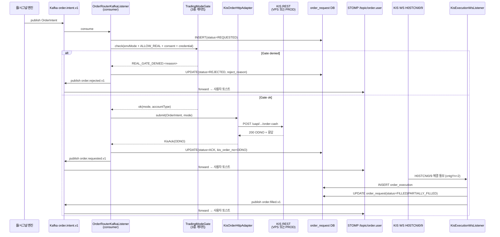
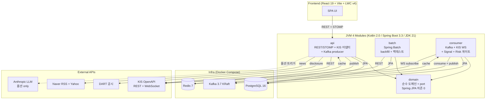
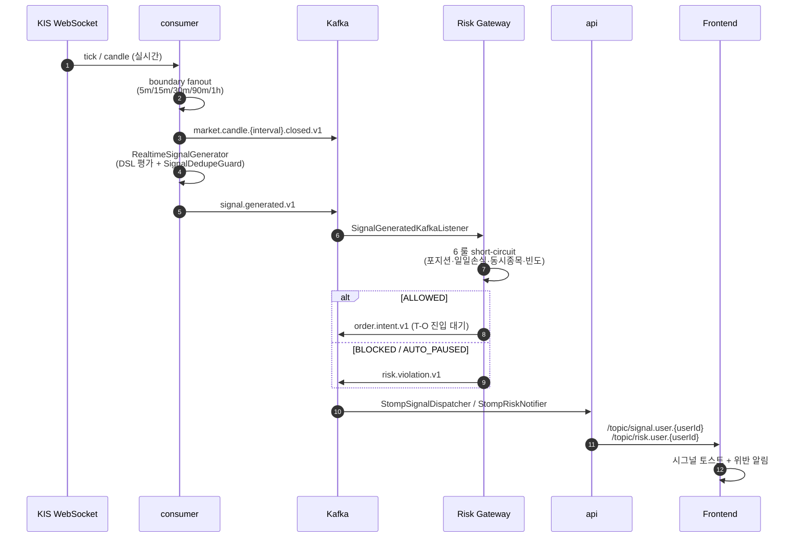
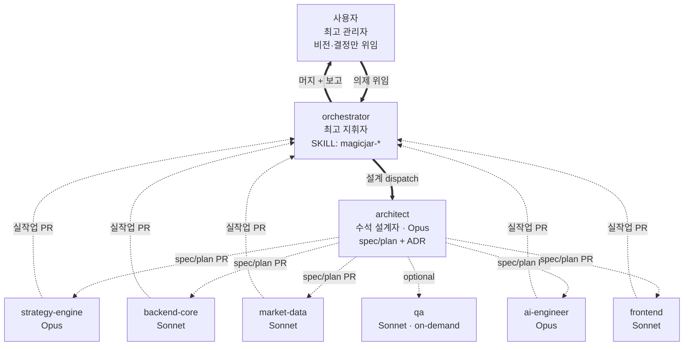

<div align="center">

# magicJar (마법의항아리)

**개인 맞춤형 한국 주식 자동매매 시스템**
_룰 기반 quant trading 본체 + AI 옵션 보조 + MCP 서버 미래 노출_

[](https://github.com/sp-daewoon/magicJar/releases)
[-purple)](https://kotlinlang.org/)
[](https://spring.io/projects/spring-boot)
[](https://react.dev/)
[](https://apiportal.koreainvestment.com/)
[](#license)

</div>

---

## 🪄 magicJar Master Index

> **한눈에 모든 문서·정책·결정·진행 상태**를 진입하는 마스터 시각화 HTML (ADR 0079 권위).

| 진입 방법 | 명령/URL |
|---|---|
| **로컬 (권장)** | `open _workspace/master.html` (브라우저 자동 실행) |
| **온라인 preview** | [htmlpreview.github.io](https://htmlpreview.github.io/?https://github.com/sp-daewoon/magicJar/blob/main/_workspace/master.html) (외부 service, 의존성 약함) |
| **수동 갱신** | `/master-index` slash command 또는 `node scripts/master-index.mjs` |
| **자동 갱신** | 매 release cut 시 `scripts/release.sh`가 자동 호출 (sync-readme-releases 직후) |

12 카테고리 두 축 (📐 권위 = 가이드·정책·ADR·spec·카탈로그·하네스 / 🕐 시계열 = baseline·devlog·release·backlog·task·dashboard) + 상단 banner (현재 release · 사이클 단계 · 다음 마일스톤 · 이번 작업 timeline).

---

## 핵심 가치

> **사용자 = 최고 관리자.** 7 AI 에이전트가 architect 설계 → 실무 sub-agent 병렬 실행 디스패치로 운영되는 magicJar 본체.

1. **룰 기반 quant trading 본체** — 사용자가 정의한 DSL 룰이 KIS WebSocket 실시간 시세에 평가되어 BUY/SELL 시그널 발행 → 리스크 게이트 → 주문 의도. **AI는 매매 결정권 0**, 옵션 분석 코멘트만.
2. **한국투자증권 KIS OpenAPI 단일 출처** — 모의투자(vps) ↔ 실전(prod) dual mode + WebSocket 실시간 시세 + 80개 지표·57개 패턴 카탈로그. 자체 추론 0 의무 (KIS-first 정책, ADR 0053).
3. **3단 hierarchy 자율 운영** — 사용자(최고 관리자) → orchestrator(지휘자) → architect(수석 설계자) → 6 실무 sub-agent 병렬 디스패치. ADR 63건 + baseline 5세대 + devlog 4건으로 추적성 완전 보존.

---

## 🔄 자동매매 흐름 (시그널 → 주문 → 체결)

> **룰/시그널 발행 → 3중 안전 게이트 → KIS REST 주문 → KIS WS 체결 통보 → 사용자 STOMP push**. ADR 0068(T-O) §14 LOCK. 자동매매(AUTO) + 사용자 수동 주문(MANUAL, T-MAN)도 동일 path 재사용 — 차이는 OrderIntent 발생 위치만(SignalConsumer vs POST /api/orders/manual).



**3중 안전 게이트** (자본 흐름 진입 직전 LOCK):
- `MAGICJAR_MODE` env (MOCK·REAL — 시스템 운영 mode)
- `MAGICJAR_ALLOW_REAL` env (REAL 진입 이중 게이트)
- `user_account.real_trading_consent_at` (사용자 명시 동의 시각)

→ 3 조건 모두 통과 시만 KIS PROD endpoint 호출. dev/staging은 항상 MOCK + VPS endpoint. 하나라도 미통과 시 `REAL_GATE_DENIED:<reason>` reject + audit 영속.

---

## Quick Start (5분 안에 첫 차트)

### 사전 요구사항

- **JDK 21** (Gradle wrapper 내장)
- **Docker** + **Docker Compose** v2
- **KIS OpenAPI 키** — [한국투자증권 API 포털](https://apiportal.koreainvestment.com/) 가입 후 prod(조회용) + vps(주문용) 2쌍 발급
- (옵션) **Anthropic API 키** — AI 분석 보조 활성화 시

### 3 명령으로 기동

```bash
# 1. 환경 변수 (KIS 키 필수)
cp .env.example .env
$EDITOR .env

# 2. Gradle bootJar + Docker compose up (7 컨테이너 = 인프라 3 + 앱 4)
scripts/build-and-deploy.sh

# 3. 접속
open http://localhost:3000
```

### 접근 URL

| URL | 설명 |
|-----|------|
| http://localhost:3000 | **Frontend SPA** — 첫 dogfooding 진입점 |
| http://localhost:8080/swagger-ui.html | REST API 문서 (Swagger UI) |
| http://localhost:8080/actuator/health | api 헬스체크 |
| http://localhost:8090 | Kafka UI (디버깅) |
| http://localhost:8888 | Dozzle (전 컨테이너 로그) |

### 첫 dogfooding 시나리오

1. **⚙️ Settings 모달** → KIS 키 입력 (DB AES 암호화 저장, [`project_kis_key_management.md`](docs/architecture/policies/) 정합)
2. **/strategy/list** → DSL 룰 활성화 (status: `ACTIVE`)
3. **boundary 마감 시점** (5m / 15m / 30m / 90m / 1h) → STOMP 시그널 토스트 도착
4. **리스크 게이트** 통과 시 → `order.intent.v1` Kafka 발행 → T-O 트랙 진입 대기

### 개발 모드 (IDE bootRun + Infra 컨테이너)

```bash
# 인프라(postgres·kafka·redis)만 컨테이너
docker compose -f docker/docker-compose.infra.yml up -d

# IDE에서 :api:bootRun · :batch:bootRun · :consumer:bootRun 직접 실행
cd frontend && pnpm install && pnpm dev   # 포트 5173
```

---

## Architecture

### 시스템 전경 — 4 JVM 모듈 + 외부 4 통합



### E2E 데이터 흐름 — 시세 → 시그널 → 리스크 → 주문



### 기술 스택 매트릭스

| 영역 | 기술 | 버전 |
|------|------|------|
| **언어** | Kotlin (K2) · TypeScript | 2.0 · 5.x |
| **Backend** | Spring Boot · Spring AI · Spring Batch · Gradle KTS | 3.3 · 8.5 |
| **Frontend** | React · Vite · Tailwind CSS · LWC v4 (TradingView Lightweight Charts) · pnpm | 19 · 6 · 3 · 4 · 9 |
| **DB / Messaging / Cache** | PostgreSQL · Kafka KRaft · Redis | 16 · 3.7 · 7 |
| **외부 API** | KIS OpenAPI (prod + vps) · DART · Yahoo Finance · Naver RSS · Anthropic | — |
| **배포** | Docker Compose 7 컨테이너 (인프라 3 + 앱 4) | — |
| **개발 도구** | husky pre-commit/pre-push · task.mjs CLI · ktlint | — |

### 운영 정책 한 줄 인용

- **default profile**: `dev,real-kis` — mock 부팅 path 폐기 (ADR 0044)
- **실계좌 이중 게이트**: `MAGICJAR_MODE=REAL` + `MAGICJAR_ALLOW_REAL=true` 둘 다여야 실주문
- **AI 호출 0 본체**: T-DSL · T-IND · T-PAT · T-SIG · T-RISK 트랙 LLM provider import 0건 의무 (ADR 0023 정합)
- **KIS-only data**: 차트·시그널 데이터 소스는 KIS REST/WS 단일 — 합성·mock 금지 (ADR 0053)

---

## Agents & Workflow

### 3단 hierarchy — 사용자 + orchestrator + 7 sub-agent



### 7 sub-agent 매트릭스

| 에이전트 | 모델 | 책임 영역 | 대표 트랙 |
|----------|------|----------|----------|
| **orchestrator** (skill) | — | 사용자 위임 받아 지휘 · 디스패치 매트릭스 · 머지 흐름 통제 · 사이클 archive | 사이클 전체 |
| **architect** | Opus | 시스템 설계 · ADR 발행 · spec/plan · 모듈 경계 · 헌법 갱신 | T-W1 · T-SIG · T-RISK plan |
| **backend-core** | Sonnet | JVM 4 모듈 뼈대 · REST · JPA · Flyway · STOMP · 도메인 어댑터 | API 구현 전반 |
| **market-data** | Sonnet | KIS OpenAPI · Yahoo · DART · Naver · 캔들 영속 · KIS-first 의무 | T-MS1 · T-CA1 · T-IM1 |
| **strategy-engine** | Opus | DSL · 80지표 · 57패턴 · 시그널 · 백테스트 · 리스크 게이트 | T-DSL · T-IND · T-PAT · T-SIG · T-BT · T-RISK |
| **ai-engineer** | Opus | Spring AI · 프롬프트 카탈로그 · LLM 호출 게이트 · MCP 서버 | T-AI · T-MCP |
| **frontend** | Sonnet | React SPA · LWC v4 차트 · Strategy Builder · STOMP 소비 · 토스트 | UI 전반 |
| **qa** | Sonnet | 경계면 교차 검증 (on-demand 7 트리거 조건만) | MAGICJAR_MODE=REAL 진입 시 sunset |

> **모델 차등 근거 (ADR 0035)**: opus = 설계·전략·AI 깊은 추론 영역, sonnet = 구현·통합 영역.

### orchestrator 일대기

사용자가 의제(예: "T-RISK 트랙 진입")를 던지면 orchestrator(SKILL: `magicjar-orchestrator`)가 **지휘봉**을 받는다. 우선 architect에게 spec/plan을 요청해 ADR 발행 + 결정 의제 N건을 사용자에게 위임한다. 사용자가 옵션을 채택하면 orchestrator는 **실제 충돌 행렬 검토 후 적극 병렬 디스패치** ([`feedback_orchestrator_active_parallel.md`](../../.claude/projects/-Users-ak-song-magic-ch1/memory/) 정합) — strategy-engine · backend-core · frontend 3 sub-agent를 background로 동시 발사. 각 sub-agent는 본인 영역만 PR 생성 → orchestrator가 머지 순서·rebase·CHANGELOG slot 정합을 통제하고 사용자에게 PR URL + evidence를 보고한다.

### 운영 헌법 7 § ([`_workspace/arch/agent-charter.md`](_workspace/arch/agent-charter.md))

| § | 룰 | 핵심 |
|---|-----|------|
| **§1** | task.mjs 4단계 의무 | `start` → `check` (결과물마다) → `done` (PR 후) → `archive` (orchestrator만) |
| **§2** | 머지 후 정리 4단계 | main pull → task archive → worktree 제거 → agent/* 로컬 브랜치 삭제 |
| **§3** | KIS-first raw fetch | 자체 추론 0 + 공식 출처 raw fetch 의무 (단일 권위: `docs/architecture/policies/`) |
| **§4** | CHANGELOG 슬롯 채번 | spec PR diff에 sub-agent별 row + anchor 사전 prepend, 본인 row만 in-place edit |
| **§5** | PR 직전 rebase | `git fetch origin main && git rebase origin/main` 의무, 머지 정책 `--rebase` (squash 금지) |
| **§6** | JPA Repository default fun 금지 | body 가진 fun이 query inference에 걸려 부팅 실패 (ADR 0051) |
| **§7** | sub-agent fail 분기 | 재디스패치 OR 자율 진행 둘 중 하나만, 동시 진행 금지 |

### 진화 — 5 baseline (v3.1.0 → v3.5.0)

| 버전 | 마감 미러스톤 | 핵심 트랙 / ADR |
|------|--------------|------------------|
| **v3.1.0** | W1 풀세트 (시세 영속 인프라) | T-W1 · T-S1 · T-MS1 · T-IM1 · T-CA1 |
| **v3.2.0** | W2 4 트랙 (DSL 매칭 본체) | T-IND (80지표) · T-DSL · T-PAT (57패턴) · T-SB |
| **v3.2.2** | NXT 통합거래 + 5종 합산 | ADR 0062 · 0063 |
| **v3.3.0** | boundary fanout 실시간 합산 | ADR 0064 (5m/15m/30m/90m/1h fanout) |
| **v3.4.0** | T-SIG 가동 본체 (매매 결정 노드) | ADR 0066 — DSL 평가 → Kafka `signal.generated.v1` → STOMP |
| **v3.5.0** ★ 현재 | T-RISK 리스크 관리 게이트 | ADR 0067 — 6 룰 short-circuit → `order.intent.v1` |

> Wave 로드맵: **W1**(인프라) → **W2**(매칭 본체) → **W3**(시그널·리스크·주문) → **W4**(AI·MCP) → **W5**(LWC·러닝). 전체 [`docs/architecture/tracks-roadmap.md`](docs/architecture/tracks-roadmap.md).

---

## Documentation

### md 관리 4 매트릭스

| 자원 | 위치 | 갱신 주기 | 관리자 | 현재 규모 |
|------|------|----------|--------|----------|
| **ADR** (Architecture Decision Records) | [`_workspace/arch/adr/`](_workspace/arch/adr/) | 의제마다 발행 | architect 단독 | **63건** (0001 ~ 0067, sequential) |
| **baseline snapshot** | [`_workspace/baseline/v<X.Y.Z>/`](_workspace/baseline/) | minor release | 4 sub-agent 병렬 | **5세대** (v3.1.0 · v3.2.0 · v3.2.2 · v3.3.0 · v3.4.0) + html |
| **devlog** (HTML 일일) | [`_workspace/devlog/`](_workspace/devlog/) | 매일 (사용자 `/devlog`) | 사용자 호출 → Claude 작성 | **4 HTML** + index |
| **사용자 메모리** | `~/.claude/projects/.../memory/` | 자율 (Claude 누적) | Claude 자동 | **27건** (feedback + project + reference) |

### 단일 진실원 (SoT)

- **★ 단일 진입점**: [`_workspace/INDEX.md`](_workspace/INDEX.md) — 의도별 진입 경로 (현행 규약 / 결정 이력 / 진행 중 / snapshot / task)
- **★ 현행 권위 정책 (Living Policy)**: [`docs/architecture/policies/`](docs/architecture/policies/) — "지금 무엇이 권위인가"의 단일 위치 (ADR 0053)
- **마스터 아키텍처**: [`docs/architecture/master-architecture.md`](docs/architecture/master-architecture.md) (ADR 0030 SoT)
- **트랙 로드맵**: [`docs/architecture/tracks-roadmap.md`](docs/architecture/tracks-roadmap.md) (W1 ~ W5)
- **개발 룰북**: [`docs/architecture/development-rules.md`](docs/architecture/development-rules.md) (개발 룰 5건)
- **코드 컨벤션**: [`docs/architecture/code-convention.md`](docs/architecture/code-convention.md)
- **외부 API 정책**: [`docs/architecture/external-api-policy.md`](docs/architecture/external-api-policy.md) (KIS 호출 빈도·토큰)
- **KIS API 레퍼런스**: [`docs/operations/kis-api-reference.md`](docs/operations/kis-api-reference.md)
- **운영 헌법**: [`_workspace/arch/agent-charter.md`](_workspace/arch/agent-charter.md) (7 §)
- **브랜칭 룰**: [`_workspace/arch/branching-rules.md`](_workspace/arch/branching-rules.md)

### 결정 이력 진입 경로 (5 질문 → 5 위치)

| "무엇을 알고 싶은가" | 진입 위치 |
|---------------------|----------|
| 현행 권위는 무엇인가 | [`docs/architecture/policies/README.md`](docs/architecture/policies/) |
| 결정 이력은 무엇인가 | [`_workspace/arch/adr/README.md`](_workspace/arch/adr/) (63건 인덱스) |
| 진행 중 의제는 무엇인가 | [`_workspace/backlog.md`](_workspace/backlog.md) |
| 특정 시점 풀 snapshot은 | [`_workspace/baseline/v3.4.0/README.md`](_workspace/baseline/v3.4.0/) |
| 에이전트 운영 규칙은 | [`_workspace/arch/agent-charter.md`](_workspace/arch/agent-charter.md) |

### 핵심 명령

```bash
# 전체 검증 (4 JVM 모듈)
./gradlew check

# 단일 모듈
./gradlew :api:check
./gradlew :api:bootJar

# 단일 테스트
./gradlew :api:test --tests "kr.spdaewoon.magicjar.SomeTest"

# 린트 (pre-commit이 자동 실행)
./gradlew ktlintCheck
./gradlew ktlintFormat                  # 자동 정정

# 통합 기동
scripts/build-and-deploy.sh             # 전체
scripts/build-and-deploy.sh api-app     # 특정 서비스만

# 통합 스모크 (3 시나리오)
scripts/smoke.sh

# Task 파일 시스템 (헌법 §1 — agent/* 브랜치 작업 시 의무)
node scripts/task.mjs start --agent <a> --goal "..." --deliverables "..."
node scripts/task.mjs check "<항목>"
node scripts/task.mjs done --pr <N>
```

### CI/CD

- **로컬 빌드**: `scripts/build-and-deploy.sh` (Gradle bootJar + Docker compose up)
- **GitHub Actions**: 폐기 (ADR 0049 Superseded) — `release/v*` 태그 이미지 push만 유지
- **릴리즈**: `v*.*.*` 태그 → release commit + baseline cut + immutable

### 디렉토리 구조

```
.
├── domain/ api/ batch/ consumer/    JVM 4 모듈 (Kotlin 2.0 / Spring Boot 3.3)
├── frontend/                        React 19 + Vite + LWC v4
├── docker/                          docker-compose 3 yml (전체 / 인프라 / 앱)
├── docs/
│   ├── architecture/                마스터 아키텍처 · 코드 컨벤션 · 정책 (Living Policy)
│   └── operations/                  운영 가이드 + KIS API 레퍼런스
├── _workspace/
│   ├── INDEX.md                     ★ 단일 진입점
│   ├── arch/                        ADR (63건) + 운영 헌법 + 브랜칭 룰
│   ├── baseline/                    5 세대 immutable snapshot
│   ├── devlog/                      일일 작업로그 HTML
│   ├── backlog.md                   진행 중 의제
│   ├── tasks/                       task.mjs 4단계 산출물
│   ├── specs/                       spec/plan PR 본문
│   ├── strategy/                    지표·패턴 카탈로그 (80 + 57)
│   ├── market-data/                 KIS 엔드포인트 매핑
│   └── ai/                          AI 프롬프트 카탈로그
├── scripts/                         CLI 도구 (task · smoke · build-and-deploy)
├── .claude/                         하네스 (agents · skills · hooks · commands)
└── .husky/                          git hooks (pre-commit · pre-push)
```

---

## 📦 Releases & Baseline 진화

GitHub 방문자가 한 번에 진입할 수 있도록 release notes(📋) + baseline html(📊) 2 컬럼 매트릭스. 매 release/baseline 발행 시 `scripts/sync-readme-releases.mjs`가 자동 갱신 (ADR 0052 §X 정합).

<!-- releases-table:start -->

| 버전 | 날짜 | 미러스톤 | Release | Baseline |
|------|------|----------|---------|----------|
| **v3.6.19** | 2026-05-19 | (검토) | [📋](https://github.com/sp-daewoon/magicJar/releases/tag/v3.6.19) | [📊](_workspace/baseline/v3.6.0/html/index.html) |
| **v3.6.18** | 2026-05-19 | (검토) | [📋](https://github.com/sp-daewoon/magicJar/releases/tag/v3.6.18) | [📊](_workspace/baseline/v3.6.0/html/index.html) |
| **v3.6.17** | 2026-05-19 | (검토) | [📋](https://github.com/sp-daewoon/magicJar/releases/tag/v3.6.17) | [📊](_workspace/baseline/v3.6.0/html/index.html) |
| **v3.6.16** | 2026-05-18 | (검토) | [📋](https://github.com/sp-daewoon/magicJar/releases/tag/v3.6.16) | [📊](_workspace/baseline/v3.6.0/html/index.html) |
| **v3.6.13** | 2026-05-18 | (검토) | [📋](https://github.com/sp-daewoon/magicJar/releases/tag/v3.6.13) | [📊](_workspace/baseline/v3.6.0/html/index.html) |
| **v3.6.12** | 2026-05-18 | (검토) | [📋](https://github.com/sp-daewoon/magicJar/releases/tag/v3.6.12) | [📊](_workspace/baseline/v3.6.0/html/index.html) |
| **v3.6.11** | 2026-05-17 | (검토) | [📋](https://github.com/sp-daewoon/magicJar/releases/tag/v3.6.11) | [📊](_workspace/baseline/v3.6.0/html/index.html) |
| **v3.6.10** | 2026-05-17 | (검토) | [📋](https://github.com/sp-daewoon/magicJar/releases/tag/v3.6.10) | [📊](_workspace/baseline/v3.6.0/html/index.html) |
| **v3.6.9** | 2026-05-15 | (검토) | [📋](https://github.com/sp-daewoon/magicJar/releases/tag/v3.6.9) | [📊](_workspace/baseline/v3.6.0/html/index.html) |
| **v3.6.8** | 2026-05-15 | (검토) | [📋](https://github.com/sp-daewoon/magicJar/releases/tag/v3.6.8) | [📊](_workspace/baseline/v3.6.0/html/index.html) |
| **v3.6.7** | 2026-05-15 | (검토) | [📋](https://github.com/sp-daewoon/magicJar/releases/tag/v3.6.7) | [📊](_workspace/baseline/v3.6.0/html/index.html) |
| **v3.6.6** | 2026-05-15 | (검토) | [📋](https://github.com/sp-daewoon/magicJar/releases/tag/v3.6.6) | [📊](_workspace/baseline/v3.6.0/html/index.html) |
| **v3.6.5** | 2026-05-15 | (검토) | [📋](https://github.com/sp-daewoon/magicJar/releases/tag/v3.6.5) | [📊](_workspace/baseline/v3.6.0/html/index.html) |
| **v3.6.4** | 2026-05-14 | (검토) | [📋](https://github.com/sp-daewoon/magicJar/releases/tag/v3.6.4) | [📊](_workspace/baseline/v3.6.0/html/index.html) |
| **v3.6.3** | 2026-05-14 | (검토) | [📋](https://github.com/sp-daewoon/magicJar/releases/tag/v3.6.3) | [📊](_workspace/baseline/v3.6.0/html/index.html) |
| **v3.6.2** | 2026-05-14 | (검토) | [📋](https://github.com/sp-daewoon/magicJar/releases/tag/v3.6.2) | [📊](_workspace/baseline/v3.6.0/html/index.html) |
| **v3.6.1** | 2026-05-13 | (검토) | [📋](https://github.com/sp-daewoon/magicJar/releases/tag/v3.6.1) | [📊](_workspace/baseline/v3.6.0/html/index.html) |
| **v3.6.0** | 2026-05-13 | T-O W3 네 번째 트랙 마감 미러스톤 | [📋](https://github.com/sp-daewoon/magicJar/releases/tag/v3.6.0) | [📊](_workspace/baseline/v3.6.0/html/index.html) |
| **v3.5.0** | 2026-05-12 | T-RISK W3 세 번째 트랙 마감 미러스톤 | [📋](https://github.com/sp-daewoon/magicJar/releases/tag/v3.5.0) | [📊](_workspace/baseline/v3.5.0/html/index.html) |
| **v3.4.0** | 2026-05-12 | T-SIG W3 두 번째 트랙 마감 미러스톤 | [📋](https://github.com/sp-daewoon/magicJar/releases/tag/v3.4.0) | [📊](_workspace/baseline/v3.4.0/html/index.html) |
| **v3.3.1** | 2026-05-12 | T-BT W3 트랙 마감 | [📋](https://github.com/sp-daewoon/magicJar/releases/tag/v3.3.1) | [📊](_workspace/baseline/v3.3.0/html/index.html) |
| **v3.3.0** | 2026-05-12 | 실시간 boundary fanout 미러스톤 | [📋](https://github.com/sp-daewoon/magicJar/releases/tag/v3.3.0) | [📊](_workspace/baseline/v3.3.0/html/index.html) |
| **v3.2.3** | 2026-05-11 | ADR 0019·0028·0029 §2 매트릭스 NXT/합산 5종 보강 + KIS 500 retry 3회 exponential backoff | [📋](https://github.com/sp-daewoon/magicJar/releases/tag/v3.2.3) | [📊](_workspace/baseline/v3.2.0/html/index.html) |
| **v3.2.2** | 2026-05-11 | KIS-only 데이터 정책 + NXT/통합거래 cover + 분봉 합산 가공 트랙 가동 | [📋](https://github.com/sp-daewoon/magicJar/releases/tag/v3.2.2) | [📊](_workspace/baseline/v3.2.0/html/index.html) |
| **v3.2.1** | 2026-05-11 | (검토) | [📋](https://github.com/sp-daewoon/magicJar/releases/tag/v3.2.1) | [📊](_workspace/baseline/v3.2.0/html/index.html) |
| **v3.1.1** | 2026-05-08 | (검토) | [📋](https://github.com/sp-daewoon/magicJar/releases/tag/v3.1.1) | [📊](_workspace/baseline/v3.1.0/html/index.html) |
| **v3.1.0** | 2026-05-08 | (검토) | [📋](https://github.com/sp-daewoon/magicJar/releases/tag/v3.1.0) | [📊](_workspace/baseline/v3.1.0/html/index.html) |
| **v3.0.1** | 2026-05-07 | (검토) | [📋](https://github.com/sp-daewoon/magicJar/releases/tag/v3.0.1) | — |
| **v3.0.0** | 2026-05-06 | (검토) | [📋](https://github.com/sp-daewoon/magicJar/releases/tag/v3.0.0) | — |
| **v2.9.9** | 2026-05-06 | (검토) | [📋](https://github.com/sp-daewoon/magicJar/releases/tag/v2.9.9) | — |
| **v2.0.1** | 2026-05-05 | (검토) | [📋](https://github.com/sp-daewoon/magicJar/releases/tag/v2.0.1) | — |
| **v2.0.0** | 2026-05-04 | (검토) | [📋](https://github.com/sp-daewoon/magicJar/releases/tag/v2.0.0) | — |
| **v1.0.1** | 2026-05-01 | (검토) | [📋](https://github.com/sp-daewoon/magicJar/releases/tag/v1.0.1) | — |
| **v0.1.0** | 2026-04-29 | (검토) | [📋](https://github.com/sp-daewoon/magicJar/releases/tag/v0.1.0) | — |

<!-- releases-table:end -->

- **📋 Release**: 풍부한 release notes (Hero · PR 시계열 · 신규 ADR · 운영 영향 · baseline 링크 · dogfooding 가이드 — ADR 0052 §X)
- **📊 Baseline**: 7 파일 풀세트 (README + 01 architecture + 02 data-flow + 03 use-sequences + 04 feature-spec + 05 ui-inventory + 06 history + 07 policy) + Mermaid 시각화 HTML

전체 변경 이력은 [CHANGELOG.md](CHANGELOG.md) · 결정 이력은 [ADR 인덱스](_workspace/arch/adr/) 참조.

---

## License

TBD (Private) — `sp-daewoon/magicJar` repository

---

<div align="center">

**magicJar** — 룰이 본체, AI가 보조, 사용자가 최고 관리자.

[CHANGELOG](CHANGELOG.md) · [ADR 인덱스](_workspace/arch/adr/) · [마스터 아키텍처](docs/architecture/master-architecture.md) · [v3.5.0 baseline](_workspace/baseline/v3.5.0/html/index.html)

</div>
