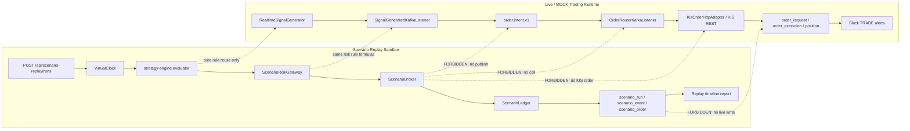

# ADR 0107 — Scenario Replay Sandbox (실주문 경로와 분리된 전략 QA 리플레이)

- 상태: Accepted
- 작성일: 2026-06-03 KST
- 결정자: 사용자(최고 관리자) + Codex direction guard
- 관계:
  - ADR 0047 DSL Evaluation Sandbox
  - ADR 0056 Backtest Engine Architecture
  - ADR 0066 T-SIG 실시간 시그널 엔진
  - ADR 0067 T-RISK 리스크 관리
  - ADR 0068 T-O 주문 실행
  - ADR 0105 캔들 Reconciliation + data readiness fail-closed
  - ADR 0037 KIS API Rate Limit
  - ADR 0102 spec/plan 발행 시 main 영속 자원 audit

---

## 1. 컨텍스트

장중이 아니면 자동매매 전략을 실제 흐름처럼 검증하기 어렵다. 기존 백테스트는 과거 성과 계산에는 충분하지만, 사용자가 확인하고 싶은 것은 다음에 더 가깝다.

1. 특정 시점부터 분봉을 다시 흘려 보냈을 때 어떤 전략이 BUY/SELL 시그널을 냈는가
2. 그 시그널이 어떤 리스크 룰에서 허용 또는 차단됐는가
3. 주문을 냈다고 가정하면 어떤 체결/거절/보류 이벤트가 발생했는가
4. KIS 잔고 조회 실패, rate limit, 장종료, 데이터 부족 같은 오류가 사용자에게 어떤 메시지로 보이는가

하지만 이 기능은 실전 주문 경로와 조금이라도 섞이면 안 된다. 특히 다음 경로에 닿으면 사고 범위가 자본으로 확장된다.

- Kafka `order.intent.v1`
- `OrderRouterKafkaListener`
- `KisOrderHttpAdapter`
- `KisOrderPort`
- KIS REST 주문 TR `TTTC0012U`, `TTTC0011U`, `VTTC0012U`, `VTTC0011U`
- live 테이블 `order_request`, `order_execution`, `risk_event`, `position`
- Slack TRADE 알림 `order.filled.v1`, `order.rejected.v1`

따라서 새 기능은 "실전과 같은 시나리오"를 쓰되 "실전과 같은 side effect"는 절대 쓰지 않는 별도 QA 런타임이어야 한다.

---

## 2. 결정

### 2-1. 새 트랙 `T-SIM`을 추가한다

트랙 이름은 **Scenario Replay Sandbox**이며 약어는 `T-SIM`이다.

목표는 전략 QA다. 사용자는 과거 KIS candle을 virtual clock으로 재생하면서 전략 신호, 리스크 판단, 가상 주문, 가상 체결, 오류 이벤트를 한 run 안에서 순서대로 확인한다.

### 2-2. 실주문 경로는 재사용하지 않는다

리플레이는 다음 컴포넌트를 직접 호출하거나 import하지 않는다.

| 금지 영역 | 금지 대상 | 사유 |
|---|---|---|
| live 주문 Kafka | `order.intent.v1` | consumer 주문 라우터 진입점 |
| live 주문 consumer | `OrderRouterKafkaListener` | KIS 주문 발행 전 단계 |
| KIS 주문 adapter | `KisOrderHttpAdapter`, `KisOrderPort` | 실제/모의 KIS 주문 API 호출 가능 |
| 체결 listener | `KisExecutionWsListener` | live 체결 영속 및 알림 경로 |
| live 주문 DB | `order_request`, `order_execution`, `order_audit_event` | 실제 주문 audit와 혼합 위험 |
| live 리스크 DB | `risk_event`, `position` | 운영 리스크/포지션 혼합 위험 |
| live 알림 | `order.filled.v1`, `order.rejected.v1`, `risk.violation.v1` publish | Slack TRADE/P0 알림 혼선 |

리플레이가 주문 의도를 만들더라도 그 의도는 `ScenarioOrderIntent`이며 `OrderIntent`가 아니다.

### 2-3. 순수 계산 컴포넌트만 재사용한다

재사용 허용 범위는 아래로 제한한다.

| 허용 | 재사용 방식 |
|---|---|
| Strategy DSL parser/evaluator | `strategy-engine` evaluator를 virtual candle slice로 호출 |
| Indicator/pattern 계산 | 기존 `indicator-impl`, `pattern-engine` 순수 계산 재사용 |
| Backtest cost model | 세금·수수료·슬리피지 모델은 복사하지 않고 registry 재사용 가능 |
| Risk rule 계산 | `RiskGatewayEvaluator`의 deterministic rule은 재사용하되 context는 `ScenarioLedger`에서 생성 |
| Candle read | DB candle read-only 조회. KIS 실시간 fetch는 하지 않음 |
| data readiness 판단 | ADR 0105 상태를 읽거나 replay 내부 `DATA_NOT_READY` 이벤트로 변환 |

핵심은 "같은 룰"을 쓰되 "같은 side-effect adapter"를 쓰지 않는 것이다.

### 2-4. 리플레이 영속은 `scenario_*` namespace만 사용한다

향후 구현 시 영속 테이블은 아래 prefix만 허용한다.

| 테이블 | 역할 |
|---|---|
| `scenario_run` | 실행 메타, 전략, 기간, interval, 시작 자본, 상태 |
| `scenario_event` | virtual time 순서의 signal/risk/order/error 타임라인 |
| `scenario_order` | 가상 주문 요청/보류/거절 상태 |
| `scenario_execution` | 가상 체결 |
| `scenario_position` | run 내부 포지션 스냅샷 |

live 테이블에는 INSERT/UPDATE/DELETE 금지다. `order_request`, `order_execution`, `risk_event`, `position`, `trading_journal`, `performance_summary`는 읽기도 최소화하고, 리플레이 v1에서는 쓰지 않는다.

### 2-5. Kafka는 v1에서 쓰지 않는다

v1 리플레이는 API 요청 안에서 synchronous run 또는 background job으로만 동작한다. Kafka publish/listen은 쓰지 않는다.

후속에서 진행률 stream이 필요하면 live 토픽이 아니라 다음 prefix만 허용한다.

- `scenario.run.started.v1`
- `scenario.event.v1`
- `scenario.run.completed.v1`

`order.*`, `risk.*`, `signal.generated.v1` publish는 금지다.

### 2-6. Fill model은 보수적으로 둔다

가상 체결 기본값은 다음 규칙이다.

| 상황 | v1 기본 |
|---|---|
| 시장가 BUY/SELL | 다음 candle open 체결 |
| 지정가 BUY | 다음 candle low <= limitPrice 이면 limitPrice 체결 |
| 지정가 SELL | 다음 candle high >= limitPrice 이면 limitPrice 체결 |
| stop-loss/take-profit 동시 터치 | 보수적으로 stop-loss 우선 |
| candle gap/데이터 부족 | `DATA_NOT_READY` 또는 `FILL_NOT_DECIDABLE` 이벤트로 보류 |

분봉 OHLC만으로 intrabar 순서는 알 수 없으므로, 수익에 유리한 추론은 금지한다.

### 2-7. 장애도 시나리오 이벤트로 재현한다

리플레이에서 rate limit, KIS 잔고조회 실패, 장종료 같은 이벤트는 실제 KIS를 호출해 만들지 않는다. run request에 fault injection으로 지정하거나 과거 운영 로그를 import해 재현한다.

| 장애 | 리플레이 표현 |
|---|---|
| KIS 잔고 조회 rate limit | `BALANCE_LOOKUP_RATE_LIMITED` |
| 잔고 조회 재시도 후 실패 | `BALANCE_LOOKUP_FAILED_ORDER_HELD` |
| 장종료 주문 거절 | `SIM_ORDER_REJECTED_MARKET_CLOSED` |
| data readiness 실패 | `DATA_NOT_READY_SIGNAL_SKIPPED` |
| strategy timeout | `STRATEGY_TIMEOUT_SIGNAL_SKIPPED` |

"잔고 조회 실패"를 "매도 주문 실패"로 보이지 않게 하는 것이 acceptance 조건이다.

---

## 3. 격리 다이어그램

---

## 4. 구현 게이트

리플레이 구현 PR은 아래 검증을 통과해야 한다.

1. `rg "order.intent.v1|KisOrderHttpAdapter|KisOrderPort|OrderRouterKafkaListener|order_request|order_execution|risk_event" api/src/main/kotlin/kr/spdaewoon/magicjar/api/scenario domain/src/main/kotlin/kr/spdaewoon/magicjar/domain/scenario` 결과가 허용된 KDoc 인용 외 0건
2. scenario package에서 `consumer.*` import 0건
3. scenario package에서 `KafkaTemplate` import 0건
4. scenario persistence는 `scenario_*` 테이블만 사용
5. replay endpoint는 `MAGICJAR_SCENARIO_REPLAY_ENABLED=true`일 때만 열림
6. 실제 KIS 주문 TR_ID 문자열 `TTTC0012U`, `TTTC0011U`, `VTTC0012U`, `VTTC0011U`가 scenario 구현 코드에 없음
7. 실패 메시지에 "실제 주문 실패" 표현 금지. 가상 주문/리플레이 이벤트로 명확히 표기

---

## 5. 단계

| 단계 | 범위 | 자본 영향 |
|---|---|---|
| Phase 0 | 본 ADR + policy + spec + v3.11.0 baseline | 0 |
| Phase 1 | domain `scenario` 모델 + pure engine skeleton + forbidden import test | 0 |
| Phase 2 | `scenario_*` Flyway + repository + run API | 0 |
| Phase 3 | UI `/qa/scenario-replay` timeline + report | 0 |
| Phase 4 | optional `scenario.*` progress stream | 0 |

Phase 1부터도 live order package 수정은 금지한다. 필요한 공통 타입은 domain에 새로 만들고, live `OrderIntent`를 끌어다 쓰지 않는다.

---

## 6. 결과

장중이 아니어도 사용자는 실제 투자와 같은 전략 조건을 과거 candle 위에서 재생하고, 어떤 전략이 왜 매수/매도 신호를 냈는지, 어떤 리스크 룰이 막았는지, 가상 주문이 어떤 이유로 체결/거절/보류됐는지 한 화면에서 확인할 수 있다.

동시에 live 주문 경로와 DB/Kafka/Slack이 분리되므로, 리플레이 오류가 실주문·모의주문·운영 알림으로 번지지 않는다.

---

## 7. 변경 이력

| 날짜 | 변경 |
|---|---|
| 2026-06-03 | ADR 0107 신설. v3.11.0 baseline 이후 시나리오 리플레이는 `T-SIM` 격리 트랙으로 진행하고, live 주문 경로·KIS 주문 adapter·live Kafka topic·live 주문/리스크 테이블 접근을 금지한다. |
