# 02 — 모듈별 데이터 흐름 (v3.1.0)

> 기준: 2026-05-08 (W1 마감, v3.1.0 베이스라인 컷)
> 인용 원칙: 코드 path + 실제 grep 결과에서만 기술. 추측 0건.

---

## §1 데이터 영역 4단계 개관

`docs/architecture/master-architecture.md` §2 정의 — A·B·C·D 4영역 19컴포넌트.

| 영역 | 설명 | v3.1.0 구현 상태 |
|------|------|-----------------|
| **A 데이터** | 시장 데이터 수집·저장 (KIS WS, REST, Yahoo, DB, Redis) | **구현** — T-W2, T-IM1, T-CA1, T-MS1 |
| **B 분석·전략** | 지표 계산, 패턴 인식, 백테스트, 시그널 생성 | **미구현** — W2 T-IND·T-PAT·T-BT 예정 |
| **C 의사결정·실행** | 주문 생성, 리스크 가드, KIS 주문 API 전송 | **포트/도메인만** — T-O (W3 예정) |
| **D 운영** | 감사 로그, kill-switch, 알림, 모니터링 | **부분 구현** — audit_trail·kill_switch_state·notification_outbox 테이블 존재, 처리 로직 W3 예정 |

---

## §2 api 모듈 데이터 흐름

### 2-1 모듈 역할

`api/src/main/kotlin/kr/spdaewoon/magicjar/api/` — REST/STOMP 진입점 + 외부 어댑터(KIS REST) + Kafka producer.

주요 파일:
- `controller/WatchlistController.kt` — GET/POST/DELETE `/api/watchlists`
- `controller/OnboardingController.kt` — GET/POST `/api/onboarding/**`
- `controller/SymbolController.kt` — GET/POST `/api/symbols/**`
- `controller/InstrumentController.kt` — GET/POST `/api/instruments/**`
- `service/WatchlistService.kt` — Kafka `watchlist.changed.v1` producer
- `service/OnboardingService.kt` — AES-256-GCM 암호화, UserOnboardedEvent 발행
- `service/CandleQueryService.kt` — Redis + DB 합류 캔들 조회
- `service/InstrumentSearchService.kt` — Redis sorted set + DB LIKE fallback

### 2-2 REST 요청 → DB 흐름 (Watchlist 등록 예시)

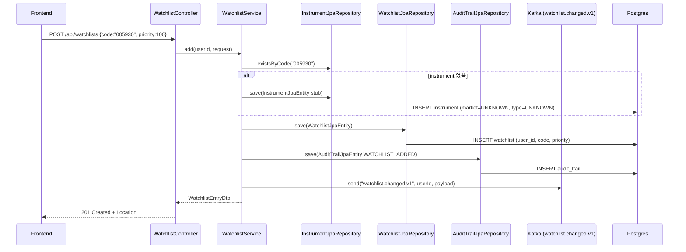

소스: `api/src/main/kotlin/kr/spdaewoon/magicjar/api/service/WatchlistService.kt:101-141`

### 2-3 캔들 조회 흐름

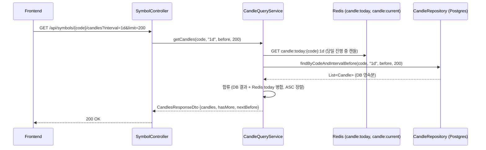

소스: `api/src/main/kotlin/kr/spdaewoon/magicjar/api/controller/SymbolController.kt:113-132`

### 2-4 종목 검색 흐름

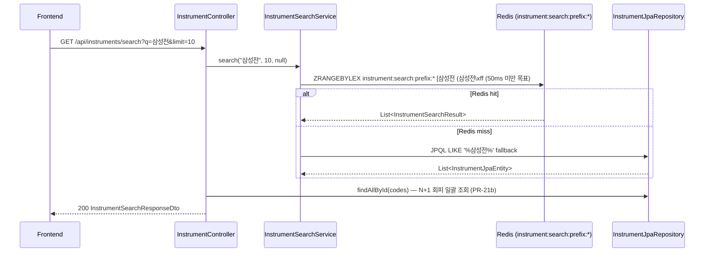

소스: `api/src/main/kotlin/kr/spdaewoon/magicjar/api/controller/InstrumentController.kt:70-115`

### 2-5 호가 구독 명령 흐름 (STOMP fanout)

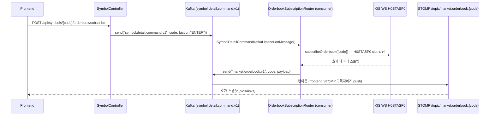

소스: `api/src/main/kotlin/kr/spdaewoon/magicjar/api/controller/SymbolController.kt:145-173`

---

## §3 batch 모듈 데이터 흐름

### 3-1 모듈 역할

`batch/src/main/kotlin/kr/spdaewoon/magicjar/batch/` — Spring Batch 잡 (Spring Batch 프레임워크 미사용, @Component + @Scheduled 기반).

4 잡 + 2 bootstrap runner:
- `job/instrument/InstrumentSyncJob.kt` — T-IM1 KIS 종목마스터 동기화
- `job/marketcalendar/MarketCalendarSyncJob.kt` — T-MS1 KRX 영업일 캘린더
- `job/corp_action/CorpActionSyncJob.kt` — T-CA1 기업행위 sync
- `job/corp_action/CandleAdjustmentJob.kt` — T-CA1 캔들 수정주가 소급 보정
- `bootstrap/InstrumentSeedRunner.kt` — 부팅 시 시드 데이터
- `bootstrap/MarketCalendarSeedRunner.kt` — 부팅 시 캘린더 시드

### 3-2 InstrumentSyncJob 흐름

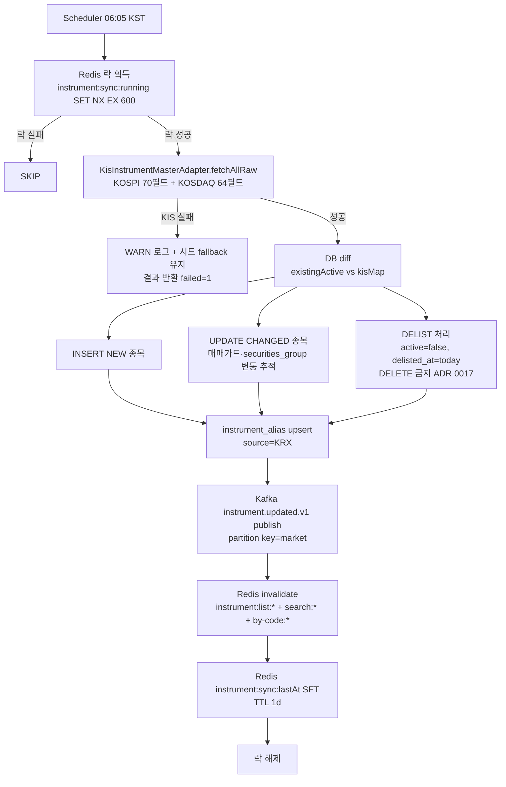

소스: `batch/src/main/kotlin/kr/spdaewoon/magicjar/batch/job/instrument/InstrumentSyncJob.kt:66-236`

### 3-3 MarketCalendarSyncJob 흐름

| 실행 시점 | 트리거 | 처리 |
|-----------|--------|------|
| 03:00 KST daily | `@Scheduled(cron = "0 0 3 * * *", zone = "Asia/Seoul")` | KIS chk-holiday(CTCA0903R) 호출 → upsert |
| 부팅 직후 | `MarketCalendarSeedRunner @PostConstruct` | 정적 JSON 시드 로드 → upsert |

주의: v3.1.0 시점 KIS credential 조회 미구현 — `sync()` 내부 WARN 로그 + 정적 시드 유지. 본격 연동은 batch credential bean 추가 후.

소스: `batch/src/main/kotlin/kr/spdaewoon/magicjar/batch/job/marketcalendar/MarketCalendarSyncJob.kt:65-91`

### 3-4 CorpActionSyncJob 흐름 (T-CA1)

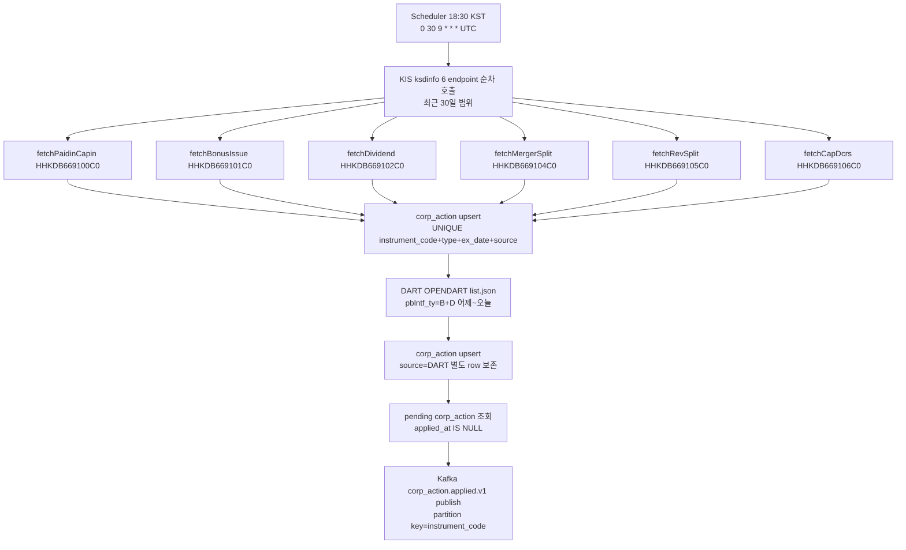

소스: `batch/src/main/kotlin/kr/spdaewoon/magicjar/batch/job/corp_action/CorpActionSyncJob.kt:55-156`

### 3-5 CandleAdjustmentJob 흐름 (T-CA1)

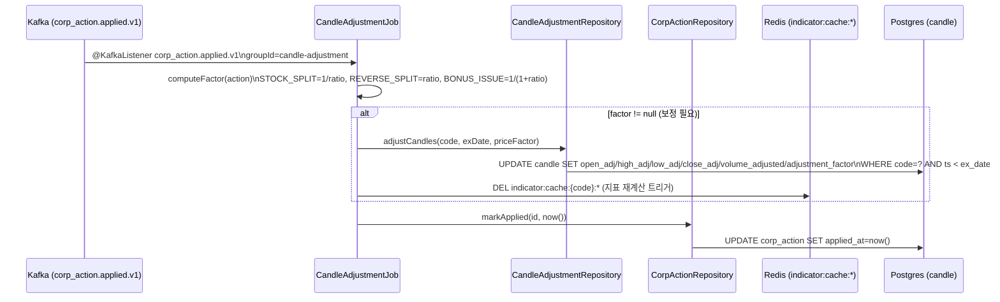

소스: `batch/src/main/kotlin/kr/spdaewoon/magicjar/batch/job/corp_action/CandleAdjustmentJob.kt:62-131`

---

## §4 consumer 모듈 데이터 흐름

### 4-1 모듈 역할

`consumer/src/main/kotlin/kr/spdaewoon/magicjar/consumer/` — Kafka consumer + KIS WS 실시간 + 시그널/주문 dispatch + 구독 관리.

주요 파일:
- `ws/KisWebSocketBridge.kt` — KIS WS H0STCNT0/H0STASP0 연결·재연결·메시지 처리
- `kafka/WatchlistChangedKafkaListener.kt` — `watchlist.changed.v1` consumer
- `kafka/SymbolDetailCommandKafkaListener.kt` — `symbol.detail.command.v1` consumer
- `ingestion/SubscriptionRouter.kt` — WS vs polling 분배 (30 slot 예산)
- `ingestion/WatchlistIngestionWorker.kt` / `WatchlistPollingWorker.kt`
- `application/market/DailyCloseFinalizer.kt` — 16:00 KST 일봉 마감
- `application/market/TickFallbackEmitter.kt` — T2 폴백 10초 주기

### 4-2 KIS WS → Redis → Kafka → STOMP 흐름

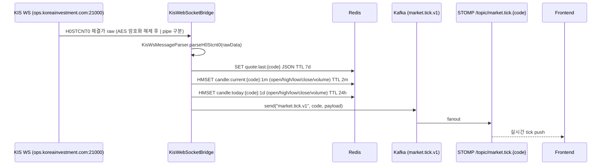

소스: `consumer/src/main/kotlin/kr/spdaewoon/magicjar/consumer/ws/KisWebSocketBridge.kt:285-402`

### 4-3 H0STASP0 호가 흐름

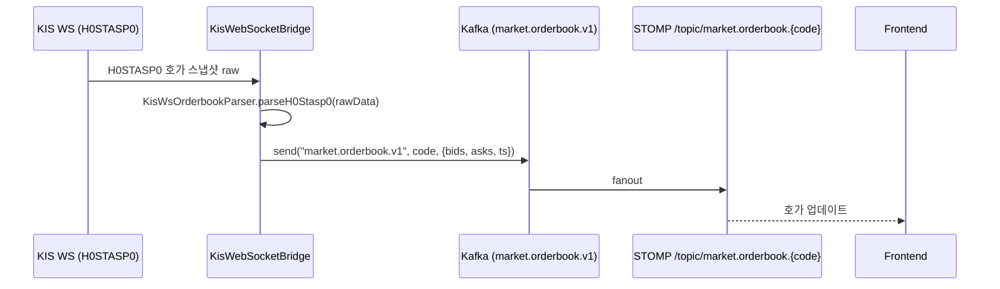

소스: `consumer/src/main/kotlin/kr/spdaewoon/magicjar/consumer/ws/KisWebSocketBridge.kt:265-283`

### 4-4 Watchlist ADDED → cold-start → 구독 흐름

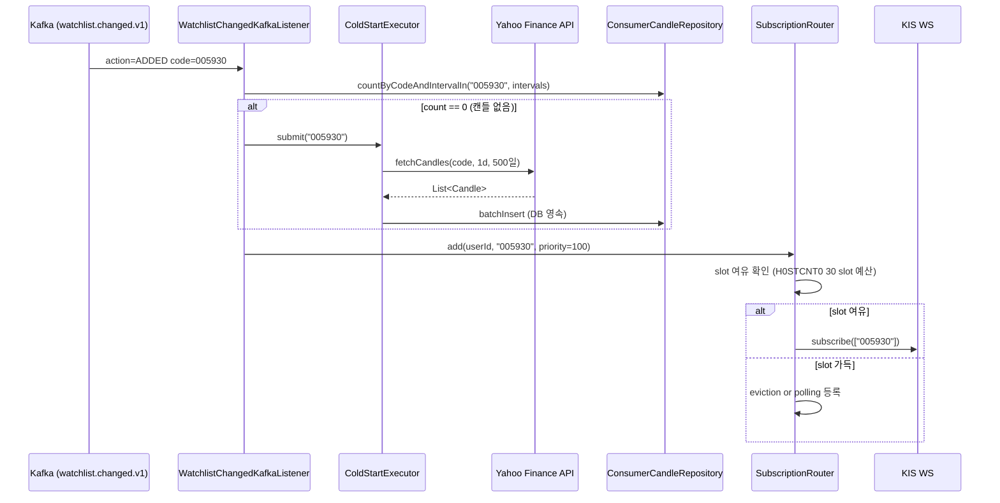

소스: `consumer/src/main/kotlin/kr/spdaewoon/magicjar/consumer/kafka/WatchlistChangedKafkaListener.kt:100-121`

### 4-5 DailyCloseFinalizer 흐름 (T-MS1)

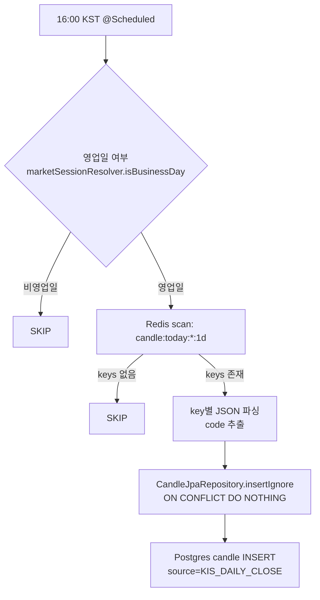

소스: `consumer/src/main/kotlin/kr/spdaewoon/magicjar/consumer/application/market/DailyCloseFinalizer.kt:54-118`

### 4-6 TickFallbackEmitter T2 폴백 흐름

10초 `@Scheduled(fixedDelay = 10_000L)` → session 확인 → Closed이면 SKIP. Regular/Pre/PostMarket이면 구독 종목 순회(v3.1.0 시점 stub — 구독 종목 목록 노출 미완).

소스: `consumer/src/main/kotlin/kr/spdaewoon/magicjar/consumer/application/market/TickFallbackEmitter.kt:48-63`

### 4-7 KIS WS 재연결 지수 백오프 (ADR 0048 §2-4)

| 시도 | 대기 시간 |
|------|-----------|
| 1차 | 즉시 (0ms) |
| 2차 | 2,000ms |
| 3차 | 5,000ms |
| 4차 | 10,000ms |
| 5차+ | 30,000ms |

30초 이상 연속 실패 → polling fallback 활성화.

소스: `consumer/src/main/kotlin/kr/spdaewoon/magicjar/consumer/ws/KisWebSocketBridge.kt:71-72`

---

## §5 domain 모듈 책임

Spring·JPA 의존 0건. 순수 Kotlin data class + interface.

### 5-1 도메인 entity (data class)

| 도메인 | 파일 | 핵심 필드 |
|--------|------|-----------|
| `Candle` | `domain/market/candle/Candle.kt` | code, interval, ts, openRaw, closeRaw, openAdj, closeAdj, adjustmentFactor |
| `TickEvent` | `domain/market/tick/TickEvent.kt` | code, price, volume, ts, source, stale |
| `CorpAction` | `domain/instrument/corp_action/CorpAction.kt` | instrumentCode, type, exDate, ratio, cashDividend, source, appliedAt |
| `Position` | `domain/position/Position.kt` | userId, code, quantity, avgPrice |
| `MarketSession` | `domain/market/session/MarketSession.kt` | sealed: Regular, PreMarket, PostMarket, Closed |
| `UserKisCredential` | `domain/user/UserKisCredential.kt` | userId, accountType, accountNumber, appKeyEnc, secretKeyEnc |
| `WatchlistEntry` | `domain/watchlist/WatchlistEntry.kt` | userId, code, priority |

### 5-2 포트 (interface)

| 포트 | 파일 | 구현체 위치 |
|------|------|------------|
| `KisWsPort` | `domain/market/port/KisWsPort.kt` | `consumer/ws/KisWebSocketBridge.kt` |
| `QuoteCachePort` | `domain/market/port/QuoteCachePort.kt` | `consumer/infrastructure/cache/RedisQuoteCacheAdapter.kt` |
| `CandleRepository` | `domain/market/port/CandleRepository.kt` | `consumer/persistence/ConsumerCandleRepositoryAdapter.kt` |
| `KisRestPort` | `domain/market/port/KisRestPort.kt` | `consumer/infrastructure/kis/KisRestCandleAdapter.kt` |
| `YahooCandleFetcher` | `domain/market/port/YahooCandleFetcher.kt` | `consumer/infrastructure/yahoo/YahooCandleFetcherAdapter.kt` |
| `KisInstrumentMasterPort` | `domain/instrument/port/KisInstrumentMasterPort.kt` | `batch/infrastructure/kis/KisInstrumentMasterAdapter.kt` |
| `InstrumentSearchIndex` | `domain/instrument/port/InstrumentSearchIndex.kt` | `api/service/InstrumentSearchService.kt` |
| `CorpActionRepository` | `domain/instrument/corp_action/port/CorpActionRepository.kt` | `batch/persistence/CorpActionRepositoryAdapter.kt` |
| `KisKsdInfoFetcher` | `domain/instrument/corp_action/port/KisKsdInfoFetcher.kt` | `batch/infrastructure/kis/KisKsdInfoAdapter.kt` |
| `DartDisclosureFetcher` | `domain/instrument/corp_action/port/DartDisclosureFetcher.kt` | `batch/infrastructure/dart/DartDisclosureAdapter.kt` |
| `MarketSessionResolver` | `domain/market/session/MarketSession.kt` | `consumer/infrastructure/session/SimpleMarketSessionResolver.kt` (stub) |
| `PositionRepository` | `domain/position/port/PositionRepository.kt` | `consumer/persistence/PositionJpaEntity.kt` |
| `KisBalancePort` | `domain/position/port/KisBalancePort.kt` | `consumer/infrastructure/kis/KisBalanceAdapter.kt` |
| `SecretCipher` | `domain/secret/port/SecretCipher.kt` | `api/secret/AesGcmCipher.kt` |

---

## §6 Kafka 토픽 매트릭스

소스: `consumer/src/main/kotlin/kr/spdaewoon/magicjar/consumer/config/KafkaTopicConfig.kt`

| 토픽 이름 | partitions | retention | producer | consumer | payload schema | 비고 |
|----------|-----------|-----------|---------|---------|---------------|------|
| `market.tick.v1` | 1 | 1h | `KisWebSocketBridge` | (STOMP fanout — frontend 직접) | `{code, price, volume, ts, source, stale}` | H0STCNT0 실시간 + T2 폴백 |
| `market.candle.minute.closed.v1` | 1 | 1d | `TickToMinuteAggregator` | (strategy-engine W2 예정) | `{code, interval, open, high, low, close, volume, ts}` | 1m closing 캔들 |
| `market.orderbook.v1` | 1 | 1h | `KisWebSocketBridge` | (STOMP fanout — frontend) | `{code, ts, bids:[{price,quantity}], asks:[{price,quantity}]}` | H0STASP0 호가 스냅샷 |
| `symbol.detail.command.v1` | 1 | 1h | `SymbolController` (api) | `SymbolDetailCommandKafkaListener` (consumer) | `{action:"ENTER"\|"EXIT", code, userId, ts}` | 호가 sub/unsub 명령 |
| `instrument.updated.v1` | 1 | 7d | `InstrumentSyncJob` (batch) | (미구현 — W2 예정) | `{syncedAt, changes:[{code, action, market, name}]}` | partition key=market |
| `watchlist.changed.v1` | 1 | — | `WatchlistService` (api) | `WatchlistChangedKafkaListener` (consumer) | `{userId, code, action:"ADDED"\|"REMOVED", occurredAt}` | ADR 0028 |
| `corp_action.applied.v1` | 1 | 1d | `CorpActionSyncJob` (batch) | `CandleAdjustmentJob` (batch) | `{id, instrumentCode, type, exDate, ratio, cashDividend, source}` | partition key=instrumentCode |

### 6-1 producer/consumer 매핑

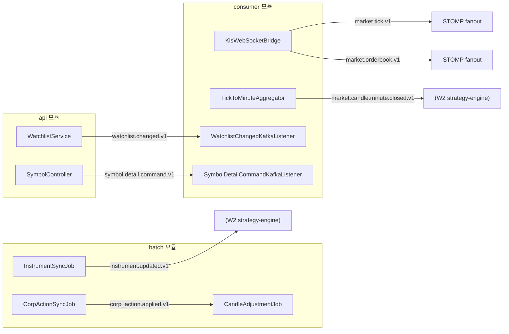

---

## §7 Redis 키 매트릭스

| 키 패턴 | TTL | purpose | set 위치 | 비고 |
|---------|-----|---------|---------|------|
| `quote:last:{code}` | 7d | 실시간 최종 체결가 JSON | `KisWebSocketBridge.writeToRedis()` / `RedisQuoteCacheAdapter.putQuote()` | `{price, volume, ts, source}` |
| `candle:current:{code}:1m` | 2m | 진행 중인 1분봉 HMSET | `KisWebSocketBridge.updateCandleCurrent()` | `{open,high,low,close,volume,startTs}` — TickToMinuteAggregator가 closing 시 DEL |
| `candle:today:{code}:1d` | 24h | 당일 1d 캔들 진행 중 HMSET | `KisWebSocketBridge.updateCandleToday()` | `{open,high,low,close,volume}` — DailyCloseFinalizer가 16:00 DB flush 후 만료 |
| `instrument:search:prefix:*` | — | 종목 검색 sorted set (ZRANGEBYLEX) | `InstrumentSearchService.rebuildIndex()` | Redis sorted set, score=0, member=name+code 복합 |
| `instrument:by-code:{code}` | — | 단일 종목 캐시 | `InstrumentSearchService` | InstrumentSyncJob이 변경 시 DEL |
| `instrument:list:*` | — | 전체 목록 캐시 | `InstrumentSearchService` | InstrumentSyncJob sync 후 DEL |
| `instrument:sync:running` | 600s | InstrumentSyncJob 동시 실행 락 | `InstrumentSyncJob.run()` | SET NX EX 600 |
| `instrument:sync:lastAt` | 1d | 마지막 sync 완료 시각 | `InstrumentSyncJob.doSync()` | ISO8601 문자열 |
| `indicator:cache:{code}:*` | — | 지표 계산 캐시 (W2 T-IND) | (strategy-engine — W2 예정) | CandleAdjustmentJob이 corp_action 적용 후 DEL |

소스:
- `batch/job/instrument/InstrumentSyncJob.kt:354-370` (instrument:* 패턴)
- `consumer/ws/KisWebSocketBridge.kt:302-382` (quote:last, candle:current, candle:today)
- `batch/job/corp_action/CandleAdjustmentJob.kt:122-126` (indicator:cache:*)

---

## §8 Postgres 스키마 누적 (Flyway V1~V8)

### 8-1 V1 baseline (PR-5a) — 11 테이블

소스: `api/src/main/resources/db/migration/V1__baseline.sql`

| 테이블 | 핵심 컬럼 | 비고 |
|--------|----------|------|
| `system_config` | id(SMALLINT PK=1), dart_api_key(BYTEA), notification_slack_webhook(BYTEA) | singleton (id=1 CHECK) |
| `user_account` | user_id(PK), display_name, masked_account, last_login_at | |
| `user_kis_credential` | (user_id, account_type) PK, account_number, app_key_enc(BYTEA), secret_key_enc(BYTEA) | AES 암호화 |
| `instrument` | code(PK), isin, name, market, type, sector, active | V3에서 UNKNOWN 허용으로 CHECK 완화 |
| `watchlist` | id(BIGSERIAL), user_id, code, priority, UQ(user_id,code) | FK → user_account, instrument |
| `candle` | id, code, interval, ts, open_raw/high_raw/low_raw/close_raw, open_adj/high_adj/low_adj/close_adj, volume, source | UQ(code,interval,ts) |
| `position` | id, user_id, code, quantity, avg_price | UQ(user_id,code) |
| `orders` | id, intent_id(UUID), user_id, code, side, status, reject_reason, kis_ord_no | |
| `kill_switch_state` | user_id(PK), enabled, reason | |
| `notification_outbox` | id, event_topic, payload_json(JSONB), status, retry_count | |
| `audit_trail` | id, actor, action, entity_type, entity_id, detail_json(JSONB), occurred_at | |

### 8-2 V2 (PR-6 T-ONBOARD) — onboarding refinements

소스: `api/src/main/resources/db/migration/V2__onboarding_refinements.sql`

- `user_account.masked_account` → GENERATED ALWAYS AS (substr(user_id,1,4)||'****') STORED
- `user_account.last_login_at` 인덱스 추가
- `user_kis_credential.created_at / updated_at` 컬럼 추가

### 8-3 V3 (PR-7 T-W1) — watchlist/position refinements

소스: `api/src/main/resources/db/migration/V3__watchlist_position_refinements.sql`

- `instrument.market` CHECK에 'UNKNOWN' 추가 (stub row 허용)
- `instrument.type` CHECK에 'UNKNOWN' 추가
- `watchlist (user_id, priority, created_at)` 정렬 인덱스
- `position (user_id)` 인덱스

### 8-4 V4 (PR-11a T-IM1) — instrument 검색 인덱스

소스: `api/src/main/resources/db/migration/V4__instrument_master_search.sql`

- pg_trgm extension 활성화
- `instrument.name_norm` / `instrument.theme` 컬럼 추가
- `idx_instrument_name_trgm` (gin trigram 한글 부분 일치)
- `idx_instrument_code_prefix` (code prefix LIKE 최적화)
- `instrument_alias` 테이블 신설 (code, alias, source PK)

### 8-5 V5 (PR-21a T-IM1) — KIS-first 70+ 필드 확장

소스: `api/src/main/resources/db/migration/V5__instrument_kis_first_expansion.sql`

add-only ALTER 70 컬럼:
- **Tier 1**: securities_group (ST/MF/RT 등 KIS scrt_grp_cls_code)
- **Tier 2 매매 가드** (17개): trading_halt, liquidation, management_stock, market_alert, credit_able, margin_rate, short_overheated, 등
- **Tier 3 분류 인덱스** (33개): industry_large/medium/small, kospi200_sector, is_kospi200, is_kosdaq150, is_krx/100/300, is_spac, 등
- **Tier 4 재무**: base_price, market_cap_prev, sales_amount, roe, 등

### 8-6 V6 (PR-29a T-MS1) — market_calendar + order_reject_audit

소스: `api/src/main/resources/db/migration/V6__market_calendar_and_reject_audit.sql`

- `market_calendar` 테이블 신설 (date PK, is_business_day, source: STATIC_SEED|KIS_CHK_HOLIDAY|MANUAL)
- `orders` 테이블: reject_reason / reject_detail / reject_source 컬럼 추가
- `order_reject_audit` 테이블 신설 (intent_id UNIQUE)

### 8-7 V7 (PR-29b T-CA1) — corp_action

소스: `api/src/main/resources/db/migration/V7__corp_action.sql`

- `corp_action` 테이블 신설 (instrument_code, type, ex_date, ratio, cash_dividend, source, applied_at)
- UNIQUE(instrument_code, type, ex_date, source) — KIS·DART 이중 보존
- 미적용 건 partial index (applied_at IS NULL)

### 8-8 V8 (PR-29b T-CA1) — candle 수정주가 컬럼 추가

소스: `api/src/main/resources/db/migration/V8__candle_adjusted.sql`

- `candle.adjustment_factor NUMERIC(15,8) DEFAULT 1.0` 추가 (누적 보정 계수)
- `candle.volume_adjusted BIGINT` 추가 (분할 보정 거래량)
- 기존 candle 행 backfill: `adjustment_factor = 1.0 WHERE NULL`

---

## 부록 — 주요 엔드포인트 전체 목록

| 모듈 | 메서드 | 경로 | 담당 |
|------|--------|------|------|
| api | GET | `/api/onboarding/status` | T-ONBOARD |
| api | POST | `/api/onboarding/kis/validate` | T-ONBOARD |
| api | POST | `/api/onboarding/kis/mock` | T-ONBOARD |
| api | POST | `/api/onboarding/system-config` | T-ONBOARD |
| api | POST | `/api/onboarding/complete` | T-ONBOARD |
| api | GET | `/api/watchlists` | T-W1 |
| api | POST | `/api/watchlists` | T-W1 |
| api | DELETE | `/api/watchlists/{code}` | T-W1 |
| api | GET | `/api/symbols/{code}` | T-S1 |
| api | GET | `/api/symbols/{code}/candles` | T-S1 |
| api | POST | `/api/symbols/{code}/orderbook/subscribe` | T-S1 |
| api | POST | `/api/symbols/{code}/orderbook/unsubscribe` | T-S1 |
| api | GET | `/api/instruments/search` | T-IM1 |
| api | GET | `/api/instruments/{code}` | T-IM1 |
| api | GET | `/api/instruments` | T-IM1 |
| api | POST | `/api/instruments/sync` | T-IM1 |
