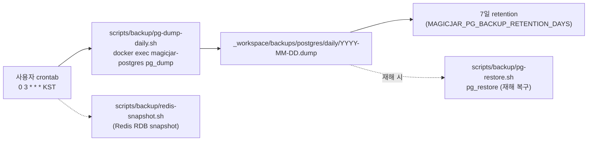
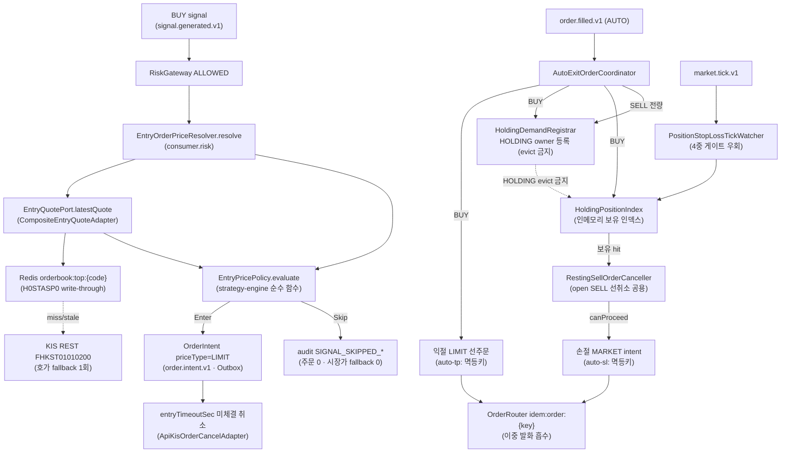

# v3.12.0 데이터 흐름 매트릭스

- baseline: v3.12.0
- 작성일: 2026-06-08
- 작성자: backend-core (bot+backend-core@magicjar.local)
- SoT: `docs/architecture/master-architecture.md` §2 + `settings.gradle.kts` + ADR 0004 + ADR 0094 (운영 단계) + ADR 0110·0111·0112·0113·0114 (분할매수·AI 발굴·캔들 retention·주문 집행 사이클)
- 기준: v3.9.0 02-data-flow.md 전체 이월 + **주문 집행 정책 합류** (진입 marketable limit · 미체결 취소 · tick 손절 안전망 · 익절 LIMIT 선주문 — ADR 0114) + **전략별 포지션 귀속 + 분할매수/평단 exit** (strategy_position · ScaleInExitCalculator — ADR 0110·0111) + **AI 4종 Claude CLI bridge** (종목발굴·프리셋 추천·전략 생성·종목상세 코멘트 — ADR 0112) + **시나리오 리플레이 샌드박스** (ADR 0107) + **캔들 retention/interval 확장** (3m·4h·12h·1m 장기 보존 — ADR 0105·0113) + **백업/복구 흐름** (pg-dump cron → restore — ADR 0096) + Flyway 22건(V53~V74)

---

## 🔄 v3.9.0 → v3.12.0 진화 요약 (리팩토링맨 lens)

| 영역 | v3.9.0 | v3.12.0 | 진화 사유 |
|------|--------|---------|----------|
| 자본 path touch | 0건 (read-only 트랙만 합류 — T-MARKET·T-AI·T-MCP) | **자본 path 본격 보강** (진입 가격 정책 + 청산 "항상" 보장 + 분할매수/평단 exit) | ADR 0114·0110·0111 — 운영 dwell 후 자동매매 안전 결함 직시 (사용자 2질문: "시장가로만 사고 있지 않나" + "포지션 보유 중 긴장 상태인가") |
| 진입 가격 | **시장가 고정** (`OrderRouterKafkaListener` priceType default MARKET — 슬리피지 보호 0) | **marketable limit** (매도1호가 + 상한 cap + 스프레드 게이트 + 호가 미가용 스킵 · 시장가 fallback 0) | ADR 0114 §3 — `EntryPricePolicy` 순수 계산기 (live·백테스트·리플레이 공유) |
| 손절 보장 | 1m 시그널 경로 단일 (readiness·market-hours·전략 status·1m 마감 4중 게이트 의존) | **tick 손절 안전망 신설** (`PositionStopLossTickWatcher` — `market.tick.v1` 직접 listen → 4중 게이트 우회 MARKET SELL) | ADR 0114 §1-2·§4 — KIS 국내 OpenAPI에 서버 예약형 스탑로스 부재 → consumer 자체가 스탑로스 장치 |
| 익절 보장 | 1m 시그널 경로 SELL | **익절 LIMIT 선주문** (`AutoExitOrderCoordinator` — BUY 체결 즉시 KIS 서버에 resting SELL · consumer 다운돼도 익절 보장) | ADR 0114 §3-3 — scale-in 평단 변동 시 취소-후-재발행 정합 |
| 포지션 모델 | `position`(user+code 합산 · KIS 잔고 권위) 단일 | **+ `strategy_position`** (전략별 lot ledger · 평단/exit 토대) | ADR 0110 — "전략이 살아 있어야 청산"이 아니라 "포지션이 있으면 청산" 불변식 전환 |
| 분할매수/exit | 단일 진입 + 전량 익절 | **scale-in plan + partial exits + 평단 기준 stop/take** (`ScaleInExitCalculator` 순수 함수) | ADR 0111 — RiskPlan JSONB add-only 확장 |
| 실시간 구독 owner | `DETAIL` · `STRATEGY` 2종 | **+ `HOLDING`** (최우선 priority · evict 절대 금지 — 보유 종목 구독 끊김 = 청산 재료 공백 차단) | ADR 0114 §4-3 P3 |
| AI 보조 | 5 진입점 × 3 API provider (Anthropic·Gemini·OpenAI) | **+ Claude CLI bridge 4종** (종목발굴·프리셋 추천·전략 생성·종목상세 코멘트 — API key 미사용 `claude -p`/local bridge) | ADR 0112 — 사용자 "AI API 미사용, claude -p 사용" 결재 |
| 시나리오 검증 | 0건 | **시나리오 리플레이 샌드박스** (`scenario_*` 격리 namespace · 실주문/모의주문 runtime 분리) | ADR 0107 |
| 캔들 interval | 5m·15m·30m·90m·1h (+1d backfill) | **+ 3m·4h·12h** (intraday 후보 확장) + **1m 장기 보존 tiering** | ADR 0105·0113 |
| DR/backup | 표 cover만 (스크립트 0) | **pg-dump cron + restore 스크립트** (`scripts/backup/` 매일 03:00 KST + 7일 retention) | ADR 0096 §2-1 실집행 |
| Flyway | V52까지 | **V74까지** (V53~V74 22건 — trendline·market_calendar·interval·strategy exit·scenario·strategy_position·research-candidate·entry_policy·min_hold_bars 등) | — |

✨ **핵심 통찰**: v3.9.0이 **사용자 옵션 path 완전 합류**(read-only) baseline이었다면, v3.12.0은 **자본 path 안전 보강 + 자동매매 집행 정밀화** baseline이다. 운영 dwell evidence 위에서 "시장가 고정·손절 4중 게이트 의존"의 구조적 결함을 직시(ADR 0114) → 진입은 슬리피지 캡 보호, 청산은 tick 안전망·position-driven으로 "항상 보장". AI는 여전히 자본 path 결정권 0(Claude CLI bridge도 후보 탐색·코멘트만). 자본 path를 **건드리되 안전 방향으로만** 진화 — `EntryPricePolicy`·`ScaleInExitCalculator`·`stopPriceOf`·`KrxTickSize` 순수 계산기를 live·백테스트·리플레이 단일 출처로 공유해 "리플레이≠라이브" drift를 원천 차단.

---

## 1. 모듈 의존성 매트릭스

### 1-1. JVM 9 모듈 구성 (v3.9.0 이월 — 변동 0)

```
settings.gradle.kts include:
  domain
  pattern-engine
  indicator-impl
  strategy-engine
  market-trend-engine
  persistence-shared
  api
  batch
  consumer
```

| 모듈 | Spring 의존 | JPA 의존 | v3.12.0 역할 변동 |
|------|------------|---------|------------------|
| `domain` | 0 | 0 | **+ `EntryQuotePort`** (진입 호가 동기 read 포트 — `domain.market.port`) + **`EntryPolicy`/`ResolvedEntryPolicy`** (진입 정책 도메인 — `domain.strategy`) + strategy_position 도메인 |
| `pattern-engine` | 0 | 0 | v3.9.0 LOCK 이월 |
| `indicator-impl` | 0 | 0 | v3.9.0 LOCK 이월 |
| `strategy-engine` | 0 | 0 | **+ `EntryPricePolicy`** (진입 marketable limit 순수 계산기 — `strategy.entry`) + **`KrxTickSize`** (KRX 호가단위 floor 단일 출처) + `ScaleInExitCalculator`(평단 stop/take exit — ADR 0111) |
| `market-trend-engine` | Spring Context only | 0 | v3.9.0 LOCK 이월 |
| `persistence-shared` | data-jpa | JPA | Outbox 공용 어댑터 (ADR 0088) LOCK 이월 |
| `api` | Spring Boot 3.3 | JPA | **+ StrategyResearch AI discovery (Claude CLI bridge)** + scenario replay controller + strategy_position 조회 |
| `batch` | Spring Boot 3.3 + Spring Batch | JPA | v3.9.0 LOCK 이월 (cron Job + 캔들 backfill interval 확장) |
| `consumer` | Spring Boot 3.3 | JPA | **+ 주문 집행 컴포넌트 5종** (`EntryOrderPriceResolver`·`PositionStopLossTickWatcher`·`AutoExitOrderCoordinator`·`RestingSellOrderCanceller`·`HoldingPositionIndex`·`HoldingDemandRegistrar`) + `ClaudeCliCommentAdapter`(AI 코멘트 4번째 provider) |

- `domain` 비의존 LOCK 유지 (Spring·JPA import 0 — ArchUnit 게이트). `EntryQuotePort`도 순수 interface.
- **진입/청산 순수 계산기는 `strategy-engine`** (`EntryPricePolicy`·`KrxTickSize`·`ScaleInExitCalculator`) — `ScaleInExitCalculator` 선례 1:1, live(consumer)·백테스트(api)·리플레이가 단일 함수 공유.
- 컨테이너 매트릭스 변동 0 (여전히 4 + 인프라 3 = 7 컨테이너).

### 1-2. v3.12.0 신규 컴포넌트 위치 매트릭스

| 컴포넌트 | 모듈 | 패키지 경로 | ADR 근거 |
|---------|------|-----------|---------|
| `EntryPricePolicy` (순수 계산기) | `strategy-engine` | `strategy.entry.*` | ADR 0114 §6 |
| `EntryPriceInput`·`EntryPriceDecision` (sealed) | `strategy-engine` | `strategy.entry.*` | ADR 0114 §6-1 |
| `KrxTickSize` (호가단위 floor 단일 출처) | `strategy-engine` | `strategy.entry.*` | ADR 0114 §3-3 |
| `ScaleInExitCalculator` (평단 stop/take 순수 함수) | `strategy-engine` | `strategy.*` | ADR 0111 |
| `EntryQuotePort` (interface) + `EntryQuote` | `domain` | `domain.market.port.*` | ADR 0114 §10-3 |
| `EntryPolicy`·`ResolvedEntryPolicy` (도메인) | `domain` | `domain.strategy.*` | ADR 0114 §5 |
| `EntryOrderPriceResolver` (호출 배선) | `consumer` | `consumer.risk.*` | ADR 0114 §3-1 R2-C2a |
| `CompositeEntryQuoteAdapter` (Redis → REST 우선순위) | `consumer` | `consumer.infrastructure.kis.*` | ADR 0114 §10-3 |
| `RedisOrderbookTopCache` (`orderbook:top:{code}` write-through/read) | `consumer` | `consumer.infrastructure.kis.*` | ADR 0114 §10-3 ① |
| `KisRestAskingPriceAdapter` (FHKST01010200 fallback) | `consumer` | `consumer.infrastructure.kis.*` | ADR 0114 §10-3 ② |
| `PositionStopLossTickWatcher` (tick 손절 안전망) | `consumer` | `consumer.order.*` | ADR 0114 §4 R2-C2b ① |
| `AutoExitOrderCoordinator` (익절 LIMIT 선주문) | `consumer` | `consumer.order.*` | ADR 0114 §3-3 R2-C2b ② |
| `RestingSellOrderCanceller` (open SELL 선취소 공용) | `consumer` | `consumer.order.*` | ADR 0114 §5 |
| `HoldingPositionIndex` (인메모리 보유 인덱스) | `consumer` | `consumer.order.*` | ADR 0114 §4-3 P3 |
| `HoldingDemandRegistrar` (HOLDING owner 등록/해제) | `consumer` | `consumer.ingestion.*` | ADR 0114 §4-3 P3 |
| `OrderIntentKafkaProducer.publishExitIntent` (청산 intent 발행) | `consumer` | `consumer.risk.*` | ADR 0114 §3-3 |
| `StrategyResearchAiDiscoveryService` | `api` | `api.strategyresearch.*` | ADR 0112 §2 |
| `StrategyResearchAiTextClient` (Claude CLI/bridge) | `api` | `api.strategyresearch.*` | ADR 0112 §2-1 |
| `StrategyBuilderAiGenerateService` (전략 생성) | `api` | `api.strategybuilder.*` | ADR 0112 정합 |
| `ClaudeCliCommentAdapter` (AI 코멘트 4번째 provider) | `consumer` | `consumer.ai.*` | CHANGELOG 2026-06-08 |

---

## 2. api 모듈 데이터 흐름

### 2-1. REST 엔드포인트 매트릭스 (v3.9.0 이월 + v3.12.0 신규)

#### v3.12.0 신규 — 전략 리서치 AI 발굴 (ADR 0112)

| 경로 | 컨트롤러 | 역할 | 외부 호출 | ADR |
|------|---------|------|-----------|-----|
| `POST /api/strategy-research/ai-discovery` | `StrategyResearchController` | 자연어 조건 → Claude CLI/bridge 종목 후보 발굴 → instrument master 매핑(matched/unmatched) | `claude -p` 또는 bridge `POST /discover` | 0112 §2-1 |
| `GET /api/strategy-research/ai-discovery/state` | `StrategyResearchController` | 사용자별 마지막 발굴 조건·후보 상태(KEPT/DISMISSED) 조회 | — | 0112 (V67) |
| (preset CRUD) | `StrategyResearchController` | AI 발굴 intent prompt preset 관리(매수 추천 아님 — Screener/Backtest 검증용 가설 템플릿) | — | 0112 (V70) |
| (core prompt 편집) | `StrategyResearchController` | AI 발굴 **Core Wrapper**(전역 system prompt) 운영 중 편집 — 코드 상수 → DB 단일행 승격 | — | 0112 (V71) |

- 안전 경계 LOCK (ADR 0112 §2-4): KIS 주문 adapter 호출 0 · `order.intent.v1` 발행 0 · 전략 자동 저장 0 · watchlist 자동 등록 0 · 실시간 수요 자동 등록 0. AI 후보는 "검증 후보" — 사용자가 명시 선택해야 기존 리서치 form 진입.

#### v3.12.0 신규 — 시나리오 리플레이 + 분할매수/exit + 캔들

| 경로 | 컨트롤러 | 역할 | ADR |
|------|---------|------|-----|
| (scenario replay) | scenario controller | 실주문/모의주문 runtime과 격리된 QA replay (scenario_* namespace) | 0107 (V63) |
| (strategy exit 설정) | strategy controller | scale-in plan · partial exits · 평단 stop/take · entry_policy · minHoldBars 설정 | 0110·0111·0114 |
| (캔들 가져오기) | candle controller | 종목 상세에서 **수동 캔들 fetch** (REST bootstrap/backfill — 부족 구간 재수집 path) | 0105 캔들 정책 |

### 2-2. STOMP 구독 토픽 (v3.9.0 이월 — 자본 path 신규 push 0)

- 주문 집행/청산 audit은 **기존 signal/order audit fanout 재사용** (신규 STOMP topic 0 — ADR 0114 §10-4).
- 진입 스킵(`SIGNAL_SKIPPED_*`)·손절 MARKET·익절 LIMIT 선주문은 기존 order lifecycle STOMP topic으로 노출.

### 2-3. api 모듈 내부 서비스 레이어 (v3.12.0 추가)

```
StrategyResearchController(/api/strategy-research/ai-discovery)
                              → StrategyResearchAiDiscoveryService
                                  → StrategyResearchAiTextClient
                                      ├── bridge-url empty → ProcessBuilder(command, "-p", prompt) 직접 실행 (provider=claude-cli)
                                      └── bridge-url 설정 → POST {bridge}/discover (provider=claude-cli-bridge)
                                  → JSON 후보 파싱 → InstrumentJpaRepository.searchByNameOrCode 매핑
                                  → active=true · securitiesGroup ∈ {ST, null} · market filter → matched/unmatched
                              → strategy_research_ai_discovery_state UPSERT (V67 — KEPT/DISMISSED)
                              → preset(V70) · core prompt(V71) 영속 조회

JvmBacktestEngine (api/service/backtest)
                              → EntryPricePolicy (strategy-engine 공유 — 진입 slippage 모델 정합 · ADR 0114 §6)
                              → ScaleInExitCalculator (평단 exit — 리플레이/라이브와 단일 출처)
```

---

## 3. consumer 모듈 데이터 흐름

### 3-1. Kafka 토픽 소비 매트릭스 (v3.9.0 이월 + v3.12.0 신규 2건)

| 토픽 | 리스너 클래스 | groupId | v3.12.0 변경 |
|------|------------|---------|------------|
| (v3.9.0 이월 — `order.intent.v1` · `signal.generated.v1` · `market.candle.*.closed.v1` · `ai.comment.requested.v1` 등) | (동일) | (동일) | — |
| **✨ `market.tick.v1`** | **`PositionStopLossTickWatcher`** | **`magicjar-consumer-position-stop-loss`** | ✨ v3.12.0 — tick 손절 안전망 (보유 인덱스 hit-only) |
| **✨ `order.filled.v1`** | **`AutoExitOrderCoordinator`** | **`magicjar-consumer-auto-exit`** | ✨ v3.12.0 — BUY 체결 시 익절 LIMIT 선주문 + HOLDING 등록 / SELL 전량 청산 시 해제 |

### 3-2. ✨ 진입(BUY) marketable limit 흐름 (v3.12.0 신규 — ADR 0114 §3)

```
BUY 시그널 (signal.generated.v1) → RiskGateway ALLOWED 통과
    ↓
EntryOrderPriceResolver.resolve(signal, strategy)
    ↓ 전략 EntryPolicy(JSONB V72) ?: 전역 default env(magicjar.order.entry.*) → ResolvedEntryPolicy
    ↓ EntryQuotePort.latestQuote(code) — 동기 호가 read (CompositeEntryQuoteAdapter)
    │     ① RedisOrderbookTopCache (orderbook:top:{code} — H0STASP0 WS write-through)
    │     └── miss/stale → ② KisRestAskingPriceAdapter (FHKST01010200 1회)
    │         └── 둘 다 실패 → null (시장가 fallback 금지 LOCK)
    ↓ EntryPriceInput 조립 → EntryPricePolicy.evaluate(input)  [strategy-engine 순수 함수]
    ├── Enter(limitPrice)        → OrderIntent priceType=LIMIT + limitPrice 발행 (order.intent.v1)
    └── Skip                     → 주문 0 + audit:
          ├── PriceCapExceeded   → SIGNAL_SKIPPED_ENTRY_PRICE_CAP (ask1 > cap = priceAtSignal × (1+slippage/100))
          ├── SpreadTooWide      → SIGNAL_SKIPPED_SPREAD ((ask1-bid1)/mid > maxSpreadPct)
          ├── ThinLiquidity      → 매도1호가 잔량 약함
          └── NoQuote            → SIGNAL_SKIPPED_NO_QUOTE (호가 미가용/stale — 시장가 fallback 0)
    ↓ (Enter 시)
LIMIT 주문 후 entryTimeoutSec(default 15초) 내 미체결 → 취소 (ApiKisOrderCancelAdapter TTTC0013U/VTTC0013U)
    └── 시장가 전환 금지 · 재시도 기본 0회 (재시도 시에도 기준가 = priceAtSignal 불변 — 추격 금지)
```

✨ **순수성 LOCK**: `EntryPricePolicy.evaluate`는 Clock·IO·Spring 0. `quoteAsOf`·`evalAt` 입력 주입. 동일 입력 → 동일 출력 → live(consumer)·백테스트(`JvmBacktestEngine`)·리플레이가 단일 함수 공유 ("리플레이에선 스킵됐는데 라이브는 진입" 의심 원천 차단).

### 3-3. ✨ 청산 "항상" 보장 흐름 (v3.12.0 신규 — ADR 0114 §4 · P1~P4)

```
[P1 readiness 게이트 진입/청산 분화]  RealtimeSignalGenerator.onBoundaryClosed
    ├── BUY(신규 자본 투입) → fail-closed 유지 (READY만 허용)
    └── SELL(보유 청산 평가) → status별 진행:
          RECONCILING/STALE → 진행 (현재가는 tick/Redis current candle 우선)
          FAILED            → 현재가 가용 시 진행, 0이면 skip + alert
    핵심 불변식: fail-closed는 신규 자본 투입(BUY) 차단에만. 이미 투입된 자본 회수(SELL)는 막지 않음.

[P2 position-driven 청산 — 전략 status 무관]
    strategy_position 보유 종목(quantity>0)은 전략 status(ACTIVE/BUY_BLOCKED/DISABLED) 무관하게 청산 평가 대상.
    BUY만 status 게이트(ACTIVE 진입 · BUY_BLOCKED·DISABLED는 BUY 0).
    → StrategyPositionPort를 청산 평가 1차 권위로 승격 ("포지션 있으면 청산").

[★ tick 손절 안전망 — 4중 게이트 우회]  PositionStopLossTickWatcher (market.tick.v1 직접 listen)
    tick 수신 → HoldingPositionIndex.heldBy(code)
    ├── 보유 0 → 즉시 return (인메모리 hit-only · 매 tick DB 조회 0 — 성능 보강)
    └── 보유 lot 존재 → evaluate(position, tickPrice):
          stopPrice = stopPriceOf(avgPrice, stopLossPct)   [KrxTickSize.floorToTick — 단일 출처]
          tickPrice ≤ stopPrice →
              RestingSellOrderCanceller.cancelRestingSells (같은 종목 open SELL=auto-tp 선취소)
                ├── canProceed=false (수동/타전략 SELL 침범) → 중단 + P0 로그
                └── canProceed → publishExitIntent(priceType=MARKET · auto-sl: 멱등키)
                    → order.intent.v1 → OrderRouter idem:order:{key} (1m 경로 손절과 이중 발화 흡수)

[P3 HOLDING owner — evict 절대 금지]  RealtimeSubscriptionRouter
    BUY 체결 → HoldingDemandRegistrar.onBuyFilled(code) → HOLDING owner 등록 (priority 0 · 최우선)
            + HoldingPositionIndex.onFillRefresh (즉시 인덱스 반영)
    findEvictionCandidateLocked → HOLDING owner code 무조건 제외 (41 slot 경합에서도 보유 종목 구독 유지)
    SELL 전량 청산(종목 전체 보유 0) → HoldingDemandRegistrar.onFullyExited → demand·인덱스 해제

[P4 market-hours gate BUY 한정]  env magicjar.signal.market-hours-gate.sell-enabled (default true)
    true: SELL도 정규장만 (현행 보수)  /  false: NXT 시간대 보유 SELL 평가 허용 (NXT 유동성 risk 사용자 판단)
    BUY는 항상 market-hours gate 적용 (NXT 진입 금지).
```

✨ **HoldingPositionIndex 동시성 LOCK (적대 리뷰 R3 fix)**: 60초 `@Scheduled` refresh(스케줄러 스레드)와 체결 즉시 `onFillRefresh`(AutoExit @KafkaListener 스레드)가 인덱스 키 집합을 동시 read-modify-write → `ReentrantLock` 쓰기 직렬화 + `AtomicLong mutationSeq`(ms 미만 race 동률 회피). 읽기(`heldBy`)는 ConcurrentHashMap 가시성으로 lock-free(tick hot path 비용 0).

### 3-4. ✨ 익절 LIMIT 선주문 흐름 (v3.12.0 신규 — ADR 0114 §3-3 · AutoExitOrderCoordinator)

```
order.filled.v1 (source=AUTO) → AutoExitOrderCoordinator.onOrderFilled
    ├── BUY 체결:
    │     1. HoldingDemandRegistrar.onBuyFilled + HoldingPositionIndex.onFillRefresh (TP 실패와 무관하게 먼저)
    │     2. takeProfitPct 보유 시:
    │          baseQty/baseAvgPrice = strategy_position(평단 권위) ?: 체결 이벤트
    │          targetPrice = EntryPricePolicy.takeProfitLimitPrice(avgPrice, pct)  [단일 출처 · KRX 호가단위 내림]
    │          replaceOpenTakeProfitOrders (scale-in 정합):
    │            ├── ALREADY_ALIGNED (동일 qty·price) → 재발행 0 (멱등)
    │            ├── FAILED_CLOSED (KIS ACK 미확정/취소 실패) → 보류
    │            └── REPLACED_OR_EMPTY → 기존 auto-tp open SELL 취소 후
    │          publishExitIntent(SELL · LIMIT · auto-tp: 멱등키) → KIS 서버에 resting SELL 선주문
    │            → consumer 다운돼도 익절 보장 (1m 경로 의존 0)
    └── SELL 체결:
          전량 청산(strategy 잔량 0 + 종목 전체 보유 0) → HOLDING demand·인덱스 해제
          부분 청산 → 인덱스만 갱신 (TP 재발행은 다음 BUY 체결 또는 1m 경로)
```

✨ **PartialExit(분할 익절 plan) 경계** — 단일 전량 익절(`takeProfitPct`)만 선주문. `partialExits`(다단계)는 stage state를 `ScaleInExitCalculator`가 소유 → resting 선주문 시 1m 분할 익절 신호와 이중 발화 → coordinator는 선주문 skip(1m 경로가 stage 발화). 손절은 `PositionStopLossTickWatcher` tick 안전망이 별도 하한 보호.

### 3-5. ✨ AI 코멘트 4번째 provider — Claude CLI bridge (v3.12.0 신규)

```
ai.comment.requested.v1 → AiCommentDispatcherListener → provider routing
    ├── anthropic·gemini·openai (v3.9.0 이월 — API key)
    └── ✨ claude-cli (ClaudeCliCommentAdapter):
          MAGICJAR_AI_PROVIDER=claude-cli (구독 기반 — 키 불요)
          bridge-url POST /discover 또는 로컬 claude -p CLI fallback
          → ai_comment_log tokens 0 · cost 0 정직 기록 (AiCostCalculator claude-cli=$0)
          → prompt_template(type=chart) 흐름·응답 계약 무변경 (frontend 0 touch)
    게이트: decideMockMode() 순수 함수 — claude-cli는 "키 없음=mock 강등" 제외
            (MAGICJAR_AI_ENABLED=true + provider=claude-cli = 실해석 경로)
```

### 3-6. v3.9.0 이월 흐름 (변경 없음)

- KIS WS 브릿지 + BoundaryAggregator + KillSwitchRaceSafeGuard + Outbox publish — v3.9.0 LOCK 이월.
- 자본 path Outbox publish (intent·filled·rejected·cancelled) LOCK 이월 — v3.12.0은 청산 intent도 동일 `order.intent.v1` Outbox 경로 사용(`OrderIntentKafkaProducer.publishExitIntent`).

---

## 4. batch 모듈 데이터 흐름

### 4-1. Spring Batch 잡 매트릭스 (v3.9.0 이월 + interval 확장)

| 잡 클래스 | v3.12.0 변경 |
|----------|------------|
| `MarketIndexSyncJob` · `MarketIndexDailyCloseJob` | v3.9.0 LOCK 이월 |
| `CandleBackfillWorker` | **+ 3m·4h·12h interval backfill** (V57·V58 — intraday 후보 확장) + **1m 장기 보존 tiering** (ADR 0105·0113) |
| `InstrumentSyncJob` · `MarketCalendarSyncJob` 등 | v3.9.0 LOCK 이월 |

### 4-2. ✨ 백업/복구 흐름 (v3.12.0 신규 — ADR 0096 §2-1 실집행)



- `pg-dump-daily.sh`: 매일 03:00 KST + 7일 retention (ADR 0096 §2-1). `docker compose postgres` 컨테이너 `magicjar-postgres` running 의무. baseline ~3MB × 7일 = 21MB.
- `pg-restore.sh`: 재해 복구 경로 (DR drill). `redis-snapshot.sh`: Redis RDB 보조 snapshot.
- cron 등록 가이드: `docs/operations/backup-setup.md` (자동화 trigger 폐기 정책 정합 — GHA 미사용, 로컬 cron only).

---

## 5. DB 테이블 매트릭스 (Flyway v3.12.0 누적)

### 5-1. v3.9.0 이월 (변경 없음)

V1~V52 풀세트 LOCK 이월 (V47~V52 = market_index_snapshot·sector_index_snapshot·ai_comment_log·prompt_template·user_preference·mcp_audit).

### 5-2. ✨ v3.12.0 신규 22건 (V53~V74)

| Flyway | 테이블/변경 | 역할 | ADR |
|--------|------------|------|-----|
| **V53·V54** | `trendline` (+ extend_left) | 차트 추세선 영속 | 차트 |
| **V55** | `market_calendar_event` | 휴장일 기준표와 분리된 사용자 등록 시장 이벤트 | 0104 |
| **V56** | `position` account_type unique | 모의/실전 계좌 분리 unique | 0110 정합 |
| **V57** | `candle` interval CHECK + 4h·12h | intraday interval 확장 | 0105 |
| **V58** | `candle` interval CHECK + 3m | 3분봉 추가 | 0105·0113 |
| **V59** | `strategy.take_profit_pct` | 전량 익절 % add-only | 0111 |
| **V60** | `strategy.fixed_stop_loss_pct` | 고정 손절 % add-only | 0111 |
| **V61** | `strategy` BUY_BLOCKED status | 신규 BUY 차단 + SELL/익절/손절 평가 유지 | 0067 |
| **V62** | `kill_switch_state` seed | enabled=false 명시 row (row 없음=확인 불가=ON) | 0024 |
| **V63** | `scenario_run`·`scenario_*` | 시나리오 리플레이 격리 namespace (live FK 0) | 0107 |
| **V64** | `strategy_position` | **전략별 lot ledger** (평단/exit 토대) | 0110 |
| **V65** | `strategy.scale_in_config`·`partial_exits` (JSONB) | 분할매수 plan + 단계 익절 add-only | 0111 |
| **V66** | `order_request.source` EXTERNAL 허용 | 외부 HTS 직접 주문 흡수 (CHECK 확장) | 0068 |
| **V67** | `strategy_research_ai_discovery_state` | 사용자별 마지막 발굴 조건·후보(KEPT/DISMISSED) | 0112 |
| **V68** | `backtest_run` code multi-symbol | 다종목 백테스트 | 백테스트 |
| **V69** | drop duplicate candle index | 인덱스 정리 | — |
| **V70** | `strategy_research_ai_discovery_preset` | AI 발굴 intent prompt preset (검증 가설 템플릿) | 0112 |
| **V71** | `strategy_research_ai_discovery_core_prompt` | AI 발굴 **Core Wrapper**(전역 system prompt) 단일행 — 운영 중 편집 | 0112 |
| **V72** | `strategy.entry_policy` (JSONB) | **진입 집행 정책** (maxEntrySlippagePct·entryTimeoutSec·maxSpreadPct) add-only | 0114 §5 |
| **V73** | `strategy.min_hold_bars` | **최소 보유 캔들** — 진입 후 N캔들 DSL 매도만 무시(손절·익절은 항상 작동) | 잔익절 방어 B안 |
| **V74** | `strategy_research_candidate` | 코드 하드코딩 18 리서치 후보 → DB화 (entry_dsl 통일 + target/stop/maxHold) | 리서치 |

#### V64 `strategy_position` 핵심 (ADR 0110)

```
기존 position (user+code 합산 · KIS 잔고 권위)은 유지.
그 아래 전략별 lot ledger를 둔다 — (userId, strategyId, code) 단위 quantity·avgPrice·updatedAt.
→ 청산 평가 1차 권위 (ADR 0114 §4-2 P2 position-driven). 평단 기준 stop/take(ScaleInExitCalculator) 토대.
```

#### V72 `strategy.entry_policy` add-only (ADR 0114 §5 — 하위호환 LOCK)

```sql
ALTER TABLE strategy ADD COLUMN entry_policy jsonb;
-- EntryPolicy(maxEntrySlippagePct·entryTimeoutSec·maxSpreadPct) 묶음 객체 직렬화 슬롯.
-- null = 현행(전역 default env magicjar.order.entry.* 적용) → 기존 전략 0 변경.
-- ScaleInPlan scale_in_config(V65) 선례 1:1.
```

#### V73 `strategy.min_hold_bars` (잔익절 방어 — 하위호환 LOCK)

```
진입 체결 후 N캔들 동안 DSL 매도 시그널만 무시(손절·익절 라인은 항상 작동 — 안전망 우선).
null = 비활성(현행 — DSL SELL 즉시 평가) → 기존 전략 0 변경.
```

---

## 6. Redis 키 매트릭스 (v3.12.0 누적)

### 6-1. v3.9.0 이월 (변경 없음)

v3.9.0 풀세트 LOCK 이월 (`quote:last:*` · `candle:current:*` · `market:index:*` · `ai:prompt:cache:*` · `trendpref:user:*` 등).

### 6-2. ✨ v3.12.0 신규 — 진입 호가 동기 read (ADR 0114 §10-3)

| Redis 키 패턴 | 자료구조 | 데이터 | 채움 경로 | ADR |
|--------------|---------|-------|----------|-----|
| **`orderbook:top:{code}`** | STRING (JSON) | 매도1·매수1 호가 + 잔량 + asOf (진입 marketable limit 산정용) | `KisWebSocketBridge` H0STASP0 수신 → `RedisOrderbookTopCache` write-through | 0114 §10-3 ① |

✨ **호가 source 발굴 결함 (ADR 0114 §10-3)**: 현행 호가(H0STASP0)는 `KisWebSocketBridge` → Kafka `market.orderbook.v1` → STOMP로만 흐르고 **동기 read 캐시 부재**였다. `EntryPricePolicy`가 요구하는 `ask1`/`bid1`/`askQty1`/`quoteAsOf`를 주문 시점에 읽을 곳이 없었음 → `CompositeEntryQuoteAdapter`가 Redis 캐시(1차) → KIS REST FHKST01010200(2차) → null(시장가 fallback 금지) 우선순위로 제공.

---

## 7. Kafka 토픽 전체 매트릭스 (v3.12.0)

### 7-1. v3.9.0 이월 (변경 없음)

v3.9.0 풀세트 LOCK 이월. **자본 path 청산 intent도 신규 topic 0** — `order.intent.v1`에 priceType/limitPrice add-only 필드로 발행(`publishExitIntent` — OrderRouter가 이미 읽는 키).

### 7-2. ✨ v3.12.0 신규 소비 경로 (topic 신설 0 · 기존 topic 재소비)

| 토픽 | 신규 소비자 | groupId | 용도 |
|------|------------|---------|------|
| `market.tick.v1` (기존) | `PositionStopLossTickWatcher` | `magicjar-consumer-position-stop-loss` | tick 손절 안전망 (4중 게이트 우회) |
| `order.filled.v1` (기존) | `AutoExitOrderCoordinator` | `magicjar-consumer-auto-exit` | 익절 LIMIT 선주문 + HOLDING 등록/해제 |
| `order.intent.v1` (기존) | (기존 OrderRouter) | (기존) | 청산 intent(`publishExitIntent`) — priceType MARKET(손절)/LIMIT(익절) add-only |

✨ **멱등 LOCK**: `auto-sl:`(손절)·`auto-tp:`(익절) 멱등키 → OrderRouter `idem:order:{key}`가 1m 시그널 경로와 tick/coordinator 경로의 동시 발화를 한 번만 주문되도록 흡수.

---

## 8. ✨ 주문 집행 정책 종합 Mermaid (v3.12.0 — ADR 0114)



---

## 9. boundary 시각 매트릭스 (v3.3.0 이월 + interval 확장)

| Interval | v3.12.0 변동 |
|----------|------------|
| 5m·15m·30m·90m·1h | v3.9.0 LOCK 이월 |
| **3m** ✨ | V58 신규 (intraday 후보) |
| **4h·12h** ✨ | V57 신규 |
| 1d | 이월 + 1m 장기 보존 tiering (ADR 0113) |

v3.12.0 추가 부하 예상:
- 진입 호가 동기 read: BUY 시그널 시점 1회 (Redis hit 위주 · miss 시 KIS REST 1회 — ADR 0037 10 TPS 내 ε)
- tick 손절 watcher: `market.tick.v1` 소비 — 보유 0 종목은 인메모리 hit-only로 즉시 return (DB 부하 0)
- strategy_position: 전략×종목 lot row (소규모)
- 캔들 interval 확장(3m·4h·12h): backfill row 증가 (ADR 0113 retention tiering으로 1m 장기 보존 관리)

영향 통제 LOCK. PostgreSQL·Redis·Kafka 부담 통제됨.

---

## 10. ADR 정합 참조 (v3.12.0 갱신)

| ADR | 관련 흐름 |
|-----|---------|
| ADR 0004 | 모듈 경계 — 9 모듈 LOCK (진입/청산 순수 계산기는 strategy-engine, port는 domain) |
| ADR 0007 | Kafka backbone — 자본 path Outbox publish (청산 intent도 order.intent.v1 add-only) |
| ADR 0013 | MarketSession FSM — market-hours gate BUY 한정 분리(P4 sell-enabled) |
| ADR 0023 | 룰 온리 + AI 호출 0 — EntryPricePolicy·ScaleInExitCalculator·tick watcher 모두 AI 호출 0 LOCK |
| ADR 0024 | KillSwitch — kill_switch_state seed(V62 · row 없음=ON 보수) |
| ADR 0037 | KIS Rate Limit — 진입 호가 REST fallback 1회(10 TPS 내) |
| ADR 0048 | 호가 구독 LRU H0STASP0 — orderbook:top write-through source |
| ADR 0067 | T-RISK Signal→RiskGateway→OrderIntent — priceType/limitPrice 채워 발행 + BUY_BLOCKED(V61) |
| ADR 0068 | T-O 주문 실행 — LIMIT 주문·취소 기존 경로 + EXTERNAL source(V66) |
| ADR 0088 | persistence-shared Outbox — 청산 intent도 동일 경로 |
| ADR 0094 | 운영 단계 — v3.12.0이 운영 dwell 후 자본 path 안전 보강 baseline |
| ADR 0096 | DR/backup — pg-dump-daily.sh + pg-restore.sh 실집행 (매일 03:00 KST · 7일 retention) |
| ADR 0104 | market_calendar_event(V55) |
| ADR 0105 | 캔들 reconciliation + readiness gate(P1 분화 대상) + 1m 장기 보존 |
| ADR 0106 | RiskPlan 필수 — 진입 가격 산정의 선행 게이트 |
| ADR 0107 | 시나리오 리플레이 샌드박스(V63 scenario_* 격리) |
| ADR 0110 | **전략별 포지션 귀속 strategy_position(V64)** — 청산 평가 1차 권위(P2 position-driven) |
| ADR 0111 | **RiskPlan scale-in/평단 exit(V65)** — ScaleInExitCalculator 순수 함수 |
| ADR 0112 | **AI 종목발굴 Claude CLI bridge** — 발굴·프리셋(V70)·Core Wrapper(V71)·state(V67) + 코멘트 4번째 provider |
| ADR 0113 | 캔들 retention tiering(V57·V58 interval 확장) |
| ADR 0114 | **주문 집행 정책 + 청산 항상 보장** — EntryPricePolicy·entry_policy(V72)·tick 손절·익절 선주문·HOLDING owner·min_hold_bars(V73) |

---

## 11. 💡 v3.12.0 리팩토링맨 lens 진보 평가

| 영역 | 진보도 | 평가 |
|------|-------|------|
| 진입 가격 정책 | ★★★★★ | 시장가 고정 → marketable limit(슬리피지 캡·스프레드 게이트·시장가 fallback 0) — 자본 보호 본체 |
| 순수 계산기 공유 | ★★★★★ | EntryPricePolicy·ScaleInExitCalculator·KrxTickSize·stopPriceOf 모두 순수 함수 → live·백테스트·리플레이 단일 출처(drift 차단) |
| tick 손절 안전망 | ★★★★★ | 1m 4중 게이트 우회 + 인메모리 hit-only(매 tick DB 0) + ReentrantLock 동시성 fix — Codex 약점 보강 |
| 청산 게이트 분화(P1~P4) | ★★★★★ | fail-closed는 BUY 차단에만 / SELL은 현재가 가용 시 진행 / position-driven / HOLDING evict 금지 — "손절 항상 보장" |
| 익절 LIMIT 선주문 | ★★★★ | BUY 체결 즉시 KIS 서버 resting SELL → consumer 다운돼도 익절 보장 + scale-in 평단 정합(취소-후-재발행) |
| sealed 상태 표현 | ★★★★★ | EntryPriceDecision(Enter/Skip.PriceCapExceeded·SpreadTooWide·ThinLiquidity·NoQuote) — audit 코드 컴파일 타임 안전 |
| add-only 하위호환 | ★★★★★ | entry_policy(V72)·min_hold_bars(V73)·scale_in_config(V65) JSONB null = 현행 동작(기존 전략 0 변경 LOCK) |
| AI Claude CLI bridge | ★★★★ | API key 미사용 claude -p/bridge 4종 + 자본 path 결정권 0 + 종목 master 매핑(hallucination 차단) |
| DR/backup 실집행 | ★★★★ | ADR 0096 표 cover → pg-dump cron + restore 스크립트 실집행 |
| Core Wrapper DB 승격 | ★★★★ | AI 발굴 전역 system prompt 코드 상수 → DB 단일행(운영 중 편집) |

✨ **v3.12.0 cut 종합 평가**:
- v3.9.0이 read-only 옵션 path 합류였다면, v3.12.0은 **자본 path를 안전 방향으로만 진화** — 진입 슬리피지 보호 + 청산 항상 보장(tick 안전망·position-driven·HOLDING evict 금지).
- KIS 국내 OpenAPI 서버 스탑로스 부재라는 구조적 함의 직시 → consumer 자체가 스탑로스 장치임을 게이트 분화·tick watcher로 견고화.
- 순수 계산기 단일 출처 원칙(EntryPricePolicy·ScaleInExitCalculator·KrxTickSize)으로 백테스트/리플레이/라이브 drift 의심 차단 — "리팩토링맨 DRY" 본질 정합.
- AI는 끝까지 자본 path 결정권 0(Claude CLI bridge도 후보 탐색·코멘트만 · 종목 master 매핑 의무).

🔄 **Risk 흡수 매트릭스 (v3.12.x patch 후보)**:
- ADR 0114 §9 U-2~U-9 (호가 잔량 임계·stale 기준·미체결 취소 워커 위치·NXT sell-enabled default 전환 등 운영 데이터 후 조정)
- 보유 종목 1m 폴링 fallback(P5 post-MVP — HOLDING owner가 evict 차단으로 대부분 cover)
- 진입 체결률/스킵률 관측 패널 (SIGNAL_SKIPPED_* audit count)
- ADR 0114 Codex 병렬 비교 머지 후 Accepted 승격 정합 검증
