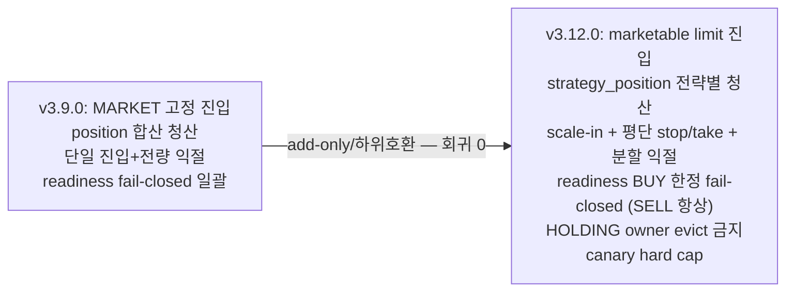

# 06 — magicJar v3.12.0 이력 추적 (PR · ADR · 기능 매핑)

> **작성자**: architect (baseline v3.12.0)
> **시점**: 2026-06-07 v3.12.0 태그 컷 직후
> **권위**: `_workspace/arch/adr/README.md` (ADR 인덱스) + `CHANGELOG.md` + `api/src/main/resources/db/migration/` (Flyway 실 파일) + v3.12.0 코드 inspection

본 문서는 v3.9.0(W4 마감) 이후 v3.12.0(실매매 직전 자본 path 완성)까지의 **결정 → 코드 → 마이그레이션 추적표**다. 실코드·실문서·실 마이그레이션 파일만 인용한다(추정 0).

---

## §1. v3.9.0 → v3.12.0 minor·patch 시계열

| 버전 | 일자 | 미러스톤 | 신규 ADR |
|------|------|----------|----------|
| v3.9.0 | 2026-05-24 | W4 마감 baseline (T-MARKET + T-AI + T-MCP 3 트랙 동시 진입) | 0100·0101·0102·0103 |
| v3.10.0 | 2026-05-31 | 캔들/오더블럭 후보 스크리닝 minor (`3m` interval 정식 + `4h`·`12h` 기준봉 + 사용자 실행형 screener 기본봉 `1d` LOCK + 재수집 UX) | 0104 |
| v3.10.1 | 2026-06-01 | RiskPlan·캔들 reconciliation 운영 patch (BUY 전 손절/익절 RiskPlan 필수 게이트 + AUTO SELL KIS 잔고 preflight) | 0105·0106 |
| v3.11.0 | 2026-06-03 | Scenario Replay Sandbox `T-SIM` (장외 전략/리스크/가상 주문/체결/오류 QA 재현 — live 주문 경로 분리 LOCK, `scenario_*` namespace) | 0107·0108 |
| **v3.12.0** | **2026-06-07** | **실매매 직전 자본 path 완성** (canary hard cap·전략별 포지션 귀속·scale-in/평단 exit·주문 집행 marketable limit·청산 "항상" 보장·AI 종목발굴 Claude CLI bridge) | **0109·0110·0111·0112·0113·0114** |

---

## §2. v3.12.0 신규 ADR 6건 추적 (0109~0114 — 실코드 매핑)

### ADR 0109 — REAL canary hard cap ENV 게이트 (Accepted 2026-06-05)

| 항목 | 내용 |
|---|---|
| 결정 | REAL canary 전용 hard cap ENV 3건(`MAGICJAR_CANARY_MAX_ORDER_QTY`·`_MAX_ORDER_NOTIONAL_KRW`·`_MAX_ORDERS_PER_DAY`)을 OrderRouter에서 RiskConfig·POSITION_LIMIT와 **독립** 강제 |
| 본질 | "실수해도 손실이 작게 캡됨" — RiskConfig는 운용 정책, hard cap은 운영 안전선(둘 다 통과해야 주문, 더 엄격한 쪽 적용) |
| 갭 evidence | `OrderRouterKafkaListener` 수량 상한 0(L212 `quantity<=0`만) + notional은 POSITION_LIMIT budget 기준만 + 일일 REAL 전역 cap 0 |
| reject reason | `CANARY_QTY_CAP` · `CANARY_NOTIONAL_CAP` · `CANARY_DAILY_ORDER_CAP` |
| 강제 위치 | OrderRouter Step 3(3중 게이트) 이후 ~ Step 5(INSERT) 이전 |
| 일일 횟수 권위 | `order_request` 당일 `mode='REAL'` count — **DB 단일 권위**(Redis 카운터 미사용 — drift 회피) |
| fail-open | ENV 미설정 또는 ≤0이면 게이트 통과(일반 REAL 운용) |
| 자원 | ENV add-only — Flyway·Kafka·Redis·STOMP·REST 신설 0 |
| 동반 | `docs/operations/real-canary-runbook.md` + spec `2026-06-05-real-canary-spec.md` |
| 코드 | `consumer/.../order/OrderRouterKafkaListener.kt` (canary cap 분기) |

### ADR 0110 — 전략별 포지션 귀속 `strategy_position` 1급 도메인 (Accepted 2026-06-05)

| 항목 | 내용 |
|---|---|
| 결정 | 기존 `position`(UNIQUE user+code · KIS 잔고 권위) 유지 + 그 아래 `strategy_position`(UNIQUE user+strategy+code) lot ledger 신설 |
| 문제 | `position`이 종목 합산 → 다전략 시 "어느 전략이 얼마에 샀나" 부재 → 익절/손절이 user+code 합산 평단 기준(A전략 물량을 B전략 평단으로 청산 오염) |
| 컬럼 | `quantity`·`avg_price`·`filled_lots`·`realized_pnl`·`opened_at`·`updated_at` + `executed_exit_stages JSONB`(부분 익절 중복 발화 방지) |
| 불변식 | `sum(strategy_position.quantity WHERE user+code) == position.quantity` — drift 시 **KIS 잔고(position) 상위 권위** + `STRATEGY_POSITION_DRIFT` SystemEvent(WARN) |
| RiskGateway 분기 | SELL 2룰만 전략별 분기 — `SELL_WITHOUT_POSITION`(그 전략 물량 0이면 차단) · `SELL_QUANTITY_UNAVAILABLE`. POSITION_LIMIT·MAX_CONCURRENT는 합산 유지(KIS·자본 노출 무관) |
| leg idempotency 권위 | `idempotency_key` UQ + Redis SETNX(`uq_order_signal_user` 아님). scale-in/분할 익절 leg는 회차/단계 suffix add |
| Flyway | **실 파일 V64** (ADR 본문은 V65 표기 — orchestrator 확정 시 V64로 당김) |
| 코드 | `domain/.../position/StrategyPosition.kt` · `port/StrategyPositionPort.kt` · `consumer/.../persistence/StrategyPositionJpaEntity.kt`·`StrategyPositionJpaRepository.kt` · `api/.../persistence/strategy/StrategyPositionReadJpaEntity.kt` |
| readiness | C-2(+5 P1) 해소 |

### ADR 0111 — RiskPlan scale-in / 평단 기준 exit 확장 (ADR 0106 amend, Accepted 2026-06-05)

| 항목 | 내용 |
|---|---|
| 결정 | ADR 0106 RiskPlan을 add-only 확장 — 미설정 전략은 현행 단일 진입+전량 익절(하위호환 LOCK) |
| 분할 매수 | `ScaleInPlan` — `totalSlices`(1~10) + `sliceWeights`(합=100/null이면 균등) + `reentryTrigger`(SIGNAL_REPEAT/PRICE_DROP_PCT) + `minSliceIntervalSec`. 매 회차 RiskPlan preflight 통과 의무 |
| 평단 exit | stop-loss exit 신규(`evaluateStopLossExit` — 현재가 ≤ 평단×(1-stopLoss%) → 전량 SELL) + 분할 익절 `PartialExit`(단계당 1회 발화 — `executed_exit_stages`) + 전량 익절(기존). 모든 exit는 `strategy_position.avgPrice`(전략 평단) 기준 |
| 동시 터치 | stop-loss·take-profit 동시면 stop-loss 우선(보수). live·리플레이·백테스트 동일 |
| 단일 함수 | `ScaleInExitCalculator`(순수 함수 — live·리플레이·백테스트 공유, PR #730 패턴) |
| DSL | 미확장(정책 레이어) |
| Flyway | **실 파일 V65** `strategy_scale_in_exit`(`scale_in_config`·`partial_exits` JSONB add-only — ADR 본문 V66 → V65로 당김) |
| 코드 | `strategy-engine/.../scalein/ScaleInExitCalculator.kt` · `ScaleInExitSimulation.kt` |

### ADR 0112 — AI 종목발굴 Claude CLI bridge + 전략 리서치 후보 탐색 (Accepted 2026-06-06, 작성자 Codex)

| 항목 | 내용 |
|---|---|
| 결정 | 전략 리서치 상단 AI 종목발굴 패널 + `POST /api/strategy-research/ai-discovery` |
| 사용자 명시 | "AI API 사용 안 할 거고 `claude -p`를 이용" — Anthropic API key 없이 CLI |
| provider 분기 | `BRIDGE_URL` 비어있음(IDE/host) → `ProcessBuilder(command,"-p",prompt)` 직접 실행(provider=`claude-cli`) / Docker dev → `http://host.docker.internal:8787/discover`(provider=`claude-cli-bridge`) |
| 매핑 | JSON 후보 → instrument master code/name/market → matched/unmatched 분류. matched만 기존 form/chart 이동, unmatched 표시만 |
| 안전 | 주문 adapter 호출 0 · `order.intent.v1` 발행 0 · 전략 자동 저장 0 · watchlist 자동 등록 0(direction-guard 정합) |
| Flyway | V67(`ai_discovery_state`) · V70(`ai_discovery_preset`) · V71(`ai_discovery_core_prompt`) + V74(`strategy_research_candidate` — 코드 18 후보 DB화) |
| 코드 | `api/.../strategyresearch/StrategyResearchAiDiscoveryService.kt` · `StrategyResearchAiTextClient.kt` · `scripts/claude-discovery-bridge.mjs` · `consumer/.../ai/ClaudeCliCommentAdapter.kt`(AI 4종 통일) |
| package | version `0.2.0` |

### ADR 0113 — 캔들 retention 계층화 케이스 분석 (Proposed 2026-06-06, 결정 보류)

| 항목 | 내용 |
|---|---|
| 맥락 | DB 전수 감사(`docs/assessments/2026-06-06-db-usage-contention-audit.html`) — candle 849MB(DB 87%)·인덱스 561MB(66%)·update/insert 2.4배·HOT 3.3% |
| 재확인 | KIS는 중간 interval(3m~12h) 미제공 → "1m 수집 + 백엔드 합산"(ADR 0062)이 유일 합리 source 전략 — **재확인 유지** |
| 케이스 | A(현상 유지)·B(일괄 6개월)·C(계층 retention — 권고)·D(합산 비영속 — 기각)·E(파티셔닝 — 100종목 트리거) |
| 권고안 C | 1m 6개월(admin 1년) / 3m·5m 2년 / 15m~12h 영구 / 일봉계열 영구 — 500종목에도 ~40GB 수렴 |
| 결정 | **보류**(사용자 지시 2026-06-06 — "분석만 문서화, 결정 보류") |
| 즉시 집행 | **V69** `idx_candle_code_interval_ts` drop(V1 출생 중복 · scan 0회 · 167MB) — 무위험 결함 정정(사용자 승인) |
| 후속 | v8 인덱스는 1~2주 pg_stat 관찰 후 V70 후속(retention 채택 시점에 ADR Accepted 승격 또는 후속 ADR) |

### ADR 0114 — 주문 집행 정책(marketable limit) + 포지션 청산 "항상" 보장 (Proposed 2026-06-07 → 코드 머지)

| 항목 | 내용 |
|---|---|
| 입력 권위 | `docs/assessments/2026-06-07-order-execution-policy-and-position-vigilance.html`(코드 전수 인용 + KIS open-trading-api 실측) |
| 사용자 2질문 | ① "시장가로만 사고 있지 않나?"(사실 — `OrderRouterKafkaListener.kt:949-952` default MARKET) ② "포지션 보유 중 시스템이 긴장 상태인가?"(게이트 4중 의존 구멍) |
| 진입 정책 | **marketable limit**(매도1호가, 상한=기준가×(1+maxEntrySlippctPct) 초과 시 스킵) + 스프레드 게이트(maxSpreadPct) + 미체결 entryTimeoutSec 취소(**시장가 전환 금지**) + 재시도 0회(기준가 불변) + 손절 MARKET/익절 LIMIT(트리거 가격) + 부분체결 명문화 |
| 청산 게이트 분화 | P1 readiness BUY 한정 fail-closed(SELL은 현재가 가용 시 진행 — RECONCILING/STALE 진행·FAILED 조건부) / P2 position-driven 청산(전략 status 무관·DISABLED 보유분 청산) / P3 `RealtimeDemandOwner.HOLDING` 신설(evict 절대 금지·체결 자동 등록) / P4 `market-hours-gate.sell-enabled` env(NXT) / P5 1m 폴링 post-MVP |
| KIS 구조 함의 | KIS 국내주식 OpenAPI에 서버 예약형 가격 트리거 스탑로스 **없음**(CTSC0008U=시간 예약 / ORD_DVSN=02=15:20 시장가 전환 / HTS 자동감시=단말 전용) → consumer 자체가 스탑로스 장치 |
| 순수 계산기 | `EntryPricePolicy`(domain/strategy-engine — live·백테스트·리플레이 공유, ScaleInExitCalculator 선례) |
| RiskPlan 진입 3종 | `maxEntrySlippctPct`(0.2)·`entryTimeoutSec`(15)·`maxSpreadPct`(0.3) JSONB add-only(하위호환) |
| ENV 5종 | `magicjar.order.entry.max-slippage-pct`·`.timeout-sec`·`.max-spread-pct`·`.retry-count` + `magicjar.signal.market-hours-gate.sell-enabled` |
| Flyway | V72(`entry_policy` JSONB) + V73(`min_hold_bars` — 잔익절 방어 B안 평면 INT) |
| 상태 | Proposed(별 브랜치 Codex 병렬 비교 머지 예정 — 머지 시 Accepted 승격) · **단 R1/R2 코드는 main 머지됨** |
| 코드 | `strategy-engine/.../entry/EntryPricePolicy.kt` · `domain/.../strategy/EntryPolicy.kt`·`EntryPolicySerde.kt` · `consumer/.../ingestion/RealtimeSubscriptionRouter.kt`(HOLDING) · `consumer/.../order/HoldingPositionIndex.kt`·`HoldingDemandRegistrar.kt`·`AutoExitOrderCoordinator.kt` |

---

## §3. Flyway V64~V74 매트릭스 (실 파일 권위 — 추정 0)

| version | 파일명 | 표/변경 | ADR | 하위호환 |
|---|---|---|---|---|
| V64 | `V64__strategy_position.sql` | strategy_position lot ledger (UNIQUE user+strategy+code) | 0110 | 신규 표 — 단일 전략은 1행=position 1행 정합 |
| V65 | `V65__strategy_scale_in_exit.sql` | strategy scale-in/partial-exit 정책 JSONB add-only | 0111 | null=현행 단일 진입+전량 익절 |
| V66 | `V66__order_request_source_external.sql` | order_request.source EXTERNAL 허용(CHECK 확장) | 자본 path fix | CHECK 완화 — 외부 HTS 주문 흡수 |
| V67 | `V67__strategy_research_ai_discovery_state.sql` | AI 종목발굴 마지막 조건·후보 상태 | 0112 | 신규 표 |
| V68 | `V68__backtest_run_code_multi_symbol.sql` | backtest_run.code 다종목 universe 저장 | 0056 정합 | VARCHAR(8)→확장 — 500 fix |
| V69 | `V69__drop_duplicate_candle_index.sql` | idx_candle_code_interval_ts drop(중복·167MB) | 0113 | drop only — uq DESC 커버 |
| V70 | `V70__strategy_research_ai_discovery_preset.sql` | AI 종목발굴 intent prompt preset | 0112 | 신규 표 |
| V71 | `V71__strategy_research_ai_discovery_core_prompt.sql` | core wrapper 사용자 편집 DB화 | 0112 | 신규 표 |
| V72 | `V72__strategy_entry_policy.sql` | strategy.entry_policy JSONB add-only | 0114 §5 | null=현행 MARKET 진입 |
| V73 | `V73__strategy_min_hold_bars.sql` | strategy.min_hold_bars INT add-only(잔익절 방어 B안) | 0114 인접 | null=비활성(현행) |
| V74 | `V74__strategy_research_candidate.sql` | 코드 하드코딩 18 리서치 후보 DB화 | 0112 정합 | 신규 표 |

> **번호 정합 evidence**: ADR 0110/0111 본문은 strategy_position=V65·scale-in=V66으로 명기했으나, main HEAD audit 결과 별 브랜치(T-SIM scenario V63 등) 점유로 orchestrator가 **V64·V65로 당겨 확정**했다(ADR 0102 자원 audit 절차 정합). V65 파일 헤더 주석도 "spec 본문 V66 → orchestrator 확정 V65로 당김" 명시. 실 파일이 권위.

---

## §4. v3.12.0 자본 path 변경 추적 (chain 정밀화)

| 변경 축 | v3.9.0 | v3.12.0 | ADR |
|---|---|---|---|
| 진입 가격 | MARKET 고정(default) | marketable limit(LIMIT 발행 + 상한 스킵) | 0114 |
| 미체결 처리 | (없음 — 시장가 즉시) | entryTimeoutSec 취소(시장가 전환 금지·추격 금지) | 0114 |
| 포지션 귀속 | user+code 합산 | + 전략별 lot ledger(strategy_position) | 0110 |
| 익절/손절 | 단일 진입+전량 익절(stop-loss 미구현) | scale-in + 평단 stop/take + 분할 익절 | 0111 |
| 청산 게이트 | readiness fail-closed 일괄(손절도 skip) | BUY 한정 fail-closed(SELL은 현재가 가용 시 항상) | 0114 P1 |
| 전략 status | ACTIVE/BUY_BLOCKED만 평가(DISABLED 방치) | position-driven(DISABLED 보유분도 청산) | 0114 P2 |
| 보유 종목 구독 | DETAIL/STRATEGY owner(evict 가능) | + HOLDING owner(evict 절대 금지) | 0114 P3 |
| 운영 안전선 | RiskConfig·POSITION_LIMIT만 | + canary hard cap 3 ENV(독립) | 0109 |

---

## §5. ADR 0114 R1/R2/R3 라운드 분할 추적 (개발 룰 3·4 정합)

| 라운드 | 범위 | 담당 | 코드 evidence |
|---|---|---|---|
| R1 | EntryPricePolicy 순수 계산기 + EntryPriceInput/Decision sealed + RiskPlan 진입 3종 JSONB(V72) + 전역 default env | strategy-engine(+domain) | `EntryPricePolicy.kt` · `EntryPolicy.kt`·`EntryPolicySerde.kt` · `EntryPricePolicyTest.kt` |
| R2 | 호가 source + BUY 경로 EntryPricePolicy 호출 + P1 readiness 분화 + P2 position-driven + P3 HOLDING owner + P4 sell-enabled env + 미체결 취소 워커 + 손절 MARKET/익절 LIMIT | backend-core + market-data | `RealtimeSubscriptionRouter.kt`(HOLDING) · `HoldingPositionIndex.kt`·`HoldingDemandRegistrar.kt`·`AutoExitOrderCoordinator.kt` |
| R3 | 백테스트 슬리피지 모델 정합 + 시나리오 리플레이 + qa 회귀 | qa(+strategy-engine) | `ScaleInExitSimulationR3Test.kt` |

R2 결정 위임 의제(§9 UNCERTAIN) — U-2 호가 잔량 임계 · U-3 호가 stale 판정 · U-4 미체결 취소 워커 위치 · U-5 익절 LIMIT 미체결 처리 · U-6 전략 삭제 시 청산 fallback · U-8 HOLDING 해제 grace TTL.

---

## §6. assessment evidence 추적 (입력 권위)

| assessment | 일자 | ADR/기능 |
|---|---|---|
| `2026-06-05-autotrading-readiness.html` | 2026-06-05 | 종합 87·MOCK 95·REAL 78 — REAL canary +5 P1(ADR 0109)·전략별 포지션 C-2(ADR 0110) |
| `2026-06-06-db-usage-contention-audit.html` | 2026-06-06 | candle 849MB·인덱스 561MB·update/insert 2.4배 — ADR 0113 retention 케이스 |
| `2026-06-06-candle-storage-capacity.html` | 2026-06-06 | row 단가 ~215B·종목 65MB/년 용량 — ADR 0113 §용량 기초 |
| `2026-06-06-candle-operating-policy-options.md` | 2026-06-06 | retention Case A~E — ADR 0113 §대안 |
| `2026-06-07-order-execution-policy-and-position-vigilance.html` | 2026-06-07 | 코드 전수 + KIS open-trading-api 실측 — ADR 0114 입력 권위 |
| `2026-06-07-autotrading-order-position-watch.html` | 2026-06-07 | 주문 정책·포지션 감시 점검 — ADR 0114 정합 |

---

본 06-history는 v3.12.0 시점 결정→코드→마이그레이션 추적표다. ADR 결정 근거 본문은 `_workspace/arch/adr/0109~0114`, 정책 변화 어필은 07-policy-evolution, 시스템 그림은 01-architecture를 참조한다.
