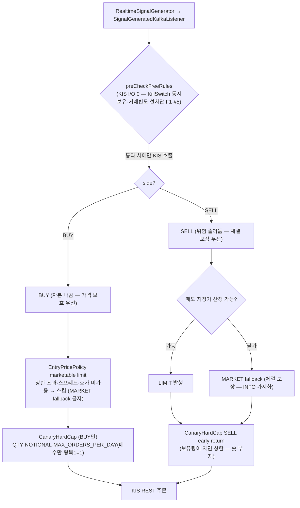
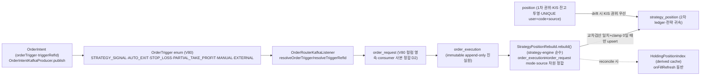
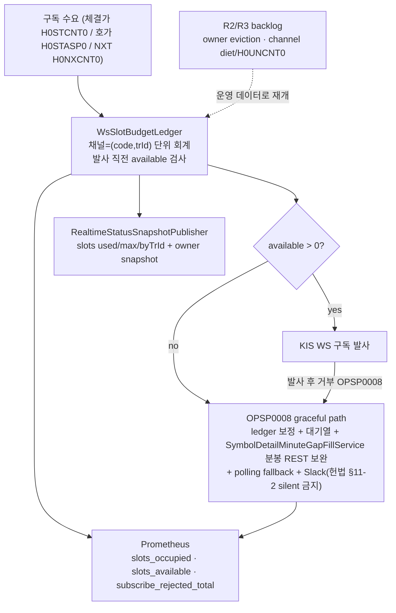
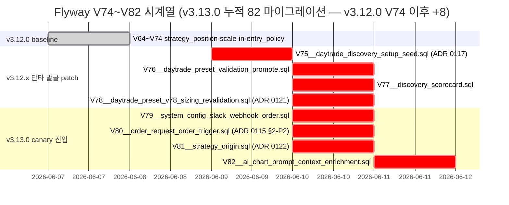
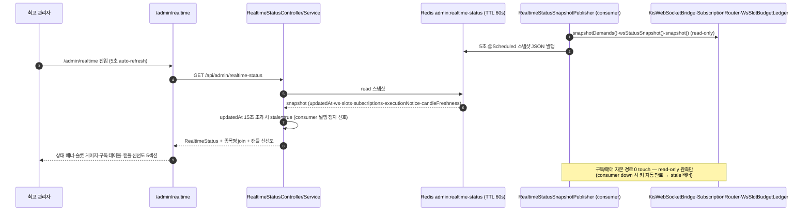

# 01 — magicJar v3.13.0 아키텍처 (시각화)

> **작성자**: architect (baseline v3.13.0)
> **시점**: 2026-06-12 v3.13.0 release commit 준비
> **권위**: `docs/architecture/master-architecture.md` v2 §3-5·§5·§6·§10·§13 + ADR 0002·0004·0005·0023·0030·0043·0048·0067·0068·0080·0094·0109·0110·0111·0112·0114 + **0115·0116·0117·0118·0119·0120·0121·0122·0123** + 정책 `long-only-trading.md` + 헌법 §11·§12·§13 + v3.13.0 시점 코드 inspection

본 문서는 v3.13.0 시점 magicJar 시스템의 **시각화 가능 수준 그림**이다. SoT는 `docs/architecture/master-architecture.md`이며, 본 문서는 그 하위 구체화 — v3.13.0 시점 실체(발행된 컨테이너·테이블·KIS endpoint·Kafka topic·STOMP 토픽·9 JVM 모듈·7 sub-agent hierarchy·운영 헌법 §1~§13·**REAL canary 실전 첫 완주 + 롱 온리 + 키 사슬 무결성 + WS 슬롯 단일 회계 — ADR 0115~0123**)만 인용한다. v1/v2 잔재 0건.

**v3.12.0 → v3.13.0 핵심 변경 (REAL canary 진입 마일스톤)**:

- **롱 온리 정책 명문화 (정책 `long-only-trading.md` + 헌법 §13 + ADR 0109 §7 amend)** — 공매도 부재 → 매도=보유분 청산 → cap·가격 보호는 BUY 비대칭. `OrderRouterKafkaListener.evaluateCanaryHardCap`는 `side==SELL` early return / `SignalGeneratedKafkaListener.publishSell`는 매도 지정가 산정 실패 시 MARKET fallback(INFO). canary cap = 매수만(왕복 1=1) — PR #927·#928·#926.
- **체결-원장-리스크 키 사슬 무결성 (ADR 0115 §2-P2)** — `OrderTrigger` enum 신설(`domain/.../order/execution/OrderTrigger.kt`) + Flyway V80(`order_trigger`·`trigger_ref_id`)로 0-sentinel 폐지. `BackfillCancelledFillPolicy`·`StrategyPositionRebuild`(strategy-engine 순수) + consumer 정합 배선. `strategy_position`을 `order_execution`(immutable 진실원) 파생 재계산 뷰로 점진 전환(대안 B-on-A). 헌법 §11(빈 합류 + silent fallback 금지) 동반.
- **KIS WS 슬롯 단일 회계 (ADR 0123 + ADR 0048 amend 41→40)** — `WsSlotBudgetLedger`(채널=(code,trId) 단위 회계·거부 감지·회계 보정·fallback wiring·slot metrics)까지 R1 반영. owner priority eviction(R2)과 채널 다이어트/H0UNCNT0(R3)는 운영 테스트에서 슬롯 포화·거부가 반복될 때 재개.
- **관리자 실시간 가시화** — `RealtimeStatusSnapshotPublisher`(consumer 5초 Redis 발행·TTL 60s) + `RealtimeStatusController`/`RealtimeStatusService`(api 가공) + `/admin/realtime` 화면 + `/magicjar-ops-monitor` 커맨드 + 일일 운영 보고.
- **DETAIL 호가 "표시 중에만"** — `OrderbookSubscriptionRouter`(consumer) DETAIL owner 진입 구독·이탈 즉시 해제(15분 idle 안전망). 수동매매 호가 보조 복원(PR #943·#944).
- **발굴 → MOCK 페이퍼 dispatch (ADR 0122)** — `Strategy.origin=PAPER_DISCOVERY`(V81) + `PaperCapitalSnapshotProviderAdapter`(가상 자본 격리) + `TradingModeGate.resolveMode(paperStrategy)` GAP-0 hotfix. 자동 진입 금지(opt-in 명시 액션만).
- **Flyway 누적**: V74 → V82 (+8 — V75~V78 단타 발굴·V79 slack order webhook·V80 order_trigger·V81 strategy_origin·V82 ai_chart_prompt).

---

## §1. 시스템 전경 (9 JVM 모듈 + frontend + docker + 외부 + 인프라 3 + REAL canary 실전 + ADR 0115~0123)

```mermaid
graph TD
    subgraph EXTERNAL["외부 통합 (옵션 + fallback)"]
        KISREST["KIS REST<br/>openapi.koreainvestment.com:9443 (real·조회)<br/>openapivts.koreainvestment.com:29443 (vps·주문)<br/>order-cash · order-rvsecncl(TTTC0013U/VTTC0013U 취소)<br/>· inquire-balance(TTTC/VTTC8434R) · inquire-daily-ccld(TTTC/VTTC0081R)<br/>· inquire-asking-price(FHKST01010200 marketable limit 호가)<br/>+ 3-tier 버킷 USER4/SHARED3/BG3 합10 (ADR 0116)"]
        KISWS["KIS WebSocket<br/>wss://ops.koreainvestment.com:21000<br/>H0STCNT0 체결가 + H0STASP0 호가 + H0NXCNT0 NXT<br/>+ H0STCNI0/H0STCNI9 체결통보 (실전/vps)<br/>+ AES-256-CBC 복호화 + 40 슬롯 단일 회계 (ADR 0123)"]
        KISMULTI["KIS REST 멀티시세 (ADR 0118)<br/>intstock-multprice FHKST11300006<br/>30종목/콜 야간 23:00 snapshot (전종목 1d)"]
        KISMASTER["KIS 종목마스터 ZIP<br/>new.real.download.dws.co.kr (instrument 73필드)"]
        DART["DART OPENDART · NAVER Open API (T-NEWS)"]
        CLAUDECLI["Claude CLI (ADR 0112)<br/>claude -p (host) / claude-discovery-bridge.mjs (:8787)<br/>AI 4종(발굴·차트해석·전략빌더·코멘트) · API key 없이"]
    end

    subgraph FRONTEND["frontend (React 19 + Vite + Tailwind + LWC v4 — pnpm)"]
        FE_DASH["/<br/>DashboardPage + AccountSummary + Holdings + MarketIndexStrip"]
        FE_SYM["/symbol/:code<br/>+ STOMP boundary + LWC chart + AiCard<br/>+ SymbolOrderbook (DETAIL 표시 중에만·이탈 해제 #943)<br/>+ OrderTicket 지정가 진입 ON"]
        FE_SB["/strategy/builder + RiskPlan (scale-in·손절·익절·entry 정책)"]
        FE_RESEARCH["/strategy/research<br/>+ AI 종목발굴 패널 (ADR 0112)<br/>+ 단타 발굴 스코어카드 (ADR 0117)"]
        FE_PAPER["/api/daytrade/paper/* 진입점<br/>+ 발굴→MOCK 페이퍼 승격 opt-in (ADR 0122)"]
        FE_POS["/positions + /orders + /journal"]
        FE_TRACE["/strategy/list 사인 키 사슬 추적 (ADR 0115 §2-B #4)<br/>+ OrderTriggerBadge + SignalTracePanel"]
        FE_ADMIN["/admin/realtime (신규)<br/>WS 연결·슬롯 게이지·구독 테이블·캔들 신선도<br/>+ 5초 auto-refresh + /system"]
        FE_SET["SettingsModal + KIS 키 + KillSwitch + RealTradingConsent 이중 confirm"]
    end

    subgraph API["api (Spring Boot 3.3 / 8080)"]
        API_REST["REST controllers (Account·Order·Screener·Journal·News·Market·Mcp ...)"]
        API_ADMIN["RealtimeStatusController + RealtimeStatusService<br/>GET /api/admin/realtime-status (Redis 스냅샷 read·종목명 join·캔들 신선도)"]
        API_PAPER["DaytradePaperController (ADR 0122)<br/>POST /promote · DELETE /{id} · GET /strategies · GET /positions<br/>+ RiskConfig 프로필 <userId>:paper"]
        API_TRACE["SignalTraceService (ADR 0115 §2-B)<br/>GET /api/signals/{id}/trace (사인→주문→체결→보유 교차검산 read-only)"]
        API_RESEARCH["StrategyResearchAiDiscoveryService + 단타 발굴 (ADR 0112·0117)"]
        API_FLY["Flyway V1~V82 적용기 (v3.13.0: V75~V82 +8 · JpaScanConfiguration 화이트리스트 LOCK ADR 0103)"]
        API_KIS["KisTokenService + KisRateLimiterPort(3-tier ADR 0116) + ReconcileService"]
    end

    subgraph BATCH["batch (Spring Batch / 8081)"]
        B_INSTR["InstrumentSyncJob + MARKET_DAILY universe (ADR 0118)"]
        B_PERF["DailyPerformanceJob + DailyScreenerJob"]
        B_ROLLUP["MarketDailyRollupService + DailyRollupAggregator (ADR 0120 — 1d→1wk/1mo/1y)"]
        B_NIGHT["MarketDailyNightlySnapshotService (multprice 23:00 + 롤업)"]
    end

    subgraph CONSUMER["consumer (Kafka + KIS WS / 8082)"]
        C_KIS_WS["KisWebSocketBridge<br/>H0STCNT0 + H0STASP0 + H0NXCNT0 + H0STCNI0/9<br/>+ AES-256-CBC + wsStatusSnapshot()"]
        C_LEDGER["WsSlotBudgetLedger (ADR 0123 R1)<br/>+ 채널=(code,trId) 단위 회계 · 40 슬롯 단일 권위<br/>+ OPSP0008 감지 · 회계 보정 · fallback/metrics"]
        C_SUBROUTER["RealtimeSubscriptionRouter (체결가) + OrderbookSubscriptionRouter (호가)<br/>+ owner snapshot: HOLDING/PENDING_BUY/DETAIL/WATCHLIST/STRATEGY<br/>+ eviction 실행은 ADR 0123 R2 deferred<br/>+ DETAIL 호가 진입 구독·이탈 해제 (#944)<br/>+ snapshotDemands() read-only 관측"]
        C_SIG["RealtimeSignalGenerator + SignalGeneratedKafkaListener<br/>+ preCheckFreeRules (KIS I/O 전 공짜 룰 선차단 F1-#5)<br/>+ publishSell MARKET fallback (롱 온리 §13)<br/>+ CapitalSnapshotSelector.forStrategy (페이퍼 분기)"]
        C_RISK["RiskGatewayEvaluator (ADR 0067·0110)<br/>+ SELL 2룰 strategy_position 분기<br/>+ holdingQuantity 원장 0 시 실잔고 fallback (F1-#4)<br/>+ TradeFrequencyRedisGuard KST 자정 경계 (F1-#3)"]
        C_ORDER["OrderRouterKafkaListener (12 step LOCK)<br/>+ CanaryHardCapGate BUY 한정 (ADR 0109 §7)<br/>+ resolveOrderTrigger/resolveTriggerRefId (V80 키 부여)<br/>+ resolvePaperStrategy → TradingModeGate (ADR 0122 GAP-0)<br/>+ strategy_position upsert"]
        C_EXIT["AutoExitOrderCoordinator + PositionStopLossTickWatcher<br/>+ 손절 MARKET / 익절 LIMIT<br/>+ ExpiredDayOrderSyncWorker (만료 day-order 동기화 F1-#1)<br/>+ source 차원 정합 (MOCK·REAL 공존 D1)"]
        C_INTEGRITY["BackfillCancelledFillPolicy + StrategyPositionRebuild (strategy-engine 순수)<br/>+ ConsumerExecutionStrategyPositionAdapter.rebuildStrategyPositionFromLedger<br/>+ order_execution 파생 재계산 (ADR 0115 §2-P2 B-on-A)"]
        C_CONSENT["ConsumerRealTradingConsentJpaAdapter (consumer-local · F2)<br/>+ user_account.real_trading_consent_at read-only (헌법 §11)"]
        C_STATUS["RealtimeStatusSnapshotPublisher (5초 Redis admin:realtime-status TTL 60s)"]
        C_AI["ClaudeCliCommentAdapter (AI 4종 통일 · 자본 path AI 0)"]
    end

    subgraph INFRA["인프라 (3 컨테이너)"]
        PG["PostgreSQL 16<br/>+ V1~V82 누적 (v3.13.0 +8)<br/>+ order_trigger/trigger_ref_id(V80) + strategy_origin(V81)<br/>+ daytrade discovery(V75~V78) + ai_chart_prompt(V82)"]
        REDIS["Redis 7<br/>+ kis token + 3-tier 버킷 3키(ADR 0116)<br/>+ admin:realtime-status snapshot(TTL 60s)<br/>+ TradeFrequency day ZSET (KST 자정 trim)<br/>+ canary 일일 카운트는 DB 권위(order_request)"]
        KAFKA["Kafka 3.7 KRaft<br/>+ order.intent.v1 (orderTrigger/triggerRefId add-only)<br/>+ signal.generated.v1 · order.filled.v1<br/>+ market.realtime.demand.v1 (owner priority)"]
    end

    subgraph OBS["관측 + DR (P0 OPS LOCK)"]
        PROM["Prometheus SLO + Grafana :3001<br/>+ KIS WS slot 5종(ADR 0123) + rate limit windowCount 차등(ADR 0095 amend)"]
        OPSMON["/magicjar-ops-monitor 커맨드 + 일일 운영 보고<br/>+ backup/DR cron (pg-dump-daily·redis-snapshot)"]
    end

    FE_ADMIN -->|GET /api/admin/realtime-status| API_ADMIN
    API_ADMIN -->|read admin:realtime-status| REDIS
    C_STATUS -->|5초 발행| REDIS
    FE_PAPER -->|POST /promote opt-in| API_PAPER
    FE_TRACE -->|GET /signals/id/trace| API_TRACE

    C_KIS_WS -->|H0STCNI0/9 체결| C_ORDER
    C_LEDGER -->|available 검사| C_SUBROUTER
    C_SIG -->|preCheckFreeRules 통과 후 KIS 호출| C_RISK
    C_RISK -->|verdict ALLOWED| C_ORDER
    C_ORDER -->|CanaryHardCap BUY 한정 통과| KISREST
    C_ORDER -->|orderTrigger/triggerRefId + strategy_position upsert| PG
    C_EXIT -->|손절 MARKET/익절 LIMIT| KISREST
    C_INTEGRITY -->|rebuild 교차검산| PG
    C_CONSENT -->|consent read| PG
```



본 그림 명시 사실:

- **9 JVM 모듈 보존** — domain · pattern-engine · indicator-impl · persistence-shared · strategy-engine · market-trend-engine · api · batch · consumer (신규 모듈 0)
- **REAL canary 실전 자본 path** — RealtimeSignalGenerator(preCheckFreeRules 선차단) → RiskGatewayEvaluator(holdingQuantity 실잔고 fallback) → EntryPricePolicy(marketable limit) → OrderRouter(CanaryHardCap **BUY 한정** + orderTrigger 키 부여 + paper origin 인지) → KIS REST/WS 체결 → AutoExit/StopLoss(손절 MARKET/익절 LIMIT·만료 day-order 동기화)
- **체결-원장-리스크 무결성** — order_execution(immutable 진실원) → StrategyPositionRebuild 재계산 → KIS authority(position) 교차검산 → strategy_position upsert (누락 영구화 불가)
- **WS 슬롯 단일 회계** — WsSlotBudgetLedger(40 채널 단위) + OPSP0008 감지·회계 보정·관측(R1). owner eviction은 R2 deferred.
- **관리자 가시화** — RealtimeStatusSnapshotPublisher(consumer) → Redis → RealtimeStatusService(api) → /admin/realtime

---

## §2. 롱 온리 자본 path 비대칭 흐름 — "BUY=가격 보호 / SELL=체결 보장" (정책 `long-only-trading.md` + ADR 0109 §7)



**롱 온리 정책 핵심 (`long-only-trading.md` — 최고 관리자 직접 결재 2026-06-12)**:

- **magicJar는 롱 온리** — 공매도·대주·파생 숏 부재. 매도(SELL)는 항상 보유분 청산이므로 보유 수량이 자연 상한 → 매도에 금액·수량 cap 검증 불요.
- **canary cap BUY 비대칭** — `OrderRouterKafkaListener.evaluateCanaryHardCap`는 `side==SELL` early return. `MAX_ORDERS_PER_DAY`=당일 매수만·왕복 1회=1카운트, REJECTED 미카운트(PR #927·#928).
- **매도 MARKET fallback** — 매도 지정가 산정 실패 시 시장가로 던진다(`SignalGeneratedKafkaListener.publishSell`·INFO 가시화). 청산은 체결 확실성이 본질(ADR 0114 §1-2). 진입(BUY)은 MARKET fallback 금지(슬리피지 캡 자기 부정 — ADR 0114 §3-1-5)와 방향 구분 명문화.
- **`SELL_WITHOUT_POSITION`은 정상 가드** — 보유 0의 SELL 시그널 차단은 알람 대상 아님(Slack mute — PR #926).

**라이브 incident 근거 (2026-06-12 REAL canary 2일차 — 자본 보호 역전)**: cap 3종이 방향 무구분이라 청산을 막아 손실을 키웠다 — 11:32 익절 LIMIT `CANARY_DAILY_ORDER_CAP:5>=5` · 13:11 DSL 청산 `6>=5` · 13:31 수동 SELL `CANARY_NOTIONAL_CAP:PRICE_UNAVAILABLE`. → ADR 0109 §7 amend + 정책 명문화로 영구 차단.

---

## §3. 체결-원장-리스크 키 사슬 무결성 (ADR 0115 §2-P2 — 대안 B-on-A)



**무결성 불변식 (ADR 0115 §2-P2 — 최고 관리자 키 사슬 무결성 요구)**:

- **파생 상태 재계산 가능성** (master §3-5 신설) — 보유 수량 등 파생 ledger는 immutable 진실원(`order_execution`)에서 **결정론적 재계산 가능**해야 한다. 독립 mutable 증분 원장은 증분 1회 누락이 영구화되므로 금지 방향. drift reconcile 시 진실원에서 rebuild로 `Σ전략 귀속 == KIS authority(position)` 검산 → 누락이 발생해도 다음 reconcile가 흡수.
- **0-sentinel 폐지 (R2)** — 자동청산 SELL `signal_id=0`·백필 stub `strategy_id=0`로 발사 출처 데이터 차원이 소실되던 G7을 `OrderTrigger` enum + `trigger_ref_id`로 차원 복원. 발사 지점 전수 키 부여(시그널·자동익절·tick 손절·수동·외부 흡수).
- **source·mode 차원 정합 (D1 라이브 fix)** — position UQ=(user,code,**source**)로 MOCK·REAL 행 공존이 정상. watcher가 현재 모드 source로 좁혀 조회 + ledger 집계 3쿼리에 `r.mode = :mode` 추가(권위↔체결 비교축 정합) + reconcileDrift 권위 행 부재 시 내림 보정 skip.

**3중 상태 권위·시차 매트릭스 (master §3-5-1)**:

| 상태 | 위치 | 역할 | 동기화 |
|---|---|---|---|
| `position` | DB (user+code+source) | **1차 권위** (KIS 잔고 투영) | 5분 worker 자기치유 |
| `strategy_position` | DB (user+strategy+code) | **2차 ledger** (전략 귀속 — ADR 0110) | 체결 즉시~5분 + replay + drift rebuild |
| `HoldingPositionIndex` | in-memory | **derived cache** | onFillRefresh 동반(DB 직접 정정 감지) |

---

## §4. KIS WS 구독 슬롯 단일 회계 R1 (ADR 0123 + ADR 0048 amend)



**WS 슬롯 회계 핵심 (ADR 0123 — 2026-06-11 후성(093370) OPSP0008 incident)**:

- **root cause** — 체결가·호가 두 독립 라우터가 부분 한도를 각각 관리 + NXT(H0NXCNT0) 이중 발사 미회계 + 거부 응답 미감지 → 총 점유 40 초과 인지 0(분봉 35/92 결손).
- **40 KIS-first 정정** — ADR 0048 본문 "41건"은 KIS-first raw `kis_auth.py` enforce 결과 **40건**으로 정정(채널=(code,trId) 단위 회계). 자체 추론 0.
- **R1 현재 baseline** — `WsSlotBudgetLedger` 채널 단위 회계 + OPSP0008 감지/보정 + gap-fill/polling fallback + Prometheus metrics + `/admin/realtime` slot snapshot.
- **R2/R3 deferred** — owner priority eviction(HOLDING/PENDING_BUY 보호)과 채널 다이어트(NXT owner별 선택화·H0UNCNT0 통합 체결가)는 운영 테스트에서 슬롯 포화/거부가 반복될 때 재개.

---

## §5. Flyway V1~V82 시계열 매트릭스 (v3.13.0 cut 시점 baseline)



**v3.13.0 사이클 신규 마이그레이션 8건 (V75~V82 — 실 파일 권위)**:

| version | 표/변경 | ADR | 비고 |
|---|---|---|---|
| **V75** | `daytrade_discovery_setup_seed` (빌트인 단타 setup 프리셋) | 0117 | 신규 표 — 단타 발굴 레이어 |
| **V76** | `daytrade_preset_validation_promote` (IS/OOS 검증·승격) | 0117 | — |
| **V77** | `discovery_scorecard` (발굴 스코어카드 08:30/23:30) | 0117 | — |
| **V78** | `daytrade_preset_v78_sizing_revalidation` (FixedFractional 재검증) | 0121 | H1 active 유지·H2/H6 신규 승격 |
| **V79** | `system_config_slack_webhook_order` (주문 체결 추가 Slack 채널 BYTEA·AES-GCM) | (운영 알림) | 주문 Slack 이중 송출 |
| **V80** | `order_request.order_trigger VARCHAR(24)` + `trigger_ref_id BIGINT` + CHECK(6값 OR NULL) + 기존 행 backfill | 0115 §2-P2 | 0-sentinel 폐지 — legacy null=USER_DSL 정합 |
| **V81** | `strategy.origin` enum(USER_DSL default·PAPER_DISCOVERY) | 0122 | null=legacy=USER_DSL zero-regression |
| **V82** | `ai_chart_prompt_context_enrichment` (차트 해석 프롬프트 컨텍스트) | 0112 정합 | AI 4종 차트해석 보강 |

> **Flyway 정합 주의**: V75~V78은 직전 v3.12.x patch(단타 발굴)에서 적재됐으나 v3.12.0 baseline 매트릭스(V64~V74) 이후이므로 본 baseline에서 통합 추적한다. 실 파일(`api/src/main/resources/db/migration/`)이 권위.

---

## §6. 관리자 실시간 상태 가시화 흐름



**관리자 가시화 핵심**: 최고 관리자 결재("내가 그 상태를 확인 못 하니깐 장애 처리가 어렵다"). consumer 인메모리 상태를 read-only 스냅샷으로 Redis에 발행(구독/매매 로직 변경 0) + api가 종목명·캔들 신선도 가공. 부분 실패 fail-open(관측 화면 무중단). `/magicjar-ops-monitor` 커맨드 + 일일 운영 보고가 화면 가시성을 보완.

---

## §7. 모듈 경계 (ADR 0004 — 9 모듈 보존) + 헌법 §11 빈 합류 검증

```
domain/                  순수 도메인 + port (Spring·JPA 의존 0)
  └─ order/execution/OrderTrigger.kt                       (ADR 0115 §2-P2 — 발사 출처 enum)
  └─ order/execution/port/TradingModeGate.kt               (ADR 0122 — resolveMode(paperStrategy))
strategy-engine/         DSL parser + 순수 계산기 (api·consumer 공유 — ADR 0092)
  ├─ integrity/BackfillCancelledFillPolicy.kt              (ADR 0115 §2-P2 R1 — G5)
  └─ integrity/StrategyPositionRebuild.kt                  (ADR 0115 §2-P2 — order_execution 재계산)
api/                     REST/STOMP + 외부 어댑터 + Strategy CRUD + AI + 관리자 관측
  ├─ controller/runtime/RealtimeStatusController.kt        (관리자 실시간 상태)
  ├─ service/runtime/RealtimeStatusService.kt
  └─ controller/daytrade/DaytradePaperController.kt        (ADR 0122)
consumer/                Kafka 소비 + KIS WS + 시그널·주문 + 청산 + 무결성
  ├─ order/OrderRouterKafkaListener.kt (canary BUY 한정·orderTrigger·paper origin)
  ├─ order/ExpiredDayOrderSyncWorker.kt·PositionStopLossTickWatcher.kt (F1·D1)
  ├─ risk/RiskGatewayEvaluator.kt (holdingQuantity 실잔고 fallback·preCheckFreeRules)
  ├─ risk/SignalGeneratedKafkaListener.kt (publishSell MARKET fallback·페이퍼 분기)
  ├─ risk/PaperCapitalSnapshotProviderAdapter.kt (ADR 0122 가상 자본 격리)
  ├─ ingestion/WsSlotBudgetLedger.kt·OrderbookSubscriptionRouter.kt (ADR 0123)
  ├─ ingestion/RealtimeStatusSnapshotPublisher.kt (관리자 관측 발행)
  └─ persistence/ConsumerRealTradingConsentJpaAdapter.kt (F2 — 헌법 §11 빈 합류)
batch/ · persistence-shared/ · indicator-impl/ · pattern-engine/ · market-trend-engine/  (보존)
frontend/                React 19 + Vite + LWC v4 (HTTP/STOMP only — JVM 그래프 밖)
docker/                  인프라 3 + 앱 4 = 7 컨테이너
```

- **헌법 §11 신설 (ADR 0115 §2-P2)**: domain port 구현 빈의 모듈별 합류 검증 의무 + silent fallback 금지. `RealTradingConsentJpaAdapter`가 api 모듈에만 `@Component` 존재 → consumer ApplicationContext 빈 부재 → 첫 REAL 매수가 `CONSENT_PORT_UNAVAILABLE` 거부(F2). consumer-local `Consumer*JpaAdapter` 패턴으로 합류 + 정적 검증 테스트(@Component 존재·scan 범위·타입 빈 정확히 1개)로 silent 재발 차단.
- **순수성 LOCK**: `BackfillCancelledFillPolicy`·`StrategyPositionRebuild`·`EntryPricePolicy`·`ScaleInExitCalculator`는 Spring·JPA·IO·AI 의존 0 — 입력→출력 결정론(백테스트/리플레이/재계산 재현성).

---

본 01-architecture는 v3.13.0 시점 magicJar 시스템의 시각화 가능 수준 그림이다. 본 baseline 폴더의 02-data-flow(backend-core) · 03-use-sequences(market-data KIS-first raw) · 04-feature-spec(backend-core) · 05-ui-inventory(frontend) · 06-history-traceability · 07-policy-evolution 본문은 본 문서를 횡단 인용한다.
