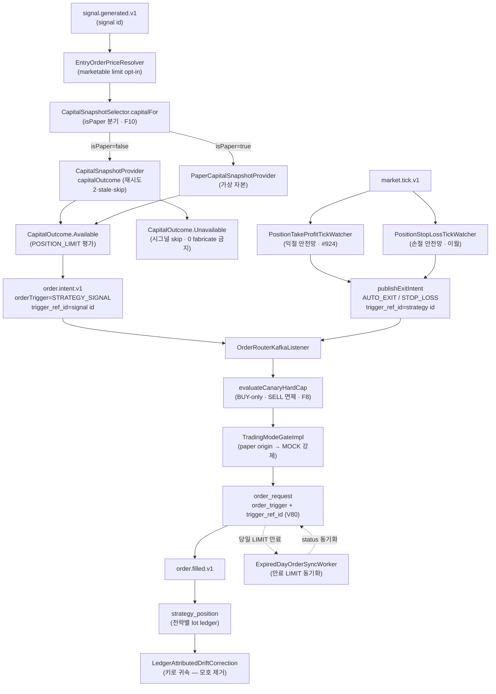

# v3.13.0 데이터 흐름 매트릭스

- baseline: v3.13.0
- 작성일: 2026-06-12
- 작성자: backend-core (bot+backend-core@magicjar.local)
- SoT: `docs/architecture/master-architecture.md` §2 + `settings.gradle.kts` + ADR 0004 + ADR 0094 (운영 단계) + ADR 0109 (canary hard cap) + ADR 0114 (주문 집행 정책) + ADR 0115 (체결-원장 키 사슬 무결성) + ADR 0122 (발굴→MOCK 페이퍼 dispatch) + ADR 0123 (KIS WS 슬롯 단일 회계)
- 기준: v3.12.0 02-data-flow.md 전체 이월 + **체결-원장 키 사슬 무결성** (OrderTrigger enum·trigger_ref_id 실키 — V80 · ADR 0115) + **자본 조회 실패 sealed 처리** (CapitalOutcome — F10 · 0원 fabricate 폐기) + **canary hard cap BUY-only 의미** (SELL 전면 면제 — F8 · ADR 0109 §7) + **AutoPauseGuard 무해 가드 제외** (F9) + **만료 주문 동기화 워커** + **취소 ODNO 매핑** (F7) + **TP tick watcher** (#924 익절 안전망 격상) + **지정가 진입 opt-in** (marketable limit) + **발굴 페이퍼(MOCK) 경로** (StrategyOrigin·PaperCapital — V81 · ADR 0122) + **관리자 실시간 상태 snapshot** (`admin:realtime-status`) + **DETAIL 호가 "표시 중에만"** (#944) + Flyway 8건(V75~V82)

---

## 🔄 v3.12.0 → v3.13.0 진화 요약 (리팩토링맨 lens)

| 영역 | v3.12.0 | v3.13.0 | 진화 사유 |
|------|---------|---------|----------|
| 체결-원장 귀속 키 | `signal_id=0` sentinel(자동청산) · `strategy_id=0` stub(백필) — 발사 출처 데이터 차원 소실 | **`order_trigger` enum + `trigger_ref_id` 실키**(V80) — "signal 없는 주문은 허용, 출처 모르는 주문은 폐지" | ADR 0115 §2-P2-⑥ — 최고 관리자 "매도했다는데 포지션 남고 매수했다는데 포지션 안 보이면 자동매매 실격" |
| 잔고(capital) 조회 실패 | KIS 실패 시 **`BigDecimal.ZERO` fabricate** → "0원 × 70% = 한도 0원" POSITION_LIMIT 거짓 차단 + AutoPause 오염 | **`CapitalOutcome` sealed**(`Available(값,stale)` / `Unavailable(reason)`) — 재시도 2회 → stale-cache → skip · 0 fabricate 어떤 실패에서도 금지 | F10(2026-06-12 결재) — "실제 0"과 "조회 불가"를 타입 분리(컴파일 타임 차단) |
| canary hard cap | qty·notional·daily 3 cap 전부 BUY/SELL 공통 적용 | **SELL 전면 면제**(숏 부재 — 매도는 보유량이 자연 상한) · daily cap도 BUY-only count | F8(13:31 incident) — 시장가 SELL이 `PRICE_UNAVAILABLE` notional cap에 막혀 **청산 차단** = 자본 보호 역전 |
| AutoPause 카운트 | 모든 risk reject가 임계에 기여 | **무해 가드 rule 제외**(`SELL_WITHOUT_POSITION` 등 — 보유 0 SELL 차단은 정상 거동) | F9 — 상태형 exit 전략이 정상 가드로 자동정지되는 결함 |
| 만료 LIMIT 주문 | KIS 당일 LIMIT 만료를 클라이언트가 못 받아 DB `status=ACK` **영구 잔존** → 다음날 SELL 시그널 오판 | **`ExpiredDayOrderSyncWorker`** — KIS 일별체결조회로 만료 동기화 | canary D2(09:01~09:04 incident) |
| 익절 실행 | BUY 체결 시 LIMIT 1회 선주문 + **DSL SELL 시그널 처리 때만 재발행** → 당일 만료 후 +11% 급등에도 익절 영영 안 나감 | **`PositionTakeProfitTickWatcher`**(#924) — `market.tick.v1` 직접 listen → tick ≥ 익절가 즉시 MARKET SELL(손절 watcher 대칭) | canary D2 batch B — 손절만 tick 감시던 비대칭 해소 |
| 취소 ODNO | 취소 시 KIS 신규 ODNO를 외부(EXTERNAL) 주문으로 오인 흡수 | **`OODER_NO` fallback** — 취소 ODNO를 원주문에 매핑 | F7 |
| 진입 가격 | marketable limit 전역 globalDefault **무조건 적용** → 호가 미가용 시 NoQuote skip 다발 | **opt-in 게이트** — 전략 `entry_policy` 명시 보유 또는 전역 `limitEnabled=true`에만 marketable limit · 그 외 기존(시장가) | 2026-06-08 hotfix — 적용 대상 한정으로 호가 미가용 skip 부작용 제거 |
| 페이퍼(MOCK) 경로 | 0건 (전략 origin 구분 없음) | **발굴→MOCK 페이퍼 dispatch**(`StrategyOrigin.PAPER_DISCOVERY` — V81) + 가상 자본(`PaperCapitalSnapshotProvider`) 격리 | ADR 0122 — 발굴 setup을 실 자본 오염 없이 페이퍼로 굴려봄 |
| 관측 | Prometheus/Grafana SLO만 | **`admin:realtime-status`** — consumer가 KIS WS 세션·슬롯 회계·구독 owner·체결통보 상태를 Redis 5초 발행 → api read-only 진단 화면 | 최고 관리자 "한 화면에서 보고 장애 처리" |
| DETAIL 호가 구독 | (사이클 중 제거됐다가) 복원 — "표시 중에만" 진입 구독·이탈 즉시 해제 + 15분 idle 안전망 | (#944) | watchlist 합집합 금지 방향 가드 정합 |
| Flyway | V74까지 | **V82까지** (V75~V82 8건 — 단타 발굴 seed/검증·스코어카드·Slack webhook·order_trigger·strategy_origin·chart prompt v2) | — |

✨ **핵심 통찰**: v3.12.0이 자본 path를 **안전 방향으로 신규 합류**(진입 marketable limit·청산 항상 보장)한 baseline이었다면, v3.13.0은 그 자본 path를 **운영 incident evidence로 견고화**한 baseline이다. REAL canary 실전 dwell(09:01~14:12 incident 다발)에서 드러난 6개 구조적 결함(0원 fabricate·SELL cap 역전·정상 가드 AutoPause·만료 주문 잔존·익절 시그널 의존·취소 ODNO 오인)을 sealed 타입·BUY-only 면제·tick 격상·동기화 워커로 닫았다. 동시에 ADR 0115 키 사슬 무결성(`order_trigger`·`trigger_ref_id`)으로 "어느 전략이 몇 주 샀고 몇 주 팔았나"를 데이터 차원에서 추적 가능하게 만들어 drift 귀속의 근본(키 부재)을 제거했다. 페이퍼(MOCK) 경로(ADR 0122)는 발굴 후보를 실 자본 오염 없이 검증하는 격리 레인을 열었다. 모든 변경이 add-only 하위호환 LOCK + AI 결정권 0.

---

## 1. 모듈 의존성 매트릭스

### 1-1. JVM 9 모듈 구성 (v3.12.0 이월 — 변동 0)

```
settings.gradle.kts include:
  domain
  pattern-engine
  indicator-impl
  strategy-engine
  market-trend-engine
  persistence-shared
  api
  batch
  consumer
```

| 모듈 | Spring 의존 | JPA 의존 | v3.13.0 역할 변동 |
|------|------------|---------|------------------|
| `domain` | 0 | 0 | **+ `OrderTrigger` enum**(`domain.order.execution` — 발사 출처 1급 키) + **`StrategyOrigin` enum**(`domain.strategy` — USER_DSL/PAPER_DISCOVERY) + **`CapitalOutcome` sealed·`CapitalSnapshotSelector`·`PaperCapitalSnapshotProvider` 포트**(`domain.risk.port`) + `OrderRequest.orderTrigger`/`triggerRefId` 필드 |
| `pattern-engine` | 0 | 0 | v3.12.0 LOCK 이월 |
| `indicator-impl` | 0 | 0 | v3.12.0 LOCK 이월 |
| `strategy-engine` | 0 | 0 | `EntryPricePolicy`·`KrxTickSize`·`ScaleInExitCalculator` LOCK 이월(TP tick watcher가 `EntryPricePolicy.takeProfitLimitPrice` 재사용) + `Strategy.origin` 필드 |
| `market-trend-engine` | Spring Context only | 0 | v3.12.0 LOCK 이월 |
| `persistence-shared` | data-jpa | JPA | Outbox 공용 어댑터 (ADR 0088) LOCK 이월 |
| `api` | Spring Boot 3.3 | JPA | **+ `RealtimeStatusController`/`RealtimeStatusService`**(관리자 실시간 상태) + 발굴 페이퍼 dispatch REST(`DaytradePaperService`) + order_trigger 조회 필터 |
| `batch` | Spring Boot 3.3 + Spring Batch | JPA | v3.12.0 LOCK 이월 |
| `consumer` | Spring Boot 3.3 | JPA | **+ 주문 집행/원장 컴포넌트 다수**(`PositionTakeProfitTickWatcher`·`ExpiredDayOrderSyncWorker`·`RealtimeStatusSnapshotPublisher`) + `KisCapitalSnapshotProviderAdapter`/`CapitalSnapshotProviderAdapter`(F10) + `PaperCapitalSnapshotProviderAdapter`(ADR 0122) + `TradingModeGateImpl` paper 인지 + canary hard cap BUY-only |

- `domain` 비의존 LOCK 유지 (Spring·JPA import 0 — ArchUnit 게이트). `CapitalOutcome`·`CapitalSnapshotSelector`·`OrderTrigger`·`StrategyOrigin` 모두 순수 도메인.
- **`CapitalSnapshotSelector`는 origin enum 직접 의존 회피 — `isPaper: Boolean` 술어로 분기**(strategy 도메인과 add-only 병렬 충돌 차단, R1/R2 분리 — `CapitalSnapshotSelector.kt` 주석 근거).
- 컨테이너 매트릭스 변동 0 (여전히 4 + 인프라 3 = 7 컨테이너).

### 1-2. v3.13.0 신규/변경 컴포넌트 위치 매트릭스

| 컴포넌트 | 모듈 | 패키지 경로 | 근거 |
|---------|------|-----------|------|
| `OrderTrigger` (enum 6값) | `domain` | `domain.order.execution` | ADR 0115 §2-P2-⑥ |
| `OrderRequest.orderTrigger`·`triggerRefId` | `domain` | `domain.order.execution` | ADR 0115 (V80) |
| `StrategyOrigin` (enum 2값 + `isPaper()`) | `domain` | `domain.strategy` | ADR 0122 §2-A (V81) |
| `CapitalOutcome` (sealed Available/Unavailable) | `domain` | `domain.risk.port` | F10 |
| `CapitalSnapshotSelector` (fun interface — `isPaper` 분기) | `domain` | `domain.risk.port` | ADR 0122 §2-C + F10 |
| `PaperCapitalSnapshotProvider` (포트) | `domain` | `domain.risk.port` | ADR 0122 §2-C |
| `PositionTakeProfitTickWatcher` (익절 tick 안전망) | `consumer` | `consumer.order` | #924 canary D2 batch B |
| `ExpiredDayOrderSyncWorker` (만료 주문 동기화) | `consumer` | `consumer.order` | canary D2 #1 |
| `RestingSellOrderCanceller` (취소 ODNO `OODER_NO` fallback) | `consumer` | `consumer.order` | F7 |
| `KisCapitalSnapshotProviderAdapter` (F10 재시도·stale·skip) | `consumer` | `consumer.risk` | F10 |
| `PaperCapitalSnapshotProviderAdapter` (가상 자본) | `consumer` | `consumer.risk` | ADR 0122 R2 |
| `TradingModeGateImpl` (paper origin 인지 — MOCK 강제) | `consumer` | `consumer.order` | ADR 0122 §6 GAP-0 |
| canary hard cap BUY-only (`evaluateCanaryHardCap`) | `consumer` | `consumer.order.OrderRouterKafkaListener` | F8 + ADR 0109 §7 |
| `AutoPauseGuard` 무해 rule 제외 | `consumer` | `consumer.risk` | F9 |
| `RealtimeStatusSnapshotPublisher` (Redis 5초 발행) | `consumer` | `consumer.ingestion` | 관리자 상태 |
| `RealtimeStatusController`/`RealtimeStatusService` | `api` | `api.controller.runtime`·`api.service.runtime` | 관리자 상태 |
| `EntryOrderPriceResolver` opt-in 게이트 (marketable limit) | `consumer` | `consumer.risk` | 2026-06-08 hotfix |

---

## 2. api 모듈 데이터 흐름

### 2-1. REST 엔드포인트 매트릭스 (v3.12.0 이월 + v3.13.0 신규)

#### ✨ v3.13.0 신규 — 관리자 실시간 상태 + 발굴 페이퍼

| 경로 | 컨트롤러 | 역할 | 외부/내부 출처 | 근거 |
|------|---------|------|--------------|------|
| `GET /api/admin/realtime-status` | `RealtimeStatusController` | KIS WS 세션·슬롯 회계·구독 owner(체결가 H0STCNT0/호가 H0STASP0)·체결통보(H0STCNI0/9)·1m 캔들 신선도 통합 관측(read-only) | Redis `admin:realtime-status`(consumer 5초 발행) read + instrument 종목명 join + stale 판정 | 관리자 결재 |
| (발굴 페이퍼 dispatch) | 발굴/전략 controller | 발굴 setup → `origin=PAPER_DISCOVERY` 전략 인스턴스 생성 → 기존 signal→risk→order 경로(MOCK 강제) 진입 | — | ADR 0122 (V81) |

- `realtime-status`: 스냅샷 15초 이상 미갱신 시 `stale=true`(consumer 발행 정지·장애 신호) — read-only 진단으로 구독·매매 로직 변경 0 (`RealtimeStatusService` 주석 근거).
- 발굴 페이퍼 안전 경계(ADR 0122 §1-3): PAPER_DISCOVERY 전략은 가상 자본(`PaperCapitalSnapshotProvider`)으로 RiskGateway 평가 — 실 KIS 잔고 오염 0 · 실주문 발사 0(`TradingModeGateImpl` MOCK 강제).

### 2-2. STOMP 구독 토픽 (v3.12.0 이월 — 자본 path 신규 push 0)

- order_trigger·trigger_ref_id 키 사슬은 기존 order/signal audit fanout으로 노출(신규 STOMP topic 0 — ADR 0115 §2-B add-only).
- 익절 tick MARKET·만료 동기화·취소 ODNO 매핑은 기존 order lifecycle audit topic으로 노출.

### 2-3. api 모듈 내부 서비스 레이어 (v3.13.0 추가)

```
RealtimeStatusController(GET /api/admin/realtime-status)
                              → RealtimeStatusService
                                  → Redis admin:realtime-status read (consumer 5초 snapshot)
                                  → InstrumentJpaRepository 종목명 join
                                  → stale 판정(15s) + ACTIVE 전략 종목 1m 캔들 신선도
                                  → WsStatusDto·SlotStatusDto·SubscriptionStatusDto·ExecutionNoticeDto·CandleFreshnessDto

JvmBacktestEngine (api/service/backtest)
                              → EntryPricePolicy·ScaleInExitCalculator (strategy-engine 공유 — v3.12.0 LOCK 이월)
```

---

## 3. consumer 모듈 데이터 흐름

### 3-1. Kafka 토픽 소비 매트릭스 (v3.12.0 이월 + v3.13.0 신규 1건)

| 토픽 | 리스너 클래스 | groupId | v3.13.0 변경 |
|------|------------|---------|------------|
| (v3.12.0 이월 — `order.intent.v1` · `signal.generated.v1` · `market.candle.*.closed.v1` · `market.tick.v1`(손절) · `order.filled.v1`(익절 선주문) 등) | (동일) | (동일) | — |
| **✨ `market.tick.v1`** | **`PositionTakeProfitTickWatcher`** | `magicjar-consumer-position-take-profit` | ✨ v3.13.0 — 익절 tick 안전망(손절 watcher 대칭 · 4중 게이트 우회 · #924) |

### 3-2. ✨ 자본(capital) 조회 실패 sealed 처리 흐름 (v3.13.0 신규 — F10)

```
BUY 시그널 (signal.generated.v1) → SignalGeneratedKafkaListener.buildContext
    ↓ 평가 대상 전략 origin 판정 (StrategyOrigin.isPaper())
    ↓ CapitalSnapshotSelector.capitalFor(userId, isPaper)
    ├── isPaper=true  → PaperCapitalSnapshotProvider.getCapital → CapitalOutcome.Available(가상 자본, stale=false)
    └── isPaper=false → CapitalSnapshotProvider.capitalOutcome(userId)
          → KisCapitalSnapshotProviderAdapter (F10):
              ① KIS 잔고조회 fresh 시도
                  ├── 성공 → Available(capital, stale=false) + 최근 성공 snapshot 갱신
                  └── rate limit(EGW00215/EGW00201) 등 실패 → backoff 재시도 2회(ENV balance-rate-limit-max-retries)
              ② 재시도 모두 실패 → 유효 TTL 내 최근 성공 snapshot 재사용 → Available(capital, stale=true)
              └── stale-cache도 없음 → Unavailable(reason: KIS_RATE_LIMIT / KIS_LOOKUP_FAILED:<msg>)
    ↓ when(outcome):
    ├── Available → POSITION_LIMIT 예산 평가 진행 (stale=true면 운영 가시화 로그)
    └── Unavailable → 이번 시그널만 조용히 skip(audit)
          핵심: 0 fabricate 어떤 실패에서도 금지 → POSITION_LIMIT 거짓 차단·Slack 위반 알람·AutoPause 카운트로 흐르지 않음
```

✨ **sealed LOCK (F10)**: `CapitalOutcome`은 "실제 0(보유 자산 0)"과 "조회 불가(알 수 없음)"를 `when` exhaustive로 분리한다. 이전 `getCapital`의 `catch → BigDecimal.ZERO` 내부 swallow가 REAL fail-fast `catch`를 무력화(provider가 throw 안 하니 도달 못 함)했던 근본 경로를 타입으로 제거(`CapitalOutcome.kt` 주석 근거).

### 3-3. ✨ 익절 tick 안전망 흐름 (v3.13.0 신규 — #924 PositionTakeProfitTickWatcher)

```
market.tick.v1 → PositionTakeProfitTickWatcher.onTick
    ↓ HoldingPositionIndex.heldBy(code)  (인메모리 hit-only — 보유 0이면 즉시 return · 매 tick DB 0)
    ↓ 보유 lot 존재 → takeProfitPct 보유 시:
        targetPrice = EntryPricePolicy.takeProfitLimitPrice(avgPrice, pct)  [KrxTickSize 단일 출처]
        tickPrice ≥ targetPrice →
            RestingSellOrderCanceller.cancelRestingSells (같은 종목 open auto-tp LIMIT 선취소)
              ├── canProceed=false (수동/타전략 SELL 침범) → 중단 + P0 로그
              └── canProceed → publishExitIntent(priceType=MARKET · OrderTrigger=AUTO_EXIT · auto-tp 멱등키)
                  → order.intent.v1 → OrderRouter idem:order:{key} (시그널/선주문 경로와 이중 발화 흡수)
```

✨ **대칭 SRP 분리 (#924)**: 손절 `PositionStopLossTickWatcher`(tick ≤ 손절가)와 익절 `PositionTakeProfitTickWatcher`(tick ≥ 익절가)는 평가 방향·발사 키 의미가 달라 한 클래스 분기 대신 형제 클래스로 분리(OCP·SRP — `PositionTakeProfitTickWatcher.kt` 주석 근거). 익절이 "BUY 체결 선주문 + DSL SELL 시그널 처리 때만 재발행" 비대칭이라 당일 LIMIT 만료 후 +11% 급등에도 익절 영영 안 나가는 공백을 닫는다.

### 3-4. ✨ 만료 일중 주문 동기화 흐름 (v3.13.0 신규 — ExpiredDayOrderSyncWorker)

```
@Scheduled (KST 장 마감 후) → ExpiredDayOrderSyncWorker
    ↓ DB order_request status ∈ {ACK, REQUESTED} & 당일 발주 & 미체결 잔존 조회
    ↓ KisOrderInquireDailyCcldPort (KIS 일별체결조회) → OrderInquireResult
    ├── 만료 확인 → status=EXPIRED 동기화 + OrderAuditEvent(만료)
    └── 잔량 체결 확인 → status 정정
    → 다음날 SELL 시그널이 "이미 만료된 LIMIT을 살아있는 것으로 오판"하는 결함 차단
```

✨ **결함 근본 (canary D2 #1)**: KIS 당일 LIMIT은 장 마감으로 만료되나 클라이언트가 만료 통보를 못 받아 DB `status=ACK` 영구 잔존 → 본 워커가 KIS 일별체결조회로 진실을 동기화(`ExpiredDayOrderSyncWorker.kt` 주석 근거).

### 3-5. ✨ canary hard cap BUY-only + AutoPause 무해 가드 제외 (v3.13.0 — F8·F9)

```
[canary hard cap — REAL 전용 마지막 자본 안전선 · ADR 0109 + F8]  OrderRouterKafkaListener.evaluateCanaryHardCap
    3중 게이트·KillSwitch·장운영시간·KIS sync 통과 후, INSERT 이전:
    ├── MOCK 모드 → 전체 비활성 (canary는 REAL 안전선)
    ├── side == SELL → ✨ 전면 면제 (QTY·NOTIONAL cap 전부 skip — 숏 부재로 매도는 보유량이 자연 상한)
    └── side == BUY (REAL) → 각 cap > 0일 때만:
          cap1 CANARY_QTY_CAP        (qty > max-order-qty)
          cap2 CANARY_NOTIONAL_CAP   (qty × price > max-order-notional-krw)
          cap3 CANARY_DAILY_ORDER_CAP (당일 KST mode=REAL·side=BUY·status<>REJECTED count ≥ max-orders-per-day · DB 단일 권위)

[AutoPause 무해 가드 제외 · F9]  AutoPauseGuard
    risk reject SQL 카운트에서 무해 rule 제외(threshold·전환 메커니즘 무손상):
    └── SELL_WITHOUT_POSITION 등 정상 가드(보유 0 SELL 차단 = long-only-trading.md §4 권위)는 임계에 기여 0
```

✨ **자본 보호 역전 차단 (F8 — 13:31 incident)**: 시장가 SELL이 NOTIONAL cap의 `PRICE_UNAVAILABLE`(시장가 매도 금액 검증용 현재가 조회 실패 → fail-closed)로 거부되어 **청산이 차단**된 결함을 SELL 전면 면제가 닫는다(`OrderRouterKafkaListener.kt` `evaluateCanaryHardCap` 주석 근거).

### 3-6. ✨ 취소 ODNO 매핑 흐름 (v3.13.0 — F7)

```
주문 취소(TTTC0013U/VTTC0013U) → KIS 응답에 신규 ODNO 발급
    ↓ KisExecutionWsListener / RestingSellOrderCanceller
    ├── (결함) 신규 ODNO를 외부(EXTERNAL) 주문으로 오인 흡수 → 유령 체결/포지션
    └── (fix F7) OODER_NO(원주문번호) fallback로 원 order_request에 매핑 → EXTERNAL 오인 차단
```

### 3-7. ✨ 발굴 페이퍼(MOCK) 경로 + capital 분기 (v3.13.0 신규 — ADR 0122)

```
발굴 setup → origin=PAPER_DISCOVERY 전략 인스턴스 (Strategy.origin · V81)
    ↓ signal.generated.v1 → SignalGeneratedKafkaListener (기존 룰 경로 100% — AI 결정권 0)
    ↓ CapitalSnapshotSelector.forStrategy(realProvider, paperProvider).capitalFor(userId, isPaper=true)
    │     → PaperCapitalSnapshotProvider (가상 자본 — 실 KIS 잔고 오염 0)
    │     → paperProvider 미배선이면 PaperCapitalProviderUnavailableException fail-fast (silent 실 fallback 금지 · 헌법 §11)
    ↓ RiskGateway 평가 → order.intent.v1 (OrderTrigger=STRATEGY_SIGNAL + origin=PAPER_DISCOVERY)
    ↓ TradingModeGateImpl → MOCK 강제 (env 3중 게이트 무관 — REAL canary 진입 후에도 페이퍼 실 발사 0)
    핵심: 페이퍼는 신규 OrderTrigger 발명 0 — STRATEGY_SIGNAL + mode=MOCK + origin=PAPER_DISCOVERY 조합 식별(ADR 0122 §2-E)
```

### 3-8. ✨ 관리자 실시간 상태 snapshot 발행 (v3.13.0 신규)

```
RealtimeStatusSnapshotPublisher (@Scheduled 5초 + 구독 변경 즉시 publishNow)
    ↓ read-only snapshot 접근자만 호출:
    │   RealtimeSubscriptionRouter / OrderbookSubscriptionRouter (구독 owner)
    │   WsSlotBudgetLedger (슬롯 회계 — ADR 0123 단일 회계기)
    │   KisWebSocketBridge (WS 세션·체결통보)
    ↓ ObjectMapper 직렬화 → Redis admin:realtime-status (발행 주기로 freshness 판정)
    → api RealtimeStatusController read (3-2)
    graceful: 모든 의존 ObjectProvider(빈 부재 no-op) · publish 실패 runCatching 흡수(스케줄러 cascade 차단)
```

### 3-9. ✨ 진입 marketable limit opt-in 게이트 (v3.13.0 — 2026-06-08 hotfix)

```
BUY 시그널 → EntryOrderPriceResolver.resolve
    적용 대상 판정 (둘 중 하나여야 marketable limit):
    ① 전략별 entry_policy(JSONB V72) 명시 보유 → 그 전략은 marketable limit 의도
    ② 전역 limitEnabled=true (magicjar.order.entry.limit-enabled) → entry_policy 없는 전략에도 전역 opt-in
    ├── 적용 대상 → EntryQuotePort(CompositeEntryQuoteAdapter) read → EntryPricePolicy.evaluate
    │     (시장가 fallback 금지는 적용 대상에 한해 LOCK — ADR 0114 §3-1-5)
    └── 비적용 → 기존 경로(시장가)
```

✨ **부작용 제거 (2026-06-08)**: 과거 배선은 entry_policy=null이어도 globalDefault(marketable limit)를 무조건 적용 → 호가 WS 미구독 종목에서 NoQuote skip 다발. opt-in 게이트로 적용 대상 한정(`EntryOrderPriceResolver.kt` 주석 근거).

### 3-10. v3.12.0 이월 흐름 (변경 없음)

- 진입 marketable limit 산정·청산 항상 보장(P1~P4)·손절 tick watcher·익절 LIMIT 선주문·HOLDING owner evict 금지 — v3.12.0 LOCK 이월(opt-in 게이트·익절 tick 격상·canary cap만 v3.13.0 증분).
- KIS WS 브릿지 + BoundaryAggregator + Outbox publish LOCK 이월(ADR 0123 슬롯 단일 회계기는 market-data 권위 — 03-use-sequences 참조).

---

## 4. batch 모듈 데이터 흐름

### 4-1. Spring Batch 잡 매트릭스 (v3.12.0 이월 + 증분)

| 잡 클래스 | v3.13.0 변경 |
|----------|------------|
| `MarketIndexSyncJob` · `MarketIndexDailyCloseJob` | v3.12.0 LOCK 이월 |
| `CandleBackfillWorker` · 전종목 일봉 today snapshot 스케줄러(ADR 0118 R2 — 야간 23:00) | v3.12.0 이월 (전종목 일봉 backfill·1분봉 on-demand 전환은 market-data 권위 — 03-use-sequences 참조) |
| `InstrumentSyncJob` · `MarketCalendarSyncJob` 등 | v3.12.0 LOCK 이월 |

- 단타 발굴 스코어카드(V77 — 08:30/23:30 가동)·일봉 단타 발굴은 strategy-engine·market-data 책임 — 본 backend-core 매트릭스에서는 잡 위치만 인용. 데이터 흐름 권위는 03-use-sequences.

### 4-2. 백업/복구 흐름 (v3.12.0 LOCK 이월)

- `scripts/backup/pg-dump-daily.sh`(매일 03:00 KST + 7일 retention) · `pg-restore.sh` · `redis-snapshot.sh` — ADR 0096 §2-1 실집행. v3.13.0 변동 0.

---

## 5. DB 테이블 매트릭스 (Flyway v3.13.0 누적)

### 5-1. v3.12.0 이월 (변경 없음)

V1~V74 풀세트 LOCK 이월 (V72 `strategy.entry_policy` · V73 `strategy.min_hold_bars` · V74 `strategy_research_candidate` 포함).

### 5-2. ✨ v3.13.0 신규 8건 (V75~V82)

| Flyway | 테이블/변경 | 역할 | 근거 |
|--------|------------|------|-----|
| **V75** | `daytrade_discovery_setup` seed | 단타 발굴 setup 시드 | ADR 0117 R2 |
| **V76** | daytrade preset 검증·승격 | 단타 프리셋 IS/OOS 검증 결과 반영 | ADR 0117 |
| **V77** | `discovery_scorecard` | 매일 발굴 기록 + 다음날 자동 채점(08:30/23:30) | 발굴 스코어카드 |
| **V78** | daytrade preset V78 사이징 재검증 | 사이징 정합(FixedFractional) 5/6 통과 집행 | ADR 0121 §3 |
| **V79** | `system_config.notification_slack_webhook_order` (BYTEA) | 주문 체결 전용 Slack webhook 추가 채널(이중 송출) — AES-256-GCM 암호화(ADR 0046 패턴) | 최고 관리자 지시 |
| **V80** | `order_request.order_trigger` (VARCHAR 24) + `trigger_ref_id` (BIGINT) | **발사 출처 enum + 유발 근거 실키** — 0-sentinel 폐지(키 사슬 무결성) | ADR 0115 §2-P2-⑥ |
| **V81** | `strategy.origin` (VARCHAR 24) | **전략 출처 enum**(USER_DSL/PAPER_DISCOVERY) — capital 분기 판정 키 | ADR 0122 §2-A |
| **V82** | `prompt_template` chart v2 | AI 차트 프롬프트 실측 캔들 요약 enrichment(매매 결정권 0) | chart prompt |

#### V80 `order_request.order_trigger`·`trigger_ref_id` 핵심 (ADR 0115)

```
add-only · nullable 2컬럼 — 기존 sentinel(signal_id·strategy_id·source) 병존(점진 전환 · 읽기 경로만 enum 우선).
CHECK: order_trigger IN (STRATEGY_SIGNAL, AUTO_EXIT, STOP_LOSS, PARTIAL_TAKE_PROFIT, MANUAL, EXTERNAL) OR NULL.
backfill 분류(best-effort):
  source=EXTERNAL → EXTERNAL / source=MANUAL → MANUAL
  source=AUTO & signal_id>0 → STRATEGY_SIGNAL (trigger_ref_id=signal_id)
  source=AUTO & signal_id=0 & idem 'auto-sl:%' → STOP_LOSS (trigger_ref_id=NULLIF(strategy_id,0))
  source=AUTO & signal_id=0 (그 외) → AUTO_EXIT
"signal 없는 주문은 허용, 출처 모르는 주문은 폐지." NULL=legacy 미분류(V80 이전 행 · 롤백 시 enum 무시).
```

#### V81 `strategy.origin` add-only (ADR 0122 — 하위호환 LOCK)

```sql
ALTER TABLE strategy ADD COLUMN IF NOT EXISTS origin VARCHAR(24);
-- CHECK: origin IN ('USER_DSL','PAPER_DISCOVERY') OR NULL.
-- 기존 행 USER_DSL backfill (발굴 페이퍼는 V81 이후 생성). NULL=legacy(USER_DSL 취급).
-- consumer capital 분기 판정 키(가상 자본 vs 실 KIS 잔고 — spec §1-3 격리). 기존 전략 0 변경.
```

#### V79 `notification_slack_webhook_order` (이중 송출 — 하위호환 LOCK)

```
ALTER TABLE system_config ADD COLUMN IF NOT EXISTS notification_slack_webhook_order BYTEA;
-- AES-256-GCM 단일 row(system_config id=1) 패턴(ADR 0046 · notification_slack_webhook 동일).
-- NULL=추가 송출 silent skip(기존 채널 발송·outbox 영향 0). webhook URL은 코드·yml·.env 모두 placeholder — 운영자 DB 주입.
```

---

## 6. Redis 키 매트릭스 (v3.13.0 누적)

### 6-1. v3.12.0 이월 (변경 없음)

v3.12.0 풀세트 LOCK 이월 (`orderbook:top:{code}`(진입 호가 동기 read) · `quote:last:*` · `candle:current:*` · `idem:order:{key}` 등).

### 6-2. ✨ v3.13.0 신규

| Redis 키 | 자료구조 | 데이터 | 채움 경로 | 근거 |
|---------|---------|-------|----------|------|
| **`admin:realtime-status`** | STRING (JSON) | KIS WS 세션·슬롯 회계·구독 owner(체결가/호가)·체결통보 상태 snapshot | `RealtimeStatusSnapshotPublisher` @Scheduled 5초 + 구독 변경 즉시 publishNow | 관리자 상태 |
| **capital stale-cache** (F10 — provider 내부 최근 성공 snapshot) | (provider 내부 보관) | 최근 성공 잔고값 + asOf (유효 TTL 내 재사용 → `Available(stale=true)`) | `KisCapitalSnapshotProviderAdapter` 성공 시 갱신 | F10 |

✨ **read-only LOCK**: `admin:realtime-status`는 관측 전용 — consumer publish·api read 모두 구독 demand 맵·슬롯 회계·매매 로직 변경 0(`RealtimeStatusSnapshotPublisher.kt` 주석 근거). 15초 미갱신 = `stale=true`(consumer 장애 신호).

---

## 7. Kafka 토픽 전체 매트릭스 (v3.13.0)

### 7-1. v3.12.0 이월 (변경 없음)

v3.12.0 풀세트 LOCK 이월. 자본 path 청산 intent도 신규 topic 0 — `order.intent.v1`에 `priceType`/`limitPrice` + (v3.13.0) `orderTrigger`/`triggerRefId` add-only 필드.

### 7-2. ✨ v3.13.0 신규 소비 경로 (topic 신설 0 · 기존 topic 재소비)

| 토픽 | 신규 소비자 | groupId | 용도 |
|------|------------|---------|------|
| `market.tick.v1` (기존) | `PositionTakeProfitTickWatcher` | `magicjar-consumer-position-take-profit` | 익절 tick 안전망(손절 watcher 대칭 · 4중 게이트 우회 · #924) |
| `order.intent.v1` (기존) | (기존 OrderRouter) | (기존) | 익절 tick MARKET intent(OrderTrigger=AUTO_EXIT · auto-tp 멱등키) add-only |

✨ **멱등 LOCK 이월**: `auto-sl:`(손절)·`auto-tp:`(익절) 멱등키 → OrderRouter `idem:order:{key}`가 1m 시그널 경로·손절/익절 tick watcher·익절 LIMIT 선주문의 동시 발화를 한 번만 주문되도록 흡수.

---

## 8. ✨ 체결-원장 키 사슬 무결성 종합 Mermaid (v3.13.0 — ADR 0115)



---

## 9. boundary 시각 매트릭스 (v3.12.0 LOCK 이월)

| Interval | v3.13.0 변동 |
|----------|------------|
| 3m·5m·15m·30m·90m·1h·4h·12h·1d | v3.12.0 LOCK 이월 |
| 1wk·1mo·1y 롤업 | 1d 합산 통일 모델(ADR 0120 — market-data 권위) |

v3.13.0 추가 부하 예상:
- 익절 tick watcher: `market.tick.v1` 소비 — 보유 0 종목 인메모리 hit-only 즉시 return(DB 부하 0 · 손절 watcher와 동일 패턴)
- capital stale-cache: provider 내부 최근 성공 snapshot 1건/user (소규모)
- `admin:realtime-status`: Redis STRING 1키 5초 write + api read (관측 read-only · ε)
- 만료 동기화 워커: 장 마감 후 1회 KIS 일별체결조회(10 TPS 내)

영향 통제 LOCK. PostgreSQL·Redis·Kafka 부담 통제됨.

---

## 10. ADR 정합 참조 (v3.13.0 갱신)

| ADR | 관련 흐름 |
|-----|---------|
| ADR 0004 | 모듈 경계 — 9 모듈 LOCK (OrderTrigger·StrategyOrigin·CapitalOutcome·CapitalSnapshotSelector 모두 순수 domain) |
| ADR 0007 | Kafka backbone — order.intent.v1 orderTrigger/triggerRefId add-only |
| ADR 0023 | 룰 온리 + AI 호출 0 — capital 분기·익절 tick·페이퍼 경로 모두 AI 0 LOCK |
| ADR 0024 | KillSwitch — canary hard cap은 KillSwitch 통과 후 마지막 안전선 |
| ADR 0037 | KIS Rate Limit — capital 재시도 2회·만료 동기화 1회(10 TPS 내) |
| ADR 0046 | AES-256-GCM — notification_slack_webhook_order(V79) 동일 패턴 |
| ADR 0048 | 호가 LRU H0STASP0 — orderbook:top write-through(marketable limit source) |
| ADR 0088 | persistence-shared Outbox — 청산 intent도 동일 경로 + RiskConfig consumer 빈 부재 fix 패턴 |
| ADR 0094 | 운영 단계 — v3.13.0이 REAL canary dwell incident 견고화 baseline |
| ADR 0109 | **REAL canary hard cap** — SELL 전면 면제(F8) · daily cap BUY-only(§7) |
| ADR 0114 | 주문 집행 정책 — marketable limit opt-in 게이트 + 익절 tick watcher 격상(#924) |
| ADR 0115 | **체결-원장 키 사슬 무결성** — OrderTrigger·trigger_ref_id(V80) · drift 귀속 키 부재 제거 |
| ADR 0118·0119·0120 | 전종목 일봉·1분봉 on-demand·롤업 통일(market-data 권위 — 인용만) |
| ADR 0121 | 사이징 정합(FixedFractional) — V78 5/6 통과(strategy-engine 권위) |
| ADR 0122 | **발굴→MOCK 페이퍼 dispatch** — StrategyOrigin(V81)·PaperCapital·CapitalSnapshotSelector·TradingModeGate MOCK 강제 |
| ADR 0123 | KIS WS 슬롯 단일 회계기(market-data 권위 — realtime-status가 read) |
| F7·F8·F9·F10 | 취소 ODNO 매핑 · canary SELL 면제 · AutoPause 무해 가드 제외 · capital sealed 처리(2026-06-12 결재) |

---

## 11. 💡 v3.13.0 리팩토링맨 lens 진보 평가

| 영역 | 진보도 | 평가 |
|------|-------|------|
| 자본 조회 실패 sealed | ★★★★★ | `CapitalOutcome`(Available/Unavailable) — "실제 0"과 "조회 불가"를 타입 분리. 0 fabricate 경로를 컴파일에서 제거(F10 결재 정합) |
| 키 사슬 무결성 | ★★★★★ | `OrderTrigger` enum + `trigger_ref_id` — 0-sentinel 안티패턴 폐지. drift 귀속 모호(G7)의 근본 = 키 부재를 제거 |
| canary SELL 면제 | ★★★★★ | 숏 부재 본질 직시 — 매도는 보유량이 자연 상한. NOTIONAL cap이 청산을 막던 자본 보호 역전 차단(F8) |
| 익절 tick 격상 | ★★★★★ | 손절 watcher 대칭(SRP 형제 분리) — 익절만 시그널 의존이던 비대칭 공백(당일 LIMIT 만료 후 급등) 해소(#924) |
| 만료 주문 동기화 | ★★★★ | KIS 일별체결조회로 "만료된 LIMIT을 살아있다 오판"하는 영구 잔존 결함 닫음 |
| AutoPause 무해 제외 | ★★★★ | 정상 가드(보유 0 SELL 차단)가 임계 오염시키던 결함 — threshold 무손상 SQL 카운트 제외(F9) |
| 페이퍼 capital 격리 | ★★★★★ | `CapitalSnapshotSelector`가 origin enum 직접 의존 회피(`isPaper` 술어) — add-only 병렬 안전 + paper 미배선 fail-fast(silent 실 fallback 금지) |
| marketable limit opt-in | ★★★★ | globalDefault 무조건 적용 → 전략 entry_policy/전역 스위치 opt-in 한정 — NoQuote skip 부작용 제거 |
| 관리자 상태 관측 | ★★★★ | consumer Redis 5초 발행 → api read-only 진단(구독·매매 로직 0 touch · graceful ObjectProvider) |
| add-only 하위호환 | ★★★★★ | order_trigger·trigger_ref_id·origin·slack_webhook 모두 nullable add-only(기존 행 best-effort backfill · 롤백 안전) |

✨ **v3.13.0 cut 종합 평가**:
- v3.12.0이 자본 path를 안전 방향으로 신규 합류한 baseline이었다면, v3.13.0은 그 path를 **REAL canary 실전 incident evidence로 견고화**한 baseline이다.
- 6개 구조적 결함(F7~F10 + canary D2 batch)을 sealed 타입·BUY-only 면제·tick 대칭·동기화 워커로 닫아 "0원 거짓 차단·청산 차단·정상 가드 오정지·만료 오판·익절 누락·취소 오인"을 제거.
- ADR 0115 키 사슬 무결성(`order_trigger`·`trigger_ref_id`)으로 "어느 전략이 몇 주 사고 팔았나"를 데이터 차원에서 추적 — drift 귀속 모호의 근본(키 부재) 제거.
- ADR 0122 페이퍼(MOCK) 레인은 발굴 후보를 실 자본 오염 없이 검증하는 격리 경로 — `CapitalSnapshotSelector` enum 결합 회피로 병렬 안전.
- AI는 끝까지 자본 path 결정권 0(페이퍼도 룰 기반 시그널 경로 100% · chart prompt v2도 실측 요약 해석만).

🔄 **Risk 흡수 매트릭스 (v3.13.x patch 후보)**:
- order_trigger sentinel 컬럼(signal_id·strategy_id) 폐기(점진 전환 — V80은 병존)
- capital stale-cache 유효 TTL 운영 데이터 후 튜닝(F10 ENV)
- canary cap 운영 졸업 후 일반 REAL 운용 전환(ADR 0109 §7)
- DSL `pattern` WARN·빈 wrapper 잔여(이전 세션 backlog)
- 주문 체결 Slack 이중 송출 e2e 실증(체결 대기)
