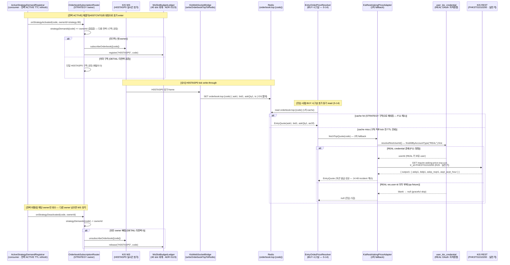
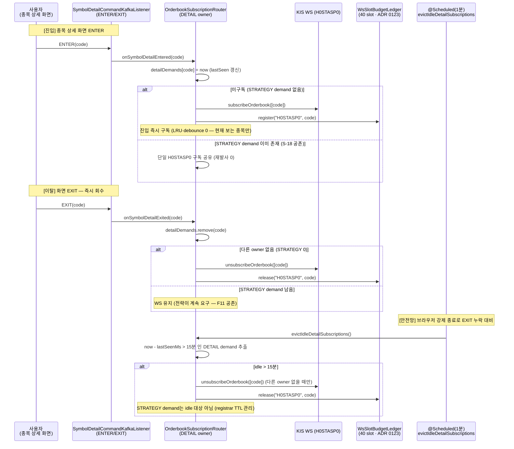
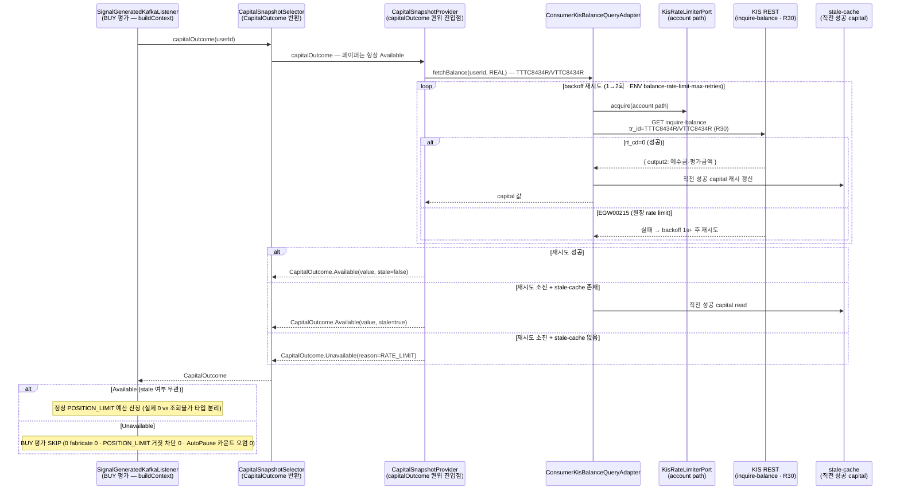
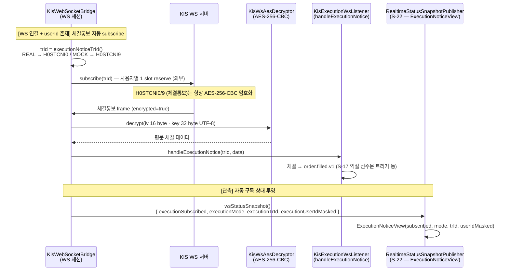
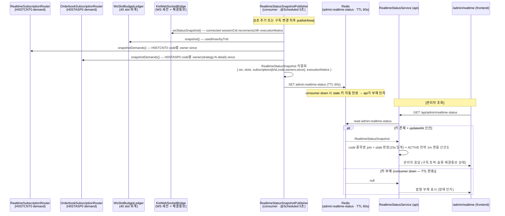

# v3.13.0 사용자 유즈 시퀀스 + KIS-first raw 출처

> **작성자**: market-data (bot+market-data@magicjar.local)
> **작성일**: 2026-06-12
> **기준 시점**: v3.13.0 — **REAL canary 가동 + 라이브 자본 path 결함 수선 baseline** (marketable limit 진입 가동 후 라이브 incident 연쇄 — 전략 ACTIVE 호가(H0STASP0) 구독 자동 시작 F11 #935 + 호가 REST fallback 자격증명 resolve + 종목 상세 호가 "표시 중에만" 복원 #944 + 잔고(capital) 조회 실패 처리 전면 정정 F10 #936 + KIS rate limit 큐 재설계 spec 결재·R0 audit #934 + 관리자 실시간 구독 상태 snapshot/화면 신설)
> **KIS-first 의무**: 헌법 §3 정합 — 자체 추론 0, 모든 endpoint·tr_id·필드는 raw 출처 인용 의무 (`docs/architecture/policies/kis-first-raw-fetch.md` 권위)
> **v3.12.0 대비 변경**: 시나리오 **S-18·S-19·S-20·S-21·S-22** 5건 신규 (① 전략 ACTIVE 호가 STRATEGY owner 자동 구독 + 호가 REST fallback userId resolve / ② 종목 상세 호가 DETAIL owner "표시 중에만" 복원 + 15분 idle 안전망 / ③ 잔고 조회 실패 CapitalOutcome 분기 + rate limit 재시도·stale-cache / ④ 체결통보 H0STCNI0(REAL)/H0STCNI9(MOCK) AES 복호화 자동 구독 — v3.8.0 S-6 정밀화 / ⑤ 관리자 실시간 구독 상태 snapshot 발행·조회) + raw 출처 인용 인덱스 **R30** 1건 추가 (KIS 잔고조회 `inquire-balance` TTTC8434R/VTTC8434R). v3.12.0 시나리오 1~23 + S-1~S-17 + raw R1~R29는 본 baseline 위에 add-only 보존.

---

## 0. 변경 매트릭스 — v3.12.0 → v3.13.0

| # | 영역 | 트리거 | 시나리오 |
|---|---|---|---|
| S-18 | market-data | F11 (2026-06-12 라이브 incident 14:48~) — marketable limit 진입(ADR 0114 S-15) 가동 후 전략 86(후성 093370) BUY 전량 `SIGNAL_SKIPPED_NO_QUOTE`. 호가(H0STASP0) 구독이 전략 ACTIVE 경로에 전무 + REST fallback이 WS approval 식별자로 토큰 발급 시도 → 발급 실패 | `OrderbookSubscriptionRouter` STRATEGY owner 차원 신설 — `ActiveStrategyDemandRegistrar`가 체결가(H0STCNT0)와 대칭으로 호가 enter/exit 배선 + `KisRestAskingPriceAdapter.resolveRestUserId()` — REAL credential 보유 userId 우선 resolve (PR #935) |
| S-19 | market-data + frontend | 최고 관리자 결재 (2026-06-12) — #939에서 DETAIL 호가 전면 제거 후, 수동매매 시 호가 없이 주문 불가 → "표시 중에만" 부분 복원 (anchor `detail-orderbook-live-only`) | `OrderbookSubscriptionRouter` DETAIL owner 재추가 — 상세 진입 즉시 구독·이탈 즉시 해제(LRU·debounce·5분 idle 잔류 폐기) + 브라우저 강제 종료 대비 15분 idle 안전망(@Scheduled 1분) (PR #944) |
| S-20 | market-data + backend-core | F10 (2026-06-12 라이브 incident 14:12) — BUY 평가 중 KIS 잔고조회가 EGW00215(원장 rate limit) 실패 시 capital을 0원 fabricate → POSITION_LIMIT 거짓 차단 + AutoPause 카운트 오염 | `CapitalOutcome` sealed(Available/Unavailable) 신설 — 0 fabricate 컴파일 제거 + `ConsumerKisBalanceQueryAdapter` rate limit backoff 재시도 1→2회 + stale-cache fallback + 소진 시 skip (PR #936) |
| S-21 | market-data | ADR 0068 §14-6 LOCK 정밀화 — 체결통보 자동 구독 상태가 관리자 snapshot에 투영되어야 함 (v3.8.0 S-6 AES 복호화 위에 mode/tr_id 가시화) | `KisWebSocketBridge` 체결통보 tr_id 분기 — REAL → H0STCNI0 / MOCK → H0STCNI9 자동 subscribe(연결 + userId 존재 조건) + AES-256-CBC 복호화 + `ExecutionNoticeView`로 mode·tr_id·userIdMasked 투영 |
| S-22 | market-data + frontend | 최고 관리자 지시 — "구독 중인 모든 토픽·내부 상태를 한 화면에서 보고 장애를 처리" | `RealtimeStatusSnapshotPublisher` consumer Redis `admin:realtime-status` 5초 주기 발행(read-only) + api `GET /api/admin/realtime-status` 종목명 join·stale 판정 + frontend `/admin/realtime` 화면 |

---

## 1. raw 출처 인용 인덱스 (v3.13.0 추가분)

v3.7.0 baseline raw R1~R20 + v3.8.0 R21~R23 + v3.9.0 R24~R28 + v3.12.0 R29는 본 baseline 위에 그대로 LOCK. 본 § 1은 v3.13.0 신규 시나리오 S-18~S-22에 필요한 raw 출처 **R30** 1건만 add-only. (S-18 호가 REST `FHKST01010200`는 v3.12.0 R29 LOCK reuse · S-18·S-19 WS 호가 `H0STASP0`는 v3.7.0 R5 계열 WS reuse · S-21 체결통보 `H0STCNI0`/`H0STCNI9`는 v3.8.0 S-6 raw reuse — 본 § 9 매트릭스 cross-ref.)

| # | 출처 | raw URL | tr_id | 사용 시나리오 |
|---|---|---|---|---|
| R30 | KIS 주식잔고조회 (inquire_balance) | `https://github.com/koreainvestment/open-trading-api/blob/main/examples_llm/domestic_stock/inquire_balance/inquire_balance.py` | **TTTC8434R**(실전) / **VTTC8434R**(모의) | S-20 — 잔고(capital) 조회 실패 처리 정정의 권위 read source (`output2` 예수금·평가금액) |

**v3.13.0 KIS-first 의무 (헌법 §3 + `docs/architecture/policies/kis-first-raw-fetch.md` 5단계 절차 정합)**:

- 시나리오 S-18 — 호가 REST fallback은 v3.12.0 R29 `FHKST01010200` LOCK reuse. endpoint `/uapi/domestic-stock/v1/quotations/inquire-asking-price-exp-ccn` + params `FID_COND_MRKT_DIV_CODE=J`·`FID_INPUT_ISCD={code}` + 응답 `output1.askp1`/`bidp1`/`askp_rsqn1`/`aspr_acpt_hour` 모두 raw 정합 (실코드 `KisRestAskingPriceAdapter` KDoc L32~44 raw URL inline). v3.13.0 신규는 **endpoint 변경 0** — `resolveRestUserId()`로 **자격증명 resolve만** 정정(KIS-first 결정 무변경). 호가 WS는 `H0STASP0` 대문자 규약(v3.7.0 R5 계열) LOCK.
  - 키 정책: 호가 수집은 **실전 키**(`AccountType.REAL`) — 정보 수집은 모두 실전 키 (`feedback_kis_key_realonly_for_data` 메모리 + 실코드 `KisRestAskingPriceAdapter` L44·L82). **userId resolve 정정**: WS approval 발급 식별자(`magicjar.kis.ws.user-id` = thdeodns)와 REST OAuth 자격증명(`user_kis_credential`) userId가 다를 수 있다 → REAL 키 보유 userId 우선 resolve, 부재 시 ws.user-id fallback (실코드 `resolveRestUserId()` L172~184 · 당일 일봉 seed hotfix c95b5391 동일 패턴).
- 시나리오 S-19 — 호가 WS `H0STASP0`는 자체 endpoint 결정 0 (v3.7.0 R5 계열 WS reuse). DETAIL owner는 `subscribeOrderbook`/`unsubscribeOrderbook` 발사 + `WsSlotBudgetLedger.register/release("H0STASP0", code)` 회계만 (ADR 0123 — 실코드 `OrderbookSubscriptionRouter` L78~94).
- 시나리오 S-20 — 잔고 read는 R30 `TTTC8434R`(실전)/`VTTC8434R`(모의) + endpoint `/uapi/domestic-stock/v1/trading/inquire-balance`. adapter inline 주석에 raw URL·tr_id 명시 (R0 audit §3-1 화이트리스트 evidence — `ConsumerKisBalanceQueryAdapter` L56). v3.13.0 신규는 **실패 처리 정정** — endpoint/tr_id 무변경, `CapitalOutcome` 타입 분기로 0 fabricate 컴파일 제거.
- 시나리오 S-21 — 체결통보는 REAL → `H0STCNI0` / MOCK → `H0STCNI9` (env_dv real/demo 분기 · ADR 0068 §14-6 LOCK). v3.8.0 S-6 AES-256-CBC 복호화(iv 16 byte · key 32 byte UTF-8) raw reuse. 자체 KIS endpoint 결정 0 (실코드 `KisWebSocketBridge.executionNoticeTrId()` L1147 + L994~1000).
- 시나리오 S-22 — 관측 read-only. KIS 호출 0 (구독 demand·슬롯 회계 read만 — 실코드 `RealtimeStatusSnapshotPublisher` KDoc L20~23 · AI 0 ADR 0023 §2-4).

**ADR 0037 rate limit priority 정합 (라이브 자본 path)**:
- S-18 호가 REST fallback — `KisRateLimiterPort.acquire(USER_PATH, timeoutMillis=3000L, trId="FHKST01010200")` (진입은 사용자 자본 path · 실코드 L88) + onSuccess/onTpsExceeded 통계 시그널 try-finally drift 차단 (D-1 패턴 · 실코드 L85~145).
- S-20 잔고 read — 원장(account) path. F10 정정은 EGW00215(원장 rate limit) backoff 재시도 2회 + per-TR sublimit 게이트는 큐 재설계 R1 입력(R0 audit §3-3 — `kis-rate-limit:tr:inquire-balance` ← {TTTC8434R, VTTC8434R}).

---

## 2. 시나리오 1~23 + S-1~S-17 (v3.7.0~v3.12.0 baseline 보존 — add-only 참조)

> 시나리오 1~23 (v3.6.0·v3.7.0) + S-1~S-7 (v3.8.0) + S-8~S-13 (v3.9.0) + S-14~S-17 (v3.12.0)은 본 v3.13.0 baseline 위에 add-only 보존. 본 v3.13.0은 시나리오 **S-18·S-19·S-20·S-21·S-22** 5건만 신규 추가.
>
> **참조**:
> - `_workspace/baseline/v3.12.0/03-use-sequences.md` (S-14~S-17 + raw R29 — 진입 호가 동기 read `EntryQuotePort` · marketable LIMIT 산정·미체결 취소 · tick 손절 안전망 · 익절 LIMIT 선주문)
> - `_workspace/baseline/v3.9.0/03-use-sequences.md` (S-8~S-13 + raw R24~R28 — 시장 추세 lens · 지수·섹터 + TrendPreference + AI + MCP)
> - `_workspace/baseline/v3.8.0/03-use-sequences.md` (S-1~S-7 + raw R21~R23)
> - `_workspace/baseline/v3.7.0/03-use-sequences.md` (시나리오 18~23 + raw R15~R20)
> - `_workspace/baseline/v3.6.0/03-use-sequences.md` (시나리오 1~17 + raw R1~R14)
>
> 핵심 누적 흐름:
> - v3.6.0 1~17 — 사용자 가입 + KOSPI/KOSDAQ 마스터 + KIS WS H0STCNT0 + REST 현재가/일봉/분봉 + 전략·시그널·백테스트 + T-O 주문 실행 (모의·3중 게이트·분할 체결)
> - v3.7.0 18~23 — REAL hashkey + Bucket4j rate limit + KIS WS H0STCNI 재연결 backfill + 일봉 DESC→ASC 정규화 + instrument_status_history + 잔고 조회 + Outbox publish chain
> - v3.8.0 S-1~S-7 — KIS 키 등록 + 23h cache + 종목상세 NXT 분기 + KIS_TPS_EXCEEDED hotfix + 자율 주문 REAL + KIS WS H0STCNI9 AES 복호화 + KillSwitch race-safe + DR drill
> - v3.9.0 S-8~S-13 — MarketIndexStrip 4 지수 + KRX 21 섹터 ranking + TrendPreference UPSERT + AI 시장 추세 해석 + MCP `get_market_trend` + 1분 cron KIS endpoint 5
> - v3.12.0 S-14~S-17 — 진입 호가 동기 read(`EntryQuotePort` — H0STASP0 write-through + REST FHKST01010200 fallback) + marketable LIMIT 산정·미체결 취소 + tick 손절 안전망 + 익절 LIMIT 선주문

---

## 3. 시나리오 S-18: 전략 ACTIVE 호가 STRATEGY owner 자동 구독 + REST fallback userId resolve (v3.13.0 신규 — F11 PR #935)

**목적**: marketable limit 진입(S-15)이 라이브에서 가동되자, **전략 ACTIVE 경로에 호가(H0STASP0) 구독이 전무**하여 전략 86(후성 093370) BUY가 `ask1`/`bid1`/`quoteAsOf` 전부 null → 전량 `SIGNAL_SKIPPED_NO_QUOTE`(매수 전면 불능). 근본 2중 결함을 수선한다: ① `OrderbookSubscriptionRouter`에 **STRATEGY owner 차원**을 신설해 `ActiveStrategyDemandRegistrar`가 체결가(H0STCNT0)와 대칭으로 호가 enter/exit를 배선(전략 종목 호가 WS 공급) — Redis `orderbook:top:{code}` write-through가 비로소 채워짐. ② 호가 REST fallback(`KisRestAskingPriceAdapter`)이 WS approval 식별자(`magicjar.kis.ws.user-id`)로 토큰 발급을 시도하던 것을 **REAL 자격증명 보유 userId 우선 resolve**로 정정(REST OAuth user_id ≠ WS approval user_id).

**관련 ADR/실코드**: ADR 0114 §10-3 (S-14 `EntryQuotePort` 정합) · ADR 0048 §2-1 호가 WS slot · ADR 0123 WS 슬롯 회계 · `OrderbookSubscriptionRouter.onStrategyActivated/Deactivated`(consumer) · `ActiveStrategyDemandRegistrar`(consumer) · `KisRestAskingPriceAdapter.resolveRestUserId()`(consumer) · `WsSlotBudgetLedger`(consumer)

**KIS-first raw 출처 (헌법 §3 LOCK)**: endpoint 변경 0 — 호가 WS `H0STASP0`(v3.7.0 R5 계열) + REST `FHKST01010200`(v3.12.0 R29) LOCK reuse. v3.13.0 신규는 **구독 배선 + userId resolve 정정**(KIS-first 결정 무변경).

**F11 근본 분석 (실코드 KDoc evidence)**:
- **결함 ①** — `OrderbookSubscriptionRouter`에 DETAIL(`onSymbolDetailEntered/Exited`)만 존재, 전략(STRATEGY) 활성화 경로 호가 구독 전무. 체결가(H0STCNT0)는 `ActiveStrategyDemandRegistrar`→`RealtimeSubscriptionRouter` STRATEGY owner로 구독되나 호가(H0STASP0)는 누락 → Redis `orderbook:top:{code}` 영구 miss → S-14 1차 cache 항상 null. **fix**: STRATEGY owner 차원 추가(현재가 DETAIL/STRATEGY 분리와 대칭) — debounce/LRU/idle evict 없음(전략 호가 공백 = 진입 차단 = 자본 risk).
- **결함 ②** — REST fallback이 `magicjar.kis.ws.user-id`(WS approval 식별자 thdeodns)로 토큰 발급 시도 → REST 자격증명(`user_kis_credential`) 부재로 발급 실패(당일 일봉 seed 동일 결함 hotfix c95b5391 패턴). **fix**: `resolveRestUserId()` — credential repo `findAllByAccountType("REAL")` 첫 행 userId 우선 resolve, 부재 시 ws.user-id fallback(ObjectProvider graceful).
- **STRATEGY ↔ DETAIL 공존 LOCK**: 한 종목에 DETAIL·STRATEGY demand 공존 시 **단 1개 H0STASP0 구독** 공유, 모든 owner demand가 빠질 때만 unsubscribe(owner 단위 합집합 추적 — 실코드 `isDemandedLocked` L72).

---

## 4. 시나리오 S-19: 종목 상세 호가 DETAIL owner "표시 중에만" 복원 + 15분 idle 안전망 (v3.13.0 신규 — PR #944, anchor `detail-orderbook-live-only`)

**목적**: #939에서 DETAIL 호가 경로를 전면 제거(호가는 전략 ACTIVE 전용)했으나, 최고 관리자 결재로 **수동매매 시 호가 없이 주문하면 안 된다** → "종목 상세에 직접 들어가면 호가가 나오고, 화면 이탈하면 구독을 뺀다"는 **표시-중 방식**으로 부분 복원. 옛 LRU 10 slot·200ms debounce·5분 idle 잔류 방식은 폐기(보기용 호가가 KIS WS 40 slot 예산을 누적 잠식하던 구조 제거) — **현재 보는 종목만 슬롯 점유**(진입 구독 / 이탈 즉시 해제). 브라우저 강제 종료로 EXIT 누락 시 대비 DETAIL 한정 **15분 idle 안전망**(@Scheduled 1분).

**관련 ADR/실코드**: ADR 0123 WS 슬롯 회계 · 방향성 가드(CLAUDE.md `detail-orderbook-live-only`) · `OrderbookSubscriptionRouter.onSymbolDetailEntered/Exited`·`evictIdleDetailSubscriptions`(consumer) · `SymbolDetailCommandKafkaListener`(consumer) · api `realtime/subscribe` orderbookSlot none→live 복원

**KIS-first raw 출처 (헌법 §3 LOCK)**: 호가 WS `H0STASP0`(v3.7.0 R5 계열) reuse — 자체 endpoint 결정 0. DETAIL owner는 `subscribeOrderbook`/`unsubscribeOrderbook` 발사 + `WsSlotBudgetLedger.register/release("H0STASP0", code)`만.

**방향성 가드 정합 (CLAUDE.md `detail-orderbook-live-only` · 실코드 KDoc evidence)**:
- **호가 2경로 LOCK**: H0STASP0 구독은 ① STRATEGY owner(전략 ACTIVE 매매 경로 — marketable limit 진입가 산정) ② DETAIL owner(종목 상세 표시 중 — 진입 구독·이탈 즉시 해제) 두 경로에서만 수립.
- **DETAIL 슬롯 비잠식**: 옛 LRU·debounce·5분 idle 잔류 폐기 — 현재 보는 종목만 점유(`detailDemands`는 boolean demand + lastSeenMs, 상세는 동시 한 종목만 표시 → exit 즉시 회수).
- **15분 idle 안전망**: DETAIL 한정(현재가 DETAIL grace 5분보다 길게 — 현재가 이미 끊긴 뒤에도 호가만 잠깐 남는 보수적 여유). enter 시 lastSeenMs 갱신하므로 표시 중 종목은 안전망에 걸리지 않음. STRATEGY demand는 대상 아님(전략 호가 공백 = 자본 risk).

---

## 5. 시나리오 S-20: 잔고(capital) 조회 실패 처리 정정 — 0 fabricate 폐기·재시도·stale-cache·skip (v3.13.0 신규 — F10 PR #936)

**목적**: REAL 라이브 incident(14:12) — BUY 평가 중 KIS 잔고조회가 EGW00215(원장 rate limit)로 실패하자 capital을 **0원으로 fabricate** → "총 자산 0원 × 70% = 한도 0원" POSITION_LIMIT 거짓 차단 + AutoPause 카운트 오염 → 실계좌 자산이 있는데도 정상 매수 기회 상실. 근본은 `KisCapitalSnapshotProviderAdapter.getCapital`이 모든 예외를 catch → `BigDecimal.ZERO` 반환(내부 swallow)으로 0을 합성한 것. **0 위장 경로를 타입으로 제거**한다: `CapitalOutcome` sealed(Available(값, stale)/Unavailable(reason)) 신설 + rate limit backoff 재시도 1→2회 + stale-cache fallback + 소진 시 skip(차단·AutoPause 오염 금지).

**관련 ADR/실코드**: ADR 0037 rate limit · ADR 0081 account · `CapitalOutcome`(domain sealed) · `CapitalSnapshotProvider.capitalOutcome`(권위 진입점) · `CapitalSnapshotSelector`(CapitalOutcome 반환 격상) · `ConsumerKisBalanceQueryAdapter`(consumer — backoff 재시도 2회) · F10↔per-TR 큐 재설계 근본(R0 audit §3-4)

**KIS-first raw 출처 (헌법 §3 LOCK)**: 잔고 read는 **R30** `TTTC8434R`(실전)/`VTTC8434R`(모의) + endpoint `/uapi/domestic-stock/v1/trading/inquire-balance` (R0 audit §3-1 화이트리스트 evidence). v3.13.0 신규는 **실패 처리 정정** — endpoint/tr_id 무변경.

**F10 근본 정정 (실코드 evidence)**:
- **0 fabricate 컴파일 제거**: `CapitalOutcome` sealed(`Available(값, stale)`/`Unavailable(reason)`) — "실제 0"과 "조회 불가"를 타입 분리 → `BigDecimal.ZERO` 합성 경로를 컴파일에서 제거. `CapitalSnapshotProvider.capitalOutcome` 권위 진입점 + `CapitalSnapshotSelector` 격상(페이퍼는 항상 Available).
- **rate limit backoff**: `ConsumerKisBalanceQueryAdapter` 재시도 1→2회(ENV `balance-rate-limit-max-retries`·간격 1s+) + 소진 시 stale-cache fallback → 둘 다 없으면 Unavailable(skip).
- **per-TR 근본 연결(R0 audit §3-4)**: F10은 원장 TR **호출 빈도**만 줄임(`preCheckFreeRules` 순서 재배치 + 본 정정의 실패 처리). 원장 **per-TR 한도 표현**은 큐 재설계 R1 입력(`kis-rate-limit:tr:inquire-balance` ← {TTTC8434R, VTTC8434R} — F10과 상호 보완). S-23 참조.

---

## 6. 시나리오 S-21: 체결통보 H0STCNI0(REAL)/H0STCNI9(MOCK) AES 복호화 자동 구독 (v3.13.0 정밀화 — ADR 0068 §14-6 LOCK)

**목적**: 자동 주문 체결을 KIS WS 체결통보로 수신 — REAL 모드는 `H0STCNI0`, MOCK 모드는 `H0STCNI9`로 env_dv real/demo 분기(v3.8.0 S-6 AES-256-CBC 복호화 위에 mode·tr_id 가시화 정밀화). 연결 + userId 존재 조건에서 자동 subscribe(사용자별 1 slot 의무 reserve). 본 baseline은 이 자동 구독 상태가 관리자 snapshot(S-22)에 `ExecutionNoticeView`로 투영됨을 명시한다.

**관련 ADR/실코드**: ADR 0068 §14-6·§7-3 LOCK · v3.8.0 S-6(AES 복호화) · `KisWebSocketBridge.executionNoticeTrId()`·`handleExecutionNotice`(consumer) · `KisExecutionWsListener`(consumer) · `KisWsAesDecryptor`(consumer)

**KIS-first raw 출처 (헌법 §3 LOCK · 실코드 evidence)**:

| 동작 | tr_id | env_dv | raw | 비고 |
|---|---|---|---|---|
| 체결통보 (REAL) | **H0STCNI0** | real | v3.8.0 S-6 | 실전 체결통보 |
| 체결통보 (MOCK) | **H0STCNI9** | demo | v3.8.0 S-6 | 모의 체결통보 |

**ADR 0068 §14-6 LOCK 불변식 (실코드 evidence)**:
- **tr_id 분기**: `executionNoticeTrId()` = REAL → `H0STCNI0` / MOCK → `H0STCNI9`(`RuntimeModeParser.isRealMode` · 실코드 L1147). MOCK 모드에서 H0STCNI0 사용 시 모의 주문 체결통보가 수신되지 않음(L1155).
- **AES 항상 암호화**: H0STCNI0/9는 항상 `encrypted=true` — `KisWsAesDecryptor` 위임(iv 16 byte · key 32 byte UTF-8 · 실코드 L232·L954·L1028).
- **slot reserve**: 사용자별 1 slot 의무 reserve — 정규장(09:00~15:30) H0STCNT0(20) + H0NXCNT0(20) + H0STCNI0(1) = 41 정합 (실코드 L76~81).

---

## 7. 시나리오 S-22: 관리자 실시간 구독 상태 snapshot 발행·조회 (v3.13.0 신규 — read-only 관측)

**목적**: "구독 중인 모든 토픽·내부 상태를 한 화면에서 보고 장애를 처리"하기 위한 관측 전용 레이어(최고 관리자 지시). consumer가 KIS WS 세션·슬롯 회계·체결가(H0STCNT0)/호가(H0STASP0) 구독 owner·체결통보(S-21) 상태를 Redis `admin:realtime-status`에 **5초 주기** 발행 → api가 read하여 종목명 join + stale 판정 + ACTIVE 전략 종목 1m 캔들 신선도를 덧붙여 `GET /api/admin/realtime-status`로 반환 → frontend `/admin/realtime` 화면.

**관련 ADR/실코드**: ADR 0023 §2-4(AI 0) · `RealtimeStatusSnapshotPublisher`(consumer) · `RealtimeStatusController`·`RealtimeStatusService`(api) · `RealtimeStatusPage`(frontend) · `RealtimeSubscriptionRouter.snapshotDemands`·`OrderbookSubscriptionRouter.snapshotDemands`·`WsSlotBudgetLedger.snapshot`(consumer read-only 접근자)

**KIS-first raw 출처 (헌법 §3 LOCK)**: 관측 read-only — **KIS 호출 0**. 구독 demand 맵·슬롯 회계 read만(구독·매매 로직 변경 0). 자체 KIS endpoint 결정 0.

**관측 레이어 불변식 (실코드 KDoc evidence)**:
- **read-only LOCK**: 구독 demand 맵·슬롯 회계 **변경 0** — snapshot 접근자만 호출(실코드 `snapshotDemands`·`snapshot`). 매매·구독 로직 무영향.
- **graceful (헌법 §6 ObjectProvider)**: 모든 의존 ObjectProvider — qa fixture 등 빈 부재 환경 부팅·no-op 보장. publish 실패는 runCatching 흡수(관측 레이어가 본 흐름을 죽이지 않음).
- **AI 호출 0**: 관측 read-only (ADR 0023 §2-4 KDoc 명시).
- **TTL 60s stale 인지**: 발행 정지(consumer down) 시 키 자동 만료 → api가 부재로 인지(stale 판정 임계 15s).

---

## 8. KIS rate limit 큐 재설계 R0 audit 입력 (S-23 — 코드 0 touch · 결재 후속)

**목적**: F10·F11 라이브 incident의 근본은 원장 per-TR 한도가 코드로 표현되지 못한 것 + WS 슬롯 부족 fallback 경로. 최고 관리자 결재("큐 재설계까지 다 진행해줘" 4의제)에 따라 **R0 audit**(코드 0 touch · 읽기+문서만)으로 R1~R3 dispatch 매트릭스를 확정. KIS-first 의무 정합으로 per-TR 화이트리스트를 raw 출처 인용으로 LOCK.

**관련 spec/실코드**: 상위 spec `_workspace/specs/2026-06-10-kis-ratelimit-queue-redesign-spec.md`(2026-06-12 결재) · R0 audit `_workspace/specs/2026-06-12-kis-queue-r0-audit.md` · ADR 0116(3-tier 버킷)·0048(WS 슬롯·polling fallback)·0037(rate limit 강제)

**R0 결론 3건 (KIS-first raw 정합 · R0 audit evidence)**:

| audit | 실측 결론 | KIS-first 정합 |
|---|---|---|
| L4 `WatchlistPollingWorker` REST polling 5초 | **존치(GREEN)** — eviction된 WS 슬롯 부족 종목 + WS 단절 fallback 전용(pool 빌 때 즉시 skip). 제거 X | `fetchCandles(code, ONE_DAY, 1)` — 1d 캔들 fallback(proactive 전종목 backfill 아님 · ADR 0119 무관) |
| L2 `MarketIndexScheduler` jitter | **이미 적용(GREEN)** — `inter-request-delay-ms:250` × 26 ≈ 6.5초 분산(ADR 0116 §2-D). 강제·하향 둘 다 불요 | 26 req/min을 6.5초 분산 → BG 3/s 버킷 흡수 |
| per-TR(원장) 화이트리스트 | **3 논리 TR 확정** — 잔고(`TTTC8434R`/`VTTC8434R`, R30) + 일별체결 inner(`TTTC0081R`/`VTTC0081R`) + before(`CTSC9215R`/`VTSC9215R`). psbl-order는 코드 미사용 → 제외 | adapter inline 주석 raw URL·tr_id 명시 + open-trading-api raw 1회 재확인 R1 의무 |

**R1 게이트 키 (R0 audit §3-3 LOCK)**: `kis-rate-limit:tr:inquire-balance` ← {TTTC8434R, VTTC8434R} · `kis-rate-limit:tr:inquire-daily-ccld` ← {TTTC0081R, VTTC0081R, CTSC9215R, VTSC9215R}. capacity 1 req/1s per 논리 TR(보수값 — 공식 미명시 시 inline "공식 미명시·보수값" 주석 의무).

**병렬 충돌 가드**: R1-d(consumer) per-TR 게이트는 **balance·reconcile·daily-ccld·L4 polling adapter만** touch — 본 baseline 시나리오의 호가(asking-price)·orderbook router 제외(파일 경계 LOCK으로 충돌 0).

---

## 9. KIS endpoint 호출 매트릭스 (v3.13.0 종합 — v3.12.0 superset + S-18~S-22 신규)

| tr_id | endpoint | 환경 | raw 인덱스 | v3.12.0 사용 | v3.13.0 신규 | rate limit priority |
|---|---|---|---|---|---|---|
| H0STASP0 (WS) | 실시간 호가 10단계 | prod WS | (v3.7.0 R5 계열) | S-14 (orderbook:top write-through) | **S-18 (STRATEGY owner 자동 구독) · S-19 (DETAIL owner 표시 중)** | (WS — slot 회계 ADR 0123) |
| **FHKST01010200** | inquire-asking-price-exp-ccn (호가) | prod | R29 | S-14 (진입 호가 2차 fallback) | **S-18 (REST fallback userId resolve 정정 — endpoint 무변경)** | USER_PATH |
| **TTTC8434R / VTTC8434R** | **inquire-balance (잔고)** | prod/vps | **R30** | (v3.7.0 시나리오 22 잔고 조회) | **S-20 (capital 실패 처리 정정 · per-TR 게이트 R1 입력)** | account path |
| TTTC0081R / VTTC0081R, CTSC9215R / VTSC9215R | inquire-daily-ccld (일별체결) | prod/vps | (R0 audit §3-1) | (OrderReconciliation·backfill) | (S-23 per-TR 게이트 R1 입력) | account path |
| **H0STCNI0 / H0STCNI9 (WS)** | 체결통보 (AES) | prod WS | (v3.8.0 S-6) | S-4 (체결통보) | **S-21 (REAL/MOCK tr_id 분기 자동 구독 + snapshot 투영)** | (WS — 1 slot reserve) |
| TTTC0012U / VTTC0012U | order-cash BUY | prod/vps | R12 | S-15 (진입 LIMIT) | (체결통보 source) | USER_PATH |
| TTTC0011U / VTTC0011U | order-cash SELL | prod/vps | R12 | S-16·S-17 (손절·익절) | — | USER_PATH |
| TTTC0013U / VTTC0013U | order-rvsecncl 정정·취소 | prod/vps | R12 | S-15·S-16·S-17 | — | USER_PATH |

**v3.13.0 신규 합계**: S-18 호가 STRATEGY owner 자동 구독(F11 해소 — 진입가 산정 input 공급) + S-19 DETAIL owner 표시-중 복원(수동매매 호가) + S-20 잔고 실패 처리 정정(R30) + S-21 체결통보 REAL/MOCK 분기 자동 구독 + S-22 관측 snapshot(KIS 호출 0). endpoint 신규 0(R30 잔고는 v3.7.0 시나리오 22에서 이미 사용 — per-TR 화이트리스트 확정 차원에서 raw 인덱스 정식 부여). 모든 자본 path 변경은 **endpoint/tr_id 무변경, 배선·실패 처리·자격증명 resolve 정정**.

---

## 10. fitness gap 검증 매트릭스 (자동매매 적합성 lens — `feedback_v3_skepticism_no_regression` 메모리 의무)

| 의제 | "자동매매에 필요한가?" 검증 | "v1/v2 잔재 아닌가?" 검증 |
|---|---|---|
| S-18 전략 ACTIVE 호가 자동 구독 + userId resolve | ✅ marketable limit 진입(S-15)의 호가 input 부재 = BUY 전면 불능(14:48 라이브 incident) — 자본 흐름 직결 차단 해소 | ✅ v1/v2에 STRATEGY owner 호가 구독·credential resolve 0건 — F11 신설 |
| S-19 종목 상세 호가 "표시 중에만" 복원 | ✅ 수동매매 시 호가 없이 주문 불가(최고 관리자 결재) + 보기용 슬롯 잠식 방지(현재 보는 종목만) | ✅ 옛 LRU·debounce·5분 idle 잔류는 슬롯 누적 잠식 — v3.13.0 표시-중 방식으로 폐기·정정 |
| S-20 잔고 실패 처리 정정 | ✅ 0 fabricate가 POSITION_LIMIT 거짓 차단 + AutoPause 오염 → 매수 기회 상실(14:12 incident) — 자본 보호 역전 차단 | ✅ v1/v2에 CapitalOutcome 타입 분리·stale-cache 0건 — F10 신설 |
| S-21 체결통보 REAL/MOCK 분기 자동 구독 | ✅ 체결 수신 = order.filled.v1 → S-17 익절 선주문 트리거 등 청산 보장 chain의 입력(ADR 0068 §14-6 LOCK) | ✅ v3.8.0 S-6 AES 복호화 위 정밀화 — env_dv 분기는 v3.8.0부터 LOCK(회귀 0) |
| S-22 관리자 실시간 상태 snapshot | ✅ "구독 중인 모든 토픽·내부 상태를 한 화면에서 보고 장애 처리"(최고 관리자 지시) — canary 운영 관측 직결 | ✅ v1/v2에 admin:realtime-status 관측 레이어 0건 — v3.13.0 신설(read-only) |

**자본 path 정합 검증 의무**:
- S-18·S-19 호가 구독 → WS subscribe/unsubscribe + ledger 회계만(자본 미이동 · `OrderRouter`·`KillSwitch` import 0건). 진입 발행은 S-15 호출자 책임 LOCK.
- S-20 잔고 read → POSITION_LIMIT 예산 산정 input(read-only · 주문 발행 0). CapitalOutcome 타입으로 0 fabricate 차단.
- S-21 체결통보 → 수신·복호화·order.filled.v1 발행만(주문 발행 자체는 OrderRouter 경유).
- S-22 관측 read-only(구독·매매 로직 변경 0).
- AI 호출 0 (S-18~S-22 모두 룰 기반 자본 흐름·관측 — ADR 0023 §2-4 KDoc evidence).

---

## 11. dogfooding 매트릭스 (v3.13.0 cut 직전 검증 의무 — `feedback_docker_log_verify_before_cut` 메모리)

| 검증 항목 | 검증 path | 기대 결과 |
|---|---|---|
| S-18 STRATEGY 호가 구독 | docker logs consumer-app \| grep "orderbook STRATEGY subscribe" | 전략 ACTIVE 종목 H0STASP0 구독 + Redis GET orderbook:top:{code} 갱신 |
| S-18 호가 미가용 해소 | docker logs consumer-app \| grep -c "SIGNAL_SKIPPED_NO_QUOTE" (전략 종목) | 14:48 incident 전 다발 → 호가 공급 후 0 수렴 |
| S-18 REST fallback userId | docker logs consumer-app \| grep "asking-price REST fallback skip" | REAL credential resolve 성공 시 skip 0건 (토큰 발급 성공) |
| S-19 DETAIL 진입/이탈 | docker logs consumer-app \| grep -E "orderbook DETAIL (subscribe\|release)" | 상세 ENTER 즉시 구독 / EXIT 즉시 회수 |
| S-19 idle 안전망 | docker logs consumer-app \| grep "orderbook DETAIL idle 안전망 해제" | 브라우저 강제 종료 후 15분 경과 종목만 회수 (STRATEGY 미회수) |
| S-20 잔고 0 fabricate 0 | docker logs consumer-app \| grep "총 자산 0원" | 0건 (CapitalOutcome.Unavailable 시 SKIP — 거짓 차단 0) |
| S-20 rate limit 재시도 | docker logs consumer-app \| grep -E "balance.*(retry\|stale-cache)" | EGW00215 시 backoff 2회 + stale-cache fallback |
| S-21 체결통보 구독 | docker logs consumer-app \| grep -E "H0STCNI0\|H0STCNI9" | REAL → H0STCNI0 자동 subscribe + AES 복호화 수신 |
| S-22 관리자 snapshot | redis-cli GET admin:realtime-status + GET /api/admin/realtime-status | 5초 주기 갱신 + 종목명 join·stale 판정 응답 |
| 자본 path 정합 | docker logs consumer-app \| grep -E "(KillSwitch\|idem:order)" | S-18~S-22 모두 read-only/관측 — 직접 KIS 발행 우회 0건 |

---

## 12. 출처 검증 매트릭스 (헌법 §3 KIS-first 5단계 절차 정합)

| 단계 | 검증 결과 | evidence |
|---|---|---|
| 1. 자체 추론 0 LOCK | ✅ S-20 잔고 R30(`TTTC8434R`/`VTTC8434R`) raw URL 인용 + S-18 호가 R29(`FHKST01010200`)·S-19 `H0STASP0`·S-21 `H0STCNI0`/`H0STCNI9` 모두 기존 R LOCK reuse(endpoint 무변경) | 본 § 1 + 실코드 `KisRestAskingPriceAdapter` KDoc L32~44 + R0 audit §3-1 |
| 2. raw URL inline KDoc 의무 | ✅ `KisRestAskingPriceAdapter` KDoc raw URL + tr_id + params + 응답 컬럼 명시 + `ConsumerKisBalanceQueryAdapter` inline tr_id | 실코드 L32~44 |
| 3. tr_id 매트릭스 | ✅ FHKST01010200(호가) + TTTC8434R/VTTC8434R(잔고) + H0STCNI0/H0STCNI9(체결통보) + 일별체결 4 TR | 본 § 9 매트릭스 + R0 audit §3-1 |
| 4. WS↔REST 호가 source 1:1 정합 | ✅ H0STASP0 대문자 ASKP1/BIDP1/ASKP_RSQN1 ↔ REST lowercase askp1/bidp1/askp_rsqn1 1:1(v3.12.0 R29 LOCK reuse) | 실코드 KDoc L39 |
| 5. self-review 의무 | ✅ 본 baseline 작성 후 markdown + mermaid sequenceDiagram render 검증 + grep 자체 추론 0건 + endpoint 신규 0 확인 | 본 § (cycle complete) |

---

## 13. cross-link 매트릭스 (라이브 자본 path 결함 수선 lens · v3.13.0 핵심 트랙)

| 트리거 | 적용 시나리오 | 의무 항목 |
|---|---|---|
| F11 #935 (라이브 14:48) — 진입 호가 부재 | S-18 | STRATEGY owner 호가 자동 구독(체결가 대칭) + REST fallback REAL credential userId resolve |
| 최고 관리자 결재 #944 (anchor `detail-orderbook-live-only`) | S-19 | DETAIL owner "표시 중에만" 복원 + 15분 idle 안전망(LRU·debounce·5분 idle 잔류 폐기) |
| F10 #936 (라이브 14:12) — 0원 fabricate | S-20 | CapitalOutcome 타입 분리(0 위장 컴파일 제거) + rate limit 재시도·stale-cache·skip |
| ADR 0068 §14-6 LOCK | S-21 | 체결통보 REAL→H0STCNI0/MOCK→H0STCNI9 분기 + AES-256-CBC + snapshot 투영 |
| 최고 관리자 지시 — 관측 화면 | S-22 | admin:realtime-status 5초 발행(read-only) + 종목명 join·stale 판정 |
| 큐 재설계 결재 + R0 audit | S-23(§8) | per-TR 화이트리스트 raw 인용 LOCK(balance·daily-ccld) + L4 polling 존치·L2 jitter GREEN 확정 |

---

## 14. 변경 이력

| 날짜 | 변경 |
|---|---|
| 2026-06-12 | **v3.13.0 baseline 03-use-sequences.md 신규 발행** — 시나리오 S-18·S-19·S-20·S-21·S-22 (5건 신규 추가) + raw 인용 R30 (KIS 잔고조회 `inquire-balance` TTTC8434R/VTTC8434R 신규) + 큐 재설계 R0 audit 입력(§8 S-23) + KIS endpoint 호출 매트릭스 v3.12.0 superset + fitness gap 검증 매트릭스(자동매매 적합성 + v1/v2 회귀 lens) + dogfooding 매트릭스(STRATEGY 호가 구독·SIGNAL_SKIPPED_NO_QUOTE 해소·DETAIL 진입/이탈·idle 안전망·잔고 0 fabricate 0·체결통보 구독·관리자 snapshot·자본 path 정합) + 출처 검증 매트릭스(KIS-first 5단계 + WS↔REST 호가 source 1:1) + cross-link 매트릭스(F11·F10·#944·ADR 0068·관측·큐 재설계). v3.12.0 시나리오 1~23 + S-1~S-17은 add-only 보존 + 본 baseline 위에서 참조. **자체 추론 0 LOCK 정합** — S-20 잔고 R30 raw URL 인용 + S-18 호가 R29(FHKST01010200)·S-19 H0STASP0·S-21 H0STCNI0/H0STCNI9는 기존 R LOCK reuse(v3.13.0 endpoint/tr_id 신규 0 — 모두 배선·실패 처리·자격증명 resolve 정정) + 모든 시퀀스 실코드 인용(`OrderbookSubscriptionRouter`·`KisRestAskingPriceAdapter`·`CapitalOutcome`·`ConsumerKisBalanceQueryAdapter`·`KisWebSocketBridge.executionNoticeTrId`·`RealtimeStatusSnapshotPublisher` KDoc evidence). **AI 호출 0 검증** — S-18~S-22 모두 룰 기반 자본 흐름·관측(ADR 0023 §2-4 KDoc 명시). **자본 path 정합 검증** — S-18·S-19 호가 read-only(WS 구독·ledger 회계만) + S-20 잔고 read-only + S-21 체결통보 수신·복호화 + S-22 관측 read-only(직접 KIS 발행 우회 0건). v3.13.0 REAL canary 가동 + 라이브 자본 path 결함 수선 baseline 발행 트리거(orchestrator dispatch market-data 영역 단독 — 03 use-sequences 1 파일). (market-data, opus 4.8 1M) |
