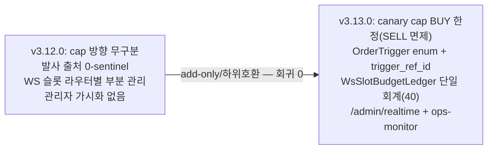

# 06 — magicJar v3.13.0 이력 추적 (PR · ADR · 기능 매핑)

> **작성자**: architect (baseline v3.13.0)
> **시점**: 2026-06-12 v3.13.0 release commit 준비
> **권위**: `_workspace/arch/adr/README.md` (ADR 인덱스) + `CHANGELOG.md` + `api/src/main/resources/db/migration/` (Flyway 실 파일) + v3.13.0 코드 inspection

본 문서는 v3.12.0(실매매 직전 자본 path 완성) 이후 v3.13.0(REAL canary 진입 마일스톤)까지의 **결정 → 코드 → 마이그레이션 → 라이브 incident 추적표**다. 실코드·실문서·실 마이그레이션 파일·라이브 evidence(시각·signalId·KIS 응답 코드)만 인용한다(추정 0).

---

## §1. v3.12.0 → v3.13.0 minor·patch 시계열

| 버전 | 일자 | 미러스톤 | 신규 ADR |
|------|------|----------|----------|
| v3.12.0 | 2026-06-07 | 실매매 직전 자본 path 완성 | 0109·0110·0111·0112·0113·0114 |
| v3.12.1 | 2026-06-09 | 포지션 정합·KIS rate limit·관측 patch (ADR 0115 코드 반영·status drift 정정) | 0115·0116 |
| v3.12.2~v3.12.4 | 2026-06-09~10 | 단타 발굴 레이어 + 전종목 일봉 universe + 1m 백필 폐지 + 1d 롤업 + 백테스트 사이징 정합 | 0117·0118·0119·0120·0121 |
| v3.12.5 | 2026-06-10 | 체결-원장-리스크 체인 통합 진단 + execution-ledger spec 보강 | 0115 §2-P2 amend |
| **v3.13.0** | **2026-06-12** | **REAL canary 진입 마일스톤** (첫 실전 주문 완주·롱 온리 명문화·키 사슬 무결성 R1/R2·WS 슬롯 단일 회계 R1·관리자 가시화·페이퍼 dispatch) | **0122·0123 + 0109 §7 amend + long-only 정책 + 헌법 §11·§12·§13** |

---

## §2. v3.13.0 신규/amend ADR 추적 (0115~0123 + 0109 §7 — 실코드 매핑)

### ADR 0109 §7 amend — canary cap 의미 정합 (2026-06-12 사용자 직접 결재)

| 항목 | 내용 |
|---|---|
| 계기 | REAL canary 2일차 라이브 incident — cap 3종 방향 무구분이 청산 봉쇄(자본 보호 역전): 11:32 익절 LIMIT `CANARY_DAILY_ORDER_CAP:5>=5` · 13:11 DSL 청산 `6>=5` · 13:31 수동 SELL `CANARY_NOTIONAL_CAP:PRICE_UNAVAILABLE` |
| 결재 3건 | ① `MAX_ORDERS_PER_DAY`=당일 매수(BUY)만·왕복 1회=1카운트·REJECTED 미카운트(PR #927) ② QTY·NOTIONAL cap SELL 전면 면제 — 숏 부재로 매도는 보유량 자연 상한(hotfix F8) ③ 매도 가격 미가용 시 MARKET fallback — 청산 체결 보장 우선(hotfix F8) |
| 방향 명문화 | "BUY=가격 보호 우선 / SELL=체결 보장 우선" — 진입 MARKET fallback 금지(ADR 0114 §3-1-5)와 방향 구분 |
| 코드 | `OrderRouterKafkaListener.evaluateCanaryHardCap`(SELL early return) · `SignalGeneratedKafkaListener.publishSell`(MARKET fallback) |
| 잔여 | ENV 이름(`MAX_ORDERS_PER_DAY`) 리네이밍은 라이브 호환 보류 — 의미 권위=amend §7 |

### ADR 0115 — 포지션 단일 권위 + 드리프트 자동보정 + 청산 사슬 안전화 (Accepted 2026-06-08 → §2-P2 정식 신설 2026-06-10)

| 항목 | 내용 |
|---|---|
| P1(v3.12.1 코드 반영) | strategy_position drift WARN→position(KIS) 권위 자동내림(realized 보존·하한·다전략 updatedAt 차감) + backfill replay 식별→TP 미발행 + watcher cooldown + N회 거부 자동정지 + PAUSED 유령 포지션 손절 금지 |
| §P1-1 amend(2026-06-10) | 부족 방향 귀속 보정(`LedgerAttributedDriftCorrection`) |
| §2-P2 정식 신설(2026-06-10 최고 관리자 전체 승인) | 체결-원장-리스크 체인 통합 6항목 ①replay execution-단위 멱등 ②backfill CANCELLED 체결 대조 ③WarnUnderflow 단일전략 evidence 자동보정 ④장중 배포 in-flight drain 가드 ⑤in-memory index 변경감지 refresh ⑥0-sentinel 폐지+OrderTrigger enum |
| 대안 | **B-on-A** — `strategy_position`을 `order_execution`(immutable 진실원) 파생 재계산 뷰로 점진 전환(누락 영구화 불가) |
| R1 코드 | `strategy-engine/.../integrity/BackfillCancelledFillPolicy.kt`(G5) · `StrategyPositionRebuild.kt`(G4) · `ConsumerExecutionStrategyPositionAdapter.rebuildStrategyPositionFromLedger` · `scripts/check-inflight-drain.sh`(G1) · `HoldingPositionIndex.onFillRefresh`(G3) |
| R2 코드 | `domain/.../order/execution/OrderTrigger.kt`(enum 6값) + Flyway V80 + 발사 지점 전수 키 부여(0-sentinel 폐지) |
| 동반 | 헌법 §11(빈 합류 + silent fallback 금지) + master §3-5 3중 상태 권위 매트릭스 + development-rules drain 절차 |

### ADR 0116 — KIS Rate Limit Phase 2 priority 버킷 (Proposed 2026-06-08)

| 항목 | 내용 |
|---|---|
| 결정 | priority별 별도 버킷 3-tier(USER 4 / SHARED 3 / BG 3 합 10) + KIS 실제 한도 정합(refill burst 억제) + 역방향 fallback + MarketIndexScheduler jitter 분산 |
| 자원 | Redis 3 key + ENV 4 add-only — Flyway/Kafka/STOMP/REST 0 |
| ADR 0037 관계 | §2-1 단일 bucket·§2-3 share 분할 supersede |

### ADR 0117 — 단타 발굴(Discovery) 레이어 + 체결강도 KIS raw 흡수 (Proposed 2026-06-09)

| 항목 | 내용 |
|---|---|
| 결정 | 전략 미작성 시 시스템 빌트인 룰로 단타 후보 TOP N 제시 + `POST /api/screener/daytrade-discover`(LLM 0·ai-discovery와 분리) + 빌트인 단타 setup 프리셋 |
| KIS raw | H0STCNT0 `[18]CTTR`(체결강도)·`[14]ACML_TR_PBMN` 흡수→TickEvent 2필드 add-only + DSL `trade_intensity` add-only |
| 발굴 LOCK | STRATEGY owner 재사용·watchlist 비삽입 + 자본 결정권 0 |
| Flyway | V75(setup seed)·V76(검증·승격)·V77(스코어카드) |

### ADR 0118 — 전종목 일봉 universe(MARKET_DAILY) + 야간 멀티시세 snapshot (Proposed 2026-06-09, 결재 완료)

| 항목 | 내용 |
|---|---|
| 결정 | `instrument`(KIS 73필드) → MARKET_DAILY universe(~2,517 보통주·**ETF·ETN 제외**·1d 단독·WS 구독 0)를 active managed universe(~25)와 물리 분리 |
| 야간 snapshot | KIS `intstock-multprice`(FHKST11300006·30종목/콜·100콜) 23:00 → 1d 적재 + today WS집계를 `upsertAll`(ON CONFLICT DO UPDATE) 공식값 교정 |
| 결재 3건 | ① universe=보통주(ETF·ETN 제외) ② 이력 깊이=10년(architect 권고 1년→사용자 상향) ③ today 종가=NXT 통합 권위 |
| backfill | per-symbol FHKST03010100 1회성 R-BF 멱등 분산 캠페인(체크포인트·콜예산 cap·~75,000콜) |
| KIS-first | inter2_oprc/hgpr/lwpr/prpr·acml_vol·acml_tr_pbmn·max30 raw 검증 |

### ADR 0119 — 1분봉 proactive cold-start 백필 폐지 → on-demand 전환 (Accepted 2026-06-09)

| 항목 | 내용 |
|---|---|
| 계기 | 전종목 일봉 마이그레이션(ADR 0118 R-BF) 중 일봉 wipe가 managed 전체에 1m cold-start storm(126일×~630콜) 유발 |
| 결정 | `ColdStartExecutor` 전면 은퇴 + 호출처 3곳 제거. 1m 유입 = Ⓐ실시간 WS + Ⓒon-demand(`SymbolDetailMinuteGapFill`·admin 수동) 보존, Ⓑ내부 자동백필 폐지 |
| 자원 | Flyway/Kafka/Redis/STOMP/ENV 0 |

### ADR 0120 — 1wk/1mo/1y를 1d 합산으로 전환 (Accepted 2026-06-10)

| 항목 | 내용 |
|---|---|
| 계기 | 2026-06-09 MIGRATE wipe가 일봉 패밀리 삭제했으나 R-BF가 1d만 재적재 → 1wk·1mo·1y 15종목만 남은 년봉 회귀 |
| 결정 | 1wk/1mo/1y를 보유한 1d(전종목 10년)에서 합산 생성(KIS 콜 0·전종목 W/M/Y 재fetch ~95k콜 기각) — `DailyRollupAggregator`(domain 순수·12 test) |
| KIS-first ts | 주봉 ts=그 주 첫 거래일·월/연봉 ts=마지막 거래일(005930 reverse-engineering 정합) |
| 회귀 PASS | 005930 2026-05 월봉 1d 18봉 롤업과 완전 일치(open228000·close317000·high323000·low224000·vol622,815,748) |
| amend §9 | batch upsert(NamedParameterJdbcTemplate.batchUpdate) + R2 incremental(400 거래일) + 비동기 병렬(Semaphore 4) — ~3종목/분 병목 제거 |

### ADR 0121 — 백테스트 사이징 정합 + G3 게이트 재정의 (Proposed 2026-06-10)

| 항목 | 내용 |
|---|---|
| 계기 | V77 재검증 측정-게이트 불일치 — `SizingPolicy.AllCapital`(1포지션=자본100%) MDD는 "몰빵 누적 낙폭"인데 G3(MDD≤8%)는 분산 포트폴리오 기준 → 단타 0승격 영구 강제 |
| 본선 A | `SizingPolicy.FixedFractional(positionPercent·maxConcurrent·maxPositionAmount)` 활성화(sealed class 확장 add-only) — 실전 RiskConfig(maxPositionPercent10·maxConcurrentPositions5) 정합 |
| 보조 B | G3 재정의 = FixedFractional(10%/5) 적용 MDD ≤ **12%** |
| V78 재검증 | V77 6종 사이징만 교체 동일환경 재판정 — H1 active 유지·H2/H6 신규 승격 |
| 자원 | Flyway V78 + 코드계약 only(REST/ENV/Kafka/STOMP 0) |

### ADR 0122 — 발굴 → MOCK 페이퍼 트레이딩 dispatch (Accepted 2026-06-10)

| 항목 | 내용 |
|---|---|
| 결정 | 발굴 후보를 사용자 opt-in으로 MOCK 페이퍼 전략 승격 → 백테스트→모의→실전 3단 중 빠진 모의 고리 채움 |
| 발굴 LOCK | 발굴 DTO 주문 트리거 0·매매 결정권 0·watchlist write 0 (절대 불변) |
| 자동 진입 금지 | 페이퍼 승격은 사용자 명시 opt-in 액션만(스코어카드 cron이 페이퍼 전략 생성 시 reject 게이트) |
| 기존 경로 재사용 | `Strategy.origin=PAPER_DISCOVERY`(V81) → RealtimeSignalGenerator → RiskGateway → OrderRouter → `TradingModeGate`(**MOCK 강제**) → KisOrderHttpAdapter(MOCK 분기) |
| 가상 자본 격리 | `PaperCapitalSnapshotProviderAdapter`(실 KIS 잔고 미호출 — 실 잔고 오염 0) |
| GAP-0 hotfix | `TradingModeGate.resolveMode(userId, paperStrategy)` port 확장 + `OrderRouterKafkaListener.resolvePaperStrategy`(origin DB 조회·발행처 4곳 단일 관문) — REAL 전환 전 페이퍼 주문 실 발사 구멍 영구 차단 |
| 코드 | `api/.../controller/daytrade/DaytradePaperController.kt` · `consumer/.../risk/PaperCapitalSnapshotProviderAdapter.kt` · `domain/.../order/execution/port/TradingModeGate.kt` |
| 선행 의존 | ADR 0115 P2-⑥(OrderTrigger enum) 완료 후 R1 착수 |

### ADR 0123 — KIS WS 구독 슬롯 회계 R1 + R2/R3 deferred (Proposed 2026-06-11, ADR 0048 amend)

| 항목 | 내용 |
|---|---|
| 계기 | 2026-06-11 후성(093370) 분봉 35/92 결손 incident — OPSP0008 MAX SUBSCRIBE OVER(체결가·호가 두 독립 라우터 부분 한도 각각 관리 + NXT 이중 발사 미회계 + 거부 미감지 → 총 점유 40 초과 인지 0) |
| ADR 0048 amend | KIS-first raw `kis_auth.py` enforce **40건**(41→정정) · 채널=(code,trId) 단위 회계 |
| 단일 회계기 | `WsSlotBudgetLedger`(채널 단위 추적·OPSP0008 감지·회계 보정·fallback wiring·metrics) |
| owner eviction | R2 deferred — HOLDING/PENDING_BUY 보호 우선순위 모델은 ADR에 남기되, 실행은 운영 슬롯 포화/거부 반복 시 재개 |
| 채널 다이어트 | R3 deferred — NXT owner별 선택화 + H0UNCNT0 통합 체결가는 실측 게이트 확인 후 재개 |
| graceful path | OPSP0008→ledger 보정+대기열+`SymbolDetailMinuteGapFillService` 분봉 REST 보완+polling fallback+Slack(헌법 §11-2 silent 금지) |
| 라운드 | R1(회계+OPSP0008 감지+관측) 현재 baseline · R2(eviction)/R3(다이어트)/R4(시나리오 qa)는 운영 테스트 후 재개 |
| 코드 | `consumer/.../ingestion/WsSlotBudgetLedger.kt` · `OrderbookSubscriptionRouter.kt` · `RealtimeStatusSnapshotPublisher.kt` |
| 자원 | Flyway/Kafka/STOMP/REST 0 · ENV 6(`MAGICJAR_KIS_WS_*` 확장) |

---

## §3. REAL canary 라이브 incident 매트릭스 (F1~F11 — 첫 실전 가동 evidence)

REAL canary는 2026-06-11 첫 가동(첫 매수 체결 1.7초) + 2026-06-12 2일차 dwell 중 라이브에서만 드러나는 결함 11건을 발굴·해소했다. 전부 자본 path. 실코드·실 incident 시각·signalId·KIS 응답 코드 인용(추정 0).

| 결함 | 증상 (라이브 evidence) | root cause | fix | PR/anchor |
|---|---|---|---|---|
| **F2** | 10:49 첫 REAL 매수 intent(signalId=717) `REAL_GATE_DENIED:CONSENT_PORT_UNAVAILABLE` 거부 | `RealTradingConsentJpaAdapter`가 api 모듈에만 `@Component`(ADR 0088 경계) → consumer context 빈 0개 | consumer-local `ConsumerRealTradingConsentJpaAdapter`(`user_account.real_trading_consent_at` read-only) + 정적 검증 테스트 3 | `consumer-consent-port-wiring` |
| **D1** | 09:09 `Query did not return a unique result: 2 results`(MOCK·REAL position 행 공존) + 13:35 rebuildTotal=10 vs REAL authority=1(MOCK 혼입 교차검산 영구 실패) + 13:31 strategy_position(85) 1→0 정상 귀속 즉시 삭제 | watcher `findByUserIdAndCode`(source 무차원) + ledger 3쿼리 mode 무차원 + reconcileDrift 권위 부재를 "확정 0" 오인 | watcher 현재 모드 source 좁힘 + ledger 3쿼리 `r.mode=:mode` + 권위 부재 시 내림 보정 skip | `position-source-dimension-trigger-key` |
| **D2** | REAL 286(BUY·signalId=732)·287의 order_trigger·trigger_ref_id NULL | consumer 사본 `ConsumerOrderRequestJpaEntity`에 V80 컬럼·매핑 누락(INSERT가 consumer 거주) | consumer entity 컬럼 + adapter toEntity·toDomain 매핑 + 기존 REAL backfill SQL | `position-source-dimension-trigger-key` |
| **F8** | 13:31 수동 SELL `CANARY_NOTIONAL_CAP:PRICE_UNAVAILABLE` 청산 차단 | SELL이 진입처럼 cap·가격 보호에 막힘(방향 무구분) | SELL canary cap 전면 면제 + 매도 지정가 산정 실패 MARKET fallback | `f8-sell-exempt` |
| **F (cap count)** | 일일 cap이 매수+매도+취소+거부 전부 집계 → 5번째 청산 불가(`6>=5`) | `MAX_ORDERS_PER_DAY` 방향·상태 무구분 | cap = 매수(BUY)만 카운트·왕복 1회=1 | PR #927 |
| **F (slack)** | `SELL_WITHOUT_POSITION` 차단 Slack 노이즈 | 정상 가드인데 알람 발사 | SELL_WITHOUT_POSITION Slack 제외 | `mute-sell-without-position-slack` (PR #926) |
| **F1-#1** | 09:01~09:04 당일 LIMIT 익절 SELL 만료돼도 DB status=ACK 영구 잔존 → 다음날 매도 영원히 skip | day-order 만료-DB 미동기화 | `ExpiredDayOrderSyncWorker`(30분 cron) — KIS 일별체결 대조 후 CANCELLED/FILLED 동기화 | `canary-d2-batch-a` #1 |
| **F1-#2** | 거래 0인데 한도 차단 16건(헛소모 3건→일 5건 도달) | ALLOWED 시점 무조건 record(발행 skip 시에도) | `publishBuyOrSkip`·`publishSell` 발행 성공 직후에만 record | `canary-d2-batch-a` #2 |
| **F1-#3** | 어제 거래가 오늘 한도 잠식 | `countRecentDay` 롤링 24h | `from=max(now-86400, 당일 0시 KST)` + day ZSET KST 자정 trim | `canary-d2-batch-a` #3 |
| **F1-#4** | strategy_position 행 존재 시 quantity=0이어도 0 채택 → 청산 마비 | `holdingQuantity` 원장 0 fallback 부재 | `?.takeIf { it.quantity>0 }` — 원장 0이면 실잔고 fallback | `canary-d2-batch-a` #4 |
| **F1-#5** | 차단될 시그널도 KIS 원장 TR 소모(EGW00201 자가 기여) | 평가 순서가 KIS I/O를 공짜 룰보다 먼저 | `preCheckFreeRules`(I/O 0) 신설 — 공짜 룰 선차단 후 통과 시에만 KIS 호출 | `canary-d2-batch-a` #5 |
| **F (TP 격상)** | 익절이 SELL 시그널 의존(분봉 경계까지 지연) | 익절 발화가 시그널 경로 의존 | 익절(take-profit) 실행을 SELL 시그널 의존→tick 감시로 격상 | `canary-d2-batch-b` |
| **F10** | 14:12 총자산 0원 fabricate → BUY 평가 잔고조회 직격 | 원장 per-TR 한도(EGW00215 계열)가 잔고조회 직격 | `preCheckFreeRules` 원장 TR 호출 순서 재배치(임시) — 근본은 큐 재설계 spec §4-5 | `kis-queue-approved-r0-audit` |
| **F11** | 전략 ACTIVE인데 호가(H0STASP0) 구독 미시작 + REST fallback 자격증명 resolve 결함 | 전략 ACTIVE 호가 구독 자동 시작 누락 + REST fallback REAL 자격증명 resolve | 전략 ACTIVE 호가 구독 자동 시작 + REST fallback REAL 자격증명 resolve 수선 | `f11-orderbook` |
| **F (auto-pause)** | 무해 가드(SELL_WITHOUT_POSITION 등)가 AutoPause 임계 누적 | 무해 가드가 차단 임계에 집계 | AutoPauseGuard 무해 가드 차단 임계 제외 | (hotfix) |
| **F (cancel ODNO)** | KIS 취소 신규 ODNO 매핑 부재로 외부 주문 오인 흡수 | 취소 신규 ODNO가 외부 주문으로 오인 | KIS 취소 신규 ODNO 매핑 부재 오인 흡수 차단 | (hotfix) |
| **F (capital fail)** | 잔고(capital) 조회 실패 처리 결함 | capital 조회 실패 silent 처리 | 잔고 조회 실패 처리 전면 정정 | (hotfix) |
| **GAP-0** | REAL 전환 후 페이퍼 전략 주문이 실 발사될 수 있는 구멍 | 주문 게이트가 env만 보고 전략 origin 몰라 | `TradingModeGate.resolveMode(paperStrategy)` + `resolvePaperStrategy` origin 인지 | `gap0-paper-mode-gate` |

---

## §4. Flyway V75~V82 매트릭스 (실 파일 권위 — 추정 0)

| version | 파일명 | 표/변경 | ADR | 하위호환 |
|---|---|---|---|---|
| V75 | `V75__daytrade_discovery_setup_seed.sql` | 빌트인 단타 setup 프리셋 seed | 0117 | 신규 표 |
| V76 | `V76__daytrade_preset_validation_promote.sql` | 단타 프리셋 IS/OOS 검증·승격 | 0117 | 신규 표 |
| V77 | `V77__discovery_scorecard.sql` | 발굴 스코어카드(08:30/23:30 가동) | 0117 | 신규 표 |
| V78 | `V78__daytrade_preset_v78_sizing_revalidation.sql` | FixedFractional 사이징 재검증(H1 유지·H2/H6 승격) | 0121 | 데이터 재판정 |
| V79 | `V79__system_config_slack_webhook_order.sql` | 주문 체결 추가 Slack 채널 BYTEA(AES-GCM ADR 0046 패턴) | (운영 알림) | 미설정 시 silent skip |
| V80 | `V80__order_request_order_trigger.sql` | order_request.order_trigger VARCHAR(24) + trigger_ref_id BIGINT + CHECK(6값 OR NULL) + 기존 행 backfill | 0115 §2-P2 | nullable add — legacy null=USER_DSL 정합 |
| V81 | `V81__strategy_origin.sql` | strategy.origin enum(USER_DSL default·PAPER_DISCOVERY) | 0122 | null=legacy=USER_DSL zero-regression |
| V82 | `V82__ai_chart_prompt_context_enrichment.sql` | AI 차트 해석 프롬프트 컨텍스트 보강 | 0112 정합 | add-only |

---

## §5. v3.13.0 자본 path 변경 추적 (롱 온리 비대칭 + 키 사슬 무결성)

| 변경 축 | v3.12.0 | v3.13.0 | ADR |
|---|---|---|---|
| canary cap 방향 | 방향 무구분 | BUY 한정(SELL cap 면제·롱 온리) | 0109 §7 |
| 매도 가격 미가용 | 진입처럼 스킵(PRICE_UNAVAILABLE) | MARKET fallback(체결 보장) | 0109 §7 |
| 발사 출처 키 | source·signal_id 0-sentinel | OrderTrigger enum 6값 + trigger_ref_id(V80) | 0115 §2-P2 |
| 포지션 재계산 | 증분 mutable(누락 영구화) | order_execution 파생 재계산(B-on-A) | 0115 §2-P2 |
| WS 슬롯 회계 | 라우터별 부분(41 추정) | WsSlotBudgetLedger 단일(40 KIS-first) | 0123 |
| owner 모델 | DETAIL·STRATEGY·HOLDING | + PENDING_BUY·WATCHLIST owner snapshot, eviction 실행은 R2 deferred | 0123 |
| consent 게이트 | api 어댑터만(consumer 빈 부재) | consumer-local 합류(헌법 §11) | 0115/F2 |
| 페이퍼 격리 | 없음 | origin=PAPER_DISCOVERY + 가상 자본 + TradingModeGate paper 인지 | 0122 |
| 관리자 가시화 | 없음 | /admin/realtime + GET /api/admin/realtime-status + ops-monitor | (운영) |

---

## §6. evidence 추적 (입력 권위)

| evidence | 일자 | ADR/기능 |
|---|---|---|
| `2026-06-10-execution-ledger-integrity-architecture.md` (spec) | 2026-06-10 | ADR 0115 §2-P2 키 사슬 무결성 6항목 + 불변식 5건 acceptance |
| `2026-06-10-strategy-mock-paper-flow.html` (퍼널 검증) | 2026-06-10 | ADR 0122 GAP-0 페이퍼 mode gate |
| `2026-06-11-kis-ws-slot-budget.md` (spec) | 2026-06-11 | ADR 0123 WS 슬롯 단일 회계 |
| `2026-06-10-kis-ratelimit-queue-redesign-spec.md` (spec, 결재됨) | 2026-06-10~12 | KIS rate limit 큐 재설계 + R0 audit(L4 존치·L2 GREEN·per-TR 확정) |
| `2026-06-12-kis-queue-r0-audit.md` | 2026-06-12 | 큐 R1~R3 dispatch 매트릭스 |
| REAL canary 라이브 로그(2026-06-11~12) | 2026-06-11~12 | F1~F11 + D1·D2 incident 시각·signalId·KIS 코드 |

---

본 06-history는 v3.13.0 시점 결정→코드→마이그레이션→라이브 incident 추적표다. ADR 결정 근거 본문은 `_workspace/arch/adr/0115~0123`, 정책 변화 어필은 07-policy-evolution, 시스템 그림은 01-architecture를 참조한다.
