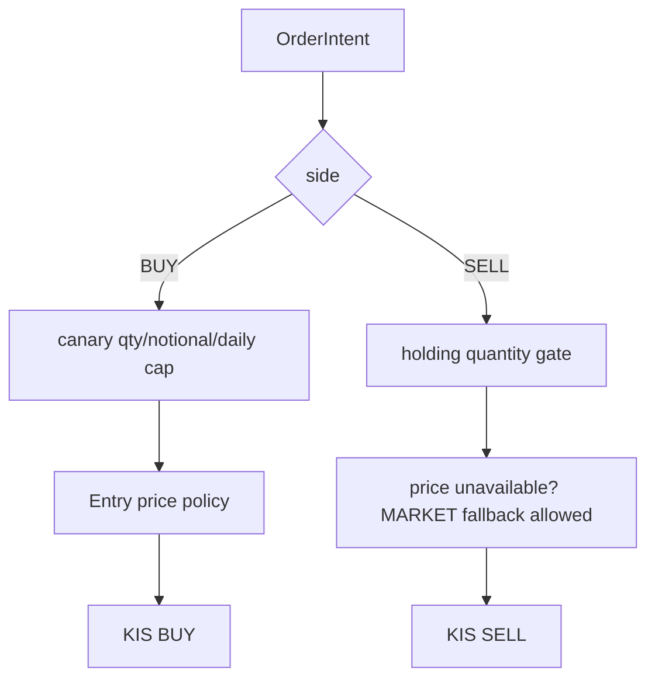

# 07 — magicJar v3.13.0 정책 진화

> **작성자**: Codex (Claude Code 중단 지점 인수)
> **시점**: 2026-06-12 v3.13.0 baseline 정리
> **권위**: `_workspace/arch/agent-charter.md` + `docs/architecture/policies/long-only-trading.md` + ADR 0109/0115/0122/0123 + v3.13.0 코드 inspection

v3.13.0 정책 변화의 핵심은 "실전 첫 운용에서 드러난 역방향 위험을 정책 언어로 고정"한 것이다. v3.12.0은 자본 path를 안전 방향으로 설계했고, v3.13.0은 그 path를 실계좌 canary에서 검증하며 BUY 보호와 SELL 청산 보장을 더 날카롭게 분리했다.

---

## §1. 롱 온리 정책 — SELL은 신규 위험이 아니라 청산이다

magicJar는 공매도·대주·파생 숏을 다루지 않는다. 따라서 SELL은 항상 보유분 청산이다.

| 액션 | 정책 |
|---|---|
| BUY | 신규 자본 투입. readiness, consent, KillSwitch, canary cap, price cap을 보수적으로 적용 |
| SELL | 기존 위험 회수. 보유 수량 게이트는 엄격히 보되, cap/가격 미가용으로 청산을 막지 않음 |
| CANCEL | 원주문 상태 복구. KIS 취소 ODNO를 새 외부 주문으로 오인하지 않음 |
| PAPER | 실자본과 분리. MOCK origin과 paper capital만 사용 |

이 정책이 ADR 0109 §7 amend, 헌법 §13, `long-only-trading.md`의 핵심이다.

---

## §2. Canary hard cap 의미 정정

canary cap의 목적은 "잘못된 BUY가 너무 크게 나가지 않게 막는 것"이다. v3.13.0 전에는 qty/notional/daily cap이 SELL에도 적용되어, 가격을 알 수 없는 상황의 MARKET SELL을 막는 역방향 결함이 생겼다.

정정 후 정책:

- qty/notional cap은 BUY에만 적용한다.
- daily cap은 BUY 주문 수만 센다.
- SELL의 상한은 실보유 수량이다.
- SELL 가격 정보가 없을 때는 청산 보장을 위해 MARKET fallback을 허용한다.
- BUY의 MARKET fallback 금지는 유지한다.

---

## §3. 체결-원장-리스크 키 사슬 정책

정책 문장: **signal 없는 주문은 허용하지만, 출처 모르는 주문은 허용하지 않는다.**

이전 0-sentinel은 자동청산/백필/수동/외부 흡수의 의미를 같은 숫자에 접어 넣어 원장 귀속을 흐리게 했다. v3.13.0은 `OrderTrigger`와 `trigger_ref_id`로 발사 출처를 분리한다.

| 원칙 | 설명 |
|---|---|
| immutable evidence 우선 | KIS 체결과 `order_execution`이 원장 재구성의 1차 증거 |
| derived ledger | `strategy_position`은 장기적으로 execution evidence에서 재계산 가능한 상태여야 함 |
| silent fallback 금지 | 빈 포트/누락 adapter가 조용히 REAL gate를 통과시키거나 막지 않음 |
| drain 우선 | 장중 in-flight 주문이 있을 때 키 사슬 변경 배포 금지 |

---

## §4. 실패를 0으로 만들지 않는 정책

잔고 조회 실패를 0원으로 바꾸면 시스템은 "돈이 없는 것"과 "원장을 읽지 못한 것"을 구분하지 못한다. v3.13.0은 `CapitalOutcome`으로 이 둘을 타입 차원에서 분리한다.

- `Available(amount, stale=false)`: 정상 조회.
- `Available(amount, stale=true)`: 최근 정상값 fallback.
- `Unavailable(reason)`: 평가 skip. 0원 fabricate 금지.

이는 헌법 §11의 "silent fallback 금지"와 같은 결이다. 모르는 값을 안전한 척하지 않는다.

---

## §5. KIS WS 슬롯 정책 — R1 관측 baseline, R2/R3 deferred

ADR 0123의 정책 전환은 정당하다. KIS 예제 코드 기준 운영 상한을 40으로 보수 정정하고, `(code, trId)` 채널 단위 회계로 바꾸었다. 다만 v3.13.0 baseline에 실제로 들어온 것은 R1이다.

| 라운드 | v3.13.0 정책 상태 |
|---|---|
| R1 ledger/fallback/metrics | 현재 baseline. 운영 문제를 보이게 만들고 거부 후 fallback을 건다 |
| R2 owner eviction | deferred. 운영 데이터로 slot 포화/거부가 반복될 때 진행 |
| R3 channel diet/H0UNCNT0 | deferred. KIS 통합 체결가 실측과 fallback 가드 확인 후 진행 |

R1만 있어도 당장 "원인 불명 분봉 결손"은 관측 가능한 장애로 바뀐다. 그래서 현재는 R1을 유지하고, R2/R3는 운영 테스트에서 실제 필요가 확인될 때 진행한다.

---

## §6. 페이퍼 검증 정책

발굴 후보는 실전 주문 후보가 아니라 검증 후보다. ADR 0122는 이 원칙을 구현한다.

- `PAPER_DISCOVERY` origin은 MOCK 강제.
- 가상 자본은 실계좌 자본과 분리한다.
- UI에서 사용자가 명시 승격해야 페이퍼로 간다.
- 페이퍼 결과가 있어도 실전 자동 승격은 없다.

---

## §7. 운영 가시화 정책

v3.13.0은 "장애를 로그로만 보는 시스템"에서 "관리자가 화면에서 상태를 읽는 시스템"으로 이동했다.

| 상태 | 가시화 |
|---|---|
| KIS WS 연결/체결통보 | `/admin/realtime` banner |
| 슬롯 포화/거부 | slot gauge + metrics |
| 구독 owner | subscription table |
| 캔들 신선도 | freshness panel |
| 시스템 이벤트 detail | tooltip + modal + copy |
| 런타임 게이트 | header RuntimeFlagsIndicator |

RuntimeFlagsIndicator는 이제 `userId`가 없는 계좌 무관 조회를 동의 미체결로 오인하지 않는다. 실주문 게이트와 헤더 표시의 기준이 같은 `user_account.real_trading_consent_at`로 맞춰졌다.

---

## §8. 다음 운영 판단 후보

| 후보 | 진행 조건 |
|---|---|
| ADR 0123 R2 eviction | OPSP0008 거부율이 반복되거나 HOLDING/PENDING_BUY 공백이 관측될 때 |
| ADR 0123 R3 channel diet | H0UNCNT0 통합 체결가가 KRX+NXT를 안정적으로 cover한다는 실측 후 |
| KIS queue R1~R3 | per-TR 원장 한도 충돌이 운영에서 반복될 때 |
| 41 slot 주석 정리 | 다음 문서/테스트 debt cleanup |
| H0STOUP0 ledger 합류 | 시간외 단일가 구독을 슬롯 dashboard에 포함해야 할 때 |

이번 baseline은 위 후보를 구현했다고 주장하지 않는다. 운영 테스트로 필요성이 확인되면 별도 PR에서 진행한다.
