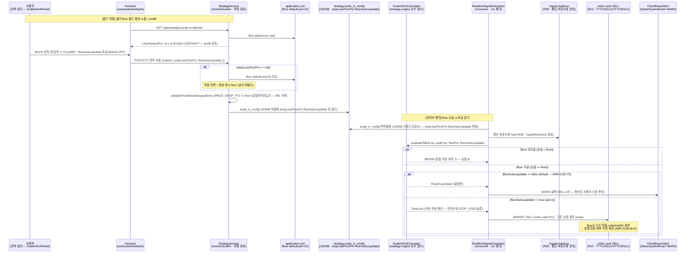
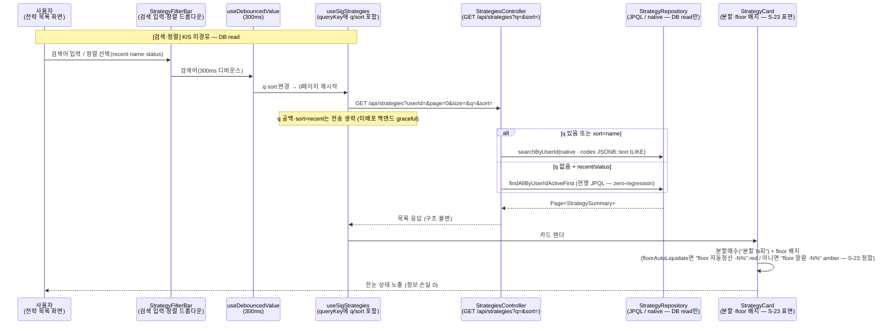

# v3.14.0 사용자 유즈 시퀀스 + KIS-first raw 출처

> **작성자**: market-data (bot+market-data@magicjar.local)
> **작성일**: 2026-06-21
> **기준 시점**: v3.14.0 — **분할매수 floor 운영화(default 외부화 + 자동청산 토글) + 전략 목록 탐색성(검색·정렬·빌더 고도화) baseline** (REAL canary 8일차 — ADR 0128 amend로 floor catastrophic 손절선을 ① yml 운영 default 외부화(재컴파일 없이 튜닝·사용자 가시화) + ② 전략 단위 자동청산 on/off 토글(default=알람만, opt-in 청산)로 운영화 + 전략 수 증가 대비 목록 검색(q)·정렬(sort) REST 계약 + frontend 빌더/목록 UX 고도화)
> **KIS-first 의무**: 헌법 §3 정합 — 자체 추론 0, 모든 endpoint·tr_id·필드는 raw 출처 인용 의무 (`docs/architecture/policies/kis-first-raw-fetch.md` 권위)
> **v3.13.0 대비 변경**: 시나리오 **S-23·S-24** 2건 신규 (① floor 운영 default 외부화 + 자동청산 토글 — 빌더 설정→저장→라이브 floor 도달 시 알람(default)/자동청산(toggle ON) 분기 / ② 전략 목록 검색·정렬 — `GET /api/strategies?q=&sort=` LOCKED CONTRACT + 빌더/목록 UX). raw 출처 인용은 **신규 0** — S-23 floor 자동청산은 기존 매도 endpoint `order-cash`(`TTTC0011U`/`VTTC0011U`, R12) reuse + 잔고 `inquire-balance`(`TTTC8434R`/`VTTC8434R`, R30) reuse, S-24는 DB read·UI 흐름으로 **KIS 호출 0**. v3.13.0 시나리오 1~23 + S-1~S-22 + raw R1~R30은 본 baseline 위에 add-only 보존.

---

## 0. 변경 매트릭스 — v3.13.0 → v3.14.0

| # | 영역 | 트리거 | 시나리오 |
|---|---|---|---|
| S-23 | market-data + backend-core + frontend | ADR 0128 amend (2026-06-21 canary 8일차 결재) — 분할매수 floor(평단 -손절% catastrophic 알람선) 운영 결함 2건: 갭① `ScaleInLimits.DEFAULT_STOP_LOSS_FLOOR_PCT=15`가 코드 상수로 박혀 운영 중 튜닝 불가 + 화면 가시성 0 / 갭② floor=알람만 고정이라 기계적 손실 bound를 원하는 전략이 자동청산 선택 불가 | 갭① yml `magicjar.strategy.scale-in.floor-default-pct`(default 15) 외부화 + api 저장 시 floor null→yml default 주입(저장 전략 항상 명시 floor) + `GET /api/strategies/scale-in-defaults` 빌더 prefill 계약(PR #1066·#1068). 갭② `ScaleInPlan.floorAutoLiquidate: Boolean`(default false) 신설 — false=`FloorBreachAlert`(알람만·SELL 미발행) / true=floor 도달 자동 전량 청산(`StopLoss`→`order-cash` MARKET SELL `TTTC0011U`/`VTTC0011U` R12 reuse) + `scale_in_config` JSONB 라운드트립 복원 fix + 빌더 floor 필드 항상노출·토글 UI(PR #1065·#1066·#1068·#1067) |
| S-24 | backend-core + frontend | 사용자(최고 관리자) 결재 (2026-06-19 "전략 몇 개 안 되는데 화면에 다 안 보임" 페인포인트) — 전략 수 증가 대비 목록 탐색성 + 빌더 고도화 | `GET /api/strategies?q=&sort=` LOCKED CONTRACT(q=name·nameKo·codes 부분일치 / sort=recent\|name\|status) — q 없음+recent/status는 기존 JPQL `findAllByUserIdActiveFirst`, q 있거나 sort=name일 때만 native `searchByUserId`(zero-regression). frontend 목록 검색(debounce 300ms)·정렬·카드 분할/floor 배지·빠른/일괄 액션·상태 요약 점프(PR #1069·#1071) + 빌더 분할계획 프리뷰·검증 인라인·RiskPlan 위계화·모바일(PR #1070). **KIS 호출 0** — DB read + UI |

---

## 1. raw 출처 인용 인덱스 (v3.14.0 — 신규 0 · 전부 reuse LOCK)

v3.7.0 baseline raw R1~R20 + v3.8.0 R21~R23 + v3.9.0 R24~R28 + v3.12.0 R29 + v3.13.0 R30은 본 baseline 위에 그대로 LOCK. v3.14.0은 신규 시나리오 S-23·S-24가 **새 KIS endpoint를 도입하지 않으므로** raw 인용 신규 0 — 전부 기존 R LOCK reuse + S-24는 KIS 호출 0.

| # | 출처 | raw URL | tr_id | v3.14.0 사용 시나리오 |
|---|---|---|---|---|
| R12 (reuse) | KIS 주식주문(현금) order_cash | `https://raw.githubusercontent.com/koreainvestment/open-trading-api/main/examples_user/domestic_stock/order_cash/order_cash.py` (= baseline `domestic_stock_functions.py` L10097~L10213) | **TTTC0011U**(실전 매도) / **VTTC0011U**(모의 매도) | S-23 — floor 자동청산(`floorAutoLiquidate=true`) 시 `StopLoss`→MARKET SELL 발행 (기존 손절 경로 재사용 · endpoint 무변경) |
| R30 (reuse) | KIS 주식잔고조회 inquire_balance | `https://raw.githubusercontent.com/koreainvestment/open-trading-api/main/examples_llm/domestic_stock/inquire_balance/inquire_balance.py` | **TTTC8434R**(실전) / **VTTC8434R**(모의) | S-23 — floor 도달 평가의 평단/보유수량 권위 read (`output1` 보유종목 + `output2` 예수금 · S-20 CapitalOutcome 경로 reuse) |

**v3.14.0 KIS-first 의무 (헌법 §3 + `docs/architecture/policies/kis-first-raw-fetch.md` 5단계 절차 정합)**:

- 시나리오 S-23 — floor 자동청산은 **자체 endpoint 결정 0**. `floorAutoLiquidate=true` 분기에서 발행되는 SELL은 기존 손절 경로(`order-cash` `TTTC0011U`/`VTTC0011U` R12 · hashkey 헤더 의무·v3.7.0 시나리오 18 LOCK)를 그대로 재사용한다. v3.14.0 신규는 **엔진 분기 + yml 외부화 + 토글 직렬화**(KIS 호출 byte 무변경 — 알람만(false) 시 SELL 0건, 자동청산(true) 시에만 기존 SELL 1회). floor 도달 판정의 평단·보유수량 read는 R30 `inquire-balance`(S-20 `CapitalOutcome` 경로 reuse) + tick 안전망(`PositionStopLossTickWatcher`)의 `HoldingPositionIndex` 스냅샷.
  - 키 정책: floor 자동청산 SELL은 주문 액션이므로 **모의/실전 분기**(`AccountType` — `MAGICJAR_MODE`/`MAGICJAR_ALLOW_REAL` 이중 게이트 · `feedback_kis_key_realonly_for_data`는 정보 수집만 실전 키 고정, 주문은 mode 분기). floor 도달 평가의 잔고 read(R30)는 **실전 키**(정보 수집).
  - yml 외부화: `magicjar.strategy.scale-in.floor-default-pct`(default 15 · ENV `MAGICJAR_STRATEGY_SCALE_IN_FLOOR_DEFAULT_PCT`)는 **운영 default 위치 이동만** — KIS endpoint/tr_id 무관(DDL 0 · `scale_in_config` JSONB가 `floorAutoLiquidate` 자동 흡수). 도메인 상수 `ScaleInLimits.DEFAULT_STOP_LOSS_FLOOR_PCT`는 "운영 default→last-resort 안전망"으로 강등(삭제 X).
- 시나리오 S-24 — 전략 목록 검색·정렬은 **KIS 호출 0**(DB read + UI). `GET /api/strategies?q=&sort=`는 PostgreSQL JPQL/native query만 — 외부 시세 endpoint 미경유. 자체 KIS endpoint 결정 0. (본 § 인용은 KIS-first 5단계 절차의 "해당 없음(KIS 미사용)" 명시 의무 — 자체 추론 0 정합.)

**ADR 0037 rate limit priority 정합 (라이브 자본 path)**:
- S-23 floor 자동청산 SELL — `KisRateLimiterPort.acquire(USER_PATH, trId="TTTC0011U"/"VTTC0011U")` (청산은 사용자 자본 path · 기존 손절 SELL 경로와 동일 priority — v3.12.0 S-16 손절 LOCK reuse). floor 도달 평가 잔고 read는 account path(S-20 R30 reuse).
- S-24 — rate limit 무관(KIS 미경유 · DB read).

---

## 2. 시나리오 1~23 + S-1~S-22 (v3.7.0~v3.13.0 baseline 보존 — add-only 참조)

> 시나리오 1~23 (v3.6.0·v3.7.0) + S-1~S-7 (v3.8.0) + S-8~S-13 (v3.9.0) + S-14~S-17 (v3.12.0) + S-18~S-22 (v3.13.0)은 본 v3.14.0 baseline 위에 add-only 보존. 본 v3.14.0은 시나리오 **S-23·S-24** 2건만 신규 추가.
>
> **참조**:
> - `_workspace/baseline/v3.13.0/03-use-sequences.md` (S-18~S-22 + raw R30 — 전략 ACTIVE 호가 STRATEGY owner 자동 구독·DETAIL "표시 중에만"·잔고 CapitalOutcome·체결통보 H0STCNI0/9·관리자 realtime snapshot)
> - `_workspace/baseline/v3.12.0/03-use-sequences.md` (S-14~S-17 + raw R29 — 진입 호가 동기 read·marketable LIMIT·tick 손절·익절 LIMIT 선주문)
> - `_workspace/baseline/v3.9.0/03-use-sequences.md` (S-8~S-13 + raw R24~R28 — 시장 추세 lens·지수·섹터·TrendPreference·AI·MCP)
> - `_workspace/baseline/v3.8.0/03-use-sequences.md` (S-1~S-7 + raw R21~R23)
> - `_workspace/baseline/v3.7.0/03-use-sequences.md` (시나리오 18~23 + raw R15~R20 — order-cash R12·잔고 R19/R20)
> - `_workspace/baseline/v3.6.0/03-use-sequences.md` (시나리오 1~17 + raw R1~R14)
>
> 핵심 누적 흐름:
> - v3.6.0 1~17 — 사용자 가입 + KOSPI/KOSDAQ 마스터 + KIS WS H0STCNT0 + REST 현재가/일봉/분봉 + 전략·시그널·백테스트 + T-O 주문 실행 (모의·3중 게이트·분할 체결)
> - v3.7.0 18~23 — REAL hashkey + Bucket4j rate limit + KIS WS H0STCNI 재연결 backfill + 일봉 DESC→ASC 정규화 + instrument_status_history + 잔고 조회(R19/R20) + Outbox publish chain
> - v3.8.0 S-1~S-7 — KIS 키 등록 + 23h cache + 종목상세 NXT 분기 + KIS_TPS_EXCEEDED hotfix + 자율 주문 REAL + KIS WS H0STCNI9 AES 복호화 + KillSwitch race-safe + DR drill
> - v3.9.0 S-8~S-13 — MarketIndexStrip 4 지수 + KRX 21 섹터 ranking + TrendPreference UPSERT + AI 시장 추세 해석 + MCP `get_market_trend` + 1분 cron KIS endpoint 5
> - v3.12.0 S-14~S-17 — 진입 호가 동기 read(`EntryQuotePort` — H0STASP0 write-through + REST FHKST01010200 fallback) + marketable LIMIT 산정·미체결 취소 + tick 손절 안전망 + 익절 LIMIT 선주문
> - v3.13.0 S-18~S-22 — 전략 ACTIVE 호가 STRATEGY owner 자동 구독(F11) + DETAIL "표시 중에만" 복원 + 잔고 CapitalOutcome 실패 처리 + 체결통보 H0STCNI0/9 AES 자동 구독 + 관리자 realtime snapshot

---

## 3. 시나리오 S-23: 분할매수 floor 운영 default 외부화 + 자동청산 토글 (v3.14.0 신규 — ADR 0128 amend · PR #1065·#1066·#1068·#1067)

**목적**: 분할매수(scale-in)의 **floor**(1차 평단 대비 절대 -X% catastrophic 알람선)를 두 결함에서 운영화한다. ① 갭① — `ScaleInLimits.DEFAULT_STOP_LOSS_FLOOR_PCT=15`가 컴파일 상수로 박혀 운영 중 기본값 튜닝 시 재컴파일·재배포가 필요했고 사용자가 화면에서 그 값을 볼 수 없었다(가시성 0) → `application.yml` `magicjar.strategy.scale-in.floor-default-pct`(default 15)로 외부화 + api 저장 시 floor null이면 yml default를 주입해 **저장 전략은 항상 명시 floor** 보유 + `GET /api/strategies/scale-in-defaults`로 빌더 prefill. ② 갭② — floor=알람만(`FloorBreachAlert`·SELL 미발행) 고정이라 기계적 손실 bound를 원하는 전략이 자동청산을 선택할 수 없었다 → `ScaleInPlan.floorAutoLiquidate: Boolean`(default **false**) 신설로 **전략 단위 opt-in 자동청산**. false=현행 알람만(ADR 0128 ⑦ default 유지·zero-regression), true=floor 도달 시 자동 전량 청산(`StopLoss`→기존 `order-cash` MARKET SELL 경로 재사용).

**관련 ADR/실코드**: ADR 0128 §6 amend(floor default 외부화 + floorAutoLiquidate 토글) · ADR 0128 §2 ⑦(floor 알람만 default) · ADR 0037 rate limit · `ScaleInPlan.floorAutoLiquidate`·`ScaleInLimits.DEFAULT_STOP_LOSS_FLOOR_PCT`(domain) · `ScaleInExitCalculator.evaluate`(strategy-engine floor 분기) · `RealtimeSignalGenerator`(consumer — `ScaleInExitInput.floorAutoLiquidate` 주입) · `StrategyService.resolveScaleIn`(api — floor null→yml default 주입) · `StrategyEntityMapper`·`ConsumerStrategyLookupJpaAdapter`(JSONB 라운드트립 fix) · `ScaleInExitPanel`(frontend 빌더)

**KIS-first raw 출처 (헌법 §3 LOCK)**: 신규 endpoint 0. floor 자동청산 SELL = `order-cash` `TTTC0011U`/`VTTC0011U`(R12 · v3.12.0 S-16 손절 LOCK reuse) + floor 도달 평가 잔고 read = `inquire-balance` `TTTC8434R`/`VTTC8434R`(R30 · S-20 CapitalOutcome 경로 reuse). yml `floor-default-pct`는 운영 default 위치 이동만(KIS 무관 · DDL 0 · JSONB 흡수).

**ADR 0128 amend LOCK 불변식 (실코드 evidence)**:
- **갭① default 보존 원칙**: 운영 default 15%는 그대로 15%(yml default) — 외부화 목적은 "재컴파일 없이 튜닝 + 사용자 가시성"이지 값 변경이 아니다(ADR 0128 §6-2). 도메인 상수 `DEFAULT_STOP_LOSS_FLOOR_PCT`는 삭제 X — last-resort 안전망(yml 미설정 + api 미경유 programmatic 생성)으로만 잔존(KDoc "운영 default 아님" 명시).
- **갭② default = false(알람만)**: §2 ⑦ 현행 동작 그대로 — zero-regression. 자본 경로 변경(알람→자동 청산)이므로 **계정 전체가 아닌 전략 단위 opt-in**(한 전략 toggle ON이 다른 전략·종목 청산에 영향 0).
- **JSONB 라운드트립 critical fix**: write는 전 필드 직렬화하나 api `StrategyEntityMapper`·consumer `ConsumerStrategyLookupJpaAdapter`의 수동 `deserializeScaleIn`가 `stopLossFloorPct`·`floorAutoLiquidate`를 복원하지 않아 조회 시 소실되던 비대칭 버그 보강 — 누락 시 갭② wiring 영구 dead·갭① floor 소실(라이브 자본 critical).
- **floor < 분할 최저 진입가 저장검증**: toggle 무관 불변 — 알람이든 청산이든 floor가 분할 의미를 깨면 안 됨(PRICE_DROP_PCT는 누적 하락보다 깊어야 저장 허용·400 거부 / SIGNAL_REPEAT은 가격 조건 없어 항상 통과).
- **floor의 ⑤⑥ 독립성(§6-5)**: toggle ON이면 분할 미완 여부 무관하게 floor에서 청산(floor의 본질이 worst-case bound). ⑤의 "분할 미완 손절 보류"는 평단 -손절%(⑥) 경로에만 적용되고 floor는 별도 상한.

---

## 4. 시나리오 S-24: 전략 목록 검색·정렬 + 빌더/목록 UX 고도화 (v3.14.0 신규 — PR #1069·#1070·#1071 · KIS 호출 0)

**목적**: 사용자(최고 관리자) "전략 몇 개 안 되는데 화면에 다 안 보임" 페인포인트(2026-06-19)에 대응해 전략 수 증가 대비 **목록 탐색성**을 보강한다. ① backend `GET /api/strategies?q=&sort=` LOCKED CONTRACT — q=name·nameKo·codes(종목코드) 대소문자 무시 부분일치, sort=recent(default·현행)\|name(가나다)\|status(상태 우선순위). zero-regression: q 없음 + recent/status는 현행 JPQL `findAllByUserIdActiveFirst` 그대로, q 있거나 sort=name일 때만 native `searchByUserId`(codes JSONB::text ILIKE) 위임. ② frontend 목록 검색(debounce 300ms)·정렬 드롭다운·카드 분할/floor 배지·즐겨찾기·복제·일괄 시작/중지·상태 요약 점프. ③ frontend 빌더 고도화 — 저장 전 분할계획 client-side 프리뷰·조건 검증 인라인·RiskPlan 위계화(CollapsibleSection)·모바일 탭. **이 시나리오는 KIS 호출 0** — DB read + UI 흐름이며, S-23 floor 운영화의 UI 표면(카드 floor 배지·빌더 floor 필드/토글)을 사용자에게 노출한다.

**관련 ADR/실코드**: ADR 0128 amend R3(빌더 floor 노출·카드 배지) · `StrategiesController`(api — q·sort 파라미터·Swagger 4단) · `StrategyRepository.searchByUserId`(native query · 헌법 §6 abstract fun body 0) · `useSigStrategies`·`StrategyFilterBar`·`useDebouncedValue`(frontend) · `strategyCardBadges.ts`(분할·floor 배지) · `StrategyRunStatusSummary`(요약 점프) · `buildScaleInPlanPreview`(빌더 client-side 분할계획 프리뷰)

**KIS-first raw 출처 (헌법 §3)**: **KIS 호출 0** — `GET /api/strategies?q=&sort=`는 PostgreSQL read만(JPQL/native query). 외부 시세·체결·호가·주문 endpoint 미경유. 자체 KIS endpoint 결정 0(KIS-first 5단계 "해당 없음" 명시 — 자체 추론 0 정합).

**목록/빌더 UX 불변식 (실코드 evidence)**:
- **LOCKED CONTRACT**: `GET /api/strategies?q=&sort=` — q=name·nameKo·codes 부분일치 / sort=recent\|name\|status. 미지원 sort 값은 recent로 흡수(graceful). `Page<StrategySummary>` 응답 구조 불변(add-only 파라미터).
- **zero-regression**: q 없음 + recent/status는 현행 JPQL 그대로 호출 — q 있거나 sort=name일 때만 native `searchByUserId` 위임(기존 동작 byte 불변).
- **헌법 §6 Repository default fun 함정 회피**: `searchByUserId`는 Repository **abstract fun**(body 0) — interface 내부 body 가진 fun 발행 금지(ADR 0051 · 본 영역 핵심 risk).
- **S-23 표면 정합**: 카드 floor 배지는 `floorAutoLiquidate` 값으로 "자동청산(red)/알람(amber)" 분기 — S-23 도메인 토글과 1:1(`strategyCardBadges.ts`). 빌더 floor 필드는 항상 노출 + `useScaleInDefaults`로 prefill(`GET /api/strategies/scale-in-defaults` — S-23 갭① 계약).
- **client-side 분할계획 프리뷰**: 저장 전(strategyId 없음) SaveModal은 서버 `/scalein-plan` 호출 불가 → `buildScaleInPlanPreview` 순수 산식(PRICE_DROP_PCT는 기준가×(1+drop/100)^n)·수량 미표기(base 미상)·mock 0건(기준가 미입력 시 안내). 라이브 분할계획 API(`GET /api/strategies/{id}/scalein-plan` — v3.13.0 R2)와 별개 경로.

---

## 5. KIS endpoint 호출 매트릭스 (v3.14.0 종합 — v3.13.0 superset + S-23·S-24)

| tr_id | endpoint | 환경 | raw 인덱스 | v3.13.0 사용 | v3.14.0 신규 | rate limit priority |
|---|---|---|---|---|---|---|
| **TTTC0011U / VTTC0011U** | order-cash SELL | prod/vps | **R12** | S-16·S-17 (손절·익절) | **S-23 (floor 자동청산 toggle ON → MARKET SELL · endpoint 무변경)** | USER_PATH |
| **TTTC8434R / VTTC8434R** | inquire-balance (잔고) | prod/vps | **R30** | S-20 (capital CapitalOutcome) | **S-23 (floor 도달 평가 평단·보유수량 read · S-20 경로 reuse)** | account path |
| (KIS 미경유) | `GET /api/strategies?q=&sort=` | — (DB read) | — | — | **S-24 (전략 목록 검색·정렬 — KIS 호출 0)** | (rate limit 무관) |
| H0STASP0 (WS) | 실시간 호가 10단계 | prod WS | (v3.7.0 R5 계열) | S-14·S-18·S-19 | — | (WS — slot 회계 ADR 0123) |
| FHKST01010200 | inquire-asking-price-exp-ccn (호가) | prod | R29 | S-14·S-18 | — | USER_PATH |
| H0STCNI0 / H0STCNI9 (WS) | 체결통보 (AES) | prod WS | (v3.8.0 S-6) | S-4·S-21 | (S-23 floor 자동청산 SELL 체결 source) | (WS — 1 slot reserve) |
| TTTC0012U / VTTC0012U | order-cash BUY | prod/vps | R12 | S-15 (진입 LIMIT) | — | USER_PATH |
| TTTC0013U / VTTC0013U | order-rvsecncl 정정·취소 | prod/vps | R12 | S-15·S-16·S-17 | — | USER_PATH |

**v3.14.0 신규 합계**: S-23 floor 운영화(yml default 외부화 + 자동청산 토글 — endpoint 신규 0, 기존 `order-cash` SELL R12·`inquire-balance` R30 reuse) + S-24 전략 목록 검색·정렬(KIS 호출 0 · DB read). **모든 v3.14.0 변경은 endpoint/tr_id 무변경** — S-23은 엔진 분기·yml 외부화·JSONB 토글 직렬화·기존 SELL 경로 재사용, S-24는 PostgreSQL read·UI.

---

## 6. fitness gap 검증 매트릭스 (자동매매 적합성 lens — `feedback_v3_skepticism_no_regression` 메모리 의무)

| 의제 | "자동매매에 필요한가?" 검증 | "v1/v2 잔재 아닌가?" 검증 |
|---|---|---|
| S-23 갭① floor yml 외부화 | ✅ floor 기본값을 재컴파일 없이 운영 튜닝 + 사용자 가시화 — 분할매수 손실 한계선의 운영 가능성 직결 | ✅ v1/v2에 scale-in floor·yml 외부화 0건 — ADR 0128 amend 신설(default 15 보존·위치만 이동) |
| S-23 갭② floor 자동청산 토글 | ✅ 기계적 손실 bound를 원하는 전략에 자동청산 경로 제공(default=알람만 zero-regression) — 사용자 청산 정책 선택권 | ✅ v1/v2에 floorAutoLiquidate 토글 0건 — 자본 경로 변경이라 전략 단위 opt-in으로 안전(계정 전체 영향 0) |
| S-24 전략 목록 검색·정렬 | ✅ 전략 수 증가 시 탐색성(검색·정렬) 부재가 운영 페인포인트(사용자 직접 결재) — 자동매매 전략 운영 UX 직결 | ✅ v1/v2에 q·sort 계약·목록 클러스터 UX 0건 — add-only(zero-regression: q 없음+recent/status는 현행 JPQL 그대로) |

**자본 path 정합 검증 의무**:
- S-23 갭① yml 외부화 → 운영 default 위치 이동만(KIS 무관·DDL 0). 저장 경로 floor null→yml 주입은 read-only 설정값(주문 발행 0).
- S-23 갭② 자동청산 → `floorAutoLiquidate=true` 시에만 기존 `order-cash` SELL 경로(R12) 재사용(신규 발행 경로 0). false(default) 시 SELL 0건·알람만. floor 도달 평가 잔고 read는 read-only(R30).
- S-24 전략 목록 검색·정렬 → DB read + UI(KIS 호출 0·주문 발행 0). 빌더 분할계획 프리뷰는 client-side 순수 산식(mock 0건).
- AI 호출 0 (S-23·S-24 모두 룰 기반 자본 흐름·UI — ADR 0023 §2-4 KDoc evidence).

---

## 7. dogfooding 매트릭스 (v3.14.0 cut 직전 검증 의무 — `feedback_docker_log_verify_before_cut` 메모리)

| 검증 항목 | 검증 path | 기대 결과 |
|---|---|---|
| S-23 갭① yml 외부화 | `curl GET /api/strategies/scale-in-defaults` | `{ floorDefaultPct: 15 }`(yml 튜닝 시 그 값) |
| S-23 갭① floor null→default 주입 | floor 미입력 전략 저장 후 재조회 | 저장값 = 명시 floor(15) — 상수 미참조 |
| S-23 갭② autoLiquidate=false (default) | docker logs consumer-app \| grep "FloorBreachAlert" | floor 도달 시 Slack WARN만(SELL 0건) |
| S-23 갭② autoLiquidate=true (opt-in) | docker logs consumer-app \| grep -E "floorAutoLiquidate.*StopLoss\|order-cash SELL" | floor 도달 시 MARKET SELL 1회 + 포지션·PnL 정합 |
| S-23 JSONB 라운드트립 | 전략 저장→재조회 시 stopLossFloorPct·floorAutoLiquidate 보존 | api·consumer 양쪽 복원(소실 0) |
| S-24 검색 q | `curl 'GET /api/strategies?q=후성'` | name·nameKo·codes 부분일치 결과 |
| S-24 정렬 sort | `curl 'GET /api/strategies?sort=name'` (가나다) · `sort=status` | name 가나다·status 우선순위 정렬 |
| S-24 zero-regression | `curl 'GET /api/strategies'` (q·sort 생략) | 현행 findAllByUserIdActiveFirst JPQL 동일 결과 |
| S-24 카드 floor 배지 | frontend 목록 화면 | floorAutoLiquidate면 "floor 자동청산 -N%" red / 아니면 "floor 알람 -N%" amber |
| 자본 path 정합 | docker logs consumer-app \| grep -E "(KillSwitch\|idem:order)" | S-23 false·S-24 직접 KIS 발행 0건(toggle ON SELL만 기존 경로) |

---

## 8. 출처 검증 매트릭스 (헌법 §3 KIS-first 5단계 절차 정합)

| 단계 | 검증 결과 | evidence |
|---|---|---|
| 1. 자체 추론 0 LOCK | ✅ S-23 floor 자동청산 SELL = R12(`TTTC0011U`/`VTTC0011U`)·평가 잔고 = R30(`TTTC8434R`/`VTTC8434R`) 모두 기존 R LOCK reuse(endpoint 무변경) · S-24는 KIS 호출 0 명시 | 본 § 1 + v3.7.0 R12·R19/R20 + v3.13.0 R30 |
| 2. raw URL inline KDoc 의무 | ✅ floor 자동청산은 기존 `KisOrderHttpAdapter.submit` order-cash 경로 reuse(raw URL inline 기존 LOCK) · 신규 KIS adapter 0 | 실코드 `KisOrderHttpAdapter`(R12 KDoc) |
| 3. tr_id 매트릭스 | ✅ TTTC0011U/VTTC0011U(SELL) + TTTC8434R/VTTC8434R(잔고) + S-24 KIS 미사용 | 본 § 5 매트릭스 |
| 4. WS↔REST source 1:1 정합 | ✅ v3.14.0 신규 endpoint 0 — 기존 R12·R30 정합 LOCK reuse(변경 0) | v3.13.0 §12 LOCK |
| 5. self-review 의무 | ✅ 본 baseline 작성 후 markdown + mermaid sequenceDiagram render 검증 + grep 자체 추론 0건 + KIS endpoint 신규 0 확인(S-23 reuse·S-24 KIS 0) | 본 § (cycle complete) |

---

## 9. cross-link 매트릭스 (분할매수 floor 운영화 + 목록 탐색성 lens · v3.14.0 핵심 트랙)

| 트리거 | 적용 시나리오 | 의무 항목 |
|---|---|---|
| ADR 0128 amend 갭① (2026-06-21 결재) | S-23 | floor `floor-default-pct` yml 외부화 + api 저장 시 floor null→default 주입 + `/scale-in-defaults` 계약 + 도메인 상수 last-resort 강등 |
| ADR 0128 amend 갭② (2026-06-21 결재) | S-23 | `floorAutoLiquidate` 전략 단위 opt-in(default false=알람만) + 엔진 false→FloorBreachAlert/true→StopLoss(order-cash R12) + JSONB 라운드트립 fix |
| 사용자 결재 — 목록 페인포인트(2026-06-19) | S-24 | `GET /api/strategies?q=&sort=` LOCKED CONTRACT(zero-regression) + 목록 검색·정렬·카드 배지·일괄 액션·상태 요약 |
| 사용자 강조 — 빌더 고도화(2026-06-19) | S-24 | 빌더 분할계획 client-side 프리뷰·검증 인라인·RiskPlan 위계화·모바일 + floor 필드/토글 노출(S-23 표면) |

---

## 10. 변경 이력

| 날짜 | 변경 |
|---|---|
| 2026-06-21 | **v3.14.0 baseline 03-use-sequences.md 신규 발행** — 시나리오 S-23·S-24 (2건 신규 추가). **S-23 분할매수 floor 운영화(ADR 0128 amend)** — 갭① floor 운영 default `magicjar.strategy.scale-in.floor-default-pct`(default 15) yml 외부화 + api 저장 시 floor null→yml default 주입(저장 전략 항상 명시 floor) + `GET /api/strategies/scale-in-defaults` 빌더 prefill 계약 + 도메인 상수 `DEFAULT_STOP_LOSS_FLOOR_PCT` last-resort 안전망 강등 / 갭② `ScaleInPlan.floorAutoLiquidate: Boolean`(default false) 전략 단위 opt-in 자동청산 — false=FloorBreachAlert(알람만·SELL 미발행) / true=floor 도달 자동 전량 청산(StopLoss→order-cash MARKET SELL `TTTC0011U`/`VTTC0011U` R12 reuse) + JSONB 라운드트립 복원 fix + floor의 ⑤⑥ 독립 catastrophic 상한(§6-5). **S-24 전략 목록 검색·정렬 + 빌더/목록 UX 고도화** — `GET /api/strategies?q=&sort=` LOCKED CONTRACT(q=name·nameKo·codes 부분일치 / sort=recent\|name\|status / zero-regression: q 없음+recent/status는 현행 JPQL·헌법 §6 Repository abstract fun body 0) + frontend 목록 검색(debounce 300ms)·정렬·카드 분할/floor 배지(S-23 표면)·일괄 액션·상태 요약 점프 + 빌더 client-side 분할계획 프리뷰·검증 인라인·RiskPlan 위계화·모바일(KIS 호출 0 — DB read + UI). **raw 출처 신규 0** — S-23 floor 자동청산 SELL은 R12(`TTTC0011U`/`VTTC0011U` order-cash)·평가 잔고는 R30(`TTTC8434R`/`VTTC8434R` inquire-balance) 기존 LOCK reuse(endpoint/tr_id 무변경) + S-24는 KIS 호출 0(KIS-first 5단계 "해당 없음" 명시 — 자체 추론 0 정합). v3.13.0 시나리오 1~23 + S-1~S-22 + raw R1~R30은 add-only 보존 + 본 baseline 위에서 참조. **자체 추론 0 LOCK 정합** — 모든 시퀀스 실코드 인용(`ScaleInPlan.floorAutoLiquidate`·`ScaleInExitCalculator`·`RealtimeSignalGenerator`·`StrategyService.resolveScaleIn`·`StrategyEntityMapper`·`StrategiesController`·`StrategyRepository.searchByUserId` evidence). **AI 호출 0 검증** — S-23·S-24 모두 룰 기반 자본 흐름·UI(ADR 0023 §2-4). **자본 path 정합 검증** — S-23 갭① yml read-only(주문 0)·갭② autoLiquidate=true 시에만 기존 SELL 경로 reuse(false 시 SELL 0)·floor 평가 잔고 read-only + S-24 DB read·UI(KIS 0·주문 0). v3.14.0 분할매수 floor 운영화 + 전략 목록 탐색성 baseline 발행 트리거(orchestrator dispatch market-data 영역 단독 — 03 use-sequences 1 파일). (market-data, opus 4.8 1M) |
