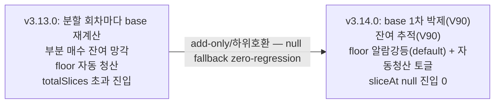

# 06 — magicJar v3.14.0 이력 추적 (PR · ADR · 기능 매핑)

> **작성자**: architect (baseline v3.14.0)
> **시점**: 2026-06-21 v3.14.0 release commit 준비 (main `cbd5db8e`)
> **권위**: `_workspace/arch/adr/README.md` (ADR 인덱스 — 총 124건) + `CHANGELOG.md` + `api/src/main/resources/db/migration/` (Flyway 실 파일) + git log + v3.14.0 코드 inspection

본 문서는 v3.13.0(REAL canary 진입) 이후 v3.14.0(분할매수 자본 재설계 + 운영 고도화)까지의 **결정 → 코드 → 마이그레이션 → 라이브 검증 추적표**다. 실코드·실문서·실 마이그레이션 파일·라이브 evidence(시각·전략 ID·drift)만 인용한다(추정 0).

---

## §1. v3.13.0 → v3.14.0 minor·patch 시계열

| 버전 | 일자 | 마일스톤 | 신규/amend ADR |
|------|------|----------|----------|
| v3.13.0 | 2026-06-12 | REAL canary 진입 (첫 실전 주문·롱 온리·키 사슬 무결성 R1/R2·WS 슬롯 회계 R1·관리자 가시화) | 0122·0123 + 0109 §7 amend + long-only |
| v3.13.1~v3.13.3 | 2026-06-13 | KIS WS 구독 수요 재편(H0UNCNT0 단일 채널·watchlist polling 강등·owner 재정렬) + 토픽 명명규칙 wire clean-cut | **0124·0125** |
| v3.13.4~v3.13.5 | 2026-06-15~16 | 토픽 명명규칙 Phase 2 wire 플립 + 매수 사이징 계좌 전체 공유 풀 + 전략 성과 히스토리 | **0126** + 0125 amend |
| v3.13.6 | 2026-06-18 | 손절 자동화·오프라인 체결 부팅정합·TP tick failsafe 승격 + 전략 시작화면 + 프리셋 DB화 | **0127** |
| v3.13.7 | 2026-06-18 | 분할매수 첫회 전량매수 P0 근본fix(scale_in_config 매핑 누락 drift) + WS self-heal 제거 + EXPIRE 가드 | — |
| **v3.14.0** | **2026-06-21** | **분할매수 자본 재설계 + floor 운영화 + 전략 UX 고도화** (base 박제·잔여 추적·floor 알람강등/자동청산 토글·빌더/목록 UX) | **0128 (+§6 amend)** |

---

## §2. v3.14.0 신규/amend ADR 추적 (0124~0128 — 실코드 매핑)

### ADR 0124 — KIS WS 구독 수요 재편 (Accepted 2026-06-13 — 최고 관리자 직접 결재, 결정 3건 LOCK)

| 항목 | 내용 |
|---|---|
| 계기 | KIS WS 40 슬롯 회계(ADR 0123 R1) 가동 후 watchlist 합집합 구독이 매매 수요 슬롯을 잠식 + H0STCNT0(KRX)+H0NXCNT0(NXT) 이중 발사로 종목당 슬롯 2 소모 |
| 결정 3건 | ① **H0UNCNT0 단일 체결가 채널**(KRX+NXT 통합·종목당 1채널·`NEW_MKOP_CLS_CODE` 세션 구분 — 이중 발사 경로·flag 완전 제거) ② **watchlist polling 강등**(KIS WS 구독 폐지 → 5초 REST polling 전용, WS 40 slot 매매 전용) ③ **owner 우선순위 재정렬**(HOLDING 0 > PENDING_BUY 5 > STRATEGY 10 > DETAIL 20 — 매매 경로가 관찰 경로 우선·slot 경합 시 DETAIL evict·STRATEGY 보호) |
| 호가 | H0STASP0 → **H0UNASP0 통합 호가** 전환. STRATEGY(marketable limit) + DETAIL(표시 중에만) 두 경로 |
| LOCK | HOLDING·PENDING_BUY evict 절대 금지(ADR 0114 LOCK). watchlist 기능(등록/삭제/priority/화면) 유지·시세 채널만 WS→polling |
| ADR 0123 관계 | 0123 R3(채널 다이어트·H0UNCNT0 통합)을 본 ADR이 정식 채택(0123 Proposed → 0124 R3) |

### ADR 0125 — 실시간 토픽 명명규칙 + wire clean-cut 마이그레이션 (Accepted 2026-06-15)

| 항목 | 내용 |
|---|---|
| 결정 | Kafka/STOMP/KIS alias 명명규칙 레지스트리화 + wire clean-cut 마이그레이션(Phase 1 wire 불변 → Phase 2 wire 플립) |
| 미채택 | dual-write 미채택(clean cut). DLT auto-suffix 유지 |
| 실증 | 41 `kafka.*` 토픽 clean cut 배포(PR #966~#972) |

### ADR 0126 — 전략별 일자별 성과 누적 원장 + 시장 레짐/α + 메모 (Accepted 2026-06-16 — 최고 관리자 요청, 접근법 A 결재)

| 항목 | 내용 |
|---|---|
| 결정 | "전략이 어떤 장에서 효과적이었나"를 데이터로 장기 축적 — 전략×일자 왕복성과 + 지수 레짐 + α + 일자별 메모 누적 |
| 접근법 A | `DailyPerformanceJob` 확장(별도 잡 신설 X) — 매일 00:30 집계·읽기 전용·KIS 0 |
| Flyway | V85(strategy_daily_performance)·V86(market_index_daily)·V87(strategy_daily_note) |
| 튜닝 후속 | 레짐 임계치·벤치마크 코드 매핑(메모리 `project_strategy_performance_history`) |

### ADR 0127 — TP tick fail-safe(익절 tick 안전망) (Accepted 2026-06-18)

| 항목 | 내용 |
|---|---|
| 계기 | SL/TP 비대칭 — 손절(SL)은 tick 감시(`PositionStopLossTickWatcher`)인데 익절(TP)은 시그널 경로 의존(분봉 경계 지연). 2026-06-18 후성 익절 deadlock(워커 RT_CD_7 좀비 ACK 마비 → 익절 영구 skip) |
| 결정 | 신규 형제 `PositionTakeProfitTickWatcher` — tick ≥ 익절가 시 MARKET SELL + `auto-tpt:` 키 KST 날짜 차원(중복 발사 차단) |
| 사후 승격 | canary D2 hotfix B(`PositionTakeProfitTickWatcher`)로 코드는 이미 2026-06-12 라이브 반영 완료. 본 ADR은 SoT 사후 정식 승격·정합 문서화(코드 0 touch·md only) |

### ADR 0128 — 분할매수(scale-in) 자본 로직 재설계 (Accepted 2026-06-19 · Amended 2026-06-21 §6) ★ v3.14.0 핵심

| 항목 | 내용 |
|---|---|
| 계기 | 2026-06-19 canary 후성(093370) 라이브 — 분할매수 자본 로직 5개 결함(base 재계산 회차 비중 왜곡·부분 매수 잔여 망각·floor 자동 청산 큰손실 확정·totalSlices 초과 진입·weight 0 엣지) |
| 결정 9건 | ① base = 1차 진입 시점 가용액 **박제**(외부주입 추상화) ② 부분 매수 + 잔여 추적 ③ 익절가 = 매 체결 평단 따라 재발행(기구현 정합) ④ 회차 진입 = 시그널/트리거 도달 시(기구현) ⑤ 분할 미완 손절 일절 보류(DEFER) ⑥ 분할 완료 후 평단 -손절% 손절(FIRE) ⑦ floor = 전략 설정값 + **알람만**(자동 청산 X·`FloorBreachAlert`) ⑧ totalSlices 초과 진입 0 ⑨ weight 0 엣지 skip |
| 관계 | **ADR 0111 amend**(scale-in/partial-exit 도메인 위에 보강·우선순위 LOCK 불변) · **PR #1057 정합**(drift reconcile 깎기 방지 토대) · **PR #1058 강등**(#1058 자동 청산 → 본 ADR 알람만) · 메모리 `feedback_position_limit_account_wide`(base = 계좌 전체 공유 풀 사이징 결과 박제) |
| domain | `ScaleInPlan.stopLossFloorPct`·`StrategyPosition.scaleInBaseBudget`·`scaleInRemainderQty` |
| 순수 함수 | `ScaleInExitCalculator`(floor 강등·sliceAt·effectiveSliceCount) · `ScaleInPlanProjector`(R3 투영기·0% 회차 제외) |
| consumer | `RiskGatewayEvaluator.resolveBuyQuantity`(박제 base × 회차 비중·잔여 clamp·sliceAt null 진입 0) · `RealtimeSignalGenerator`(FloorBreachAlert emit) |
| Flyway | V90(`scale_in_base_budget` NUMERIC nullable + `scale_in_remainder_qty` INTEGER default 0). floor 설정값은 `scale_in_config` JSONB(DDL 불필요) |
| R 경계 | R1(strategy-engine 도메인·순수·consumer 사이징) · R2(backend-core base 박제 wiring·scale-in-plan API·V90) · R3(frontend 예상 매수 계획 패널) |
| **§6 amend (2026-06-21)** | **갭① floor 운영 default 외부화** — 도메인 상수 `DEFAULT_STOP_LOSS_FLOOR_PCT=15`의 운영 default 지위 박탈 → `application.yml` `magicjar.strategy.scale-in.floor-default-pct`(default 15)로 외부화. api 저장 경로 floor null → yml default 주입 후 영속(저장 전략 항상 명시 floor). 도메인 상수는 last-resort 안전망으로만 잔존. **갭② floor 자동청산 토글** — `ScaleInPlan.floorAutoLiquidate: Boolean`(default false=알람만·`scale_in_config` JSONB 직렬화·DDL 0) 신설. true=floor 도달 시 자동 전량 청산(`StopLoss` 슬롯·분할 미완 여부 무관 청산). 전략 단위 opt-in(계정 전체 영향 0) |

---

## §3. v3.14.0 PR 시계열 (분할매수 재설계 + 운영 고도화 — git log 권위)

### 분할매수 자본 재설계 (ADR 0128 R1~R3)

| PR | commit | 내용 | 영역 |
|---|---|---|---|
| (ADR) | `8c775de0` | ADR 0128 분할매수 자본 재설계 + README 인덱스 + CHANGELOG | architect |
| #1060 | `2e249cf6`·`34c0f9ac`·`cf11ece3`·`3408593c`·`bab326ea` | R1 — domain 필드(base 고정·잔여·floor 알람) + floor 알람강등·base고정·totalSlices 초과·weight0 fix + V90 Flyway + ScaleInPlanProjector + 단위테스트 | strategy-engine |
| #1061 | `d52f248c`·`d8f66ce0` | R2 — scale-in base 영속 wiring(1차 buyable 박제·부분매수 잔여·전량청산 reset) | consumer |
| #1061(a) | `acb65b95` | R2 — 분할계획 조회 API + R2 테스트 일괄 | api |
| #1062 | `e576bc4d`·`3f352fc2` | R3 — 분할매수 예상 매수 계획 UI(회차별 목표수량·진입조건·예상손절가·floor 알람선) | frontend |

### floor amend (ADR 0128 §6 — 2026-06-21)

| PR | commit | 내용 | 영역 |
|---|---|---|---|
| #1065 | `62e52f93`·`d418a900` | ADR 0128 amend — floor 운영 default 외부화 + 자동청산 토글 | architect |
| #1066 | `b0ab80f8`·`60caa371` | R1 — floor 자동청산 토글(`floorAutoLiquidate`) + 중복상수 제거 | strategy-engine |
| #1068 | `4ad9d1e2`·`55735789` | R2 — floor yml 외부화(`floor-default-pct`) + 자동청산 wiring | api·consumer |
| #1067 | `8737fe9a`·`f8dbcb46`·`f0bff76c` | R3 — floor 필드 항상노출+prefill + 자동청산 토글 | frontend |

### 전략 빌더·목록 UX 고도화

| PR | commit | 내용 | 영역 |
|---|---|---|---|
| #1069 | `e849cb76`·`3f9a4ecb` | 전략 목록 검색·정렬 파라미터(`q`·`sort`) | api |
| #1070 | `2b33aa7a`·`00683d9e` | 전략 빌더 고도화 — 분할계획 프리뷰·검증 인라인·RiskPlan UX·모바일 | frontend |
| #1071 | `80c9a69f`·`4e5d5c46` | 전략 목록 UX — 검색·정렬·카드 밀도·빠른 액션·상태 요약 | frontend |
| #1072 | `c2a59bb6` | 빌더 복제(`?duplicate=1`) 처리 — strategyId 비워 신규 저장 분기 fix | frontend |
| (qa) | `f2af82db`·`3240f538` | Wave1+2 전략 화면 Visual 회귀 baseline + 시나리오(S12~S15, 헌법 §9-2) | qa |

---

## §4. v3.13.x patch 라이브 incident·정합 매트릭스 (canary 5~8일차)

분할매수 재설계는 라이브 결함의 연속 발굴 위에 도출됐다. 실코드·실 incident 시각·전략 ID·KIS 응답 코드 인용(추정 0).

| 결함/정합 | 증상 (라이브 evidence) | root cause | fix | PR |
|---|---|---|---|---|
| **분할 첫회 전량매수 P0 (1차)** | 라이브 분할 1회차가 비중 무시 전량 매수 | `resolveBuyQuantity` 회차 비중 미반영(v3.13.6) | sliceWeights 회차 비중 정합 | #1050 |
| **분할 첫회 전량매수 P0 (2차·근본)** | #1050 fix 후에도 라이브 미작동 | `ConsumerStrategyJpaEntity.scale_in_config` 매핑 누락 drift(v3.13.7) | consumer 엔티티 scale_in_config 매핑 | #1052 |
| **익절 deadlock** | 2026-06-18 후성 워커 RT_CD_7(조회일자 today-2 거부) → 좀비 ACK 청소 마비 → 익절 영구 skip | KIS 조회일자 차원 결함 + SL/TP 비대칭 | 워커 RT_CD_7 근본 fix + TP tick failsafe(ADR 0127) | #1054 등 |
| **EXPIRE 매도 전용 가드** | ExpiredDayOrderSyncWorker EXPIRE fallback이 BUY에도 적용 위험 | EXPIRE fallback 방향 무구분 | EXPIRE fallback 매도(SELL) 전용 + RT_CD_7 글자매칭 제거 | #1054 |
| **WS self-heal churn** | KIS WS 무tick self-heal 재구독(풀 리셋)이 실효 0·churn 잔소음 | self-heal 풀 리셋 churn | self-heal 재구독 제거(사용자 결재) | #1055 |
| **분할 N회차 stale 양수 잔고 깎기 P0** | 분할 N회차 체결 직후 drift reconcile이 stale 양수 잔고 깎음 | reconcile이 in-flight 분할 체결을 drift로 오인 | stale 양수 잔고 깎기 방지 가드 | #1057 |
| **분할 미완 손절 보류** | 분할 미완 종목 손절이 큰손실 확정 | 분할 미완 손절 무구분 | 분할 미완 손절 보류(DEFER) + catastrophic floor 교착 가드 | #1058 |
| **floor 자동청산 → 알람강등** | #1058 catastrophic floor 자동 청산이 스윙 반등 놓침 | 기계적 floor 청산이 변동성 큰 스윙에 부적합 | floor = 알람만(FloorBreachAlert·SELL 미발행) | #1060(ADR 0128 ⑦) |

---

## §5. Flyway V83~V90 매트릭스 (실 파일 권위 — 추정 0)

| version | 파일명 | 표/변경 | ADR | 하위호환 |
|---|---|---|---|---|
| V83 | `V83__strategy_vi_action_policy.sql` | strategy.vi_action_policy(default ALERT_ONLY) | (운영) | 기존 전략 관측/알림만 |
| V84 | `V84__system_config_realtime_fallback_buy.sql` | ACTIVE 전략 degraded/fallback candle BUY 허용(default TRUE) | (운영) | 기존 동작 보존 |
| V85 | `V85__strategy_daily_performance.sql` | 전략×일자 왕복성과 누적 원장 | 0126 | 신규 표·읽기 전용 |
| V86 | `V86__market_index_daily.sql` | 지수×일자 OHLC 롤업(전 전략 공유) | 0126 | 신규 표 |
| V87 | `V87__strategy_daily_note.sql` | 전략×일자 메모 | 0126 | 신규 표 |
| V88 | `V88__strategy_owner_and_favorite.sql` | strategy.owner 컬럼 + strategy_favorite 테이블 | (전략 시작화면) | nullable add + 신규 표 |
| V89 | `V89__seed_system_strategy_templates.sql` | SYSTEM 전략 템플릿 시드(스마트머니 6 + 미너비니 4) | (전략 시작화면) | 시드 데이터 |
| V90 | `V90__strategy_position_scale_in_base_remainder.sql` | scale_in_base_budget(NUMERIC nullable) + scale_in_remainder_qty(INTEGER default 0) | 0128 ①② | nullable add — null=라이브 buyable fallback(zero-regression) |

> **floorAutoLiquidate DDL 0**: ADR 0128 §6 amend의 `floorAutoLiquidate`는 기존 `strategy.scale_in_config` JSONB(V90 이전부터 존재)에 키 추가로 자동 흡수 — 신규 컬럼/마이그레이션 불필요. 역직렬화 시 키 부재면 default false(zero-regression).

---

## §6. v3.14.0 자본 path 변경 추적 (분할매수 재설계 + floor 운영화)

| 변경 축 | v3.13.0 | v3.14.0 | ADR |
|---|---|---|---|
| 회차 base | 회차마다 재계산(비중 왜곡) | 1차 시점 buyable 박제(`scaleInBaseBudget` V90) | 0128 ① |
| 부분 매수 잔여 | 망각 | `scaleInRemainderQty` 다음 회차 더함 clamp(V90) | 0128 ② |
| floor 도달 | 자동 청산(#1058) | 알람만(default) + 자동청산 토글(opt-in) | 0128 ⑦ + amend ② |
| floor 운영 default | 도메인 상수 `DEFAULT_STOP_LOSS_FLOOR_PCT=15`(재컴파일 필요) | `application.yml` floor-default-pct(가시성·튜닝) | 0128 amend ① |
| 회차 한도 | totalSlices 초과 마지막 가중 계속 매수 | sliceAt(filledLots) null → 진입 0 | 0128 ⑧ |
| weight 0 회차 | 검증 거부 / 손절 영구 보류 위험 | effectiveSliceCount skip(`[50,50,0]`=`[50,50]`) | 0128 ⑨ |
| KIS WS 체결가 | H0STCNT0+H0NXCNT0 이중 발사 | H0UNCNT0 단일 채널(KRX+NXT 통합) | 0124 |
| watchlist 시세 | KIS WS 구독(slot 잠식) | 5초 REST polling 강등 | 0124 |
| owner priority | HOLDING·PENDING_BUY·STRATEGY·DETAIL | 재정렬(STRATEGY > DETAIL — 매매 경로 우선) | 0124 |
| 익절(TP) | 시그널 경로 의존(분봉 지연) | tick 감시 failsafe(`PositionTakeProfitTickWatcher`) | 0127 |
| 전략 빌더 | 기본 폼 | 분할계획 프리뷰·검증 인라인·RiskPlan 접기·모바일·floor·토글 | (UX·0128 R3) |
| 전략 목록 | 기본 목록 | 검색·정렬·카드 배지·빠른 액션·상태 요약 | (UX) |

---

## §7. evidence 추적 (입력 권위)

| evidence | 일자 | ADR/기능 |
|---|---|---|
| 메모리 `project_scalein_strategy_design.md` (사용자 결재 9건 설계) | 2026-06-19 | ADR 0128 분할매수 재설계 결정 권위 |
| 메모리 `feedback_position_limit_account_wide.md` | 2026-06-16 | base = 계좌 전체 공유 풀 사이징 결과 박제(ADR 0128 ①) |
| 메모리 `project_session_2026_06_19_state.md` | 2026-06-19 | 분할 재설계 R1~R3 배포 + floor 갭①·갭② 다음 1순위 |
| 라이브 후성(093370) 분할 1·2·3회차 drift 0 검증 | 2026-06-19 | ADR 0128 R1~R3 라이브 실증 |
| 전략47(qa_scalein ma3/ma8 whipsaw) 4회차 sliceIndex=3 초과 | 2026-06-19 | ADR 0128 ⑧ totalSlices 초과 진입 실증 |
| 메모리 `project_session_2026_06_19_state.md` (canary 8일차) | 2026-06-19 | floor 갭①(default 15% 하드코딩 제거)·갭②(자동청산 토글) → ADR 0128 §6 amend |
| 메모리 `project_strategy_performance_history.md` | 2026-06-16 | ADR 0126 전략 성과 원장 |

---

본 06-history는 v3.14.0 시점 결정→코드→마이그레이션→라이브 검증 추적표다. ADR 결정 근거 본문은 `_workspace/arch/adr/0124~0128`, 정책 변화 어필은 07-policy-evolution, 시스템 그림은 01-architecture를 참조한다.
