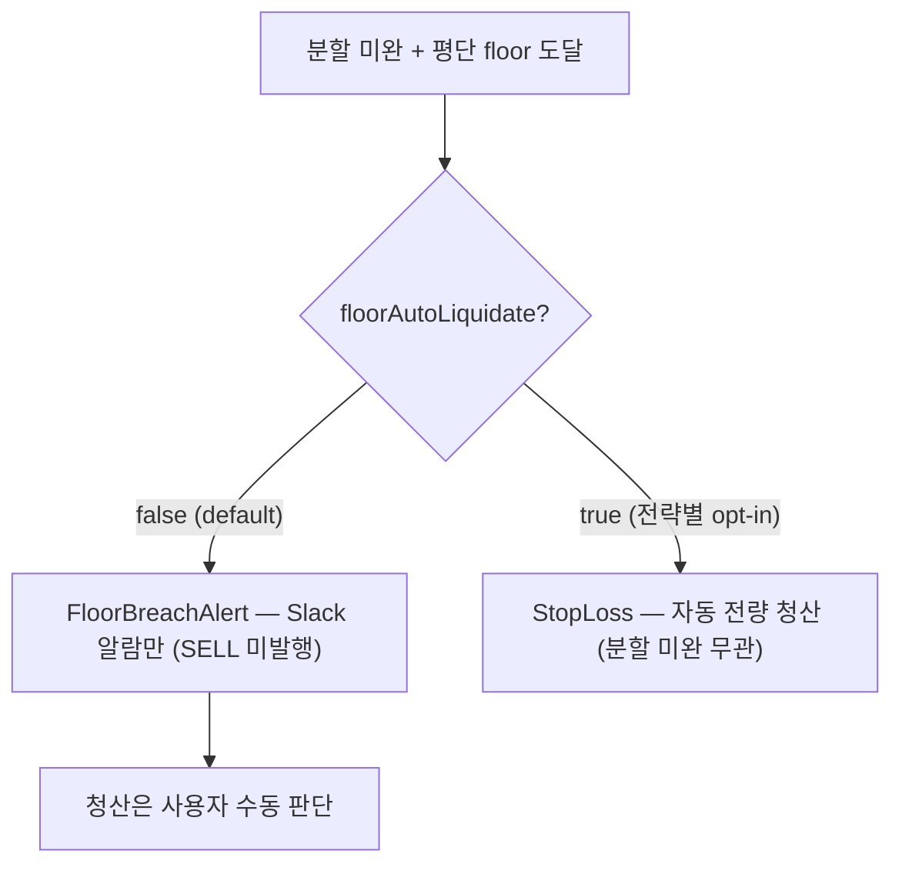

# 07 — magicJar v3.14.0 정책 진화

> **작성자**: architect (baseline v3.14.0)
> **시점**: 2026-06-21 v3.14.0 baseline 정리 (main `cbd5db8e`)
> **권위**: `_workspace/arch/agent-charter.md`(운영 헌법 §1~§13) + `docs/architecture/policies/` + ADR 0124/0125/0126/0127/0128(+§6 amend) + v3.14.0 코드 inspection

v3.14.0 정책 변화의 핵심은 **"스윙 전략의 자본 안전선을 정책 언어로 정밀화"**한 것이다. v3.13.0이 실계좌 canary에서 BUY 보호와 SELL 청산 보장을 분리했다면, v3.14.0은 분할매수(scale-in)라는 다회차 진입 전략에서 ① 회차 예산이 흔들리지 않게 base를 박제하고 ② catastrophic floor를 "기계적 청산"이 아니라 "관리자 판단을 돕는 알람 + 전략별 opt-in 청산"으로 분리했다. 운영 단계 고도화의 한 사이클이다.

---

## §1. 운영 헌법 7§ 현행 매트릭스 (§1~§13 — v3.14.0 시점)

운영 헌법(`_workspace/arch/agent-charter.md`)은 v3.14.0 시점 §1~§13으로 진화했다. v3.14.0 사이클은 신규 §을 추가하지 않고(ADR 0128은 ADR 0111 amend·자본 path 결재로 처리), 기존 §을 그대로 적용했다.

| § | 주제 | v3.14.0 적용 |
|---|---|---|
| §1 | task.mjs 4단계 + worktree 진입 author 의무 + task 파일 commit 의무 | 분할매수 PR #1060~#1073 전부 task 동반 |
| §2 | 머지 후 정리 4단계 | 각 PR 머지 후 worktree·브랜치 정리 |
| §3 | KIS-first raw fetch 의무 | ADR 0124 H0UNCNT0/H0UNASP0 KIS 공식 규격 raw 검증 |
| §4 | CHANGELOG 슬롯 채번룰 | v3.14.0 baseline sub-agent 슬롯 4 anchor 사전 발행 |
| §5 | PR 생성 직전 rebase 의무 | — |
| §6 | JPA Repository default fun 함정 | — |
| §7 | sub-agent fail 시 분기 룰 | — |
| §8 | 변경 이력 | — |
| §9 | 운영 단계 룰(SLO/SLA·변경 관리·on-call·backup/DR·ADR 양식·7 hierarchy LOCK) | ADR 0128 amend §6-3 rollback plan·관측 매트릭스 의무 적용 |
| §10 | 운영 메모(architect/sub-agent/orchestrator/사용자 책임) | — |
| §11 | 모듈 경계 빈 합류 + silent fallback 금지(ADR 0115 §2-P2) | ScaleInPlan·StrategyPosition 신규 필드 매핑 누락(v3.13.7 #1052 drift) 차단 정합 |
| §12 | 주문 액션 승인 매트릭스 | REAL canary 분할 라이브 검증 사용자 승인 후 배포 |
| §13 | 롱 온리 원칙 ref | 분할매수도 BUY=물타기 진입·floor 청산은 보유분 SELL(롱 온리 정합) |

---

## §2. 분할매수(scale-in) 자본 정책 — base는 1차에 박제한다 (ADR 0128)

분할매수는 "하락 시 물타기로 평단을 낮추는" 스윙 전략이다. 핵심 정책 문장: **회차 예산은 1차 진입 시점에 한 번 고정하고, 이후 회차는 그 박제된 base만 쓴다.**

이전에는 `resolveBuyQuantity`가 회차마다 `buyable = min(남은한도, 예수금)`을 재계산했다. 1차 매수가 전체노출을 늘려 남은 한도가 줄면 2·3차 회차 예산이 의도보다 작아지는 역방향 결함이 있었다(예: 20만 base [40,35,25] 의도 → 1차 8만 후 buyable 12만으로 줄어 2차가 4.2만으로 쪼그라듦).

| 원칙 | 설명 |
|---|---|
| base 1차 고정 | `StrategyPosition.scaleInBaseBudget`(V90)에 1차 시점 buyable을 박제. `회차예산 = floor(박제 base × weight%/100)` |
| 잔여 추적 | 회차 예산이 자금 부족으로 부분 매수되면 못 산 잔여(`scaleInRemainderQty` V90)를 다음 회차에 더함(buyable clamp) |
| 외부주입 추상화 | base의 의미는 "분할 전체에 쓸 종목 예산". 미래 "지정 가격 + 목표 금액" 매집 트랙에선 base = 사용자 지정 목표 금액으로 채워 회차 산식 변경 0 호환 |
| 회차 한도 | totalSlices 초과 진입 0(`sliceAt(filledLots)` null → 진입 0). weight 0% 회차 skip(`effectiveSliceCount` = 양수 비중 회차 수) |
| 백테스트 정합 | 회차 산식은 백테스트(`JvmBacktestEngine.evaluateScaleInExitSlice`)와 동일 — 결정론 재현성 |

base 외부주입 추상화는 메모리 `feedback_position_limit_account_wide`(매수 사이징 계좌 전체 공유 풀)와 정합한다 — base = 계좌 전체 공유 풀 사이징 결과의 박제값이다.

---

## §3. floor 정책 — 기계적 청산이 아니라 worst-case 알람 + 전략별 opt-in 청산 (ADR 0128 ⑦ + §6 amend ②)

분할매수는 스윙 매매라 변동성이 크다. floor(평단 -손절% catastrophic 알람선)에서 기계적으로 청산하면 반등을 놓치고 큰 손실만 확정한다.

정책 진화:

- **v3.13.0(PR #1058)**: 분할 미완 catastrophic floor에서 **자동 청산**(StopLoss).
- **v3.14.0(ADR 0128 ⑦)**: floor 도달 → **`FloorBreachAlert`(알람만·SELL 미발행)**가 default. "분할 미완 + 시그널無 + 폭락" 시 자동 손절 0 = 의도된 수동 리스크 관리.
- **v3.14.0 amend ②(2026-06-21)**: 일부 전략(변동성 작거나 기계적 손실 bound 선호)은 `ScaleInPlan.floorAutoLiquidate`(default false) 토글 ON으로 자동 전량 청산 선택. **자본 경로 변경(알람→청산)이므로 계정 전체가 아닌 전략 단위 opt-in** — 한 전략의 toggle ON이 다른 전략·종목 청산에 영향 0.

**손절 보류와 floor의 분리(ADR 0128 §6-5)**: ⑤ "분할 미완 손절 보류(DEFER)"는 평단 -손절%(⑥) 경로에만 적용된다. floor는 별도 catastrophic 상한이므로 toggle ON이면 분할 미완 여부 무관하게 floor에서 청산(worst-case bound 본질). 우선순위 LOCK(STOP_LOSS > PARTIAL_TP > TAKE_PROFIT > ENTER_SLICE > HOLD) 내 STOP_LOSS 슬롯.

**floor < 분할 최저 진입가 저장검증**: floor가 분할 최저 진입가보다 위(얕)면 마지막 회차 진입 전에 floor가 떠 분할 의미가 깨진다. PRICE_DROP_PCT 플랜은 누적 하락보다 floor가 깊어야(`ScaleInLimits.validateFloorBelowDeepestEntry`) 저장 허용(api 400 거부). toggle 무관 불변.

---

## §4. floor 운영 default 외부화 — 값은 yml로, 코드는 안전망으로 (ADR 0128 §6 amend ①)

정책 문장: **운영 default 값은 화면에서 보이고 재컴파일 없이 바꿀 수 있어야 한다.**

이전 도메인 상수 `ScaleInLimits.DEFAULT_STOP_LOSS_FLOOR_PCT=15`가 사실상 "운영 default 지위"를 가졌는데, 운영 중 기본값을 바꾸려면 재컴파일·재배포가 필요했고 사용자가 그 값을 화면에서 볼 수 없었다(가시성 0).

| 변경 | 내용 |
|---|---|
| 운영 default 위치 | 도메인 상수 → `application.yml` `magicjar.strategy.scale-in.floor-default-pct`(default 15) |
| 저장 시 주입 | api 저장 경로에서 floor null → yml default 주입 후 영속 — **저장 전략은 항상 명시 floor 보유** |
| 도메인 상수 | 삭제하지 않고 last-resort 안전망(yml 미설정 + api 미경유 programmatic 생성)으로만 잔존 — "운영 default"에서 "방어용 fallback"으로 강등 |
| 값 보존 | 운영 default 15%는 그대로 15%(yml default). 외부화 목적은 "튜닝 + 가시성"이지 값 변경 아님(방향성 가드) |
| UI | 빌더 floor 필드 **항상 노출** + yml default prefill(설정 조회로 전달) |

이는 헌법 §11 "silent fallback 금지"와 결이 같다 — 운영 default를 코드에 숨기지 않고 yml 한 곳을 권위로 둔다.

---

## §5. KIS WS 구독 수요 정책 — 매매 경로가 관찰 경로보다 우선 (ADR 0124)

ADR 0124는 KIS WS 40 슬롯을 매매 수요 전용으로 재편했다(ADR 0123 R1 회계 위에 R3 채널 다이어트 정식 채택).

| 정책 | 내용 |
|---|---|
| 단일 체결가 채널 | **H0UNCNT0**(KRX+NXT 통합·종목당 1채널·`NEW_MKOP_CLS_CODE` 세션 구분) — H0STCNT0+H0NXCNT0 이중 발사 폐기 |
| watchlist 시세 | **5초 REST polling 전용**(KIS WS 구독 폐지) — watchlist 기능은 유지·시세 채널만 강등. WS 40 slot은 매매 전용으로 비움 |
| owner priority | HOLDING(0) > PENDING_BUY(5) > **STRATEGY(10) > DETAIL(20)** — **매매 경로(STRATEGY)가 관찰 경로(DETAIL)보다 우선**. slot 경합 시 DETAIL evict·STRATEGY 보호 |
| evict LOCK | HOLDING·PENDING_BUY는 evict 절대 금지(ADR 0114 LOCK) |
| 호가 | H0STASP0 → **H0UNASP0 통합 호가**. STRATEGY(marketable limit) + DETAIL(표시 중에만·이탈 즉시 해제·15분 idle 안전망) 두 경로 |

정책 핵심: 실시간 시세 수요를 watchlist 단순 합집합으로 다루지 않는다. 자본을 움직이는 경로(매매·보유·미체결)가 보기용 경로(관찰)보다 슬롯에서 우선한다.

---

## §6. 전략 UX 정책 — 검증을 빌더 안으로, 발견을 목록 안으로

v3.14.0은 전략을 "코드로만 검증하는 시스템"에서 "사용자가 빌더·목록 화면에서 검증·발견하는 시스템"으로 한 걸음 옮겼다(ADR 0128 R3 + UX PR #1069~#1072).

| 화면 | 정책 |
|---|---|
| 빌더 | 분할계획 프리뷰(회차별 목표수량·진입조건·예상손절가·floor 알람선) + 검증 인라인(저장 전 오류 즉시 표기) + RiskPlan 접기 UX + 모바일 대응 + floor 필드 항상 노출(yml prefill) + 자동청산 토글(default OFF) |
| 목록 | 검색·정렬(`q`·`sort` 파라미터·api) + 카드 밀도 배지 + 빠른 액션 + 상태 요약 |
| 복제 | `?duplicate=1` 시 strategyId 비워 신규 저장 분기(기존 전략 덮어쓰기 방지 fix #1072) |

이 정책은 "전략 후보 프리셋은 자동매매 결정을 대신하지 않는다"는 방향성 가드와 정합한다 — 빌더는 사용자가 검증·저장하는 출발점이다.

---

## §7. Release 정책 개정 — feature 묶음 = minor (2026-06-21 사용자 결재)

> **개정 권위**: 2026-06-21 사용자 직접 결재. 직전 정책(메모리 `feedback_release_policy_patch_first` — v3.8.0 이후 patch only)을 부분 개정한다.

v3.14.0 cut의 분기점은 release 단위 정책이다. 직전에는 v3.8.0 이후 모든 변경을 patch(v3.X.1·v3.X.2…)로 처리했다(W3 잔여·dogfooding·bugfix). v3.14.0부터는 정책을 다음으로 개정한다.

| 변경 성격 | release 단위 |
|---|---|
| **feature 묶음** (분할매수 재설계·전략 UX 고도화 등 사용자 가치 기능 묶음) | **minor** (v3.13.x → v3.14.0) |
| hotfix·dogfooding 결함 정정·정책 정합·작은 묶음 | patch (v3.14.1·v3.14.2…) |
| Wave 마감 (W4·W5 등) | minor(기존 정책 유지) |

개정 사유: v3.13.x 7개 patch에 분할매수 P0 2단 fix·전략 시작화면·전략 성과 원장 등 사용자 가치 기능이 누적됐는데 전부 patch로 묻혀 release 단위에서 마일스톤이 보이지 않았다. **사용자에게 의미 있는 feature 묶음이 완성되면 minor로 끊어 baseline·release notes로 가시화**한다. v3.14.0(분할매수 자본 재설계 + floor 운영화 + 전략 UX 고도화)이 첫 적용이다.

release 절차(ADR 0052 LOCK)는 불변: `/baseline init vX.Y.0`(7 md + 8 html) → baseline PR 머지 → `git tag` + `release/vX.Y.Z` → `scripts/release.sh`. GitHub Actions 폐기(`feedback_no_github_actions`) 유지.

---

## §8. ADR 진화 누적 (v3.14.0 시점)

| ADR | 상태 | v3.14.0 정책 기여 |
|---|---|---|
| 0124 | Accepted | KIS WS 구독 수요 재편(H0UNCNT0 단일·watchlist polling·owner 재정렬) |
| 0125 | Accepted | 실시간 토픽 명명규칙 + wire clean-cut |
| 0126 | Accepted | 전략 성과 누적 원장 + 레짐/α + 메모 |
| 0127 | Accepted | TP tick failsafe(SL/TP 비대칭 해소·canary D2 hotfix 사후 승격) |
| **0128** | **Accepted · Amended** | **분할매수 자본 재설계(base 박제·잔여·floor 알람강등·한도/0% fix) + §6 amend(floor yml 외부화·자동청산 토글)** |

**ADR 총 124건**(파일 0001~0128 중 0058·0059·0060·0065 의도적 갭). README §0 정합(2026-06-21 0128 amend[Accepted·Amended] 정합 — 총건수 불변·신규 ADR 아님).

---

## §9. 다음 운영 판단 후보

| 후보 | 진행 조건 |
|---|---|
| 분할매수 리스크 풀 분리 (지정 목표 금액 매집 트랙) | base 외부주입 추상화 토대 위에서 사용자 결재 시 (메모리 §미래 트랙) |
| floor 자동청산 toggle ON 전략 라이브 실증 | toggle ON 전략 floor 도달 시 자동 청산 1회 + 포지션·PnL 정합 검증 |
| 전략 성과 레짐 임계치·벤치마크 코드 매핑 튜닝 | ADR 0126 데이터 축적 후 (메모리 `project_strategy_performance_history`) |
| ADR 0123 R4(시나리오 qa) / H0STOUP0 시간외 단일가 ledger 합류 | 운영 슬롯 dashboard 필요 시 |
| consumer 엔티티 persistence-shared 추출 | scale_in_config 매핑 누락(v3.13.7 #1052) 같은 drift 재발 방지 (backlog) |
| consumer Kafka 사망 자동 재기동 | 운영 안정성 backlog |

이번 baseline은 위 후보를 구현했다고 주장하지 않는다. 운영 테스트·사용자 결재로 필요성이 확인되면 별도 PR에서 진행한다.

---

본 07-policy-evolution은 v3.14.0 시점 정책 진화를 기록한다. 정책 본문 권위는 `_workspace/arch/agent-charter.md`(헌법) + `docs/architecture/policies/`(Living Policy), 결정 근거는 ADR 0124~0128, 시스템 그림은 01-architecture, 이력은 06-history-traceability를 참조한다.
