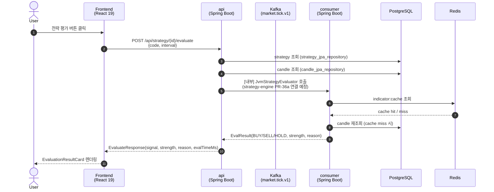
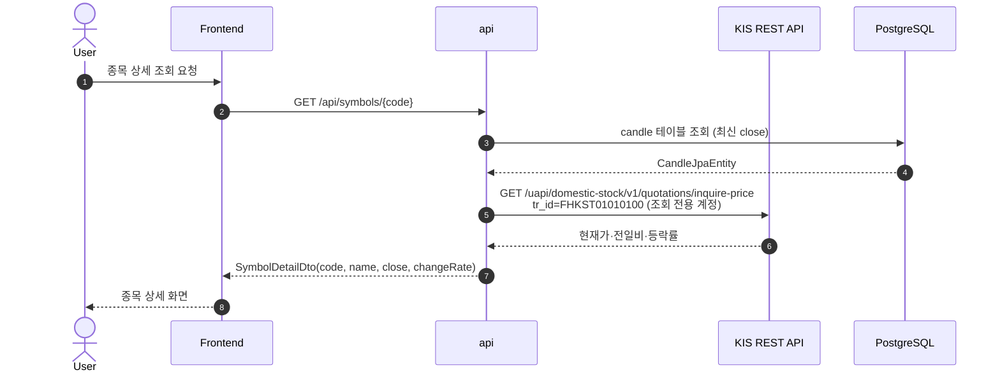
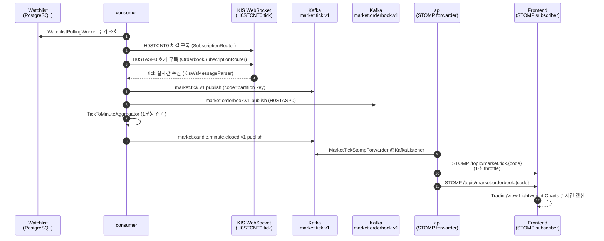
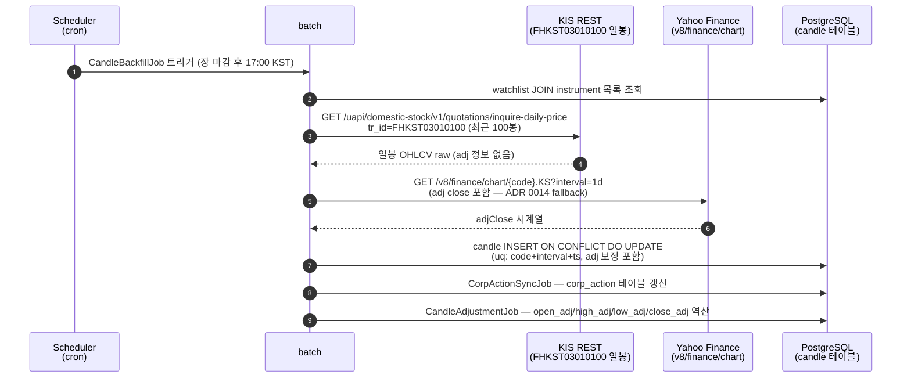

# magicJar v3.2.0 Baseline — 02 데이터 흐름

> **작성자**: backend-core | **기준 시점**: 2026-05-10 v3.2.0 | **ADR 0052 §4-2 정합**

---

## 1. 모듈 구성 요약

```
domain/       순수 도메인 + port interface (Spring·JPA 의존 0)
api/          REST/STOMP + 외부 어댑터(KIS·Yahoo·DART) + Kafka producer
batch/        Spring Batch — 종목 마스터 sync·기업 행위 sync·캔들 backfill
consumer/     Kafka 소비 + KIS WS + 지표 계산 + 패턴 인식 + Redis 캐시
pattern-engine/ 57패턴 JvmPatternRecognizer (pattern-engine 서브 모듈)
frontend/     React 19 + TS — REST 호출 + STOMP 구독
```

---

## 2. 핵심 데이터 흐름 Mermaid Sequence

### 2-1. 전략 평가 흐름 (Frontend → API → Kafka → Consumer)



### 2-2. 시세 조회 흐름 (Frontend → API → KIS REST → DB)



### 2-3. 실시간 시세 흐름 (Consumer → KIS WS → Kafka → Frontend STOMP)



### 2-4. 캔들 Backfill 흐름 (Batch → DB → Yahoo/KIS → DB)



---

## 3. Kafka 토픽 매트릭스

> 출처: `consumer/src/main/kotlin/.../config/KafkaTopicConfig.kt`

| 토픽명 | 파티션 | 발행(Publish) 측 | 구독(Subscribe) 측 | payload 스키마 | idempotency 키 | retention |
|--------|--------|------------------|--------------------|----------------|----------------|-----------|
| `market.tick.v1` | 1 | consumer `KisWebSocketBridge` (H0STCNT0) + `TickFallbackEmitter` (polling) | api `MarketTickStompForwarder` | `TickEvent(code, price, volume, ts)` | `code + ts` | 1h |
| `market.candle.minute.closed.v1` | 1 | consumer `TickToMinuteAggregator` | api `MarketCandleStompForwarder` | `Candle(code, interval=1m, ts, OHLCV)` | `code + ts` | 1d |
| `market.orderbook.v1` | 1 | consumer `KisWebSocketBridge` (H0STASP0) | api `MarketOrderbookStompForwarder` | `OrderbookSnapshot(code, bids, asks, ts)` | `code + ts` | 1h |
| `symbol.detail.command.v1` | 1 | api `SymbolController` (호가 sub/unsub 명령) | consumer `OrderbookSubscriptionRouter` | `SymbolDetailCommand(code, action=SUB/UNSUB)` | `code + action` | 1h |
| `watchlist.changed.v1` | 1 | api `WatchlistController` (add/remove) | consumer `WatchlistChangedKafkaListener` | `WatchlistChangedEvent(userId, code, action=ADDED/REMOVED, occurredAt)` | `userId + code + action` | 7d |
| `instrument.updated.v1` | 1 | consumer `InstrumentUpdatedKafkaPublisher` (InstrumentSyncJob 트리거 후) | consumer `WatchlistIngestionWorker` | `InstrumentUpdated(code, market, name)` | `code` | 7d |
| `corp_action.applied.v1` | 1 | batch `CorpActionSyncJob` | batch `CandleAdjustmentJob` | `CorpActionApplied(instrumentCode, type, exDate)` | `instrumentCode + type + exDate` | 1d |

> **consumer group ID**: `magicjar-consumer-watchlist-ingestion` (WatchlistChangedKafkaConfig 기준)

---

## 4. Redis 키 매트릭스

### 4-1. 지표 캐시 (T-IND)

> 출처: `consumer/src/main/kotlin/.../cache/RedisIndicatorCacheAdapter.kt`

| 키 패턴 | 타입 | TTL | sliding/fixed | invalidation | 값 형태 |
|---------|------|-----|---------------|--------------|---------|
| `indicator:cache:{code}:{interval}:{name}:{paramsHash}` | String (JSON) | 분봉 300s (5분) | fixed | 없음 (만료 대기) | JSON `IndicatorResult` (BigDecimal→String, Instant→ISO) |
| `indicator:cache:{code}:{interval}:{name}:{paramsHash}` | String (JSON) | 일봉 86400s (1일) | fixed | 없음 (만료 대기) | 동상 |

- `paramsHash`: `IndicatorSpec.paramsHash()` — SHA-256 16자리 hex prefix
- 분봉 적용 interval: `1m·2m·5m·15m·30m·60m·90m·1h`
- 일봉 이상 interval: `1d·1wk·1mo·1y`
- PUT: `RedisIndicatorCacheAdapter.put(code, interval, result)`
- GET: `RedisIndicatorCacheAdapter.get(code, interval, spec)`
- EVICT: `RedisIndicatorCacheAdapter.evict(code, interval, spec)` (수동 호출 시)

### 4-2. 패턴 캐시 (T-PAT)

> 출처: `pattern-engine/src/main/kotlin/.../cache/RedisPatternCacheAdapter.kt`

| 키 패턴 | 타입 | TTL | sliding/fixed | invalidation | 값 형태 |
|---------|------|-----|---------------|--------------|---------|
| `pattern:cache:{code}:{interval}:{patternsHash}` | String (JSON) | 분봉 300s (5분) | fixed | 없음 (만료 대기) | JSON `List<PatternMatchDto>` |
| `pattern:cache:{code}:{interval}:{patternsHash}` | String (JSON) | 일봉 86400s (1일) | fixed | 없음 (만료 대기) | 동상 |

- `patternsHash`: `RedisPatternCacheAdapter.patternsHash(patterns, from, to)` — 패턴 Set sorted + from + to → SHA-256 16자리 hex prefix
- 분봉 적용 interval: `1m·2m·5m·15m·30m·90m·1h`
- 일봉 이상 interval: `1d·1wk·1mo·1y`
- api·consumer 양쪽이 동일 키 패턴 공유 (api 측 `PatternController` + consumer 측 동일 bean)

### 4-3. 시세 캐시 (T-W2)

> 출처: `consumer/src/main/kotlin/.../cache/RedisQuoteCacheAdapter.kt`

| 키 패턴 | 타입 | TTL | 설명 |
|---------|------|-----|------|
| `quote:{code}` | String (JSON) | 30s | 최신 tick 가격·거래량 스냅샷 (`QuoteCachePort` 구현) |

### 4-4. 포지션 캐시

> 출처: `consumer/src/main/kotlin/.../cache/RedisPositionCacheAdapter.kt`

| 키 패턴 | 타입 | TTL | 설명 |
|---------|------|-----|------|
| `position:{userId}` | String (JSON) | 300s (5분) | 사용자 보유 포지션 스냅샷 (bootstrap runner 동기화) |

### 4-5. KIS OAuth 토큰 (T-W1)

| 키 패턴 | 타입 | TTL | 설명 |
|---------|------|-----|------|
| `kis:oauth:lock:{accountType}` | String | 30s | 분산 락 (ADR 0038 Redis SETNX) |

---

## 5. PostgreSQL DB 흐름 — 모듈별 Read/Write

> Flyway V1~V11 기준. 테이블명 = Flyway 버전 기준 정의.

| 테이블 | Flyway | api (Read/Write) | batch (Read/Write) | consumer (Read/Write) | 비고 |
|--------|--------|------------------|--------------------|-----------------------|------|
| `system_config` | V1 | R/W | R | - | OnboardingService 전용 |
| `user_account` | V1 | R/W | - | R | single-tenant |
| `user_kis_credential` | V1 | R/W | - | R | AES-GCM 암호화 |
| `instrument` | V1,V4,V5 | R/W | **W** (InstrumentSyncJob) | R | batch가 마스터 소유 |
| `instrument_alias` | V4 | R | **W** (InstrumentSyncJob) | - | name_norm·alias |
| `watchlist` | V1 | R/W | - | R | kafka 발행 trigger |
| `candle` | V1,V8 | R/W | **W** (backfill·adj) | R/W | V8 adj 컬럼 추가 |
| `position` | V1 | - | - | R/W | bootstrap runner |
| `orders` | V1 | R | - | R/W | 주문 실행 dispatch |
| `kill_switch_state` | V1 | R | - | R/W | KillSwitchRepository |
| `notification_outbox` | V1 | - | - | R/W | outbox pattern |
| `audit_trail` | V1 | W | - | W | 공용 감사 로그 |
| `market_calendar` | V6 | R | **W** (MarketCalendarSyncJob) | R | 영업일 판별 |
| `corp_action` | V7 | - | R/W (CorpActionSyncJob) | - | KIS ksdinfo·DART |
| `strategy` | V9,V10 | R/W | - | R | DSL 전략 CRUD |
| `strategy_eval_metric` | V11 | R/W | - | R/W | 평가 지표 ring buffer |

> **참고**: `batch`는 모든 외부 API 폴링 + DB 마스터 write 담당. `consumer`는 KIS WS 실시간 수신 + 알람 dispatch. `api`는 REST/STOMP 게이트웨이.

---

## 6. STOMP 토픽 매트릭스

> WebSocket endpoint: `ws://host:8080/ws` (SockJS fallback `/ws`)

| STOMP destination | 발행 측 | 구독 측 | 주기 | payload |
|-------------------|---------|---------|------|---------|
| `/topic/market.tick.{code}` | api `MarketTickStompForwarder` | Frontend | 실시간 (1초 throttle) | `{code, price, volume, changeRate, ts}` |
| `/topic/market.candle.{code}` | api `MarketCandleStompForwarder` | Frontend | 1분봉 closing 시 | `Candle(code, interval, ts, OHLCV)` |
| `/topic/market.orderbook.{code}` | api `MarketOrderbookStompForwarder` | Frontend | 실시간 | `OrderbookSnapshot(code, bids, asks, ts)` |

---

## 7. 외부 API 연결 흐름 요약

| 외부 시스템 | 연결 모듈 | endpoint / tr_id | 용도 |
|-------------|-----------|------------------|------|
| KIS REST (조회) | api, consumer, batch | `FHKST01010100` 현재가, `FHKST03010100` 일봉, `CTCA0903R` 영업일 | 시세·캔들·영업일 |
| KIS REST (인증) | consumer | `/oauth2/tokenP` | access token 발급 |
| KIS WebSocket | consumer | `H0STCNT0` 체결, `H0STASP0` 호가, `H0STCNI9` 체결통보 | 실시간 시세 |
| KIS ksdinfo | batch | `HHKDB669100C0`~`HHKDB669106C0` | 기업 행위 6종 (ADR 0018) |
| Yahoo Finance | batch, consumer | `v8/finance/chart/{code}.KS` | 수정 주가 (fallback, ADR 0014) |
| DART OpenDART | batch | `list.json pblntf_ty=B/D` | 기업 공시 (ADR 0018) |
| Naver Finance | consumer | (alias fallback) | 종목 한글명 alias |

---

> **fitness gap 0 확인**: v1/v2 잔재 데이터 흐름 0건. 모든 흐름은 KIS-first (ADR 0003·정책 `kis-first.md`). mock 합성 데이터 흐름 0 (feedback_no_mock_data.md 정합).
