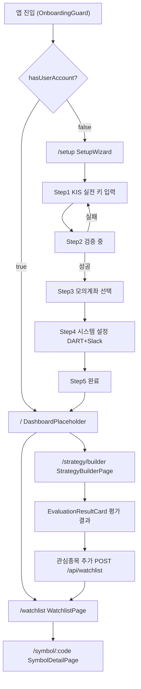

# magicJar v3.2.0 Baseline — 05. UI 화면 인벤토리

> **작성 시점**: 2026-05-10 v3.2.0 태그 컷
> **작성 에이전트**: frontend
> **커버 PR 범위**: PR-5b ~ PR-45 (W1 온보딩·Watchlist·Symbol + W2 T-SB)
> **코드 기준**: `frontend/src/` 직접 inspect — 추측 0건

---

## 1. 라우팅 매트릭스

| URL 패턴 | 페이지 컴포넌트 | 진입 가드 | 트랙 ID | ADR |
|---------|--------------|---------|--------|-----|
| `/` | `DashboardPlaceholder` | OnboardingGuard | T-W1 | ADR 0040 |
| `/watchlist` | `WatchlistPage` | OnboardingGuard | T-W1 | ADR 0040 |
| `/symbol/:code` | `SymbolDetailPage` | OnboardingGuard | T-S1 | ADR 0040 §2-2 |
| `/strategy/builder` | `StrategyBuilderPage` | OnboardingGuard | T-SB | ADR 0040 §1, ADR 0055 |
| `/setup` | `SetupWizard` | OnboardingGuard (역방향) | T-ONBOARD | ADR 0040 |
| `*` | `Navigate to="/"` | — | — | — |

**OnboardingGuard 로직** (`frontend/src/App.tsx`):
- `GET /api/onboarding/status` — `hasUserAccount=false` + path `/setup` 이외 → `/setup` redirect
- `hasUserAccount=true` + path `/setup` → `/` redirect (중복 진입 차단)
- isLoading → 스플래시(animate-spin) 표시

---

## 2. 화면 전이 다이어그램

---

## 3. 화면별 상세 인벤토리

### 3-1. DashboardPlaceholder (`/`)

- **파일**: `frontend/src/pages/DashboardPlaceholder.tsx`
- **역할**: W1 이후 대시보드 플레이스홀더 (WatchlistPage 진입 유도)
- **메뉴/버튼**: AppHeader 공통 — "대시보드"(활성) / "관심종목" / "전략 빌더"
- **상태 종류**: 정상(플레이스홀더 표시) / 온보딩 미완(→ /setup 리다이렉트)
- **API 호출**: `GET /api/onboarding/status` (OnboardingGuard)
- **사용자 메모리 정합**: `feedback_no_mock_data` — 백엔드 데이터 없을 시 "데이터 없음" 명시

---

### 3-2. SetupWizard (`/setup`)

- **파일**: `frontend/src/pages/SetupWizard.tsx`
- **하위 Step 컴포넌트**:

| Step | 파일 | 역할 |
|------|------|------|
| 1 | `frontend/src/pages/setup/steps/KisRealStep.tsx` | KIS 실전 appKey·appSecret·accountNo 입력 |
| 2 | `frontend/src/pages/setup/steps/KisValidatingStep.tsx` | 백엔드 검증 진행 (POST /api/onboarding/validate) |
| 3 | `frontend/src/pages/setup/steps/KisMockStep.tsx` | 모의계좌 추가 (선택) |
| 4 | `frontend/src/pages/setup/steps/SystemConfigStep.tsx` | DART API 키 + Slack webhook (선택) |
| 5 | `frontend/src/pages/setup/steps/CompleteStep.tsx` | 셋업 완료 요약 + 홈 이동 |

- **상태 종류**: 미설정 / 설정 중(검증) / 완료
- **진행률 계산**: `(currentStep - 1) / (TOTAL_STEPS - 1) * 100%` (spec §5-10)
- **Zustand store**: `frontend/src/stores/onboarding.ts`
- **AppHeader**: `/setup` 경로에서 미표시 (App.tsx AppLayout 분기)
- **사용자 메모리 정합**: `project_kis_key_management` — SettingsModal 입력 + DB AES 암호화

---

### 3-3. WatchlistPage (`/watchlist`)

- **파일**: `frontend/src/pages/Watchlist/WatchlistPage.tsx`
- **하위 컴포넌트**:

| 컴포넌트 | 파일 | 역할 |
|---------|------|------|
| `WatchlistAddForm` | `WatchlistAddForm.tsx` | 종목코드 검색·등록 폼 (InstrumentSearchInput 내장) |
| `WatchlistRow` | `WatchlistRow.tsx` | 종목 행 — 현재가·등락률·삭제 버튼 + SymbolDetail 이동 |
| `WatchlistEmpty` | `WatchlistEmpty.tsx` | 빈 상태 — "종목을 추가해 보세요" CTA |
| `WatchlistSkeleton` | (WatchlistPage 내부) | 로딩 중 3행 pulse |

- **버튼 인벤토리**:

| 버튼 | 위치 | 동작 | API |
|-----|------|------|-----|
| "추가" | WatchlistAddForm | POST /api/watchlist | useAddWatchlist mutation |
| "삭제" | WatchlistRow | DELETE /api/watchlist/{code} | useRemoveWatchlist mutation |
| "종목명/코드 클릭" | WatchlistRow | navigate /symbol/:code | 라우터 |
| "종목 등록하기" CTA | WatchlistEmpty | inputRef.focus() | — |

- **상태 종류**: 로딩(Skeleton) / 정상(종목 목록) / 빈 데이터(WatchlistEmpty) / REST 에러(섹션 오류 표시)
- **API hook**: `useWatchlist()` — staleTime 30s, `useAddWatchlist()`, `useRemoveWatchlist()`
- **STOMP**: 미구독 (Watchlist 목록은 REST polling, 개별 현재가는 SymbolDetail에서 구독)
- **사용자 메모리 정합**: `feedback_no_mock_data` — 0건 시 WatchlistEmpty 명시 (mock 합성 폐기)

---

### 3-4. SymbolDetailPage (`/symbol/:code`)

- **파일**: `frontend/src/pages/Symbol/SymbolDetailPage.tsx`
- **하위 컴포넌트**:

| 컴포넌트 | 파일 | 역할 |
|---------|------|------|
| `SymbolHeader` | `SymbolHeader.tsx` | 종목명·코드 헤더 (instrument 없으면 code 그대로 graceful) |
| `SymbolPriceCard` | `SymbolPriceCard.tsx` | 현재가·등락률·등락폭 + 장 마감 stale 배지 |
| `SymbolMetaCard` | `SymbolMetaCard.tsx` | PER·PBR·시총·EPS·BPS·발행주식수 |
| `SymbolChart` | `SymbolChart.tsx` | 캔들 차트 컨테이너 (LightweightChart 내장) |
| `LightweightChart` | `LightweightChart.tsx` | LWC v4 차트 렌더링 + PatternMarker overlay |
| `IndicatorOverlay` | `IndicatorOverlay.tsx` | 80지표 overlay (T-IND) |
| `IndicatorPanel` | `IndicatorPanel.tsx` | 지표 선택 패널 |
| `IntervalToggle` | `IntervalToggle.tsx` | 분봉/일봉 토글 (1m/5m/30m/1h/1d/1wk) |
| `PatternToggleMenu` | `components/chart/PatternToggleMenu.tsx` | 57패턴 표시 ON/OFF 토글 메뉴 |
| `PatternMarker` | `components/chart/PatternMarker.tsx` | 차트 위 패턴 마커 overlay (T-PAT) |
| `SymbolOrderbook` | `SymbolOrderbook.tsx` | 호가창 (LRU 10 slot) |
| `SymbolError` | `SymbolError.tsx` | HTTP 503/404/400 에러 표시 |

- **버튼/메뉴 인벤토리**:

| 버튼/메뉴 | 위치 | 동작 |
|---------|------|------|
| "분봉/일봉" 인터벌 토글 | IntervalToggle | useSymbolCandles 파라미터 변경 |
| 지표 ON/OFF | IndicatorPanel | IndicatorOverlay 렌더링 제어 |
| 패턴 ON/OFF 토글 | PatternToggleMenu | PatternMarker overlay 제어 |

- **상태 종류**:

| 상태 | 처리 방식 |
|------|---------|
| 정상 | 현재가·차트·메타·호가 4 영역 렌더 |
| HTTP 503/404/400 | SymbolError 컴포넌트 표시 |
| 캔들 0건 (cold-start 미완) | "데이터 수집 중" skeleton |
| 장 마감 | stale 배지 (SymbolPriceCard) |
| STOMP 끊김 | "실시간 연결 재시도 중..." 배지 + 5s polling fallback |
| 호가 slot queued | "polling fallback 중" 배지 (SymbolOrderbook) |

- **STOMP 구독** (`frontend/src/lib/stomp.ts`):

| 토픽 | 용도 |
|------|------|
| `/topic/market.tick.{code}` | 현재가 실시간 갱신 |
| `/topic/market.candle.minute.{code}` | 1m 캔들 실시간 append |
| `/topic/market.orderbook.{code}` | 호가 실시간 갱신 |

- **API hook**: `useSymbol(code)`, `useInstrument(code)`, `useSymbolCandles(code, interval)`, `usePatterns(code)`, `useIndicators(code)`
- **사용자 메모리 정합**: `feedback_kis_first_policy` — 80지표·57패턴 catalog는 backend 정적 인용

---

### 3-5. StrategyBuilderPage (`/strategy/builder`)

- **파일**: `frontend/src/pages/Strategy/StrategyBuilderPage.tsx`
- **ADR**: ADR 0055 B+C-lite 하이브리드 채택 (Reactflow·Monaco 거부, 의존 추가 0건)
- **레이아웃**: 좌(BlockPalette w-56) + 중(StrategyBuilderCanvas flex-1) + 우(결과 영역 w-72)
- **하위 컴포넌트**:

| 컴포넌트 | 파일 | 역할 |
|---------|------|------|
| `BlockPalette` | `components/strategy/BlockPalette.tsx` | 지표 80건·패턴 57건·캔들·연산자 4탭 팔레트 + 검색 |
| `BlockNode` | `components/strategy/BlockNode.tsx` | 재귀 트리 노드 8분기 + 키보드 Tab/Enter/Delete 접근성 |
| `StrategyBuilderCanvas` | `components/strategy/StrategyBuilderCanvas.tsx` | entry/exit 두 탭 + DSL 미리보기 readonly + 액션버튼 행 |
| `DslTextEditor` | `components/strategy/DslTextEditor.tsx` | textarea DSL 직접 편집 (Monaco 없음 ADR 0055 §3) |
| `NaturalLanguageInput` | `components/strategy/NaturalLanguageInput.tsx` | 자연어 모달 — REAL/MOCK/UNTRANSLATABLE/DISABLED 4분기 |
| `EvaluationResultCard` | `components/strategy/EvaluationResultCard.tsx` | BUY/SELL/HOLD 배지 + 강도 게이지 + 관심종목 추가 버튼 |
| `EvaluationEmptyCard` | (EvaluationResultCard 내부) | 평가 전 "데이터 없음" 명시 |
| `ComplexityCard` | `components/strategy/ComplexityCard.tsx` | LOW/MEDIUM/HIGH/CRITICAL 4단 배지 + AST stats |
| `StrategySaveModal` | `components/strategy/StrategySaveModal.tsx` | name·nameKo·universe·tf 폼 + useCreateStrategy |

- **버튼 인벤토리**:

| 버튼 | 위치 | 동작 | API |
|-----|------|------|-----|
| "검증" | StrategyBuilderCanvas 액션행 | POST /api/strategy/validate | useStrategyValidate mutation |
| "저장" | StrategyBuilderCanvas 액션행 | StrategySaveModal 열기 | — |
| "저장 확인" | StrategySaveModal | POST /api/strategy | useCreateStrategy mutation |
| "평가 실행" | 우측 결과 영역 | POST /api/strategy/{id}/evaluate | useStrategyEvaluate mutation |
| "자연어 입력" | StrategyBuilderCanvas 액션행 | NaturalLanguageInput 모달 열기 | useStrategyTranslate mutation |
| "DSL 편집" | StrategyBuilderCanvas 액션행 | DslTextEditor 모달 열기 | — |
| "YAML 내보내기" | StrategyBuilderCanvas 액션행 | Blob download strategy.kis.yaml | — |
| "YAML 불러오기" | StrategyBuilderCanvas 액션행 | FileReader → kisYamlImport | — |
| "관심종목 추가" | EvaluationResultCard | POST /api/watchlist | useAddWatchlist mutation |

- **상태 종류**:

| 상태 | 처리 방식 |
|------|---------|
| 정상(빈 캔버스) | BlockPalette + Canvas 빈 상태 안내 |
| 검증 중 | isValidating spinner |
| 검증 완료 | ComplexityCard 표시 |
| 검증 실패 | 에러 카드 + 토스트(red) |
| 저장 완료 | strategyId 획득 + 토스트(green) + 평가 활성화 |
| 평가 중 | isEvaluating spinner |
| 평가 완료 | EvaluationResultCard(BUY/SELL/HOLD) |
| 평가 전(저장 후) | EvaluationEmptyCard |
| 모바일(768px 이하) | "데스크톱(1280px 이상) 권장" 안내 메시지 |
| AI 비활성화(`DISABLED`) | NaturalLanguageInput — 비활성 안내 |
| AI mock 모드 | NaturalLanguageInput — MOCK 분기 |

- **DSL 라이브러리** (`frontend/src/lib/dsl/`):

| 파일 | 역할 |
|------|------|
| `blockTree.ts` | BlockNode discriminated union 8종 + BlockTree 타입 |
| `serializer.ts` | serializeBlockTree → DSL 1줄 텍스트 (KisYamlDslParser 1:1 정합) |
| `parser.ts` | parseDslText 재귀 하강 6단 (최대 깊이 50, 화이트리스트 위반 throw) |
| `yaml.ts` | kisYamlExport / kisYamlImport (KIS .kis.yaml 호환, 1MB 제한) |
| `catalogIds.ts` | 파서 화이트리스트 — 80지표+57패턴 ID Set |

- **API hook**: `useStrategyValidate`, `useStrategyEvaluate`, `useCreateStrategy`, `useStrategyTranslate`
- **사용자 메모리 정합**:
  - `feedback_swagger_pattern` — REST 호출 4단 어노테이션 정합
  - `feedback_no_mock_data` — EvaluationEmptyCard "데이터 없음" 명시
  - 룰 5 — LLM provider import 0건 (AI는 useStrategyTranslate → backend 위임)

---

## 4. 공통 레이아웃 컴포넌트

### AppHeader (`frontend/src/components/layout/AppHeader.tsx`)

- **위치**: sticky top-0 / z-50 / `/setup` 경로에서 미표시 (App.tsx AppLayout 분기)
- **메뉴 항목**:

| 메뉴 라벨 | NavLink to | 트랙 |
|---------|----------|------|
| 대시보드 | `/` | T-W1 |
| 관심종목 | `/watchlist` | T-W1 |
| 전략 빌더 | `/strategy/builder` | T-SB |

- **접근성**: `aria-label="메인 메뉴"` + `focus:ring-2` keyboard focus ring

### InstrumentSearchInput (`frontend/src/components/InstrumentSearchInput.tsx`)

- WatchlistAddForm에서 사용
- `GET /api/instruments/search?q=` — useInstrumentSearch hook
- 검색 결과 드롭다운 + 선택 시 콜백

---

## 5. API Hook 인벤토리

| hook | 파일 | 메서드 | endpoint |
|------|------|-------|---------|
| `useOnboardingStatus` | `api/onboarding.ts` | GET | `/api/onboarding/status` |
| `useWatchlist` | `api/hooks/useWatchlist.ts` | GET | `/api/watchlist` |
| `useAddWatchlist` | `api/hooks/useWatchlist.ts` | POST | `/api/watchlist` |
| `useRemoveWatchlist` | `api/hooks/useWatchlist.ts` | DELETE | `/api/watchlist/{code}` |
| `useSymbol` | `api/hooks/useSymbol.ts` | GET | `/api/symbols/{code}` |
| `useInstrument` | `api/hooks/useInstrument.ts` | GET | `/api/instruments/{code}` |
| `useSymbolCandles` | `api/hooks/useSymbolCandles.ts` | GET | `/api/symbols/{code}/candles` |
| `useInstrumentSearch` | `api/hooks/useInstrumentSearch.ts` | GET | `/api/instruments/search` |
| `useIndicators` | `api/hooks/useIndicators.ts` | GET | `/api/indicators/{code}` |
| `usePatterns` | `api/hooks/usePatterns.ts` | GET | `/api/patterns/{code}` |
| `useStrategyValidate` | `api/hooks/useStrategy.ts` | POST | `/api/strategy/validate` |
| `useStrategyEvaluate` | `api/hooks/useStrategy.ts` | POST | `/api/strategy/{id}/evaluate` |
| `useCreateStrategy` | `api/hooks/useStrategy.ts` | POST | `/api/strategy` |
| `useStrategyTranslate` | `api/hooks/useStrategyTranslate.ts` | POST | `/api/dsl/translate-from-natural` |

---

## 6. STOMP 토픽 매트릭스

| 토픽 | 구독 위치 | 용도 | ADR |
|------|---------|------|-----|
| `/topic/market.tick.{code}` | SymbolDetailPage | 현재가 실시간 갱신 | ADR 0029 §2-5 |
| `/topic/market.candle.minute.{code}` | SymbolDetailPage | 1m 캔들 실시간 append | ADR 0029 §2-5 |
| `/topic/market.orderbook.{code}` | SymbolDetailPage | 호가 실시간 갱신 | ADR 0029 §2-5 |

**STOMP 에러 처리** (`frontend/src/lib/stomp.ts`):
- brokerURL: `wss://{host}/ws` (HTTPS) / `ws://{host}/ws` (HTTP)
- `reconnectDelay`: 5000ms 자동 재연결
- 연결 상태 인디케이터: onConnect / onStompError / onDisconnect 분기

---

## 7. 테스트 인벤토리

| 테스트 파일 | 위치 | 테스트 건수 | 커버 대상 |
|----------|------|---------|---------|
| `onboarding-routing.test.tsx` | `src/__tests__/` | — | OnboardingGuard 라우팅 분기 |
| `watchlist-flow.test.tsx` | `src/__tests__/` | — | Watchlist CRUD 플로우 |
| `indicator-catalog.test.ts` | `src/__tests__/indicators/` | — | INDICATOR_CATALOG 80건 정합 |
| `pattern-catalog.test.ts` | `src/__tests__/patterns/` | — | PATTERN_CATALOG 57건 정합 |
| `pattern-marker.test.ts` | `src/__tests__/patterns/` | — | PatternMarker 마커 렌더링 |
| `symbol-detail-pattern.test.tsx` | `src/__tests__/patterns/` | — | SymbolDetail 패턴 통합 |
| `use-patterns.test.ts` | `src/__tests__/patterns/` | — | usePatterns hook |
| `InstrumentSearchInput.test.tsx` | `components/__tests__/` | — | 검색 입력 컴포넌트 |
| `BlockNode.test.tsx` | `components/strategy/__tests__/` | 10건 | BlockNode 8분기 + 키보드 접근성 |
| `StrategyBuilderCanvas.test.tsx` | `components/strategy/__tests__/` | 7건 | Canvas 탭·DSL 미리보기 |
| `EvaluationResultCard.test.tsx` | `components/strategy/__tests__/` | 7건 | BUY/SELL/HOLD + 빈 상태 |
| `parser.test.ts` | `lib/dsl/__tests__/` | 9건 | parseDslText 재귀 6단 |
| `serializer.test.ts` | `lib/dsl/__tests__/` | 7건 | serializeBlockTree round-trip |
| `yaml.test.ts` | `lib/dsl/__tests__/` | 5건 | kisYamlExport/Import |
| `StrategyBuilderPage.test.tsx` | `pages/Strategy/__tests__/` | 5건 | 통합 페이지 플로우 |
| `SymbolDetailPage.test.tsx` | `pages/Symbol/__tests__/` | — | 종목 상세 통합 |

**총계**: pnpm test 131 GREEN (16 test files, PR-45까지 누적)

---

## 8. 반응형 · 접근성 정책

| 항목 | 현황 | 후속 계획 |
|------|------|---------|
| 기본 브레이크포인트 | 데스크톱 우선 (≥ 1280px) | — |
| Strategy Builder 모바일 | 768px 이하 "데스크톱 권장" 안내만 | ADR 0055 §결정사유 메모 — 후속 PR |
| 키보드 접근성 | AppHeader `focus:ring-2` + BlockNode `Tab/Enter/Delete` | — |
| ARIA | 메인 메뉴 `aria-label`, WatchlistSkeleton `aria-busy`, 토스트 `role="status"` | — |

---

## 9. 사용자 메모리 정합 검증

| 메모리 항목 | 화면 반영 위치 | 정합 여부 |
|----------|-------------|---------|
| `feedback_no_mock_data` | WatchlistEmpty · EvaluationEmptyCard · SymbolChart 0건 skeleton | 정합 |
| `feedback_swagger_pattern` | useStrategy hooks — REST 4단 어노테이션 정합 | 정합 |
| `feedback_kis_first_policy` | INDICATOR_CATALOG(80건)·PATTERN_CATALOG(57건) backend 정적 인용 | 정합 |
| `project_kis_key_management` | SetupWizard KisRealStep 폼 + DB AES 암호화 (backend 위임) | 정합 |
| `feedback_honorific` | 한국어 UI 레이블 전체 | 정합 |

---

## 10. 의존 패키지 (v3.2.0 시점)

| 패키지 | 용도 | 버전 |
|-------|------|------|
| `react` | SPA 프레임워크 | 19.x |
| `react-router-dom` | 클라이언트 라우팅 | 6.x |
| `@tanstack/react-query` | 서버 상태 관리 | 5.x |
| `@stomp/stompjs` | WebSocket STOMP 클라이언트 | 7.x |
| `lightweight-charts` | LWC v4 — TradingView 차트 | 4.x |
| `zustand` | 클라이언트 상태 (onboarding) | 4.x |
| `axios` | HTTP 클라이언트 | 1.x |
| `js-yaml` | YAML 직렬화/역직렬화 | 4.x |
| `tailwindcss` | CSS 유틸리티 | 3.x |
| `vite` | 번들러 + dev server | 5.x |
| `vitest` | 테스트 러너 | 1.x |

> **의존 추가 0건** — ADR 0055 §4 준수 (PR-45 시점 기준, Reactflow·Monaco 거부)

---

## 11. 현재 한계 · 후속 PR 예정

| 항목 | 현황 | 후속 계획 |
|------|------|---------|
| 대시보드 | DashboardPlaceholder (placeholder) | W3 T-J 매매일지 + 실시간 위젯 |
| Watchlist 실시간 현재가 | REST polling (목록) + SymbolDetail STOMP | Watchlist 행 단위 STOMP 구독 (W3) |
| Strategy Builder 모바일 | 안내 메시지만 | 후속 PR ADR 0055 §결정사유 메모 |
| AI Option Console | 미구현 | W4 T-AI |
| 매매일지 (`/journal`) | 미구현 | W3 T-J |
| 설정 화면 (`/settings`) | SetupWizard 내 (/setup) | 독립 /settings 페이지 후속 |
