# 01 — magicJar v3.2.2 아키텍처 (시각화)

> **작성자**: architect (PR-48)
> **시점**: 2026-05-11 v3.2.2 태그 컷 직후
> **권위**: `docs/architecture/master-architecture.md` v2 §5·§6 + ADR 0002·0004(5 모듈 보존)·0005·0006·0007·0008·0009·0019(부분 revoke)·0028·0029·0054·0055·**0056**·**0057**·**0062**·**0063** 정합 + v3.2.2 시점 코드 inspection 결과

본 문서는 v3.2.2 시점 magicJar 시스템의 **시각화 가능 수준 그림**이다. SoT는 `docs/architecture/master-architecture.md`이며, 본 문서는 그 하위 구체화 — v3.2.2 시점 실체(현재 발행된 컨테이너·테이블·KIS endpoint·Kafka topic·Anthropic helper·신규 컴포넌트 3건)만 인용한다. v1/v2 잔재 0건. 미발행 트랙(W3 일부·W4·W5)은 명시적으로 제외.

**v3.2.0 → v3.2.2 핵심 변경**:
- **외부 통합 5 → 4 (Yahoo Finance `@Deprecated` — `consumer/.../infrastructure/yahoo/YahooCandleFetcherAdapter.kt` 본격 비활성, v3.3.0 일괄 삭제 예정)** — ADR 0057
- **KIS 시장 분류 코드 cover KRX 단독(`fid_cond_mrkt_div_code="J"`) → KRX+NXT 통합(`fid_cond_mrkt_div_code="UN"`)** — ADR 0063
- **KIS 1m cover 시간대 09:00~15:30 → 08:00~20:00 KST (~390 → ~720 bar/일)** — ADR 0063
- **`MIN_1M_CANDLE_THRESHOLD` 350 → 700** — ADR 0063
- **5m·15m·30m·90m·1h 합산 가공 활성화 (precomputed) — `CandleAggregator`(domain) + `AggregateBackfillRunner`(consumer) + `CandleBootstrapRunner`(consumer)** — ADR 0062
- **DailyCloseFinalizer 트리거 시각 16:00 → 20:00 KST (NXT after-hour 마감)** — ADR 0062·0063 결합
- **`domain/backtest/*` 5 sealed class + 룩어헤드 가드 + 세·수수료·슬리피지 보정 + sandbox 통합 (W3 T-BT 코드 진입)** — ADR 0056
- JVM 모듈 5 보존 (v3.2.0 base — domain·api·batch·consumer·pattern-engine)
- Flyway V11 보존 (마이그레이션 추가 0건 — `CandleAggregator` 영속은 기존 candle 테이블 활용)

---

## §1. 시스템 전경 (5 JVM 모듈 + frontend + 외부 4 + 인프라 3 + 디버깅 2)

```mermaid
graph TD
    subgraph EXTERNAL["외부 통합 (옵션 + fallback) — v3.2.2 Yahoo 폐기"]
        KISREST["KIS REST<br/>openapi.koreainvestment.com:9443<br/>prod credential 단일 채널<br/>+ fid_cond_mrkt_div_code=UN (NXT 통합)"]
        KISWS["KIS WebSocket<br/>wss://ops.koreainvestment.com:21000<br/>prod credential 단일 채널"]
        KISMASTER["KIS 종목마스터 ZIP<br/>new.real.download.dws.co.kr<br/>(공개 — 인증 불필요)"]
        DART["DART OPENDART<br/>opendart.fss.or.kr"]
        ANTHROPIC["Anthropic Spring AI<br/>api.anthropic.com<br/>(T-DSL 자연어 helper · 사용자 트리거 한정)"]
        YAHOO_DEP["~~Yahoo Finance~~<br/>YahooCandleFetcherAdapter @Deprecated<br/>v3.3.0 일괄 삭제 예정"]
    end

    subgraph FRONTEND["frontend (React 19 + Vite + LWC v4)"]
        FE_SETUP["/setup<br/>SetupWizard 7-step"]
        FE_WL["/watchlist<br/>WatchlistPage"]
        FE_SYM["/symbol/:code<br/>SymbolDetailPage<br/>+ IndicatorPanel + PatternToggleMenu<br/>+ IntervalToggle 10종 (v3.2.2 +15m/+90m)"]
        FE_SB["/strategy/builder<br/>StrategyBuilderPage<br/>(트리 폼 빌더 + DSL 토글)"]
        FE_DASH["/<br/>DashboardPlaceholder"]
    end

    subgraph API["api (Spring Boot 3.3 / 8080)"]
        API_REST["REST controllers<br/>onboarding · watchlist · symbol · instrument<br/>candle · indicator · strategy · pattern · dsl-translate<br/>+ backtest (W3 T-BT 코드 진입 — ADR 0056)"]
        API_STOMP["STOMP /ws<br/>tick · candle · orderbook<br/>+ candle.5m~1h (v3.2.2 합산 fanout)"]
        API_GUARD["OnboardingGuardFilter<br/>(401 ONBOARDING_REQUIRED)"]
        API_AUTH["KisAuthValidator<br/>AesGcmCipher AES-256-GCM"]
        API_FLY["Flyway V1~V11 적용기<br/>(v3.2.2 마이그레이션 0건 — V11 보존)"]
        API_AI["NaturalLanguageDslTranslator<br/>(@Service · ChatClient lazy)<br/>+ MockDslHeuristic 9 패턴 fallback"]
        API_BT["BacktestEngine (W3 T-BT 진입 — ADR 0056)<br/>+ 룩어헤드 가드 + 세·수수료·슬리피지<br/>+ JvmStrategyEvaluator sandbox 재사용"]
    end

    subgraph BATCH["batch (Spring Batch / 8081)"]
        B_INSTR["InstrumentSyncJob<br/>(13 cron + boot sync)"]
        B_KIS_MASTER["KisInstrumentMasterAdapter<br/>EUC-KR fixed-width"]
        B_CHK["KisChkHolidayAdapter<br/>tr_id=CTCA0903R"]
        B_KSD["KisKsdInfoAdapter<br/>HHKDB669100C0~106C0 (6)"]
        B_DART["DartDisclosureAdapter<br/>DartCorpCodeRepository"]
        B_CALSEED["MarketCalendarSeedRunner<br/>2026~2027 31건 정적 시드"]
        B_CASYNC["CorpActionSyncJob<br/>cron 18:30"]
        B_CADJ["CandleAdjustmentJob<br/>(corp_action.applied.v1 listener)"]
    end

    subgraph CONSUMER["consumer (Kafka + KIS WS / 8082)"]
        C_WL_LISTEN["WatchlistChangedKafkaListener"]
        C_INGEST["WatchlistIngestionWorker<br/>+ SubscriptionRouter (slot 1+30+10)"]
        C_POLL["WatchlistPollingWorker (5s)"]
        C_BOOTSTRAP_1M["CandleBootstrapRunner (v3.2.2 신규)<br/>fid_cond_mrkt_div_code=UN<br/>+ 시작 hour 200000 / 종료 < 08:00<br/>+ MIN_1M_CANDLE_THRESHOLD=700"]
        C_KIS_WS["KisWebSocketBridge<br/>H0STCNT0 체결가 + H0STASP0 호가<br/>+ tick 등락 필드 forward (PR #290 hotfix)"]
        C_KIS_REST["KisRestCandleAdapter<br/>fid_cond_mrkt_div_code=UN (v3.2.2 ADR 0063)<br/>+ FHKST03010100 (일·주·월·년봉)<br/>+ FHKST03010200 (당일 분봉)<br/>+ FHKST03010230 (1분봉 과거 30 거래일)"]
        C_TICK_AGG["TickToMinuteAggregator<br/>(@Scheduled 매 분 0초)<br/>+ boundary 마감 5m~1h Redis 갱신 (v3.2.2)"]
        C_AGG_BACKFILL["AggregateBackfillRunner (v3.2.2 신규)<br/>cold-start 1m 적재 직후 5m·15m·30m·90m·1h 일괄 합산"]
        C_DCF["DailyCloseFinalizer<br/>(@Scheduled 20:00 KST — v3.2.2 NXT after-hour 마감 확장)"]
        C_COLD["ColdStartExecutor<br/>(KIS REST 4 interval × 1회 — Yahoo 제거)"]
        C_POS_BOOTSTRAP["PositionBootstrapRunner<br/>ApplicationRunner ADR 0042"]
        C_IND["KisStrategyBuilderSource (80지표)<br/>+ NativeIndicatorSource 5종<br/>+ IndicatorEngine + RedisCache"]
        C_DSL["KisYamlDslParser (parser.py 1:1)<br/>+ JvmStrategyEvaluator<br/>+ sandbox + auto-disable"]
    end

    subgraph PATTERN_ENGINE["pattern-engine (라이브러리 jar — ADR 0054 보존)<br/>kotlin('jvm') + Spring Context · Boot main 0"]
        P_REG["JvmPatternRecognizer<br/>@Component('patternRecognizer')<br/>require(detectors.size == 57)"]
        P_DETECT["57 detector<br/>single 14 + pair 16 + triple 27<br/>R1 active 10 + R2 stub 47"]
        P_HELPER["util/CandleMath<br/>+ helper/SimpleTripleHelper<br/>+ helper/ConsecutiveDirectionCalculator"]
        P_CACHE["RedisPatternCacheAdapter<br/>분봉 5분 / 일봉 1일 TTL"]
    end

    subgraph DOMAIN["domain (Pure Kotlin — Spring·JPA 0)"]
        D_PORTS["ports<br/>(InstrumentRepository · KisRestPort · KisWsPort ·<br/>MarketSessionResolver · CorpActionRepository ·<br/>IndicatorEngine · IndicatorSource ·<br/>StrategyRepositoryPort · PatternRecognizer · PatternDetector)"]
        D_DSL["domain/strategy<br/>23+ sealed/enum/data class<br/>(KIS parser.py 1:1 port + 3 rename)"]
        D_PAT["domain/pattern<br/>5 도메인 + 7 port + PatternCatalog 57"]
        D_IND["domain/indicator<br/>7 port + IndicatorCatalog 80 metadata"]
        D_AGG["domain/market/CandleAggregator (v3.2.2 신규 — ADR 0062)<br/>Pure Kotlin<br/>OHLCV = (first.open, max(highs), min(lows), last.close, sum(volumes))<br/>5m·15m·30m·90m·1h 5종"]
        D_BT["domain/backtest 5 sealed class (W3 T-BT — ADR 0056)<br/>+ 룩어헤드 가드 + 보정 로직"]
    end

    subgraph INFRA["인프라 3 + 디버깅 2"]
        PG[("PostgreSQL 16<br/>Flyway V1~V11<br/>candle table<br/>1m ~147k / 5m~1h 합산 ~56k / 1d·1wk·1mo·1y ~4k rows")]
        REDIS[("Redis 7<br/>quote·session·instrument·position·kis token<br/>+ indicator:cache + pattern:cache<br/>+ candle:current:{code}:1m·5m·15m·30m·90m·1h (v3.2.2)")]
        KAFKA[("Kafka 3.7 KRaft<br/>retention 1h / 200MB / segment 10MB")]
        DOZZLE["Dozzle 8888<br/>(로그 web UI)"]
        KAFKAUI["Kafka UI 8090"]
    end

    %% Frontend → API
    FE_SETUP -->|"HTTP+STOMP"| API_REST
    FE_WL -->|"HTTP+STOMP"| API_REST
    FE_SYM -->|"HTTP+STOMP<br/>+ 5m·15m·30m·90m·1h 활성 (v3.2.2)"| API_STOMP
    FE_SB -->|"HTTP /api/strategy + /api/dsl/translate-from-natural"| API_REST
    FE_DASH -->|"HTTP"| API_REST

    %% API → External
    API_AUTH -->|"OAuth2 검증 (prod credential)"| KISREST
    API_AI -->|"Spring AI Anthropic ChatClient"| ANTHROPIC

    %% Batch → External
    B_KIS_MASTER -->|"GET zip"| KISMASTER
    B_CHK -->|"tr_id=CTCA0903R"| KISREST
    B_KSD -->|"6 endpoint"| KISREST
    B_DART -->|"list.json + corpCode.xml"| DART

    %% Consumer → External
    C_KIS_WS -->|"WebSocket H0STCNT0/ASP0 (prod)"| KISWS
    C_KIS_REST -->|"fid_cond_mrkt_div_code=UN<br/>+ 시작 200000 / 종료 < 08:00"| KISREST
    C_BOOTSTRAP_1M -->|"FHKST03010230 (1m 과거 30 거래일)"| KISREST
    C_COLD -.->|"~~Yahoo~~ 제거 — KIS REST 4 interval만"| YAHOO_DEP

    %% pattern-engine은 라이브러리
    API_REST -.->|"implementation(:pattern-engine)"| P_REG
    C_DSL -.->|"implementation(:pattern-engine) · DSL pattern_detected"| P_REG
    P_REG --> P_DETECT
    P_DETECT --> P_HELPER
    P_REG --> P_CACHE

    %% API ↔ infra
    API_REST --> PG
    API_REST --> REDIS
    API_REST -->|"producer"| KAFKA
    API_FLY --> PG
    API_BT -->|"sandbox · domain/backtest"| D_BT

    %% Batch ↔ infra
    B_INSTR --> PG
    B_INSTR -->|"producer"| KAFKA
    B_CASYNC --> PG
    B_CASYNC -->|"producer"| KAFKA
    B_CALSEED --> PG
    B_CADJ -->|"consumer"| KAFKA

    %% Consumer ↔ infra + v3.2.2 합산 트랙
    C_WL_LISTEN -->|"consumer"| KAFKA
    C_INGEST --> REDIS
    C_BOOTSTRAP_1M --> PG
    C_BOOTSTRAP_1M -->|"trigger"| C_AGG_BACKFILL
    C_AGG_BACKFILL -->|"5m~1h 합산 INSERT"| PG
    C_AGG_BACKFILL -.->|"uses"| D_AGG
    C_KIS_WS -->|"producer"| KAFKA
    C_TICK_AGG --> PG
    C_TICK_AGG --> REDIS
    C_TICK_AGG -.->|"boundary 마감 합산"| D_AGG
    C_DCF -->|"20:00 KST · 5m~1h flush"| PG
    C_DCF --> REDIS
    C_POS_BOOTSTRAP --> REDIS
    C_POS_BOOTSTRAP --> PG
    C_IND --> REDIS
    P_CACHE --> REDIS

    %% Domain (헥사고날 — 모든 모듈이 import)
    API_REST -->|"implements port"| D_PORTS
    B_INSTR -->|"implements port"| D_PORTS
    C_KIS_WS -->|"implements port"| D_PORTS
    P_REG -->|"implements PatternRecognizer port"| D_PAT
    C_IND -->|"implements IndicatorSource port"| D_IND
    C_DSL -->|"reads domain/strategy AST"| D_DSL
```



**범례**:
- 실선 화살표 — DB·Redis·Kafka inbound/outbound
- 점선 화살표 — 외부 HTTP/WS 호출 + pattern-engine library 의존(implementation) + 폐기된 Yahoo 더미 박스
- `domain`은 모든 JVM 모듈의 의존이지만 시각화 단순화를 위해 별도 박스 + port implements 점선만 표시
- `pattern-engine`은 라이브러리 jar(컨테이너 추가 0) — v3.2.2에서 변경 0

**원칙**: 외부 5개(KIS REST·KIS WS·KIS 종목마스터 ZIP·DART·Anthropic) 중 어느 하나가 끊겨도 본체는 동작 — 영속 candle·Redis 캐시·정적 시드·last-day-close fallback (`master-architecture.md` §3-2). **Yahoo는 v3.2.2부터 의존 0** — `@Deprecated` 마킹만 잔존, v3.3.0 일괄 삭제(ADR 0057 §2-4 정합). Anthropic은 사용자 트리거 helper만이라 부재 시 MockDslHeuristic 9 패턴 fallback 또는 503 AI_DISABLED 응답(ADR 0023·0026·룰 5).

---

## §2. 모듈 책임 매트릭스 (v3.2.2 실체 — 5 모듈 보존)

`master-architecture.md` §5-1A·§5-2 + `settings.gradle.kts:14~20` 기준 5 JVM 모듈 + frontend 1 SPA. v3.2.2 시점 실제 구현된 컴포넌트만 표기.

### 2-1. v3.2.0 W1·W2 트랙 (보존 — v3.2.0 baseline 01-architecture.md §2 정합)

| 영역 | api | batch | consumer | pattern-engine | frontend |
|------|-----|-------|----------|----------------|----------|
| Onboarding·Watchlist·Ingestion·Symbol·MarketSession·CorpAction·Instrument (W1 7 트랙) | (v3.2.0 보존) | (v3.2.0 보존) | (v3.2.0 보존) | — | (v3.2.0 보존) |
| Indicator·DSL·Pattern·Strategy Builder (W2 4 트랙) | (v3.2.0 보존) | — | (v3.2.0 보존) | (v3.2.0 보존) | (v3.2.0 보존) |

상세는 `_workspace/baseline/v3.2.0/01-architecture.md §2`. v3.2.2에서 변경 0(데이터 정책 정합만 갱신 — 도메인 추가는 §2-2 v3.2.2 신규 영역).

### 2-2. v3.2.2 신규 트랙 (데이터 정책 3건 + W3 T-BT 코드 진입)

| 영역 | api | batch | consumer | domain | frontend |
|------|-----|-------|----------|--------|----------|
| **KIS-only 단일 채널 (ADR 0057)** | — | (영향 0) | `KisRestCandleAdapter` Yahoo 호출부 제거 / `WatchlistIngestionWorker` cold-start KIS-only 전환 / Yahoo `@Deprecated` 마킹 + `@Component` 제거 | — | (영향 0 — backend 응답으로 자연 정합) |
| **NXT 통합 cover (ADR 0063)** | — | — | `KisRestCandleAdapter` L170·L380 `fid_cond_mrkt_div_code="UN"` + L152 시작 hour `200000` + L243 종료 조건 `< 08:00 KST` / `CandleBootstrapRunner` L46 `MIN_1M_CANDLE_THRESHOLD=700L` | — | `IntervalToggle` LWC X축 범위 점검 (08:00~20:00 KST 가정 검증) |
| **5m·15m·30m·90m·1h 합산 가공 (ADR 0062)** | (REST 자연 정합 — interval 응답 `meta.aggregationPending=false`) | — | **`AggregateBackfillRunner`(@Component, cold-start 1m 적재 직후 5m·15m·30m·90m·1h 5종 일괄 합산 + DB INSERT)** + `TickToMinuteAggregator` 확장(boundary 마감 시 Redis 5m~1h 갱신) + `DailyCloseFinalizer` 트리거 시각 16:00 → 20:00 KST 확장 + `ColdStartExecutor` 확장 | **`market/CandleAggregator.kt` (Pure Kotlin · Spring·JPA 의존 0 · 단위 테스트 17건 — PR #300)** | `IntervalToggle` 5종 활성화 (5m·15m·30m·90m·1h) + `useSymbolCandles.ts` 정합 |
| **W3 T-BT 코드 진입 (ADR 0056 — PR #282·#284)** | `BacktestController` REST · `BacktestService` · `BacktestRunJpaEntity` 영속 (W3 후속 사이클) | — | (cold-start 동반 영향 0) | **`backtest/*` 5 sealed class · 룩어헤드 가드 · 세·수수료·슬리피지 보정 · sandbox 통합 (JvmStrategyEvaluator 재사용 — ADR 0047 정합)** | (W3 후속 사이클 — `/backtest` 라우트 미발행) |

### 2-3. 데이터 출처 매트릭스 갱신 (ADR 0057 §2-1 정합)

> **운용 범위 (v3.2.2 발효 후)**: 5종 interval(1m·1d·1wk·1mo·1y) **+ 5m·15m·30m·90m·1h 합산 가공 5종 활성화** = 총 10종 모두 KIS OpenAPI 단일 출처 + ADR 0062 합산 가공 정합.

| Interval | Source | KIS endpoint / tr_id | Cache | DB 영속 |
|---|---|---|---|---|
| **틱** | KIS WS `H0STCNT0` | WebSocket (prod credential) | Redis (휘발, retention 1h) | X |
| **1m (1분봉)** | **KIS REST** | `FHKST03010230` (과거 30 거래일, prod credential, fid_cond_mrkt_div_code=UN) | Redis (당일) + DB | **DB 영속 (~147k rows 11종목 × 30 거래일 × ~720 bar/일)** |
| **5m / 15m / 30m / 90m / 1h** | **1m 합산 가공 (백엔드 precomputed — ADR 0062)** | — (1m 소비) | Redis (당일 진행 중 boundary 마감 시) | **DB 영속 (~56k rows)** |
| **1d (일봉)** | **KIS REST** | `FHKST03010100` (prod credential, fid_cond_mrkt_div_code=UN) | Redis cache (옵션) | DB 영속 |
| **당일 진행 중 일봉** | KIS REST + KIS WS tick 누적 (ADR 0029) | `FHKST01010100` + `H0STCNT0` (prod credential) | Redis only (휘발, 장 마감까지) | 장 마감 후 DB INSERT |
| **1wk / 1mo / 1y (주·월·년봉)** | **KIS REST** | `FHKST03010100` (period_div_code='W'·'M'·'Y', prod credential) | Redis cache (옵션) | DB 영속 |

**credential 정책 (ADR 0057 §정합)**: 본 매트릭스의 모든 호출은 **prod(실전) credential 단일 채널** (`AccountType.REAL`). 모의 credential은 정보 수집에서 사용 0건 — 모의/실전 분기는 주문 라우터(거래 액션)에만 적용.

**v3.2.0 시점 미발행 영역** (master §2 19컴포넌트 중 W3 일부~W5 — 본 baseline에는 포함 안 함):
- Screener · Signal · Risk · Order · Reconcile · Notify · Performance (W3 본격 사이클 — T-BT 코드는 v3.2.2에서 도메인 본체만 진입)
- AI Console · MCP Server (W4) — 단, T-DSL 자연어 helper는 v3.2.0에 발행됨 (Spring AI Anthropic, ADR 0023·0026 사용자 트리거 한정)
- LWC 확장 · Learn (W5)

`docs/architecture/master-architecture.md` §2 + `tracks-roadmap.md` §1·§2 정합.

---

## §3. 외부 통합 매트릭스 (raw 출처 의무 — 헌법 §3 KIS-first)

`master-architecture.md` §4 + 코드 inspection 결과. 모든 endpoint·tr_id는 코드 inline 주석에 raw 출처 명시 의무. v3.2.0 보존 + v3.2.2 변경(Yahoo 폐기 · NXT cover · 1m 과거 30 거래일).

### 3-1. KIS REST API (공식 https://github.com/koreainvestment/open-trading-api)

| 호출 위치 | endpoint | tr_id | 인증 | 용도 | v3.2.2 변경 | raw 출처 |
|-----------|----------|-------|------|------|-------------|----------|
| `api/.../KisAuthValidator.kt` | `/oauth2/tokenP` | — | appkey + appsecret | KIS 키 검증 (셋업) | — (보존) | apiportal.koreainvestment.com/apiservice |
| `consumer/.../KisRestCandleAdapter.kt` L170 `fetchOneMinCandles` | `inquire-time-itemchartprice` 또는 `inquire-time-dailychartprice` | `FHKST03010200` (당일) / `FHKST03010230` (과거 30일) | Bearer (prod credential) | T-W2 + 1m 합산 source | **L170·L380 `fid_cond_mrkt_div_code="UN"` (KRX→UN)** · **L152 시작 hour `200000` (153000→200000)** · **L243 종료 조건 `< 08:00 KST` (09:00→08:00)** — ADR 0063 채택 | open-trading-api `inquire_time_dailychartprice.py` |
| `consumer/.../KisRestCandleAdapter.kt` `fetchDailyCandles` | `inquire-daily-itemchartprice` | `FHKST03010100` | Bearer (prod credential) | 일/주/월/년봉 cold-start | **L380 `fid_cond_mrkt_div_code="UN"`** — ADR 0063 | open-trading-api `inquire_daily_itemchartprice.py` |
| `consumer/.../KisRestPriceAdapter.kt` | `inquire-price` | `FHKST01010100` | Bearer (prod credential) | 5초 polling fallback (T-W2) + 당일 진행 중 일봉 (ADR 0029) | — (보존) | open-trading-api `inquire_price.py` |
| `api/.../KisRestPriceMetricsAdapter.kt` | financial-ratio + inquire-volume | (헤더 보강) | Bearer + appkey/appsecret (prod credential) | T-S1 PER/PBR/거래량 | — (보존) | KIS 공식 API portal |
| `consumer/.../KisBalanceAdapter.kt` | `inquire-balance` | `TTTC8434R` (실전) / `VTTC8434R` (모의) | Bearer + 계좌 | Position Bootstrap | — (보존 — 모의/실전 분기는 주문 라우터만, 정보 수집은 prod 단일 ADR 0057) | open-trading-api `inquire_balance.py` |
| `batch/.../KisChkHolidayAdapter.kt` | `chk-holiday` | `CTCA0903R` | Bearer | 영업일·공휴일 캘린더 (T-MS1) | — (보존) | open-trading-api `chk_holiday.py` |
| `batch/.../KisKsdInfoAdapter.kt` | `ksdinfo/{6 endpoint}` | `HHKDB669100C0` 외 5건 | Bearer | Corp Action (T-CA1) | — (보존) | open-trading-api `ksdinfo_*` 6 디렉토리 |
| `consumer/.../KisAuthAdapter.kt` | `/oauth2/Approval` (WS) + `/oauth2/tokenP` (REST) | — | Redis 분산락 23h cache | KIS OAuth 통합 | — (보존 — prod credential 단일 채널 LOCK) | open-trading-api `kis_auth.py` |

**raw 출처 검증 (v3.2.2 신규 — ADR 0063 §1-4)**:

```
raw URL: https://raw.githubusercontent.com/koreainvestment/open-trading-api/main/examples_llm/domestic_stock/inquire_time_dailychartprice/inquire_time_dailychartprice.py

fid_cond_mrkt_div_code (str): [필수] 조건 시장 분류 코드 (ex. J:KRX, NX:NXT, UN:통합)
```

→ ADR 0063 채택 결과 `UN` 코드 사용으로 KRX+NXT 통합 응답 수신. 자체 추론 0건.

### 3-2. KIS WebSocket

| 호출 위치 | URL | tr_id | 용도 | v3.2.2 변경 |
|-----------|-----|-------|------|------------|
| `consumer/.../KisWebSocketBridge.kt` | `wss://ops.koreainvestment.com:21000` (prod credential 단일 채널) | `H0STCNT0` (체결가) | T-W2 실시간 시세 | tick 등락 필드 forward 보강 (PR #290 hotfix — domain `TickEvent`에 `changeRate·changePrice` 필드 add + STOMP forward) |
| 동일 어댑터 | 동일 URL | `H0STASP0` (호가) | T-S1 OrderbookSubscriptionRouter (LRU 10) | — (보존) |
| 후속 (W3) | 동일 URL | `H0STCNI0` (체결통보) | T-O 주문 체결 — v3.2.2 미발행 | — |

PIPE(`|`) + 캐럿(`^`) 구분자 + H0STCNT0 45필드 인덱스는 KIS-first raw fetch (open-trading-api `domestic_stock_functions_ws.py`) 정합. **PR #305 hotfix**: PINGPONG JSON 메시지(`{"header":{"tr_id":"PINGPONG"}}` 형식)가 구독 응답 `success=false`로 잘못 인식되는 false-positive 정정 — 헤더 JSON 분기 우선 처리.

### 3-3. KIS 종목마스터 ZIP (인증 불필요 공개 다운로드)

v3.2.0 보존 — 변경 0. `batch/.../KisInstrumentMasterAdapter.kt` KOSPI 70 widths + KOSDAQ 64 widths EUC-KR fixed-width 파싱. raw 출처: open-trading-api `stocks_info/kis_kospi_code_mst.py` + `kis_kosdaq_code_mst.py`.

### 3-4. DART OPENDART (공시·기업코드)

v3.2.0 보존 — 변경 0. `batch/.../DartCorpCodeRepository.kt` + `DartDisclosureAdapter.kt`. PR #278 SSL handshake 패턴이 PR #287 KIS WS hotfix에 동일 적용(참고).

### 3-5. ~~Yahoo Finance~~ (**v3.2.2 폐기 — ADR 0057**)

| 호출 위치 | 처리 | 사유 |
|-----------|------|------|
| `consumer/.../infrastructure/yahoo/YahooCandleFetcherAdapter.kt` | `@Deprecated` 마킹 + `@Component` 제거 + 미사용 처리 | 사용자 dogfooding 결함 root cause — `interval=1d&range=max` monthly downsample이 일봉 위치에 월봉 INSERT (ADR 0057 §1-2) |
| `consumer/.../WatchlistIngestionWorker.kt` | Yahoo cold-start 호출부 제거 + KIS REST cold-start으로 전환 | ADR 0057 §2-4 |
| `consumer/.../ColdStartExecutor.kt` | 7 interval 호출 → KIS REST 4 interval만 (1d·1wk·1mo·1y) | ADR 0057 §2-3 |
| `application.yml` | `yahoo.base-url`·`yahoo.timeout` 환경 제거 | ADR 0057 §2-4 |
| `instrument` 테이블 oltest 종목 | Yahoo source row 일회성 DELETE (`DELETE FROM candle WHERE source='YAHOO' AND interval='1d'`) + KIS REST 재backfill (PR #295) | ADR 0057 §2-4 |

**실제 파일 삭제는 v3.3.0 minor 일괄** (사용자 메모리 `feedback_kis_first_policy.md` 정합). v3.2.2에서는 `@Deprecated` 마킹 + 의존 0 + 코드 path만 잔존.

### 3-6. Anthropic — Spring AI ChatClient (T-DSL 자연어→DSL helper)

v3.2.0 보존 — 변경 0. `api/.../ai/dsl/NaturalLanguageDslTranslator.kt` + `MAGICJAR_AI_ENABLED` · `MAGICJAR_AI_MOCK_MODE` · `ANTHROPIC_API_KEY` 게이트 그대로. 사용자 트리거 한정 (ADR 0023·0026 룰 5 LOCK).

---

## §4. 영속 계층 (Flyway V1~V11 누적 — v3.2.0 보존 · v3.2.2 마이그레이션 0건)

`api/src/main/resources/db/migration/` 디렉토리. `api` 모듈 단독 적용 (`batch`·`consumer`·`pattern-engine`은 `flyway.enabled=false` — ADR 0006 정합).

### 4-1. 마이그레이션 시계열 (v3.2.0 보존 — v3.2.2 변경 0)

| Flyway | 파일 | 발행 PR | 트랙 | 핵심 변경 |
|--------|------|---------|------|-----------|
| V1 | `V1__baseline.sql` | PR-5a (#189) | 부트스트랩 | 11 테이블 baseline (v3.1.0 보존) |
| V2 | `V2__onboarding_refinements.sql` | PR-6a (#193) | T-ONBOARD | (보존) |
| V3 | `V3__watchlist_position_refinements.sql` | PR-7a (#196) | T-W1 | (보존) |
| V4 | `V4__instrument_master_search.sql` | PR-11a (#206) | T-IM1 | (보존) |
| V5 | `V5__instrument_kis_first_expansion.sql` | PR-21a (#219) | T-IM1 | 70 컬럼 add-only ALTER (보존) |
| V6 | `V6__market_calendar_and_reject_audit.sql` | PR-29a (#230) | T-MS1 | (보존) |
| V7 | `V7__corp_action.sql` | PR-29b (#231) | T-CA1 | (보존) |
| V8 | `V8__candle_adjusted.sql` | PR-29b (#231) | T-CA1 | candle.adjustment_factor·volume_adjusted (보존) |
| V9 | `V9__strategy.sql` | PR-36b (#255) | T-DSL | strategy 기본 테이블 (보존) |
| V10 | `V10__strategy_disabled_reason.sql` | PR-36b (#255) | T-DSL | strategy ALTER — disabled_reason 등 (보존) |
| V11 | `V11__strategy_eval_metric.sql` | PR-36b (#255) | T-DSL | strategy_eval_metric (보존) |

**v3.2.2 마이그레이션 0건 사유**: 합산 가공(ADR 0062 §4-7) + NXT cover(ADR 0063) + KIS-only(ADR 0057 §2-6)는 모두 **CHECK constraint 보존 + DDL 변경 0건** 결정. `CandleAggregator` 결과는 기존 `candle` 테이블의 `interval` 컬럼이 `'5m','15m','30m','90m','1h'` 5종 모두 이미 허용 상태(ADR 0019 §2-6) — INSERT만 추가하면 정합.

### 4-2. 모듈별 Flyway 운영 (v3.2.0 보존)

- `api` 모듈 — `flyway.enabled=true` (단독 책임, V1~V11 적용)
- `batch`·`consumer`·`pattern-engine` — `flyway.enabled=false`
- 부팅 순서 — `docker-compose.yml` `depends_on: api-app: { condition: service_healthy }` (batch·consumer는 api 모듈의 Flyway 적용 완료 후 시작)

### 4-3. v3.2.2 시점 candle 테이블 적재량 (실측)

```
interval     | row count   | 변동 (v3.2.0 대비)
-------------+-------------+-------------------
1m           | ~147,000    | 약 2.5배 증가 (NXT cover 390 → 720 bar/일)
5m           | ~21,500     | 신규 활성화 (v3.2.0=0)
15m          | ~9,000      | 신규 활성화
30m          | ~5,000      | 신규 활성화
90m          | ~3,000      | 신규 활성화
1h           | ~5,000      | 신규 활성화 (5m~1h 합산 가공 = ~56k 합계)
1d           | ~2,500      | KIS-only 재backfill 후 (v3.2.0 Yahoo 오염 정리)
1wk·1mo·1y   | ~1,500      | 보존
```

> 11종목 watchlist × 30 거래일 × 12시간 cover 베이스. 정확한 row count는 baseline 컷 시점 측정값(±5% 범위 정합). 합산 가공 결과 ~56k는 ADR 0062 §9-3 NXT 결합 영향 예측 71k 대비 78% (현재 9종목 활성 watchlist 기준 — 35종목 모집단 확장 시 71k 도달 예측).

### 4-4. v3.2.0 ERD (보존 — 변경 0)

v3.2.0 baseline 01-architecture.md §4-3 ERD 그대로. v3.2.2에서 `CandleAggregator` 결과도 기존 `candle` 테이블 활용 → 신규 테이블 0.

---

## §5. Frontend 라우팅 + 데이터 fetch 패턴 (v3.2.0 5 라우트 보존)

`frontend/src/App.tsx` SoT. v3.2.2 라우트 추가 0 — `IntervalToggle` 5종 활성화만 정합 변경.

### 5-1. 라우트 트리 (v3.2.0 보존)

5 라우트 (`/setup` · `/` · `/watchlist` · `/symbol/:code` · `/strategy/builder`) — 변경 0.

### 5-2. 데이터 fetch 매트릭스 (v3.2.2 변경 1건만)

| 화면 | REST | STOMP | hook | v3.2.2 정합 변경 |
|------|------|-------|------|------------------|
| `/setup` (보존) | (v3.2.0 동일) | — | onboarding.ts 5 hooks | — |
| `/watchlist` (보존) | (v3.2.0 동일) | — | useWatchlist 외 | — |
| `/symbol/:code` (**v3.2.2 5m~1h 활성화**) | (v3.2.0 동일) | `/topic/symbol/{code}/tick`·`/candle/1m·5m·15m·30m·90m·1h`·`/orderbook` | useSymbolCandles · usePatterns 외 | **IntervalToggle 5종 활성화 (5m·15m·30m·90m·1h)** · `meta.aggregationPending=false` 응답 정합 |
| `/strategy/builder` (보존) | (v3.2.0 동일) | — | useStrategy 7 hooks | — |
| `/` (보존) | GET `/api/onboarding/status` | — | useOnboardingStatus | — |

### 5-3. STOMP 인프라 (보존)

`@stomp/stompjs` + `useStompTopic` 커스텀훅 + 싱글톤 재연결. 서버 측 endpoint = `api` 모듈 `WebSocketConfig` `/ws`. v3.2.2 STOMP 토픽 add: `/topic/symbol/{code}/candle/{5m·15m·30m·90m·1h}` 5건(ADR 0062 §7-1 frontend 후속).

---

## §6. Deployment 토폴로지 (docker-compose 9 컨테이너 — v3.2.0 보존)

`docker/docker-compose.yml` SoT (인프라 3 + 앱 4 + 디버깅 2 = **9 컨테이너 — 변경 0**).

**중요**: v3.2.2 신규 컴포넌트 3건(`CandleAggregator` domain + `AggregateBackfillRunner`·`CandleBootstrapRunner` consumer)은 모두 **기존 모듈 내부에 흡수** — 컨테이너 추가 0. consumer 컨테이너의 build 단계에서 `domain` jar + `pattern-engine` jar를 implementation 받아 흡수.

v3.2.0 baseline 01-architecture.md §6 Mermaid 그대로. 변경 사항만:
- `consumer-app` 컨테이너에 `CandleBootstrapRunner` · `AggregateBackfillRunner` 빈 등록(ApplicationRunner)
- `DailyCloseFinalizer` 트리거 시각 환경 변수 `MAGICJAR_DAILY_CLOSE_FINALIZER_AT=20:00` 갱신 (16:00 → 20:00 KST)
- `application.yml` Yahoo 관련 환경 제거 (`yahoo.*`)

### 6-1. 부팅 순서 (v3.2.0 보존)

v3.2.0 baseline 01-architecture.md §6-1 그대로. 변경 0.

### 6-2. infra-only 모드 (보존)

v3.2.0 보존.

### 6-3. profile 분기 (보존)

v3.2.0 보존. default `SPRING_PROFILES_ACTIVE=dev,real-kis` (ADR 0046 셋업 마법사 + dev 환경 실 KIS).

### 6-4. 실주문 이중 게이트 (W3 진입 시 본격 — 현재 미구현)

v3.2.0 보존. `MAGICJAR_MODE=REAL` + `MAGICJAR_ALLOW_REAL=true` 둘 다여야 실주문.

### 6-5. AI helper 게이트 (v3.2.0 T-DSL 보존)

v3.2.0 보존. `MAGICJAR_AI_ENABLED` · `MAGICJAR_AI_MOCK_MODE` · `ANTHROPIC_API_KEY`.

---

## §7. v3.2.2 신규 컴포넌트 매트릭스 (합산 트랙 본체 — ADR 0062 정합)

본 §7은 v3.2.2에서 신규 발행된 3 컴포넌트 상세. v3.2.0 baseline에는 부재.

### 7-1. `CandleAggregator` (domain — Pure Kotlin)

| 항목 | 값 | 출처 |
|------|----|----|
| 위치 | `domain/src/main/kotlin/kr/spdaewoon/magicjar/domain/market/CandleAggregator.kt` | PR #300 |
| 종류 | Pure Kotlin object (Spring·JPA 의존 0) | 헥사고날 정합 (`master-architecture.md` §5-1A) |
| 입력 | `List<Candle1m>` (정렬 보장 — KIS REST 응답 시간 오름차순) | ADR 0062 §4-2 |
| 출력 | `List<CandleNm>` (target interval = 5m·15m·30m·90m·1h) | ADR 0062 §4-2 |
| 합산 공식 | `OHLCV = (first.open, max(highs), min(lows), last.close, sum(volumes))` | ADR 0062 §4-2 |
| 기준 timestamp 정렬 | NXT 통합 후 5m: 08:00·08:05·…·19:55 (144 bar/일) / 15m: 48 bar/일 / 30m: 24 bar/일 / 90m: 8 bar/일 / 1h: 12 bar/일 | ADR 0062 §9-2 |
| 단위 테스트 | 17건 (JVM 의존 0) — PR #300 | ADR 0062 §4-2 |
| raw URL 주석 의무 | `FHKST03010230` raw URL + KIS 응답 필드(`stck_bsop_date`, `stck_cntg_hour`, `stck_oprc`, `stck_hgpr`, `stck_lwpr`, `stck_prpr`, `cntg_vol`) inline 주석 명시 | 헌법 §3 KIS-first raw fetch |
| 경계 케이스 | 점심 휴장 없음(09:00~15:30 연속) · 거래정지일 빈 array · 시간외 거래량 정규장 한정 · 동시호가 9:00 bar 포함 | ADR 0062 §4-2 |

### 7-2. `AggregateBackfillRunner` (consumer)

| 항목 | 값 | 출처 |
|------|----|----|
| 위치 | `consumer/src/main/kotlin/kr/spdaewoon/magicjar/consumer/application/market/AggregateBackfillRunner.kt` | PR #303 |
| 종류 | `@Component` ApplicationRunner | PR-48 architect spec §4-3 정합 |
| 트리거 | cold-start 시 1m 적재 직후 5m·15m·30m·90m·1h 5종 일괄 합산 + DB INSERT(`ON CONFLICT DO NOTHING`) | ADR 0062 §4-3·§4-5 |
| 의존 | `CandleAggregator` (domain) + `CandleRepository` (api에서 정의된 JPA port의 consumer 측 어댑터) | 헥사고날 정합 |
| 멱등성 | `ON CONFLICT (code, interval, ts) DO NOTHING` — 재실행 안전 | ADR 0062 §4-5 |

### 7-3. `CandleBootstrapRunner` (consumer — NXT cover)

| 항목 | 값 | 출처 |
|------|----|----|
| 위치 | `consumer/src/main/kotlin/kr/spdaewoon/magicjar/consumer/application/market/CandleBootstrapRunner.kt` | PR #295·#296·#297·#301 누적 |
| 종류 | `@Component` ApplicationRunner | PR-48 architect spec §4-3 정합 |
| 트리거 | 부팅 시 watchlist 종목 11개 × 30 거래일 × 1m 적재 — KIS REST `FHKST03010230` (prod credential, `fid_cond_mrkt_div_code="UN"`) | ADR 0063 §2-A·§2-B·§2-C |
| threshold | `MIN_1M_CANDLE_THRESHOLD = 700L` (KRX 정규장 390 → NXT 통합 720, 마진 -20 = 700) | ADR 0063 §2-C |
| 시간 범위 | 시작 hour `200000` (KRX 정규장 마감 후 NXT after-hour 포함) · 종료 조건 `< 08:00 KST` (NXT pre-hour 시작 전) | ADR 0063 §2-B |
| 후속 트리거 | 1m 적재 완료 후 `AggregateBackfillRunner` 자동 실행 | ADR 0062 §4-3 |
| 거래정지/상장폐지 skip | KOSDAQ market_div J 분기 + halt/liquidation 종목 skip (PR #304 hotfix) | dogfooding 결함 정정 |

### 7-4. `TickToMinuteAggregator` 확장 (boundary 마감 5m~1h Redis 갱신)

기존 v3.2.0 컴포넌트 — v3.2.2에서 boundary 마감 시 Redis `candle:current:{code}:{5m~1h}` 갱신 로직 확장. ADR 0062 §4-4 Redis 키 매트릭스 정합.

### 7-5. `DailyCloseFinalizer` 트리거 시각 확장

기존 v3.2.0 컴포넌트 — v3.2.2에서 트리거 시각 **16:00 KST → 20:00 KST** 확장 (NXT after-hour 마감). ADR 0062 §9-4 NXT 결합 영향 정합.

### 7-6. `domain/backtest/*` (W3 T-BT 코드 — ADR 0056)

| 항목 | 값 | 출처 |
|------|----|----|
| 위치 | `domain/src/main/kotlin/kr/spdaewoon/magicjar/domain/backtest/*.kt` (5 sealed class + 룩어헤드 가드 + 보정 로직) | PR #284 |
| 종류 | Pure Kotlin (Spring·JPA 의존 0) | 헥사고날 정합 |
| sealed class | `BacktestRun` · `BacktestResult` · `LookaheadGuard` · `Adjustment` · `BacktestError` | ADR 0056 §2 |
| 보정 로직 | 세(0.23%) · 수수료(0.015%) · 슬리피지(시뮬레이션 옵션) | ADR 0056 §3 |
| sandbox 통합 | `JvmStrategyEvaluator` 재사용 (ADR 0047 정합) | ADR 0056 §4 |
| W3 후속 사이클 | API REST (`BacktestController`) · 영속(`backtest_run` Flyway V12 예정) · 결과 응답 (Frontend `/backtest` 라우트) | v3.3.0 minor |

---

## §8. 다음 Wave 진입 시 본 문서 갱신

W3 본격 진입(Backtest 데이터 적재·실행·결과 영속 + Screener · Signal · Risk · Order · Reconcile · Performance · Notification) 시 본 §1·§2·§3·§4·§5·§7에 다음 사항 add:
- §1 — backtest_run·screener·signal·order·reconcile·notify 박스 추가 + Slack webhook 외부 통합 add + **Yahoo 점선 박스 완전 제거**(v3.3.0 일괄 삭제)
- §2 — strategy/signal/risk/order/notify 컬럼 채움 + W3 T-BT API REST·영속·frontend 라인 채움
- §3 — KIS 주문 endpoint(TTTC8001U·VTTC0801U 등) + KIS WS H0STCNI0 체결통보 + Slack webhook + Yahoo §3-5 row 완전 제거
- §4 — V12~ Flyway 추가(backtest_run·screener_result·signal_event·order_audit·notification_outbox·performance_summary)
- §5 — `/backtest`·`/screener`·`/dashboard` 본격 라우트 추가
- §7 — `CandleAggregator`·`AggregateBackfillRunner`·`CandleBootstrapRunner`·`BacktestEngine` 안정화 후 v3.3.0 baseline 검증 — backlog §33·§34·§35 정합

W4 진입 시 §1에 mcp 컨테이너 + AI Console 박스 추가. 본 v3.2.2 Anthropic 통합(T-DSL helper)은 W4 본격 영역의 1차 baseline.

W5 진입 시 §5에 LWC 확장 + Learn 라우트 추가.
