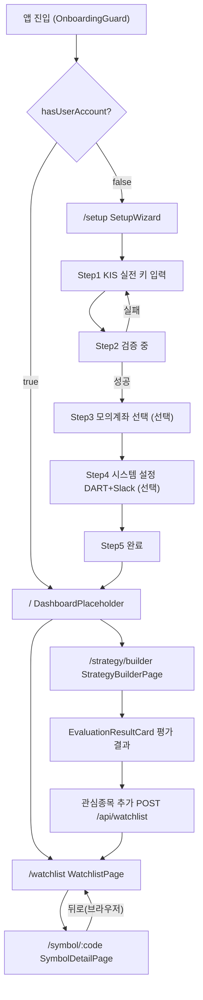
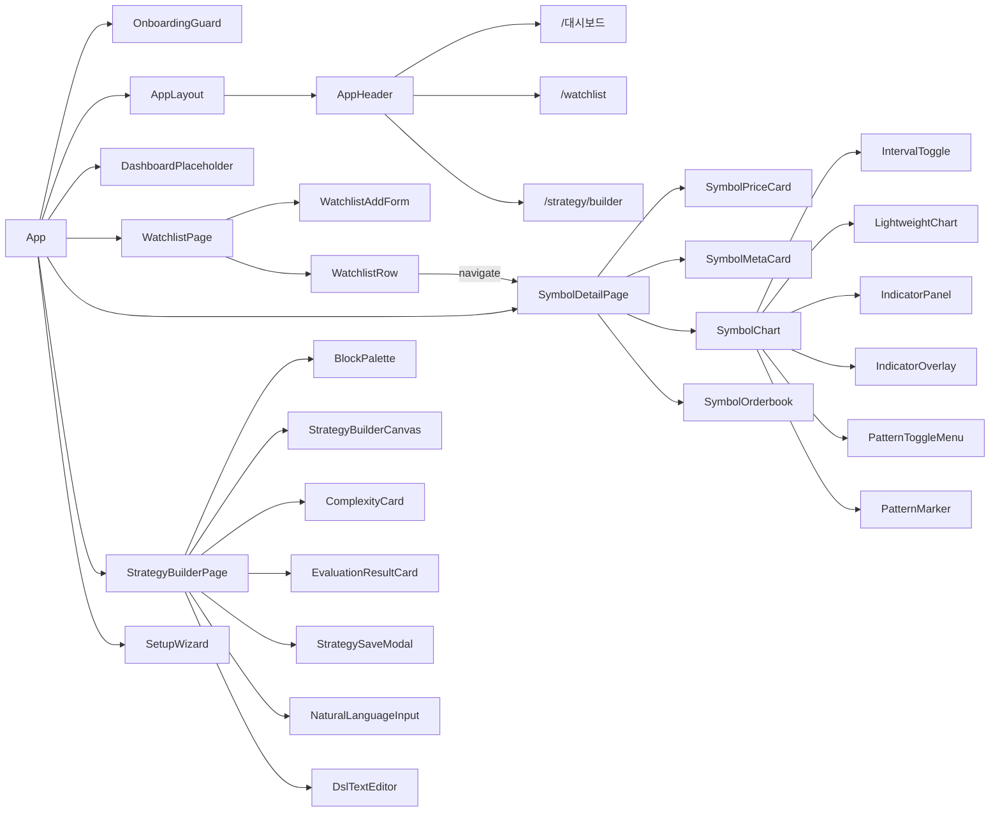

# magicJar v3.2.2 Baseline — 05. UI 화면 인벤토리

> **작성 시점**: 2026-05-11 v3.2.2 태그 컷
> **작성 에이전트**: frontend
> **커버 PR 범위**: PR-5b ~ PR-48 (W1 온보딩·Watchlist·Symbol + W2 T-IND·T-PAT·T-SB + v3.2.2 ADR 0062·0063 인터벌 확장 + dogfooding hotfix 묶음)
> **코드 기준**: `frontend/src/` 직접 inspect — 추측 0건

---

## 1. 라우팅 매트릭스

| URL 패턴 | 페이지 컴포넌트 | 진입 가드 | 트랙 ID | ADR |
|---------|--------------|---------|--------|-----|
| `/` | `DashboardPlaceholder` | OnboardingGuard | T-W1 | ADR 0040 |
| `/watchlist` | `WatchlistPage` | OnboardingGuard | T-W1 | ADR 0040 |
| `/symbol/:code` | `SymbolDetailPage` | OnboardingGuard | T-S1 | ADR 0040 §2-2 |
| `/strategy/builder` | `StrategyBuilderPage` | OnboardingGuard | T-SB | ADR 0040 §1, ADR 0055 |
| `/setup` | `SetupWizard` | OnboardingGuard (역방향) | T-ONBOARD | ADR 0040 |
| `*` | `Navigate to="/"` | — | — | — |

**OnboardingGuard 로직** (`frontend/src/App.tsx`):
- `GET /api/onboarding/status` — `hasUserAccount=false` + path `/setup` 이외 → `/setup` redirect
- `hasUserAccount=true` + path `/setup` → `/` redirect (중복 진입 차단)
- isLoading → 스플래시(animate-spin) 표시

---

## 2. 화면 전이 다이어그램



---

## 3. 글로벌 내비게이션 (AppHeader)

**파일**: `frontend/src/components/layout/AppHeader.tsx`

| 메뉴 항목 | 링크 | 활성 조건 | 접근성 |
|---------|------|---------|------|
| magicJar (로고) | `/` | — | NavLink |
| 대시보드 | `/` (end) | exact match | aria-current |
| 관심종목 | `/watchlist` | prefix match | aria-current |
| 전략 빌더 | `/strategy/builder` | prefix match | aria-current |

- `/setup` 경로에서는 AppHeader 미표시 (App.tsx AppLayout 분기)
- `sticky top-0 z-50` + `backdrop-blur` — 스크롤 시 상단 고정
- 키보드 포커스링: `focus:ring-2 focus:ring-blue-400`

---

## 4. 화면별 컴포넌트 인벤토리

### 4-1. DashboardPlaceholder (`/`)

**파일**: `frontend/src/pages/DashboardPlaceholder.tsx`

| 항목 | 내용 |
|------|------|
| 현황 | placeholder (T-W1 사이클에서 Watchlist 분리, 실질적 진입점은 `/watchlist`) |
| 역할 | `/watchlist` 이동 링크 + 상태 안내 |

---

### 4-2. SetupWizard (`/setup`)

**파일**: `frontend/src/pages/SetupWizard.tsx`  
**step 컴포넌트**: `frontend/src/pages/setup/steps/` 5개

| Step | 컴포넌트 | 내용 |
|------|---------|------|
| 1 | `KisRealStep` | KIS 실전 AppKey·AppSecret·계좌번호 입력 |
| 2 | `KisValidatingStep` | 백엔드 검증 진행 (애니메이션) |
| 3 | `KisMockStep` | 모의계좌 AppKey·AppSecret 입력 (선택) |
| 4 | `SystemConfigStep` | DART API 키 + Slack Webhook (선택) |
| 5 | `CompleteStep` | 셋업 완료 요약 + 시작 버튼 |

**상태**: Zustand `useOnboardingStore` (`frontend/src/stores/onboarding.ts`)

**진행률 표시**: `(currentStep - 1) / 5 * 100%` — 상단 progress bar

**연결 REST**:
- `POST /api/onboarding/validate-kis` — KisValidatingStep (Step 2)
- `POST /api/onboarding/complete` — CompleteStep (Step 5)
- `GET /api/onboarding/status` — App.tsx OnboardingGuard

---

### 4-3. WatchlistPage (`/watchlist`)

**파일**: `frontend/src/pages/Watchlist/WatchlistPage.tsx`

| 컴포넌트 | 파일 | 역할 |
|---------|------|------|
| `WatchlistPage` | `WatchlistPage.tsx` | 페이지 루트 + 로딩·에러·빈 상태 분기 |
| `WatchlistAddForm` | `WatchlistAddForm.tsx` | 종목 코드 입력 + `POST /api/watchlists` |
| `WatchlistEmpty` | `WatchlistEmpty.tsx` | 0건 안내 + CTA 버튼 (입력창 포커스) |
| `WatchlistRow` | `WatchlistRow.tsx` | 1 row: 종목명·코드·시장·상태 배지·우선순위·등록일·삭제 버튼 |
| `WatchlistSkeleton` (inline) | — | 로딩 중 3행 pulse 스켈레톤 |

**WatchlistRow 상태 배지**:

| 배지 | 조건 | 색상 |
|-----|------|------|
| 상장폐지 | `entry.delisted === true` | 빨강(red-300) |
| 거래정지 | `entry.tradingHalt === true` | 주황(orange-300) |
| 관리종목 | `entry.managementStock === true && !tradingHalt` | 노랑(yellow-300) |

**행 동작**:
- 행 클릭 / Enter·Space 키 → `navigate('/symbol/:code')` (ADR 0040 §2-2)
- 삭제 버튼 클릭 → `window.confirm` → `DELETE /api/watchlists/{code}` → row fade-out (200ms)
- 오류 시 페이지 전체 중단 없음 — 섹션 오류 표시

**연결 REST**:
- `GET /api/watchlists` — useWatchlist hook
- `POST /api/watchlists` — WatchlistAddForm (useAddWatchlist)
- `DELETE /api/watchlists/{code}` — WatchlistRow (useRemoveWatchlist)

---

### 4-4. SymbolDetailPage (`/symbol/:code`)

**파일**: `frontend/src/pages/Symbol/SymbolDetailPage.tsx`

#### 하위 컴포넌트 매트릭스

| 컴포넌트 | 파일 | 역할 |
|---------|------|------|
| `SymbolHeader` | `SymbolHeader.tsx` | 종목명·코드·시장·산업 + 뒤로 이동 버튼 |
| `SymbolPriceCard` | `SymbolPriceCard.tsx` | 현재가·등락·등락률 + 고·저·시·전일종가·거래량 + stale 배지 |
| `SymbolMetaCard` | `SymbolMetaCard.tsx` | PER·PBR·EPS·BPS·시가총액 |
| `SymbolChart` | `SymbolChart.tsx` | IntervalToggle + LWC 차트 + 지표·패턴 패널 |
| `SymbolOrderbook` | `SymbolOrderbook.tsx` | 매수·매도 10단계 호가표 |
| `SymbolError` | `SymbolError.tsx` | 에러 분기 표시 (404·503·상장폐지) |

#### 레이아웃 구조 (desktop lg)

```
┌─ AppHeader ──────────────────────────────────────────────────┐
├─ SymbolHeader (종목명·코드·뒤로) ──────────────────────────────┤
├─ STOMP 연결 상태 배지 (끊김 시만 표시) ──────────────────────────┤
├── 3 열 그리드 (lg:grid-cols-3) ─────────────────────────────── ┤
│   좌 (1열): SymbolPriceCard + SymbolMetaCard                  │
│   우 (2열): SymbolChart                                       │
├── SymbolOrderbook (전폭) ────────────────────────────────────┤
└──────────────────────────────────────────────────────────────┘
```

#### SymbolPriceCard 상태 배지

| 배지 | 조건 | 색상 |
|-----|------|------|
| 실시간 | `asOf` 30초 이내 | 녹색(green-400) pulse |
| 지연 데이터 | polling + 장 중 | 노랑(yellow-400) |
| 장 마감 | polling/closed + 장외 | 회색(gray-500) |

**등락 색상 정책** (한국 주식 관례):
- `changeSign` 1·2 (상한·상승) → `text-red-400`
- `changeSign` 3 (보합) → `text-gray-300`
- `changeSign` 4·5 (하한·하락) → `text-blue-400`
- null fallback: `change` 숫자값 기반 분기

**STOMP 토픽 구독** (stompEnabled = `Boolean(code) && !isDelisted`):

| 토픽 | 용도 |
|-----|------|
| `/topic/market.tick.{code}` | 현재가·등락·등락률 실시간 갱신 |
| `/topic/market.candle.minute.{code}` | 1m 차트 실시간 append |
| `/topic/market.orderbook.{code}` | 호가 10단계 실시간 갱신 |

**호가 slot 라이프사이클** (ADR 0048 LRU 10):
- mount `+200ms` → `POST /api/symbols/{code}/orderbook/subscribe`
- unmount → `navigator.sendBeacon('/api/symbols/{code}/orderbook/unsubscribe')` + REST fallback

**graceful 처리 매트릭스**:

| 상황 | 처리 |
|------|------|
| HTTP 503/404 | SymbolError 표시 |
| candle 0건 cold-start | "데이터 수집 중" skeleton + 안내 |
| 합산 인터벌 0건 (ADR 0062) | "X봉 합산 데이터 준비 중" 전용 안내 |
| STOMP 끊김 | 노랑 배지 + 5s polling fallback |
| instrument 테이블 부재 | code 그대로 표시 (SymbolHeader graceful) |
| 상장폐지 종목 | SymbolError variant="delisted" — 가격·차트·호가 진입 차단 |
| 호가 slot queued | "polling fallback 중" 배지 |

---

### 4-5. SymbolChart (SymbolDetailPage 내부)

**파일**: `frontend/src/pages/Symbol/SymbolChart.tsx`

#### IntervalToggle

**파일**: `frontend/src/pages/Symbol/IntervalToggle.tsx`

| 인터벌 | 레이블 | 분류 | ADR |
|-------|------|------|-----|
| `1m` | 1분 | KIS 직접 | ADR 0062 |
| `5m` | 5분 | 합산 | ADR 0062 |
| `15m` | 15분 | 합산 | ADR 0062 |
| `30m` | 30분 | 합산 | ADR 0062 |
| `90m` | 90분 | 합산 | ADR 0062 |
| `1h` | 1시간 | 합산 | ADR 0062 |
| `1d` | 일 | KIS 직접 | ADR 0019 |
| `1wk` | 주 | KIS 직접 | ADR 0019 |
| `1mo` | 월 | KIS 직접 | ADR 0019 |
| `1y` | 년 | KIS 직접 | ADR 0019 |

- 활성 버튼: `bg-blue-600 text-white`
- 비활성 버튼: `bg-gray-800 text-gray-400`
- 접근성: `role="group"` + `aria-pressed` + `focus:ring-2`

#### LightweightChart

**파일**: `frontend/src/pages/Symbol/LightweightChart.tsx`

| 항목 | 구현 |
|------|------|
| 라이브러리 | `lightweight-charts` v4 (LWC v4, ADR 0025) |
| 차트 테마 | 다크: background `#0d1117`, grid `#1f2937` |
| 캔들 색상 | 상승 `#26a69a`, 하락 `#ef5350` |
| 거래량 | `addHistogramSeries` (priceScaleId: '', 독립 스케일) |
| 시간 포맷 | KST `Asia/Seoul` — intraday "YYYY-MM-DD HH:mm", 일봉+ "YYYY-MM-DD" |
| NXT X축 | ts ASC 입력 시 LWC v4 timeScale 자동 확장 (ADR 0063 — 별도 range 설정 불필요) |
| 실시간 갱신 | STOMP 1m candle → `candleSeries.update()` |
| 좌측 스크롤 | `subscribeVisibleLogicalRangeChange` — range.from < 1 → `onScrollLeft` 콜백 |
| hover 툴팁 | crosshair 이동 → OHLCV + 등락률 floating div (role="tooltip") |
| 반응형 | `ResizeObserver` → `chart.applyOptions({ width })` |
| IndicatorOverlay 연동 | `onChartReady(chart: IChartApi)` + `onChartDestroy` 콜백 |
| PatternMarker 연동 | `onCandleSeriesReady(series)` + `onCandleSeriesDestroy` 콜백 |

**TradingView Advanced 의존 0** (ADR 0025 §2-1 LOCK).

#### 지표 패널 (T-IND)

| 컴포넌트 | 파일 | 역할 |
|---------|------|------|
| `IndicatorPanel` | `IndicatorPanel.tsx` | 80지표 목록 슬라이드인 패널 + 토글 |
| `IndicatorOverlay` | `IndicatorOverlay.tsx` | LWC chart에 지표 series 렌더링 (DOM 없음) |

- 지표 오류: 위젯 수준 오류 배지 — 페이지 전체 중단 없음
- 지표 선택 시 `GET /api/indicators/{id}` 요청

#### 패턴 패널 (T-PAT)

| 컴포넌트 | 파일 | 역할 |
|---------|------|------|
| `PatternToggleMenu` | `components/chart/PatternToggleMenu.tsx` | 57패턴 catalog picker 슬라이드인 패널 |
| `PatternMarker` | `components/chart/PatternMarker.tsx` | LWC candleSeries에 BULL/BEAR 마커 overlay (DOM 없음) |

- 패턴 0건 시 "선택한 패턴이 해당 기간에서 발견되지 않았습니다." 명시 (mock 합성 0)
- `GET /api/symbols/{code}/patterns?patternIds=...&interval=...`

#### 페이지네이션

- `useInfiniteQuery` + before cursor
- 좌측 스크롤 끝 도달 → `fetchNextPage` 자동 트리거
- "더 보기" 버튼 (hasNextPage) + "이전 데이터 불러오는 중..." 인디케이터
- pages 역순 flatMap 으로 ASC 정렬 보장 (dogfooding hotfix — PR #290)

---

### 4-6. StrategyBuilderPage (`/strategy/builder`)

**파일**: `frontend/src/pages/Strategy/StrategyBuilderPage.tsx`

#### 레이아웃 구조

```
┌─ AppHeader ────────────────────────────────────────────────┐
├── 3 단 레이아웃 (768px 이상) ─────────────────────────────── ┤
│   좌 (w-56): BlockPalette                                  │
│   중 (flex-1): StrategyBuilderCanvas                       │
│   우 (w-72): ComplexityCard + EvaluationResultCard         │
└──────────────────────────────────────────────────────────────┘
```

- 768px 미만 → 안내 메시지 (DoD #26)

#### 하위 컴포넌트 매트릭스

| 컴포넌트 | 파일 | 역할 |
|---------|------|------|
| `BlockPalette` | `strategy/BlockPalette.tsx` | 4탭(지표80·패턴57·캔들·연산자) + 검색 |
| `BlockNode` | `strategy/BlockNode.tsx` | 재귀 트리 노드 8분기 + Tab/Enter/Delete 키보드 접근성 |
| `StrategyBuilderCanvas` | `strategy/StrategyBuilderCanvas.tsx` | entry/exit 탭 + DSL 미리보기 + 액션 버튼 행 |
| `DslTextEditor` | `strategy/DslTextEditor.tsx` | textarea DSL 직접 편집 (Monaco 미사용 — ADR 0055 §3) |
| `NaturalLanguageInput` | `strategy/NaturalLanguageInput.tsx` | AI 자연어 변환 모달 (사용자 트리거 only — ADR 0023 §1) |
| `ComplexityCard` | `strategy/ComplexityCard.tsx` | LOW/MEDIUM/HIGH/CRITICAL 복잡도 배지 + AST stats |
| `EvaluationResultCard` | `strategy/EvaluationResultCard.tsx` | BUY/SELL/HOLD 배지 + 강도 게이지 + 관심종목 추가 버튼 |
| `StrategySaveModal` | `strategy/StrategySaveModal.tsx` | 전략명·한글명·universe·timeframe 폼 |
| `EvaluationEmptyCard` | `strategy/EvaluationResultCard.tsx` | 평가 전 "데이터 없음" 명시 |

#### DSL 라이브러리 (`frontend/src/lib/dsl/`)

| 파일 | 역할 |
|------|------|
| `blockTree.ts` | `BlockNode` discriminated union 8종 + `BlockTree` + 조작 헬퍼 |
| `serializer.ts` | `serializeBlockTree` → DSL 1줄 텍스트 (backend KisYamlDslParser 1:1) |
| `parser.ts` | `parseDslText` 재귀 하강 6단 — 최대 깊이 50, 화이트리스트 위반 throw |
| `yaml.ts` | `kisYamlExport` / `kisYamlImport` — .kis.yaml 호환, 1MB 제한 |
| `catalogIds.ts` | 파서 화이트리스트용 80지표+57패턴 ID Set |

#### 연결 REST

| 엔드포인트 | 용도 | hook |
|-----------|------|------|
| `POST /api/strategy/validate` | DSL 복잡도 검증 | `useStrategyValidate` |
| `POST /api/strategy/{id}/evaluate` | 전략 평가 | `useStrategyEvaluate` |
| `POST /api/strategy` | 전략 저장 | `useCreateStrategy` |
| `GET /api/strategy` | 전략 목록 | `useStrategyList` |
| `GET /api/strategy/{id}` | 전략 조회 | `useGetStrategy` |
| `DELETE /api/strategy/{id}` | 전략 삭제 | `useDeleteStrategy` |
| `POST /api/strategy/{id}/enable` | 전략 활성화 | `useEnableStrategy` |
| `POST /api/dsl/translate-from-natural` | AI 자연어 변환 | `useStrategyTranslate` |

**LLM provider import 0건** (룰 5 — AI는 사용자 트리거 REST 요청만).

---

## 5. API Hook 매트릭스

| Hook | 파일 | 대상 엔드포인트 | 용도 |
|------|------|----------------|------|
| `useOnboardingStatus` | `api/onboarding.ts` | `GET /api/onboarding/status` | OnboardingGuard |
| `useWatchlist` | `api/hooks/useWatchlist.ts` | `GET /api/watchlists` | WatchlistPage 목록 |
| `useAddWatchlist` | `api/hooks/useWatchlist.ts` | `POST /api/watchlists` | WatchlistAddForm |
| `useRemoveWatchlist` | `api/hooks/useWatchlist.ts` | `DELETE /api/watchlists/{code}` | WatchlistRow |
| `useSymbol` | `api/hooks/useSymbol.ts` | `GET /api/symbols/{code}` | SymbolDetailPage 5s polling |
| `useSymbolCandles` | `api/hooks/useSymbolCandles.ts` | `GET /api/symbols/{code}/candles` | SymbolChart 무한 스크롤 |
| `useInstrument` | `api/hooks/useInstrument.ts` | `GET /api/instruments/{code}` | SymbolDetailPage 메타 |
| `useInstrumentSearch` | `api/hooks/useInstrumentSearch.ts` | `GET /api/instruments/search?q=` | InstrumentSearchInput |
| `useIndicators` | `api/hooks/useIndicators.ts` | `GET /api/indicators/{id}` | IndicatorOverlay |
| `usePatterns` | `api/hooks/usePatterns.ts` | `GET /api/symbols/{code}/patterns` | PatternMarker |
| `useStrategyValidate` | `api/hooks/useStrategy.ts` | `POST /api/strategy/validate` | StrategyBuilderPage |
| `useStrategyEvaluate` | `api/hooks/useStrategy.ts` | `POST /api/strategy/{id}/evaluate` | StrategyBuilderPage |
| `useCreateStrategy` | `api/hooks/useStrategy.ts` | `POST /api/strategy` | StrategySaveModal |
| `useStrategyTranslate` | `api/hooks/useStrategyTranslate.ts` | `POST /api/dsl/translate-from-natural` | NaturalLanguageInput |

---

## 6. STOMP 토픽 매트릭스

| 토픽 | 구독 위치 | payload 타입 | 용도 |
|-----|---------|------------|------|
| `/topic/market.tick.{code}` | `SymbolDetailPage` | `TickPayload` | 현재가·등락·등락률 실시간 |
| `/topic/market.candle.minute.{code}` | `SymbolDetailPage` | `CandleMinutePayload` | 1m 차트 실시간 append |
| `/topic/market.orderbook.{code}` | `SymbolDetailPage` | `OrderbookPayload` | 호가 10단계 실시간 |

**STOMP 설정** (`frontend/src/lib/stomp.ts`):
- `@stomp/stompjs` Client 싱글톤 (re-render 시 재연결 방지)
- `brokerURL`: `ws://{host}/ws` (Vite dev proxy → `ws://localhost:8080/ws`)
- `reconnectDelay`: 5000ms
- 연결 끊김 → 노랑 배지 + 5s polling fallback 자동 전환

---

## 7. TickPayload 등락 필드 (v3.2.2 신규 — dogfooding hotfix)

`frontend/src/api/symbol.ts` `TickPayload` 인터페이스:

| 필드 | KIS raw 필드 | 타입 | 설명 |
|------|------------|------|------|
| `priceChange` | `PRDY_VRSS` | `string \| null` | 전일 대비 금액 |
| `changeRate` | `PRDY_CTRT` | `string \| null` | 등락률 % |
| `changeSign` | `PRDY_VRSS_SIGN` | `string \| null` | 부호 코드 (1=상한·2=상승·3=보합·4=하한·5=하락) |

- null: polling source (KIS WS H0STCNT0 미수신 시)
- non-null: STOMP tick과 현재가 동일 source → 등락 싱크 보장 (PR #289 dogfooding hotfix)

---

## 8. 컴포넌트 의존도 분기 다이어그램



---

## 9. 접근성 정책 요약

| 항목 | 구현 방식 |
|------|---------|
| 키보드 포커스 | `focus:ring-2 focus:ring-blue-400` 전 인터랙티브 요소 |
| 버튼 aria | `aria-label`, `aria-pressed`, `aria-expanded` |
| 상태 안내 | `role="status"` / `role="alert"` + `aria-live="polite"` |
| 스피너 | `aria-busy="true"` + `aria-label` |
| 차트 | `role="img" aria-label="종목 차트"` |
| 툴팁 | `role="tooltip" aria-label="캔들 상세 정보"` |
| 메뉴 | `aria-current` NavLink |
| WatchlistRow | `role="button" tabIndex={0}` + Enter·Space 키 핸들러 |
| IntervalToggle | `role="group" aria-label="차트 인터벌 선택"` |
| BlockNode | Tab/Enter/Delete 키보드 접근성 (DoD #25) |

---

## 10. 숫자·날짜 포맷 정책

| 포맷 유형 | 구현 | 예시 |
|---------|------|-----|
| 가격 (원화) | `toLocaleString('ko-KR')` | `85,000` |
| 등락률 | `toFixed(2)` + 부호 prefix | `+1.23%` / `-0.45%` |
| 거래량 | 1백만→`X.X백만`, 1천→`X천`, 그 외 ko-KR | `1.2백만` |
| 날짜 (KST) | `toLocaleDateString('ko-KR', { timeZone: 'Asia/Seoul' })` | `2026. 05. 11.` |
| 차트 intraday | `Intl.DateTimeFormat('sv-SE', { timeZone: 'Asia/Seoul', hour: '2-digit', minute: '2-digit' })` | `2026-05-11 09:30` |
| 차트 일봉+ | `Intl.DateTimeFormat('sv-SE', { timeZone: 'Asia/Seoul' })` | `2026-05-11` |

---

## 11. 에러 처리 정책

| 상황 | 처리 |
|------|------|
| REST 실패 | 해당 위젯만 오류 표시 — 페이지 전체 중단 금지 |
| WebSocket 끊김 | 자동 재연결(5s) + 연결 상태 인디케이터 배지 |
| AI 응답 지연 | 스켈레톤 로딩 (NaturalLanguageInput 모달 내) |
| candle 0건 | "데이터 없음" 명시 — mock 합성 절대 0 (feedback_no_mock_data.md) |
| 패턴 0건 | "패턴이 발견되지 않았습니다." 명시 |
| EvaluationResult 없음 | `EvaluationEmptyCard` — "평가 결과 없음" 명시 |

---

## 12. 테스트 파일 매트릭스 (v3.2.2 기준)

| 테스트 파일 | 케이스 수 | 커버 대상 |
|-----------|---------|---------|
| `__tests__/onboarding-routing.test.tsx` | — | OnboardingGuard 라우팅 분기 |
| `__tests__/watchlist-flow.test.tsx` | — | WatchlistPage 추가·삭제·종목 이동 |
| `__tests__/tick-sync-display.test.tsx` | 20 | `changeSignToArrow`·`changeSignToColorClass`·STOMP source 우선·null fallback |
| `__tests__/indicators/indicator-catalog.test.ts` | — | 80지표 ID 정합 |
| `__tests__/patterns/pattern-catalog.test.ts` | — | 57패턴 ID 정합 |
| `__tests__/patterns/pattern-marker.test.ts` | — | PatternMarker LWC series 마커 |
| `__tests__/patterns/symbol-detail-pattern.test.tsx` | — | SymbolDetailPage 패턴 흐름 |
| `__tests__/patterns/use-patterns.test.ts` | — | usePatterns hook |
| `components/__tests__/InstrumentSearchInput.test.tsx` | — | 검색 인풋 |
| `components/strategy/__tests__/BlockNode.test.tsx` | 10 | BlockNode 트리 조작·키보드 |
| `components/strategy/__tests__/EvaluationResultCard.test.tsx` | 7 | BUY/SELL/HOLD 배지 |
| `components/strategy/__tests__/StrategyBuilderCanvas.test.tsx` | 7 | 캔버스 entry/exit 탭 |
| `lib/dsl/__tests__/parser.test.ts` | 9 | parseDslText 6단 재귀 |
| `lib/dsl/__tests__/serializer.test.ts` | 7 | serializeBlockTree round-trip |
| `lib/dsl/__tests__/yaml.test.ts` | 5 | kisYamlExport/Import |
| `pages/Strategy/__tests__/StrategyBuilderPage.test.tsx` | 5 | StrategyBuilderPage 통합 |
| `pages/Symbol/__tests__/SymbolDetailPage.test.tsx` | — | SymbolDetailPage 통합 |

**v3.2.2 pnpm test 기준**: 151건 GREEN (17 test files)

---

## 13. v3.2.2 신규 변경 요약 (v3.2.0 대비)

| 항목 | 변경 내용 | ADR/PR |
|------|---------|--------|
| `IntervalToggle` 10종 | 15분·90분 버튼 신규 추가 (5m·15m·30m·90m·1h 활성화) | ADR 0062, PR #291 |
| `CandleInterval` 타입 | 10종 확장 (`15m`·`90m` 추가) | ADR 0062 |
| `LightweightChart.isIntradayInterval` | 15m·90m 포함 — KST 시·분 표시 활성, NXT 08:00~20:00 X축 자동 확장 | ADR 0063 |
| `SymbolChart.AGGREGATED_INTERVALS` | 5m·15m·30m·90m·1h 5종 — AggregateBackfillRunner 전 전용 안내 분기 | ADR 0062 |
| `TickPayload` 등락 필드 | `priceChange`·`changeRate`·`changeSign` 3 필드 신규 (STOMP 단일 source 동기) | PR #289 |
| `SymbolPriceCard` 등락 표시 | STOMP tick 우선·null fallback + changeSign 코드 기반 색상·부호 | PR #289 |
| `useInfiniteQuery` pages 합산 | `[...data.pages].reverse().flatMap(...)` — page 경계 ts 역행 결함 수정 | PR #290 |

---

## 14. ADR 인용 인덱스

| ADR | 제목 | 관련 UI 항목 |
|-----|------|------------|
| ADR 0009 | frontend SPA + LWC v4 | 전체 프론트엔드 아키텍처 |
| ADR 0014 | 실시간 시세 fallback tier | stale 배지 (live/delayed/closed) |
| ADR 0019 | 캔들 인터벌 정책 | CandleInterval 타입, IntervalToggle |
| ADR 0023 | AI 자연어 DSL 변환 | NaturalLanguageInput (사용자 트리거 only) |
| ADR 0025 | LWC v4 차트 | LightweightChart |
| ADR 0029 | STOMP 실시간 캔들 | SymbolDetailPage STOMP 구독 |
| ADR 0040 | 라우팅 + Watchlist 진입점 | App.tsx 라우트, WatchlistRow 이동 |
| ADR 0048 | 호가 LRU 10 slot | SymbolOrderbook subscribe/unsubscribe |
| ADR 0055 | Strategy Builder UI 스택 | StrategyBuilderPage (Monaco 없음) |
| ADR 0062 | 5m~1h 합산 인터벌 활성화 | IntervalToggle 10종, AGGREGATED_INTERVALS |
| ADR 0063 | NXT X축 커버 (08:00~20:00) | LightweightChart isIntradayInterval |
