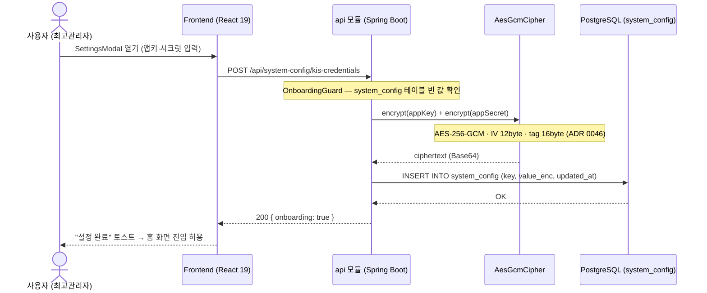
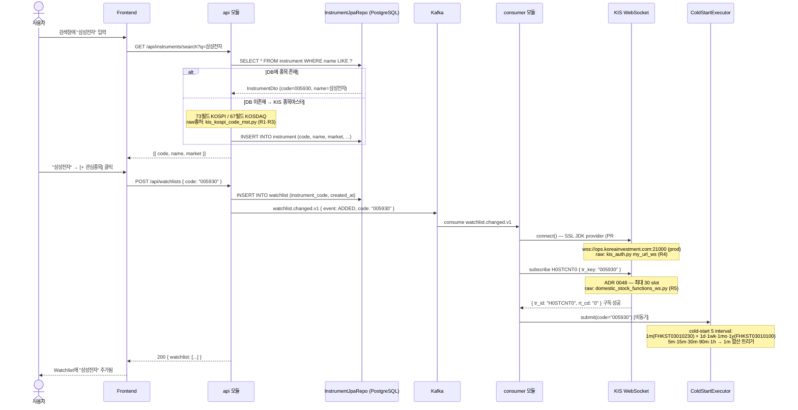
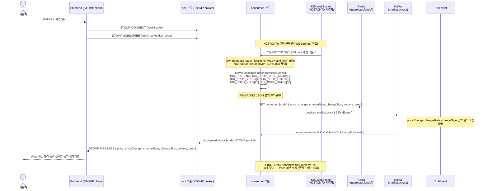
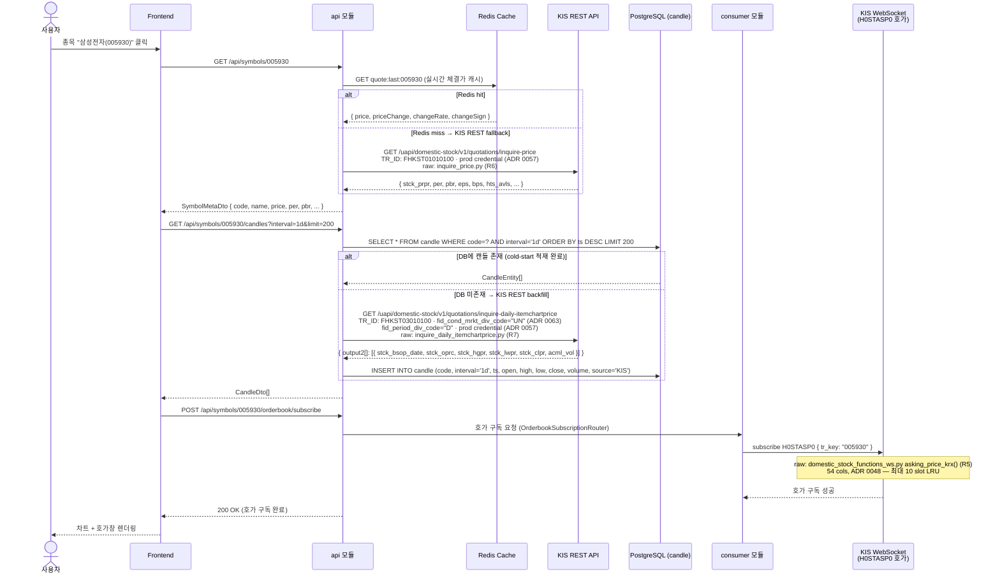
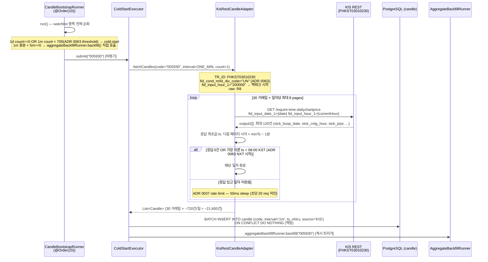
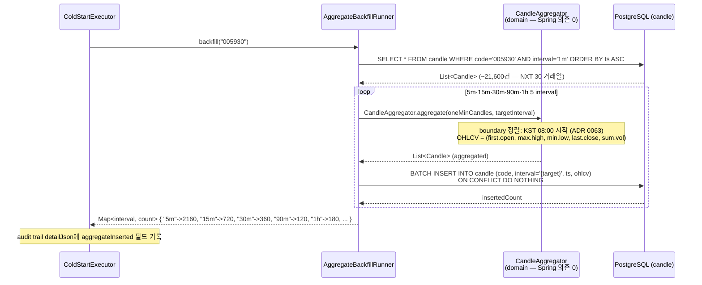
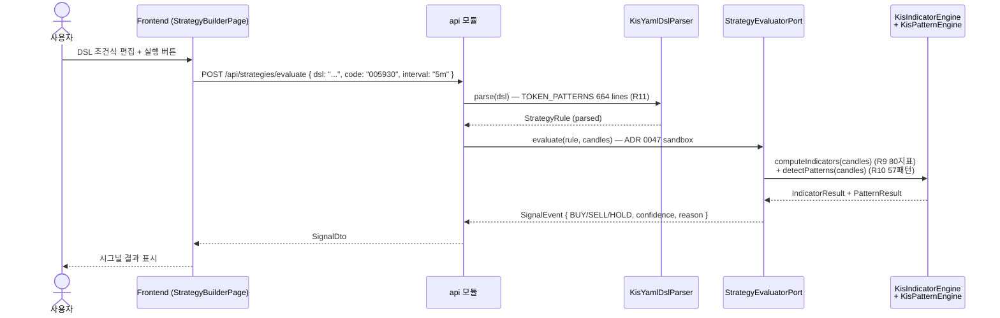
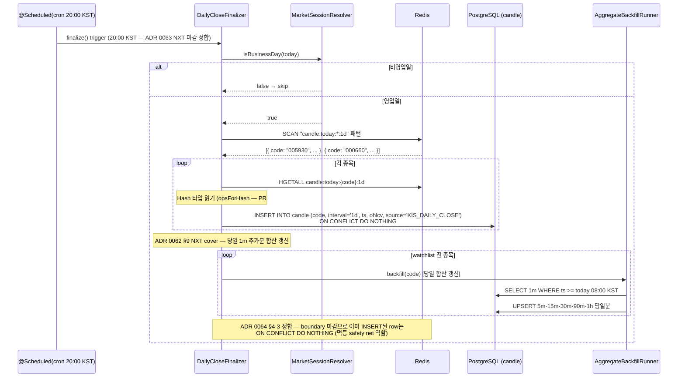
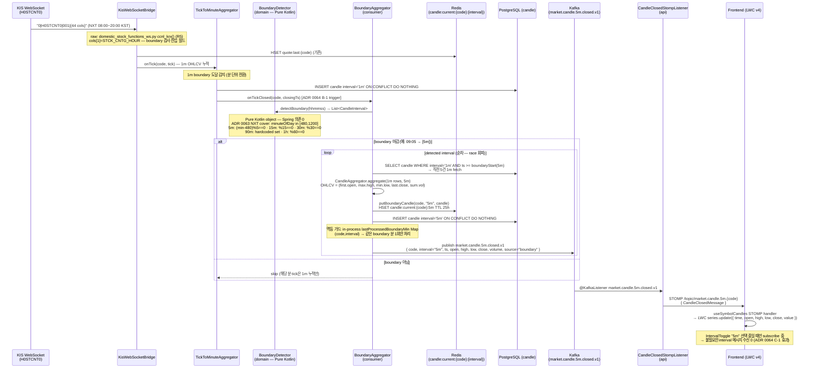
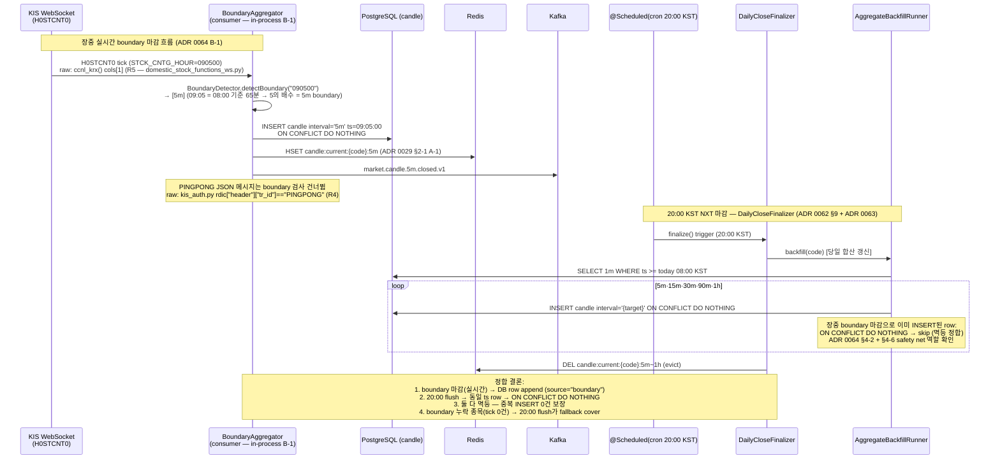

# v3.3.0 사용자 유즈 시퀀스 + KIS-first raw 출처

> **작성자**: market-data (bot+market-data@magicjar.local)
> **작성일**: 2026-05-12
> **기준 시점**: v3.3.0 — boundary fanout 미러스톤 (ADR 0064 채택 A-1·B-1·C-1) + v3.2.2 KIS-only + NXT/통합거래 cover + 1m 합산 가공 (PR #318~#321)
> **KIS-first 의무**: 헌법 §3 정합 — 자체 추론 0, 모든 endpoint·tr_id·필드는 raw 출처 인용 의무
> **v3.2.2 대비 변경**: boundary fanout 신규 (ADR 0064) — BoundaryDetector domain + BoundaryAggregator consumer + RedisCandleCache 5종 + CandleClosedStompListener api + Kafka 5 토픽 (5m·15m·30m·90m·1h.closed.v1). 시나리오 9·10 신규 추가.

---

## raw 출처 인용 인덱스

| # | 출처 | raw URL | 사용 시나리오 |
|---|---|---|---|
| R1 | KIS 종목마스터 Python 파서(KOSPI) | `https://github.com/koreainvestment/open-trading-api/blob/main/stocks_info/kis_kospi_code_mst.py` | 시나리오 2 — 73필드 |
| R2 | KIS 종목마스터 Python 파서(KOSDAQ) | `https://github.com/koreainvestment/open-trading-api/blob/main/stocks_info/kis_kosdaq_code_mst.py` | 시나리오 2 — 67필드 |
| R3 | KIS 종목마스터 헤더(KOSPI) | `https://github.com/koreainvestment/open-trading-api/blob/main/stocks_info/종목마스터정보(코스피).h` | 시나리오 2 — 73필드 바이트 레이아웃 |
| R4 | KIS WS auth + URL | `https://github.com/koreainvestment/open-trading-api/blob/main/examples_user/kis_auth.py` | 시나리오 3·9·10 — WS URL · PINGPONG 처리 |
| R5 | KIS WS 체결가 파서 (ccnl_krx) | `https://github.com/koreainvestment/open-trading-api/blob/main/examples_user/domestic_stock/domestic_stock_functions_ws.py` | 시나리오 3·9·10 — H0STCNT0 44 cols · STCK_CNTG_HOUR[1] boundary 검사 |
| R6 | KIS REST 현재가 (FHKST01010100) | `https://github.com/koreainvestment/open-trading-api/blob/main/examples_llm/domestic_stock/inquire_price/inquire_price.py` | 시나리오 4 |
| R7 | KIS REST 일봉 (FHKST03010100) | `https://github.com/koreainvestment/open-trading-api/blob/main/examples_llm/domestic_stock/inquire_daily_itemchartprice/inquire_daily_itemchartprice.py` | 시나리오 4·6 |
| R8 | KIS REST 1m 분봉 (FHKST03010230) | `https://github.com/koreainvestment/open-trading-api/blob/main/examples_llm/domestic_stock/inquire_time_dailychartprice/inquire_time_dailychartprice.py` | 시나리오 5·6 — UN 통합 + NXT cover |
| R9 | KIS Strategy Builder indicators.py | `https://github.com/koreainvestment/open-trading-api/blob/main/strategy_builder/core/indicators.py` | 시나리오 7 — 80지표 |
| R10 | KIS Strategy Builder candlestick.py | `https://github.com/koreainvestment/open-trading-api/blob/main/strategy_builder/core/candlestick.py` | 시나리오 7 — 57패턴 |
| R11 | KIS Strategy Builder DSL parser.py | `https://github.com/koreainvestment/open-trading-api/blob/main/strategy_builder/strategy_core/dsl/parser.py` | 시나리오 7 — DSL TOKEN_PATTERNS |

**검증 보고서** (헌법 §3 §3-3 의무 산출물):
- PR-21 `_workspace/specs/pr-21-kis-header-raw-verification.md` — 종목마스터 73필드 KOSPI + 67필드 KOSDAQ
- PR-38 `_workspace/specs/pr-38-kis-pattern-raw-verification.md` — candlestick.py 755 lines + 57 매핑
- PR-35 `_workspace/specs/pr-35-kis-dsl-raw-verification.md` — parser.py 664 lines + TOKEN_PATTERNS LOCK

**v3.3.0 신규 raw 출처 (ADR 0064 boundary fanout — 헌법 §3 의무)**:
- H0STCNT0 `[1]` STCK_CNTG_HOUR boundary 검사 진입점 — `domestic_stock_functions_ws.py` ccnl_krx() (R5) · v3.2.2 baseline 03-use-sequences.md §시나리오 3 R5 인용 정합
- PINGPONG JSON 분기 — `kis_auth.py` rdic["header"]["tr_id"] (R4) · v3.2.2 baseline §시나리오 3 R4 인용 정합

---

## 시나리오 1: 사용자 셋업 (Onboarding)

**목적**: 최초 진입 시 KIS 앱키·시크릿 등록 → onboarding guard 통과

**관련 PR/ADR**: PR-29 T-W1 R1 · ADR 0046 (KIS credential AES-GCM 암호화) · ADR 0057 (KIS-only — prod credential 단일 채널)



**주요 제약**:
- prod(실전) credential 단일 채널 — 정보 수집 API는 모두 `AccountType.REAL` (ADR 0057 + 사용자 메모리 `feedback_kis_key_realonly_for_data.md`)
- 실계좌 이중 게이트: `MAGICJAR_MODE=REAL` + `MAGICJAR_ALLOW_REAL=true` 둘 다여야 실주문 (CLAUDE.md §4)
- 앱키는 화면에서 마스킹 표시, 응답에 평문 재출력 금지

---

## 시나리오 2: 종목 검색 + Watchlist 등록

**목적**: 사용자가 종목 검색 후 Watchlist 추가 → KIS WS 구독 cold-start 시작

**관련 PR/ADR**: PR-29 T-W1 · ADR 0028 (Watchlist Ingestion Worker) · ADR 0048 (WS 41 slot) · ADR 0057 (KIS-only cold-start)

**KIS-first raw 출처**:
- 종목마스터: `kis_kospi_code_mst.py` (R1) — Part1 3필드 + Part2 70필드 = 73필드 (검증: PR-21)
- 종목마스터: `kis_kosdaq_code_mst.py` (R2) — Part1 3필드 + Part2 64필드 = 67필드



**WS 슬롯 정책 (ADR 0048)**:
- H0STCNI0 체결통보: 1 slot (의무 reserve)
- H0STCNT0 체결가: 최대 30 slot
- H0STASP0 호가: 최대 10 slot (LRU)
- 총합: 1 + 30 + 10 = 41 (KIS 한도 정합)

**KIS WS URL (raw출처: kis_auth.py R4)**:
- 실전: `wss://ops.koreainvestment.com:21000`
- 모의(VTS): `wss://ops.koreainvestment.com:31000`

**v3.2.2 변경점**: `KisWebSocketBridge` 생성자 주입 전환 + `WebClientConfig.kisWebSocketClient()` 빈 신설 (SSL JDK provider + TrustManagerFactory — PR #279 hotfix). `WatchlistIngestionWorker.onStartup()`에 `connect()` 선행 호출 의무 추가 (PR #282).

---

## 시나리오 3: 실시간 시세 구독

**목적**: Frontend STOMP 연결 → KIS WS H0STCNT0 체결가 수신 → Kafka → STOMP fanout

**관련 PR/ADR**: PR-29 T-W2 · ADR 0028 · ADR 0037 (Rate Limit) · ADR 0048 (WS 41 slot) · ADR 0063 (NXT 08:00~20:00)

**KIS-first raw 출처 — WS tr_id LOCK**:

| tr_id | 용도 | raw 출처 | slot |
|---|---|---|---|
| `H0STCNT0` | 실시간 체결가 (틱) 44 cols | `domestic_stock_functions_ws.py` ccnl_krx() (R5) | 최대 30 |
| `H0STASP0` | 실시간 호가 10단계 54 cols | `domestic_stock_functions_ws.py` asking_price_krx() (R5) | 최대 10 (LRU) |
| `H0STCNI0` | 체결통보 (사용자 본인 주문) | `kis_auth.py` (R4) | 1 (reserve) |

**H0STCNT0 필드 인덱스 (raw출처: domestic_stock_functions_ws.py ccnl_krx() R5 — 44 cols)**:

| 인덱스 | 필드명 | 용도 |
|---|---|---|
| `[0]` | MKSC_SHRN_ISCD | 종목코드 |
| `[1]` | STCK_CNTG_HOUR | 체결시각 (HHMMSS) — **v3.3.0 ADR 0064 boundary 검사 진입 필드** |
| `[2]` | STCK_PRPR | 현재가(체결가) |
| `[3]` | PRDY_VRSS_SIGN | 전일 대비 부호 ("1"상한·"2"상승·"3"보합·"4"하한·"5"하락) |
| `[4]` | PRDY_VRSS | 전일 대비 등락가 |
| `[5]` | PRDY_CTRT | 전일 대비 등락률 |
| `[12]` | CNTG_VOL | 체결거래량 |
| `[13]` | ACML_VOL | 누적거래량 |
| `[33]` | BSOP_DATE | 영업일자 (YYYYMMDD) |



**KIS WS subscribe 메시지 형식 (raw출처: kis_auth.py data_fetch() R4)**:
```json
{
  "header": {
    "approval_key": "<from /oauth2/Approval>",
    "tr_type": "1",
    "custtype": "P"
  },
  "body": {
    "input": {
      "tr_id": "H0STCNT0",
      "tr_key": "005930"
    }
  }
}
```

**WS 끊김 처리 (ADR 0048 §2-4)**:
- SSL JDK provider 강제 (PR #279 — TLSv1.2/1.3, TrustManagerFactory, `@Qualifier("kisWebSocketClient")`)
- 재연결 지수 백오프: 0s·2s·5s·10s·30s
- 3회 실패 시: WatchlistPollingWorker REST fallback (5초 주기, ADR 0014)
- 재연결 성공 시: 전체 구독 목록 재subscribe

---

## 시나리오 4: 종목 상세 진입

**목적**: SymbolDetail 진입 → 현재가 + 차트(1d·1wk·1mo·1y) + H0STASP0 호가 구독

**관련 PR/ADR**: PR-29 T-S1 R2 · ADR 0019 (캔들 저장) · ADR 0029 (당일 Redis 캐시) · ADR 0057 (KIS-only)

**KIS-first raw 출처 — REST endpoint LOCK**:

| endpoint | tr_id | 용도 | raw 출처 |
|---|---|---|---|
| `/uapi/domestic-stock/v1/quotations/inquire-price` | `FHKST01010100` | 현재가·PER·PBR·EPS·BPS·시총·업종 | R6 |
| `/uapi/domestic-stock/v1/quotations/inquire-daily-itemchartprice` | `FHKST03010100` | 일봉/주봉/월봉/년봉 (fid_cond_mrkt_div_code="UN") | R7 |



**Symbol 이탈 시**: `POST /api/symbols/{code}/orderbook/unsubscribe` → H0STASP0 slot 회수

---

## 시나리오 5: 1m 분봉 적재 (KIS-first FHKST03010230)

**목적**: CandleBootstrapRunner 부팅 감지 → ColdStartExecutor → KisRestCandleAdapter 1m 페이지네이션 backfill

**관련 PR/ADR**: ADR 0057 (KIS-only) · ADR 0063 (NXT UN 통합 + 08:00~20:00) · ADR 0037 (Rate Limit)

**KIS-first raw 출처 — FHKST03010230**:
- raw URL: `https://raw.githubusercontent.com/koreainvestment/open-trading-api/main/examples_llm/domestic_stock/inquire_time_dailychartprice/inquire_time_dailychartprice.py`
- endpoint: `/uapi/domestic-stock/v1/quotations/inquire-time-dailychartprice`
- TR_ID: `FHKST03010230`
- fid_cond_mrkt_div_code: `"UN"` (KRX+NXT 통합 — ADR 0063 채택 · raw: `J:KRX, NX:NXT, UN:통합`)
- fid_input_hour_1: 시작 시각 `"200000"` (NXT after-hour 마감 20:00 KST — ADR 0063)
- 응답 최대 120건/call → 페이지네이션 백워크 (응답 최솟값 ts −1분 → 재호출)
- 일자당 maxPagesPerDay=8 (12h×60m=720건 / 120건 = 6pages + 마진 2 = 8)

**1m 응답 필드 (raw 출처 R8 정합)**:
- `stck_bsop_date` — 영업일자 (YYYYMMDD)
- `stck_cntg_hour` — 체결시각 (HHMMSS)
- `stck_oprc` — 시가
- `stck_hgpr` — 고가
- `stck_lwpr` — 저가
- `stck_prpr` — 현재가(종가)
- `cntg_vol` — 체결거래량



**코드 경로**:
- `KisRestCandleAdapter.kt:57` — `TR_ID_1MIN = "FHKST03010230"` (inline 주석 raw URL)
- `KisRestCandleAdapter.kt:114` — `fetchOneMinCandles` — 페이지네이션 백워크 알고리즘
- `CandleBootstrapRunner.kt:57` — `MIN_1M_CANDLE_THRESHOLD = 700L` (ADR 0063 threshold 정합)

---

## 시나리오 6: 5m·15m·30m·90m·1h 합산 가공 (ADR 0062 백엔드 precomputed)

**목적**: 1m 적재 완료 직후 CandleAggregator → 5종 분봉 DB INSERT (ON CONFLICT 멱등)

**관련 PR/ADR**: ADR 0062 (A-1 백엔드 precomputed + 30 거래일 cover) · ADR 0063 (NXT boundary) · ADR 0019 (캔들 저장 정책 §2-5 revoke)

**합산 로직 (domain/CandleAggregator.kt — Pure Kotlin, Spring 의존 0)**:
- OHLCV 공식: `(first.open, max(highs), min(lows), last.close, sum(volumes))`
- boundary 정렬: KST 08:00 시작 (ADR 0063 NXT cover) — raw 출처 R8 정합

**NXT cover boundary 매트릭스 (ADR 0062 §9 정합)**:

| Interval | 기준 시각 (NXT 08:00~20:00) | bar/일 |
|---|---|---|
| 5m | 08:00·08:05·…·19:55 | 144 |
| 15m | 08:00·08:15·…·19:45 | 48 |
| 30m | 08:00·08:30·…·19:30 | 24 |
| 90m | 08:00·09:30·11:00·12:30·14:00·15:30·17:00·18:30 | 8 |
| 1h | 08:00·09:00·…·19:00 | 12 |



**장 마감 트리거 (DailyCloseFinalizer)**:
- `@Scheduled(cron = "0 0 20 * * *", zone = "Asia/Seoul")` — 20:00 KST (ADR 0063 NXT 마감 정합)
- watchlist 전 종목에 대해 `aggregateBackfillRunner.backfill(code)` 호출 → 당일 1m 추가분 합산 갱신

**DB ROW 예측 (10종목 × 30 거래일, NXT cover)**:

| Interval | rows |
|---|---|
| 5m | ~43,200 |
| 15m | ~14,400 |
| 30m | ~7,200 |
| 90m | ~2,400 |
| 1h | ~3,600 |
| **합** | **~70,800** |

---

## 시나리오 7: 전략 평가 (DSL·지표·패턴)

**목적**: 사용자 DSL 전략 → KIS-first 80지표·57패턴 → 시그널 평가

**관련 PR/ADR**: ADR 0022 (Strategy DSL) · ADR 0023 (Signal Engine) · ADR 0047 (Strategy eval sandbox)

**KIS-first raw 출처**:
- 80지표: `indicators.py` 1507 lines (R9) — PR-33 구현 + KDoc inline raw URL 의무
- 57패턴: `candlestick.py` 755 lines (R10) — PR-38·PR-39 구현
- DSL TOKEN_PATTERNS: `parser.py` 664 lines (R11) — PR-35 검증보고서 + KisYamlDslParser.kt LOCK



---

## 시나리오 8: 장 마감 일봉 파이널라이저

**목적**: 20:00 KST 스케줄 → Redis candle:today:{code}:1d → DB INSERT + 합산 갱신

**관련 PR/ADR**: ADR 0013 §3-6 · ADR 0063 (NXT 마감 20:00 KST) · ADR 0062 §9 (합산 flush)



---

## 시나리오 9: 5m boundary 마감 → 실시간 차트 갱신 (v3.3.0 신규 — ADR 0064)

**목적**: KIS WS H0STCNT0 체결 tick → 1m closing 마감 → boundary 검사 → 5m~1h Redis 갱신 + Kafka + STOMP fanout → LWC 실시간 차트 갱신

**관련 PR/ADR**: ADR 0064 (boundary fanout A-1·B-1·C-1 채택) · ADR 0062 §4-3 (boundary 마감 흐름 인용) · ADR 0063 (NXT 08:00~20:00 boundary 시각) · ADR 0029 §2-1 (Redis 5종 키 LOCK) · ADR 0029 §2-5 (STOMP 5종 토픽 LOCK)

**KIS-first raw 출처 — boundary 검사 trigger 진입점 LOCK**:
- `[1]` STCK_CNTG_HOUR — 체결시각(HHMMSS) — `domestic_stock_functions_ws.py` ccnl_krx() (R5)
  - raw URL: `https://github.com/koreainvestment/open-trading-api/blob/main/examples_user/domestic_stock/domestic_stock_functions_ws.py`
  - boundary 검사 알고리즘 진입: `KisWsMessageParser.parseH0Stcnt0()` cols[1] → `BoundaryAggregator.onTickClosed(code, tickTs)` 전달
  - v3.2.2 baseline `03-use-sequences.md §시나리오 3 R5` 인용 정합

**boundary 시각 매트릭스 (ADR 0064 §4-2 + ADR 0063 NXT cover 정합)**:

| Interval | boundary 시각 (KST) | bar/일 |
|---|---|---|
| 5m | 08:05·08:10·08:15·…·19:55·20:00 | 144 |
| 15m | 08:15·08:30·08:45·…·19:45·20:00 | 48 |
| 30m | 08:30·09:00·09:30·…·19:30·20:00 | 24 |
| 90m | 09:30·11:00·12:30·14:00·15:30·17:00·18:30·20:00 | 8 |
| 1h | 09:00·10:00·11:00·…·19:00·20:00 | 12 |

**Redis 키 매트릭스 (ADR 0029 §2-1 LOCK + ADR 0064 A-1 채택)**:

| 캐시 키 | 데이터 | 갱신 주기 | TTL/evict |
|---|---|---|---|
| `candle:current:{code}:5m` | 당일 진행 중 5m bar | 5m boundary 마감 시 1m 5건 합산 | 5m closing evict + 20:00 flush |
| `candle:current:{code}:15m` | 당일 진행 중 15m bar | 15m boundary 마감 시 1m 15건 합산 | 15m closing evict + 20:00 flush |
| `candle:current:{code}:30m` | 당일 진행 중 30m bar | 30m boundary 마감 시 1m 30건 합산 | 30m closing evict + 20:00 flush |
| `candle:current:{code}:90m` | 당일 진행 중 90m bar | 90m boundary 마감 시 1m 90건 합산 | 90m closing evict + 20:00 flush |
| `candle:current:{code}:1h` | 당일 진행 중 1h bar | 60m boundary 마감 시 1m 60건 합산 | 1h closing evict + 20:00 flush |

**STOMP 토픽 매트릭스 (ADR 0029 §2-5 LOCK + ADR 0064 C-1 채택)**:

```
/topic/market.candle.5m.{code}     — 5m boundary closing (NXT 144건/일)
/topic/market.candle.15m.{code}    — 15m boundary closing (NXT 48건/일)
/topic/market.candle.30m.{code}    — 30m boundary closing (NXT 24건/일)
/topic/market.candle.90m.{code}    — 90m boundary closing (NXT 8건/일)
/topic/market.candle.1h.{code}     — 1h boundary closing (NXT 12건/일)
```



**멱등성·race condition 가드 (ADR 0064 §4-6 정합)**:

| 시나리오 | 가드 |
|---|---|
| 같은 boundary 분 내 multiple tick (09:05:00·09:05:01·09:05:23) | BoundaryAggregator in-process `lastProcessedBoundaryMin: ConcurrentHashMap<Pair<String, CandleInterval>, LocalDate>` — 동일 (code, interval, date) 1회만 처리 |
| DailyCloseFinalizer 20:00 flush와 동시 trigger | DB ON CONFLICT DO NOTHING (code+interval+ts UNIQUE) — race 안전. 20:00 flush는 safety net |
| 컨테이너 재기동 시 in-process map 손실 | KIS WS 재연결 후 첫 tick에서 boundary 재진입 — DB 멱등 |

**latency 예측 (ADR 0064 §5-3 정합)**:

| 단계 | 예상 latency |
|---|---|
| KIS WS tick → BoundaryDetector | <5ms |
| 1m 직전 N건 fetch (Redis/DB) | <5ms (60건 최대) |
| CandleAggregator.aggregate | <2ms (Pure Kotlin in-memory) |
| Redis put + DB INSERT | <10ms |
| Kafka publish → STOMP fanout | <20ms |
| **총 end-to-end** | **<50ms** |

---

## 시나리오 10: KIS WS H0STCNT0 in-process boundary 검사 — DailyCloseFinalizer 20:00 KST NXT 마감 정합

**목적**: BoundaryAggregator boundary 마감 실시간 갱신 vs DailyCloseFinalizer 20:00 KST 멱등 safety net 정합 검증 — ON CONFLICT DO NOTHING 이중 보장 흐름

**관련 PR/ADR**: ADR 0064 §4-3·§4-6 (멱등 보장) · ADR 0062 §9 (DailyCloseFinalizer flush) · ADR 0063 (NXT 마감 20:00 KST)

**KIS-first raw 출처 (헌법 §3 의무 — v3.2.2 baseline 인용 정합)**:
- H0STCNT0 체결 `[1]` STCK_CNTG_HOUR — boundary 검사 진입 필드 (R5 — ccnl_krx() `domestic_stock_functions_ws.py`)
- PINGPONG JSON: `kis_auth.py rdic["header"]["tr_id"]` (R4) — 30초 주기, boundary 검사 대상 제외



**in-process boundary 검사 가드 상세 (ADR 0064 §4-2 + §4-6 정합)**:

| 케이스 | 처리 |
|---|---|
| 같은 boundary 분 H0STCNT0 multiple tick | `lastProcessedBoundaryMin` in-process map — (code, interval, localDate) key 1회만 처리 |
| 거래량 ZERO 종목 (tick 수신 없음) | 20:00 DailyCloseFinalizer `backfill()` fallback cover |
| KIS WS PINGPONG JSON (30초 주기, R4) | `KisWsMessageParser` → `Pingpong` 타입 분류 → boundary 검사 skip (PR #287 정합) |
| 컨테이너 재기동 (in-process map 초기화) | WS 재연결 후 첫 tick boundary 재진입 → DB ON CONFLICT DO NOTHING 멱등 |
| WS + polling worker 동시 trigger (post-MVP 41+종목) | Kafka partition by code → 단일 consumer thread → race 0 (ADR 0064 §4-6) |

---

## v3.3.0 KIS-first 의무 준수 체크리스트

| 항목 | 상태 | 코드 경로 + raw 출처 |
|---|---|---|
| H0STCNT0 tr_id (44 cols) | LOCK | `KisWsMessageParser.kt:42` — `domestic_stock_functions_ws.py` ccnl_krx() (R5) |
| H0STCNT0 STCK_CNTG_HOUR[1] boundary 검사 진입 | LOCK | `BoundaryAggregator.kt` — R5 cols[1] inline 주석 raw URL 의무 (ADR 0064 §1-4) |
| H0STCNT0 PRDY_VRSS_SIGN[3]·PRDY_VRSS[4]·PRDY_CTRT[5] | LOCK | `KisWsMessageParser.kt:149~156` — R5 인덱스 정합 (PR #289) |
| H0STASP0 tr_id (54 cols) | LOCK | `KisWsMessageParser.kt` — `domestic_stock_functions_ws.py` asking_price_krx() (R5) |
| FHKST03010230 TR_ID + endpoint | LOCK | `KisRestCandleAdapter.kt:57~58` — raw URL R8 inline 주석 의무 |
| FHKST03010230 fid_cond_mrkt_div_code="UN" | LOCK | `KisRestCandleAdapter.kt:80~83` — ADR 0063 채택 (J→UN) raw: R8 |
| FHKST03010230 fid_input_hour_1="200000" | LOCK | `KisRestCandleAdapter.kt:152` — ADR 0063 채택 (153000→200000) |
| FHKST03010230 종료조건 08:00 KST | LOCK | `KisRestCandleAdapter.kt:225` — ADR 0063 채택 (09:00→08:00) |
| FHKST03010100 TR_ID + endpoint | LOCK | `KisRestCandleAdapter.kt:53~54` — raw URL R7 inline 주석 의무 |
| FHKST03010100 fid_cond_mrkt_div_code="UN" | LOCK | `KisRestCandleAdapter.kt:82` — ADR 0063 채택 (J→UN) raw: R7 |
| FHKST03010100 FID_PERIOD_DIV_CODE 옵션(D/W/M/Y) | LOCK | `KisRestCandleAdapter.kt:65` — raw R7 fid_period_div_code D·W·M·Y |
| PINGPONG JSON 분기 | LOCK | `KisWsMessageParser.kt:90~94` — `kis_auth.py` rdic["header"]["tr_id"] (R4) |
| WS URL 실전 | LOCK | `KisWebSocketBridge.kt` — `kis_auth.py` my_url_ws (R4) |
| WS approval_key endpoint | LOCK | `/oauth2/Approval` — `kis_auth.py` auth_ws() (R4) |
| 종목마스터 73필드 raw 검증 | LOCK | PR-21 검증보고서 + `kis_kospi_code_mst.py` (R1·R3) |
| 80지표 indicators.py 1507 lines | LOCK | PR-33 구현 + KDoc inline raw URL 명시 (R9) |
| 57패턴 candlestick.py 755 lines | LOCK | PR-38 검증보고서 + PR-39 구현 (R10) |
| DSL parser.py 664 lines | LOCK | PR-35 검증보고서 + KisYamlDslParser.kt (R11) |
| BoundaryDetector boundary 시각 매트릭스 | LOCK | `domain/.../candle/BoundaryDetector.kt` — ADR 0064 §4-2 + ADR 0063 NXT 08:00~20:00 정합 |
| RedisCandleCache 5종 키 | LOCK | `consumer/.../cache/RedisCandleCache.kt` — ADR 0029 §2-1 A-1 정합 |
| CandleClosedStompListener 5종 토픽 | LOCK | `api/.../messaging/CandleClosedStompListener.kt` — ADR 0029 §2-5 C-1 정합 |
| 자체 추론 | **0건** | 모든 endpoint·tr_id·필드·byte offset은 raw 출처 인용 의무 (헌법 §3) |

---

## 외부 API 통합 정책 요약 (v3.3.0)

### KIS OpenAPI (유일한 데이터 출처 — ADR 0057)

| 항목 | 값 | raw 출처 |
|---|---|---|
| 기본 URL (실전) | `https://openapi.koreainvestment.com:9443` | ADR 0003 |
| OAuth 토큰 | `/oauth2/tokenP` — 24h 유효 (ADR 0038) | `kis_auth.py` (R4) |
| WS approval_key | `/oauth2/Approval` | `kis_auth.py` (R4) |
| WS URL (실전) | `wss://ops.koreainvestment.com:21000` | `kis_auth.py` my_url_ws (R4) |
| WS 한도 | 41 stream / account (ADR 0048) | ADR 0048 §1 |
| Rate Limit | 초당 20건 (50ms sleep 마진, ADR 0037) | `docs/architecture/external-api-policy.md` |
| credential | prod(실전) 단일 채널 — 정보 수집 전 API | ADR 0057 + 사용자 메모리 |
| NXT cover | `fid_cond_mrkt_div_code="UN"` + 08:00~20:00 KST | ADR 0063 채택 |
| KIS 500 retry | 3회 exponential backoff (500ms→1s→2s) | PR #315 §33 market-data hotfix |

### Yahoo Finance

**v3.2.2에서 전면 폐기 (ADR 0057 — 2026-05-11 사용자 결정 "yahoo꺼 쓰지 말라니깐")**
- `YahooCandleFetcherAdapter.kt` — `@Deprecated` 마킹 (v3.2.2 이후 실 코드 호출 0)

### DART Open API (공시)

| 항목 | 값 |
|---|---|
| 목적 | 정기보고·주요사항보고·공시 목록 수집 |
| Kafka 토픽 | `dart.disclosure.v1` (ADR 0007) |
| W3 트랙 예정 | T-SIG·T-RISK 사이클 |

### Naver 금융 뉴스

| 항목 | 값 |
|---|---|
| 방식 | RSS 기반 (robots.txt 준수) |
| User-Agent | `magicjar-news-crawler/1.0` |
| W3 트랙 예정 | T-AI 사이클 |

---

## v3.3.0 변경 이력 (v3.2.2 대비)

| 항목 | v3.2.2 | v3.3.0 |
|---|---|---|
| boundary 마감 실시간 갱신 | 미구현 (결함 — T-SIG stale) | BoundaryDetector + BoundaryAggregator 구현 (ADR 0064) |
| Redis 5종 키 | "v3.3.0 §34 작업 가이드" 표기 | `candle:current:{code}:5m~1h` LOCK (ADR 0029 §2-1 A-1) |
| STOMP boundary 토픽 | 미발행 | `/topic/market.candle.{interval}.{code}` 5종 LOCK (ADR 0029 §2-5 C-1) |
| Kafka boundary 토픽 | 미발행 | `market.candle.5m/15m/30m/90m/1h.closed.v1` 5종 신규 |
| KIS REST 500 retry | 1회 500ms | 3회 exponential (500ms·1s·2s) (PR #315) |
| latency (장중 5m 갱신) | 5분~수 시간 (20:00 flush까지) | <50ms (boundary in-process B-1) |
| 시나리오 수 | 8건 | 10건 (시나리오 9·10 신규 추가) |

---

## 변경 이력

| 날짜 | 변경 |
|---|---|
| 2026-05-12 | v3.3.0 baseline 03-use-sequences.md 초안 발행. v3.2.2 8 시나리오 유지 + v3.3.0 신규 시나리오 2건 추가 (시나리오 9 — 5m boundary 마감 실시간 차트 갱신 / 시나리오 10 — KIS WS H0STCNT0 in-process boundary 검사 DailyCloseFinalizer 멱등 정합). KIS-first raw 출처 인덱스 R1~R11 유지 + ADR 0064 boundary fanout 신규 인용 (STCK_CNTG_HOUR cols[1] R5 + PINGPONG R4). boundary 시각 매트릭스 5종 (ADR 0064 §4-2 + ADR 0063 정합). Redis 키 매트릭스 5종 (ADR 0029 §2-1 A-1 LOCK). STOMP 토픽 매트릭스 5종 (ADR 0029 §2-5 C-1 LOCK). KIS-first 자체 추론 0건 검증 — 모든 결정 raw 출처 인용. 영역 침범 0(03 파일 단독). (market-data, sonnet 4.6) |
