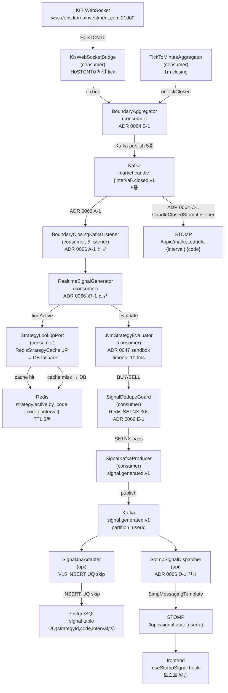

# v3.4.0 데이터 흐름 매트릭스

- baseline: v3.4.0
- 작성일: 2026-05-12
- 작성자: backend-core (bot+backend-core@magicjar.local)
- SoT: `docs/architecture/master-architecture.md` §2 + `settings.gradle.kts` + ADR 0004
- 기준: v3.3.0 02-data-flow.md + v3.4.0 T-BT 영속 + T-SIG 추가 (ADR 0061·ADR 0066 A-1·B-1·C-1·D-1·E-1·F-1 채택)

---

## 1. 모듈 의존성 매트릭스

### 1-1. JVM 5 모듈 구성

```
settings.gradle.kts include:
  domain
  pattern-engine
  api
  batch
  consumer
```

| 모듈 | Spring 의존 | JPA 의존 | 역할 |
|------|------------|---------|------|
| `domain` | 0 | 0 | 순수 도메인 + 포트 인터페이스 (Spring·JPA 0 — 헥사고날 내부 링) |
| `pattern-engine` | 0 | 0 | 캔들스틱 패턴 57종 인식 (Pure Kotlin — ADR 0054) |
| `api` | Spring Boot 3.3 | JPA (Hibernate 6) | REST/STOMP + KIS REST 어댑터 + Kafka producer |
| `batch` | Spring Boot 3.3 + Spring Batch | JPA | 종목 마스터 sync + 기업 행위 처리 잡 |
| `consumer` | Spring Boot 3.3 | JPA | Kafka 소비 + KIS WS 브릿지 + 시그널·주문 dispatch |

### 1-2. 모듈 간 의존 방향

```
domain ←── api
domain ←── consumer
domain ←── batch
pattern-engine ←── api
(domain ← pattern-engine : PatternRecognizer port 참조)
```

- `domain`은 어떤 모듈에도 의존하지 않음 (Spring·JPA import 0건 강제)
- `api`/`consumer`/`batch`는 `domain` 포트 인터페이스를 구현하는 어댑터 배치
- `pattern-engine`은 `domain`의 `PatternRecognizer` 포트 구현체 (`JvmPatternRecognizer`)

### 1-3. v3.4.0 신규 컴포넌트 위치

| 컴포넌트 | 모듈 | 패키지 경로 | ADR 근거 |
|---------|------|-----------|---------|
| `Signal` · `SignalSide` · `SignalContext` | `domain` | `domain/.../signal/Signal.kt` | ADR 0066 §5-2 — Pure Kotlin data class |
| `SignalRepository` port | `domain` | `domain/.../signal/port/SignalRepository.kt` | ADR 0066 §5-3 — 헥사고날 포트 (abstract fun body 0) |
| `StrategyStatus` enum | `domain` | `domain/.../strategy/StrategyStatus.kt` | ADR 0066 §5-1 F-1 — ACTIVE·PAUSED·DISABLED·DELETED |
| `StrategyLookupPort` | `domain` | `domain/.../strategy/port/StrategyLookupPort.kt` | ADR 0066 §5-3 — findActiveByCodeAndInterval 포트 |
| `RealtimeSignalGenerator` | `consumer` | `consumer/.../signal/RealtimeSignalGenerator.kt` | ADR 0066 §7-1 A-1 — JvmStrategyEvaluator sandbox 위임 |
| `BoundaryClosingKafkaListener` (5건) | `consumer` | `consumer/.../signal/BoundaryClosingKafkaListener.kt` | ADR 0066 §7-1 A-1 — 5m·15m·30m·90m·1h listener |
| `SignalDedupeGuard` | `consumer` | `consumer/.../signal/SignalDedupeGuard.kt` | ADR 0066 §7-1 E-1 — Redis SETNX 30s TTL |
| `SignalKafkaProducer` | `consumer` | `consumer/.../signal/SignalKafkaProducer.kt` | ADR 0066 §7-1 — `signal.generated.v1` 발행 |
| `SignalJpaEntity/Repository/Adapter` | `api` | `api/.../persistence/signal/` | ADR 0066 §6-2 V15 — signal 영속 |
| `StrategyJpaEntity` 확장 | `api` | `api/.../persistence/strategy/StrategyJpaEntity.kt` | ADR 0066 §6-1 V14 — status·codes·intervals 컬럼 추가 |
| `StrategyLookupJpaAdapter` | `api` | `api/.../persistence/strategy/StrategyLookupJpaAdapter.kt` | ADR 0066 — Redis cache 1차·DB miss 보완 |
| `RedisStrategyCache` | `api` | `api/.../cache/RedisStrategyCache.kt` | ADR 0066 §2-5 — TTL 5분·strategy:active:by_code 키 |
| `StrategiesController` | `api` | `api/.../controller/StrategiesController.kt` | ADR 0066 §4-1 — 6 endpoint |
| `SignalController` | `api` | `api/.../controller/SignalController.kt` | ADR 0066 §4-2 — 2 endpoint |
| `StompSignalDispatcher` | `api` | `api/.../messaging/StompSignalDispatcher.kt` | ADR 0066 §7-2 D-1 — `/topic/signal.user.{userId}` fanout |

---

## 2. api 모듈 데이터 흐름

### 2-1. REST 엔드포인트 매트릭스

#### 기존 (v3.3.0 이월)

| 경로 | 컨트롤러 | 역할 | Kafka 발행 |
|------|---------|------|-----------|
| `GET /api/watchlists` | `WatchlistController` | 관심종목 목록 (priority ASC) | — |
| `POST /api/watchlists` | `WatchlistController` | 관심종목 등록 | `watchlist.changed.v1` ADDED |
| `DELETE /api/watchlists/{code}` | `WatchlistController` | 관심종목 삭제 | `watchlist.changed.v1` REMOVED |
| `GET /api/symbols/{code}` | `SymbolController` | 현재가·PER·PBR·시총·업종 | — |
| `GET /api/symbols/{code}/candles` | `SymbolController` | 캔들 시계열 (DB + Redis merge) | — |
| `POST /api/symbols/{code}/orderbook/subscribe` | `SymbolController` | 호가 구독 시작 | `symbol.detail.command.v1` ENTER |
| `POST /api/symbols/{code}/orderbook/unsubscribe` | `SymbolController` | 호가 구독 해제 | `symbol.detail.command.v1` EXIT |
| `GET /api/patterns` | `PatternController` | 57종 패턴 인식 | — |
| `GET /api/indicators` | `IndicatorController` | 80종 기술적 지표 | — |
| `GET /api/instruments` | `InstrumentController` | 종목 검색 (Redis 인덱스) | — |
| `POST /api/backtest/run` | `BacktestController` | DSL 전략 백테스트 (stateless, ADR 0056) | — |
| `POST /api/onboarding` | `OnboardingController` | KIS 키 등록 + AES 암호화 | — |
| `POST /api/ai/dsl/translate` | `DslTranslateController` | 자연어 → DSL 변환 (AI 보조) | — |

#### v3.3.1 T-BT 결과 영속 (ADR 0061 — R2 신규)

| 경로 | 컨트롤러 | 역할 |
|------|---------|------|
| `POST /api/backtests` | `BacktestsController` | 백테스트 실행 + 영속 (PENDING→RUNNING→SUCCEEDED/FAILED) |
| `GET /api/backtests` | `BacktestsController` | 사용자 목록 (페이징 `?page&size`) |
| `GET /api/backtests/{id}` | `BacktestsController` | 단건 메타 + KPI |
| `GET /api/backtests/{id}/result` | `BacktestsController` | 거래·포지션 시계열 (페이징) |
| `DELETE /api/backtests/{id}` | `BacktestsController` | 삭제 (CASCADE — backtest_trade·backtest_position) |

#### v3.4.0 T-SIG Strategy + Signal (ADR 0066 — Phase 2 신규)

| 경로 | 컨트롤러 | 역할 |
|------|---------|------|
| `POST /api/strategies` | `StrategiesController` | 룰 등록 + ADR 0047 §2-1 static 검증 |
| `GET /api/strategies` | `StrategiesController` | 사용자 룰 목록 (페이징) |
| `GET /api/strategies/{id}` | `StrategiesController` | 단건 + metric summary |
| `PUT /api/strategies/{id}` | `StrategiesController` | 전략 수정 (이름·DSL·codes·intervals) |
| `DELETE /api/strategies/{id}` | `StrategiesController` | soft delete (status=DELETED) |
| `PUT /api/strategies/{id}/toggle` | `StrategiesController` | status 토글 ACTIVE↔PAUSED / DISABLED→ACTIVE (reactivate) |
| `GET /api/signals` | `SignalController` | 시그널 시계열 (페이징 `?userId&strategyId&code&from&to`) |
| `GET /api/signals/{id}` | `SignalController` | 단건 (side·strength·reason·price·contextJson) |

### 2-2. STOMP 구독 토픽 (api Kafka Consumer → 브라우저 fanout)

#### 기존 3종 (v3.2.2 이월)

| Kafka 토픽 (소비) | STOMP 토픽 (발행) | 포워더 클래스 | 설명 |
|-----------------|----------------|-------------|------|
| `market.tick.v1` | `/topic/market.tick.{code}` | `MarketTickStompForwarder` | 실시간 체결가 (1초 throttle) |
| `market.candle.minute.closed.v1` | `/topic/market.candle.minute.{code}` | `MarketCandleStompForwarder` | 1분봉 closing |
| `market.orderbook.v1` | `/topic/market.orderbook.{code}` | `MarketOrderbookStompForwarder` | 호가 스냅샷 |

#### boundary 5종 (v3.3.0 — ADR 0064 C-1)

| Kafka 토픽 (소비) | STOMP 토픽 (발행) | 리스너 클래스 | 설명 |
|-----------------|----------------|------------|------|
| `market.candle.5m.closed.v1` | `/topic/market.candle.5m.{code}` | `CandleClosedStompListener` | 5분봉 boundary closing |
| `market.candle.15m.closed.v1` | `/topic/market.candle.15m.{code}` | `CandleClosedStompListener` | 15분봉 boundary closing |
| `market.candle.30m.closed.v1` | `/topic/market.candle.30m.{code}` | `CandleClosedStompListener` | 30분봉 boundary closing |
| `market.candle.90m.closed.v1` | `/topic/market.candle.90m.{code}` | `CandleClosedStompListener` | 90분봉 boundary closing |
| `market.candle.1h.closed.v1` | `/topic/market.candle.1h.{code}` | `CandleClosedStompListener` | 60분봉 boundary closing |

#### v3.4.0 신규 1종 (ADR 0066 D-1 — T-SIG STOMP fanout)

| Kafka 토픽 (소비) | STOMP 토픽 (발행) | 리스너 클래스 | 설명 |
|-----------------|----------------|------------|------|
| `signal.generated.v1` | `/topic/signal.user.{userId}` | `StompSignalDispatcher` | 시그널 발행 → userId별 토스트 알림 |

userId 단위 격리 — 사용자 A의 시그널이 사용자 B에게 누설 0 (ADR 0010 multi-tenant 정합).

### 2-3. api 모듈 내부 서비스 레이어

```
Controller → Service → JPA Repository (persistence 패키지)
                     → Redis (InstrumentSearchIndexAdapter / RedisStrategyCache)
                     → KIS REST 어댑터 (KisRestPriceMetricsAdapter)
CandleClosedStompListener ← Kafka (5m~1h closed.v1)         → SimpMessagingTemplate → STOMP
StompSignalDispatcher     ← Kafka (signal.generated.v1)      → SimpMessagingTemplate → STOMP (userId)
```

---

## 3. consumer 모듈 데이터 흐름

### 3-1. Kafka 토픽 소비 매트릭스

#### 기존 (v3.3.0 이월)

| 토픽 | 리스너 클래스 | groupId | 처리 내용 |
|------|------------|---------|----------|
| `watchlist.changed.v1` | `WatchlistChangedKafkaListener` | `magicjar-consumer-watchlist-ingestion` | ADDED: cold-start 트리거 + WS/polling 구독 / REMOVED: 구독 해제 + Redis evict |
| `symbol.detail.command.v1` | `SymbolDetailCommandKafkaListener` | `magicjar-consumer-orderbook-cmd` | ENTER: H0STASP0 구독 slot 할당 / EXIT: slot 회수 |

#### v3.4.0 신규 5종 (ADR 0066 A-1 — boundary 시그널 평가)

| 토픽 | 리스너 클래스 | groupId | 처리 내용 |
|------|------------|---------|----------|
| `market.candle.5m.closed.v1` | `BoundaryClosingKafkaListener` | `magicjar-consumer-signal-5m` | 5m boundary payload → 활성 strategy 평가 → 시그널 발행 |
| `market.candle.15m.closed.v1` | `BoundaryClosingKafkaListener` | `magicjar-consumer-signal-15m` | 15m boundary payload → 활성 strategy 평가 → 시그널 발행 |
| `market.candle.30m.closed.v1` | `BoundaryClosingKafkaListener` | `magicjar-consumer-signal-30m` | 30m boundary payload → 활성 strategy 평가 → 시그널 발행 |
| `market.candle.90m.closed.v1` | `BoundaryClosingKafkaListener` | `magicjar-consumer-signal-90m` | 90m boundary payload → 활성 strategy 평가 → 시그널 발행 |
| `market.candle.1h.closed.v1` | `BoundaryClosingKafkaListener` | `magicjar-consumer-signal-1h` | 1h boundary payload → 활성 strategy 평가 → 시그널 발행 |

groupId 인터벌별 분리 이유: 5m·15m 동시 boundary 도달 시 partition 경합 방지 + 재균형 격리.

### 3-2. KIS WS 브릿지 흐름 (v3.3.0 이월)

```
KIS WebSocket (wss://ops.koreainvestment.com:21000)
    ↓  H0STCNT0 (체결가 tick)
KisWebSocketBridge
    ├── writeToRedis(quote:last:{code}, 등락 필드 포함)   ← ADR 0029
    ├── publishTickEvent → Kafka market.tick.v1
    └── STCK_CNTG_HOUR 추출 → BoundaryAggregator.onTick(code, hhmmss)
           ↓  (ADR 0064 B-1 in-process 검사)
    BoundaryDetector.detectBoundary(hhmmss) → List<CandleInterval>

    KIS WebSocket
    ↓  H0STASP0 (호가 스냅샷)
KisWebSocketBridge
    └── publishOrderbook → Kafka market.orderbook.v1

    KIS WebSocket
    ↓  PINGPONG JSON {"header":{"tr_id":"PINGPONG",...}}
KisWebSocketBridge
    └── echo (원본 raw 그대로 — KIS raw 정합)
```

KIS-first raw 출처: H0STCNT0 `ccnl_krx()` 44 cols — `[1]` STCK_CNTG_HOUR (`domestic_stock_functions_ws.py`)

### 3-3. BoundaryAggregator → SignalEngine 연결 흐름 (v3.4.0 신규)

```
BoundaryAggregator.onTickClosed(code, tickTs)
    ↓  (ADR 0064 B-1 trigger — TickToMinuteAggregator 확장)
BoundaryDetector → boundary 5종 Kafka 발행
    ↓
market.candle.{interval}.closed.v1 (5종)
    ↓  (v3.4.0 신규 — ADR 0066 A-1)
BoundaryClosingKafkaListener (5 listener, consumer)
    ↓
RealtimeSignalGenerator.evaluate(code, interval, candle)
    ├── StrategyLookupPort.findActiveByCodeAndInterval(code, interval)
    │       → RedisStrategyCache.getActive(code, interval) 1차 (TTL 5분)
    │       → miss 시 DB StrategyJpaRepository fallback
    ├── JvmStrategyEvaluator.evaluate(strategy, candles) — ADR 0047 sandbox timeout 100ms
    │       → BUY / SELL → 시그널 발행
    │       → HOLD → skip
    ├── SignalDedupeGuard.check(strategyId, code, interval, ts)
    │       → Redis SETNX key: sigdedupe:{strategyId}:{code}:{interval}:{ts} TTL 30s
    │       → hit: 중복 skip
    │       → fail-open: Redis 결함 시 진행
    └── SignalKafkaProducer.publish(signal)
            → Kafka signal.generated.v1 (partition key = userId)
                ↓
        StompSignalDispatcher (api)
            → /topic/signal.user.{userId}  (STOMP, ADR 0066 D-1)
        SignalJpaAdapter.save(signal)
            → signal table INSERT (UQ skip on DUPLICATE_KEY — ADR 0066 E-1)
```

### 3-4. BoundaryAggregator 흐름 (v3.3.0 이월 — ADR 0064 §4-3)

```
BoundaryAggregator.onTickClosed(code, tickTs)
    ↓
BoundaryDetector.detectBoundary(hhmmss) → List<CandleInterval>
    ↓
boundary 도달 시 (예: 09:05:00 → [5m]) interval별 순차 처리:
    FOR target IN detected:
        1. in-process 중복 가드 (lastProcessedBoundaryMin ConcurrentHashMap)
        2. DB 직전 N건 1m 캔들 fetch (5m→5건, 15m→15건, 30m→30건, 90m→90건, 1h→60건)
        3. CandleAggregator.aggregate(rows, target) → Candle
        4. RedisCandleCache.putBoundaryCandle(code, target, candle)
           → Redis candle:current:{code}:{target} (hash, TTL 25h)
        5. DB candle table INSERT (ON CONFLICT DO NOTHING)
        6. Kafka publish market.candle.{target}.closed.v1
           → CandleClosedStompListener (api) → /topic/market.candle.{target}.{code}
           → BoundaryClosingKafkaListener (consumer) → RealtimeSignalGenerator (v3.4.0 신규)
```

### 3-5. cold-start 흐름 (v3.3.0 이월)

```
WatchlistChangedKafkaListener (ADDED)
    ↓  DB count 0이면 cold-start submit
ColdStartExecutor (thread pool=2)
    ├── KIS REST FHKST03010230 → 1m (30 거래일)
    ├── KIS REST FHKST03010100 → 1d·1wk·1mo·1y
    └── AggregateBackfillRunner.backfill(code) — 1m 적재 후 합산
    audit: KIS_COLD_START_DONE / KIS_COLD_START_PARTIAL_FAIL / KIS_COLD_START_FAILED
```

### 3-6. consumer 부팅 bootstrap (v3.3.0 이월)

```
CandleBootstrapRunner (@ApplicationReadyEvent)
    ↓  watchlist 전 종목 순회
    ├── count(1m) < 700 → ColdStartExecutor.submit(code)
    └── count(5m) == 0 && count(1m) >= 700 → AggregateBackfillRunner.backfill(code)

PositionBootstrapRunner (@ApplicationReadyEvent)
    └── KIS REST balance → Position DB 동기화
```

### 3-7. DailyCloseFinalizer (v3.3.0 이월)

```
20:00 KST (NXT after-hour 마감 — ADR 0063 정합)
    ↓
DailyCloseFinalizer
    ├── watchlist 전 종목 AggregateBackfillRunner.backfill(code) — safety net
    └── Redis candle:current:{code}:5m~1h evict
```

---

## 4. batch 모듈 데이터 흐름 (v3.3.0 이월)

### 4-1. Spring Batch 잡 매트릭스

| 잡 클래스 | 스케줄 | 역할 | KIS 엔드포인트 |
|----------|-------|------|--------------|
| `InstrumentSyncJob` | `InstrumentMasterSyncScheduler` | 종목 마스터 전체 sync (KOSPI·KOSDAQ) | `CTPF1002R` |
| `MarketCalendarSyncJob` | — | 영업일 캘린더 sync | `CTCA0903R` |
| `CorpActionSyncJob` | — | 기업 행위(분할·배당) sync | HHKDB669100C0~HHKDB669106C0 (6종) |
| `CandleAdjustmentJob` | `CorpActionSyncJob` 후속 | 수정 주가 소급 조정 | — |

### 4-2. batch 모듈 Kafka 발행

| 잡 | 발행 토픽 | 파티션 키 | 내용 |
|----|---------|---------|------|
| `InstrumentSyncJob` | `instrument.updated.v1` | market | 종목 마스터 변경 이벤트 |
| `CorpActionSyncJob` | `corp_action.applied.v1` | instrumentCode | 기업 행위 적용 이벤트 |

---

## 5. DB 테이블 매트릭스 (Flyway — v3.4.0 누적)

| 테이블 | Flyway | 신규 시점 | 역할 |
|-------|--------|---------|------|
| `user_kis_credential` | V1 | v3.0 | KIS 키 AES 암호화 영속 |
| `watchlist_entry` | V1 | v3.0 | 관심종목 (UQ user_id, code) |
| `position` | V1 | v3.0 | 보유 포지션 |
| `candle` | V1 | v3.0 | 캔들 시계열 (UQ code+interval+ts, CHECK 11종) |
| `instrument` | V4 | v3.0 | 종목 마스터 (KOSPI·KOSDAQ) |
| `market_calendar` | V6 | v3.0 | 영업일 캘린더 |
| `corp_action` | V7 | v3.0 | 기업 행위 이력 |
| `strategy` | V9 | v3.1 | DSL 전략 (ADR 0022·0047) — V14에서 status·codes·intervals 확장 |
| `strategy_eval_metric` | V11 | v3.2 | sandbox 평가 metric ring buffer (ADR 0047) |
| `backtest_run` | V12 | v3.3.1 | 백테스트 실행 메타 + KPI 집계 (ADR 0061 B-1) |
| `backtest_trade` | V13 | v3.3.1 | 백테스트 매매 기록 시계열 (ADR 0061 B-1) |
| `backtest_position` | V13 | v3.3.1 | 백테스트 포지션 기록 시계열 (ADR 0061 B-1) |
| `strategy` (확장) | V14 | **v3.4.0** | status 4단·codes JSONB·intervals JSONB + paused_at·disabled_at·deleted_at (ADR 0066 F-1) |
| `signal` | V15 | **v3.4.0** | T-SIG 시그널 영속 (UQ strategy_id+code+interval+ts — ADR 0066 E-1·C-1) |

### 5-1. backtest_run 컬럼 요약 (ADR 0061 §2-2 — v3.3.1)

```
id, user_id, code, interval, rule_dsl, range_from, range_to,
status (PENDING/RUNNING/SUCCEEDED/FAILED),
started_at, completed_at,
total_return, win_rate, mdd, sharpe, sortino,
trade_count, position_count, detail_json (JSONB)
```

CASCADE DELETE: backtest_run 삭제 시 backtest_trade·backtest_position 일괄 삭제.

### 5-2. signal 컬럼 요약 (ADR 0066 §6-2 V15 — v3.4.0)

```sql
-- Flyway V15 (실제 구현 정합)
id, strategy_id (FK→strategy ON DELETE CASCADE), user_id,
code, interval, ts (boundary closing ts — deterministic),
side CHECK('BUY','SELL','HOLD'), strength (0~100),
reason, price, rule_signal, context_json (JSONB),
created_at,
UNIQUE (strategy_id, code, interval, ts)  -- E-1 멱등
```

index: `idx_signal_user_ts (user_id, ts DESC)` · `idx_signal_code_ts (code, ts DESC)` · `idx_signal_strategy (strategy_id, ts DESC)`

### 5-3. strategy 확장 컬럼 요약 (ADR 0066 §6-1 V14 — v3.4.0)

```sql
-- Flyway V14 add columns
status       VARCHAR(10) NOT NULL DEFAULT 'ACTIVE' CHECK(IN('ACTIVE','PAUSED','DISABLED','DELETED'))
codes        JSONB                       -- ["005930","000660"]
intervals    JSONB                       -- ["5m","15m"]
paused_at    TIMESTAMPTZ
disabled_at  TIMESTAMPTZ
deleted_at   TIMESTAMPTZ

-- 부분 인덱스
idx_strategy_status_active ON strategy(status) WHERE status = 'ACTIVE'
```

---

## 6. Redis 키 매트릭스 (ADR 0029 + ADR 0064 A-1 + ADR 0066 §2-5 정합)

### 6-1. 기존 키 (v3.2.2 이월)

| Redis 키 패턴 | 데이터 | 갱신 | TTL |
|--------------|-------|------|-----|
| `quote:last:{code}` | 현재가·등락 JSON | KIS WS tick | 7일 |
| `candle:current:{code}:1m` | 당일 진행 중 1분봉 | KIS WS tick | 1분 closing 시 evict |
| `candle:today:{code}:1d` | 당일 일봉 진행 중 | DailyCloseFinalizer | 당일 마감 evict |
| `indicator:cache:{code}:{interval}:{name}:{paramsHash}` | 기술적 지표 결과 | IndicatorService | 분봉 300s / 일봉+ 86400s |
| `pattern:cache:{code}:{interval}:{...}` | 패턴 인식 결과 | PatternController | 분봉 300s / 일봉+ 86400s |
| `watchlist:source:{userId}` | data source 매트릭스 | SubscriptionRouter | — |
| `instrument:search:idx` | 종목 검색 인덱스 | InstrumentSyncJob | — |

### 6-2. v3.3.0 boundary 캐시 5종 (ADR 0064 A-1 채택)

| Redis 키 패턴 | 데이터 | 갱신 주기 | TTL |
|--------------|-------|---------|-----|
| `candle:current:{code}:5m` | 당일 5m bar | 5m boundary 마감 시 | 25h (20:00 flush) |
| `candle:current:{code}:15m` | 당일 15m bar | 15m boundary 마감 시 | 25h |
| `candle:current:{code}:30m` | 당일 30m bar | 30m boundary 마감 시 | 25h |
| `candle:current:{code}:90m` | 당일 90m bar | 90m boundary 마감 시 | 25h |
| `candle:current:{code}:1h` | 당일 1h bar | 60m boundary 마감 시 | 25h |

### 6-3. v3.4.0 신규 키 (ADR 0066 §2-5 — T-SIG strategy cache)

| Redis 키 패턴 | 데이터 | 갱신 | TTL |
|--------------|-------|------|-----|
| `strategy:active:by_code:{code}:{interval}` | 해당 code+interval ACTIVE 전략 목록 JSON | strategy 등록/수정/삭제/토글 시 invalidate | 5분 (RedisStrategyCache) |
| `sigdedupe:{strategyId}:{code}:{interval}:{ts}` | 중복 시그널 SETNX 가드 | SignalDedupeGuard.check() 성공 시 set | 30s (E-1 보조 fast-path) |

`strategy:active:by_code` TTL 5분 — boundary 평가 hot path I/O 절감 (D B miss 시 StrategyJpaRepository fallback + putActive).

---

## 7. Kafka 토픽 전체 매트릭스

### 7-1. 기존 7종 (v3.2.2 이월)

| 토픽 | 파티션 | retention | 발행자 | 소비자 |
|------|--------|----------|-------|-------|
| `market.tick.v1` | 1 | 1h | `KisWebSocketBridge` (consumer) | `MarketTickStompForwarder` (api) |
| `market.candle.minute.closed.v1` | 1 | 1d | `TickToMinuteAggregator` (consumer) | `MarketCandleStompForwarder` (api) |
| `market.orderbook.v1` | 1 | 1h | `KisWebSocketBridge` (consumer) | `MarketOrderbookStompForwarder` (api) |
| `symbol.detail.command.v1` | 1 | 1h | `SymbolController` (api) | `SymbolDetailCommandKafkaListener` (consumer) |
| `watchlist.changed.v1` | 1 | 7d | `WatchlistService` (api) | `WatchlistChangedKafkaListener` (consumer) |
| `instrument.updated.v1` | 1 | 7d | `InstrumentSyncJob` (batch) | `InstrumentUpdatedKafkaPublisher` (consumer) |
| `corp_action.applied.v1` | 1 | 1d | `CorpActionSyncJob` (batch) | `CandleAdjustmentJob` (batch 내부) |

### 7-2. v3.3.0 신규 5종 (ADR 0064 — boundary closed)

| 토픽 | 파티션 | retention | 발행자 | 소비자 |
|------|--------|----------|-------|-------|
| `market.candle.5m.closed.v1` | 1 | 1d | `BoundaryAggregator` (consumer) | `CandleClosedStompListener` (api) + `BoundaryClosingKafkaListener` (consumer) |
| `market.candle.15m.closed.v1` | 1 | 1d | `BoundaryAggregator` (consumer) | `CandleClosedStompListener` (api) + `BoundaryClosingKafkaListener` (consumer) |
| `market.candle.30m.closed.v1` | 1 | 1d | `BoundaryAggregator` (consumer) | `CandleClosedStompListener` (api) + `BoundaryClosingKafkaListener` (consumer) |
| `market.candle.90m.closed.v1` | 1 | 1d | `BoundaryAggregator` (consumer) | `CandleClosedStompListener` (api) + `BoundaryClosingKafkaListener` (consumer) |
| `market.candle.1h.closed.v1` | 1 | 1d | `BoundaryAggregator` (consumer) | `CandleClosedStompListener` (api) + `BoundaryClosingKafkaListener` (consumer) |

### 7-3. v3.4.0 신규 1종 (ADR 0066 — signal 발행)

| 토픽 | 파티션 | retention | 발행자 | 소비자 |
|------|--------|----------|-------|-------|
| `signal.generated.v1` | 1 | 7d | `SignalKafkaProducer` (consumer) | `StompSignalDispatcher` (api) + `SignalJpaAdapter` (api) |

partition key = userId (사용자별 순서 보장 + multi-tenant 격리).
retention 7d — 시그널 audit trail (ADR 0007 정합).

`signal.generated.v1` payload schema:
```json
{
  "id": 12345,
  "strategyId": 1,
  "userId": "user001",
  "code": "005930",
  "interval": "5m",
  "ts": 1747022100,
  "side": "BUY",
  "strength": 75,
  "reason": "MA(5) crossed above MA(20) at 09:05",
  "price": 78200.0,
  "ruleSignal": "ENTRY_BUY",
  "contextJson": "{\"ma5\": 78100, \"ma20\": 77800}",
  "createdAt": "2026-05-12T09:05:00.456+09:00"
}
```

---

## 8. Mermaid 데이터 흐름 (T-SIG — KIS WS → BoundaryAggregator → SignalEngine → DB+Kafka → StompSignalDispatcher → frontend)



---

## 9. boundary 시각 매트릭스 (v3.3.0 이월 — ADR 0062 §9 + ADR 0063 NXT)

| Interval | boundary 시각 (KST) | bar/일 | Redis 키 TTL |
|----------|-------------------|-------|------------|
| 5m | 08:05·08:10·…·19:55·20:00 | 144 | 25h |
| 15m | 08:15·08:30·…·19:45·20:00 | 48 | 25h |
| 30m | 08:30·09:00·…·19:30·20:00 | 24 | 25h |
| 90m | 09:30·11:00·12:30·14:00·15:30·17:00·18:30·20:00 | 8 | 25h |
| 1h | 09:00·10:00·…·19:00·20:00 | 12 | 25h |

T-SIG 시그널 발행 부하 (ADR 0066 §5-2 추정): 사용자 1명 × strategy 10 × 종목 10 × 5 interval × 30 day = 최대 15K row/day. Kafka `signal.generated.v1` ≈ 0.17 msg/s (가벼움).

---

## 10. ADR 정합 참조

| ADR | 관련 흐름 |
|-----|---------|
| ADR 0004 | 모듈 경계 결정 (domain·api·batch·consumer + pattern-engine) |
| ADR 0007 | Kafka 이벤트 backbone — signal.generated.v1 신규 포함 |
| ADR 0019 | 캔들 저장 정책 (UQ code+interval+ts) |
| ADR 0021 | Indicator Source 추상화 (T-SIG 평가 시 지표 호출) |
| ADR 0022 | KIS Strategy Builder 호환 DSL (룰 평가 권위) |
| ADR 0023 | Signal Engine 룰 온리 — AI 호출 0 (본 ADR T-SIG 구현 권위) |
| ADR 0028 | Watchlist 기반 Ingestion Worker (cold-start) |
| ADR 0029 | 당일 진행 중 캔들 Redis 캐시 (§2-1 키 매트릭스 LOCK) |
| ADR 0037 | KIS Rate Limit (시그널 엔진 KIS REST 직접 호출 0건 확인) |
| ADR 0045 | Graceful Shutdown (consumer strategy-eval-pool SmartLifecycle) |
| ADR 0047 | DSL Evaluation Sandbox (timeout 100ms·50회 abort — 본 ADR 실시간 path 정합) |
| ADR 0051 | Spring Data Repository default fun 함정 (SignalJpaRepository·StrategyJpaRepository body 0) |
| ADR 0054 | pattern-engine 모듈 분리 |
| ADR 0056 | 백테스트 엔진 (stateless POST /api/backtest/run 보존) |
| ADR 0057 | KIS-only 데이터 출처 (signal 평가 path KIS REST 직접 0건) |
| ADR 0061 | Backtest 결과 영속 (3 테이블 + REST 5 endpoint — v3.3.1) |
| ADR 0062 | 5m~1h 합산 가공 (BoundaryAggregator backbone) |
| ADR 0063 | NXT 통합 거래시간 (boundary 시각 08:00~20:00 cover) |
| ADR 0064 | Redis boundary fanout + STOMP 5종 (signal 트리거 진입점) |
| ADR 0066 | T-SIG 실시간 시그널 엔진 (A-1·B-1·C-1·D-1·E-1·F-1 채택 — v3.4.0 신규) |
