# 01 — magicJar v3.5.0 아키텍처 (시각화)

> **작성자**: architect (PR-53)
> **시점**: 2026-05-12 v3.5.0 태그 컷 직후 (release commit `53e5113`)
> **권위**: `docs/architecture/master-architecture.md` v2 §5·§6 + ADR 0002·0004(5 모듈 보존)·0005·0006·0007·0008·0009·0019(부분 revoke 유지)·0023(Signal Engine 룰 매칭 only · AI 호출 0)·0024(Risk Guard chain 6단)·0028·0029·0042(Position Bootstrap)·0043(KillSwitch)·0044(Notification)·0045(Graceful Shutdown)·0047(DSL Sandbox)·0048·0054·0055·0056·0057·0061·0062·0063·0064·0066·**0067** 정합 + ~~0049(Superseded)~~ + v3.5.0 시점 코드 inspection 결과

본 문서는 v3.5.0 시점 magicJar 시스템의 **시각화 가능 수준 그림**이다. SoT는 `docs/architecture/master-architecture.md`이며, 본 문서는 그 하위 구체화 — v3.5.0 시점 실체(현재 발행된 컨테이너·테이블·KIS endpoint·Kafka topic·STOMP 토픽·v3.5.0 신규 컴포넌트 14건)만 인용한다. v1/v2 잔재 0건. 미발행 트랙(W3 잔여·W4·W5)은 명시적으로 제외.

**v3.4.0 → v3.5.0 핵심 변경**:
- **Flyway +4건**: V16(`risk_config`) + V17(`risk_event`) + V18(`position` ALTER — V18 hotfix 정합 PR #355) + V19(`signal.risk_status` ALTER)
- **Kafka 토픽 +2종**: `risk.violation.v1` (T-RISK BLOCKED 시 publish — ADR 0044 Notification 진입점) + `order.intent.v1` (T-RISK ALLOWED 시 publish — T-O 후행 트랙 진입점, ADR 0067 §7-1)
- **STOMP 토픽 +1종**: `/topic/risk.user.{userId}` (F-1 채택 BLOCKED + AUTO_PAUSED 2 event type, ADR 0067 §4-D)
- **Redis namespace +5종**: `risk_config:{userId}` cache TTL 1h + `trades:freq:{strategyId}:{userId}:minute|day` ZSET sliding window + `daily_pnl:{userId}:{date}` TTL 자정까지 + `balance:user:{userId}` (ADR 0042 정합 공유)
- **REST endpoint +7건**: RiskConfig 3건(GET·PUT·POST reset) + RiskEvent 2건(GET list·GET detail) + Position 2건(GET current·GET history)
- **frontend 라우트 +3건**: `/risk-config`·`/risk-events`·`/positions`
- **v3.5.0 신규 컴포넌트 14건**:
  - **T-RISK Phase 1 (consumer + domain)**: domain `RiskConfig`·`RiskEvent`·`RiskRule`(7단)·`RiskVerdict`·`RiskGatewayResult` sealed·`RiskContext`·`Position`·`TradingMode` + 8 port. consumer `RiskGatewayEvaluator`(6 룰 short-circuit)·`SignalGeneratedKafkaListener`·`TradeFrequencyRedisGuard`·`DailyPnlCalculator`·`AutoPauseGuard`·`RiskViolationKafkaProducer`·`OrderIntentKafkaProducer`
  - **T-RISK Phase 2 (api)**: `RiskConfigJpaEntity·Adapter` + `RiskEventJpaEntity·Adapter` + `PositionJpaEntity·Adapter` + `SignalRiskStatusJpaAdapter` + 3 REST Controller(7 endpoint) + `StompRiskNotifier`
- **V18 hotfix** (PR #355): `position` CREATE → ALTER — ADR 0042 Position Bootstrap baseline에서 이미 `position` 테이블 존재 → V18 CREATE 시도 충돌 → ALTER로 정정(closedAt·mode·unrealizedPnl 컬럼 add only)
- **README 굴직 재작성** (PR #359): 373 lines + 사용자 비전 정합 (A-1·B-2·C-3·D-3·E-1)
- **release.sh 신규** (PR #358): GHA 없이 GitHub Release 자동 승격 헬퍼 + ADR 0049 Superseded 후속
- JVM 모듈 5 보존 (v3.2.0 base — domain·api·batch·consumer·pattern-engine)

---

## §1. 시스템 전경 (5 JVM 모듈 + frontend + 외부 4 + 인프라 3 + 디버깅 2 + T-SIG·T-RISK 흐름)

```mermaid
graph TD
    subgraph EXTERNAL["외부 통합 (옵션 + fallback)"]
        KISREST["KIS REST<br/>openapi.koreainvestment.com:9443<br/>prod credential 단일 채널"]
        KISWS["KIS WebSocket<br/>wss://ops.koreainvestment.com:21000<br/>prod credential 단일 채널<br/>H0STCNT0 체결가 + H0STASP0 호가"]
        KISMASTER["KIS 종목마스터 ZIP<br/>new.real.download.dws.co.kr"]
        DART["DART OPENDART<br/>opendart.fss.or.kr"]
        ANTHROPIC["Anthropic Spring AI<br/>api.anthropic.com<br/>(T-DSL 자연어 helper · 사용자 트리거 한정)"]
        YAHOO_DEP["~~Yahoo Finance~~<br/>YahooCandleFetcherAdapter @Deprecated<br/>v3.6.x 일괄 삭제 예정"]
    end

    subgraph FRONTEND["frontend (React 19 + Vite + LWC v4)"]
        FE_SETUP["/setup<br/>SetupWizard 7-step"]
        FE_WL["/watchlist<br/>WatchlistPage"]
        FE_SYM["/symbol/:code<br/>SymbolDetailPage<br/>+ STOMP 5종 boundary subscribe<br/>+ LWC series.update() 실시간 갱신 (v3.3.0)"]
        FE_SB["/strategy/builder<br/>StrategyBuilderPage<br/>(트리 폼 빌더 + DSL 토글)"]
        FE_SL["/strategy/list (v3.4.0)<br/>StrategyListPage<br/>+ STOMP /topic/signal.user.{userId} 토스트"]
        FE_BT["/strategy/backtest (v3.3.1)<br/>BacktestPage<br/>+ LWC equity curve · trade marker"]
        FE_RC["/risk-config (v3.5.0 신규)<br/>RiskConfigPage<br/>+ RiskConfigForm 8 필드<br/>+ 의제 B 택1 UI · slider C·D"]
        FE_RE["/risk-events (v3.5.0 신규)<br/>RiskEventListPage<br/>+ 시계열 테이블 + rule 필터 + verdict 필터"]
        FE_POS["/positions (v3.5.0 신규)<br/>PositionPage<br/>+ 현재 보유 + 청산 이력 탭<br/>+ PositionCard · PnlBadge"]
        FE_DASH["/<br/>DashboardPlaceholder"]
    end

    subgraph API["api (Spring Boot 3.3 / 8080)"]
        API_REST["REST controllers<br/>onboarding · watchlist · symbol · instrument<br/>candle · indicator · strategy · pattern · dsl-translate · backtest · signal"]
        API_STOMP["STOMP /ws<br/>tick · candle/1m · orderbook<br/>+ candle/5m·15m·30m·90m·1h (v3.3.0)<br/>+ signal.user.{userId} (v3.4.0)<br/>+ risk.user.{userId} (v3.5.0 신규)"]
        API_GUARD["OnboardingGuardFilter<br/>(401 ONBOARDING_REQUIRED)"]
        API_AUTH["KisAuthValidator<br/>AesGcmCipher AES-256-GCM"]
        API_FLY["Flyway V1~V19 적용기<br/>(v3.5.0: V16·V17·V18·V19 T-RISK)"]
        API_AI["NaturalLanguageDslTranslator<br/>(@Service · ChatClient lazy)<br/>+ MockDslHeuristic 9 패턴 fallback"]
        API_BT["BacktestEngine + BacktestPersister + BacktestQueryService<br/>+ JvmStrategyEvaluator sandbox 재사용"]
        API_STOMP_FANOUT["CandleClosedStompListener<br/>5 KafkaListener → STOMP fanout (v3.3.0)"]
        API_STRATEGY["StrategyController 6 endpoint (v3.4.0)<br/>+ StrategyService (complexity 계산)"]
        API_SIGNAL["SignalController 2 endpoint (v3.4.0)<br/>+ SignalJpaAdapter (DUPLICATE_KEY skip)<br/>+ SignalRiskStatusJpaAdapter (v3.5.0 신규)"]
        API_REDIS_CACHE["RedisStrategyCache (v3.4.0)<br/>strategy:active:by_code:{code}:{interval}"]
        API_STOMP_SIGNAL["StompSignalDispatcher (v3.4.0)<br/>Kafka signal.generated.v1 consumer<br/>→ STOMP /topic/signal.user.{userId}"]
        API_RC["RiskConfigController (v3.5.0 신규)<br/>3 endpoint (GET · PUT · POST reset)<br/>+ RiskConfigJpaAdapter + RiskConfigService<br/>+ Redis risk_config cache TTL 1h"]
        API_RE["RiskEventController (v3.5.0 신규)<br/>2 endpoint (GET list 페이징 · GET detail)<br/>+ RiskEventJpaAdapter + RiskEventQueryService"]
        API_POS["PositionController (v3.5.0 신규)<br/>2 endpoint (GET current · GET history)<br/>+ PositionJpaAdapter + PositionQueryService"]
        API_STOMP_RISK["StompRiskNotifier (v3.5.0 신규)<br/>2 event type fanout (BLOCKED + AUTO_PAUSED)<br/>→ /topic/risk.user.{userId}"]
    end

    subgraph BATCH["batch (Spring Batch / 8081)"]
        B_INSTR["InstrumentSyncJob<br/>(13 cron + boot sync)"]
        B_KIS_MASTER["KisInstrumentMasterAdapter<br/>EUC-KR fixed-width"]
        B_CHK["KisChkHolidayAdapter<br/>tr_id=CTCA0903R"]
        B_KSD["KisKsdInfoAdapter<br/>HHKDB669100C0~106C0 (6)"]
        B_DART["DartDisclosureAdapter<br/>DartCorpCodeRepository"]
        B_CALSEED["MarketCalendarSeedRunner<br/>2026~2027 31건 정적 시드"]
        B_CASYNC["CorpActionSyncJob<br/>cron 18:30"]
        B_CADJ["CandleAdjustmentJob<br/>(corp_action.applied.v1 listener)"]
    end

    subgraph CONSUMER["consumer (Kafka + KIS WS / 8082)"]
        C_WL_LISTEN["WatchlistChangedKafkaListener"]
        C_INGEST["WatchlistIngestionWorker<br/>+ SubscriptionRouter (slot 1+30+10)"]
        C_POLL["WatchlistPollingWorker (5s)"]
        C_BOOTSTRAP_1M["CandleBootstrapRunner<br/>(fid_cond_mrkt_div_code=UN<br/>+ KIS 500 retry 3회)"]
        C_KIS_WS["KisWebSocketBridge<br/>H0STCNT0 체결가 + H0STASP0 호가"]
        C_KIS_REST["KisRestCandleAdapter<br/>FHKST03010100/200/230<br/>+ 500 retry 3회 exponential backoff"]
        C_TICK_AGG["TickToMinuteAggregator<br/>(@Scheduled 매 분 0초)<br/>+ 1m closing → boundaryAggregator.onTickClosed"]
        C_AGG_BACKFILL["AggregateBackfillRunner<br/>cold-start 1m 적재 직후<br/>5m·15m·30m·90m·1h 일괄 합산"]
        C_BD["BoundaryAggregator (v3.3.0)<br/>@Component<br/>onTickClosed(code, closingTs)<br/>5 interval 순차 처리 + 멱등 가드"]
        C_RCC["RedisCandleCache (v3.3.0)<br/>candle:current:{code}:5m~1h<br/>TTL 25h"]
        C_DCF["DailyCloseFinalizer<br/>(@Scheduled 20:00 KST)"]
        C_COLD["ColdStartExecutor<br/>(KIS REST 4 interval)"]
        C_POS_BOOTSTRAP["PositionBootstrapRunner<br/>ApplicationRunner ADR 0042"]
        C_IND["KisStrategyBuilderSource (80지표)<br/>+ NativeIndicatorSource 5종<br/>+ IndicatorEngine + RedisCache"]
        C_DSL["KisYamlDslParser (parser.py 1:1)<br/>+ JvmStrategyEvaluator<br/>+ sandbox + strategy-eval-pool 4 fixed<br/>+ ADR 0047 timeout 100ms"]
        C_RSG["RealtimeSignalGenerator (v3.4.0)<br/>@Component<br/>onBoundaryClosed(payload) → evaluate"]
        C_BCKL["BoundaryClosingKafkaListener 5건 (v3.4.0)"]
        C_SDG["SignalDedupeGuard (v3.4.0)<br/>Redis SETNX signal:dedupe:..."]
        C_SKP["SignalKafkaProducer (v3.4.0)<br/>signal.generated.v1"]
        C_RGE["RiskGatewayEvaluator (v3.5.0 신규)<br/>@Component<br/>evaluate(signal) → 6 룰 short-circuit"]
        C_SGKL["SignalGeneratedKafkaListener (v3.5.0 신규)<br/>@KafkaListener signal.generated.v1<br/>partition key=userId"]
        C_TFRG["TradeFrequencyRedisGuard (v3.5.0 신규)<br/>Redis ZSET sliding window<br/>trades:freq:{strategyId}:{userId}:minute|day"]
        C_DPC["DailyPnlCalculator (v3.5.0 신규)<br/>일일 P&L 누적 + cache<br/>daily_pnl:{userId}:{date}"]
        C_APG["AutoPauseGuard (v3.5.0 신규)<br/>연속 BLOCKED 10회 시<br/>strategy.status=PAUSED 전환"]
        C_RVKP["RiskViolationKafkaProducer (v3.5.0 신규)<br/>risk.violation.v1 publish (BLOCKED only)"]
        C_OIKP["OrderIntentKafkaProducer (v3.5.0 신규)<br/>order.intent.v1 publish (ALLOWED only)<br/>(T-O 후행 진입점)"]
    end

    subgraph PATTERN_ENGINE["pattern-engine (라이브러리 jar — ADR 0054 보존)"]
        P_REG["JvmPatternRecognizer<br/>@Component('patternRecognizer')<br/>require(detectors.size == 57)"]
        P_DETECT["57 detector<br/>R1 active 10 + R2 stub 47"]
        P_CACHE["RedisPatternCacheAdapter<br/>분봉 5분 / 일봉 1일 TTL"]
    end

    subgraph DOMAIN["domain (Pure Kotlin — Spring·JPA 0)"]
        D_PORTS["ports (확장)<br/>(InstrumentRepository · KisRestPort · KisWsPort ·<br/>MarketSessionResolver · CorpActionRepository ·<br/>IndicatorEngine · IndicatorSource ·<br/>StrategyRepositoryPort · PatternRecognizer · PatternDetector)"]
        D_DSL["domain/strategy<br/>23+ sealed/enum/data class<br/>(KIS parser.py 1:1 port)"]
        D_PAT["domain/pattern<br/>5 도메인 + 7 port + PatternCatalog 57"]
        D_IND["domain/indicator<br/>7 port + IndicatorCatalog 80 metadata"]
        D_AGG["domain/market/CandleAggregator<br/>Pure Kotlin OHLCV"]
        D_BD["domain/candle/BoundaryDetector (v3.3.0)"]
        D_BT["domain/backtest 5 sealed class (ADR 0056)"]
        D_SIG["domain/signal (v3.4.0)<br/>Signal · SignalSide · SignalContext<br/>+ SignalGenerator · SignalRepository · SignalDispatcher port"]
        D_STR_EXT["domain/strategy (v3.4.0 확장)<br/>StrategyStatus 4단 + StrategyDisabledReason"]
        D_RISK["domain/risk (v3.5.0 신규)<br/>RiskConfig · RiskEvent · RiskRule(7단)<br/>+ RiskVerdict · RiskGatewayResult sealed<br/>+ RiskContext<br/>+ 5 port (RiskConfigRepository · RiskEventRepository<br/>· RiskGateway · RiskNotifier · SignalRiskStatusUpdater)"]
        D_POS["domain/position (v3.5.0 신규)<br/>Position · TradingMode(MOCK·REAL)<br/>+ PositionRepository port<br/>(findCurrentByUser · sumDailyRealizedPnl 등 7건)"]
    end

    subgraph INFRA["인프라 3 + 디버깅 2"]
        PG[("PostgreSQL 16<br/>Flyway V1~V19<br/>candle table 5m~1h ~56k + 1m ~147k<br/>+ strategy·signal (V14·V15)<br/>+ risk_config·risk_event (V16·V17, v3.5.0)<br/>+ position ALTER (V18 hotfix, v3.5.0)<br/>+ signal.risk_status ALTER (V19, v3.5.0)")]
        REDIS[("Redis 7<br/>quote·session·instrument·position·kis token<br/>+ candle:current 5종 hash<br/>+ strategy:active:by_code<br/>+ signal:dedupe SETNX 30s<br/>+ risk_config:{userId} (v3.5.0) TTL 1h<br/>+ trades:freq:{strategyId}:{userId}:minute|day ZSET (v3.5.0)<br/>+ daily_pnl:{userId}:{date} TTL 자정 (v3.5.0)<br/>+ balance:user:{userId} (ADR 0042 공유)")]
        KAFKA[("Kafka 3.7 KRaft<br/>retention 1h / 200MB / segment 10MB<br/>+ market.candle.{5m·15m·30m·90m·1h}.closed.v1<br/>+ signal.generated.v1 (v3.4.0) retention 7d<br/>+ risk.violation.v1 (v3.5.0) retention 7d (BLOCKED only)<br/>+ order.intent.v1 (v3.5.0) retention 7d (ALLOWED only)")]
        DOZZLE["Dozzle 8888<br/>(로그 web UI)"]
        KAFKAUI["Kafka UI 8090"]
    end

    %% Frontend → API
    FE_SETUP -->|"HTTP+STOMP"| API_REST
    FE_WL -->|"HTTP+STOMP"| API_REST
    FE_SYM -->|"HTTP+STOMP"| API_STOMP
    FE_SB -->|"HTTP /api/strategy + /api/dsl/translate-from-natural"| API_REST
    FE_SL -->|"HTTP /api/strategies + STOMP"| API_STRATEGY
    FE_BT -->|"HTTP /api/backtests"| API_BT
    FE_RC -->|"HTTP /api/risk-config (GET·PUT·POST reset)"| API_RC
    FE_RE -->|"HTTP /api/risk-events (GET list·GET detail)"| API_RE
    FE_POS -->|"HTTP /api/positions/current + /history"| API_POS
    FE_RC -.->|"STOMP /topic/risk.user.{userId}"| API_STOMP
    FE_RE -.->|"STOMP /topic/risk.user.{userId} 토스트"| API_STOMP
    FE_POS -.->|"STOMP /topic/risk.user.{userId}"| API_STOMP
    FE_DASH -->|"HTTP"| API_REST

    %% API → External
    API_AUTH -->|"OAuth2 검증 (prod credential)"| KISREST
    API_AI -->|"Spring AI Anthropic ChatClient"| ANTHROPIC

    %% Batch → External
    B_KIS_MASTER -->|"GET zip"| KISMASTER
    B_CHK -->|"tr_id=CTCA0903R"| KISREST
    B_KSD -->|"6 endpoint"| KISREST
    B_DART -->|"list.json + corpCode.xml"| DART

    %% Consumer → External
    C_KIS_WS -->|"WebSocket H0STCNT0/ASP0"| KISWS
    C_KIS_REST -->|"500 retry 3회"| KISREST
    C_BOOTSTRAP_1M -->|"FHKST03010230 (1m 과거 30 거래일)"| KISREST
    C_COLD -.->|"~~Yahoo~~ 제거"| YAHOO_DEP

    %% pattern-engine
    API_REST -.->|"implementation(:pattern-engine)"| P_REG
    C_DSL -.->|"implementation(:pattern-engine)"| P_REG

    %% API ↔ infra
    API_REST --> PG
    API_REST --> REDIS
    API_REST -->|"producer"| KAFKA
    API_FLY --> PG
    API_BT --> PG
    API_BT -->|"sandbox · domain/backtest"| D_BT
    API_STOMP_FANOUT -->|"consumer market.candle.*.closed.v1"| KAFKA
    API_STRATEGY --> PG
    API_STRATEGY --> API_REDIS_CACHE
    API_SIGNAL --> PG
    API_STOMP_SIGNAL -->|"consumer signal.generated.v1"| KAFKA
    API_STOMP_SIGNAL -->|"/topic/signal.user.{userId}"| API_STOMP
    API_RC --> PG
    API_RC --> REDIS
    API_RE --> PG
    API_POS --> PG
    API_STOMP_RISK -->|"/topic/risk.user.{userId}"| API_STOMP

    %% Batch ↔ infra
    B_INSTR --> PG
    B_INSTR -->|"producer"| KAFKA
    B_CASYNC --> PG
    B_CASYNC -->|"producer"| KAFKA
    B_CALSEED --> PG
    B_CADJ -->|"consumer"| KAFKA

    %% Consumer ↔ infra
    C_WL_LISTEN -->|"consumer"| KAFKA
    C_INGEST --> REDIS
    C_BOOTSTRAP_1M --> PG
    C_BOOTSTRAP_1M -->|"trigger"| C_AGG_BACKFILL
    C_AGG_BACKFILL --> PG
    C_AGG_BACKFILL -.->|"uses"| D_AGG
    C_KIS_WS -->|"producer"| KAFKA
    C_KIS_WS -->|"1m closing trigger"| C_TICK_AGG
    C_TICK_AGG --> PG
    C_TICK_AGG --> REDIS
    C_TICK_AGG -->|"onTickClosed"| C_BD
    C_BD --> PG
    C_BD -->|"putBoundary 5 hash"| C_RCC
    C_RCC --> REDIS
    C_BD -->|"producer market.candle.{interval}.closed.v1"| KAFKA
    C_DCF --> PG
    C_DCF --> REDIS
    C_POS_BOOTSTRAP --> REDIS
    C_POS_BOOTSTRAP --> PG
    C_IND --> REDIS
    P_CACHE --> REDIS

    %% v3.4.0 T-SIG (보존)
    C_BCKL -->|"consumer market.candle.*.closed.v1<br/>5 listener (partition by code)"| KAFKA
    C_BCKL -->|"onBoundaryClosed(payload)"| C_RSG
    C_RSG -.->|"findActiveByCode"| API_REDIS_CACHE
    C_RSG -->|"strategy SELECT (cache miss)"| PG
    C_RSG -.->|"SETNX dedupe 30s"| C_SDG
    C_SDG --> REDIS
    C_RSG -.->|"JvmStrategyEvaluator sandbox<br/>timeout 100ms · strategy-eval-pool 4"| C_DSL
    C_RSG -.->|"Signal? generate"| D_SIG
    C_RSG -->|"save signal (DB UQ DUPLICATE_KEY skip)"| PG
    C_RSG -->|"publish signal.generated.v1 (partition by userId)"| C_SKP
    C_SKP -->|"producer"| KAFKA

    %% v3.5.0 T-RISK 리스크 게이트 흐름 (Hot path)
    C_SGKL -->|"consumer signal.generated.v1<br/>partition by userId 순차"| KAFKA
    C_SGKL -->|"onMessage(signalPayload)"| C_RGE
    C_RGE -->|"RiskConfigRepository.findByUserId (Redis cache 우선)"| API_RC
    C_RGE -.->|"PositionRepository.findCurrentByUser"| API_POS
    C_RGE -.->|"sumDailyRealizedPnl"| C_DPC
    C_DPC --> REDIS
    C_DPC --> PG
    C_RGE -.->|"recentTradesMinute·Day count"| C_TFRG
    C_TFRG --> REDIS
    C_RGE -.->|"6 룰 short-circuit 평가"| D_RISK
    C_RGE -->|"RiskEvent INSERT (BLOCKED only)"| API_RE
    C_RGE -.->|"SignalRiskStatusUpdater.markAllowed/Blocked"| API_SIGNAL
    C_RGE -->|"Allowed → publish order.intent.v1<br/>(partition by userId)"| C_OIKP
    C_OIKP -->|"producer"| KAFKA
    C_RGE -->|"Blocked → publish risk.violation.v1"| C_RVKP
    C_RVKP -->|"producer"| KAFKA
    C_RGE -.->|"Blocked → STOMP fanout"| API_STOMP_RISK
    C_RGE -.->|"Blocked + 연속 N회 → AutoPause"| C_APG
    C_APG -.->|"countRecentBlockedByStrategy"| API_RE
    C_APG -->|"strategy.status=PAUSED + cache evict"| API_STRATEGY
    C_APG -.->|"AUTO_PAUSED STOMP fanout"| API_STOMP_RISK

    %% Domain (헥사고날)
    API_REST -->|"implements port"| D_PORTS
    B_INSTR -->|"implements port"| D_PORTS
    C_KIS_WS -->|"implements port"| D_PORTS
    P_REG -->|"implements PatternRecognizer port"| D_PAT
    C_IND -->|"implements IndicatorSource port"| D_IND
    C_DSL -->|"reads domain/strategy AST"| D_DSL
    API_SIGNAL -->|"implements SignalRepository"| D_SIG
    API_STRATEGY -->|"implements StrategyRepository"| D_STR_EXT
    API_STOMP_SIGNAL -->|"implements SignalDispatcher"| D_SIG
    API_RC -->|"implements RiskConfigRepository"| D_RISK
    API_RE -->|"implements RiskEventRepository"| D_RISK
    API_POS -->|"implements PositionRepository"| D_POS
    API_STOMP_RISK -->|"implements RiskNotifier"| D_RISK
    C_RGE -->|"implements RiskGateway"| D_RISK
```



**범례**:
- 실선 화살표 — DB·Redis·Kafka inbound/outbound
- 점선 화살표 — 외부 HTTP/WS 호출 + pattern-engine library 의존(implementation) + domain port implements + 폐기된 Yahoo 더미 박스 + Redis cache lookup
- `domain`은 모든 JVM 모듈의 의존이지만 시각화 단순화를 위해 별도 박스 + port implements 점선만 표시
- `pattern-engine`은 라이브러리 jar(컨테이너 추가 0) — v3.5.0에서 변경 0
- **v3.5.0 T-RISK 리스크 게이트 흐름 (Hot path)**: T-SIG `signal.generated.v1` publish (ADR 0066) → `SignalGeneratedKafkaListener` partition by userId → `RiskGatewayEvaluator.evaluate` 6 룰 short-circuit(KILL_SWITCH → DAILY_LOSS → MAX_CONCURRENT → TRADE_FREQ_MINUTE → TRADE_FREQ_DAY → POSITION_LIMIT) → ALLOWED 시 `order.intent.v1` publish (T-O 진입점) + signal.risk_status=ALLOWED · BLOCKED 시 `risk.violation.v1` publish + signal.risk_status=BLOCKED + risk_event INSERT + STOMP `/topic/risk.user.{userId}` 토스트 + `AutoPauseGuard.checkAndPauseIfNeeded`(연속 10회 BLOCKED 시 strategy PAUSED + AUTO_PAUSED STOMP) → frontend `useStompRisk` 토스트
- **end-to-end latency 예측 (ADR 0067 §7-3)**: T-SIG <100ms + T-RISK <75ms = **<175ms 총합** (boundary closing → 사용자 알림 + order intent)

**원칙**: 외부 4개 중 어느 하나가 끊겨도 본체는 동작. **Yahoo는 v3.2.2부터 의존 0** — `@Deprecated` 마킹만 잔존, v3.6.x minor 일괄 삭제 예정. Anthropic은 사용자 트리거 helper만이라 부재 시 MockDslHeuristic 9 패턴 fallback. **T-RISK는 KIS REST/WS 직접 호출 0건** — Kafka 내부 토픽만 listen (ADR 0067 §1 정합).

---

## §2. 모듈 책임 매트릭스 (v3.5.0 실체 — 5 모듈 보존)

`master-architecture.md` §5-1A·§5-2 + `settings.gradle.kts:14~20` 기준 5 JVM 모듈 + frontend 1 SPA. v3.5.0 시점 실제 구현된 컴포넌트만 표기.

### 2-1. v3.4.0 W1·W2 + boundary fanout + T-SIG·T-BT 트랙 (보존)

v3.4.0 baseline `_workspace/baseline/v3.4.0/01-architecture.md §2-1·§2-2·§2-3` 그대로. v3.5.0에서 변경 0 (T-RISK 트랙만 §2-2 add).

### 2-2. v3.5.0 T-RISK W3 세 번째 트랙 (ADR 0067)

| 영역 | api | batch | consumer | domain | frontend |
|------|-----|-------|----------|--------|----------|
| **domain Risk 본체 (ADR 0067 §5-1·§5-2·§5-3·§5-6)** | — | — | — | **`domain/.../risk/RiskConfig.kt` data class + `RiskEvent.kt` + `RiskRule` enum 7단(POSITION_LIMIT·DAILY_LOSS_LIMIT·MAX_CONCURRENT_POSITIONS·TRADE_FREQUENCY_MINUTE·TRADE_FREQUENCY_DAY·KILL_SWITCH_ON·USER_DISABLED) + `RiskVerdict` enum(ALLOWED·BLOCKED) + `RiskGatewayResult` sealed(Allowed·Blocked) + `RiskContext` data class + Companion `RiskConfig.defaultFor(userId)` seed (Pure Kotlin · Spring·JPA 0)** | — |
| **domain Position 본체 (ADR 0067 §5-4)** | — | — | — | **`domain/.../position/Position.kt` data class + `TradingMode` enum(MOCK·REAL · ADR 0011 정합) + `PositionRepository` port (findCurrentByUser · findByUserAndCode · findHistoryByUser · countCurrentByUser · sumDailyRealizedPnl 등 7건)** | — |
| **domain port 5건 (ADR 0067 §5-5)** | — | — | — | **`RiskConfigRepository` · `RiskEventRepository` · `RiskGateway` · `RiskNotifier` · `SignalRiskStatusUpdater` port** | — |
| **RiskGatewayEvaluator + 6 룰 (ADR 0067 §7-1·§7-2)** | — | — | **`consumer/.../risk/RiskGatewayEvaluator.kt` @Component — `RiskGateway` port 구현. 6 룰 순차 평가(short-circuit, 첫 BLOCKED 시 즉시 반환): (1) KILL_SWITCH_ON (2) DAILY_LOSS_LIMIT (3) MAX_CONCURRENT_POSITIONS BUY only (4) TRADE_FREQUENCY_MINUTE (5) TRADE_FREQUENCY_DAY (6) POSITION_LIMIT min(maxPositionAmount, currentCapital × maxPositionPercent/100)** | — | — |
| **SignalGeneratedKafkaListener (ADR 0067 §7-1)** | — | — | **`consumer/.../risk/kafka/SignalGeneratedKafkaListener.kt` @KafkaListener `signal.generated.v1` listen → RiskGatewayEvaluator 위임. partition key=userId (사용자 단위 순차 처리 race 0)** | — | — |
| **TradeFrequencyRedisGuard (ADR 0067 §7-1 D)** | — | — | **`consumer/.../risk/TradeFrequencyRedisGuard.kt` — Redis sliding window ZSET (`trades:freq:{strategyId}:{userId}:minute` + `:day`). `tryConsume(strategyId, userId, signalId, ts)`·`recentCounts(...)` O(log N)** | — | — |
| **DailyPnlCalculator (ADR 0067 §7-1 B)** | — | — | **`consumer/.../risk/DailyPnlCalculator.kt` — `PositionRepository.sumDailyRealizedPnl(userId, kstMidnight)` + Redis cache `daily_pnl:{userId}:{date}` TTL 자정까지** | — | — |
| **CapitalSnapshotProvider (ADR 0067 §7-1)** | — | — | **`consumer/.../risk/CapitalSnapshotProvider.kt` — 사용자 잔고 fetch (ADR 0042 `balance:user:{userId}` cache 우선 → miss 시 DB)** | — | — |
| **AutoPauseGuard (ADR 0067 §7-2 F-1)** | — | — | **`consumer/.../risk/AutoPauseGuard.kt` — strategy 연속 BLOCKED 검사. `RiskEventRepository.countRecentBlockedByStrategy(strategyId, windowMinutes=10)` ≥ autoPauseThreshold(default 10) 시 `strategy.status=PAUSED` + `disabled_reason=AUTO_RISK_PAUSED` 전환 + ADR 0066 StrategyCache evict + STOMP AUTO_PAUSED fanout** | — | — |
| **Risk Kafka Producer 2건 (ADR 0067 §7-1)** | — | — | **`consumer/.../risk/kafka/RiskViolationKafkaProducer.kt` `risk.violation.v1` publish (BLOCKED only · ADR 0044 Notification 진입점) + `OrderIntentKafkaProducer.kt` `order.intent.v1` publish (ALLOWED only · T-O 후행 consumer 진입점). 둘 다 partition by userId · retention 7d** | — | — |
| **RiskConfig CRUD (ADR 0067 §4-1)** | **`api/.../persistence/risk/RiskConfigJpaEntity·Adapter` (ADR 0051 default fun 회피) + `api/.../application/risk/RiskConfigService.kt` (getOrDefault · save · reset · Redis cache evict) + `api/.../controller/RiskConfigController.kt` 3 endpoint(GET · PUT upsert · POST reset)** | — | — | — | — |
| **RiskEvent 조회 (ADR 0067 §4-2)** | **`api/.../persistence/risk/RiskEventJpaEntity·Adapter` + `api/.../application/risk/RiskEventQueryService.kt` (페이징 + rule/verdict 필터) + `api/.../controller/RiskEventController.kt` 2 endpoint(GET list · GET detail)** | — | — | — | — |
| **Position 조회 (ADR 0067 §4-3)** | **`api/.../persistence/position/PositionJpaEntity·Adapter` + `api/.../application/position/PositionQueryService.kt` (current + history 분리) + `api/.../controller/PositionController.kt` 2 endpoint(GET current · GET history)** | — | — | — | — |
| **Signal.risk_status 컬럼 (ADR 0067 §6-4 V19)** | **`api/.../persistence/signal/SignalJpaEntity.kt` `risk_status` 컬럼 + `SignalRiskStatusJpaAdapter.kt` 신규 (`markAllowed`·`markBlocked` 메서드)** | — | — | — | — |
| **STOMP Risk Notifier (ADR 0067 §4-D F-1)** | **`api/.../stomp/StompRiskNotifier.kt` — `RiskNotifier` port 구현. `/topic/risk.user.{userId}` STOMP fanout (BLOCKED + AUTO_PAUSED 2 event type · multi-tenant 격리)** | — | — | — | — |
| **frontend Risk 3 페이지 (ADR 0067 Phase 3)** | — | — | — | — | **`pages/risk/RiskConfigPage.tsx`(`/risk-config`) + `pages/risk/RiskEventListPage.tsx`(`/risk-events`) + `pages/position/PositionPage.tsx`(`/positions`) + 5 컴포넌트(`RiskConfigForm` 8 필드 + 의제 B 택1 UI + slider C·D · `RiskEventBadge` BLOCKED 색상 + rule 아이콘 · `PositionCard` · `PnlBadge` 수익 녹색/손실 빨강 · `StatusToast`) + `hooks/useStompRisk.ts`(BLOCKED + AUTO_PAUSED 토스트 분기) + `useRiskConfig`·`useRiskEvents`·`usePositions` REST hook + routing 확장 + AppHeader 메뉴 3건** |

### 2-3. 데이터 출처 매트릭스 (v3.4.0 보존)

> **운용 범위 (v3.5.0 발효 후)**: v3.4.0 데이터 출처 매트릭스 그대로. T-RISK는 KIS REST/WS 직접 호출 0건 — Kafka 내부 토픽 + DB + Redis만.

상세는 `_workspace/baseline/v3.3.0/01-architecture.md §2-3`. v3.5.0에서 변경 0.

**v3.5.0 시점 미발행 영역** (master §2 19컴포넌트 중 W3 잔여~W5 — 본 baseline에는 포함 안 함):
- Screener · Order · Reconcile · Notify · Performance (W3 잔여 사이클)
- AI Console · MCP Server (W4) — 단, T-DSL 자연어 helper는 v3.2.0에 발행됨 + **T-SIG/T-RISK signal/strategy/risk_event/position REST API가 MCP 외부 client baseline LOCK**
- LWC 확장 · Learn (W5)

`docs/architecture/master-architecture.md` §2 + `tracks-roadmap.md` §1·§2 정합.

---

## §3. 외부 통합 매트릭스 (raw 출처 의무 — 헌법 §3 KIS-first)

v3.4.0 보존 — v3.5.0에서 외부 통합 변경 0. T-RISK는 KIS REST/WS 직접 호출 0건이라 외부 통합 매트릭스 영향 없음 + `SignalGeneratedKafkaListener`는 Kafka 내부 토픽 listen이라 ADR 0048 41 한도 영향 0.

### 3-1. KIS REST API

v3.4.0 보존 — `_workspace/baseline/v3.4.0/01-architecture.md §3-1` 그대로. v3.5.0에서 새 endpoint 호출 0건.

### 3-2. KIS WebSocket

v3.4.0 보존 — H0STCNT0 체결가 + H0STASP0 호가 stream 그대로. T-RISK는 KIS WS 직접 호출 0건.

### 3-3. KIS 종목마스터 ZIP · 3-4. DART OPENDART · 3-5. ~~Yahoo Finance~~ · 3-6. Anthropic

v3.4.0 보존 — 변경 0. **T-RISK 영역은 Anthropic 호출 0건** — AI 호출 0 grep 검증 의무 (ADR 0023 §2-4 + ADR 0066 §8 + ADR 0067 §8 정합):

- T-RISK 영역 코드 import 패턴 검증: `import org.springframework.ai.*` · `import com.anthropic.*` · `import com.openai.*` · `import com.google.cloud.aiplatform.*` 모두 0건
- `RiskGatewayEvaluator`·`SignalGeneratedKafkaListener`·`TradeFrequencyRedisGuard`·`DailyPnlCalculator`·`AutoPauseGuard`·`RiskViolationKafkaProducer`·`OrderIntentKafkaProducer`·`RiskConfigController`·`RiskEventController`·`PositionController`·`StompRiskNotifier` 모두 LLM import 0
- inline 주석 의무: `// AI 호출 0 — T-RISK 트랙 정책 (ADR 0023 §2-4 + ADR 0066 §8 + ADR 0067 §8)`

---

## §4. 영속 계층 (Flyway V1~V19 누적 — v3.5.0 신규 4건)

`api/src/main/resources/db/migration/` 디렉토리. `api` 모듈 단독 적용 (`flyway.enabled=false` 다른 모듈, ADR 0006 정합).

### 4-1. 마이그레이션 시계열

**v3.4.0 보존**: V1~V15 (`_workspace/baseline/v3.4.0/01-architecture.md §4-1` 참조).

**v3.5.0 신규 4건** (ADR 0067):

| 버전 | 발행 PR | 트랙 | 테이블 |
|---|---|---|---|
| V16 | #354 | T-RISK (ADR 0067 §6-1) | `risk_config` — user_id PK + 8 컬럼 (maxPositionAmount NUMERIC(15,2) · maxPositionPercent NUMERIC(7,4) · dailyLossLimitAmount? · dailyLossLimitPercent? · maxConcurrentPositions INT default 5 · maxTradesPerMinute INT default 3 · maxTradesPerDay INT default 50 · autoPauseThreshold INT default 10) + CHECK 6건 + dailyLossLimit xor 제약 |
| V17 | #354 | T-RISK (ADR 0067 §6-2) | `risk_event` — id BIGSERIAL PK + user_id + signal_id FK ON DELETE SET NULL + strategy_id FK ON DELETE SET NULL + rule VARCHAR(32) + verdict VARCHAR(8) + reason TEXT + context_json JSONB. `idx_risk_event_user_ts` · `idx_risk_event_strategy_blocked_recent ON risk_event(strategy_id, created_at DESC) WHERE verdict='BLOCKED'` (auto-PAUSE 판정 path 가속) · `idx_risk_event_signal` |
| V18 | #354 → #355 hotfix | T-RISK Position (ADR 0067 §6-3) | **(원본 CREATE → hotfix ALTER 정정)** `position` 테이블이 ADR 0042 baseline 시점 이미 존재 → V18 원본 CREATE 시도가 충돌 → PR #355 hotfix로 ALTER 정정 (`closed_at`·`mode`·`unrealized_pnl` 컬럼 add only) + 인덱스 3건(`idx_position_user_current WHERE closed_at IS NULL` · `idx_position_user_code_open WHERE closed_at IS NULL` · `idx_position_user_closed_ts WHERE closed_at IS NOT NULL`) |
| V19 | #354 | T-RISK Signal 컬럼 추가 (ADR 0067 §6-4) | `signal` 테이블 `risk_status` VARCHAR(16) NOT NULL DEFAULT 'PENDING' 컬럼 추가 + `idx_signal_user_risk_ts ON signal(user_id, risk_status, ts DESC)`. 기존 row는 default 'PENDING'. 신규 시그널은 RiskGateway consumer가 'ALLOWED' 또는 'BLOCKED' 갱신 |

> **참고 (ADR 0067 §6 Flyway 정합)**: ADR 0066 §6-3 strategy_eval_metric V16 예약 검토 보류 + 본 ADR 0067이 V16~V19 4건 사용. strategy_eval_metric은 별도 후속 사이클(가칭 V20)로 시프트. ADR 0047 §2-6 V26·V27 baseline 재할당 후속 사이클 (architect 단독 PR).

### 4-2. 모듈별 Flyway 운영 (보존)

- `api` 모듈 — `flyway.enabled=true` (단독 책임, V1~V19 적용)
- `batch`·`consumer`·`pattern-engine` — `flyway.enabled=false`
- 부팅 순서 — `docker-compose.yml` `depends_on: api-app: { condition: service_healthy }` 보존

### 4-3. v3.5.0 시점 candle + 신규 테이블 적재량 예측

```
테이블           | row count   | 변동 (v3.4.0 대비)
----------------+-------------+-------------------
candle (1m~1y)  | ~213,000    | v3.4.0 보존
backtest_run    | 본 사이클 0~소량 | v3.4.0 보존
backtest_trade  | 본 사이클 0~소량 | v3.4.0 보존
strategy        | 본 사이클 0~소량 | v3.4.0 보존
signal          | 본 사이클 0~소량 | v3.4.0 보존 + risk_status 컬럼 add (V19)
risk_config     | 본 사이클 ~1~10 row | 사용자 1명당 1 row (ADR 0067 §9-1)
risk_event      | 본 사이클 0~소량 → 1년 ~70K row (BLOCKED only · ADR 0067 §9-1) | 신규 가동
position        | ADR 0042 baseline + ALTER 정합 (closed_at·mode·unrealized_pnl 컬럼 add) | 시계열 영속 보강
```

> **v3.5.0 영속 부담 (ADR 0067 §9-1)**: risk_event 1년 ~70K row(5MB) · partition 불필요. signal.risk_status 컬럼 추가는 row 폭증 0. risk_config 사용자 수만큼이라 무시. position은 ADR 0042 baseline에 V18 hotfix ALTER 합류 — 시계열 영속 ~600/year per user 예측.

### 4-4. ERD (v3.5.0 신규 테이블·컬럼)

```
[risk_config] (userId PK) — 사용자별 1 row
       │ (참조 0 — singleton per user)

[risk_event] N — userId scoped
       │ signal_id FK (ON DELETE SET NULL) ← signal
       │ strategy_id FK (ON DELETE SET NULL) ← strategy
       │ rule + verdict + reason + context_json
       │ partial idx: strategy_id + created_at DESC WHERE verdict='BLOCKED' (auto-PAUSE path)

[position] (V18 ALTER) — ADR 0042 baseline 보존 + 컬럼 add
       │ closed_at · mode · unrealized_pnl 추가
       │ partial idx: WHERE closed_at IS NULL (현재 보유)
       │ partial idx: WHERE closed_at IS NOT NULL (청산 이력)

[signal] (V19 ALTER) — ADR 0066 baseline 보존 + risk_status 컬럼 add
       │ risk_status VARCHAR(16) DEFAULT 'PENDING'
       │ idx: user_id + risk_status + ts DESC

[strategy] ← (cross-ref) ← [signal] ← (cross-ref) ← [risk_event]
                                      │
                                      └ [position] (T-O 합류 후속 트랙)
```

---

## §5. Frontend 라우팅 + 데이터 fetch 패턴 (v3.5.0 라우트 +3건)

`frontend/src/App.tsx` SoT. v3.4.0 보존 7 라우트 + v3.5.0 3 신규(`/risk-config`·`/risk-events`·`/positions`) = **10 라우트**.

### 5-1. 라우트 트리 (v3.5.0 시점)

```
/setup            (v3.2.0)
/                 (v3.2.0 — DashboardPlaceholder)
/watchlist        (v3.2.0)
/symbol/:code     (v3.2.0 + v3.3.0 STOMP 5종 + LWC series.update)
/strategy/builder (v3.2.0 — 트리 폼 빌더 + DSL 토글)
/strategy/backtest (v3.3.1 — ADR 0061)
/strategy/list    (v3.4.0 — ADR 0066)
/risk-config     (v3.5.0 신규 — ADR 0067 Phase 3)
/risk-events     (v3.5.0 신규 — ADR 0067 Phase 3)
/positions       (v3.5.0 신규 — ADR 0067 Phase 3)
```

### 5-2. 데이터 fetch 매트릭스 (v3.5.0 신규 3 라우트)

| 화면 | REST | STOMP | hook | 신규/보존 |
|------|------|-------|------|-----------|
| `/setup`·`/watchlist`·`/symbol/:code`·`/strategy/builder`·`/strategy/backtest`·`/strategy/list` | (v3.4.0 동일) | (v3.4.0 동일) | (v3.4.0 동일) | 보존 |
| **`/risk-config`** (v3.5.0 신규) | `GET /api/risk-config` + `PUT /api/risk-config` + `POST /api/risk-config/reset` | — | `useRiskConfig` (TanStack Query) | **신규 (PR #356)** |
| **`/risk-events`** (v3.5.0 신규) | `GET /api/risk-events?userId&strategyId&rule&verdict&from&to&page&size` + `GET /api/risk-events/{id}` | `/topic/risk.user.{userId}` (실시간 토스트) | `useRiskEvents` + `useStompRisk` | **신규 (PR #356)** |
| **`/positions`** (v3.5.0 신규) | `GET /api/positions/current` + `GET /api/positions/history?from&to&page&size` | — | `usePositions` | **신규 (PR #356)** |

### 5-3. STOMP 인프라 (보존 + v3.5.0 1종 토픽 add)

`@stomp/stompjs` + `useStompTopic` 커스텀훅 + 싱글톤 재연결. 서버 측 endpoint = `api` 모듈 `WebSocketConfig` `/ws`. **v3.5.0 STOMP 토픽 add 1건** (ADR 0067 §4-D F-1):

```
/topic/risk.user.{userId}    - BLOCKED + AUTO_PAUSED 2 event type
                                (multi-tenant 격리 — userId A 위반이 userId B에게 누설 0)
                                payload BLOCKED: {type, signalId, strategyId, rule, reason, createdAt}
                                payload AUTO_PAUSED: {type, strategyId, reason, createdAt}
                                msg/day ~200 = 0.0023 msg/s (매우 가벼움)
```

**T-RISK STOMP fanout 흐름 (ADR 0067 §7-2 정합)**:
```
RiskGatewayEvaluator BLOCKED 결정
   ↓
StompRiskNotifier.notifyViolation(userId, riskEvent)
   ↓ payload BLOCKED JSON
   └─ SimpleBrokerMessageHandler.send(/topic/risk.user.{userId}, payload)
       ↓
frontend useStompRisk.subscribe(/topic/risk.user.${userId})
   ↓ type 분기
   ├─ BLOCKED: useToast(`${rule} 차단 — ${reason}`)
   └─ AUTO_PAUSED: useToast(`strategy ${strategyId} 자동 일시정지 — 연속 위반 ${reason}`)
```

---

## §6. Deployment 토폴로지 (docker-compose 9 컨테이너 — v3.4.0 보존)

`docker/docker-compose.yml` SoT (인프라 3 + 앱 4 + 디버깅 2 = **9 컨테이너 — 변경 0**).

**중요**: v3.5.0 신규 컴포넌트 14건(T-RISK Phase 1 7개 + Phase 2 7개)은 모두 **기존 모듈 내부에 흡수** — 컨테이너 추가 0. `RiskGatewayEvaluator`·`SignalGeneratedKafkaListener`·`TradeFrequencyRedisGuard`·`DailyPnlCalculator`·`CapitalSnapshotProvider`·`AutoPauseGuard`·`RiskViolationKafkaProducer`·`OrderIntentKafkaProducer`는 consumer 컨테이너 내부에 빈 등록(`@Component` · `@KafkaListener`). `RiskConfigController`·`RiskEventController`·`PositionController`·`StompRiskNotifier`·`RiskConfigService`·`RiskEventQueryService`·`PositionQueryService`·`RiskConfigJpaAdapter`·`RiskEventJpaAdapter`·`PositionJpaAdapter`·`SignalRiskStatusJpaAdapter`는 api 컨테이너 내부.

v3.4.0 baseline 01-architecture.md §6 Mermaid 그대로. v3.5.0 변경 사항만:
- `consumer-app` 컨테이너 신규 빈: T-RISK Phase 1 7개 컴포넌트
- `api-app` 컨테이너 신규 빈: T-RISK Phase 2 11개 컴포넌트
- `KafkaTopicConfig` 2 토픽 신규 빈: `risk.violation.v1` + `order.intent.v1` (retention 7d, partition by userId)

### 6-1. 부팅 순서 (v3.2.0 보존)

v3.2.0 보존. infra → postgres healthy → api(Flyway V1~V19 적용) → batch·consumer.

### 6-2. infra-only 모드 (보존) · 6-3. profile 분기 (보존) · 6-5. AI helper 게이트 (보존) · 6-6. ~~GHA release workflow~~ (v3.4.0 폐기)

v3.4.0 보존. **v3.5.0 신규: `scripts/release.sh`** (PR #358) — GHA 없이 GitHub Release 자동 승격 헬퍼. tag 검증 → 4 모듈 bootJar → docker build → ghcr.io push → gh release create draft. CI 의존 0 + 사용자 결정 명시 정합(`feedback_no_github_actions.md`).

### 6-4. 실주문 이중 게이트 (W3 잔여 — T-O 진입 시 본격)

v3.4.0 보존. `MAGICJAR_MODE=REAL` + `MAGICJAR_ALLOW_REAL=true` 둘 다여야 실주문. **v3.5.0 시점 T-RISK는 risk verdict까지만** — 자동 주문 토글은 W3 T-O 진입 시 `order.intent.v1` consume → KIS TTTC/VTTC 분기 단계에서 발효. T-RISK가 의무 게이트로 LOCK (ADR 0067 §1·§2-5 E-1).

---

## §7. v3.5.0 신규 컴포넌트 매트릭스 (T-RISK W3 본체 14건)

본 §7은 v3.5.0에서 신규 발행된 14 컴포넌트 상세. v3.4.0 baseline에는 부재.

### 7-1. `RiskGatewayEvaluator` (consumer — @Component · ADR 0067 §7-1·§7-2)

| 항목 | 값 | 출처 |
|------|----|----|
| 위치 | `consumer/src/main/kotlin/kr/spdaewoon/magicjar/consumer/risk/RiskGatewayEvaluator.kt` | PR #353 |
| 종류 | `@Component` (Spring) — `RiskGateway` port 구현 | ADR 0067 §7-1 |
| 트리거 진입점 | `evaluate(signal: Signal, context: RiskContext): RiskGatewayResult` — `SignalGeneratedKafkaListener` 위임 | ADR 0067 §7-2 |
| 6 룰 순차 평가 (§7-2 1:1) | (1) KILL_SWITCH_ON `killSwitchOn=true` 시 BLOCKED → (2) DAILY_LOSS_LIMIT `dailyRealizedPnl <= -limit` 시 BLOCKED → (3) MAX_CONCURRENT_POSITIONS `currentPositions.size >= maxConcurrentPositions` 시 BLOCKED(BUY only, SELL=청산은 통과) → (4) TRADE_FREQUENCY_MINUTE `recentTradesMinute >= maxTradesPerMinute` 시 BLOCKED → (5) TRADE_FREQUENCY_DAY `recentTradesDay >= maxTradesPerDay` 시 BLOCKED → (6) POSITION_LIMIT `signal.priceAtSignal × quantity > min(maxPositionAmount, currentCapital × maxPositionPercent/100)` 시 BLOCKED. short-circuit — 첫 BLOCKED 시 즉시 반환 | ADR 0067 §7-2 |
| ALLOWED 분기 | `markAllowed(signalId)` + `TradeFrequencyRedisGuard.consume` 누적 + `OrderIntentKafkaProducer.publish(order.intent.v1, key=userId)` → T-O 후행 진입 | ADR 0067 §7-2 |
| BLOCKED 분기 | `RiskEventRepository.save(event)` + `markBlocked(signalId, rule, reason)` + `StompRiskNotifier.notifyViolation` + `RiskViolationKafkaProducer.publish(risk.violation.v1)` + `AutoPauseGuard.checkAndPauseIfNeeded(strategyId)` | ADR 0067 §7-2 |
| AI 호출 검증 | LLM provider import 0건 — inline 주석 `// AI 호출 0 — T-RISK 트랙 정책 (ADR 0023 §2-4 + ADR 0066 §8 + ADR 0067 §8)` | ADR 0067 §8 |

### 7-2. `SignalGeneratedKafkaListener` (consumer — @KafkaListener · ADR 0067 §7-1)

| 항목 | 값 |
|------|----|
| 위치 | `consumer/.../risk/kafka/SignalGeneratedKafkaListener.kt` |
| 토픽 | `signal.generated.v1` (ADR 0066 publish 토픽) |
| partition key | userId — 동일 사용자 시그널은 단일 thread 순차 처리 (race 0) |
| latency 예측 | Kafka publish → listener: <5ms (ADR 0067 §7-3) |

### 7-3. `TradeFrequencyRedisGuard` (consumer — @Component · ADR 0067 §7-1 D)

| 항목 | 값 |
|------|----|
| 위치 | `consumer/.../risk/TradeFrequencyRedisGuard.kt` |
| Redis 키 | `trades:freq:{strategyId}:{userId}:minute` ZSET + `:day` ZSET |
| API | `recentCounts(strategyId, userId): Pair<Int,Int>` (분당+일별) · `consume(strategyId, userId, signalId, ts)` ALLOWED 시 누적 |
| 알고리즘 | sliding window — `ZADD ... {ts} {signalId}` + `ZRANGEBYSCORE` count. O(log N) |
| 메모리 | strategy 10 × 사용자 N × ~1KB peak (minute) + ~5KB peak (day) — <500KB |

### 7-4. `DailyPnlCalculator` (consumer — @Component · ADR 0067 §7-1 B)

| 항목 | 값 |
|------|----|
| 위치 | `consumer/.../risk/DailyPnlCalculator.kt` |
| 알고리즘 | `PositionRepository.sumDailyRealizedPnl(userId, kstMidnight)` + Redis cache `daily_pnl:{userId}:{date}` TTL 자정까지 |
| trigger | 의제 B DAILY_LOSS_LIMIT 평가 시 호출 |
| 정합 | KST 00:00:00 reset (`daily_pnl:{userId}:{date}` 키 자정 휘발 + 매일 새 키) |

### 7-5. `CapitalSnapshotProvider` · `AutoPauseGuard` (consumer — ADR 0067 §7-1)

| 컴포넌트 | 핵심 |
|---|---|
| **CapitalSnapshotProvider** | 사용자 잔고 fetch (ADR 0042 `balance:user:{userId}` cache 우선 → miss 시 DB) |
| **AutoPauseGuard** | `countRecentBlockedByStrategy(strategyId, 10min) >= autoPauseThreshold` 시 strategy.status=PAUSED + `disabled_reason=AUTO_RISK_PAUSED` + ADR 0066 RedisStrategyCache evict + STOMP AUTO_PAUSED fanout |

### 7-6. `RiskViolationKafkaProducer` · `OrderIntentKafkaProducer` (consumer — ADR 0067 §7-1)

| 토픽 | 발행 시점 | partition key | 후행 합류 |
|------|---------|---|---|
| `risk.violation.v1` | BLOCKED only | userId | ADR 0044 Notification 진입점 |
| `order.intent.v1` | ALLOWED only | userId | T-O 후행 consumer 진입점 |

운영 부하: 합 ~1,000 msg/day = 0.012 msg/s (가벼움).

### 7-7. T-RISK Phase 2 (api — 11 컴포넌트)

| 컴포넌트 | 위치 | 책임 |
|---|---|---|
| **RiskConfigController** | `api/.../controller/RiskConfigController.kt` | REST 3 endpoint (GET·PUT upsert·POST reset) + Swagger 4단 + 한국어 |
| **RiskEventController** | `api/.../controller/RiskEventController.kt` | REST 2 endpoint (GET list 페이징·GET detail) |
| **PositionController** | `api/.../controller/PositionController.kt` | REST 2 endpoint (GET current·GET history) |
| **RiskConfigService** | `api/.../application/risk/RiskConfigService.kt` | getOrDefault(부재 시 `RiskConfig.defaultFor(userId)` seed) · save · reset · Redis cache evict |
| **RiskEventQueryService** | `api/.../application/risk/RiskEventQueryService.kt` | 페이징 + rule/verdict 필터 |
| **PositionQueryService** | `api/.../application/position/PositionQueryService.kt` | current(closedAt IS NULL) + history 분리 |
| **RiskConfigJpaAdapter** | `api/.../persistence/risk/RiskConfigJpaAdapter.kt` | RiskConfigRepository port 구현 (ADR 0051 default fun 회피) |
| **RiskEventJpaAdapter** | `api/.../persistence/risk/RiskEventJpaAdapter.kt` | RiskEventRepository port 구현 + `countRecentBlockedByStrategy` 메서드 (auto-PAUSE 판정) |
| **PositionJpaAdapter** | `api/.../persistence/position/PositionJpaAdapter.kt` | PositionRepository port 구현 (7 메서드) |
| **SignalRiskStatusJpaAdapter** | `api/.../persistence/signal/SignalRiskStatusJpaAdapter.kt` | SignalRiskStatusUpdater port 구현 (markAllowed·markBlocked) |
| **StompRiskNotifier** | `api/.../stomp/StompRiskNotifier.kt` | RiskNotifier port 구현 (`/topic/risk.user.{userId}` BLOCKED + AUTO_PAUSED) |

### 7-8. end-to-end latency 매트릭스 (ADR 0067 §7-3 예측값)

| 단계 | latency 예측 |
|------|---------|
| Kafka `signal.generated.v1` deliver | <20ms |
| `SignalGeneratedKafkaListener` → `RiskGatewayEvaluator` | <5ms |
| `RiskConfigRepository.findByUserId` (Redis cache hit) | <2ms |
| RiskContext 빌드 (Capital + Positions + DailyPnl + RedisGuard counts) | <15ms (Redis 4 hit + DB count 1) |
| 6 룰 순차 평가 (in-memory) | <5ms |
| `RiskEvent INSERT` + `Signal UPDATE` + Kafka publish + STOMP fanout | <25ms |
| **end-to-end T-RISK 자체 (signal.generated.v1 publish → order.intent.v1 publish)** | **<75ms** |
| **end-to-end 총합 (boundary closing → 사용자 토스트 + order intent)** | **<175ms** (boundary 20ms + signal 75ms + risk 75ms + STOMP fanout 5ms) |

### 7-9. Kafka 토픽 매트릭스 추가 (ADR 0067 §9-2)

`consumer/.../config/KafkaTopicConfig.kt` 2 토픽 신규 빈:

```
risk.violation.v1   - retention 7d, partition by userId, msg/day ~200 (BLOCKED 20%)
                       후행 T-NOTIFY (ADR 0044) 진입점
order.intent.v1     - retention 7d, partition by userId, msg/day ~800 (ALLOWED 80%)
                       후행 T-O (KIS TTTC/VTTC 분기) 진입점
```

`kafka-topics --list` 시 13 기존 토픽 + 2 신규 = **15 토픽**.

### 7-10. AI 호출 0 검증 매트릭스 (ADR 0023 §2-4 + ADR 0066 §8 + ADR 0067 §8)

T-RISK 영역 전체 코드에 LLM provider import 0건. architect 1회 grep 검증 의무:

```bash
grep -rE "import (org\.springframework\.ai|com\.anthropic|com\.openai|com\.google\.cloud\.aiplatform)" \
  consumer/src/main/kotlin/kr/spdaewoon/magicjar/consumer/risk/ \
  api/src/main/kotlin/kr/spdaewoon/magicjar/api/controller/Risk* \
  api/src/main/kotlin/kr/spdaewoon/magicjar/api/controller/Position* \
  api/src/main/kotlin/kr/spdaewoon/magicjar/api/stomp/StompRiskNotifier.kt \
  domain/src/main/kotlin/kr/spdaewoon/magicjar/domain/risk/ \
  domain/src/main/kotlin/kr/spdaewoon/magicjar/domain/position/ \
  → 결과 0건 (PR-53 본 baseline 작성 시점 inspection)
```

inline 주석 정책: `// AI 호출 0 — T-RISK 트랙 정책 (ADR 0023 §2-4 + ADR 0066 §8 + ADR 0067 §8)` — 모든 핵심 컴포넌트 클래스 docs comment 또는 파일 헤더에 명시.

---

## §8. 다음 Wave 진입 시 본 문서 갱신

W3 잔여 진입(Screener · Order · Reconcile · Performance · Notification) 시 본 §1·§2·§3·§4·§5·§7에 다음 사항 add:
- **§1** — screener·order·reconcile·notify·perf 박스 추가 + Slack webhook 외부 통합 add + **Yahoo 점선 박스 완전 제거**(v3.6.x minor) + **`order.intent.v1` Kafka 토픽이 T-O 진입점으로 명시 + `risk.violation.v1`이 T-NOTIFY 진입점으로 명시**
- **§2** — screener/order/notify/perf 컬럼 채움
- **§3** — KIS 주문 endpoint(TTTC8001U·VTTC0801U 등) + KIS WS H0STCNI0 체결통보 + Slack webhook + Yahoo §3-5 row 완전 제거
- **§4** — V20~ order_audit·notification_outbox·performance_summary Flyway 추가
- **§5** — `/screener`·`/orders`·`/dashboard` 본격 라우트 추가
- **§7** — T-RISK 안정화 후 v3.X 사이클에서 fitness gap 검증 — backlog §X 정합

W4 진입 시 §1에 mcp 컨테이너 + AI Console 박스 추가. **본 v3.5.0 Anthropic 통합(T-DSL helper)은 W4 본격 영역의 1차 baseline**. **T-RISK risk_event·position REST API(`GET /api/risk-events`·`/api/positions`)가 MCP 외부 client baseline 추가 LOCK** — ADR 0027 MCP 서버 진입 시 본 v3.5.0 REST API 노출 정합.
