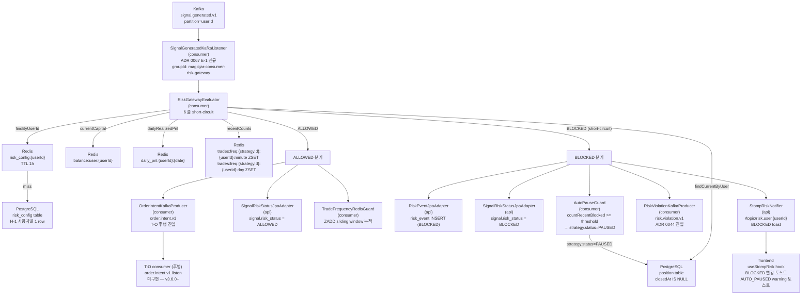

# v3.5.0 데이터 흐름 매트릭스

- baseline: v3.5.0
- 작성일: 2026-05-12
- 작성자: backend-core (bot+backend-core@magicjar.local)
- SoT: `docs/architecture/master-architecture.md` §2 + `settings.gradle.kts` + ADR 0004
- 기준: v3.4.0 02-data-flow.md 전체 이월 + v3.5.0 T-RISK 추가 (ADR 0067 A-1·B-1·C-1·D-1·E-1·F-1·G-1·H-1 채택)

---

## 1. 모듈 의존성 매트릭스

### 1-1. JVM 5 모듈 구성

```
settings.gradle.kts include:
  domain
  pattern-engine
  api
  batch
  consumer
```

| 모듈 | Spring 의존 | JPA 의존 | 역할 |
|------|------------|---------|------|
| `domain` | 0 | 0 | 순수 도메인 + 포트 인터페이스 (Spring·JPA 0 — 헥사고날 내부 링) |
| `pattern-engine` | 0 | 0 | 캔들스틱 패턴 57종 인식 (Pure Kotlin — ADR 0054) |
| `api` | Spring Boot 3.3 | JPA (Hibernate 6) | REST/STOMP + KIS REST 어댑터 + Kafka producer |
| `batch` | Spring Boot 3.3 + Spring Batch | JPA | 종목 마스터 sync + 기업 행위 처리 잡 |
| `consumer` | Spring Boot 3.3 | JPA | Kafka 소비 + KIS WS 브릿지 + 시그널·리스크·주문 dispatch |

### 1-2. 모듈 간 의존 방향

```
domain ←── api
domain ←── consumer
domain ←── batch
pattern-engine ←── api
(domain ← pattern-engine : PatternRecognizer port 참조)
```

- `domain`은 어떤 모듈에도 의존하지 않음 (Spring·JPA import 0건 강제)
- `api`/`consumer`/`batch`는 `domain` 포트 인터페이스를 구현하는 어댑터 배치
- `pattern-engine`은 `domain`의 `PatternRecognizer` 포트 구현체 (`JvmPatternRecognizer`)

### 1-3. v3.5.0 신규 컴포넌트 위치

| 컴포넌트 | 모듈 | 패키지 경로 | ADR 근거 |
|---------|------|-----------|---------|
| `RiskConfig` | `domain` | `domain/.../risk/RiskConfig.kt` | ADR 0067 §5-1 — Pure Kotlin data class |
| `RiskEvent` | `domain` | `domain/.../risk/RiskEvent.kt` | ADR 0067 §5-2 — 위반 이력 |
| `RiskRule` enum (7건) | `domain` | `domain/.../risk/RiskRule.kt` | ADR 0067 §5-2 — POSITION_LIMIT·DAILY_LOSS_LIMIT·MAX_CONCURRENT_POSITIONS·TRADE_FREQUENCY_MINUTE·TRADE_FREQUENCY_DAY·KILL_SWITCH_ON·USER_DISABLED |
| `RiskVerdict` enum | `domain` | `domain/.../risk/RiskVerdict.kt` | ADR 0067 §5-2 — ALLOWED·BLOCKED |
| `RiskGatewayResult` sealed | `domain` | `domain/.../risk/RiskGatewayResult.kt` | ADR 0067 §5-3 — Allowed·Blocked |
| `RiskContext` | `domain` | `domain/.../risk/RiskContext.kt` | ADR 0067 §5-6 — 평가 컨텍스트 집합 |
| `Position` | `domain` | `domain/.../position/Position.kt` | ADR 0067 §5-4 — 현재 보유 포지션 |
| `TradingMode` enum | `domain` | `domain/.../position/TradingMode.kt` | ADR 0067 §5-4 — MOCK·REAL |
| Port: `RiskConfigRepository` | `domain` | `domain/.../risk/port/RiskConfigRepository.kt` | ADR 0067 §5-5 — 헥사고날 포트 (body 0) |
| Port: `RiskEventRepository` | `domain` | `domain/.../risk/port/RiskEventRepository.kt` | ADR 0067 §5-5 — 헥사고날 포트 (body 0) |
| Port: `RiskGateway` | `domain` | `domain/.../risk/port/RiskGateway.kt` | ADR 0067 §5-5 — verdict 결정 본체 |
| Port: `RiskNotifier` | `domain` | `domain/.../risk/port/RiskNotifier.kt` | ADR 0067 §5-5 — STOMP fanout 포트 |
| Port: `SignalRiskStatusUpdater` | `domain` | `domain/.../signal/port/SignalRiskStatusUpdater.kt` | ADR 0067 §5-5 — signal.risk_status 갱신 포트 |
| Port: `PositionRepository` | `domain` | `domain/.../position/port/PositionRepository.kt` | ADR 0067 §5-5 — 헥사고날 포트 (body 0) |
| `SignalGeneratedKafkaListener` | `consumer` | `consumer/.../risk/kafka/SignalGeneratedKafkaListener.kt` | ADR 0067 §7-1 E-1 — signal.generated.v1 listen |
| `RiskGatewayEvaluator` | `consumer` | `consumer/.../risk/RiskGatewayEvaluator.kt` | ADR 0067 §7-1 — 6 룰 short-circuit 평가 |
| `TradeFrequencyRedisGuard` | `consumer` | `consumer/.../risk/TradeFrequencyRedisGuard.kt` | ADR 0067 §7-1 D-1 — Redis ZSET sliding window |
| `DailyPnlCalculator` | `consumer` | `consumer/.../risk/DailyPnlCalculator.kt` | ADR 0067 §7-1 B-1 — 일일 P&L + Redis cache |
| `CapitalSnapshotProvider` | `consumer` | `consumer/.../risk/CapitalSnapshotProvider.kt` | ADR 0067 §7-1 — ADR 0042 잔고 cache 활용 |
| `AutoPauseGuard` | `consumer` | `consumer/.../risk/AutoPauseGuard.kt` | ADR 0067 §7-1 F-1 — 연속 BLOCKED N회 → PAUSED |
| `RiskViolationKafkaProducer` | `consumer` | `consumer/.../risk/kafka/RiskViolationKafkaProducer.kt` | ADR 0067 §7-1 — risk.violation.v1 publish |
| `OrderIntentKafkaProducer` | `consumer` | `consumer/.../risk/kafka/OrderIntentKafkaProducer.kt` | ADR 0067 §7-1 — order.intent.v1 publish |
| `RiskConfigJpaEntity/Repository/Adapter` | `api` | `api/.../persistence/risk/` | ADR 0067 §6-1 V16 |
| `RiskEventJpaEntity/Repository/Adapter` | `api` | `api/.../persistence/risk/` | ADR 0067 §6-2 V17 |
| `PositionJpaEntity/Repository/Adapter` | `api` | `api/.../persistence/position/` | ADR 0067 §6-3 V18 |
| `SignalRiskStatusJpaAdapter` | `api` | `api/.../persistence/signal/SignalRiskStatusJpaAdapter.kt` | ADR 0067 §6-4 V19 — signal.risk_status JPQL UPDATE |
| `RiskConfigService` | `api` | `api/.../application/risk/RiskConfigService.kt` | ADR 0067 H-1 — getOrDefault·save·reset |
| `RiskEventQueryService` | `api` | `api/.../application/risk/RiskEventQueryService.kt` | ADR 0067 §4-2 — 시계열 페이징·단건 |
| `PositionQueryService` | `api` | `api/.../application/position/PositionQueryService.kt` | ADR 0067 §4-3 — current·history |
| `RiskConfigController` | `api` | `api/.../controller/RiskConfigController.kt` | ADR 0067 §4-1 — 3 endpoint |
| `RiskEventController` | `api` | `api/.../controller/RiskEventController.kt` | ADR 0067 §4-2 — 2 endpoint |
| `PositionController` | `api` | `api/.../controller/PositionController.kt` | ADR 0067 §4-3 — 2 endpoint |
| `StompRiskNotifier` | `api` | `api/.../stomp/StompRiskNotifier.kt` | ADR 0067 §7-1 F-1 — /topic/risk.user.{userId} fanout |
| `StrategyDisabledReason.RISK_VIOLATION` | `domain` | `domain/.../strategy/StrategyDisabledReason.kt` | ADR 0067 §7-2 — auto-PAUSE reason 신규 row |

---

## 2. api 모듈 데이터 흐름

### 2-1. REST 엔드포인트 매트릭스

#### 기존 (v3.4.0 이월)

| 경로 | 컨트롤러 | 역할 | Kafka 발행 |
|------|---------|------|-----------|
| `GET /api/watchlists` | `WatchlistController` | 관심종목 목록 (priority ASC) | — |
| `POST /api/watchlists` | `WatchlistController` | 관심종목 등록 | `watchlist.changed.v1` ADDED |
| `DELETE /api/watchlists/{code}` | `WatchlistController` | 관심종목 삭제 | `watchlist.changed.v1` REMOVED |
| `GET /api/symbols/{code}` | `SymbolController` | 현재가·PER·PBR·시총·업종 | — |
| `GET /api/symbols/{code}/candles` | `SymbolController` | 캔들 시계열 (DB + Redis merge) | — |
| `POST /api/symbols/{code}/orderbook/subscribe` | `SymbolController` | 호가 구독 시작 | `symbol.detail.command.v1` ENTER |
| `POST /api/symbols/{code}/orderbook/unsubscribe` | `SymbolController` | 호가 구독 해제 | `symbol.detail.command.v1` EXIT |
| `GET /api/patterns` | `PatternController` | 57종 패턴 인식 | — |
| `GET /api/indicators` | `IndicatorController` | 80종 기술적 지표 | — |
| `GET /api/instruments` | `InstrumentController` | 종목 검색 (Redis 인덱스) | — |
| `POST /api/backtest/run` | `BacktestController` | DSL 전략 백테스트 (stateless, ADR 0056) | — |
| `POST /api/onboarding` | `OnboardingController` | KIS 키 등록 + AES 암호화 | — |
| `POST /api/ai/dsl/translate` | `DslTranslateController` | 자연어 → DSL 변환 (AI 보조) | — |

#### v3.3.1 T-BT 결과 영속 (ADR 0061 이월)

| 경로 | 컨트롤러 | 역할 |
|------|---------|------|
| `POST /api/backtests` | `BacktestsController` | 백테스트 실행 + 영속 |
| `GET /api/backtests` | `BacktestsController` | 사용자 목록 (페이징) |
| `GET /api/backtests/{id}` | `BacktestsController` | 단건 메타 + KPI |
| `GET /api/backtests/{id}/result` | `BacktestsController` | 거래·포지션 시계열 (페이징) |
| `DELETE /api/backtests/{id}` | `BacktestsController` | 삭제 (CASCADE) |

#### v3.4.0 T-SIG Strategy + Signal (ADR 0066 이월)

| 경로 | 컨트롤러 | 역할 |
|------|---------|------|
| `POST /api/strategies` | `StrategiesController` | 룰 등록 |
| `GET /api/strategies` | `StrategiesController` | 사용자 룰 목록 (페이징) |
| `GET /api/strategies/{id}` | `StrategiesController` | 단건 + metric summary |
| `PUT /api/strategies/{id}` | `StrategiesController` | 전략 수정 |
| `DELETE /api/strategies/{id}` | `StrategiesController` | soft delete |
| `PUT /api/strategies/{id}/toggle` | `StrategiesController` | status 토글 |
| `GET /api/signals` | `SignalController` | 시그널 시계열 (페이징) |
| `GET /api/signals/{id}` | `SignalController` | 단건 |

#### v3.5.0 T-RISK Risk + Position (ADR 0067 — Phase 2 신규)

| 경로 | 컨트롤러 | 역할 |
|------|---------|------|
| `GET /api/risk-config` | `RiskConfigController` | 사용자 risk 설정 조회 (부재 시 default seed 반환 — H-1) |
| `PUT /api/risk-config` | `RiskConfigController` | 사용자 risk 설정 갱신 (upsert) |
| `POST /api/risk-config/reset` | `RiskConfigController` | default 값으로 reset |
| `GET /api/risk-events` | `RiskEventController` | 위반 이력 시계열 페이징 (`?userId&strategyId&rule&verdict&from&to`) |
| `GET /api/risk-events/{id}` | `RiskEventController` | 위반 이력 단건 |
| `GET /api/positions/current` | `PositionController` | 현재 보유 포지션 목록 |
| `GET /api/positions/history` | `PositionController` | 청산 이력 페이징 |

총 7 endpoint — ADR 0067 §4 전체 정합.

### 2-2. STOMP 구독 토픽 (api Kafka Consumer → 브라우저 fanout)

#### 기존 3종 (v3.2.2 이월)

| Kafka 토픽 (소비) | STOMP 토픽 (발행) | 포워더 클래스 | 설명 |
|-----------------|----------------|-------------|------|
| `market.tick.v1` | `/topic/market.tick.{code}` | `MarketTickStompForwarder` | 실시간 체결가 (1초 throttle) |
| `market.candle.minute.closed.v1` | `/topic/market.candle.minute.{code}` | `MarketCandleStompForwarder` | 1분봉 closing |
| `market.orderbook.v1` | `/topic/market.orderbook.{code}` | `MarketOrderbookStompForwarder` | 호가 스냅샷 |

#### boundary 5종 (v3.3.0 — ADR 0064 C-1)

| Kafka 토픽 (소비) | STOMP 토픽 (발행) | 리스너 클래스 | 설명 |
|-----------------|----------------|------------|------|
| `market.candle.5m.closed.v1` | `/topic/market.candle.5m.{code}` | `CandleClosedStompListener` | 5분봉 boundary closing |
| `market.candle.15m.closed.v1` | `/topic/market.candle.15m.{code}` | `CandleClosedStompListener` | 15분봉 boundary closing |
| `market.candle.30m.closed.v1` | `/topic/market.candle.30m.{code}` | `CandleClosedStompListener` | 30분봉 boundary closing |
| `market.candle.90m.closed.v1` | `/topic/market.candle.90m.{code}` | `CandleClosedStompListener` | 90분봉 boundary closing |
| `market.candle.1h.closed.v1` | `/topic/market.candle.1h.{code}` | `CandleClosedStompListener` | 60분봉 boundary closing |

#### v3.4.0 신규 1종 (ADR 0066 D-1)

| Kafka 토픽 (소비) | STOMP 토픽 (발행) | 리스너 클래스 | 설명 |
|-----------------|----------------|------------|------|
| `signal.generated.v1` | `/topic/signal.user.{userId}` | `StompSignalDispatcher` | 시그널 발행 → userId별 토스트 알림 |

#### v3.5.0 신규 1종 (ADR 0067 F-1 — T-RISK STOMP fanout)

| Kafka 토픽 (소비) | STOMP 토픽 (발행) | 리스너 클래스 | 설명 |
|-----------------|----------------|------------|------|
| `risk.violation.v1` | `/topic/risk.user.{userId}` | `StompRiskNotifier` | 리스크 위반 BLOCKED·AUTO_PAUSED → userId별 토스트 |

userId 단위 격리 — BLOCKED 알림이 다른 사용자에게 누설 0 (ADR 0010 multi-tenant).
STOMP 2 event type: `BLOCKED` (개별 위반) · `AUTO_PAUSED` (연속 N회 → strategy 자동 PAUSED).

### 2-3. api 모듈 내부 서비스 레이어

```
RiskConfigController  → RiskConfigService        → RiskConfigJpaAdapter  → risk_config table
RiskEventController   → RiskEventQueryService     → RiskEventJpaAdapter   → risk_event table
PositionController    → PositionQueryService      → PositionJpaAdapter    → position table
StompRiskNotifier     ← Kafka (risk.violation.v1) → SimpMessagingTemplate → STOMP (userId)
SignalRiskStatusJpaAdapter ← SignalGeneratedKafkaListener(consumer) 호출 → signal.risk_status UPDATE
```

---

## 3. consumer 모듈 데이터 흐름

### 3-1. Kafka 토픽 소비 매트릭스

#### 기존 (v3.3.0 이월)

| 토픽 | 리스너 클래스 | groupId | 처리 내용 |
|------|------------|---------|----------|
| `watchlist.changed.v1` | `WatchlistChangedKafkaListener` | `magicjar-consumer-watchlist-ingestion` | ADDED: cold-start 트리거 + WS/polling 구독 / REMOVED: 구독 해제 + Redis evict |
| `symbol.detail.command.v1` | `SymbolDetailCommandKafkaListener` | `magicjar-consumer-orderbook-cmd` | ENTER: H0STASP0 구독 slot 할당 / EXIT: slot 회수 |

#### v3.4.0 신규 5종 (ADR 0066 A-1 — boundary 시그널 평가)

| 토픽 | 리스너 클래스 | groupId | 처리 내용 |
|------|------------|---------|----------|
| `market.candle.5m.closed.v1` | `BoundaryClosingKafkaListener` | `magicjar-consumer-signal-5m` | 5m boundary → 활성 strategy 평가 → 시그널 발행 |
| `market.candle.15m.closed.v1` | `BoundaryClosingKafkaListener` | `magicjar-consumer-signal-15m` | 15m boundary → 평가 → 발행 |
| `market.candle.30m.closed.v1` | `BoundaryClosingKafkaListener` | `magicjar-consumer-signal-30m` | 30m boundary → 평가 → 발행 |
| `market.candle.90m.closed.v1` | `BoundaryClosingKafkaListener` | `magicjar-consumer-signal-90m` | 90m boundary → 평가 → 발행 |
| `market.candle.1h.closed.v1` | `BoundaryClosingKafkaListener` | `magicjar-consumer-signal-1h` | 1h boundary → 평가 → 발행 |

#### v3.5.0 신규 1종 (ADR 0067 E-1 — Risk Gateway)

| 토픽 | 리스너 클래스 | groupId | 처리 내용 |
|------|------------|---------|----------|
| `signal.generated.v1` | `SignalGeneratedKafkaListener` | `magicjar-consumer-risk-gateway` | signal → RiskGatewayEvaluator 6 룰 평가 → ALLOWED: order.intent.v1 publish / BLOCKED: risk.violation.v1 publish + signal.risk_status UPDATE |

partition key = userId (동일 사용자 순차 처리 — race condition 0).

### 3-2. KIS WS 브릿지 흐름 (v3.3.0 이월)

```
KIS WebSocket (wss://ops.koreainvestment.com:21000)
    ↓  H0STCNT0 (체결가 tick)
KisWebSocketBridge
    ├── writeToRedis(quote:last:{code}, 등락 필드 포함)   ← ADR 0029
    ├── publishTickEvent → Kafka market.tick.v1
    └── STCK_CNTG_HOUR 추출 → BoundaryAggregator.onTick(code, hhmmss)
           ↓  (ADR 0064 B-1 in-process 검사)
    BoundaryDetector.detectBoundary(hhmmss) → List<CandleInterval>

    KIS WebSocket
    ↓  H0STASP0 (호가 스냅샷)
KisWebSocketBridge
    └── publishOrderbook → Kafka market.orderbook.v1
```

KIS-first raw 출처: H0STCNT0 `ccnl_krx()` 44 cols — `[1]` STCK_CNTG_HOUR (`domestic_stock_functions_ws.py`)

### 3-3. Signal → Risk Gateway 흐름 (v3.5.0 신규 — ADR 0067 E-1)

```
Kafka signal.generated.v1 (partition by userId)
    ↓
SignalGeneratedKafkaListener.onMessage(signalPayload)
    ├─ signal payload deserialize (signalId · userId · strategyId · code · interval · side · strength · ...)
    └─ RiskGatewayEvaluator.evaluate(signal)
         ↓
    1. RiskConfigRepository.findByUserId(userId)
       └─ 부재 시 RiskConfig.defaultFor(userId, now) seed (H-1)
    2. RiskContext 빌드:
       ├── CapitalSnapshotProvider.currentCapital(userId)  → Redis balance:user:{userId} cache → DB
       ├── PositionRepository.findCurrentByUser(userId)    → position table (closedAt IS NULL)
       ├── DailyPnlCalculator.dailyRealizedPnl(userId)    → Redis daily_pnl:{userId}:{date} cache
       ├── TradeFrequencyRedisGuard.recentCounts(strategyId, userId)
       │       → trades:freq:{strategyId}:{userId}:minute ZSET
       │       → trades:freq:{strategyId}:{userId}:day ZSET
       └── KillSwitchRepository.isOn(userId)               (ADR 0043 정합)
    3. 6 룰 순차 평가 (short-circuit, 첫 BLOCKED 시 즉시 반환):
       a. KILL_SWITCH_ON
       b. DAILY_LOSS_LIMIT     — dailyRealizedPnl <= -limit 시 BLOCKED
       c. MAX_CONCURRENT_POSITIONS — currentPositions.size >= maxConcurrentPositions (BUY only)
       d. TRADE_FREQUENCY_MINUTE — recentTradesMinute >= maxTradesPerMinute
       e. TRADE_FREQUENCY_DAY   — recentTradesDay >= maxTradesPerDay
       f. POSITION_LIMIT        — priceAtSignal × qty > min(maxPositionAmount, capital × percent%)
    4. RiskGatewayResult 분기:
       - Allowed:
           → SignalRiskStatusUpdater.markAllowed(signalId)   (signal.risk_status = 'ALLOWED')
           → TradeFrequencyRedisGuard.consume(strategyId, userId, signalId, ts)
           → OrderIntentKafkaProducer.publish(order.intent.v1, key=userId)  ← T-O 후행 진입
       - Blocked:
           → RiskEventRepository.save(RiskEvent(rule, BLOCKED, reason, contextJson))
           → SignalRiskStatusUpdater.markBlocked(signalId, rule, reason) (signal.risk_status = 'BLOCKED')
           → StompRiskNotifier.notifyViolation(userId, riskEvent)   → /topic/risk.user.{userId}
           → RiskViolationKafkaProducer.publish(risk.violation.v1, key=userId)  ← ADR 0044
           → AutoPauseGuard.checkAndPauseIfNeeded(strategyId):
               └─ countRecentBlockedByStrategy(strategyId, 10min) >= autoPauseThreshold
                   ├─ Strategy.status = PAUSED + reason = RISK_VIOLATION
                   ├─ StompRiskNotifier.notifyAutoPaused(userId, strategyId)
                   └─ RedisStrategyCache.invalidate(codes, intervals)
```

### 3-4. BoundaryAggregator → SignalEngine 연결 흐름 (v3.4.0 이월)

```
BoundaryAggregator.onTickClosed(code, tickTs)
    ↓  (ADR 0064 B-1)
BoundaryDetector → boundary 5종 Kafka 발행
    ↓
market.candle.{interval}.closed.v1 (5종)
    ↓
BoundaryClosingKafkaListener (5 listener, consumer)
    ↓
RealtimeSignalGenerator.evaluate(code, interval, candle)
    ├── StrategyLookupPort → RedisStrategyCache (TTL 5분) → miss → DB
    ├── JvmStrategyEvaluator.evaluate() — ADR 0047 sandbox timeout 100ms
    │       BUY/SELL → SignalDedupeGuard → Redis SETNX 30s
    │               → SignalKafkaProducer → signal.generated.v1
    │                                         ↓
    │                               SignalJpaAdapter (api) → signal table INSERT
    │                               StompSignalDispatcher (api) → /topic/signal.user.{userId}
    │                               SignalGeneratedKafkaListener (consumer) → RiskGatewayEvaluator (v3.5.0 신규)
    └── HOLD → skip
```

### 3-5. BoundaryAggregator 흐름 (v3.3.0 이월 — ADR 0064 §4-3)

```
BoundaryAggregator.onTickClosed(code, tickTs)
    ↓
BoundaryDetector.detectBoundary(hhmmss) → List<CandleInterval>
    ↓
boundary 도달 시 interval별 순차 처리:
    FOR target IN detected:
        1. in-process 중복 가드 (lastProcessedBoundaryMin ConcurrentHashMap)
        2. DB 직전 N건 1m 캔들 fetch
        3. CandleAggregator.aggregate(rows, target) → Candle
        4. RedisCandleCache.putBoundaryCandle(code, target, candle)
        5. DB candle table INSERT (ON CONFLICT DO NOTHING)
        6. Kafka publish market.candle.{target}.closed.v1
```

### 3-6. cold-start 흐름 (v3.3.0 이월)

```
WatchlistChangedKafkaListener (ADDED)
    ↓  DB count 0이면 cold-start submit
ColdStartExecutor (thread pool=2)
    ├── KIS REST FHKST03010230 → 1m (30 거래일)
    ├── KIS REST FHKST03010100 → 1d·1wk·1mo·1y
    └── AggregateBackfillRunner.backfill(code)
```

### 3-7. consumer 부팅 bootstrap (v3.3.0 이월)

```
CandleBootstrapRunner (@ApplicationReadyEvent)
    ↓  watchlist 전 종목 순회
    ├── count(1m) < 700 → ColdStartExecutor.submit(code)
    └── count(5m) == 0 && count(1m) >= 700 → AggregateBackfillRunner.backfill(code)

PositionBootstrapRunner (@ApplicationReadyEvent)
    └── KIS REST balance → Position DB 동기화 (ADR 0042)
```

### 3-8. DailyCloseFinalizer (v3.3.0 이월)

```
20:00 KST (NXT after-hour 마감 — ADR 0063)
    ↓
DailyCloseFinalizer
    ├── watchlist 전 종목 AggregateBackfillRunner.backfill(code) — safety net
    ├── Redis candle:current:{code}:5m~1h evict
    └── Redis daily_pnl:{userId}:{date} evict (KST 자정 reset — B-1)
         + strategy cache invalidateAll (ADR 0066 safety net)
```

---

## 4. batch 모듈 데이터 흐름 (v3.3.0 이월)

### 4-1. Spring Batch 잡 매트릭스

| 잡 클래스 | 스케줄 | 역할 | KIS 엔드포인트 |
|----------|-------|------|--------------|
| `InstrumentSyncJob` | `InstrumentMasterSyncScheduler` | 종목 마스터 전체 sync (KOSPI·KOSDAQ) | `CTPF1002R` |
| `MarketCalendarSyncJob` | — | 영업일 캘린더 sync | `CTCA0903R` |
| `CorpActionSyncJob` | — | 기업 행위(분할·배당) sync | HHKDB669100C0~HHKDB669106C0 (6종) |
| `CandleAdjustmentJob` | `CorpActionSyncJob` 후속 | 수정 주가 소급 조정 | — |

### 4-2. batch 모듈 Kafka 발행

| 잡 | 발행 토픽 | 파티션 키 | 내용 |
|----|---------|---------|------|
| `InstrumentSyncJob` | `instrument.updated.v1` | market | 종목 마스터 변경 이벤트 |
| `CorpActionSyncJob` | `corp_action.applied.v1` | instrumentCode | 기업 행위 적용 이벤트 |

---

## 5. DB 테이블 매트릭스 (Flyway — v3.5.0 누적)

| 테이블 | Flyway | 신규 시점 | 역할 |
|-------|--------|---------|------|
| `user_kis_credential` | V1 | v3.0 | KIS 키 AES 암호화 영속 |
| `watchlist_entry` | V1 | v3.0 | 관심종목 (UQ user_id, code) |
| `position` (v3.0 기존) | V1 | v3.0 | 보유 포지션 (V18에서 T-RISK 확장 — ALTER) |
| `candle` | V1 | v3.0 | 캔들 시계열 (UQ code+interval+ts) |
| `instrument` | V4 | v3.0 | 종목 마스터 (KOSPI·KOSDAQ) |
| `market_calendar` | V6 | v3.0 | 영업일 캘린더 |
| `corp_action` | V7 | v3.0 | 기업 행위 이력 |
| `strategy` | V9 | v3.1 | DSL 전략 (V14에서 status·codes·intervals 확장) |
| `strategy_eval_metric` | V11 | v3.2 | sandbox 평가 metric ring buffer |
| `backtest_run` | V12 | v3.3.1 | 백테스트 실행 메타 + KPI (ADR 0061) |
| `backtest_trade` | V13 | v3.3.1 | 백테스트 매매 기록 시계열 |
| `backtest_position` | V13 | v3.3.1 | 백테스트 포지션 기록 |
| `strategy` (확장) | V14 | v3.4.0 | status 4단·codes·intervals JSONB + paused_at·disabled_at·deleted_at |
| `signal` | V15 | v3.4.0 | T-SIG 시그널 영속 (UQ strategy_id+code+interval+ts) |
| `risk_config` | V16 | **v3.5.0** | 사용자별 risk 설정 (ADR 0067 §6-1 H-1 — PRIMARY KEY user_id) |
| `risk_event` | V17 | **v3.5.0** | 리스크 위반 이력 (ADR 0067 §6-2 G-1 — BLOCKED only 영속) |
| `position` (V18 ALTER) | V18 | **v3.5.0** | position 컬럼 확장 — realized_pnl·unrealized_pnl·mode·updated_at 추가 (ADR 0042 baseline 정합) |
| `signal` (V19 ALTER) | V19 | **v3.5.0** | `risk_status` 컬럼 추가 — PENDING·ALLOWED·BLOCKED (ADR 0067 §6-4 F-1) |

### 5-1. risk_config 컬럼 요약 (ADR 0067 §6-1 V16 — v3.5.0)

```sql
-- Flyway V16
user_id PRIMARY KEY VARCHAR(40),
max_position_amount       NUMERIC(15,2) NOT NULL,      -- 절대 포지션 한도 (A-1)
max_position_percent      NUMERIC(7,4) NOT NULL,       -- 자본 비율 % (A-1)
daily_loss_limit_amount   NUMERIC(15,2),               -- 일일 손실 한도 절대 (B-1, XOR with percent)
daily_loss_limit_percent  NUMERIC(7,4),                -- 일일 손실 한도 % (B-1)
max_concurrent_positions  INT NOT NULL DEFAULT 5,      -- 동시 보유 종목 한도 (C-1)
max_trades_per_minute     INT NOT NULL DEFAULT 3,      -- strategy당 분당 한도 (D-1)
max_trades_per_day        INT NOT NULL DEFAULT 50,     -- strategy당 일별 한도 (D-1)
auto_pause_threshold      INT NOT NULL DEFAULT 10,     -- auto-PAUSE 연속 BLOCKED 임계 (F-1)
created_at, updated_at TIMESTAMPTZ
```

DEFAULT seed: maxPositionAmount=1,000,000원 · maxPositionPercent=10% · dailyLossLimitPercent=3% · maxConcurrentPositions=5 · maxTradesPerMinute=3 · maxTradesPerDay=50 · autoPauseThreshold=10

### 5-2. risk_event 컬럼 요약 (ADR 0067 §6-2 V17 — v3.5.0)

```sql
-- Flyway V17
id BIGSERIAL PRIMARY KEY,
user_id       VARCHAR(40) NOT NULL,
signal_id     BIGINT REFERENCES signal(id) ON DELETE SET NULL,
strategy_id   BIGINT REFERENCES strategy(id) ON DELETE SET NULL,
rule          VARCHAR(32) NOT NULL,   -- POSITION_LIMIT · DAILY_LOSS_LIMIT · MAX_CONCURRENT_POSITIONS · TRADE_FREQUENCY_MINUTE · TRADE_FREQUENCY_DAY · KILL_SWITCH_ON · USER_DISABLED
verdict       VARCHAR(8) NOT NULL,    -- ALLOWED · BLOCKED (BLOCKED only 영속 권장 — §9-1)
reason        TEXT NOT NULL,
context_json  JSONB,
created_at    TIMESTAMPTZ NOT NULL DEFAULT now()
```

index: `idx_risk_event_user_ts (user_id, created_at DESC)` · `idx_risk_event_strategy_blocked_recent (strategy_id, created_at DESC) WHERE verdict='BLOCKED'` · `idx_risk_event_signal (signal_id)`

### 5-3. position 확장 컬럼 요약 (ADR 0067 §6-3 V18 ALTER — v3.5.0)

```sql
-- Flyway V18 (ALTER TABLE position — V1 CREATE baseline 보존, 컬럼 추가만)
ADD COLUMN realized_pnl    NUMERIC(15,4) NOT NULL DEFAULT 0,
ADD COLUMN unrealized_pnl  NUMERIC(15,4),
ADD COLUMN mode            VARCHAR(8) NOT NULL DEFAULT 'MOCK',  -- MOCK · REAL (ADR 0011)
ADD COLUMN updated_at      TIMESTAMPTZ NOT NULL DEFAULT now()
```

index: `idx_position_user_current (user_id) WHERE closed_at IS NULL` · `idx_position_user_code_open (user_id, code) WHERE closed_at IS NULL` · `idx_position_user_closed_ts (user_id, closed_at DESC) WHERE closed_at IS NOT NULL`

### 5-4. signal.risk_status 컬럼 요약 (ADR 0067 §6-4 V19 ALTER — v3.5.0)

```sql
-- Flyway V19 (ALTER TABLE signal)
ADD COLUMN risk_status VARCHAR(16) NOT NULL DEFAULT 'PENDING';
-- PENDING (T-RISK 게이트 미통과 또는 v3.4.0 이전 row) · ALLOWED · BLOCKED
CREATE INDEX idx_signal_user_risk_ts ON signal (user_id, risk_status, ts DESC);
```

기존 signal row = default 'PENDING' (소급 갱신 0). 신규 signal은 RiskGatewayEvaluator 통과 시 ALLOWED 또는 BLOCKED로 갱신.

---

## 6. Redis 키 매트릭스 (v3.5.0 누적)

### 6-1. 기존 키 (v3.2.2 이월)

| Redis 키 패턴 | 데이터 | 갱신 | TTL |
|--------------|-------|------|-----|
| `quote:last:{code}` | 현재가·등락 JSON | KIS WS tick | 7일 |
| `candle:current:{code}:1m` | 당일 진행 중 1분봉 | KIS WS tick | 1분 closing 시 evict |
| `candle:today:{code}:1d` | 당일 일봉 진행 중 | DailyCloseFinalizer | 당일 마감 evict |
| `indicator:cache:{code}:{interval}:{name}:{paramsHash}` | 기술적 지표 결과 | IndicatorService | 분봉 300s / 일봉+ 86400s |
| `pattern:cache:{code}:{interval}:{...}` | 패턴 인식 결과 | PatternController | 분봉 300s / 일봉+ 86400s |
| `watchlist:source:{userId}` | data source 매트릭스 | SubscriptionRouter | — |
| `instrument:search:idx` | 종목 검색 인덱스 | InstrumentSyncJob | — |

### 6-2. v3.3.0 boundary 캐시 5종 (ADR 0064 A-1)

| Redis 키 패턴 | 데이터 | TTL |
|--------------|-------|-----|
| `candle:current:{code}:5m` | 당일 5m bar | 25h |
| `candle:current:{code}:15m` | 당일 15m bar | 25h |
| `candle:current:{code}:30m` | 당일 30m bar | 25h |
| `candle:current:{code}:90m` | 당일 90m bar | 25h |
| `candle:current:{code}:1h` | 당일 1h bar | 25h |

### 6-3. v3.4.0 신규 키 (ADR 0066 §2-5 — T-SIG)

| Redis 키 패턴 | 데이터 | TTL |
|--------------|-------|-----|
| `strategy:active:by_code:{code}:{interval}` | ACTIVE 전략 목록 JSON | 5분 |
| `sigdedupe:{strategyId}:{code}:{interval}:{ts}` | 중복 시그널 SETNX 가드 | 30s |

### 6-4. v3.5.0 신규 키 (ADR 0067 §9-4 — T-RISK)

| Redis 키 패턴 | 자료구조 | 데이터 | 갱신 | TTL |
|--------------|---------|-------|------|-----|
| `trades:freq:{strategyId}:{userId}:minute` | ZSET (sliding window) | 최근 1분 내 trade signalId + ts | TradeFrequencyRedisGuard.consume() 시 ZADD + ZREMRANGEBYSCORE | 60s window (entry 자동 만료) |
| `trades:freq:{strategyId}:{userId}:day` | ZSET (sliding window) | 당일 trade signalId + ts | 동상 | 86400s window |
| `daily_pnl:{userId}:{date}` | STRING | KST 자정~현재 누적 realized P&L | DailyPnlCalculator 호출 시 SETEX | KST 자정까지 TTL |
| `balance:user:{userId}` | STRING | 사용자 잔고 (ADR 0042 Bootstrap 동기) | PositionBootstrapRunner 부팅 + 청산 이벤트 시 | 1h (CapitalSnapshotProvider cache) |

`trades:freq` ZSET 사유: Redis ZADD + ZRANGEBYSCORE O(log N) 단순. strategy 10 × 사용자 N × 2 키 = <500KB (§9-4).

---

## 7. Kafka 토픽 전체 매트릭스

### 7-1. 기존 7종 (v3.2.2 이월)

| 토픽 | 파티션 | retention | 발행자 | 소비자 |
|------|--------|----------|-------|-------|
| `market.tick.v1` | 1 | 1h | `KisWebSocketBridge` (consumer) | `MarketTickStompForwarder` (api) |
| `market.candle.minute.closed.v1` | 1 | 1d | `TickToMinuteAggregator` (consumer) | `MarketCandleStompForwarder` (api) |
| `market.orderbook.v1` | 1 | 1h | `KisWebSocketBridge` (consumer) | `MarketOrderbookStompForwarder` (api) |
| `symbol.detail.command.v1` | 1 | 1h | `SymbolController` (api) | `SymbolDetailCommandKafkaListener` (consumer) |
| `watchlist.changed.v1` | 1 | 7d | `WatchlistService` (api) | `WatchlistChangedKafkaListener` (consumer) |
| `instrument.updated.v1` | 1 | 7d | `InstrumentSyncJob` (batch) | `InstrumentUpdatedKafkaPublisher` (consumer) |
| `corp_action.applied.v1` | 1 | 1d | `CorpActionSyncJob` (batch) | `CandleAdjustmentJob` (batch 내부) |

### 7-2. v3.3.0 신규 5종 (ADR 0064 — boundary closed)

| 토픽 | 파티션 | retention | 발행자 | 소비자 |
|------|--------|----------|-------|-------|
| `market.candle.5m.closed.v1` | 1 | 1d | `BoundaryAggregator` (consumer) | `CandleClosedStompListener` (api) + `BoundaryClosingKafkaListener` (consumer) |
| `market.candle.15m.closed.v1` | 1 | 1d | `BoundaryAggregator` (consumer) | 동상 |
| `market.candle.30m.closed.v1` | 1 | 1d | `BoundaryAggregator` (consumer) | 동상 |
| `market.candle.90m.closed.v1` | 1 | 1d | `BoundaryAggregator` (consumer) | 동상 |
| `market.candle.1h.closed.v1` | 1 | 1d | `BoundaryAggregator` (consumer) | 동상 |

### 7-3. v3.4.0 신규 1종 (ADR 0066 — signal 발행)

| 토픽 | 파티션 | retention | 발행자 | 소비자 |
|------|--------|----------|-------|-------|
| `signal.generated.v1` | 1 | 7d | `SignalKafkaProducer` (consumer) | `StompSignalDispatcher` (api) + `SignalJpaAdapter` (api) + `SignalGeneratedKafkaListener` (consumer, v3.5.0 추가) |

### 7-4. v3.5.0 신규 2종 (ADR 0067 — Risk Gateway)

| 토픽 | 파티션 | retention | 발행자 | 소비자 |
|------|--------|----------|-------|-------|
| `risk.violation.v1` | 1 | 7d | `RiskViolationKafkaProducer` (consumer) | `StompRiskNotifier` (api) — BLOCKED·AUTO_PAUSED STOMP fanout. ADR 0044 Notification 후행 진입 |
| `order.intent.v1` | 1 | 7d | `OrderIntentKafkaProducer` (consumer) | T-O 후행 consumer (미구현 — v3.6.0+ 진입 예정) |

partition key = userId (사용자 격리 — ADR 0010 multi-tenant).
retention 7d — risk audit trail + order intent audit.

`risk.violation.v1` payload schema:
```json
{
  "riskEventId": 456,
  "userId": "user001",
  "signalId": 12345,
  "strategyId": 1,
  "rule": "DAILY_LOSS_LIMIT",
  "verdict": "BLOCKED",
  "reason": "Daily loss limit reached: -3.2% >= -3.0% threshold",
  "contextJson": "{\"dailyPnl\": -32000, \"limit\": -30000, \"capital\": 1000000}",
  "createdAt": "2026-05-12T10:15:30.456+09:00"
}
```

`order.intent.v1` payload schema:
```json
{
  "signalId": 12345,
  "userId": "user001",
  "strategyId": 1,
  "code": "005930",
  "side": "BUY",
  "priceAtSignal": 78200.0,
  "riskVerdict": "ALLOWED",
  "createdAt": "2026-05-12T10:15:30.456+09:00"
}
```

---

## 8. Mermaid 데이터 흐름 (T-RISK — Signal → 6 룰 short-circuit → ALLOWED/BLOCKED 분기)



---

## 9. boundary 시각 매트릭스 (v3.3.0 이월 — ADR 0062·0063)

| Interval | boundary 시각 (KST) | bar/일 | Redis 키 TTL |
|----------|-------------------|-------|------------|
| 5m | 08:05·08:10·…·19:55·20:00 | 144 | 25h |
| 15m | 08:15·08:30·…·19:45·20:00 | 48 | 25h |
| 30m | 08:30·09:00·…·19:30·20:00 | 24 | 25h |
| 90m | 09:30·11:00·12:30·14:00·15:30·17:00·18:30·20:00 | 8 | 25h |
| 1h | 09:00·10:00·…·19:00·20:00 | 12 | 25h |

T-RISK 부하 예측 (ADR 0067 §9-2): signal ~1,000/day → BLOCKED ~200 (20%) → risk_event ~200 row/day = 70K/year (5MB). `order.intent.v1` ~800 msg/day (0.0093 msg/s).

---

## 10. ADR 정합 참조

| ADR | 관련 흐름 |
|-----|---------|
| ADR 0004 | 모듈 경계 결정 (domain·api·batch·consumer + pattern-engine) |
| ADR 0007 | Kafka 이벤트 backbone — risk.violation.v1·order.intent.v1 신규 포함 |
| ADR 0010 | Multi-tenant — userId 격리 (risk_config·risk_event·position·/topic/risk.user.{userId}) |
| ADR 0019 | 캔들 저장 정책 |
| ADR 0021 | Indicator Source 추상화 |
| ADR 0022 | KIS Strategy Builder 호환 DSL |
| ADR 0023 | Signal Engine 룰 온리 — AI 호출 0 (T-RISK 동일 정책 계승) |
| ADR 0024 | Risk Guard chain 6단 골격 (T-RISK의 W3 구현 권위) |
| ADR 0028 | Watchlist 기반 Ingestion Worker |
| ADR 0029 | 당일 진행 중 캔들 Redis 캐시 |
| ADR 0037 | KIS Rate Limit (T-RISK KIS REST 직접 호출 0건 확인) |
| ADR 0042 | Position Bootstrap — balance:user:{userId} cache 활용 + PositionBootstrapRunner |
| ADR 0043 | KillSwitch — KILL_SWITCH_ON 룰 정합 |
| ADR 0044 | Notification System — risk.violation.v1 publish → Slack 후행 진입점 |
| ADR 0045 | Graceful Shutdown — SignalGeneratedKafkaListener container SmartLifecycle |
| ADR 0047 | DSL Evaluation Sandbox (T-RISK risk-eval-pool 불필요 — deterministic 룰 <20ms) |
| ADR 0051 | Spring Data Repository default fun 함정 (RiskConfigJpaRepository·RiskEventJpaRepository·PositionJpaRepository body 0) |
| ADR 0054 | pattern-engine 모듈 분리 |
| ADR 0056 | 백테스트 엔진 (stateless — T-RISK 무관) |
| ADR 0057 | KIS-only 데이터 출처 (T-RISK KIS REST/WS 직접 호출 0건) |
| ADR 0061 | Backtest 결과 영속 패턴 (3 테이블 + REST 5 endpoint — T-RISK 패턴 baseline) |
| ADR 0062 | 5m~1h 합산 가공 (boundary 트리거 → 시그널 → T-RISK 체인) |
| ADR 0063 | NXT 통합 거래시간 (boundary 시각 08:00~20:00) |
| ADR 0064 | Redis boundary fanout (시그널 → T-RISK 체인 진입점) |
| ADR 0066 | T-SIG 실시간 시그널 엔진 (signal.generated.v1 → T-RISK listen) |
| ADR 0067 | **T-RISK 리스크 관리 게이트 (A-1·B-1·C-1·D-1·E-1·F-1·G-1·H-1 채택 — v3.5.0 신규 권위)** |
