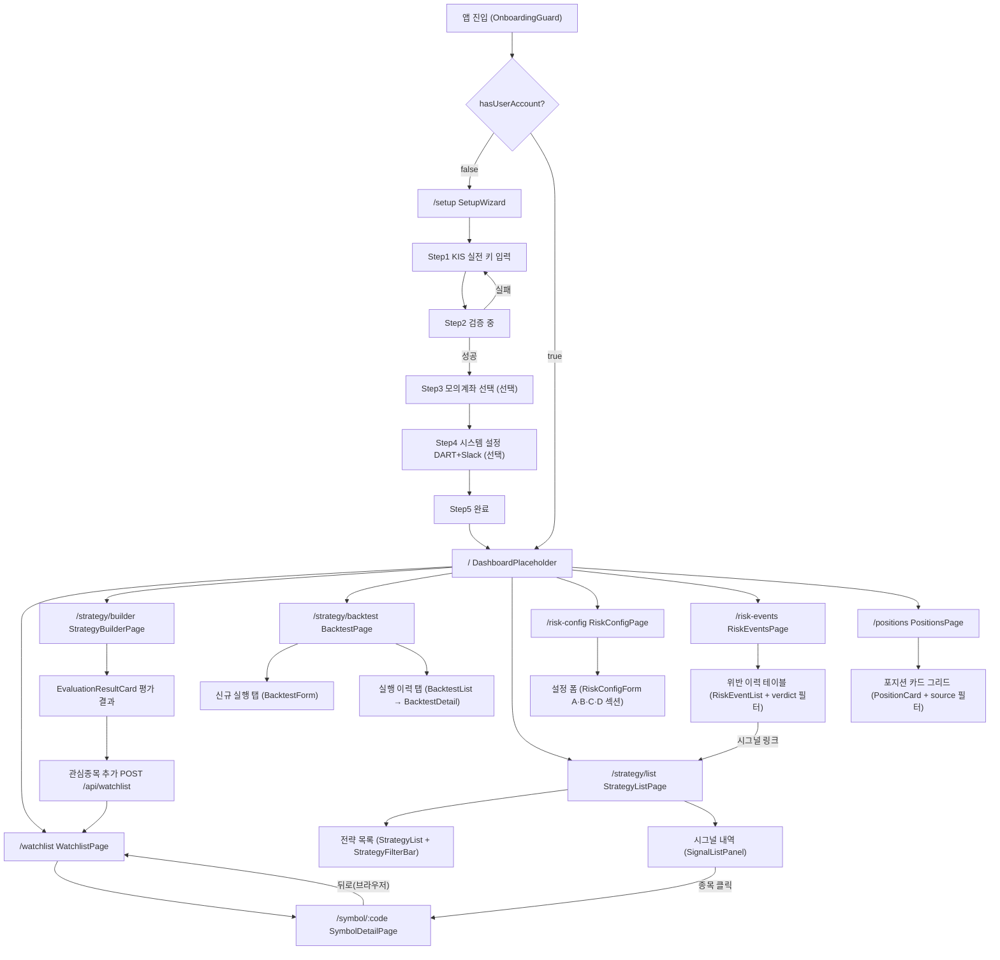
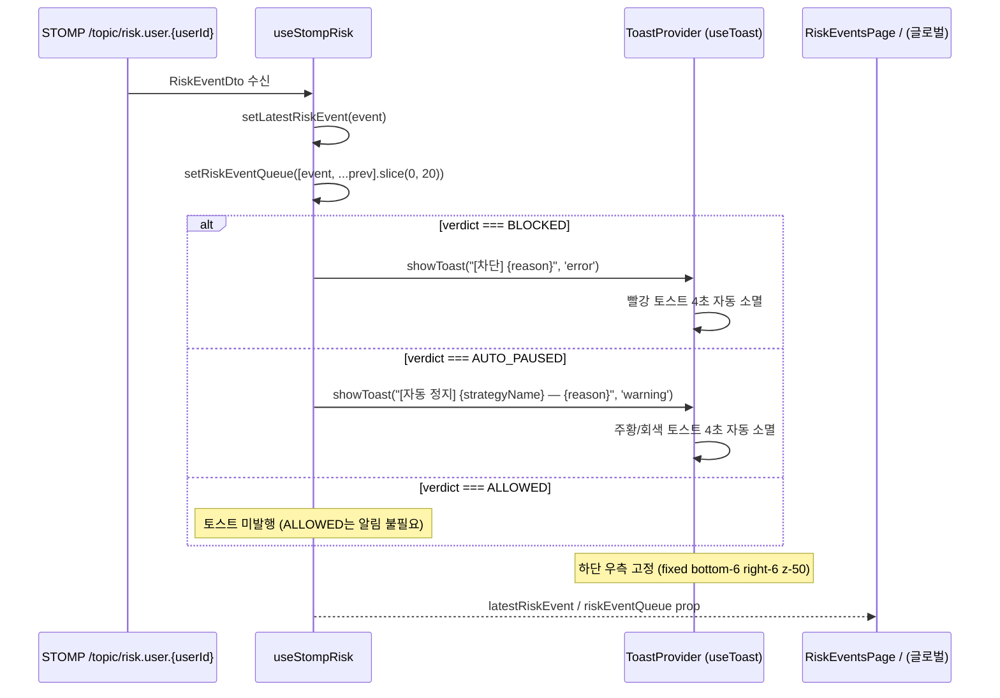
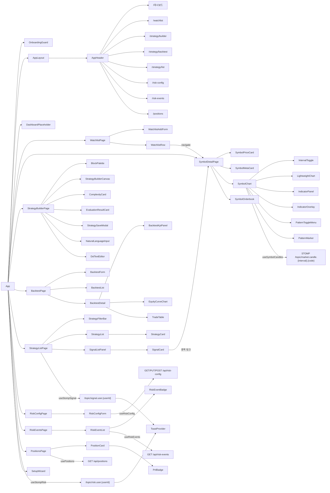

# magicJar v3.5.0 Baseline — 05. UI 화면 인벤토리

> **작성 시점**: 2026-05-12 v3.5.0 baseline
> **작성 에이전트**: frontend
> **커버 PR 범위**: PR-5b ~ PR-56 (v3.4.0 전체 + v3.5.0 T-RISK Phase 3)
>   - PR #351: ADR 0067 채택 (architect plan)
>   - PR #353: T-RISK Phase 1 — domain RiskConfig·RiskEvent·RiskRule·RiskVerdict·Position + port 6건 + RiskGatewayEvaluator + Kafka listener/producer (strategy-engine)
>   - PR #354: T-RISK Phase 2 — Flyway V16~V19 + JPA 3쌍 + REST 7 endpoint + StompRiskNotifier (backend-core)
>   - PR #355: T-RISK V18 hotfix — position CREATE→ALTER (backend-core)
>   - PR #356: T-RISK Phase 3 — `/risk-config`·`/risk-events`·`/positions` 3 페이지 + 5 컴포넌트 + useStompRisk 토스트 (frontend)
> **코드 기준**: `frontend/src/` 직접 inspect — 추측 0건
> **v3.4.0 대비 변경**:
>   - `/risk-config` 신규 라우트 + RiskConfigForm 컴포넌트
>   - `/risk-events` 신규 라우트 + RiskEventBadge·RiskEventList 컴포넌트
>   - `/positions` 신규 라우트 + PositionCard·PnlBadge 컴포넌트
>   - `useStompRisk` hook — `/topic/risk.user.{userId}` BLOCKED(빨강)·AUTO_PAUSED(주황) 토스트
>   - REST client: `risk.ts`·`position.ts` 신규
>   - AppHeader 메뉴: "리스크 설정"·"위반 이력"·"포지션" 3건 추가 (6 → 9 항목)

---

## 1. 라우팅 매트릭스

| URL 패턴 | 페이지 컴포넌트 | 진입 가드 | 트랙 ID | ADR |
|---------|--------------|---------|--------|-----|
| `/` | `DashboardPlaceholder` | OnboardingGuard | T-W1 | ADR 0040 |
| `/watchlist` | `WatchlistPage` | OnboardingGuard | T-W1 | ADR 0040 |
| `/symbol/:code` | `SymbolDetailPage` | OnboardingGuard | T-S1 | ADR 0040 §2-2 |
| `/strategy/builder` | `StrategyBuilderPage` | OnboardingGuard | T-SB | ADR 0040 §1, ADR 0055 |
| `/strategy/backtest` | `BacktestPage` | OnboardingGuard | T-BT | ADR 0061 §4 D-1 |
| `/strategy/list` | `StrategyListPage` | OnboardingGuard | T-SIG | ADR 0066 |
| `/risk-config` | `RiskConfigPage` | OnboardingGuard | T-RISK | ADR 0067 |
| `/risk-events` | `RiskEventsPage` | OnboardingGuard | T-RISK | ADR 0067 |
| `/positions` | `PositionsPage` | OnboardingGuard | T-RISK | ADR 0067 |
| `/setup` | `SetupWizard` | OnboardingGuard (역방향) | T-ONBOARD | ADR 0040 |
| `*` | `Navigate to="/"` | — | — | — |

**OnboardingGuard 로직** (`frontend/src/App.tsx`):
- `GET /api/onboarding/status` — `hasUserAccount=false` + path `/setup` 이외 → `/setup` redirect
- `hasUserAccount=true` + path `/setup` → `/` redirect (중복 진입 차단)
- isLoading → 스플래시(animate-spin) 표시

---

## 2. 화면 전이 다이어그램



---

## 3. 글로벌 내비게이션 (AppHeader)

**파일**: `frontend/src/components/layout/AppHeader.tsx`

| 메뉴 항목 | 링크 | 활성 조건 | 참조 ADR |
|---------|------|---------|------|
| magicJar (로고) | `/` | — | — |
| 대시보드 | `/` (end) | exact match | ADR 0040 |
| 관심종목 | `/watchlist` | prefix match | ADR 0040 |
| 전략 빌더 | `/strategy/builder` | prefix match | ADR 0055 |
| 백테스트 | `/strategy/backtest` | prefix match | ADR 0061 §4 D-1 |
| 전략 목록 | `/strategy/list` | prefix match | ADR 0066 |
| 리스크 설정 | `/risk-config` | prefix match | ADR 0067 |
| 위반 이력 | `/risk-events` | prefix match | ADR 0067 |
| 포지션 | `/positions` | prefix match | ADR 0067 |

- `/setup` 경로에서는 AppHeader 미표시 (App.tsx AppLayout 분기)
- `sticky top-0 z-50` + `backdrop-blur` — 스크롤 시 상단 고정
- 키보드 포커스링: `focus:ring-2 focus:ring-blue-400`

---

## 4. 화면별 컴포넌트 인벤토리

### 4-1 ~ 4-8

v3.4.0 baseline 05 §4-1 ~ §4-8 전체 보존 (DashboardPlaceholder·SetupWizard·WatchlistPage·SymbolDetailPage·SymbolChart·StrategyBuilderPage·BacktestPage·StrategyListPage). v3.5.0에서 변경 없음.

---

### 4-9. RiskConfigPage (`/risk-config`) — v3.5.0 신규

**파일**: `frontend/src/pages/Risk/RiskConfigPage.tsx`

**트랙**: T-RISK Phase 3 (ADR 0067)

#### 레이아웃 구조

```
┌─ AppHeader ───────────────────────────────────────────────────┐
├─ 페이지 헤더 (제목·설명) ──────────────────────────────────────┤
└─ RiskConfigForm (섹션 A·B·C·D + 저장·초기화 버튼) ─────────────┘
```

#### RiskConfigForm 섹션 구조

| 섹션 | 항목 | 입력 방식 | 기본값 |
|------|------|---------|-------|
| A 포지션 한도 | 절대 한도 (원) | NumberInput (천 단위 포맷) | 0 (무제한) |
| A 포지션 한도 | 비율 한도 (%) | SliderInput 1~100% | — |
| B 일일 손실 한도(DLL) | 전역 DLL (원) | NumberInput | 0 (무제한) |
| B DLL 모드 | ABSOLUTE / PERCENT | 토글 버튼 2종 | ABSOLUTE |
| B DLL (ABSOLUTE 모드) | 절대 DLL (원) | NumberInput | — |
| B DLL (PERCENT 모드) | 비율 DLL (%) | SliderInput 1~100% | — |
| C 동시 보유 종목 한도 | 최대 보유 종목 수 | SliderInput 1~20종목 | 5 |
| D 거래 빈도 한도 | 분당 최대 거래 | SliderInput 1~30회/분 | 3 |
| D 거래 빈도 한도 | 일별 최대 거래 | SliderInput 1~200회/일 | 50 |

**저장 상태 추적**: `isDirty` 플래그 — 변경 미저장 시 "저장되지 않은 변경이 있습니다." amber 안내

**버튼**:
- "기본값으로 초기화" — `POST /api/risk-config/reset` + `window.confirm` 1차 확인
- "설정 저장" — `PUT /api/risk-config` + isDirty=false 시 disabled

**연결 REST** (via `useRiskConfig`·`useUpdateRiskConfig`·`useResetRiskConfig`):
- `GET /api/risk-config` — 페이지 진입 시 현재 설정 조회 (staleTime 30s)
- `PUT /api/risk-config` — 폼 저장 (성공 시 쿼리 invalidate)
- `POST /api/risk-config/reset` — 기본값 초기화 (성공 시 쿼리 invalidate)

---

### 4-10. RiskEventsPage (`/risk-events`) — v3.5.0 신규

**파일**: `frontend/src/pages/Risk/RiskEventsPage.tsx`

**트랙**: T-RISK Phase 3 (ADR 0067)

#### 레이아웃 구조

```
┌─ AppHeader ───────────────────────────────────────────────────┐
├─ 페이지 헤더 (제목·설명) ──────────────────────────────────────┤
├─ 판정 필터 (전체·허용·차단·자동 정지) ──────────────────────────┤
└─ RiskEventList (테이블 + 더 보기 무한 스크롤) ────────────────────┘
```

**verdict 필터 옵션**:

| 값 | 레이블 | 활성 색상 |
|----|--------|---------|
| `''` | 전체 | `bg-blue-600 text-white` |
| `ALLOWED` | 허용 | `bg-blue-600 text-white` |
| `BLOCKED` | 차단 | `bg-blue-600 text-white` |
| `AUTO_PAUSED` | 자동 정지 | `bg-blue-600 text-white` |

**RiskEventList 테이블 컬럼**:

| 컬럼 | 설명 |
|------|------|
| 시각 (KST) | `ko-KR` timeZone=`Asia/Seoul` 포맷 (YYYY. MM. DD. HH:MM:SS) |
| 규칙 | `evt.rule` — truncate max-w-[160px] + title tooltip |
| 판정 | `RiskEventBadge` 컴포넌트 |
| 사유 | `evt.reason` — truncate max-w-[200px] + title tooltip |
| 시그널 | `signalId` 존재 시 `/strategy/list?signalId={id}` 링크 (# prefix 8자) |

**더 보기**: `hasNextPage` 시 "더 보기" 버튼 노출 (`fetchNextPage`) — `isFetchingNextPage` 시 "로딩 중..."

**연결 REST** (via `useRiskEvents`):
- `GET /api/risk-events?verdict=&page=&size=20` — 무한 스크롤 페이징 (staleTime 15s)

---

### 4-11. PositionsPage (`/positions`) — v3.5.0 신규

**파일**: `frontend/src/pages/Risk/PositionsPage.tsx`

**트랙**: T-RISK Phase 3 (ADR 0067)

#### 레이아웃 구조

```
┌─ AppHeader ───────────────────────────────────────────────────┐
├─ 페이지 헤더 (제목·설명) + 새로고침 버튼 ────────────────────────┤
├─ 소스 필터 (전체·MOCK·REAL) ──────────────────────────────────┤
└─ PositionCard 그리드 (1열/2열/3열 반응형) ────────────────────────┘
```

**source 필터 옵션**: `''`(전체)·`MOCK`·`REAL`

**PositionCard 카드 레이아웃**:

```
┌─ [종목코드] [종목명]             [소스 배지 MOCK/REAL] ─┐
├─ 보유 수량 : N주                                       │
│  평균 매수가: N,NNN원                                   │
│  현재가 : N,NNN원          ← currentPrice 있을 때만      │
│  평가금액 : N,NNN원         ← currentPrice 있을 때만      │
├─ [PnlBadge 평가손익]           진입 YY. MM. DD. HH:MM ─┘
```

**소스 배지 색상**:
- `REAL`: `bg-amber-900/60 text-amber-300 border border-amber-700`
- `MOCK`: `bg-blue-900/60 text-blue-300 border border-blue-700`

**새로고침**: 우상단 버튼 → `refetch()` 직접 호출

**연결 REST** (via `usePositions`):
- `GET /api/positions?source=` — 포지션 목록 (staleTime 15s)

---

## 5. T-RISK 실시간 토스트 흐름 (v3.5.0 신규)

### useStompRisk hook

**파일**: `frontend/src/api/hooks/useStompRisk.ts`

**STOMP 토픽**: `/topic/risk.user.{userId}` (ADR 0067 §6-D StompRiskNotifier)

**반환 인터페이스**:

| 필드 | 타입 | 설명 |
|------|------|------|
| `latestRiskEvent` | `RiskEventDto \| null` | 가장 최근 수신 리스크 이벤트 |
| `riskEventQueue` | `RiskEventDto[]` | 최근 20건 수신 스택 |
| `clearQueue` | `() => void` | 큐 초기화 함수 |

**토스트 메시지 포맷**:
- `BLOCKED`: `"[차단] {reason}"` — `error` 타입 (빨강)
- `AUTO_PAUSED`: `"[자동 정지] {strategyName} — {reason}"` — `warning` 타입 (주황)
- `ALLOWED`: 토스트 미발행 (사용자 인지 불필요)

**verdict → ToastType 매핑**:
- `BLOCKED` → `'error'` (red)
- `AUTO_PAUSED` → `'warning'` (amber/회색)
- 기타 → `'info'` (blue)



### ToastProvider (v3.4.0 계승)

**파일**: `frontend/src/components/ui/ToastProvider.tsx`

v3.4.0 기존 구현 100% 계승:
- 자체 구현 (react-hot-toast 미사용 — 오프라인 번들 우선)
- 4초 자동 소멸 + ESC 키 전체 닫기
- MAX 5개 동시 표시 (하단 우측 고정 스택)
- slide-in/out CSS transition
- `role="alert"` + `aria-live="assertive"` 접근성

---

## 6. API Hook 매트릭스 (v3.5.0 전체)

v3.4.0 24 hook 전체 보존 + v3.5.0 신규 4 hook 추가 (총 28 hook):

| Hook | 파일 | 대상 엔드포인트 | 용도 |
|------|------|----------------|------|
| `useOnboardingStatus` | `api/onboarding.ts` | `GET /api/onboarding/status` | OnboardingGuard |
| `useWatchlist` | `api/hooks/useWatchlist.ts` | `GET /api/watchlists` | WatchlistPage 목록 |
| `useAddWatchlist` | `api/hooks/useWatchlist.ts` | `POST /api/watchlists` | WatchlistAddForm |
| `useRemoveWatchlist` | `api/hooks/useWatchlist.ts` | `DELETE /api/watchlists/{code}` | WatchlistRow |
| `useSymbol` | `api/hooks/useSymbol.ts` | `GET /api/symbols/{code}` | SymbolDetailPage 5s polling |
| `useSymbolCandles` | `api/hooks/useSymbolCandles.ts` | `GET /api/symbols/{code}/candles` + STOMP 5종 boundary | SymbolChart 무한 스크롤 + 실시간 갱신 |
| `useInstrument` | `api/hooks/useInstrument.ts` | `GET /api/instruments/{code}` | SymbolDetailPage 메타 |
| `useInstrumentSearch` | `api/hooks/useInstrumentSearch.ts` | `GET /api/instruments/search?q=` | InstrumentSearchInput |
| `useIndicators` | `api/hooks/useIndicators.ts` | `GET /api/indicators/{id}` | IndicatorOverlay |
| `usePatterns` | `api/hooks/usePatterns.ts` | `GET /api/symbols/{code}/patterns` | PatternMarker |
| `useStrategyValidate` | `api/hooks/useStrategy.ts` | `POST /api/strategy/validate` | StrategyBuilderPage |
| `useStrategyEvaluate` | `api/hooks/useStrategy.ts` | `POST /api/strategy/{id}/evaluate` | StrategyBuilderPage |
| `useCreateStrategy` | `api/hooks/useStrategy.ts` | `POST /api/strategy` | StrategySaveModal |
| `useStrategyTranslate` | `api/hooks/useStrategyTranslate.ts` | `POST /api/dsl/translate-from-natural` | NaturalLanguageInput |
| `useSigStrategies` | `api/hooks/useSigStrategy.ts` | `GET /api/strategies?page=&size=` | StrategyList 무한 스크롤 |
| `useSigStrategy` | `api/hooks/useSigStrategy.ts` | `GET /api/strategies/{id}` | 단건 조회 |
| `useCreateSigStrategy` | `api/hooks/useSigStrategy.ts` | `POST /api/strategies` | 전략 생성 |
| `useUpdateSigStrategy` | `api/hooks/useSigStrategy.ts` | `PUT /api/strategies/{id}` | 전략 수정 |
| `useDeleteSigStrategy` | `api/hooks/useSigStrategy.ts` | `DELETE /api/strategies/{id}` | StrategyCard 삭제 |
| `useToggleSigStrategyStatus` | `api/hooks/useSigStrategy.ts` | `PUT /api/strategies/{id}/status` | StrategyCard 상태 토글 |
| `useSignals` | `api/hooks/useSignal.ts` | `GET /api/signals?userId=...` | SignalListPanel 무한 스크롤 |
| `useSignal` | `api/hooks/useSignal.ts` | `GET /api/signals/{id}` | 단건 조회 |
| `useStompSignal` | `api/hooks/useStompSignal.ts` | STOMP `/topic/signal.user.{userId}` | StrategyListPage 실시간 토스트 + prepend |
| `useRiskConfig` | `api/hooks/useRiskConfig.ts` | `GET /api/risk-config` | RiskConfigForm 조회 (staleTime 30s) |
| `useUpdateRiskConfig` | `api/hooks/useRiskConfig.ts` | `PUT /api/risk-config` | RiskConfigForm 저장 |
| `useResetRiskConfig` | `api/hooks/useRiskConfig.ts` | `POST /api/risk-config/reset` | RiskConfigForm 초기화 |
| `useRiskEvents` | `api/hooks/useRiskEvents.ts` | `GET /api/risk-events?verdict=...` | RiskEventList 무한 스크롤 (staleTime 15s) |
| `usePositions` | `api/hooks/usePositions.ts` | `GET /api/positions?source=` | PositionsPage 목록 (staleTime 15s) |

---

## 7. STOMP 토픽 매트릭스 (v3.5.0 전체)

| 토픽 | 구독 위치 | payload 타입 | 용도 |
|-----|---------|------------|------|
| `/topic/market.tick.{code}` | `SymbolDetailPage` | `TickPayload` | 현재가·등락·등락률 실시간 |
| `/topic/market.candle.minute.{code}` | `SymbolDetailPage` | `CandleMinutePayload` | 1m 차트 실시간 append |
| `/topic/market.orderbook.{code}` | `SymbolDetailPage` | `OrderbookPayload` | 호가 10단계 실시간 |
| `/topic/market.candle.5m.{code}` | `useSymbolCandles` (interval=5m 시) | `CandleClosedPayload` | 5m boundary 마감 실시간 갱신 |
| `/topic/market.candle.15m.{code}` | `useSymbolCandles` (interval=15m 시) | `CandleClosedPayload` | 15m boundary 마감 실시간 갱신 |
| `/topic/market.candle.30m.{code}` | `useSymbolCandles` (interval=30m 시) | `CandleClosedPayload` | 30m boundary 마감 실시간 갱신 |
| `/topic/market.candle.90m.{code}` | `useSymbolCandles` (interval=90m 시) | `CandleClosedPayload` | 90m boundary 마감 실시간 갱신 |
| `/topic/market.candle.1h.{code}` | `useSymbolCandles` (interval=1h 시) | `CandleClosedPayload` | 1h boundary 마감 실시간 갱신 |
| `/topic/signal.user.{userId}` | `useStompSignal` (StrategyListPage) | `SignalDto` | 실시간 시그널 토스트 + SignalListPanel prepend |
| `/topic/risk.user.{userId}` | `useStompRisk` (글로벌 또는 Risk 페이지) | `RiskEventDto` | BLOCKED(빨강)·AUTO_PAUSED(주황) 리스크 토스트 |

**STOMP 설정** (`frontend/src/lib/stomp.ts`):
- `@stomp/stompjs` Client 싱글톤
- `brokerURL`: `ws://{host}/ws` (Vite dev proxy → `ws://localhost:8080/ws`)
- `reconnectDelay`: 5000ms
- 연결 끊김 → 노랑 배지 + 5s polling fallback 자동 전환

---

## 8. REST Client 매트릭스 (v3.5.0 전체)

| 파일 | API 객체 | 용도 | 엔드포인트 수 |
|------|---------|------|------------|
| `api/onboarding.ts` | `useOnboardingStatus`, `validateKis`, `completeOnboarding` | 온보딩 흐름 | 3 |
| `api/watchlist.ts` | `watchlistApi` | 관심종목 CRUD | 3 |
| `api/symbol.ts` | `symbolApi` + TickPayload·CandleMinutePayload·CandleClosedPayload·OrderbookPayload 타입 | 시세·캔들·호가 | 4 |
| `api/instrument.ts` | `instrumentApi` | 종목 마스터 검색 | 2 |
| `api/indicator.ts` | `indicatorApi` | 80지표 데이터 | 1 |
| `api/patterns.ts` | `patternsApi` | 57패턴 감지 | 1 |
| `api/strategy.ts` | `strategyApi` (T-DSL) + `sigStrategyApi` (ADR 0066 신규) | DSL 전략·ADR 0066 전략 | 7 + 6 |
| `api/backtest.ts` | `backtestApi` | 백테스트 CRUD + 결과 조회 | 5 |
| `api/signal.ts` | `signalApi` | 시그널 목록·단건 | 2 |
| `api/dslTranslate.ts` | `dslTranslateApi` | AI 자연어 DSL 변환 | 1 |
| `api/risk.ts` | `riskApi` | 리스크 설정·이벤트 CRUD | 5 |
| `api/position.ts` | `positionApi` | 포지션 목록·단건 | 2 |

---

## 9. RiskConfigDto 타입 (v3.5.0 신규)

`frontend/src/api/risk.ts` 주요 인터페이스:

| 타입 | 필드 | 설명 |
|------|------|------|
| `RiskVerdict` | `ALLOWED \| BLOCKED \| AUTO_PAUSED` | 리스크 판정 |
| `DllMode` | `ABSOLUTE \| PERCENT` | 일일 손실 한도 모드 |
| `RiskConfigDto` | `id·userId·positionLimit·dll·maxHolding·tradeFrequency·updatedAt` | 전체 설정 DTO |
| `PositionLimitConfig` | `absoluteLimit: number` (원) + `percentLimit: number` (0~1) | A 포지션 한도 |
| `DllConfig` | `globalDll: number` + `mode: DllMode` + `absoluteDll: number` + `percentDll: number` | B DLL 설정 |
| `MaxHoldingConfig` | `maxHoldingCount: number` | C 동시 보유 종목 |
| `TradeFrequencyConfig` | `maxTradesPerMinute: number` + `maxTradesPerDay: number` | D 거래 빈도 |
| `RiskConfigUpdateRequest` | `Omit<RiskConfigDto, 'id' \| 'userId' \| 'updatedAt'>` | PUT 요청 바디 |

---

## 10. RiskEventDto 타입 (v3.5.0 신규)

`frontend/src/api/risk.ts` `RiskEventDto` 인터페이스:

| 필드 | 타입 | 설명 |
|------|------|------|
| `id` | `string` | 이벤트 ID |
| `userId` | `string` | 사용자 ID |
| `verdict` | `RiskVerdict` | ALLOWED·BLOCKED·AUTO_PAUSED |
| `rule` | `string` | 위반 규칙 텍스트 |
| `reason` | `string` | 위반 사유 상세 |
| `signalId` | `string \| undefined` | 연관 시그널 ID (optional) |
| `strategyId` | `string \| undefined` | 연관 전략 ID (optional) |
| `strategyName` | `string \| undefined` | 연관 전략명 (optional) |
| `ts` | `string` | 발생 시각 (ISO 8601 KST) |

---

## 11. PositionDto 타입 (v3.5.0 신규)

`frontend/src/api/position.ts` `PositionDto` 인터페이스:

| 필드 | 타입 | 설명 |
|------|------|------|
| `id` | `string` | 포지션 ID |
| `userId` | `string` | 사용자 ID |
| `code` | `string` | 종목 코드 |
| `codeName` | `string \| undefined` | 종목명 (optional) |
| `qty` | `number` | 보유 수량 (주) |
| `avgPrice` | `number` | 평균 매수가 (원) |
| `currentPrice` | `number \| undefined` | 현재가 (원, optional — 실시간 enrichment) |
| `source` | `PositionSource` | `MOCK \| REAL` |
| `entryTs` | `string` | 매수 진입 시각 (ISO 8601 KST) |
| `updatedAt` | `string` | 마지막 업데이트 시각 |

---

## 12. PnlBadge 색상 로직 (v3.5.0 신규)

`frontend/src/components/risk/PnlBadge.tsx`

| 조건 | 색상 | 의미 |
|------|------|------|
| `pnl >= 0` | `bg-emerald-900/60 text-emerald-300 border border-emerald-700` | 수익 |
| `pnl < 0 && \|pnl\| >= dll` | `bg-red-900/60 text-red-300 border border-red-700` | DLL 초과 위험 |
| `pnl < 0 && (\|pnl\| < dll \|\| dll 미제공)` | `bg-amber-900/60 text-amber-300 border border-amber-700` | 손실이지만 DLL 미달 |

**포맷**: `±N,NNN원` (부호 prefix + `ko-KR` 천 단위 콤마) — `formatKrw` 내부 함수

---

## 13. RiskEventBadge 색상 (v3.5.0 신규)

`frontend/src/components/risk/RiskEventBadge.tsx`

| verdict | 색상 | 레이블 |
|---------|------|--------|
| `ALLOWED` | `bg-emerald-900/60 text-emerald-300 border border-emerald-700` | 허용 |
| `BLOCKED` | `bg-red-900/60 text-red-300 border border-red-700` | 차단 |
| `AUTO_PAUSED` | `bg-gray-800/80 text-gray-400 border border-gray-600` | 자동 정지 |

---

## 14. 컴포넌트 의존도 다이어그램 (v3.5.0)



---

## 15. 에러 처리 정책 (v3.5.0 추가 항목)

v3.4.0 에러 처리 전체 보존 + v3.5.0 신규:

| 상황 | 처리 |
|------|------|
| REST 실패 | 해당 위젯만 오류 표시 — 페이지 전체 중단 금지 |
| WebSocket 끊김 | 자동 재연결(5s) + 연결 상태 인디케이터 배지 |
| RiskConfigForm 로드 실패 | 섹션 내 빨간 박스 "리스크 설정을 불러오지 못했습니다" |
| RiskConfigForm 저장 실패 | ToastProvider 에러 토스트 |
| RiskConfigForm 초기화 실패 | ToastProvider 에러 토스트 |
| RiskEventList 로드 실패 | 섹션 내 빨간 박스 |
| RiskEventList 0건 | "리스크 위반 이력이 없습니다." + "모든 시그널이 리스크 정책을 통과했습니다." |
| PositionsPage 로드 실패 | 빨간 박스 + "다시 시도" 버튼 (`refetch()`) |
| PositionsPage 0건 | "보유 포지션이 없습니다." + "자동매매 전략이 활성화되면..." 안내 |
| PositionCard currentPrice 미제공 | "현재가 미제공" 회색 텍스트 (PnlBadge 미표시) |
| BLOCKED STOMP 토스트 실패 | 연결 끊김 처리와 동일 — 재연결 후 재구독 |

---

## 16. 접근성 정책 (v3.5.0 추가 항목)

v3.4.0 접근성 항목 전체 보존 + v3.5.0 신규:

| 항목 | 구현 방식 |
|------|---------|
| RiskEventsPage verdict 필터 | `button` 클릭 기반 (role tablist 미사용 — 단순 필터) |
| PositionsPage source 필터 | `button` 클릭 기반 |
| PositionsPage 새로고침 버튼 | `aria-label="포지션 목록 새로고침"` |
| RiskEventBadge | `inline-flex` span — 배지 용도 시멘틱 보조 없음 (verdict 컬럼 컨텍스트) |
| PnlBadge | `title` tooltip에 DLL 수치 표시 (`DLL: N,NNN원`) |
| RiskConfigForm SliderInput | `aria-label={label}` + 시각적 min/max 범위 표시 |

---

## 17. 숫자·날짜 포맷 정책 (v3.5.0 추가 항목)

v3.4.0 포맷 정책 전체 보존 + v3.5.0 신규:

| 포맷 유형 | 구현 | 예시 |
|---------|------|-----|
| RiskConfig 원화 입력 | `parseKrw` — 비숫자 strip → `toLocaleString('ko-KR')` blur 재포맷 | `10,000,000` |
| 포지션 수량 | `qty.toLocaleString('ko-KR')` + "주" suffix | `1,000주` |
| 포지션 평균 매수가·현재가·평가금액 | `formatKrw` (내부) — `ko-KR` + "원" suffix | `75,400원` |
| PnlBadge 평가손익 | `±|value|.toLocaleString('ko-KR')` + "원" suffix | `+234,000원` / `-45,600원` |
| RiskEvent 발생 시각 (KST) | `ko-KR` + `timeZone: 'Asia/Seoul'` + 년 2자리·월·일·시·분·초 | `26. 05. 12. 오전 9:32:15` |
| Position 진입 시각 (KST) | `ko-KR` + `timeZone: 'Asia/Seoul'` + 년 2자리·월·일·시·분 | `26. 05. 12. 오전 9:32` |

---

## 18. 테스트 파일 매트릭스 (v3.5.0 기준)

v3.4.0 테스트 전체 보존 (151건) + v3.5.0 신규 추가 없음 (T-RISK Phase 3 frontend 테스트는 QA on-demand 정책 § 별도 일괄 예정).

---

## 19. v3.5.0 신규 변경 요약 (v3.4.0 대비)

| 항목 | 변경 내용 | ADR/PR |
|------|---------|--------|
| `RiskConfigPage.tsx` | `/risk-config` 라우트 신규 — RiskConfigForm 단일 렌더링 | ADR 0067, PR #356 |
| `RiskEventsPage.tsx` | `/risk-events` 라우트 신규 — verdict 필터 + RiskEventList | ADR 0067, PR #356 |
| `PositionsPage.tsx` | `/positions` 라우트 신규 — source 필터 + PositionCard 그리드 + 새로고침 버튼 | ADR 0067, PR #356 |
| `RiskConfigForm.tsx` | A·B·C·D 4섹션 설정 폼 + NumberInput/SliderInput 자체 구현 + isDirty 추적 | ADR 0067, PR #356 |
| `RiskEventBadge.tsx` | verdict 3종 배지 (ALLOWED·BLOCKED·AUTO_PAUSED) | ADR 0067, PR #356 |
| `RiskEventList.tsx` | 리스크 이벤트 테이블 + 무한 스크롤 "더 보기" + 시그널 링크 | ADR 0067, PR #356 |
| `PositionCard.tsx` | 포지션 단건 카드 — MOCK/REAL 소스 배지 + 평가손익 PnlBadge | ADR 0067, PR #356 |
| `PnlBadge.tsx` | PnL 3단 색상 배지 (수익·손실·DLL 초과) | ADR 0067, PR #356 |
| `useStompRisk.ts` | `/topic/risk.user.{userId}` STOMP 구독 + riskEventQueue(최근 20건) + ToastProvider 연동 | ADR 0067, PR #356 |
| `useRiskConfig.ts` | TanStack Query 3 hook (useRiskConfig·useUpdateRiskConfig·useResetRiskConfig) | ADR 0067, PR #356 |
| `useRiskEvents.ts` | TanStack Query 2 hook (useRiskEvents·useRiskEvent) — 무한 스크롤 | ADR 0067, PR #356 |
| `usePositions.ts` | TanStack Query 2 hook (usePositions·usePosition) | ADR 0067, PR #356 |
| `api/risk.ts` | REST client 5 endpoint + RiskConfigDto·RiskEventDto·RiskEventPage 타입 신규 | ADR 0067, PR #356 |
| `api/position.ts` | REST client 2 endpoint + PositionDto·PositionSource 타입 신규 | ADR 0067, PR #356 |
| `AppHeader.tsx` | 리스크 설정·위반 이력·포지션 3 메뉴 추가 (6 → 9 항목) | ADR 0067, PR #356 |
| `App.tsx` | `/risk-config`·`/risk-events`·`/positions` 3 라우트 등록 | ADR 0067, PR #356 |
| Screenshot 검증 기록 | `_workspace/frontend/screenshot-desc/2026-05-12-risk-phase3.md` | PR #356 |

---

## 20. ADR 인용 인덱스

| ADR | 제목 | 관련 UI 항목 |
|-----|------|------------|
| ADR 0009 | frontend SPA + LWC v4 | 전체 프론트엔드 아키텍처 |
| ADR 0014 | 실시간 시세 fallback tier | stale 배지 (live/delayed/closed) |
| ADR 0019 | 캔들 인터벌 정책 | CandleInterval 타입, IntervalToggle |
| ADR 0023 | AI 자연어 DSL 변환 | NaturalLanguageInput (사용자 트리거 only), LLM provider import 0건 |
| ADR 0025 | LWC v4 차트 | LightweightChart, EquityCurveChart |
| ADR 0029 | STOMP 실시간 캔들 | SymbolDetailPage STOMP 구독 |
| ADR 0040 | 라우팅 + Watchlist 진입점 | App.tsx 라우트, WatchlistRow 이동 |
| ADR 0048 | 호가 LRU 10 slot | SymbolOrderbook subscribe/unsubscribe |
| ADR 0055 | Strategy Builder UI 스택 | StrategyBuilderPage (Monaco 없음) |
| ADR 0061 | 백테스트 결과 영속 | BacktestPage + 6 컴포넌트 + backtestApi |
| ADR 0062 | 5m~1h 합산 인터벌 활성화 | IntervalToggle 10종, AGGREGATED_INTERVALS |
| ADR 0063 | NXT X축 커버 (08:00~20:00) | LightweightChart isIntradayInterval |
| ADR 0064 | Redis boundary fanout + STOMP 실시간 합산 갱신 | useSymbolCandles STOMP 5종 + LightweightChart series.update |
| ADR 0066 | T-SIG 실시간 시그널 엔진 | StrategyListPage + useStompSignal + ToastProvider |
| ADR 0067 | T-RISK 리스크 관리 | RiskConfigPage·RiskEventsPage·PositionsPage + useStompRisk |
