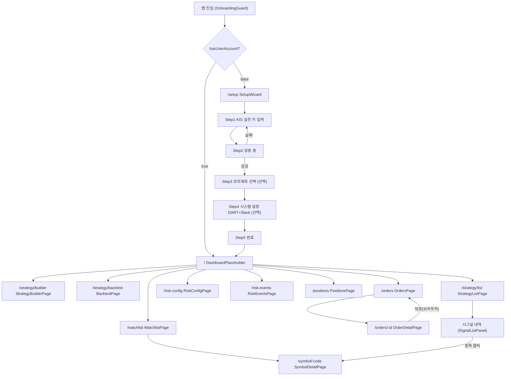
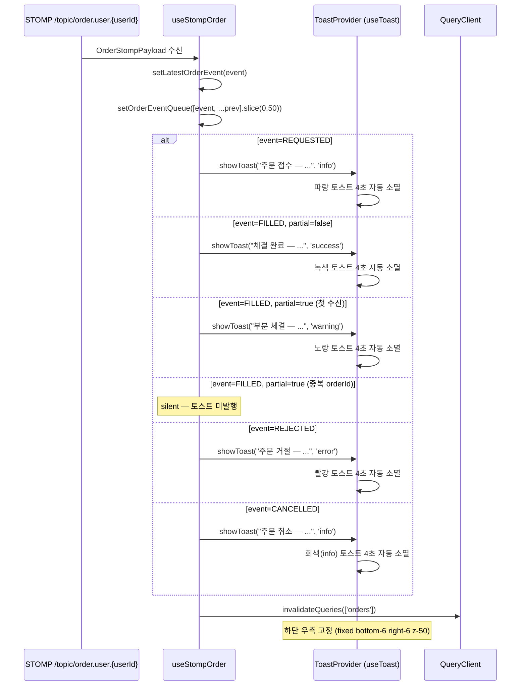
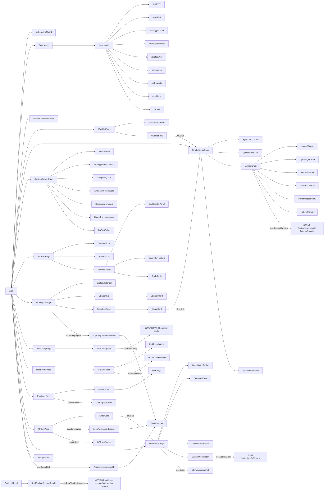

# magicJar v3.6.0 Baseline — 05. UI 화면 인벤토리

> **작성 시점**: 2026-05-13 v3.6.0 baseline
> **작성 에이전트**: frontend
> **커버 PR 범위**: v3.5.0 전체 이월 + v3.6.0 T-O Phase 3
>   - PR #375 (추정): T-O Phase 3 — `/orders`·`/orders/:id` 2 페이지 + 6 컴포넌트 + useStompOrder + RealTradingConsentToggle + REST client order.ts·account.ts
> **코드 기준**: `frontend/src/` 직접 inspect — 추측 0건
> **v3.5.0 대비 변경**:
>   - `/orders` 신규 라우트 + OrdersPage 컴포넌트
>   - `/orders/:id` 신규 라우트 + OrderDetailPage 컴포넌트
>   - `OrderStatusBadge` — 7 status × Tailwind 색상 매트릭스
>   - `OrderCard` — 주문 단건 카드 (side·code·qty·price·mode 배지)
>   - `ExecutionTable` — 분할 체결 1:N 시계열 + footer 누적 합계
>   - `OrderAuditTimeline` — audit_event 시계열 + eventType별 색상 점
>   - `CancelOrderButton` — 확인 모달 + 이중 클릭 방지
>   - `RealTradingConsentToggle` — 이중 confirm 자본 보호 UX (§16-4 LOCK)
>   - `useStompOrder` hook — `/topic/order.user.{userId}` 4 event 토스트
>   - REST client: `order.ts`·`account.ts` 신규
>   - AppHeader 메뉴: "주문" 추가 (9 → 10 항목)

---

## 1. 라우팅 매트릭스

| URL 패턴 | 페이지 컴포넌트 | 진입 가드 | 트랙 ID | ADR |
|---------|--------------|---------|--------|-----|
| `/` | `DashboardPlaceholder` | OnboardingGuard | T-W1 | ADR 0040 |
| `/watchlist` | `WatchlistPage` | OnboardingGuard | T-W1 | ADR 0040 |
| `/symbol/:code` | `SymbolDetailPage` | OnboardingGuard | T-S1 | ADR 0040 §2-2 |
| `/strategy/builder` | `StrategyBuilderPage` | OnboardingGuard | T-SB | ADR 0040 §1, ADR 0055 |
| `/strategy/backtest` | `BacktestPage` | OnboardingGuard | T-BT | ADR 0061 §4 D-1 |
| `/strategy/list` | `StrategyListPage` | OnboardingGuard | T-SIG | ADR 0066 |
| `/risk-config` | `RiskConfigPage` | OnboardingGuard | T-RISK | ADR 0067 |
| `/risk-events` | `RiskEventsPage` | OnboardingGuard | T-RISK | ADR 0067 |
| `/positions` | `PositionsPage` | OnboardingGuard | T-RISK | ADR 0067 |
| `/orders` | `OrdersPage` | OnboardingGuard | T-O | ADR 0068 |
| `/orders/:id` | `OrderDetailPage` | OnboardingGuard | T-O | ADR 0068 |
| `/setup` | `SetupWizard` | OnboardingGuard (역방향) | T-ONBOARD | ADR 0040 |
| `*` | `Navigate to="/"` | — | — | — |

**총 13 화면 (v3.5.0 11개 → v3.6.0 13개)**

**OnboardingGuard 로직** (`frontend/src/App.tsx`):
- `GET /api/onboarding/status` — `hasUserAccount=false` + path `/setup` 이외 → `/setup` redirect
- `hasUserAccount=true` + path `/setup` → `/` redirect (중복 진입 차단)
- isLoading → 스플래시(animate-spin) 표시

---

## 2. 화면 전이 다이어그램



---

## 3. 글로벌 내비게이션 (AppHeader)

**파일**: `frontend/src/components/layout/AppHeader.tsx`

| 메뉴 항목 | 링크 | 활성 조건 | 참조 ADR |
|---------|------|---------|------|
| magicJar (로고) | `/` | — | — |
| 대시보드 | `/` (end) | exact match | ADR 0040 |
| 관심종목 | `/watchlist` | prefix match | ADR 0040 |
| 전략 빌더 | `/strategy/builder` | prefix match | ADR 0055 |
| 백테스트 | `/strategy/backtest` | prefix match | ADR 0061 §4 D-1 |
| 전략 목록 | `/strategy/list` | prefix match | ADR 0066 |
| 리스크 설정 | `/risk-config` | prefix match | ADR 0067 |
| 위반 이력 | `/risk-events` | prefix match | ADR 0067 |
| 포지션 | `/positions` | prefix match | ADR 0067 |
| 주문 | `/orders` | prefix match | ADR 0068 |

**총 10 메뉴 항목 (v3.5.0 9개 → v3.6.0 10개)**

- `/setup` 경로에서는 AppHeader 미표시 (App.tsx AppLayout 분기)
- `sticky top-0 z-50` + `backdrop-blur` — 스크롤 시 상단 고정
- 키보드 포커스링: `focus:ring-2 focus:ring-blue-400`

---

## 4. 화면별 컴포넌트 인벤토리

### 4-1 ~ 4-11

v3.5.0 baseline 05 §4-1 ~ §4-11 전체 보존 (DashboardPlaceholder·SetupWizard·WatchlistPage·SymbolDetailPage·SymbolChart·StrategyBuilderPage·BacktestPage·StrategyListPage·RiskConfigPage·RiskEventsPage·PositionsPage). v3.6.0에서 변경 없음.

---

### 4-12. OrdersPage (`/orders`) — v3.6.0 신규

**파일**: `frontend/src/pages/orders/OrdersPage.tsx`

**트랙**: T-O Phase 3 (ADR 0068 §16)

#### 레이아웃 구조

```
┌─ AppHeader ───────────────────────────────────────────────────┐
├─ 페이지 헤더 (제목 "주문 내역" · 설명 · 거래 모드 배지) ──────────┤
├─ 상태 필터 버튼 행 (전체·접수·KIS 접수·부분 체결·체결 완료·거부·취소) ─┤
├─ OrderCard 목록 (페이징) ─────────────────────────────────────┤
└─ 페이지 네비게이션 (이전/다음 버튼) ────────────────────────────┘
```

**거래 모드 배지** (헤더 우측):
- `realTradingConsentAt IS NOT NULL`: `"REAL 거래 모드"` — 빨간 배지 (`border-red-800 bg-red-950/50 text-red-400`)
- `realTradingConsentAt IS NULL`: `"MOCK 모드"` — 회색 배지 (`border-gray-700 bg-gray-900 text-gray-400`)

**상태 필터 옵션**:

| value | 레이블 | 의미 |
|-------|--------|------|
| `''` | 전체 | 모든 상태 조회 |
| `REQUESTED` | 접수 | 주문 의도 수신 |
| `ACK` | KIS 접수 | KIS 주문번호 수신 |
| `PARTIALLY_FILLED` | 부분 체결 | 일부 체결 완료 |
| `FILLED` | 체결 완료 | 전량 체결 |
| `REJECTED` | 거부 | 게이트 차단 또는 KIS 거절 |
| `CANCELLED` | 취소 | 사용자 취소 |

**연결 REST** (via `useOrders`):
- `GET /api/orders?status=&page=&size=20` — 페이징 목록 (staleTime 30s)

**실시간**: `useStompOrder({ userId: '1', enabled: true })` — STOMP 구독 + 4 event 토스트

---

### 4-13. OrderDetailPage (`/orders/:id`) — v3.6.0 신규

**파일**: `frontend/src/pages/orders/OrderDetailPage.tsx`

**트랙**: T-O Phase 3 (ADR 0068 §16)

#### 레이아웃 구조

```
┌─ AppHeader ───────────────────────────────────────────────────┐
├─ 뒤로 버튼 + 페이지 헤더 ─────────────────────────────────────┤
├─ 주문 기본 정보 카드 (status badge · side · code · qty · price · mode · 시각) ─┤
├─ CancelOrderButton (REQUESTED·ACK·PARTIALLY_FILLED 상태만 표시) ──┤
├─ [체결 내역] 섹션 — ExecutionTable ──────────────────────────────┤
└─ [감사 이벤트] 섹션 — OrderAuditTimeline ────────────────────────┘
```

**주문 기본 정보 카드 필드**:

| 필드 | 표시 방식 |
|------|---------|
| status | `OrderStatusBadge` 컴포넌트 |
| side | 매수=빨강, 매도=파랑 텍스트 |
| code | 종목 코드 (굵은 글씨) |
| priceType | MARKET → "시장가", LIMIT → 지정가 수량원 |
| quantity | `N,NNN주` (ko-KR 포맷) |
| mode | REAL → 빨간 배지, MOCK → 회색 배지 |
| kisOrderNo | KIS 주문번호 (있을 때만 표시) |
| createdAt | `KST YYYY. MM. DD. HH:MM:SS` |
| filledAt | 체결 완료 시각 (FILLED 상태만) |

**연결 REST** (via `useOrder`):
- `GET /api/orders/{id}` — 단건 상세 (staleTime 30s)

**취소** (via `useCancelOrder`):
- `POST /api/orders/{id}/cancel` — 취소 요청 (성공 시 invalidateQueries)

---

## 5. T-O 실시간 토스트 흐름 (v3.6.0 신규)

### useStompOrder hook

**파일**: `frontend/src/api/hooks/useStompOrder.ts`

**STOMP 토픽**: `/topic/order.user.{userId}` (ADR 0068 §15-4 G-1 단일 토픽 결정)

**반환 인터페이스**:

| 필드 | 타입 | 설명 |
|------|------|------|
| `latestOrderEvent` | `OrderStompPayload \| null` | 가장 최근 수신 주문 이벤트 |
| `orderEventQueue` | `OrderStompPayload[]` | 최근 50건 수신 스택 |
| `clearQueue` | `() => void` | 큐 초기화 함수 |

**4 event 토스트 매트릭스 (ADR 0068 §16-3 LOCK)**:

| event | partial | 토스트 타입 | 메시지 포맷 |
|-------|---------|-----------|-----------|
| `REQUESTED` | — | `info` (파랑) | `"주문 접수 — {code} {side} {qty}주"` |
| `FILLED` | false | `success` (녹색) | `"체결 완료 — {code} {qty}주 @ {price}원"` |
| `FILLED` | true | `warning` (노랑) | `"부분 체결 — {code} {execQty}/{qty}주 @ {price}원"` |
| `REJECTED` | — | `error` (빨강) | `"주문 거절 — {code}: {reason}"` |
| `CANCELLED` | — | `info` (회색) | `"주문 취소 — {code} {qty}주"` |

**분할 체결 토스트 spam 방지 (§16-6)**:
- 동일 `orderId`의 `PARTIAL` FILLED 토스트 — 첫 번째 1회만 표시
- 후속 PARTIALLY_FILLED → `toastedFillIds` Set 포함 시 silent invalidateQueries 전환
- 최종 FILLED(partial=false) 수신 시 해당 orderId Set에서 삭제 (메모리 누수 방지)



---

## 6. RealTradingConsentToggle UX (v3.6.0 신규)

**파일**: `frontend/src/components/settings/RealTradingConsentToggle.tsx`

**위치**: SettingsModal 내부 "실거래 모드" 섹션

**ADR**: ADR 0068 §16-4 (이중 confirm 자본 보호 LOCK)

### OFF 상태 구성

```
┌─ 실거래 모드 (제목) ────────────────────────────────────────────┐
│ 실거래 모드는 한국투자증권 실계좌 자본을 사용합니다.              │
│ MAGICJAR_MODE=REAL + MAGICJAR_ALLOW_REAL=true 둘 다 설정 필수. │
├─ OFF (MOCK) 라벨 ·············· [●○○ 회색 토글] ──────────────┤
└────────────────────────────────────────────────────────────────┘
```

### 토글 ON 시도 → 1차 window.confirm

```
"실거래 모드를 활성화합니다.

한국투자증권 실계좌 prod endpoint가 호출되어 실제 자본이 사용됩니다.
환경 변수 MAGICJAR_MODE=REAL + MAGICJAR_ALLOW_REAL=true 설정도 필수입니다.

자본 손실 위험을 인지하셨습니까?"
```

→ 취소 클릭 시 즉시 중단 (API 호출 0건)

### 1차 확인 → 2차 window.confirm

```
"재확인: 자본 손실 risk를 이해하고 실거래 모드 동의를 진행합니다.

이 결정은 KIS 실계좌 주문 발행을 활성화합니다.

최종 동의하십니까?"
```

→ 취소 클릭 시 즉시 중단 (API 호출 0건)

### 2차 확인 → PUT API 호출

`PUT /api/user-account/real-trading-consent` `{ consented: true }`

### ON 상태 구성

```
┌─ 실거래 모드 (제목) ────────────────────────────────────────────┐
│ (설명 텍스트)                                                    │
├─ REAL ON (빨간 굵은 텍스트) ········· [○○● 빨간 토글] ─────────┤
│ 동의 시각: 26. 05. 13. 오전 10:32 (빨간 텍스트)                  │
├─ ┌─ 주의 박스 (border-red-900/50 bg-red-950/30) ────────────── ┤
│  │ 주의: 실거래 모드 활성화 상태입니다. KIS 실계좌 주문이 발행될 수 있습니다. │
│  └────────────────────────────────────────────────────────────┘ │
└────────────────────────────────────────────────────────────────┘
```

**토글 버튼 스타일**:
- OFF: `bg-gray-700` + 왼쪽 위치 (`translate-x-0`)
- ON: `bg-red-600` + 오른쪽 위치 (`translate-x-5`)
- 공통: `role="switch"` + `aria-checked` + `focus:ring-2 focus:ring-red-400`
- pending 중: `disabled` + `opacity-50 cursor-not-allowed`

---

## 7. OrderStatusBadge 색상 매트릭스 (v3.6.0 신규)

**파일**: `frontend/src/components/order/OrderStatusBadge.tsx`

| OrderStatus | Tailwind 클래스 | 한국어 라벨 |
|------------|----------------|-----------|
| `REQUESTED` | `bg-blue-100 text-blue-800` | 접수 |
| `ACK` | `bg-blue-200 text-blue-900` | KIS 접수 |
| `PARTIALLY_FILLED` | `bg-yellow-100 text-yellow-800` | 부분 체결 |
| `FILLED` | `bg-green-100 text-green-800` | 체결 완료 |
| `REJECTED` | `bg-red-100 text-red-800` | 거부 |
| `CANCELLED` | `bg-gray-100 text-gray-700` | 취소 |
| `EXPIRED` | `bg-gray-200 text-gray-800` | 만료 |

공통 클래스: `inline-flex items-center rounded-full px-2.5 py-0.5 text-xs font-medium`

---

## 8. OrderAuditTimeline eventType 색상 (v3.6.0 신규)

**파일**: `frontend/src/components/order/OrderAuditTimeline.tsx`

| eventType | 도트 색상 | 한국어 라벨 |
|-----------|---------|-----------|
| `REQUESTED` | `bg-blue-500` | 주문 접수 |
| `KIS_REQUEST` | `bg-blue-400` | KIS 요청 |
| `KIS_ACK` | `bg-blue-300` | KIS 접수 |
| `FILL_RECEIVED` | `bg-yellow-400` | 체결 통보 |
| `PARTIAL_FILL` | `bg-yellow-400` | 부분 체결 |
| `FULL_FILL` | `bg-green-500` | 전체 체결 |
| `KIS_REJECT` | `bg-red-500` | KIS 거부 |
| `KIS_EXCEPTION` | `bg-red-600` | KIS 오류 |
| `REAL_GATE_DENIED` | `bg-red-700` | 실거래 게이트 차단 |
| `IDEMPOTENCY_SKIPPED` | `bg-gray-400` | 중복 스킵 |
| `KILLSWITCH_DENIED` | `bg-red-800` | 킬스위치 차단 |
| `USER_CANCEL_REQUEST` | `bg-gray-400` | 취소 요청 |
| `KIS_CANCEL_ACK` | `bg-gray-300` | KIS 취소 접수 |
| `KIS_CANCEL_REJECT` | `bg-red-400` | KIS 취소 거부 |
| `EXECUTION_TIMEOUT` | `bg-orange-500` | 체결 타임아웃 |
| `EXECUTION_OVERFLOW` | `bg-red-500` | 체결 초과 |

---

## 9. API Hook 매트릭스 (v3.6.0 전체)

v3.5.0 28 hook 전체 보존 + v3.6.0 신규 5 hook 추가 (총 33 hook):

| Hook | 파일 | 대상 엔드포인트 | 용도 |
|------|------|----------------|------|
| `useOnboardingStatus` | `api/onboarding.ts` | `GET /api/onboarding/status` | OnboardingGuard |
| `useWatchlist` | `api/hooks/useWatchlist.ts` | `GET /api/watchlists` | WatchlistPage 목록 |
| `useAddWatchlist` | `api/hooks/useWatchlist.ts` | `POST /api/watchlists` | WatchlistAddForm |
| `useRemoveWatchlist` | `api/hooks/useWatchlist.ts` | `DELETE /api/watchlists/{code}` | WatchlistRow |
| `useSymbol` | `api/hooks/useSymbol.ts` | `GET /api/symbols/{code}` | SymbolDetailPage 5s polling |
| `useSymbolCandles` | `api/hooks/useSymbolCandles.ts` | `GET /api/symbols/{code}/candles` + STOMP 5종 boundary | SymbolChart 무한 스크롤 + 실시간 갱신 |
| `useInstrument` | `api/hooks/useInstrument.ts` | `GET /api/instruments/{code}` | SymbolDetailPage 메타 |
| `useInstrumentSearch` | `api/hooks/useInstrumentSearch.ts` | `GET /api/instruments/search?q=` | InstrumentSearchInput |
| `useIndicators` | `api/hooks/useIndicators.ts` | `GET /api/indicators/{id}` | IndicatorOverlay |
| `usePatterns` | `api/hooks/usePatterns.ts` | `GET /api/symbols/{code}/patterns` | PatternMarker |
| `useStrategyValidate` | `api/hooks/useStrategy.ts` | `POST /api/strategy/validate` | StrategyBuilderPage |
| `useStrategyEvaluate` | `api/hooks/useStrategy.ts` | `POST /api/strategy/{id}/evaluate` | StrategyBuilderPage |
| `useCreateStrategy` | `api/hooks/useStrategy.ts` | `POST /api/strategy` | StrategySaveModal |
| `useStrategyTranslate` | `api/hooks/useStrategyTranslate.ts` | `POST /api/dsl/translate-from-natural` | NaturalLanguageInput |
| `useSigStrategies` | `api/hooks/useSigStrategy.ts` | `GET /api/strategies?page=&size=` | StrategyList 무한 스크롤 |
| `useSigStrategy` | `api/hooks/useSigStrategy.ts` | `GET /api/strategies/{id}` | 단건 조회 |
| `useCreateSigStrategy` | `api/hooks/useSigStrategy.ts` | `POST /api/strategies` | 전략 생성 |
| `useUpdateSigStrategy` | `api/hooks/useSigStrategy.ts` | `PUT /api/strategies/{id}` | 전략 수정 |
| `useDeleteSigStrategy` | `api/hooks/useSigStrategy.ts` | `DELETE /api/strategies/{id}` | StrategyCard 삭제 |
| `useToggleSigStrategyStatus` | `api/hooks/useSigStrategy.ts` | `PUT /api/strategies/{id}/status` | StrategyCard 상태 토글 |
| `useSignals` | `api/hooks/useSignal.ts` | `GET /api/signals?userId=...` | SignalListPanel 무한 스크롤 |
| `useSignal` | `api/hooks/useSignal.ts` | `GET /api/signals/{id}` | 단건 조회 |
| `useStompSignal` | `api/hooks/useStompSignal.ts` | STOMP `/topic/signal.user.{userId}` | StrategyListPage 실시간 토스트 + prepend |
| `useRiskConfig` | `api/hooks/useRiskConfig.ts` | `GET /api/risk-config` | RiskConfigForm 조회 (staleTime 30s) |
| `useUpdateRiskConfig` | `api/hooks/useRiskConfig.ts` | `PUT /api/risk-config` | RiskConfigForm 저장 |
| `useResetRiskConfig` | `api/hooks/useRiskConfig.ts` | `POST /api/risk-config/reset` | RiskConfigForm 초기화 |
| `useRiskEvents` | `api/hooks/useRiskEvents.ts` | `GET /api/risk-events?verdict=...` | RiskEventList 무한 스크롤 (staleTime 15s) |
| `usePositions` | `api/hooks/usePositions.ts` | `GET /api/positions?source=` | PositionsPage 목록 (staleTime 15s) |
| `useOrders` | `api/hooks/useOrders.ts` | `GET /api/orders?status=&page=&size=` | OrdersPage 페이징 목록 (staleTime 30s) |
| `useOrder` | `api/hooks/useOrder.ts` | `GET /api/orders/{id}` | OrderDetailPage 단건 |
| `useCancelOrder` | `api/hooks/useCancelOrder.ts` | `POST /api/orders/{id}/cancel` | CancelOrderButton mutation |
| `useRealTradingConsent` | `api/hooks/useUpdateRealTradingConsent.ts` | `GET /api/user-account/real-trading-consent` | RealTradingConsentToggle 상태 조회 |
| `useUpdateRealTradingConsent` | `api/hooks/useUpdateRealTradingConsent.ts` | `PUT /api/user-account/real-trading-consent` | RealTradingConsentToggle mutation |

---

## 10. STOMP 토픽 매트릭스 (v3.6.0 전체)

| 토픽 | 구독 위치 | payload 타입 | 용도 |
|-----|---------|------------|------|
| `/topic/market.tick.{code}` | `SymbolDetailPage` | `TickPayload` | 현재가·등락·등락률 실시간 |
| `/topic/market.candle.minute.{code}` | `SymbolDetailPage` | `CandleMinutePayload` | 1m 차트 실시간 append |
| `/topic/market.orderbook.{code}` | `SymbolDetailPage` | `OrderbookPayload` | 호가 10단계 실시간 |
| `/topic/market.candle.5m.{code}` | `useSymbolCandles` (interval=5m 시) | `CandleClosedPayload` | 5m boundary 마감 실시간 갱신 |
| `/topic/market.candle.15m.{code}` | `useSymbolCandles` (interval=15m 시) | `CandleClosedPayload` | 15m boundary 마감 실시간 갱신 |
| `/topic/market.candle.30m.{code}` | `useSymbolCandles` (interval=30m 시) | `CandleClosedPayload` | 30m boundary 마감 실시간 갱신 |
| `/topic/market.candle.90m.{code}` | `useSymbolCandles` (interval=90m 시) | `CandleClosedPayload` | 90m boundary 마감 실시간 갱신 |
| `/topic/market.candle.1h.{code}` | `useSymbolCandles` (interval=1h 시) | `CandleClosedPayload` | 1h boundary 마감 실시간 갱신 |
| `/topic/signal.user.{userId}` | `useStompSignal` (StrategyListPage) | `SignalDto` | 실시간 시그널 토스트 + SignalListPanel prepend |
| `/topic/risk.user.{userId}` | `useStompRisk` (글로벌 또는 Risk 페이지) | `RiskEventDto` | BLOCKED(빨강)·AUTO_PAUSED(주황) 리스크 토스트 |
| `/topic/order.user.{userId}` | `useStompOrder` (OrdersPage) | `OrderStompPayload` | 4 event 주문 토스트 + 목록 자동 갱신 |

**총 11 STOMP 토픽 (v3.5.0 10종 → v3.6.0 11종)**

**STOMP 설정** (`frontend/src/lib/stomp.ts`):
- `@stomp/stompjs` Client 싱글톤
- `brokerURL`: `ws://{host}/ws` (Vite dev proxy → `ws://localhost:8080/ws`)
- `reconnectDelay`: 5000ms
- 연결 끊김 → 노랑 배지 + 5s polling fallback 자동 전환

---

## 11. REST Client 매트릭스 (v3.6.0 전체)

| 파일 | API 객체 | 용도 | 엔드포인트 수 |
|------|---------|------|------------|
| `api/onboarding.ts` | `useOnboardingStatus`, `validateKis`, `completeOnboarding` | 온보딩 흐름 | 3 |
| `api/watchlist.ts` | `watchlistApi` | 관심종목 CRUD | 3 |
| `api/symbol.ts` | `symbolApi` + TickPayload·CandleMinutePayload·CandleClosedPayload·OrderbookPayload 타입 | 시세·캔들·호가 | 4 |
| `api/instrument.ts` | `instrumentApi` | 종목 마스터 검색 | 2 |
| `api/indicator.ts` | `indicatorApi` | 80지표 데이터 | 1 |
| `api/patterns.ts` | `patternsApi` | 57패턴 감지 | 1 |
| `api/strategy.ts` | `strategyApi` (T-DSL) + `sigStrategyApi` (ADR 0066 신규) | DSL 전략·ADR 0066 전략 | 7 + 6 |
| `api/backtest.ts` | `backtestApi` | 백테스트 CRUD + 결과 조회 | 5 |
| `api/signal.ts` | `signalApi` | 시그널 목록·단건 | 2 |
| `api/dslTranslate.ts` | `dslTranslateApi` | AI 자연어 DSL 변환 | 1 |
| `api/risk.ts` | `riskApi` | 리스크 설정·이벤트 CRUD | 5 |
| `api/position.ts` | `positionApi` | 포지션 목록·단건 | 2 |
| `api/order.ts` | `orderApi` | 주문 목록·단건·취소 | 3 |
| `api/account.ts` | `accountApi` | 실거래 동의 GET/PUT | 2 |

**총 14 REST client 파일 (v3.5.0 12개 → v3.6.0 14개)**

---

## 12. OrderDto 타입 (v3.6.0 신규)

`frontend/src/api/order.ts` 주요 인터페이스:

| 타입 | 필드 | 설명 |
|------|------|------|
| `OrderStatus` | `REQUESTED \| ACK \| FILLED \| PARTIALLY_FILLED \| REJECTED \| CANCELLED \| EXPIRED` | 주문 상태 리터럴 유니온 |
| `OrderSide` | `BUY \| SELL` | 매수/매도 |
| `OrderPriceType` | `MARKET \| LIMIT` | 시장가/지정가 |
| `TradingMode` | `MOCK \| REAL` | 거래 모드 |
| `OrderAuditEventType` | 16종 리터럴 유니온 | audit event 유형 (REQUESTED·REAL_GATE_DENIED·IDEMPOTENCY_SKIPPED·KILLSWITCH_DENIED·KIS_REQUEST·KIS_ACK·KIS_REJECT·KIS_EXCEPTION·FILL_RECEIVED·PARTIAL_FILL·FULL_FILL·USER_CANCEL_REQUEST·KIS_CANCEL_ACK·KIS_CANCEL_REJECT·EXECUTION_TIMEOUT·EXECUTION_OVERFLOW) |
| `OrderExecutionDto` | `id·orderId·kisOrderNo·executedQuantity·executedPrice·executedAt·fee·tax` | 체결 단건 (분할 체결 1:N) |
| `OrderAuditEventDto` | `id·orderId·eventType·payload·createdAt` | audit 이벤트 단건 |
| `OrderListItemDto` | `id·code·side·priceType·quantity·limitPrice·mode·status·createdAt·filledAt·kisOrderNo` | 목록 카드 DTO |
| `OrderDetailDto` | `OrderListItemDto` + `executions: OrderExecutionDto[]` + `auditEvents: OrderAuditEventDto[]` | 상세 DTO |

---

## 13. ConsentToggleResponseDto 타입 (v3.6.0 신규)

`frontend/src/api/account.ts` 인터페이스:

| 필드 | 타입 | 설명 |
|------|------|------|
| `userId` | `string` | 사용자 ID |
| `realTradingConsentAt` | `string \| null` | 동의 시각 (ISO 8601). null = 동의 해제 |

---

## 14. 컴포넌트 의존도 다이어그램 (v3.6.0)



---

## 15. 에러 처리 정책 (v3.6.0 추가 항목)

v3.5.0 에러 처리 전체 보존 + v3.6.0 신규:

| 상황 | 처리 |
|------|------|
| REST 실패 | 해당 위젯만 오류 표시 — 페이지 전체 중단 금지 |
| WebSocket 끊김 | 자동 재연결(5s) + 연결 상태 인디케이터 배지 |
| OrdersPage 로드 실패 | 섹션 내 빨간 박스 "주문 목록을 불러오지 못했습니다" + "다시 시도" 버튼 |
| OrdersPage 0건 | "주문 내역이 없습니다." + "자동매매 전략이 활성화되면..." graceful 안내 |
| OrderDetailPage 로드 실패 | 빨간 박스 + 뒤로 가기 버튼 |
| OrderDetailPage id 없음 | 뒤로 가기 버튼 + "주문을 찾을 수 없습니다." |
| CancelOrderButton 실패 | ToastProvider 에러 토스트 + 모달 닫기 |
| CancelOrderButton 409 (이미 체결) | "이미 체결된 주문은 취소할 수 없습니다." 에러 토스트 |
| RealTradingConsentToggle 로드 중 | 스켈레톤 (`h-6 w-24 animate-pulse rounded bg-gray-800`) |
| RealTradingConsentToggle PUT 실패 | ToastProvider 에러 토스트 |
| STOMP order 이벤트 실패 | 연결 끊김 처리와 동일 — 재연결 후 재구독 |

---

## 16. 접근성 정책 (v3.6.0 추가 항목)

v3.5.0 접근성 항목 전체 보존 + v3.6.0 신규:

| 항목 | 구현 방식 |
|------|---------|
| OrdersPage 상태 필터 버튼 | `button` 클릭 기반 필터 행 |
| OrderCard | `button` 전체 클릭 영역 + `focus:ring-2 focus:ring-blue-400` |
| OrderStatusBadge | `inline-flex` span — 상태 컬럼 컨텍스트 |
| CancelOrderButton | `window.confirm` 확인 모달 + `disabled={isPending}` |
| RealTradingConsentToggle | `role="switch"` + `aria-checked={isOn}` + `focus:ring-2 focus:ring-red-400` |
| ExecutionTable | `<table>` 시멘틱 + `<thead>`·`<tbody>`·`<tfoot>` 구조 |
| OrderAuditTimeline | 시계열 `<ul>` 목록 구조 |

---

## 17. 숫자·날짜 포맷 정책 (v3.6.0 추가 항목)

v3.5.0 포맷 정책 전체 보존 + v3.6.0 신규:

| 포맷 유형 | 구현 | 예시 |
|---------|------|-----|
| 주문 수량 | `qty.toLocaleString('ko-KR')` + "주" suffix | `1,000주` |
| 주문 지정가·체결가 | `.toLocaleString('ko-KR')` + "원" suffix | `75,400원` |
| 주문 시장가 | `null/undefined` → "시장가" 텍스트 | `시장가` |
| 주문 생성·체결 시각 (KST) | `ko-KR` + `timeZone: 'Asia/Seoul'` + 년·월·일·시·분·초 | `26. 05. 13. 오전 9:32:01` |
| 동의 시각 (KST) | `ko-KR` + `timeZone: 'Asia/Seoul'` + 년·월·일·시·분 | `26. 05. 13. 오전 10:32` |
| 토스트 체결가 | `price.toLocaleString('ko-KR')` + "원" | `75,400원` |

---

## 18. 테스트 파일 매트릭스 (v3.6.0 기준)

v3.5.0 테스트 전체 보존 (151건) + v3.6.0 신규 추가 없음 (T-O Phase 3 frontend 테스트는 QA on-demand 정책 § 별도 일괄 예정).

---

## 19. v3.6.0 신규 변경 요약 (v3.5.0 대비)

| 항목 | 변경 내용 | ADR/PR |
|------|---------|--------|
| `OrdersPage.tsx` | `/orders` 라우트 신규 — 상태 필터 + OrderCard 목록 + 거래 모드 배지 | ADR 0068, PR #375 |
| `OrderDetailPage.tsx` | `/orders/:id` 라우트 신규 — 주문 상세 + ExecutionTable + OrderAuditTimeline + CancelOrderButton | ADR 0068, PR #375 |
| `OrderStatusBadge.tsx` | 7 status × Tailwind 색상 배지 (§16-2 LOCK) | ADR 0068, PR #375 |
| `OrderCard.tsx` | 주문 단건 카드 — side·code·qty·price·mode 배지 + 클릭 이동 | ADR 0068, PR #375 |
| `ExecutionTable.tsx` | 분할 체결 1:N 시계열 테이블 + footer 누적 합계 (케이스 3 dogfooding §16-5) | ADR 0068, PR #375 |
| `OrderAuditTimeline.tsx` | audit_event 시계열 + 16 eventType 색상 점 | ADR 0068, PR #375 |
| `CancelOrderButton.tsx` | 확인 모달 + 이중 클릭 방지 (§16-6 정합) | ADR 0068, PR #375 |
| `RealTradingConsentToggle.tsx` | **이중 confirm 자본 보호 UX (§16-4 LOCK)** — 1차+2차 window.confirm + ON 상태 경고 박스 + 동의 시각 | ADR 0068, PR #375 |
| `useStompOrder.ts` | `/topic/order.user.{userId}` STOMP 구독 + 4 event 토스트 + spam 방지 + invalidateQueries | ADR 0068, PR #375 |
| `useOrders.ts` | TanStack Query hook (useOrders — 페이징) | ADR 0068, PR #375 |
| `useOrder.ts` | TanStack Query hook (useOrder — 단건) | ADR 0068, PR #375 |
| `useCancelOrder.ts` | TanStack Query mutation hook (POST cancel) | ADR 0068, PR #375 |
| `useUpdateRealTradingConsent.ts` | TanStack Query 2 hook (useRealTradingConsent·useUpdateRealTradingConsent) | ADR 0068, PR #375 |
| `api/order.ts` | REST client 3 endpoint + OrderStatus·OrderSide·OrderPriceType·TradingMode·OrderAuditEventType + DTO 5종 타입 신규 | ADR 0068, PR #375 |
| `api/account.ts` | REST client 2 endpoint + ConsentToggleRequestDto·ConsentToggleResponseDto 타입 신규 | ADR 0068, PR #375 |
| `AppHeader.tsx` | "주문" 메뉴 추가 (9 → 10 항목) | ADR 0068, PR #375 |
| `App.tsx` | `/orders`·`/orders/:id` 2 라우트 등록 | ADR 0068, PR #375 |
| Screenshot 검증 기록 | `_workspace/frontend/screenshot-desc/2026-05-13-t-o-orders.md` | PR #375 |

---

## 20. ADR 인용 인덱스

| ADR | 제목 | 관련 UI 항목 |
|-----|------|------------|
| ADR 0009 | frontend SPA + LWC v4 | 전체 프론트엔드 아키텍처 |
| ADR 0014 | 실시간 시세 fallback tier | stale 배지 (live/delayed/closed) |
| ADR 0019 | 캔들 인터벌 정책 | CandleInterval 타입, IntervalToggle |
| ADR 0023 | AI 자연어 DSL 변환 | NaturalLanguageInput (사용자 트리거 only), LLM provider import 0건 |
| ADR 0025 | LWC v4 차트 | LightweightChart, EquityCurveChart |
| ADR 0029 | STOMP 실시간 캔들 | SymbolDetailPage STOMP 구독 |
| ADR 0040 | 라우팅 + Watchlist 진입점 | App.tsx 라우트, WatchlistRow 이동 |
| ADR 0048 | 호가 LRU 10 slot | SymbolOrderbook subscribe/unsubscribe |
| ADR 0055 | Strategy Builder UI 스택 | StrategyBuilderPage (Monaco 없음) |
| ADR 0061 | 백테스트 결과 영속 | BacktestPage + 6 컴포넌트 + backtestApi |
| ADR 0062 | 5m~1h 합산 인터벌 활성화 | IntervalToggle 10종, AGGREGATED_INTERVALS |
| ADR 0063 | NXT X축 커버 (08:00~20:00) | LightweightChart isIntradayInterval |
| ADR 0064 | Redis boundary fanout + STOMP 실시간 합산 갱신 | useSymbolCandles STOMP 5종 + LightweightChart series.update |
| ADR 0066 | T-SIG 실시간 시그널 엔진 | StrategyListPage + useStompSignal + ToastProvider |
| ADR 0067 | T-RISK 리스크 관리 | RiskConfigPage·RiskEventsPage·PositionsPage + useStompRisk |
| ADR 0068 | T-O 주문 실행 | OrdersPage·OrderDetailPage + 6 컴포넌트 + useStompOrder + RealTradingConsentToggle |
