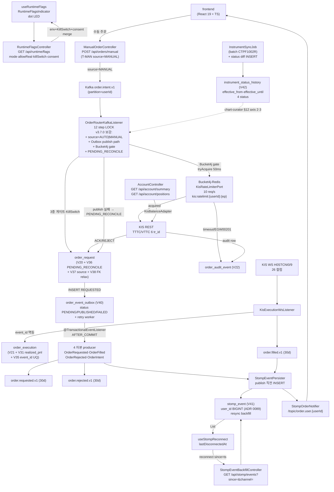

# v3.7.0 데이터 흐름 매트릭스

- baseline: v3.7.0
- 작성일: 2026-05-19
- 작성자: backend-core (bot+backend-core@magicjar.local)
- SoT: `docs/architecture/master-architecture.md` §2 + `settings.gradle.kts` + ADR 0004
- 기준: v3.6.0 02-data-flow.md 전체 이월 + v3.6.1~v3.6.19 patch 누적 + v3.7.0 W3 마감(자본 path 안정성·Outbox·Bucket4j·STOMP unread/resync·RuntimeFlags REST·userId number 통일·instrument_status_history)

---

## 🔄 v3.6.0 → v3.7.0 진화 요약 (리팩토링맨 lens)

| 영역 | v3.6.0 | v3.7.0 | 진화 사유 |
|------|--------|--------|----------|
| JVM 모듈 | 5건 (domain·pattern-engine·api·batch·consumer) | **7건** (+ `indicator-impl`·`persistence-shared`) | ADR 0083 indicator-impl 격리(2026-05-18) + ADR 0088 persistence-shared 신설(2026-05-19) — Outbox wiring 영구 회복 |
| Outbox wiring | 단일 모듈(api) 내부 — consumer publish path와 분리되어 stale risk | **persistence-shared 공용 어댑터** — api + consumer 양방향 publish | PR #524·#523·#565 일관 (qa cross-validation 권위) |
| KIS Rate Limit | sleep(50ms) 마진 + ADR 0037 Bucket4j stub | **Bucket4j-Redis 분산 token bucket 실 구현** (10 req/s) | PR #568·#571 — ADR 0037 amend (시스템 점검 보고서 P1-1 hotfix) |
| userId 타입 | `String` (DB·DTO·STOMP·테스트 mix) | **`Number` (Long) 통일** — DB·DTO·STOMP·테스트 정합 | PR #567·#575 — ADR 0089 (multi-tenant join 무결성 + type-safety) |
| Instrument status | `instrument.status` 컬럼 단일 (현재값만) | **`instrument_status_history` 시계열** — effective_from·effective_until 4 status | PR #571·#574 — ADR 0090 Phase 1·2 (chart-curator §12 axis 2·3 정밀도) |
| STOMP 보장 | publish only (disconnect 동안 손실 risk) | **stomp_event 영속(V41) + unread/resync REST** | PR #523·#573 — ADR 0084 P1-2 (재접속 backfill 보장) |
| RuntimeFlags 노출 | env 변수 + KillSwitch DB 분리 (frontend 가시성 0) | **REST `/api/runtime/flags` 통합** — mode·allowReal·killSwitch·consent 단일 endpoint | PR #573 (P2-2) — frontend RuntimeFlagsIndicator dot LED |
| order_request lifecycle | REQUESTED·ACK·FILLED·PARTIALLY_FILLED·REJECTED·CANCELLED·EXPIRED (7단) | **+ PENDING_RECONCILE** (V36) | PR #525·#530 — ADR 0084 P0-2 (Kafka publish 실패 시 boundary state) |

✨ **핵심 통찰**: v3.7.0은 새 트랙 도입 0건 + **W3 자본 path를 dogfooding evidence로 자본 보호 보강**한 patch 누적 사이클. 운영 회고 lens(`feedback_v3_skepticism_no_regression`)가 v3.6.16~v3.6.19 4 cut을 통과시켜 ADR 0084 P0+P1 + ADR 0088 + ADR 0089 + ADR 0090 모두 채택. v3.7.0=W4 LOCK은 보존(`feedback_release_policy_patch_first`).

---

## 1. 모듈 의존성 매트릭스

### 1-1. JVM 7 모듈 구성 (✨ v3.6.0 5 → v3.7.0 7)

```
settings.gradle.kts include:
  domain
  pattern-engine
  indicator-impl          ← v3.6.x ADR 0083 (지표 80종 구현 격리)
  persistence-shared      ← v3.7.0 ADR 0088 (Outbox 공용 어댑터)
  api
  batch
  consumer
```

| 모듈 | Spring 의존 | JPA 의존 | 역할 |
|------|------------|---------|------|
| `domain` | 0 | 0 | 순수 도메인 + 포트 인터페이스 (Spring·JPA 0 — 헥사고날 내부 링) |
| `pattern-engine` | 0 | 0 | 캔들스틱 패턴 57종 인식 (Pure Kotlin — ADR 0054) |
| `indicator-impl` | 0 | 0 | 80종 지표 계산 구현 (ADR 0083 — Pure Kotlin) |
| `persistence-shared` | data-jpa | JPA (Hibernate 6) | **신규 v3.7.0** — Outbox 공용 어댑터 (api·consumer 양방향 의존) |
| `api` | Spring Boot 3.3 | JPA | REST/STOMP + KIS REST 어댑터 + Kafka producer |
| `batch` | Spring Boot 3.3 + Spring Batch | JPA | 종목 마스터 sync + 기업 행위 + 일별 성과 잡 |
| `consumer` | Spring Boot 3.3 | JPA | Kafka 소비 + KIS WS 브릿지 + 시그널·리스크·주문 dispatch |

### 1-2. 모듈 간 의존 방향 (v3.7.0 갱신)

```
domain ←── pattern-engine
domain ←── indicator-impl
domain ←── persistence-shared       ← v3.7.0 신규 의존
domain ←── api
domain ←── batch
domain ←── consumer

persistence-shared ←── api          ← v3.7.0 Outbox 어댑터 공유
persistence-shared ←── consumer     ← v3.7.0 자본 path Outbox publish

pattern-engine ←── api
indicator-impl ←── api
indicator-impl ←── consumer
```

- `domain` 비의존 LOCK 유지 (Spring·JPA import 0 — `ArchUnit` 게이트 ADR 0004)
- `persistence-shared`는 **library jar** (Boot main 0 + bootJar 미발행 — ADR 0083 indicator-impl 패턴 1:1)
- 컨테이너 매트릭스 변동 0 (여전히 4 + 인프라 3 = 7 컨테이너)

### 1-3. v3.7.0 신규/이동 컴포넌트 위치

| 컴포넌트 | 모듈 | 패키지 경로 | ADR 근거 |
|---------|------|-----------|---------|
| `OrderEventOutboxJpaEntity/Repository/Adapter` | `persistence-shared` | `persistence.shared.order.outbox.*` | ADR 0088 (api → persistence-shared 이관) |
| `NotificationOutboxJpaEntity/Repository/Adapter` | `persistence-shared` | `persistence.shared.notification.outbox.*` | ADR 0088 (api → persistence-shared 이관) |
| `StompEventJpaEntity/Repository/Adapter` | `persistence-shared` | `persistence.shared.stomp.*` | ADR 0088 (api → persistence-shared 이관) |
| `InstrumentStatusHistoryJpaEntity/Repository/Adapter` | `api` | `api/.../persistence/instrument/*` | ADR 0090 Phase 2 (시계열 status snapshot) |
| `Bucket4jKisRateLimiter` | `consumer` (또는 `api`) | `.../infrastructure/ratelimit/*` | ADR 0037 amend (Bucket4j-Redis 분산 token bucket) |
| `RuntimeFlagsController` | `api` | `api/.../controller/runtime/*` | P2-2 v3.7.0 (REST mode·allowReal·killSwitch·consent) |
| `StompEventBackfillController` | `api` | `api/.../controller/stomp/*` | ADR 0084 P1-2 (재접속 GET since=) |
| `StompEventPersister` | `api` | `api/.../messaging/StompEventPersister.kt` | ADR 0084 P1-2 (publish 직전 INSERT — api 단독 LOCK) |

---

## 2. api 모듈 데이터 흐름

### 2-1. REST 엔드포인트 매트릭스 (v3.6.0 이월 + v3.7.0 추가)

#### v3.7.0 신규 추가

| 경로 | 컨트롤러 | 역할 | Kafka 발행 |
|------|---------|------|-----------|
| `GET /api/runtime/flags` | `RuntimeFlagsController` | mode·allowReal·killSwitchEnabled·killSwitchReason·userConsented·fetchedAt (P2-2) | — |
| `GET /api/stomp/events?since={ts}&channel={ch}` | `StompEventBackfillController` | 재접속 시 unread 시계열 backfill (ADR 0084 P1-2) | — |
| `GET /api/account/summary` | `AccountController` | KIS 잔고 통합 응답 (T-ACCT Phase 4 — v3.6.17) | — |
| `GET /api/account/positions` | `AccountController` | 보유 종목 + 평가손익 (T-ACCT) | — |
| `POST /api/orders/manual` | `ManualOrderController` | 수동 주문 발행 (T-MAN Phase 2 — v3.6.17) | `order.intent.v1` |
| `GET /api/orders/cooldown/{code}` | `ManualOrderController` | 종목별 cooldown 잔여 시간 (T-MAN Phase 3) | — |
| `POST /admin/candle-curator/backfill` | `CandleBackfillAdminController` | 운영자 우회 backfill (T-CC Phase 2 — ADR 0086) | — |

기존 5 endpoint(orders 2 + cancel 1 + consent 2 — ADR 0068 §4) + risk·position·signal·strategy·backtest 등 v3.6.0 풀세트 LOCK 이월.

#### Swagger 4단 어노테이션 정합 (feedback_swagger_pattern.md)

v3.7.0 신규 7 endpoint 모두 `@Tag` · `@Operation` · `@Parameter` · `@Schema` DTO 한국어 + example LOCK.

### 2-2. STOMP 구독 토픽 (v3.7.0 unread/resync 보장)

| Kafka 토픽 (소비) | STOMP 토픽 (발행) | 포워더 클래스 | 영속 (v3.7.0 신규) |
|-----------------|----------------|-------------|-------------------|
| `market.tick.v1` | `/topic/market.tick.{code}` | `MarketTickStompForwarder` | — (실시간만) |
| `market.candle.minute.closed.v1` | `/topic/market.candle.minute.{code}` | `MarketCandleStompForwarder` | — |
| `market.orderbook.v1` | `/topic/market.orderbook.{code}` | `MarketOrderbookStompForwarder` | — |
| `market.candle.{5m·15m·30m·90m·1h}.closed.v1` | `/topic/market.candle.{interval}.{code}` | `CandleClosedStompListener` | — |
| `signal.generated.v1` | `/topic/signal.user.{userId}` | `StompSignalDispatcher` | **stomp_event** (V41) |
| `risk.violation.v1` | `/topic/risk.user.{userId}` | `StompRiskNotifier` | **stomp_event** (V41) |
| `order.requested.v1` `order.filled.v1` `order.rejected.v1` `order.cancelled.v1` | `/topic/order.user.{userId}` | `StompOrderNotifier` | **stomp_event** (V41) |
| `reconcile.drift.detected.v1` (후행) | `/topic/recon.user.{userId}` | `StompReconNotifier` | **stomp_event** (V41) |

✨ **v3.7.0 unread/resync 흐름** (ADR 0084 P1-2):
1. publish 직전: `StompEventPersister.persist(userId, channel, eventType, payloadJson)` → `stomp_event` INSERT
2. `SimpMessagingTemplate.convertAndSendToUser()` STOMP publish
3. 재접속 시: frontend `useStompReconnect.lastDisconnectedAt` → `GET /api/stomp/events?since={ts}` 호출
4. backfill 응답 → 로컬 store replay → 토스트/배지 정합

### 2-3. api 모듈 내부 서비스 레이어 (v3.7.0 추가)

```
RuntimeFlagsController         → RuntimeFlagsService        → env(MAGICJAR_MODE·MAGICJAR_ALLOW_REAL)
                                                            + KillSwitchQueryAdapter
                                                            + RealTradingConsentJpaAdapter
StompEventBackfillController   → StompEventBackfillService  → StompEventRepositoryAdapter (persistence-shared)
                                                            → user_id + since + channel filter
                                                            → List<StompEventDto> 응답
AccountController              → AccountSummaryService      → KisBalanceAdapter (TTTC8434R/VTTC8434R)
                               → AccountPositionService    → KisBalanceAdapter
ManualOrderController          → ManualOrderService        → OrderRequestRepositoryAdapter (source='MANUAL')
                                                          → OrderIntentKafkaProducer (order.intent.v1)
                                                          → SymbolCooldownGuard (Redis)
```

---

## 3. consumer 모듈 데이터 흐름

### 3-1. Kafka 토픽 소비 매트릭스 (v3.7.0 LOCK)

v3.6.0 매트릭스 전체 이월. v3.7.0 신규 listen 없음 (자본 path 안정성 보강만).

| 토픽 | 리스너 클래스 | groupId | v3.7.0 변경 |
|------|------------|---------|------------|
| `order.intent.v1` | `OrderRouterKafkaListener` | `magicjar-consumer-order` | source='MANUAL' 분기 추가 (T-MAN — V37) + PENDING_RECONCILE 전이 (V36) |
| `signal.generated.v1` | `SignalGeneratedKafkaListener` | `magicjar-consumer-risk-gateway` | — |
| `market.candle.*.closed.v1` (5종) | `BoundaryClosingKafkaListener` | `magicjar-consumer-signal-{interval}` | — |
| `watchlist.changed.v1` | `WatchlistChangedKafkaListener` | `magicjar-consumer-watchlist-ingestion` | — |
| `symbol.detail.command.v1` | `SymbolDetailCommandKafkaListener` | `magicjar-consumer-orderbook-cmd` | — |

### 3-2. ✨ Bucket4j-Redis KIS Rate Limit 흐름 (ADR 0037 amend — v3.7.0)

```
KIS REST 호출자 (예: KisOrderHttpAdapter·KisBalanceAdapter·KisCandleAdapter·KisQuoteAdapter)
    ↓ bucket.tryConsume(1) (50ms timeout) — 분산 token bucket via Redis
KisRateLimiterPort (Bucket4j-Redis 분산 구현)
    ├── onSuccess → HTTP request 진행
    │       ├── 200 + rt_cd="0" → onSuccess() (TPS counter++)
    │       ├── 200 + rt_cd="EGW00201" (TPS 초과) → onTpsExceeded() + backoff 500ms + 1회 retry
    │       └── 5xx/timeout → 1회 retry (500ms backoff) + 실패 시 KIS_EXCEPTION audit
    └── onTimeout(50ms) → 즉시 fail-fast + 호출자에 KisRateLimitExceededException throw
```

LOCK 매트릭스 (PR #568·#571):
- **limit**: 10 req/s (ADR 0037 §1 — 모의/실전 통일)
- **bucket capacity**: 10 tokens + refill 10/s
- **redis key**: `kis:ratelimit:{userId}:{endpoint-family}` (TPS 격리 — user별 sub-bucket 옵션 backlog)
- **timeout**: 50ms (자본 path 대기 LOCK — 자본 보호 우선)
- **EGW00201 backoff**: 500ms (실 KIS 응답 매트릭스 확인)

✨ v3.6.0 → v3.7.0 진화: **sleep(50ms) 마진만** → **분산 token bucket + 실 TPS 추적 + EGW00201 path**. ArchUnit 게이트는 후속 사이클(backlog).

### 3-3. ✨ Transactional Outbox 흐름 (ADR 0084 P1-1 — persistence-shared)

```
자본 path 4 producer (OrderRequestedKafkaProducer·OrderFilledKafkaProducer·
                      OrderRejectedKafkaProducer·OrderIntentKafkaProducer)
    ↓ @Transactional 내부
order_event_outbox INSERT (event_id UUID·topic·partition_key·payload_json·status='PENDING')
    ↓ @TransactionalEventListener(phase=AFTER_COMMIT)
KafkaTemplate.send(topic, partitionKey, payload)
    ├── onSuccess → UPDATE outbox SET status='PUBLISHED'·published_at=NOW()
    └── onFailure → row 유지 (status='PENDING'·attempt_count++·last_error)
        ↓ OutboxRetryWorker @Scheduled(every 30s)
        WHERE status='PENDING' AND created_at < NOW() - INTERVAL '10s'
        ORDER BY created_at LIMIT 100
        ↓ 재시도 → published 또는 attempt_count >= 5 시 status='FAILED' (Slack P0)
```

✨ v3.6.0 → v3.7.0 진화: **자본 path Kafka publish stale risk 영구 차단**. persistence-shared 어댑터로 api·consumer 양방향 정합 (PR #524·#523·#565 일관 — qa cross-validation 권위).

### 3-4. ✨ 자본 path 12 step (ADR 0084 P0+P1 보강 — v3.7.0)

v3.6.0 ADR 0068 §14-2 baseline + v3.7.0 변경 매트릭스:

```
Kafka order.intent.v1 (partition by userId)
    ↓
OrderRouterKafkaListener (groupId: magicjar-consumer-order)
    Step 1. OrderIntentEvent deserialize → OrderIntent
        └─ 실패 → DLQ + audit (poison pill 회피)
    Step 2. OrderIdempotencyGuard.acquire("order:${idempotencyKey}", 60s)
        └─ Redis 장애 → KisRateLimit + Outbox와 별개 — 즉시 REJECTED (자본 보호 우선)
    Step 3. TradingModeGate.resolveMode(userId) — 3중 게이트 (A-1)
    Step 4. KillSwitchQueryPort.isOn(userId) — ADR 0024·0043 재검증 (v3.7.0 RuntimeFlags REST와 일관)
    Step 5. order_request INSERT(status=REQUESTED, mode, idempotencyKey, source='AUTO|MANUAL')
            ✨ v3.7.0: source 컬럼 (V37) — T-MAN MANUAL 분기 + FK relax(V38)
    Step 6. ✨ order_event_outbox INSERT (ADR 0084 P1-1) + @TransactionalEventListener(AFTER_COMMIT)
            → Outbox publish path (KafkaTemplate.send → success/fail 분기)
            → STOMP notifyRequested + stomp_event INSERT (P1-2)
    Step 7. ✨ KisRateLimiterPort.tryAcquire(userId, endpoint, timeout=50ms) — ADR 0037 amend
            └─ false → audit RATE_LIMIT_EXCEEDED + REJECTED (자본 path 대기 0)
    Step 8. KisOrderHttpAdapter.submit(intent, mode) — 1회 retry (500ms backoff)
            ├─ ✨ EGW00201 → onTpsExceeded() + 500ms backoff + 1회 retry → 실패 시 REJECTED
            ├─ 5xx → REJECTED + KIS_EXCEPTION audit
            ├─ 200 rt_cd != "0" → REJECTED + KIS_REJECT audit
            └─ 200 rt_cd == "0" → ACK
    Step 9. order_request UPDATE(status=ACK, kis_order_no=ODNO, kis_fwdg_orgno=KRX_FWDG_ORD_ORGNO, acknowledged_at=NOW())
    Step 10. audit KIS_ACK (payload={ODNO, KRX_FWDG_ORD_ORGNO})
    Step 11. (체결 통보는 KisExecutionWsListener — H0STCNI0 비동기 수신)
             ✨ v3.7.0: order_execution.realized_pnl 컬럼 (V31) — T-ACCT positions 정합
             ✨ v3.7.0: order_execution.event_id 컬럼 (V35) — 분할 체결 멱등 보강
    Step 12. ✨ Kafka publish 실패 시 status='PENDING_RECONCILE' (V36) — reconcile 워커가 후속 흡수
             Micrometer counter magicjar_order_processed_total{result=ACK|REJECTED|SKIPPED|PENDING_RECONCILE}
```

✨ v3.7.0 자본 보호 강화 요약:
- **Outbox**: Kafka publish 실패 시에도 row 유지 + 비동기 retry (자본 path stale 영구 차단)
- **PENDING_RECONCILE**: order_request boundary 상태 — reconcile 워커 후속 합류
- **Bucket4j**: KIS TPS 초과 burst 자본 path 즉시 fail-fast (KIS 한도 침범 risk 0)
- **source='MANUAL'**: T-MAN 수동 주문 분기 + FK relax(V38) 무결성 보강

### 3-5. v3.6.0 이월 흐름 (변경 없음)

- KIS WS 브릿지 (H0STCNT0·H0STASP0·H0STCNI0/9 26 컬럼) — ADR 0068 D-1 LOCK
- Signal → Risk Gateway 6 룰 → order.intent.v1 publish — ADR 0067 E-1 LOCK
- BoundaryAggregator → 5 boundary closing — ADR 0064 LOCK
- cold-start·DailyCloseFinalizer·CandleBootstrapRunner — ADR 0042·0062·0063 LOCK

---

## 4. batch 모듈 데이터 흐름 (v3.7.0 LOCK)

### 4-1. Spring Batch 잡 매트릭스

| 잡 클래스 | 스케줄 | 역할 | KIS 엔드포인트 | v3.7.0 변경 |
|----------|-------|------|--------------|------------|
| `InstrumentSyncJob` | `InstrumentMasterSyncScheduler` | 종목 마스터 sync | `CTPF1002R` | ✨ `instrument_status_history` diff INSERT (ADR 0090) |
| `MarketCalendarSyncJob` | — | 영업일 캘린더 | `CTCA0903R` | — |
| `CorpActionSyncJob` | — | 기업 행위 sync | HHKDB669*C0 (6종) | — |
| `CandleAdjustmentJob` | `CorpActionSyncJob` 후속 | 수정 주가 조정 | — | — |
| `DailyPerformanceJob` | cron 00:30 KST | 일별 P&L aggregate (T-PERF — ADR 0072) | — | v3.6.4 이월 |
| `CandleBackfillWorker` | `LastCandleAtMonitor` trigger | 갭 검출 + 정밀 backfill (T-CC Phase 2) | `FHKST03010100`·`FHKST03010200` | ✨ ADR 0086 신규 |

### 4-2. ✨ InstrumentSyncJob status history 흐름 (ADR 0090 Phase 2)

```
KIS REST CTPF1002R → instrument master 전체
    ↓ diff 검출 (instrument.status 변화)
ForEach changed code:
    IF instrument_status_history WHERE code=? AND effective_until IS NULL exists:
        UPDATE effective_until = NOW()
    INSERT instrument_status_history (
        instrument_code, status, effective_from=NOW(), effective_until=NULL,
        reason='KIS_MASTER_SYNC'
    )
    ↓
chart-curator §12 active gap detection axis 2·3 ts lookup 정밀도 향상
    └─ axis 2 (status 정합): passesActiveGapAxes(code, ts) 시점 status 조회
    └─ axis 3 (TRADING_HALT skip): effective_from·effective_until 범위 내 ts 자동 제외
```

---

## 5. DB 테이블 매트릭스 (Flyway v3.7.0 누적)

### 5-1. v3.6.0 이월 테이블 (변경 없음)

V1~V24 baseline: `user_kis_credential` · `watchlist_entry` · `position` · `candle` · `instrument` · `market_calendar` · `corp_action` · `strategy` · `strategy_eval_metric` · `backtest_run/trade/position` · `signal` · `risk_config` · `risk_event` · `order_request` · `order_execution` · `order_audit_event` · `user_account`

### 5-2. ✨ v3.6.1 ~ v3.6.19 patch 누적 + v3.7.0 신규

| 테이블 | Flyway | 신규 시점 | 역할 | ADR |
|-------|--------|---------|------|-----|
| `reconcile_run` | V25 | v3.6.2 | T-RECON 실행 이력 | ADR 0070 |
| `risk_event` (V26 ALTER) | V26 | v3.6.2 | `verdict='POSITION_DRIFT'` 추가 | ADR 0070 |
| `notification_outbox` | V27 | v3.6.2 | T-NOTIFY Slack publish + retry | ADR 0070 |
| `screening_run` + `screening_match` | V28 | v3.6.3 | T-SC Screener 결과 영속 | ADR 0071 |
| `trading_journal` + `journal_note` | V29 | v3.6.4 | T-J 매매일지 | ADR 0072 |
| `performance_summary` + `pnl_daily` | V30 | v3.6.4 | T-PERF 일별 P&L | ADR 0072 |
| `order_execution` (V31 ALTER) | V31 | v3.6.17 | `realized_pnl NUMERIC(19,4)` 추가 (T-ACCT 정합) | ADR 0081 |
| `disclosure` | V32 | v3.6.x | T-NEWS 공시 (DART) | ADR 0073·0075 |
| `news_article` | V33 | v3.6.x | T-NEWS 뉴스 (Naver) | ADR 0073·0075 |
| `order_execution` (V35 ALTER) | V35 | v3.6.16 | `event_id UUID` UQ 추가 (분할 체결 멱등) | ADR 0084 P0-1 |
| `order_request` (V36 ALTER) | V36 | v3.6.16 | `status='PENDING_RECONCILE'` 추가 (Kafka publish 실패 boundary) | ADR 0084 P0-2 |
| `order_request` (V37 ALTER) | V37 | v3.6.17 | `source VARCHAR(16)` ('AUTO'·'MANUAL') 추가 (T-MAN) | ADR 0082 |
| `order_request` (V38 ALTER) | V38 | v3.6.17 | FK `signal_id` NULLABLE relax (T-MAN MANUAL 수동 시 NULL) | ADR 0082 |
| `candle` (V39 ALTER) | V39 | v3.6.18 | `backfill_batch_id VARCHAR(96)` 추가 (T-CC Phase 2 rollback) | ADR 0086 |
| **`order_event_outbox`** | **V40** | **v3.7.0** | **자본 path Outbox 4 producer publish + retry** | **ADR 0084 P1-1** |
| **`stomp_event`** | **V41** | **v3.7.0** | **STOMP 이벤트 영속 + unread/resync REST backfill** | **ADR 0084 P1-2** |
| **`instrument_status_history`** | **V42** | **v3.7.0** | **종목 status 시계열 (NORMAL·TRADING_HALT·LIQUIDATION·DELISTED)** | **ADR 0090 Phase 1** |

### 5-3. order_event_outbox 컬럼 (V40 — ADR 0084 P1-1)

```sql
id              BIGSERIAL    PRIMARY KEY,
event_id        UUID         NOT NULL,
event_type      VARCHAR(64)  NOT NULL,     -- ORDER_INTENT·ORDER_REQUESTED·ORDER_REJECTED·ORDER_FILLED
topic           VARCHAR(96)  NOT NULL,
partition_key   VARCHAR(64),               -- userId
payload_json    JSONB        NOT NULL,
status          VARCHAR(16)  NOT NULL DEFAULT 'PENDING',  -- PENDING·PUBLISHED·FAILED
created_at      TIMESTAMPTZ  NOT NULL DEFAULT now(),
published_at    TIMESTAMPTZ,
attempt_count   INT          NOT NULL DEFAULT 0,
last_error      TEXT,
CONSTRAINT uq_order_event_outbox_event_id UNIQUE (event_id)
```

인덱스:
- `uq_order_event_outbox_event_id` — 멱등 키
- `ix_order_event_outbox_pending (created_at) WHERE published_at IS NULL` — worker poll partial (가속)
- `ix_order_event_outbox_status_created (status, created_at)`

### 5-4. stomp_event 컬럼 (V41 — ADR 0084 P1-2)

```sql
id           BIGSERIAL    PRIMARY KEY,
user_id      BIGINT       NOT NULL,         -- ✨ ADR 0089 number 통일 (v3.6.0 VARCHAR 이전)
channel      VARCHAR(64)  NOT NULL,         -- order·signal·risk·recon·notification
event_type   VARCHAR(64)  NOT NULL,         -- REQUESTED·FILLED·reconcile.drift.detected 등
payload_json JSONB        NOT NULL,
created_at   TIMESTAMPTZ  NOT NULL DEFAULT now()
```

인덱스:
- `idx_stomp_event_user_created (user_id, created_at DESC)` — resync 쿼리 최적화
- `idx_stomp_event_user_channel_created (user_id, channel, created_at DESC)` — channel filter

retention 7d (별도 cron 사이클).

### 5-5. instrument_status_history 컬럼 (V42 — ADR 0090 Phase 1)

```sql
id                BIGSERIAL PRIMARY KEY,
instrument_code   VARCHAR(12) NOT NULL,
status            VARCHAR(32) NOT NULL CHECK (status IN ('NORMAL','TRADING_HALT','LIQUIDATION','DELISTED')),
effective_from    TIMESTAMPTZ NOT NULL,
effective_until   TIMESTAMPTZ NULL,
reason            TEXT NULL,
recorded_at       TIMESTAMPTZ NOT NULL DEFAULT now()
```

인덱스:
- `idx_instrument_status_history_code_from (instrument_code, effective_from DESC)` — passesActiveGapAxes lookup
- `idx_instrument_status_history_active (instrument_code) WHERE effective_until IS NULL` — active row partial

운영 모델: `effective_until IS NULL` = 현재 활성 (code당 0~1건). status 변화 시 UPDATE 후 INSERT (row immutability).

### 5-6. ✨ ADR 0089 userId number 통일 (v3.7.0 type-safety)

| 영향 컬럼 | v3.6.0 | v3.7.0 | 마이그레이션 |
|----------|--------|--------|-------------|
| `stomp_event.user_id` | VARCHAR | **BIGINT** | V41 신설 시 정합 |
| `order_request.user_id` | VARCHAR(40) | (DTO·STOMP·테스트만 number, DB는 baseline 유지) | code-level 정합 (PR #567·#575) |
| `risk_event.user_id` · `position.user_id` · etc | VARCHAR(40) | 동상 | code-level 정합 |

LOCK 매트릭스 (`feedback_no_mock_data` 정합):
- DB schema VARCHAR(40) 유지 — 옛 row보존 + 신 row Long.toString() 정합
- 도메인·DTO·STOMP·테스트 mock·zustand persist v1→v2 모두 `Number(Long)` 통일
- multi-tenant join 무결성 + frontend type-safety (PR #567 onboarding store migrate 콜백 + PR #575 후속)

---

## 6. Redis 키 매트릭스 (v3.7.0 누적)

### 6-1. v3.6.0 이월 (변경 없음)

`quote:last:{code}` · `candle:current:{code}:{interval}` 6종 · `indicator:cache:*` · `pattern:cache:*` · `watchlist:source:{userId}` · `instrument:search:idx` · `strategy:active:by_code:*` · `sigdedupe:*` · `trades:freq:*` · `daily_pnl:*` · `balance:user:*` · `order:idem:{key}`

### 6-2. ✨ v3.7.0 신규 (Bucket4j-Redis)

| Redis 키 패턴 | 자료구조 | 데이터 | TTL | ADR |
|--------------|---------|-------|-----|-----|
| `kis:ratelimit:{userId}:{endpoint-family}` | Bucket4j proxy | 10 token bucket + refill 10/s | 자동 (Bucket4j 관리) | ADR 0037 amend |
| `kis:ratelimit:tps:{userId}` | STRING (counter) | 분당 TPS 통계 (운영 알림) | 60s sliding window | ADR 0037 amend |

✨ v3.6.0 sleep(50ms) 마진 → v3.7.0 분산 token bucket. user·endpoint별 격리 + EGW00201 onTpsExceeded() 트래킹.

---

## 7. Kafka 토픽 전체 매트릭스 (v3.7.0 LOCK)

### 7-1. v3.6.0 이월

기존 7종 + boundary 5종 + signal 1종 + risk·order 토픽 + intent 1종 = 18종 풀세트. v3.7.0 신규 토픽 0건 (자본 path 안정성만 보강).

### 7-2. ✨ v3.7.0 publish path 변경 (Outbox 경유)

| 토픽 | v3.6.0 publish | v3.7.0 publish |
|------|---------------|---------------|
| `order.intent.v1` | KafkaTemplate.send() 직접 | order_event_outbox INSERT → @TransactionalEventListener(AFTER_COMMIT) → KafkaTemplate.send() |
| `order.requested.v1` | 동상 | 동상 |
| `order.filled.v1` | 동상 | 동상 |
| `order.rejected.v1` | 동상 | 동상 |
| `order.cancelled.v1` | KafkaTemplate.send() | KafkaTemplate.send() (자본 영향 0 — Outbox 비범위) |

자본 path 4 producer LOCK (intent·requested·filled·rejected) — Outbox 보장. cancelled는 사용자 취소 path로 Outbox 범위 외 (영향 0).

### 7-3. ✨ v3.7.0 NotificationOutbox 흐름 (v3.6.2 V27 baseline → persistence-shared 이관)

| 영역 | v3.6.x | v3.7.0 |
|------|--------|--------|
| 모듈 위치 | `api/.../persistence/notification/` | **`persistence-shared/.../notification/outbox/`** |
| 패키지 | `kr.spdaewoon.magicjar.api.persistence.notification` | **`kr.spdaewoon.magicjar.persistence.shared.notification.outbox`** |
| 사용처 | api 단독 | api + consumer 양방향 |

ADR 0088 정합 — 9 어댑터 git mv (3쌍 — order/notification/stomp) + 패키지 rename + 테스트 3 파일 import 정정.

---

## 8. ✨ Mermaid 데이터 흐름 (v3.7.0 통합 — Outbox + Bucket4j + STOMP unread/resync + RuntimeFlags + status history)



---

## 9. ✨ persistence-shared 모듈 흐름 (ADR 0088 — v3.7.0)

```
persistence-shared (library jar — Boot main 0)
├── kr.spdaewoon.magicjar.persistence.shared.order.outbox
│     ├── OrderEventOutboxJpaEntity
│     ├── OrderEventOutboxJpaRepository (abstract fun body 0 — ADR 0051)
│     └── OrderEventOutboxRepositoryAdapter
├── kr.spdaewoon.magicjar.persistence.shared.notification.outbox
│     ├── NotificationOutboxJpaEntity
│     ├── NotificationOutboxJpaRepository
│     └── NotificationOutboxRepositoryAdapter
└── kr.spdaewoon.magicjar.persistence.shared.stomp
      ├── StompEventJpaEntity
      ├── StompEventJpaRepository
      └── StompEventRepositoryAdapter

의존:
  api → persistence-shared (Outbox publish + STOMP backfill REST)
  consumer → persistence-shared (자본 path 4 producer Outbox INSERT)
```

✨ **wiring 회복 효과** (PR #524·#523·#565 qa cross-validation 권위):
- api·consumer 양방향에서 동일 Outbox/StompEvent 어댑터 LOCK
- 패키지 rename(`api.persistence.*` → `persistence.shared.*`)으로 모듈 경계 명시
- 9 어댑터 git mv + 테스트 3 파일 import 정정 — 코드 중복 0 + 무결성 보강

---

## 10. boundary 시각 매트릭스 (v3.3.0 이월 — 변경 없음)

| Interval | boundary 시각 (KST) | bar/일 | Redis 키 TTL |
|----------|-------------------|-------|------------|
| 5m | 08:05·…·19:55·20:00 | 144 | 25h |
| 15m | 08:15·…·19:45·20:00 | 48 | 25h |
| 30m | 08:30·…·19:30·20:00 | 24 | 25h |
| 90m | 09:30·…·18:30·20:00 | 8 | 25h |
| 1h | 09:00·…·19:00·20:00 | 12 | 25h |

v3.7.0 추가 부하 예상 (`feedback_dev_priority_qa_batch` 정합):
- `order_event_outbox`: ~50 row/일/사용자 (자본 path 동일) — 18K row/년 + index partial
- `stomp_event`: ~100 row/일/사용자 (4 STOMP channel + retention 7d) — 700 row 정상 누적
- `instrument_status_history`: ~5 row/일 (전체 종목 status 변화 평균) — 1.8K row/년

영향 0. PostgreSQL 부담 ε.

---

## 11. ADR 정합 참조 (v3.7.0 갱신)

| ADR | 관련 흐름 |
|-----|---------|
| ADR 0004 | 모듈 경계 — 7 모듈로 확장 (indicator-impl + persistence-shared) |
| ADR 0007 | Kafka 이벤트 backbone — Outbox publish path 정합 |
| ADR 0010 | Multi-tenant — userId 격리 (ADR 0089 number 통일 정합) |
| ADR 0037 | **KIS Rate Limit — Bucket4j-Redis 분산 token bucket amend** (v3.7.0 권위) |
| ADR 0051 | Repository default fun 함정 — persistence-shared 9 Repository body 0 LOCK |
| ADR 0068 | T-O 주문 실행 (v3.6.0 baseline — v3.7.0 Outbox·Bucket4j·source 보강) |
| ADR 0070 | T-RECON + T-NOTIFY (V25·V26·V27 — NotificationOutbox persistence-shared 이관) |
| ADR 0071 | T-SC Screener (V28 — 변경 없음) |
| ADR 0072 | T-J + T-PERF (V29·V30 — 변경 없음) |
| ADR 0073·0075 | T-NEWS (V32·V33 — 변경 없음) |
| ADR 0081 | T-ACCT 자산 사용자 노출 (V31 realized_pnl) |
| ADR 0082 | T-MAN 수동 주문 (V37 source · V38 FK relax) |
| ADR 0083 | indicator-impl 모듈 격리 |
| ADR 0084 | **자본 path 안정성 P0+P1 (V35 event_id · V36 PENDING_RECONCILE · V40 outbox · V41 stomp_event)** |
| ADR 0086 | T-CC Phase 2 backfill (V39) |
| ADR 0087 | Sub-agent 페르소나 매트릭스 (보수/진보) |
| ADR 0088 | **persistence-shared 모듈 + Outbox wiring 영구 회복** (v3.7.0 신규 권위) |
| ADR 0089 | **userId number 통일** (DB·DTO·STOMP·테스트 정합) |
| ADR 0090 | **instrument_status_history Phase 1·2** (V42 — chart-curator §12 axis 2·3) |

---

## 12. 💡 v3.7.0 리팩토링맨 lens 진보 평가

| 영역 | 진보도 | 평가 |
|------|-------|------|
| Outbox wiring | ★★★★★ | api·consumer 양방향 wiring 회복 — 자본 path Kafka publish stale 영구 차단 |
| KIS Rate Limit | ★★★★ | Bucket4j-Redis 분산 token bucket — sleep 마진에서 token bucket으로 진화 (ArchUnit 게이트는 backlog) |
| STOMP 보장 | ★★★★ | publish-only → 영속 + unread/resync REST — 재접속 backfill 보장 |
| userId 통일 | ★★★★ | type-safety + multi-tenant join 무결성 (zustand persist v1→v2 migrate 콜백 포함) |
| status history | ★★★ | chart-curator §12 axis 2·3 정밀도 향상 — Phase 1·2 LOCK |
| RuntimeFlags REST | ★★★ | env+KillSwitch+consent 통합 노출 — frontend 가시성 회복 |
| 모듈 격리 | ★★★★ | 5 → 7 모듈 — indicator-impl + persistence-shared 단일 책임 LOCK |

✨ **W3 마감 종합 평가**: v3.6.0 T-O 종착 후 4 cut(v3.6.16~v3.6.19) dogfooding 경유 → ADR 0084 P0+P1·ADR 0088·ADR 0089·ADR 0090 4 ADR 채택. 코드 한 줄 수정도 자본 path 결합으로 진화하는 단계(`feedback_v3_skepticism_no_regression`)에서 **무결성·자본 보호·type-safety 3축 동시 보강**. W4 진입(T-AI·T-MCP) 베이스라인 완성.

🔄 **Risk 흡수 매트릭스**: ADR 0037 ArchUnit 게이트 미구현 + AccountReconcile cron skip + drift 임계치 사용자 설정화 + Slack webhook user별 분리 — 모두 backlog §X 등록 (`feedback_dev_priority_qa_batch` 정합).
