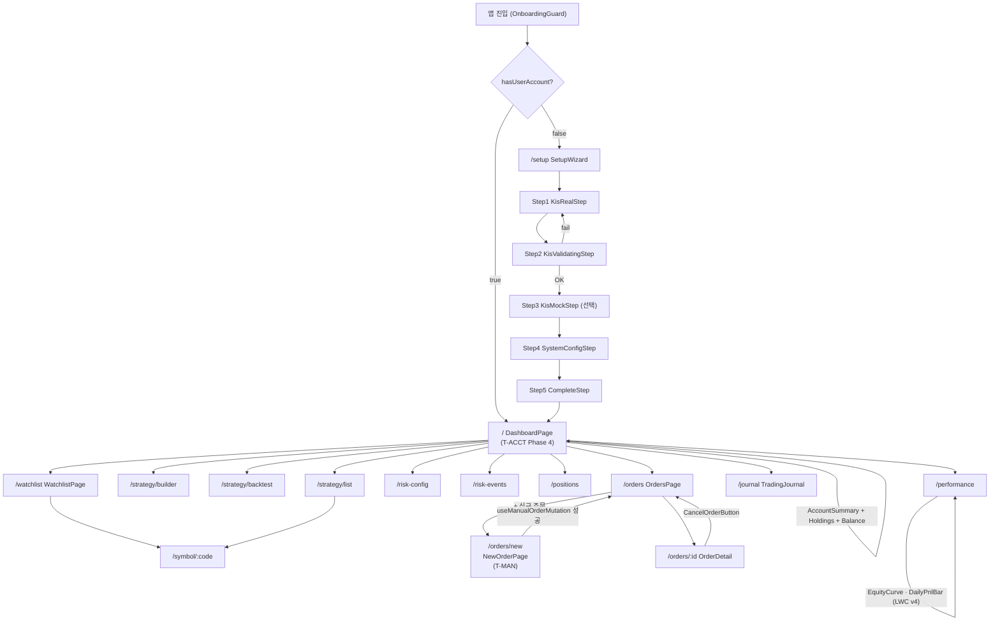
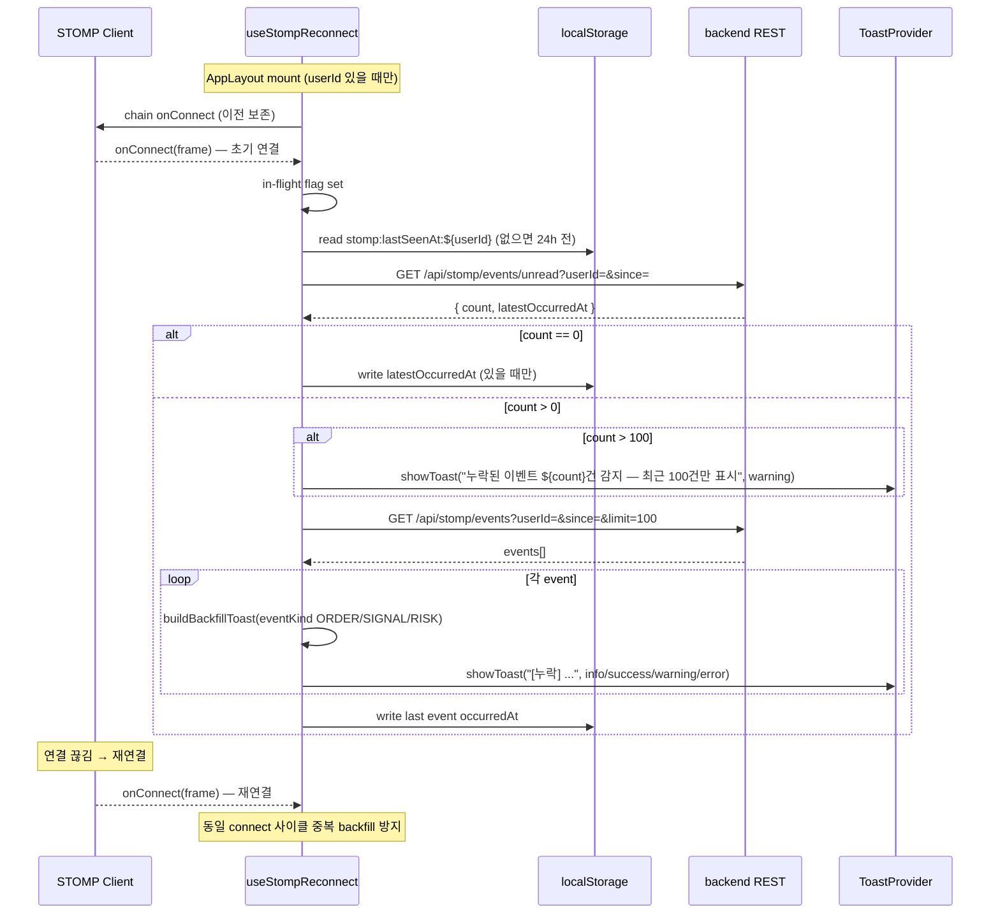
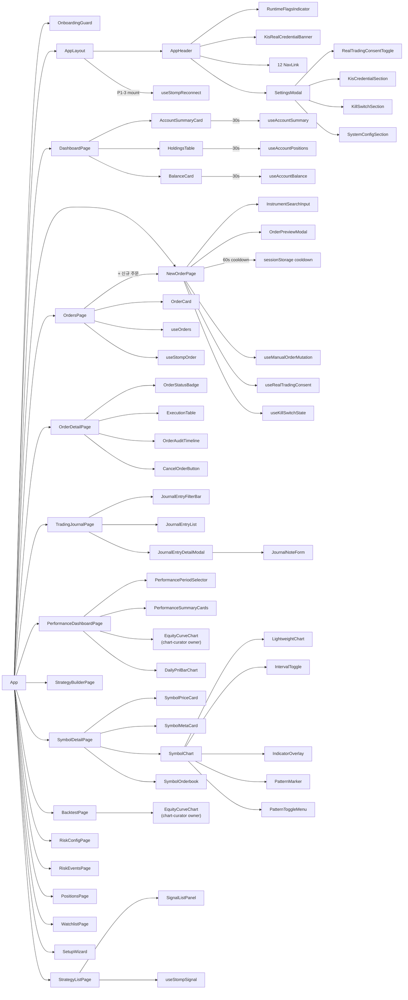

# magicJar v3.7.0 Baseline — 05. UI 화면 인벤토리

> **작성 시점**: 2026-05-19 v3.7.0 baseline cut
> **작성 에이전트**: frontend
> **커버 PR 범위**: v3.6.0 이월 + v3.6.x 시리즈(v3.6.1~v3.6.16) + v3.7.0 cut 직전까지
>   - **T-ACCT Phase 4** (ADR 0081 · PR #509): DashboardPage 격상 — AccountSummaryCard + HoldingsTable + BalanceCard + 30s auto-refresh
>   - **T-MAN Phase 2** (ADR 0082 · PR #515): NewOrderPage + OrderPreviewModal + 8 layer 안전망 + 60s cooldown + 3중 게이트
>   - **T-J Phase 3** (ADR 0072 · PR #ref 2026-05-14): TradingJournalPage `/journal` — filter·list·detail modal
>   - **T-PERF Phase 3** (ADR 0072 · PR #ref 2026-05-14): PerformanceDashboardPage `/performance` — 5 KPI + LWC v4 equity curve + daily P&L bar chart
>   - **T-CC Phase 1·2** (ADR 0085·0086 · PR #514·#571·#574): chart-curator 영입 + LWC dispose 안전망 + Phase 2 history snapshot lens (frontend 영역은 차트 컴포넌트 단일 owner 매트릭스 정합)
>   - **ADR 0089 Phase 2** (PR #575 Part A): userId `string|null` → `number|null` 통일 — 30+ 파일 type only edit + zustand persist migrate v1→v2
>   - **P2-2 RuntimeFlags** (PR #575 Part B): AppHeader 로고 옆 dot LED + 모드 라벨 + 60s refetch
>   - **P1-3 useStompReconnect** (PR #575 Part C): STOMP `onConnect` chain backfill + 2단계 invalidate-query + localStorage anchor + `[누락]` prefix 토스트
> **코드 기준**: `frontend/src/` 직접 inspect — 추측 0건
> **v3.6.0 대비 추가 화면 매트릭스**: `/` 격상(DashboardPlaceholder → DashboardPage T-ACCT) + `/orders/new` 신설(T-MAN) + `/journal` 신설(T-J) + `/performance` 신설(T-PERF) — **총 13 → 16 화면**

---

## 1. 페이지 매트릭스 — v3.7.0 16 라우트 풀세트

`frontend/src/App.tsx` 직접 인용:

| URL 패턴 | 페이지 컴포넌트 | 진입 가드 | 트랙 ID | ADR | 의존 REST (TanStack Query hook) | STOMP 토픽 | mount 시 30s polling |
|---------|--------------|---------|--------|-----|------------------------------|----------|---------------------|
| `/` | `DashboardPage` (T-ACCT Phase 4 격상) | OnboardingGuard | T-ACCT | ADR 0081 | `GET /api/account/summary?userId=&accountType=` (useAccountSummary) + `GET /api/account/positions?userId=&accountType=` (useAccountPositions) + `GET /api/account/balance?userId=&accountType=` (useAccountBalance) | — (REST polling only) | ★ 3 hook 모두 `refetchInterval: 30_000` LOCK |
| `/watchlist` | `WatchlistPage` | OnboardingGuard | T-W1 | ADR 0040 | `GET /api/watchlists` (useWatchlist) + `POST /api/watchlists` (useAddWatchlist) + `DELETE /api/watchlists/{code}` (useRemoveWatchlist) | — | — |
| `/symbol/:code` | `SymbolDetailPage` | OnboardingGuard | T-S1 | ADR 0040 §2-2 | `GET /api/symbols/{code}` (useSymbol 5s polling) + `GET /api/symbols/{code}/candles` (useSymbolCandles) + `GET /api/instruments/{code}` (useInstrument) + `GET /api/indicators/{id}` (useIndicators) + `GET /api/symbols/{code}/patterns` (usePatterns) | `/topic/market.tick.{code}` + `/topic/market.candle.minute.{code}` + `/topic/market.orderbook.{code}` + `/topic/market.candle.{5m/15m/30m/90m/1h}.{code}` (interval 선택 시) | 5s tick polling |
| `/strategy/builder` | `StrategyBuilderPage` | OnboardingGuard | T-SB | ADR 0040 §1 · ADR 0055 | `POST /api/strategy/validate` + `POST /api/strategy/{id}/evaluate` + `POST /api/strategy` + `POST /api/dsl/translate-from-natural` (useStrategyTranslate) | — | — |
| `/strategy/backtest` | `BacktestPage` | OnboardingGuard | T-BT | ADR 0061 §4 D-1 | backtest 5 endpoint(create·list·detail·trades·summary) | — | — |
| `/strategy/list` | `StrategyListPage` | OnboardingGuard | T-SIG | ADR 0066 | `GET /api/strategies` (useSigStrategies 무한 스크롤) + `GET /api/strategies/{id}` (useSigStrategy) + mutations 4건 + `GET /api/signals?userId=` (useSignals 무한 스크롤) + `GET /api/signals/{id}` (useSignal) | `/topic/signal.user.{userId}` (useStompSignal) | — |
| `/risk-config` | `RiskConfigPage` | OnboardingGuard | T-RISK | ADR 0067 | `GET /api/risk-config` (useRiskConfig 30s) + `PUT /api/risk-config` (useUpdateRiskConfig) + `POST /api/risk-config/reset` (useResetRiskConfig) | — | 30s |
| `/risk-events` | `RiskEventsPage` | OnboardingGuard | T-RISK | ADR 0067 | `GET /api/risk-events?verdict=` (useRiskEvents 15s 무한 스크롤) | `/topic/risk.user.{userId}` (useStompRisk) | 15s |
| `/positions` | `PositionsPage` | OnboardingGuard | T-RISK | ADR 0067 | `GET /api/positions?source=` (usePositions 15s) | — | 15s |
| `/orders` | `OrdersPage` (T-O + T-MAN source filter chip) | OnboardingGuard | T-O · T-MAN | ADR 0068 · ADR 0082 | `GET /api/orders?userId=&status=&source=&page=&size=20` (useOrders 30s) | `/topic/order.user.{userId}` (useStompOrder) | 30s |
| **★ `/orders/new`** | `NewOrderPage` (T-MAN Phase 2 신규) | OnboardingGuard | T-MAN | ADR 0082 | `POST /api/orders/manual` (useManualOrderMutation) + `GET /api/user-account/real-trading-consent?userId=` (useRealTradingConsent) + `GET /api/admin/kill-switch` (useKillSwitchState) + `GET /api/instruments/search?q=` (useInstrumentSearch) | — | — |
| `/orders/:id` | `OrderDetailPage` | OnboardingGuard | T-O | ADR 0068 | `GET /api/orders/{id}` (useOrder 30s) + `POST /api/orders/{id}/cancel` (useCancelOrder) | — | 30s |
| **★ `/journal`** | `TradingJournalPage` (T-J Phase 3) | OnboardingGuard | T-J | ADR 0072 | `GET /api/journal?userId=&from=&to=&instrumentCode=&eventType=&page=` (useJournalEntries 30s · keepPreviousData) + `GET /api/journal/{id}` (useJournalEntry) + `POST /api/journal/{id}/notes` (useWriteJournalNote) | — | 30s staleTime |
| **★ `/performance`** | `PerformanceDashboardPage` (T-PERF Phase 3) | OnboardingGuard | T-PERF | ADR 0072 | `GET /api/performance/summary?userId=&period=` (usePerformanceSummary 5min staleTime) + `GET /api/performance/equity-curve?userId=&from=&to=` (useEquityCurve) | — | — (5min staleTime, polling 0) |
| `/setup` | `SetupWizard` (5 step: KisRealStep · KisValidatingStep · KisMockStep · SystemConfigStep · CompleteStep) | OnboardingGuard (역방향) | T-ONBOARD | ADR 0040 | `GET /api/onboarding/status` (useOnboardingStatus) + `POST /api/onboarding/validate-kis` (validateKis) + `POST /api/onboarding/complete` (completeOnboarding) | — | — |
| `*` | `Navigate to="/"` | — | — | — | — | — | — |

**총 16 화면** (v3.6.0 13개 → v3.7.0 16개). **30s auto-refresh policy LOCK**: T-ACCT 3 hook (`useAccountSummary`·`useAccountPositions`·`useAccountBalance`) Redis TTL 30s 정합 + T-O `useOrders` + T-J `useJournalEntries`.

### 1-1. OnboardingGuard 분기 (App.tsx)

- `GET /api/onboarding/status` 호출
- `isLoading` → 스플래시 (animate-spin border-t-blue-500)
- `isError` → setup 항상 접근 허용 + 나머지 graceful
- `data.hasUserAccount=false` + path ≠ `/setup` → `Navigate to="/setup" replace`
- `data.hasUserAccount=true` + path = `/setup` → `Navigate to="/" replace` (중복 진입 차단)

### 1-2. AppLayout — useStompReconnect mount (v3.7.0 신규)

- `/setup` 경로 → AppHeader 미표시 + STOMP backfill 비활성
- `/setup` 외 + `userId !== null` → `useStompReconnect({ userId, enabled: true })` 1회 mount
- AppHeader sticky top-0 z-50 + backdrop-blur

---

## 2. 페이지 라우트 트리 (mermaid)

---

## 3. AppHeader 글로벌 내비게이션 (v3.7.0)

**파일**: `frontend/src/components/layout/AppHeader.tsx`

| 메뉴 항목 | 링크 | 활성 조건 | 트랙 |
|---------|------|---------|------|
| magicJar (로고) | `/` | — | — |
| **RuntimeFlagsIndicator** ★ | (로고 옆 dot LED + 라벨) | 항상 표시 | P2-2 frontend |
| 대시보드 | `/` (end) | exact | T-ACCT |
| 관심종목 | `/watchlist` | prefix | T-W1 |
| 전략 빌더 | `/strategy/builder` | prefix | T-SB |
| 백테스트 | `/strategy/backtest` | prefix | T-BT |
| 전략 목록 | `/strategy/list` | prefix | T-SIG |
| 리스크 설정 | `/risk-config` | prefix | T-RISK |
| 위반 이력 | `/risk-events` | prefix | T-RISK |
| 포지션 | `/positions` | prefix | T-RISK |
| 주문 | `/orders` | prefix | T-O |
| **매매일지** ★ | `/journal` | prefix | T-J |
| **성과** ★ | `/performance` | prefix | T-PERF |
| ⚙️ SettingsModal | (모달) | onClick | ADR 0069 §6 |

**총 12 NavLink + 1 RuntimeFlagsIndicator + 1 SettingsModal 트리거** (v3.6.0 10 → v3.7.0 12). KisRealCredentialBanner는 REAL 미등록 시만 노출 (backlog §58 / ADR 0077 K-1).

### 3-1. RuntimeFlagsIndicator 매트릭스 (P2-2 신규)

**파일**: `frontend/src/components/layout/RuntimeFlagsIndicator.tsx`

`decideDisplayState` 우선순위 LOCK:

| 우선순위 | 조건 | dot 색상 | 라벨 | 경고 아이콘 | title (hover tooltip) |
|---------|------|---------|------|----------|---------------------|
| 1 | `killSwitchEnabled=true` | gray | "정지" | × | "킬스위치 ON — 모든 주문 차단 ({reason})" |
| 2 | `mode=REAL && !allowReal` | yellow | "실전·차단" | ✓ | "MAGICJAR_ALLOW_REAL=false 환경변수 검토 후 재기동" |
| 3 | `mode=REAL && !userConsented` | yellow | "실전·동의대기" | ✓ | "사용자 동의 미체결 — 설정 > 실거래 동의 토글" |
| 4 | `mode=REAL && allowReal && userConsented` | red | "실전" | × | "실전 모드 활성 — 3중 게이트 모두 통과 (실주문 가능)" |
| 5 | `mode=MOCK` | green | "모의" | × | "모의 모드 — 안전한 학습/테스트 상태 (KIS 모의계좌)" |
| 6 (fallback) | `isLoading \|\| isError \|\| !data` | gray | "--" | × | "런타임 상태 로딩 중..." 또는 "조회 실패" |

`useRuntimeFlags`: `GET /api/runtime/flags` 60s refetchInterval + 30s staleTime + `mock 합성 0 LOCK` (실패 시 회색 placeholder).

---

## 4. 컴포넌트 매트릭스 — 영역 owner 매트릭스 (ADR 0085 §2-1-extended)

ADR 0085 chart-curator 영입 후 파일 경로별 단일 owner 매트릭스 적용. v3.7.0 baseline 시점 분류:

### 4-1. chart-curator owner 영역 (LWC instance 직접 다루는 파일)

| 파일 | 책임 | 트랙 | 비고 |
|------|------|------|------|
| `pages/Symbol/LightweightChart.tsx` | LWC v4 createChart + candle/area series + ResizeObserver + cleanup dispose 안전망 (PR #537 useState lift) | T-S1 · T-LWC | onCandleSeriesReady/Destroy prop 노출 (PatternMarker 연동) |
| `pages/Symbol/SymbolChart.tsx` | LWC v4 candle 차트 + IntervalToggle + IndicatorOverlay + PatternMarker · PatternToggleMenu 통합 + STOMP 5종 boundary 갱신 | T-S1 · T-LWC | useState lift PR #537 |
| `pages/Symbol/IndicatorOverlay.tsx` | LWC v4 ISeriesApi indicator 선/막대 overlay | T-IND | 80지표 |
| `pages/Symbol/IndicatorPanel.tsx` | 차트 사이드 indicator picker · 토글 | T-IND | 80지표 |
| `components/chart/PatternMarker.tsx` | LWC v4 `setMarkers()` direction BULL/BEAR 표시 + R2 stub graceful | T-PAT | 57 카탈로그 |
| `components/chart/PatternToggleMenu.tsx` | 57 패턴 카탈로그 picker + R1 active 10 / R2 stub 47 dim disabled | T-PAT | localStorage 저장 |
| `components/backtest/EquityCurveChart.tsx` | LWC v4 line series + equity 시계열 | T-BT | 백테스트 결과 |
| `features/performance/components/EquityCurveChart.tsx` | LWC v4 line series + cumulativePnl 시계열 + ResizeObserver + fitContent + empty state | T-PERF | mock 합성 0 |
| `features/performance/components/DailyPnlBarChart.tsx` | LWC v4 histogram series + dailyPnl 양수 emerald · 음수 red | T-PERF | mock 합성 0 |

**총 9 차트 컴포넌트 chart-curator 단일 owner**. ADR 0085 §2-1-extended 영구 LOCK.

### 4-2. frontend owner 영역 (일반 React 컴포넌트 — 차트 외)

#### 4-2-A. Dashboard (T-ACCT Phase 4 — 신규)

| 파일 | 책임 |
|------|------|
| `pages/Dashboard/DashboardPage.tsx` | `/` 라우트 본체 — 헤더 + 빠른 진입 링크 + AccountSummary + HoldingsTable + BalanceCard 컴포지션 + userId null setup 안내 |
| `pages/Dashboard/AccountSummaryCard.tsx` | 4 셀 매트릭스 — 총 평가금액 · 예수금 D+2 · 평가손익 + 수익률(손익 색상) · 보유 종목 수 |
| `pages/Dashboard/HoldingsTable.tsx` | KIS 실시간 보유 종목 8 컬럼 — 종목·평균단가·현재가·평가금액·매입금액·평가손익·수익률·수량 |
| `pages/Dashboard/BalanceCard.tsx` | 예수금·자산·매입평가 3 그룹 상세 (D+1·D+2·총평가·매입금액 등 12+ 필드) |

#### 4-2-B. NewOrder (T-MAN Phase 2 — 신규)

| 파일 | 책임 |
|------|------|
| `pages/orders/NewOrderPage.tsx` | `/orders/new` — 8 layer 안전망 매트릭스 본체 (종목코드 6자리 · 수량 ≥ 1 · LIMIT 가격 > 0 · 3중 게이트 표시 · KillSwitch 표시 · OrderPreviewModal · 60s cooldown · REAL 강조) |
| `components/order/OrderPreviewModal.tsx` | 미리보기 + 이중 confirm + 예상 합계 · 3중 게이트 · KillSwitch · 60s 카운터 · REAL 빨간 강조 |

**60s cooldown 영속화**: `sessionStorage.manual_order_cooldown:${userId}:${code}` = epochSeconds(만료시각). 페이지 새로고침 후에도 잔여시간 표시. backend Redis SETNX 60s가 권위.

#### 4-2-C. Orders (T-O + T-MAN 합류)

| 파일 | 책임 |
|------|------|
| `pages/orders/OrdersPage.tsx` | 상태 필터 7종 + **★ source filter chip 3종(전체·AUTO·MANUAL)** + **★ + 신규 주문 button → /orders/new** + 모드 배지 + OrderCard 페이징 + useStompOrder 4 event 토스트 |
| `pages/orders/OrderDetailPage.tsx` | 주문 기본 정보 + ExecutionTable + OrderAuditTimeline + CancelOrderButton |
| `components/order/OrderCard.tsx` | 단건 카드 — side·code·qty·price·mode·**★ source badge(AUTO 회색·MANUAL 파랑)** |
| `components/order/OrderStatusBadge.tsx` | 7 status × Tailwind 색상 매트릭스 |
| `components/order/ExecutionTable.tsx` | 분할 체결 1:N 시계열 + footer 누적 합계 |
| `components/order/OrderAuditTimeline.tsx` | audit_event 시계열 + 16 eventType 색상 점 |
| `components/order/CancelOrderButton.tsx` | 확인 모달 + 이중 클릭 방지 |

#### 4-2-D. Journal (T-J Phase 3 — v3.7.0 포함)

| 파일 | 책임 |
|------|------|
| `pages/TradingJournalPage.tsx` | `/journal` — filter bar + 목록 + 페이징 + detail modal · userId null setup 안내 |
| `features/journal/components/JournalEntryFilterBar.tsx` | 기간 picker · 종목 코드 · 이벤트 타입 5종 select · 초기화 |
| `features/journal/components/JournalEntryList.tsx` | 이벤트 타입 색상 badge + 종목명·요약·실현 손익 KST + 메모 indicator + 페이지네이션 prev/next + 빈 상태 "매매일지가 비어있습니다." LOCK |
| `features/journal/components/JournalEntryDetailModal.tsx` | entry detail + payload JSON + notes list + JournalNoteForm + ESC + 배경 click 닫기 |
| `features/journal/components/JournalNoteForm.tsx` | textarea 4000자 + 저장 mutation |

#### 4-2-E. Performance (T-PERF Phase 3 — v3.7.0 포함)

| 파일 | 책임 |
|------|------|
| `pages/PerformanceDashboardPage.tsx` | `/performance` — PeriodSelector + 5 KPI + EquityCurve + DailyPnlBar · userId null setup 안내 |
| `features/performance/components/PerformancePeriodSelector.tsx` | DAY·WEEK·MONTH·YEAR·ALL 5 button group |
| `features/performance/components/PerformanceSummaryCards.tsx` | 5 KPI 카드 — 총 손익 · MDD · 승률 · 평균 손익비 · 거래 횟수 + KST 원 단위 + skeleton + 빈 상태 "성과 데이터가 없습니다." |

#### 4-2-F. Risk (T-RISK Phase 3)

| 파일 | 책임 |
|------|------|
| `pages/Risk/RiskConfigPage.tsx` | 리스크 설정 form |
| `pages/Risk/RiskEventsPage.tsx` | 위반 이력 무한 스크롤 |
| `pages/Risk/PositionsPage.tsx` | DB 포지션 목록 |
| `components/risk/RiskConfigForm.tsx` | 리스크 설정 form 본체 |
| `components/risk/RiskEventList.tsx` | 이벤트 리스트 |
| `components/risk/RiskEventBadge.tsx` | verdict 색상 매트릭스 |
| `components/risk/PnlBadge.tsx` | 손익 색상(빨강 양수 · 파랑 음수) |
| `components/risk/PositionCard.tsx` | 포지션 단건 카드 |

#### 4-2-G. Strategy

| 파일 | 책임 |
|------|------|
| `pages/Strategy/StrategyBuilderPage.tsx` | 빌더 + Canvas + Palette + Complexity + Evaluation + SaveModal + NaturalLanguageInput + DslTextEditor |
| `pages/Strategy/BacktestPage.tsx` | 백테스트 폼·목록·상세 |
| `pages/Strategy/StrategyListPage.tsx` | 전략 목록 + SignalListPanel |
| `components/strategy/*.tsx` | 13 컴포넌트 (BlockNode·BlockPalette·StrategyBuilderCanvas·ComplexityCard·EvaluationResultCard·StrategySaveModal·NaturalLanguageInput·DslTextEditor·SignalCard·SignalListPanel·StrategyCard·StrategyFilterBar·StrategyList) |

#### 4-2-H. Watchlist (T-W1 진입 default)

| 파일 | 책임 |
|------|------|
| `pages/Watchlist/WatchlistPage.tsx` | 목록 + 추가 폼 + 빈 상태 |
| `pages/Watchlist/WatchlistAddForm.tsx` | 종목 코드 추가 |
| `pages/Watchlist/WatchlistRow.tsx` | 1행 + 종목명 + 현재가 + 클릭 시 SymbolDetailPage 이동 |
| `pages/Watchlist/WatchlistEmpty.tsx` | 빈 상태 UI |

#### 4-2-I. Symbol (T-S1 — 차트 외 일반 카드)

| 파일 | 책임 |
|------|------|
| `pages/Symbol/SymbolDetailPage.tsx` | 라우트 본체 — Price + Meta + Chart + Orderbook 컴포지션 |
| `pages/Symbol/SymbolPriceCard.tsx` | 현재가·등락·등락률 카드 (5s polling + STOMP tick) |
| `pages/Symbol/SymbolMetaCard.tsx` | 종목 마스터 메타 (시총·거래량 등) |
| `pages/Symbol/SymbolOrderbook.tsx` | 호가 10단계 (STOMP `/topic/market.orderbook.{code}` 구독, LRU 10 slot ADR 0048) |
| `pages/Symbol/SymbolHeader.tsx` | 종목명 + 코드 + Watchlist 추가/제거 토글 |
| `pages/Symbol/SymbolError.tsx` | 종목 조회 실패 graceful |
| `pages/Symbol/IntervalToggle.tsx` | 캔들 인터벌 10종 토글 (1m·5m·15m·30m·90m·1h·1d·1w·1mo · NXT 시간외 보장 ADR 0063) |

#### 4-2-J. Settings (ADR 0069 §6)

| 파일 | 책임 |
|------|------|
| `components/settings/SettingsModal.tsx` | 4 섹션 모달 |
| `components/settings/SettingsSection.tsx` | 섹션 wrapper |
| `components/settings/RealTradingConsentToggle.tsx` | 이중 confirm UX (ADR 0068 §16-4 LOCK) |
| `components/settings/sections/KisCredentialSection.tsx` | KIS 자격증명 관리 |
| `components/settings/sections/KisCredentialForm.tsx` | KIS 키 입력 |
| `components/settings/sections/RealTradingConsentSection.tsx` | 실거래 동의 섹션 |
| `components/settings/sections/KillSwitchSection.tsx` | 킬스위치 토글 |
| `components/settings/sections/SystemConfigSection.tsx` | DART·Slack 등 시스템 설정 |
| `components/settings/forms/ConfirmDangerToggle.tsx` | 위험 토글 공통 |
| `components/settings/forms/SecretKeyInput.tsx` | 마스킹 입력 |
| `components/settings/forms/SystemConfigForm.tsx` | 시스템 설정 form |

#### 4-2-K. Layout

| 파일 | 책임 |
|------|------|
| `components/layout/AppHeader.tsx` | 12 NavLink + RuntimeFlagsIndicator + ⚙️ SettingsModal + KisRealCredentialBanner |
| `components/layout/KisRealCredentialBanner.tsx` | REAL 미등록 시 상단 안내 (backlog §58 / ADR 0077 K-1) |
| `components/layout/RuntimeFlagsIndicator.tsx` | dot LED + 모드 라벨 (P2-2 신규) |

#### 4-2-L. Setup (T-ONBOARD)

| 파일 | 책임 |
|------|------|
| `pages/SetupWizard.tsx` | 5 step wizard 본체 |
| `pages/setup/steps/KisRealStep.tsx` | Step 1 KIS 실전 키 입력 |
| `pages/setup/steps/KisValidatingStep.tsx` | Step 2 검증 |
| `pages/setup/steps/KisMockStep.tsx` | Step 3 모의계좌 (선택) |
| `pages/setup/steps/SystemConfigStep.tsx` | Step 4 DART·Slack (선택) |
| `pages/setup/steps/CompleteStep.tsx` | Step 5 완료 + userId 마스킹 |

#### 4-2-M. Common · UI · Misc

| 파일 | 책임 |
|------|------|
| `components/InstrumentSearchInput.tsx` | 종목 자동완성 (debounce + dropdown) |
| `components/ui/ToastProvider.tsx` | 글로벌 토스트 + `useToast` + `useOptionalToast` (graceful — Provider 미장착 환경 no-op) |
| `components/backtest/{BacktestForm·BacktestList·BacktestDetail·BacktestKpiPanel·TradeTable}.tsx` | 백테스트 UI (EquityCurveChart는 chart-curator 영역) |
| `features/news/components/{NewsPanel·NewsItem}.tsx` | 종목 뉴스 패널 |
| `features/disclosure/components/{DisclosurePanel·DisclosureItem}.tsx` | 종목 공시 패널 |
| `features/screener/components/{ScreenerMatchTable·ScreenerResultModal·ScreenerScoreBreakdown·ScreenerSkipReasonsBadge·WatchlistBulkRegisterButton}.tsx` | Screener UI (T-SC) |

---

## 5. Hook 매트릭스 — 30s auto-refresh policy 정합

### 5-1. TanStack Query hook 풀세트 (`frontend/src/api/hooks/`)

| Hook | 파일 | 엔드포인트 | staleTime | refetchInterval | 비고 |
|------|------|----------|----------|-----------------|------|
| `useAccountSummary` | `useAccountSummary.ts` | `GET /api/account/summary` | 25_000 | **30_000** | ★ T-ACCT — Redis TTL 30s 정합 |
| `useAccountPositions` | `useAccountPositions.ts` | `GET /api/account/positions` | 25_000 | **30_000** | ★ T-ACCT |
| `useAccountBalance` | `useAccountBalance.ts` | `GET /api/account/balance` | 25_000 | **30_000** | ★ T-ACCT |
| `useOnboardingStatus` | `api/onboarding.ts` | `GET /api/onboarding/status` | — | — | OnboardingGuard |
| `useWatchlist` · `useAddWatchlist` · `useRemoveWatchlist` | `useWatchlist.ts` | `/api/watchlists` 3 endpoint | — | — | mutation invalidate |
| `useSymbol` | `useSymbol.ts` | `GET /api/symbols/{code}` | — | 5_000 | 5s polling |
| `useSymbolCandles` | `useSymbolCandles.ts` | `GET /api/symbols/{code}/candles` + STOMP 5 boundary | — | — | 무한 스크롤 + 실시간 |
| `useCandleRefresh` | `useCandleRefresh.ts` | `POST /api/symbols/{code}/candles/refresh` | — | — | mutation |
| `useInstrument` · `useInstrumentSearch` | `useInstrument.ts` · `useInstrumentSearch.ts` | `/api/instruments/{code}` · `/api/instruments/search` | — | — | 자동완성 debounce |
| `useIndicators` | `useIndicators.ts` | `GET /api/indicators/{id}` | — | — | T-IND |
| `usePatterns` | `usePatterns.ts` | `GET /api/symbols/{code}/patterns` | 300_000 (분봉) / 86_400_000 (일봉) | — | T-PAT |
| `useStrategyValidate` · `useStrategyEvaluate` · `useCreateStrategy` | `useStrategy.ts` | `/api/strategy/*` | — | — | T-DSL |
| `useStrategyTranslate` | `useStrategyTranslate.ts` | `POST /api/dsl/translate-from-natural` | — | — | T-AI 이월 — 사용자 트리거 only |
| `useSigStrategies` · `useSigStrategy` · `useCreate/Update/Delete/ToggleSigStrategyStatus` | `useSigStrategy.ts` | `/api/strategies` 5 endpoint | — | — | T-SIG |
| `useSignals` · `useSignal` | `useSignal.ts` | `/api/signals` | — | — | T-SIG |
| `useStompSignal` | `useStompSignal.ts` | STOMP `/topic/signal.user.{userId}` | — | — | 토스트 + prepend |
| `useStompRisk` | `useStompRisk.ts` | STOMP `/topic/risk.user.{userId}` | — | — | BLOCKED·AUTO_PAUSED 토스트 |
| `useStompOrder` | `useStompOrder.ts` | STOMP `/topic/order.user.{userId}` | — | — | 4 event 토스트 + spam 방지 |
| `useRiskConfig` · `useUpdateRiskConfig` · `useResetRiskConfig` | `useRiskConfig.ts` | `/api/risk-config` 3 endpoint | 30_000 | — | T-RISK |
| `useRiskEvents` | `useRiskEvents.ts` | `GET /api/risk-events?verdict=` | 15_000 | — | 무한 스크롤 |
| `usePositions` | `usePositions.ts` | `GET /api/positions` | 15_000 | — | DB 포지션 (KIS 실시간 X) |
| `useOrders` | `useOrders.ts` | `GET /api/orders` | **30_000** | — | T-O + T-MAN source filter |
| `useOrder` | `useOrder.ts` | `GET /api/orders/{id}` | 30_000 | — | 단건 |
| `useCancelOrder` | `useCancelOrder.ts` | `POST /api/orders/{id}/cancel` | — | — | mutation |
| **★ `useManualOrderMutation`** | `useManualOrderMutation.ts` | `POST /api/orders/manual` | — | — | T-MAN Phase 2 신규 |
| `useRealTradingConsent` · `useUpdateRealTradingConsent` | `useUpdateRealTradingConsent.ts` | `/api/user-account/real-trading-consent` | — | — | 이중 confirm |
| **★ `useRuntimeFlags`** | `useRuntimeFlags.ts` | `GET /api/runtime/flags` | 30_000 | **60_000** | P2-2 frontend RuntimeFlagsIndicator |
| **★ `useStompReconnect`** | `useStompReconnect.ts` | STOMP `onConnect` chain + `GET /api/stomp/events/unread`(count 1차) + `GET /api/stomp/events`(2차) | — | — | P1-3 backfill + localStorage `stomp:lastSeenAt:${userId}` anchor + 24h fallback + 100건 초과 경고 |

**총 30+ hook**. ★ = v3.7.0 신규.

### 5-2. queries hook (`frontend/src/api/queries/`)

| Hook | 엔드포인트 | 비고 |
|------|----------|------|
| `useKisCredentials` · `useUpdateKisCredential` · `useDeleteKisCredential` | `/api/kis-credentials` | KIS 키 관리 |
| `useKillSwitchState` · `useToggleKillSwitch` | `/api/admin/kill-switch` | 킬스위치 |

### 5-3. features 별 hook

| 영역 | Hook | 엔드포인트 |
|------|------|----------|
| **journal** | `useJournalEntries` · `useJournalEntry` · `useWriteJournalNote` | `/api/journal` |
| **performance** | `usePerformanceSummary` · `useEquityCurve` | `/api/performance/*` |
| **screener** | `useScreenerEvaluate` · `useScreenerRuns` · `useBulkAddWatchlist` | `/api/screener/*` |
| **news** | `useSymbolNews` | `/api/symbols/{code}/news` |
| **disclosure** | `useSymbolDisclosures` | `/api/symbols/{code}/disclosures` |

---

## 6. 디자인 매트릭스 — Tailwind + 다크모드 + 한국어 UI

### 6-1. 다크모드 LOCK

- 기본 배경: `bg-gray-950` (`<body>` + `<main>`)
- 카드 배경: `bg-gray-900/60` 또는 `bg-gray-900`
- 보더: `border-gray-800` · 강조 시 `border-gray-700`
- 텍스트: 본문 `text-gray-100`/`text-gray-200` · 보조 `text-gray-400`/`text-gray-500`
- 헤더 sticky: `sticky top-0 z-50 border-b border-gray-800 bg-gray-950/95 backdrop-blur`

### 6-2. 손익 색상 (한국 관습)

| 손익 | Tailwind 클래스 | 의미 |
|------|----------------|------|
| 양수 (이익) | `text-red-400` 또는 `text-red-500` | **빨강 = 상승/이익** (한국 증시 관습 LOCK) |
| 음수 (손실) | `text-blue-400` 또는 `text-blue-500` | **파랑 = 하락/손실** |
| 매수 BUY | `text-red-400` | 매수 = 빨강 |
| 매도 SELL | `text-blue-400` | 매도 = 파랑 |
| 평형 | `text-gray-400` | 보합 |

### 6-3. 모드 배지

| 모드 | 클래스 | 라벨 |
|------|--------|-----|
| REAL 거래 모드 | `border-red-800 bg-red-950/50 text-red-400` | "REAL 거래 모드" |
| MOCK 모드 | `border-gray-700 bg-gray-900 text-gray-500` | "MOCK 모드" |
| AUTO 주문 | `bg-gray-100 text-gray-700` (light) | "자동" |
| MANUAL 주문 | `bg-blue-100 text-blue-800` | "수동" |

### 6-4. 한국어 라벨 LOCK

| 영역 | 라벨 |
|------|------|
| 메뉴 | 대시보드 · 관심종목 · 전략 빌더 · 백테스트 · 전략 목록 · 리스크 설정 · 위반 이력 · 포지션 · 주문 · 매매일지 · 성과 |
| 주문 상태 | 접수 · KIS 접수 · 부분 체결 · 체결 완료 · 거부 · 취소 · 만료 |
| 주문 side | 매수 · 매도 |
| 주문 priceType | 시장가 · 지정가 |
| KIS 모드 | 모의 · 실전 |
| 빈 상태 | "매매일지가 비어있습니다." · "성과 데이터가 없습니다." · "주문 내역이 없습니다." · "데이터 없음" |
| RuntimeFlags | 모의 · 실전 · 실전·차단 · 실전·동의대기 · 정지 |

### 6-5. 숫자·날짜·통화 포맷

| 포맷 | 구현 | 예시 |
|------|------|------|
| 수량 | `qty.toLocaleString('ko-KR')` + "주" | `1,000주` |
| 통화 | `price.toLocaleString('ko-KR')` + "원" | `75,400원` |
| 시장가 | `null/undefined` → "시장가" | `시장가` |
| 손익률 | `(pct * 100).toFixed(2)` + "%" | `+12.34%` |
| KST 일시 | `ko-KR` + `timeZone: 'Asia/Seoul'` + 년월일시분초 | `26. 05. 19. 오전 9:32:01` |

### 6-6. 접근성

- 모든 NavLink: `focus:ring-2 focus:ring-blue-400 focus:ring-offset-1 focus:ring-offset-gray-950`
- 토글: `role="switch"` + `aria-checked` + `focus:ring-2`
- 모달: ESC 닫기 + 배경 click 닫기 + `aria-label` 의무
- 테이블: `<table>` 시멘틱 + `<thead>`·`<tbody>`·`<tfoot>` 구조
- RuntimeFlagsIndicator: `role="status"` + `aria-label={title}`

---

## 7. STOMP 토픽 매트릭스 (v3.7.0)

| 토픽 | 구독 위치 | payload | 용도 | 비고 |
|-----|---------|---------|------|------|
| `/topic/market.tick.{code}` | `SymbolDetailPage` | `TickPayload` | 현재가·등락·등락률 | T-MS1 |
| `/topic/market.candle.minute.{code}` | `SymbolDetailPage` | `CandleMinutePayload` | 1m 차트 append | T-MS1 |
| `/topic/market.orderbook.{code}` | `SymbolDetailPage` | `OrderbookPayload` | 호가 10단계 (LRU 10 slot ADR 0048) | T-MS1 |
| `/topic/market.candle.{5m/15m/30m/90m/1h}.{code}` | `useSymbolCandles` | `CandleClosedPayload` | boundary 합산 5종 (ADR 0062·0064) | T-MS1 |
| `/topic/signal.user.{userId}` | `useStompSignal` (StrategyListPage) | `SignalDto` | 토스트 + prepend | T-SIG |
| `/topic/risk.user.{userId}` | `useStompRisk` (글로벌) | `RiskEventDto` | BLOCKED·AUTO_PAUSED 토스트 | T-RISK |
| `/topic/order.user.{userId}` | `useStompOrder` (OrdersPage) | `OrderStompPayload` | 4 event 토스트 + 목록 자동 갱신 | T-O |

**총 11 STOMP 토픽 + P1-3 backfill anchor** (v3.6.0 동일 + onConnect chain backfill hook 신규).

### 7-1. P1-3 useStompReconnect 흐름 (v3.7.0 신규)

---

## 8. REST Client 매트릭스 (v3.7.0)

`frontend/src/api/` 풀세트:

| 파일 | API 객체 | 엔드포인트 수 | v3.7.0 신규 |
|------|---------|------------|-------------|
| `onboarding.ts` | `useOnboardingStatus`·`validateKis`·`completeOnboarding` | 3 | — |
| `watchlist.ts` | `watchlistApi` | 3 | userId number |
| `symbol.ts` | `symbolApi` + payload 타입 | 4 | — |
| `instrument.ts` | `instrumentApi` | 2 | — |
| `indicator.ts` | `indicatorApi` | 1 | — |
| `patterns.ts` | `patternApi` + PATTERN_CATALOG | 1 | — |
| `strategy.ts` | `strategyApi` + `sigStrategyApi` | 13 | userId number |
| `dslTranslate.ts` | `dslTranslateApi` | 1 | — |
| `backtest.ts` | `backtestApi` | 5 | userId number |
| `signal.ts` | `signalApi` | 2 | userId number |
| `risk.ts` | `riskApi` | 5 | userId number |
| `position.ts` | `positionApi` | 2 | userId number |
| `order.ts` | `orderApi` + ManualOrderRequest · OrderSource enum | 4 | ★ POST /api/orders/manual 추가 (T-MAN) |
| `account.ts` | `accountApi` (summary · positions · balance · consent get/put) | 5+ | ★ T-ACCT 신규 endpoint 3 |
| **★ `runtime.ts`** | `runtimeApi` (flags) | 1 | ★ P2-2 신규 |
| **★ `stompBackfill.ts`** | `stompBackfillApi` (unread count · list) | 2 | ★ P1-3 신규 |
| `types/settings.ts` | KIS credential · KillSwitch DTO | — | userId number |
| `queries/*.ts` | KIS credential 3 + KillSwitch 2 | 5 | — |

**총 16+ REST client 파일** (v3.6.0 14개 → v3.7.0 16+개). ★ = v3.7.0 신규.

---

## 9. ADR 0089 Phase 2 userId number 정합 evidence

### 9-1. 변경 매트릭스

| 레이어 | 파일 | 변경 |
|------|------|------|
| **store** | `stores/onboarding.ts` | `registeredUserId: string \| null → number \| null` + zustand persist `migrate` v1→v2 (`Number()` 변환 + `NaN` fallback null) |
| **REST client** | `account.ts`·`order.ts`·`watchlist.ts`·`risk.ts`·`position.ts`·`signal.ts`·`strategy.ts`·`backtest.ts`·`onboarding.ts`·`types/settings.ts` | DTO/함수 시그니처 `userId: string → number` |
| **Hook** | `useAccountSummary`·`useAccountPositions`·`useAccountBalance`·`useSignal`·`useRiskConfig`·`useRiskEvents`·`useCancelOrder`·`useUpdateRealTradingConsent`·`useSigStrategy`·`useStompRisk`·`useStompOrder`·`useStompSignal`·`usePositions`·`useOrders`·`useOrder`·`useStrategy`·`useStompReconnect`·`useManualOrderMutation` | userId number 정합 + sentinel 0 패턴(`useStompOrder({ userId: userId ?? 0, enabled: userId !== null })`) |
| **페이지 캐스팅 제거** | `TradingJournalPage`·`PerformanceDashboardPage`·`StrategyBuilderPage`·`NewOrderPage` | 기존 `Number(registeredUserId)`/`parseInt` 캐스팅 제거 (저장값 자체가 number) |
| **컴포넌트 props** | CancelOrderButton·BacktestForm·BacktestList·BacktestDetail·RiskConfigForm·RiskEventList·StrategyList·SignalListPanel·HoldingsTable·AccountSummaryCard·BalanceCard·KisMockStep | userId number |
| **마스킹** | `pages/setup/steps/CompleteStep.tsx` | 기존 `substring(0, 4)` (string) → `String(num).padStart(8, '0').substring(0, 4)` |
| **cooldown helper** | `pages/orders/NewOrderPage.tsx` | `cooldownKey(userId: number, code: string)` — sessionStorage 직렬화는 toString 자연 변환 |
| **테스트 mock** | `watchlist-flow.test.tsx`(`'74683223'` → `74683223`) · `KisRealCredentialBanner.test.tsx`(`userId: 'thdetest'` → `userId: 74683223` 4건) | number 정합 |

### 9-2. 검증 cross-validation

- `git grep "userId: string" frontend/src/` → 0건 (✅ verify)
- `git grep "Number(registeredUserId)" frontend/src/` → 0건 (✅ verify — 모든 캐스팅 제거)
- backend DB `user_account.id` BIGINT(Kotlin Long) ↔ frontend `number` (JS `Number.MAX_SAFE_INTEGER` 2^53-1 안전권) — ADR 0089 권위
- MCP future spec(ADR 0027) JSON schema int64 baseline 정합

---

## 10. mock 합성 0 LOCK evidence (사용자 메모리 정합)

`feedback_no_mock_data` 정합 — v3.7.0 baseline 시점 frontend mock 합성 LOCK 매트릭스:

| 페이지/컴포넌트 | 데이터 없음 / 실패 graceful | LOCK 문구 |
|----------------|------------------------|----------|
| DashboardPage | `userId === null` → "계좌 설정이 완료되지 않았습니다." + /setup 링크 | LOCK |
| AccountSummaryCard | isError → 위젯 빨간 박스 ("계좌 요약 조회 실패") · isLoading skeleton · 데이터 없음 → "데이터 없음" | LOCK |
| HoldingsTable | 보유 0건 → "보유 종목이 없습니다." · isError 위젯 박스 | LOCK |
| BalanceCard | 빈 응답 → "예수금 정보가 없습니다." | LOCK |
| TradingJournalPage | 빈 결과 → "매매일지가 비어있습니다." | LOCK |
| PerformanceDashboardPage | summary null → "성과 데이터가 없습니다." · userId null → setup 링크 | LOCK |
| EquityCurveChart · DailyPnlBarChart | dataPoints 0 → "데이터가 없습니다." overlay | LOCK |
| OrdersPage | 0건 → "주문 내역이 없습니다. 자동매매 전략이 활성화되면..." | LOCK |
| StrategyListPage | 시그널 0건 → "시그널이 없습니다." | LOCK |
| RiskEventsPage | 0건 → "위반 이력이 없습니다." | LOCK |
| RuntimeFlagsIndicator | isLoading·isError → 회색 dot + "--" placeholder | LOCK |
| WatchlistPage | 0건 → WatchlistEmpty component | LOCK |
| PatternMarker | 0건 → "선택한 패턴이 해당 기간에서 발견되지 않았습니다" | LOCK |

**LLM provider import 0건 검증**: `git grep "anthropic\|openai\|ChatClient" frontend/src/` → `useStrategyTranslate.ts` 1건만(사용자 트리거 only — ADR 0023). 룰 5 정합.

---

## 11. 컴포넌트 hierarchy mermaid (v3.7.0)

---

## 12. v3.7.0 신규 변경 요약 (v3.6.0 대비)

| 항목 | 변경 내용 | ADR / PR |
|------|---------|---------|
| `pages/Dashboard/{DashboardPage·AccountSummaryCard·HoldingsTable·BalanceCard}.tsx` | `/` 격상 — DashboardPlaceholder → DashboardPage 4 컴포넌트 + 30s auto-refresh | ADR 0081 / PR #509 |
| `api/account.ts` + `useAccountSummary·useAccountPositions·useAccountBalance` | KIS 실시간 잔고·보유·예수금 endpoint 3 + hook 3 (staleTime 25s + refetchInterval 30s) | ADR 0081 / PR #509 |
| `pages/orders/NewOrderPage.tsx` + `components/order/OrderPreviewModal.tsx` | `/orders/new` 8 layer 안전망 본체 + 이중 confirm + 60s cooldown sessionStorage | ADR 0082 / PR #515 |
| `useManualOrderMutation.ts` + `api/order.ts` `ManualOrderRequest`·`OrderSource enum` | POST /api/orders/manual + AUTO/MANUAL discriminator | ADR 0082 / PR #515 |
| `OrdersPage.tsx` source filter chip 3종 + + 신규 주문 button | T-MAN UI 합류 | ADR 0082 / PR #515 |
| `OrderCard.tsx` source badge | AUTO 회색 · MANUAL 파랑 | ADR 0082 / PR #515 |
| `App.tsx` route `/orders/new` 등록 + `/orders/:id` 보다 먼저 LOCK | route 우선순위 | ADR 0082 / PR #515 |
| **`pages/TradingJournalPage.tsx` + `features/journal/*`** | `/journal` — filter·list·detail modal + 4 컴포넌트 + 3 hook + journalApi | ADR 0072 / PR (v3.6.4) |
| **`pages/PerformanceDashboardPage.tsx` + `features/performance/*`** | `/performance` — PeriodSelector + 5 KPI + EquityCurveChart + DailyPnlBarChart + 2 hook + performanceApi | ADR 0072 / PR (v3.6.4) |
| `AppHeader.tsx` "매매일지" · "성과" NavLink 2 추가 | 10 → 12 메뉴 | ADR 0072 |
| LWC dispose 안전망 (PR #537 useState lift) | LightweightChart·SymbolChart·EquityCurveChart 등 6 차트 React StrictMode double-mount 안전 | T-LWC 진보 / PR #537 |
| **`stores/onboarding.ts` migrate v1→v2** | userId `string \| null → number \| null` | ADR 0089 Phase 2 / PR #575 Part A |
| 30+ 파일 userId type 정정 | REST client·hook·페이지·컴포넌트 props·테스트 mock | ADR 0089 / PR #575 |
| **`components/layout/RuntimeFlagsIndicator.tsx`** | AppHeader 로고 옆 dot LED + 모드 라벨 (KillSwitch > consent/allowReal > REAL/MOCK 우선순위) | P2-2 / PR #575 Part B |
| **`api/runtime.ts` + `useRuntimeFlags`** | GET /api/runtime/flags + 60s refetch + 30s staleTime | P2-2 / PR #575 |
| **`api/stompBackfill.ts` + `useStompReconnect`** | STOMP onConnect chain backfill + localStorage anchor + 2단계 invalidate-query + `[누락]` prefix 토스트 | P1-3 / PR #575 Part C |
| `lib/stomp.ts` `getStompClient` export | hook에서 client onConnect chain 후킹 | P1-3 / PR #575 |
| `App.tsx` AppLayout `useStompReconnect` mount | userId 있을 때만 + `/setup` 비활성 | P1-3 / PR #575 |
| `ToastProvider.tsx` `useOptionalToast` graceful | Provider 미장착 환경 no-op showToast (테스트 호환) | P1-3 / PR #575 |
| `components/chart/*` ADR 0085 §2-1-extended single owner | chart-curator 영역 영구 LOCK | ADR 0085·0086 |

---

## 13. 검증 evidence

- `pnpm typecheck` GREEN (`tsc --noEmit`)
- `pnpm build` GREEN (325 modules transformed, Vite 5)
- `pnpm test` 209 tests passed (34 files) — v3.7.0 cut 시점 (PR #575 후속)
- `pnpm install --frozen-lockfile` GREEN (husky pre-push 자동)
- author 화이트리스트: `bot+frontend@magicjar.local` (헌법 §1-A)
- mock 합성 0 — `feedback_no_mock_data` 정합
- LLM provider import: `frontend/src/` 전체에서 anthropic/openai/ChatClient = 1건(`useStrategyTranslate.ts` 사용자 트리거 only, ADR 0023)
- 차트 컴포넌트 ADR 0085 §2-1-extended single owner — chart-curator 9 파일 / frontend 일반 컴포넌트 나머지

---

## 14. ADR 인용 인덱스 (v3.7.0 frontend 범위)

| ADR | 제목 | 관련 UI 항목 |
|-----|------|------------|
| ADR 0009 | frontend SPA + LWC v4 | 전체 프론트엔드 |
| ADR 0014 | 실시간 시세 fallback tier | stale 배지 |
| ADR 0019 | 캔들 인터벌 정책 | IntervalToggle |
| ADR 0023 | AI 자연어 DSL 변환 | NaturalLanguageInput (사용자 트리거 only) |
| ADR 0025 | LWC v4 차트 | LightweightChart 등 9 차트 컴포넌트 |
| ADR 0029 | STOMP 실시간 캔들 | SymbolDetailPage 구독 |
| ADR 0040 | 라우팅 + Watchlist 진입점 | App.tsx 라우트 |
| ADR 0048 | 호가 LRU 10 slot | SymbolOrderbook |
| ADR 0055 | Strategy Builder UI 스택 | StrategyBuilderPage |
| ADR 0061 | 백테스트 결과 영속 | BacktestPage + 6 컴포넌트 |
| ADR 0062 | 5m~1h 합산 인터벌 | IntervalToggle 10종 |
| ADR 0063 | NXT X축 커버 | LightweightChart |
| ADR 0064 | Redis boundary fanout | useSymbolCandles STOMP 5 |
| ADR 0066 | T-SIG 실시간 시그널 | StrategyListPage + useStompSignal |
| ADR 0067 | T-RISK 리스크 관리 | RiskConfigPage·RiskEventsPage·PositionsPage |
| ADR 0068 | T-O 주문 실행 | OrdersPage·OrderDetailPage + 6 컴포넌트 |
| ADR 0072 | T-J + T-PERF 묶음 | TradingJournalPage · PerformanceDashboardPage |
| **ADR 0081** | T-ACCT 대시보드 격상 | **DashboardPage 4 컴포넌트 + 30s auto-refresh** |
| **ADR 0082** | T-MAN 수동 주문 | **NewOrderPage + OrderPreviewModal + 8 layer + 60s cooldown** |
| **ADR 0085** | chart-curator 영입 | 9 차트 컴포넌트 single owner 매트릭스 |
| **ADR 0089** | userId number 통일 | 30+ 파일 type only edit |

---

## 15. 한계 + 차후 (v3.7.0 시점)

- **W4 진입 직전**: AI Option Console(T-AI) · MCP server(T-MCP) — 본 baseline은 W3 종착 + dogfooding 누적 cut 시점 기준
- **차트 dispose 안전망** — PR #537 useState lift 후 React StrictMode double-mount 안전. backlog 후속 cycle에서 단위 테스트 보강 권장
- **mock 합성 0 LOCK** — backend 0건/에러 시 한국어 "데이터 없음" 표시 (사용자 메모리 LOCK)
- **AI 호출 1건만 허용** — `useStrategyTranslate` (사용자 자연어 → DSL · 트리거 only). W4에서 AI Option Console 합류 예정
- **STOMP backfill 100건 초과** — 경고 토스트 + 매매일지·주문 내역 확인 권장 (UX safety net)
- **userId number sentinel 0** — STOMP hook의 `disabled` 분기 sentinel. backend Long ID 0 사용 0건 검증 필요 (backlog 권장)
