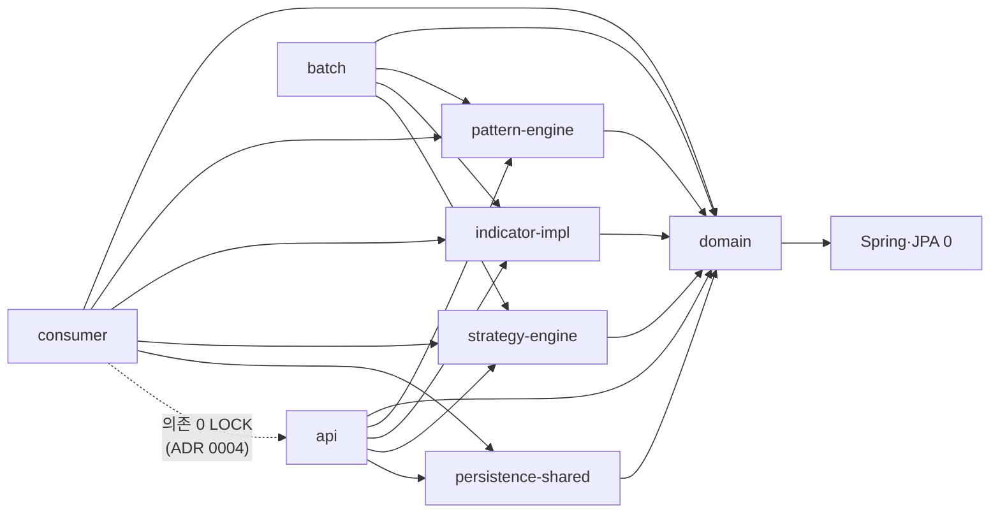
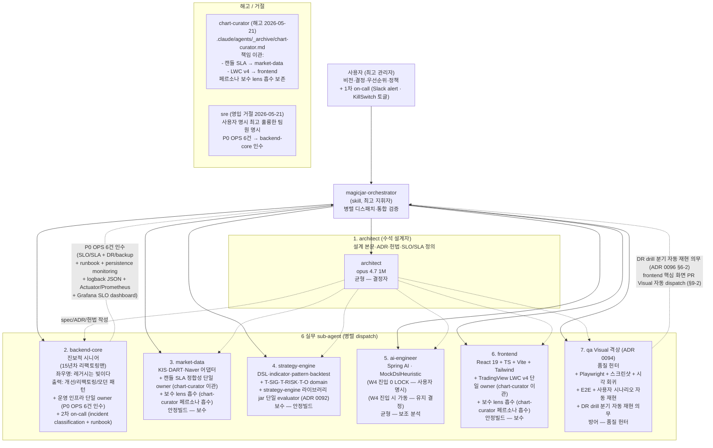
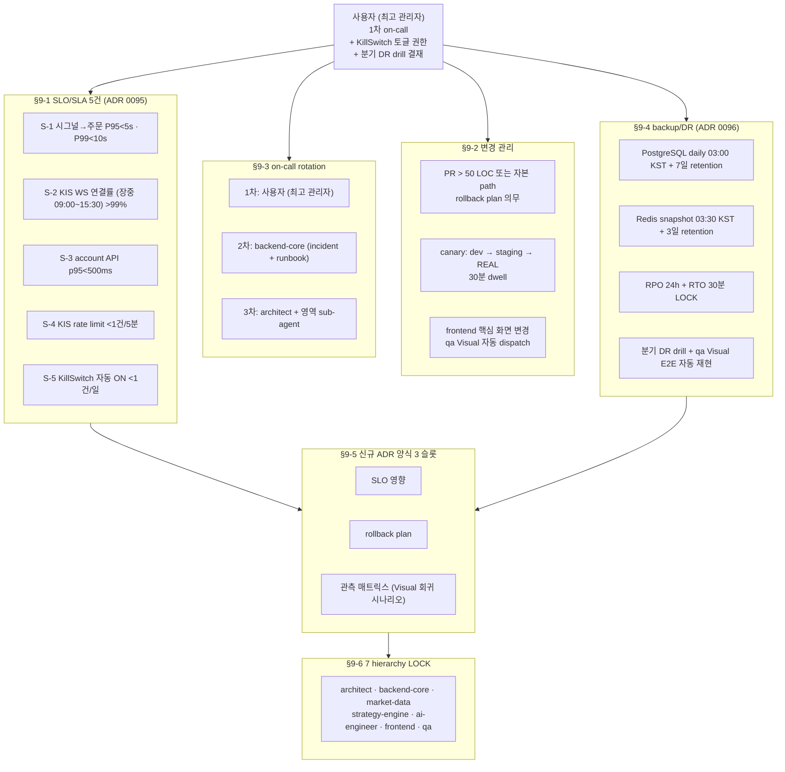
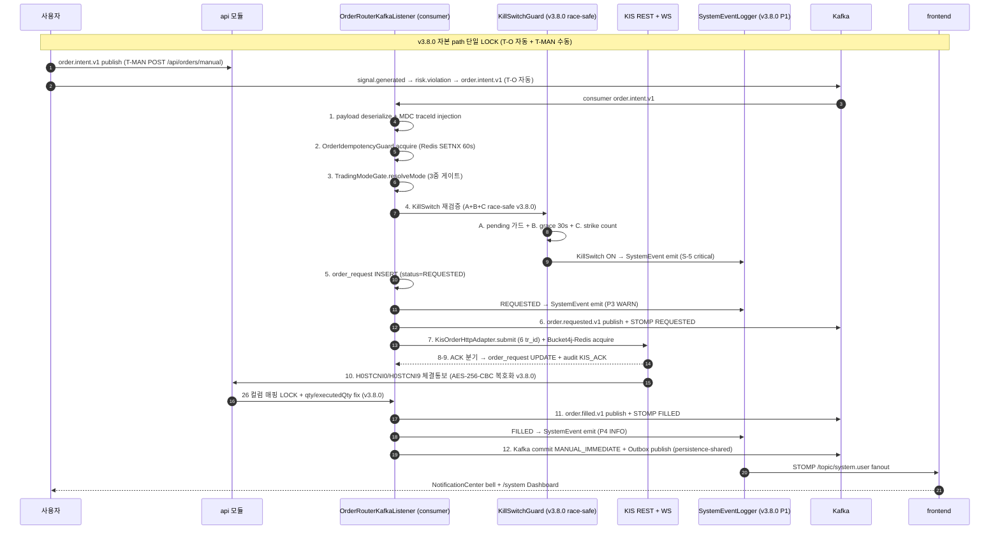

# 01 — magicJar v3.8.0 아키텍처 (시각화)

> **작성자**: architect (PR-37 baseline v3.8.0)
> **시점**: 2026-05-22 v3.8.0 태그 컷 직후 (release commit `<TBD>`)
> **권위**: `docs/architecture/master-architecture.md` v2 §5·§6 + ADR 0002·0004(8 모듈 매트릭스 v3.8.0 갱신 — strategy-engine 추가)·0005·0006·0007·0008·0009·0023·0024·0028·0029·0030·0041·0042·0043·0044·0046·0047·0048·0054·0066·0067·0068·0070·0080·0083·0084·0086·0088·**0091·0092·0093·0094·0095·0096** + v3.8.0 시점 코드 inspection 결과

본 문서는 v3.8.0 시점 magicJar 시스템의 **시각화 가능 수준 그림**이다. SoT는 `docs/architecture/master-architecture.md`이며, 본 문서는 그 하위 구체화 — v3.8.0 시점 실체(현재 발행된 컨테이너·테이블·KIS endpoint·Kafka topic·STOMP 토픽·7 sub-agent hierarchy·페르소나 5 매트릭스·운영 헌법 §9·§10·P0 OPS 6/6 LOCK)만 인용한다. v1/v2 잔재 0건. 미발행 트랙(W4 T-AI·T-MCP · W5 T-LEARN)은 명시적으로 제외.

**v3.7.0 → v3.8.0 핵심 변경 (운영 단계 진입 baseline)**:

- **JVM 모듈 매트릭스 7 → 8**: + `strategy-engine` (ADR 0092 v3.8.0 신설). DSL parser/evaluator 라이브러리 jar. api 백테스트·screener + consumer 실시간 단일 evaluator 사용. ADR 0054·0083·0088 패턴 1:1 재사용. 컨테이너 0 + Boot main 0.
- **sub-agent 매트릭스 8 → 7 (재배치, ADR 0094 amend 2026-05-21)**:
  - **chart-curator 해고** — 캔들 SLA → market-data + LWC v4 → frontend 책임 이관 (`_workspace/specs/2026-05-21-chart-curator-handover.md`). `.claude/agents/_archive/chart-curator.md`로 이동 + dispatch 0 LOCK. `.husky/pre-commit` ALLOWED_AUTHOR regex 유지(historical evidence 보존).
  - **qa Visual 격상** — Playwright + 5 시나리오 baseline + 스크린샷 + 시각 회귀 + E2E + DR drill 자동 재현 ("품질 헌터" 페르소나 — `_workspace/specs/2026-05-21-qa-visual-uplift.md`).
  - **ai-engineer 유지** — W4 진입 시 가동.
  - **sre 영입 거절** — P0 OPS 6건 backend-core 인수.
- **페르소나 매트릭스 2 → 5**: chart-curator 보수("안정빌드") 페르소나는 frontend·market-data 보수 lens로 흡수 + backend-core 진보("리팩토링맨") 유지 + qa Visual "품질 헌터" 신규 + ai-engineer 균형 신규 (ADR 0087 amend).
- **운영 헌법 §9·§10 신설**: §9 운영 단계 룰 6 항목 (SLO/SLA · 변경 관리 · on-call · backup/DR · ADR 양식 · 7 hierarchy LOCK) + §10 운영 메모 재배치.
- **P0 OPS 6/6 LOCK**: P0-OPS-1·2 logback JSON + Actuator + Prometheus + Grafana / P0-OPS-3 SLO/SLA ADR 0095 / P0-OPS-4 DR/backup ADR 0096 + pg_dump cron / P0-OPS-5 runbook 5 시나리오 / P0-OPS-6 persistence monitoring + SLO 측정 source wiring + Grafana SLO dashboard.
- **Flyway 누적**: + V44 (system_event 테이블) + V43 잔여.
- **system event log P1~P3 본문화**: SystemEventLogger port + SystemEventKafkaProducer + SystemEventLoggerAdapter (persistence-shared) + SystemEventStompNotifier + REST list/PATCH + /system Dashboard + NotificationCenter bell.
- **KillSwitch race-safe guard (A+B+C)**: pending + grace + strike 3중 가드 (ADR 0043 amend).
- **chart limit + Lazy Backfill (ADR 0093)**: backend MAX_PAGES property + /candles limit cap 5000 + frontend CandleCountSelector + Phase 5 LWC 가드 3단.
- **NXT 통합 (ADR 0091)**: KOSPI=UN/KOSDAQ=J market-level 분기 폐기 + is_kospi200/is_kosdaq150 allow-list + J fallback.
- **AI 호출 0 LOCK 유지**: W4 진입 0 — ai-engineer 유지하되 W4 진입 시점에 가동.

---

## §1. 시스템 전경 (8 JVM 모듈 + frontend + 외부 5 + 인프라 3 + 디버깅 2 + 7 sub-agent + W3 종착 노드 가동 + P0 OPS 6/6 LOCK)

```mermaid
graph TD
    subgraph EXTERNAL["외부 통합 (옵션 + fallback)"]
        KISREST["KIS REST<br/>openapi.koreainvestment.com:9443 (real)<br/>openapivts.koreainvestment.com:29443 (vps)<br/>order-cash · order-rvsecncl · inquire-balance · inquire-daily-itemchartprice<br/>+ inquire-daily-ccld + inquire-ccld<br/>+ Bucket4j-Redis 단일 bucket LOCK (ADR 0037 amend)<br/>+ EGW00201 1초 backoff+재시도 (PR #659)<br/>+ priority=BACKFILL 분리 (PR #657)"]
        KISWS["KIS WebSocket<br/>wss://ops.koreainvestment.com:21000<br/>H0STCNT0 체결가 + H0STASP0 호가<br/>+ H0STCNI0/H0STCNI9 체결통보 (T-O)<br/>+ AES-256-CBC 복호화 (v3.8.0 hotfix)<br/>+ WS_DISCONNECTED·WS_RECONNECTED SystemEvent emit"]
        KISMASTER["KIS 종목마스터 ZIP<br/>new.real.download.dws.co.kr"]
        DART["DART OPENDART<br/>opendart.fss.or.kr<br/>+ T-NEWS 실시간 인입 cron 1분"]
        NAVER["Naver Open API<br/>openapi.naver.com<br/>+ T-NEWS news.json 25K/일 한도"]
        ANTHROPIC["Anthropic Spring AI<br/>api.anthropic.com<br/>(T-DSL 자연어 helper 한정<br/>W4 T-AI 진입 0 LOCK — 사용자 명시 정합<br/>ai-engineer 유지하되 W4 진입 시점 가동)"]
        YAHOO_DEP["Yahoo Finance Deprecated<br/>YahooCandleFetcherAdapter @Deprecated<br/>v3.9.x 일괄 삭제 예정"]
    end

    subgraph FRONTEND["frontend (React 19 + Vite + LWC v4 — chart-curator 인수)"]
        FE_SETUP["/setup<br/>SetupWizard 7-step"]
        FE_DASH["/<br/>DashboardPage (v3.6.17 격상)<br/>+ AccountSummaryCard + HoldingsTable + BalanceCard<br/>+ B-1 accountType toggle (모의/실전 둘 다)<br/>+ balance STOMP push subscribe (v3.8.0)<br/>+ A T-ACCT 텍스트 5s 정정"]
        FE_WL["/watchlist"]
        FE_SYM["/symbol/:code<br/>+ STOMP 5 boundary<br/>+ LWC chart state lift LOCK (§13 ADR 0086 amend)<br/>+ CandleCountSelector UI (ADR 0093 Phase 4)<br/>+ Phase 5 LWC 가드 3단 (ADR 0093)<br/>+ 지연 데이터 라벨 fall-through fix"]
        FE_SB["/strategy/builder<br/>+ ScreenerResultModal 합류 (T-SC)"]
        FE_BT["/strategy/backtest"]
        FE_RC["/risk-config"]
        FE_RE["/risk-events"]
        FE_POS["/positions<br/>+ data source 정합 fix (account/positions 사용 — PR #643)"]
        FE_ORD["/orders<br/>+ STOMP /topic/order.user.userId<br/>+ useStompReconnect backfill hook (P1-3)<br/>+ OrderCard·OrderDetailPage 종목명 표시<br/>+ backfill toast qty=null skip fix"]
        FE_ORD_DTL["/orders/:id"]
        FE_ORD_NEW["/orders/new (T-MAN v3.6.15)<br/>+ OrderPreviewModal 이중 confirm<br/>+ 60s cooldown (KillSwitch 60→20s UX)"]
        FE_JNL["/journal (T-J v3.6.4)"]
        FE_PERF["/performance (T-PERF v3.6.4)<br/>+ LWC equity curve + daily P&L bar"]
        FE_NEWS["/news (T-NEWS v3.6.7)"]
        FE_SCREEN["/screener (T-SC v3.6.3)"]
        FE_ADMIN["/admin<br/>+ CandleBackfillAdminController (T-CC Phase 2)"]
        FE_SYSTEM["/system (v3.8.0 신설)<br/>+ SystemEvent Dashboard<br/>+ NotificationCenter bell drop-down<br/>+ REST 30s polling fallback + STOMP subscribe"]
        FE_SET["SettingsModal v3.6.5 풀세트<br/>+ KIS 키 변경 + KillSwitch 토글 + AI 키<br/>+ MOCK 키 신규 등록 POST 분기 (v3.7.1 hotfix)<br/>+ RealTradingConsentToggle 이중 confirm"]
        FE_HDR["AppHeader<br/>+ RuntimeFlagsIndicator (P2-2 dot LED + 라벨)<br/>+ WS health indicator + 끊김 toast 영구 표시 (v3.8.0)<br/>+ NotificationCenter bell drop-down (v3.8.0)<br/>+ 메뉴 13+ (주문·매매일지·성과·뉴스·스크리너·관리자·시스템)"]
    end

    subgraph API["api (Spring Boot 3.3 / 8080)"]
        API_REST["REST controllers<br/>+ Account 3 + Order 4 + Screener 3 + Journal 3 + Performance 2 + News 4 + ManualOrder 1<br/>+ Runtime 1 + StompBackfill 2 + SystemEvent 2 (list + PATCH viewed/resolved)"]
        API_STOMP["STOMP /ws<br/>tick · candle/1m·5m·15m·30m·90m·1h · orderbook<br/>+ signal.user · risk.user · order.user<br/>+ news.user (T-NEWS)<br/>+ system.user (v3.8.0 SystemEvent fanout)<br/>+ account.balance push (v3.8.0)"]
        API_FLY["Flyway V1~V44 적용기<br/>(v3.8.0: V43 잔여 + V44 system_event)"]
        API_BT["BacktestEngine + Persister + QueryService<br/>+ strategy-engine evaluator 1:1 (ADR 0092)"]
        API_AI["NaturalLanguageDslTranslator<br/>(@Service · ChatClient lazy)<br/>+ MockDslHeuristic fallback<br/>(W4 진입 0 — ai-engineer 유지하되 미가동)"]
        API_KIS_BAL["ApiKisBalanceQueryAdapter (T-ACCT v3.6.14)<br/>+ KIS inquire-balance TTTC8434R/VTTC8434R<br/>+ Redis cache accountType 분리 5s TTL (v3.8.0 hotfix — REAL/MOCK 충돌 fix)<br/>+ 토큰 통합 prefix (T-1·2·3·4)"]
        API_KIS_RATE["KisRateLimiterPort impl (P1-4 v3.7.0)<br/>+ Bucket4j-Redis 단일 bucket LOCK<br/>+ EGW00201 1초 backoff + 재시도 (PR #659)<br/>+ priority=BACKFILL 분리 (PR #657 hotfix)"]
        API_RUNTIME["RuntimeFlagsController (P2-2 v3.7.0)<br/>+ GET /api/runtime/flags<br/>+ KillSwitch·mode·allowReal·consent state"]
        API_STOMP_BACKFILL["StompEventPersister + Backfill (P1-3 v3.7.0)<br/>+ GET /api/stomp/events/unread<br/>+ GET /api/stomp/events?since=ts"]
        API_RECON["ReconcileService (T-RECON v3.6.2)<br/>+ KisBalanceQueryPort + drift 검출<br/>+ DRIFT_DETECTED SystemEvent emit (v3.8.0 P1)"]
        API_NOTIF["NotificationOutbox + SlackAdapter (T-NOTIFY v3.6.2)<br/>+ ADR 0095 P1 CRITICAL routing reuse<br/>+ ADR 0096 backup 실패 alert reuse"]
        API_JOURNAL["JournalQueryService + JournalSummaryComposer (T-J v3.6.4)"]
        API_PERF["PerformanceQueryService + Calculator (T-PERF v3.6.4)"]
        API_NEWS["NewsQueryService + NewsStompAdapter (T-NEWS v3.6.7)"]
        API_MANUAL["ManualOrderController (T-MAN v3.6.15)<br/>+ POST /api/orders/manual<br/>+ 12 step LOCK 재사용 (자본 path 단일 LOCK)<br/>+ B-2 idempotencyKey 강화 + DTO validation"]
        API_SYSEVT["SystemEventController (P2 v3.8.0)<br/>+ GET /api/system-events (list filter)<br/>+ PATCH viewed/resolved<br/>+ SystemEventQueryService totalCount/unreadCount 정합"]
        API_TOKEN["KisTokenService<br/>+ T-1·2·3·4 통합 prefix + 동적 TTL + 분산락<br/>+ EGW00123 self-heal (cache evict + 1회 재발급)<br/>+ 빈 userId hotfix (cache pollution + cross-user leak 차단)"]
    end

    subgraph BATCH["batch (Spring Batch / 8081)"]
        B_INSTR["InstrumentSyncJob<br/>+ InstrumentMasterRefreshJob (ADR 0090 Phase 1)<br/>+ NXT resolver allow-list 합류 (ADR 0091)<br/>+ InstrumentStatusHistoryPort INSERT/UPDATE<br/>+ audit_trail INSTRUMENT_STATUS_CHANGED"]
        B_CHK["KisChkHolidayAdapter tr_id=CTCA0903R"]
        B_KSD["KisKsdInfoAdapter"]
        B_DART["DartDisclosureAdapter<br/>+ T-NEWS 1분 cron 실시간 인입 (v3.6.7)"]
        B_NAVER["NaverArticleAdapter<br/>+ T-NEWS Open API news.json"]
        B_PERF["DailyPerformanceJob 00:30 KST (T-PERF v3.6.4)"]
        B_SC["DailyScreenerJob (T-SC v3.6.3 — inline 동기 1차)"]
    end

    subgraph CONSUMER["consumer (Kafka + KIS WS / 8082)"]
        C_KIS_WS["KisWebSocketBridge<br/>H0STCNT0 + H0STASP0 + H0STCNI0/H0STCNI9 (T-O)<br/>+ AES-256-CBC 복호화 hotfix (v3.8.0)<br/>+ WS_CONNECTED·WS_DISCONNECTED·WS_RECONNECTED emit (v3.8.0)<br/>+ startup 첫 연결 WS_CONNECTED emit (PR #645)"]
        C_KIS_REST["KisRestCandleAdapter (FHKST03010100/200/230)<br/>+ KisRateLimiterPort.acquire() 합류 (Phase 2 P1-4)<br/>+ 종목 간 200ms sleep 마진 (PR #657 burst 완화)"]
        C_KIS_INQUIRE["KisOrderInquireCcldHttpAdapter<br/>+ KisOrderInquireDailyCcldHttpAdapter<br/>+ .publishOn(boundedElastic) 합류 (v3.8.0 cut hotfix #661)"]
        C_TICK_AGG["TickToMinuteAggregator"]
        C_BD["BoundaryAggregator (v3.3.0)"]
        C_DCF["DailyCloseFinalizer 20:00 KST"]
        C_POS_BOOTSTRAP["PositionBootstrapRunner ADR 0042<br/>+ B retry 메커니즘 (KIS transient 흡수)<br/>+ A 3중 게이트 trigger (자동매매 의도 정합)"]
        C_RSG["RealtimeSignalGenerator (v3.4.0 T-SIG)<br/>+ strategy-engine evaluator 합류 (ADR 0092)<br/>+ test coverage 보강 (v3.8.0)"]
        C_RGE["RiskGatewayEvaluator (v3.5.0 T-RISK)"]
        C_ORKL["OrderRouterKafkaListener (v3.6.0 T-O · 12 step LOCK)<br/>+ MDC traceId injection (P1-5 v3.7.0)<br/>+ 자본 path 단일 LOCK (T-MAN 재사용)<br/>+ FILLED stomp_event qty/executedQty 매핑 fix (v3.8.0)<br/>+ entity source 매핑 누락 fix (PR #4aba93d3)"]
        C_KILL["KillSwitchGuard (v3.8.0 race-safe A+B+C)<br/>+ pending + grace + strike 3중 가드<br/>+ KillSwitchTogglePort Bean 등록 (consumer 부팅 실패 fix)"]
        C_KOA["KisOrderHttpAdapter (T-O 6 tr_id raw KDoc)"]
        C_KEWL["KisExecutionWsListener (T-O · 26 컬럼 LOCK)"]
        C_BACKFILL_EXEC["KisExecutionBackfillService<br/>+ @EventListener(ApplicationReadyEvent) lazy wiring<br/>+ KisWebSocketBridge.onReconnect hook<br/>+ .publishOn(boundedElastic) hotfix (v3.8.0)"]
        C_RECON["ReconcileWorker (T-RECON v3.6.2)<br/>+ OrderReconciliationWorker FIRED/RESOLVED emit (v3.8.0 P1)"]
        C_BAL_RECON["BalanceReconcileService<br/>+ DRIFT_DETECTED SystemEvent emit (v3.8.0 P1)"]
        C_GAP["CandleGapDetectorAdapter (T-CC Phase 2 v3.6.17)<br/>+ 4축 active gap detection (§12 ADR 0086 amend)<br/>+ passesActiveGapAxes() history at ts (Phase 2 ADR 0090)<br/>+ 책임 → market-data (chart-curator 해고 후)"]
        C_BACKFILL["CandleBackfillWorker (T-CC Phase 2-A)<br/>+ 햇징 룰 13건 LOCK<br/>+ B-1 cursor 페이지네이션 복원 (PR #587 regression fix)<br/>+ §14 햇징 룰 amend (PR #589)<br/>+ 책임 → market-data (chart-curator 해고 후)"]
        C_LCAM["LastCandleAtMonitor (T-CC Phase 1)<br/>+ KDoc 보강 §11·§12·§13 cross-ref<br/>+ NXT 30% 휴리스틱 + stale 30분 검증 (PR #660 QA 첫 임무)"]
        C_LIVE_DAILY["LiveDailyCandleScheduler<br/>+ 종목 간 200ms sleep 마진 (PR #657 KIS_TPS_EXCEEDED burst 완화)"]
        C_SYSEVT_K["SystemEventStompNotifier<br/>+ Kafka → STOMP fanout 분기 (v3.8.0 P2)<br/>+ StompEventPersister 호출 (PR #621 패턴 정합)"]
    end

    subgraph PATTERN_ENGINE["pattern-engine (라이브러리 jar)"]
        P_REG["JvmPatternRecognizer 57 detector"]
    end

    subgraph INDICATOR_IMPL["indicator-impl (라이브러리 jar v3.6.15 ADR 0083)"]
        I_NATIVE["NativeIndicatorSource"]
        I_KIS["KisStrategyBuilderSource (80지표)"]
    end

    subgraph STRATEGY_ENGINE["strategy-engine (라이브러리 jar v3.8.0 ADR 0092)<br/>★ DSL parser/evaluator 공유"]
        SE_DSL["DslParser + DslExpression"]
        SE_EVAL["StrategyEvaluator<br/>+ API 백테스트·screener 합류<br/>+ consumer 실시간 평가 합류<br/>+ HOLD stub 제거 (단일 evaluator LOCK)"]
        SE_LOOKUP["ConsumerStrategyLookup<br/>+ test coverage 보강 (v3.8.0)"]
    end

    subgraph PERSISTENCE_SHARED["persistence-shared (라이브러리 jar v3.7.0 ADR 0088)<br/>★ 자본 흐름 작동률 100% LOCK + system event 합류 (v3.8.0)"]
        PS_ORDER["OrderEventOutboxRepositoryAdapter<br/>+ JpaRepository + JpaEntity<br/>+ FOR UPDATE SKIP LOCKED + timeout (PR C v3.8.0)"]
        PS_NOTIF["NotificationOutboxRepositoryAdapter<br/>+ JpaRepository + JpaEntity"]
        PS_STOMP["StompEventRepositoryAdapter<br/>+ JpaRepository + JpaEntity"]
        PS_SYSEVT["SystemEventJpaEntity + Repository (v3.8.0 P1)<br/>+ SystemEventLoggerAdapter (4 test)<br/>+ SystemEventKafkaProducer (2 test)"]
        PS_MONITOR["persistence monitoring (P0-OPS-6 v3.8.0)<br/>+ SLO 측정 source wiring<br/>+ Outbox drain lag SLO 검증"]
    end

    subgraph DOMAIN["domain (Pure Kotlin — Spring·JPA 0)"]
        D_PORTS["ports (확장)<br/>+ Order 9 + Risk 5 + Position 1<br/>+ Screener · Journal · Performance · News<br/>+ KisRateLimiterPort (P1-4)<br/>+ KisBalanceQueryPort (T-ACCT)<br/>+ CandleGapDetectorPort (T-CC)<br/>+ InstrumentStatusHistoryPort (ADR 0090)<br/>+ SystemEventLogger (v3.8.0 P1)<br/>+ KillSwitchTogglePort (v3.8.0 활성화)"]
        D_RISK["domain/risk (v3.5.0)"]
        D_ORD["domain/order (v3.6.0 T-O)"]
        D_POS["domain/position"]
        D_SCREEN["domain/screener (T-SC v3.6.3)"]
        D_JNL["domain/journal (T-J v3.6.4)"]
        D_PERF["domain/performance (T-PERF v3.6.4)"]
        D_NEWS["domain/news (T-NEWS v3.6.7)"]
        D_SYSEVT["domain/system-event (v3.8.0 P1)<br/>+ SystemEvent + Category + Severity enum"]
    end

    subgraph INFRA["인프라 3 + 디버깅 2 + 관측 2 (v3.8.0)"]
        PG[("PostgreSQL 16<br/>Flyway V1~V44<br/>candle ~213K + risk_config·risk_event·position<br/>+ order_request·order_execution·order_audit_event<br/>+ reconcile_run·reconcile_drift (V25·V26)<br/>+ notification_outbox (V27)<br/>+ screener_history (V28)<br/>+ trading_journal·journal_note (V29)<br/>+ performance_summary·pnl_daily (V30)<br/>+ news_disclosure·news_article (V32·V33)<br/>+ order_event_outbox·stomp_event (V37·V38)<br/>+ candle.backfill_batch_id (V39)<br/>+ instrument_status_history (V42 ADR 0090)<br/>+ system_event (V44 v3.8.0 P1)<br/>+ daily backup 03:00 KST 7일 retention (ADR 0096)")]
        REDIS[("Redis 7<br/>quote·session·instrument·position·kis token (통합 prefix)<br/>+ candle:current · strategy:active · signal:dedupe<br/>+ risk_config · trades:freq · daily_pnl<br/>+ idem:order:key TTL 60s<br/>+ screener:result · journal:summary · performance:summary<br/>+ news:dedup · account:balance:userId TTL 30s (accountType 분리 5s v3.8.0)<br/>+ rate-limit:kis (Bucket4j-Redis P1-4)<br/>+ stomp:lastSeenAt:userId (P1-3)<br/>+ system:event:dedup (v3.8.0 P1)<br/>+ snapshot 03:30 KST 3일 retention (ADR 0096)")]
        KAFKA[("Kafka 3.7 KRaft<br/>+ market.candle.5m·15m·30m·90m·1h.closed.v1<br/>+ signal.generated.v1<br/>+ risk.violation.v1 + order.intent.v1<br/>+ order.requested/filled/rejected/cancelled.v1<br/>+ reconcile.drift.v1 + reconcile.run.v1<br/>+ killswitch.engaged.v1<br/>+ news.disclosure.v1 + news.article.v1<br/>+ system.event.v1 (v3.8.0 P1)<br/>+ account.balance.v1 (v3.8.0 push 전환)")]
        DOZZLE["Dozzle 8888"]
        KAFKAUI["Kafka UI 8090"]
        PROM["Prometheus (v3.8.0 P0-OPS-2)<br/>+ Actuator scraping<br/>+ 5 SLO × 2 임계 = 10 alert rule (ADR 0095)"]
        GRAFANA["Grafana SLO dashboard (v3.8.0 P0-OPS-6)<br/>+ SLO 5건 panel + persistence monitoring"]
    end

    %% Frontend
    FE_HDR -->|"GET /api/runtime/flags 60s refetch"| API_RUNTIME
    FE_ORD -.->|"useStompReconnect backfill"| API_STOMP_BACKFILL
    FE_DASH -->|"HTTP /api/account/balance·positions·summary"| API_KIS_BAL
    FE_DASH -.->|"STOMP /topic/account.balance.user (v3.8.0 push)"| API_STOMP
    FE_ORD_NEW -->|"HTTP POST /api/orders/manual"| API_MANUAL
    FE_SYSTEM -->|"HTTP /api/system-events + STOMP /topic/system.user"| API_SYSEVT
    FE_SYM -->|"HTTP /api/candles?limit=cap5000 (ADR 0093)"| API_REST
    FE_SCREEN -->|"HTTP /api/screener"| API_REST
    FE_ADMIN -->|"HTTP POST /admin/candle-curator/backfill"| C_BACKFILL

    %% API
    API_KIS_BAL -->|"inquire-balance TTTC8434R/VTTC8434R"| KISREST
    API_KIS_BAL -.->|"accountType 분리 cache"| REDIS
    API_KIS_RATE -->|"Bucket4j-Redis bucket consume"| REDIS
    API_TOKEN -->|"unified prefix + 동적 TTL"| REDIS
    API_RECON -->|"DRIFT_DETECTED → SystemEventLogger"| D_SYSEVT
    API_NOTIF -->|"NotificationOutboxRepositoryAdapter"| PS_NOTIF
    API_STOMP_BACKFILL -->|"StompEventRepositoryAdapter"| PS_STOMP
    API_MANUAL -.->|"OrderIntent → OrderRouter 12 step 재사용"| C_ORKL
    API_SYSEVT -->|"SystemEventRepository (list filter)"| PS_SYSEVT
    API_BT -.->|"implementation(strategy-engine)"| SE_EVAL

    %% Batch
    B_INSTR -->|"InstrumentStatusHistoryPort INSERT/UPDATE"| PG
    B_DART -->|"DartDisclosureAdapter 1분 cron"| DART
    B_NAVER -->|"news.json 25K/일"| NAVER
    B_PERF -->|"performance_summary·pnl_daily 00:30 KST"| PG

    %% Consumer
    C_KIS_REST -->|"KisRateLimiterPort.acquire()"| API_KIS_RATE
    C_KIS_INQUIRE -.->|".publishOn(boundedElastic) hotfix"| KISREST
    C_ORKL -->|"OrderEventOutbox publish (PS)"| PS_ORDER
    C_GAP -->|"passesActiveGapAxes() history at ts"| PG
    C_BACKFILL -->|"갭만 정밀 backfill + 햇징 룰 13건"| KISREST
    C_BACKFILL -.->|"audit_trail 5 path 의무"| PG
    C_BAL_RECON -->|"DRIFT_DETECTED emit"| D_SYSEVT
    C_RECON -->|"OrderReconciliationWorker FIRED/RESOLVED emit"| D_SYSEVT
    C_KIS_WS -->|"WS_DISCONNECTED/WS_RECONNECTED emit"| D_SYSEVT
    C_SYSEVT_K -->|"system.event.v1 → STOMP fanout"| API_STOMP
    C_KILL -.->|"KillSwitchTogglePort Bean LOCK"| D_PORTS
    C_LIVE_DAILY -.->|"200ms sleep 마진"| C_KIS_REST
    C_RSG -.->|"implementation(strategy-engine)"| SE_EVAL

    %% pattern-engine + indicator-impl + strategy-engine
    API_REST -.->|"implementation(:pattern-engine)"| P_REG
    C_RSG -.->|"implementation(:pattern-engine)"| P_REG
    API_REST -.->|"implementation(:indicator-impl)"| I_NATIVE
    C_RSG -.->|"implementation(:indicator-impl)"| I_KIS

    %% persistence-shared
    API_REST -.->|"implementation(:persistence-shared)"| PS_ORDER
    C_ORKL -.->|"implementation(:persistence-shared)"| PS_ORDER
    API_NOTIF -.->|"implementation(:persistence-shared)"| PS_NOTIF
    C_RECON -.->|"NotificationOutbox publish + SystemEvent emit"| PS_NOTIF
    API_SYSEVT -.->|"implementation(:persistence-shared) SystemEvent"| PS_SYSEVT
    PS_MONITOR -.->|"SLO 측정 source wiring"| PROM

    %% Infra
    API_REST --> PG
    API_REST --> REDIS
    API_REST -->|"producer"| KAFKA
    C_ORKL -->|"consumer order.intent.v1"| KAFKA
    PS_ORDER --> PG
    PS_NOTIF --> PG
    PS_STOMP --> PG
    PS_SYSEVT --> PG
    PS_SYSEVT -->|"SystemEventKafkaProducer"| KAFKA
    API_REST -.->|"Actuator/health/prometheus"| PROM
    PROM --> GRAFANA

    %% Domain
    API_REST -->|"implements port"| D_PORTS
    C_KIS_WS -->|"implements port"| D_PORTS
    C_ORKL -->|"reads/writes via port"| D_ORD
    API_KIS_RATE -->|"implements KisRateLimiterPort"| D_PORTS
    API_KIS_BAL -->|"implements KisBalanceQueryPort"| D_PORTS
    PS_SYSEVT -->|"implements SystemEventLogger"| D_SYSEVT
```

**범례**:
- 실선 화살표 — DB·Redis·Kafka inbound/outbound + KIS REST/WS 외부 호출
- 점선 화살표 — port implements + cache lookup + 게이트 chain step + 동기 위임
- `domain`은 모든 JVM 모듈의 의존이지만 시각화 단순화를 위해 별도 박스 + port implements 점선만 표시
- **strategy-engine (ADR 0092 v3.8.0)** — DSL parser·evaluator 공유 라이브러리 jar. API 백테스트·screener + consumer 실시간 단일 evaluator LOCK. HOLD stub 제거. ADR 0054·0083·0088 패턴 1:1 재사용.
- **persistence-shared (ADR 0088 v3.7.0 → Accepted 격상 v3.8.0)** — 자본 흐름 작동률 100% LOCK 유지 + SystemEvent 합류 (v3.8.0 P1) + persistence monitoring wiring (P0-OPS-6).
- **chart-curator 해고 후 컴포넌트 재배치** (ADR 0094 amend) — `CandleGapDetector` + `CandleBackfillWorker` + `LastCandleAtMonitor` + `LiveDailyCandleScheduler` 등 캔들 SLA 영역 단일 owner → **market-data**로 이관. `frontend/src/components/chart/*` + `SymbolChart`·`LightweightChart`·`IndicatorOverlay`·`PatternMarker` + `EquityCurveChart` + Phase 5 LWC 가드 등 LWC v4 영역 단일 owner → **frontend**로 이관.
- **자본 path 단일 LOCK** — `OrderRouterKafkaListener` 12 step LOCK이 T-O(자동) + T-MAN(수동 v3.6.15) 양쪽 진입점의 단일 chain. 3중 게이트 + KillSwitch race-safe guard (A+B+C, v3.8.0) + 멱등성 SETNX 60s + KIS REST + H0STCNI0/H0STCNI9 + AES-256-CBC 복호화 (v3.8.0) 모두 단일 경로.
- **AI 호출 0 LOCK 유지** — W4 진입 0 (사용자 명시 정합). ai-engineer 유지하되 W4 진입 시점 가동. MockDslHeuristic fallback 보존.

---

## §2. 8 JVM 모듈 매트릭스 (v3.7.0 7 → v3.8.0 8)

ADR 0004(MSA 모듈 재구성) v3.8.0 갱신 — strategy-engine 추가.

| 모듈 | 종류 | 컨테이너 | Boot main | Gradle plugin | 책임 | v3.8.0 변경 |
|------|------|----------|-----------|----------------|------|-------------|
| `domain` | 라이브러리 jar | 0 | 0 | `kotlin("jvm")` only | 순수 도메인 + port. Spring·JPA 의존 0 | port +3 (SystemEventLogger v3.8.0 P1 · KillSwitchTogglePort 활성화 · 기타 evaluator port) |
| `pattern-engine` | 라이브러리 jar | 0 | 0 | `kotlin("jvm")+kotlin("plugin.spring")+spring-context` | 57 캔들 패턴 detector | 변경 0 |
| `indicator-impl` | 라이브러리 jar | 0 | 0 | `kotlin("jvm")+kotlin("plugin.spring")+spring-context` | 80 지표 IndicatorSource 구현 | 변경 0 (보존) |
| **`strategy-engine`** | **라이브러리 jar 신설** | **0** | **0** | **`kotlin("jvm")+kotlin("plugin.spring")+spring-context`** | **DSL parser/evaluator 공유 (API 백테스트·screener + consumer 실시간 단일 evaluator) — HOLD stub 제거** | **ADR 0092 v3.8.0 신설 — ADR 0054·0083·0088 패턴 1:1 재사용** |
| `persistence-shared` | 라이브러리 jar | 0 | 0 | `kotlin("jvm")+kotlin("plugin.spring")+spring-data-jpa+jpa+spring-context` | Outbox·STOMP 영속 Repository Adapter (Order·Notification·Stomp) + **SystemEvent 합류 (v3.8.0)** | **Accepted 격상 (2026-05-22) + SystemEvent 합류 (P1) + persistence monitoring (P0-OPS-6) wiring** |
| `api` | bootJar | 컨테이너 1 | 1 | `spring-boot+org.springframework.boot.run` | REST/STOMP + Flyway 권위 + 외부 어댑터(KIS·Yahoo·DART·Naver) + Kafka producer | + SystemEventController (P2) + KisTokenService unified prefix + accountType 분리 cache + account balance STOMP push + AES-256-CBC 복호화 prereq |
| `batch` | bootJar | 컨테이너 1 | 1 | `spring-boot+org.springframework.boot.run` | Spring Batch — 일봉 backfill·전략 백테스트 잡·종목 마스터 cron·T-NEWS DART 1분 cron·T-PERF DailyPerformanceJob | + InstrumentMasterRefreshJob NXT resolver 합류 (ADR 0091) |
| `consumer` | bootJar | 컨테이너 1 | 1 | `spring-boot+org.springframework.boot.run` | Kafka 소비 + KIS WS + 시그널·주문 dispatch + 체결 추적 + Reconcile · CandleBackfill · GapDetector | + KillSwitch race-safe guard (A+B+C) + SystemEventStompNotifier + KisWebSocketBridge WS_CONNECTED·DISCONNECTED·RECONNECTED emit + KIS WS H0STCNI9 라우팅 + AES-256-CBC 복호화 hotfix + LiveDailyCandleScheduler 200ms sleep 마진 + .publishOn(boundedElastic) hotfix + OrderReconciliationWorker FIRED/RESOLVED emit + BalanceReconcileService DRIFT_DETECTED emit |

**컨테이너 매트릭스**: 3 (api·batch·consumer) — 라이브러리 jar 5건(domain·pattern-engine·indicator-impl·strategy-engine·persistence-shared) 모두 컨테이너 0. ADR 0008(Docker 표준) baseline 정합.

**모듈 의존 방향 LOCK (ADR 0004 §의존 방향, v3.8.0 갱신)**:



**의존 방향 위반 0 LOCK**: consumer → api 의존 0건 (ADR 0004 §의존 방향) 보존. ADR 0092 strategy-engine 신설은 ADR 0088 패턴 1:1 재사용으로 모듈 경계 정합 유지. ADR 0088 persistence-shared 격상 Accepted (2026-05-22).

---

## §3. 7 sub-agent hierarchy + 페르소나 5 매트릭스 (ADR 0094 amend 2026-05-21)



**페르소나 5 매트릭스** (ADR 0087 amend v3.8.0):

| sub-agent | 페르소나 | 출력 마커 | 핵심 가치 |
|-----------|---------|----------|----------|
| architect | 균형 — 결정자 | 결정자 | 설계·trade-off 명시·SoT 갱신·운영 헌법 amend |
| backend-core | **진보 — 리팩토링맨** | 개선/리팩토링/모던 패턴 | 코드 품질 최우선·최신 패턴·DRY·테스트 주도·자동화 + P0 OPS 6건 인수 |
| market-data | **보수 — 안정빌드 (chart-curator 흡수)** | critical/caution/info | 안정성 최우선·검증된 패턴·하위호환성·점진적 변경·방어적 프로그래밍 + 캔들 SLA 인수 |
| strategy-engine | 보수 — 안정빌드 | critical/caution/info | 룰 본체 정합 lens + 자본 path 직결 |
| ai-engineer | 균형 — 보조 분석 | (W4 진입 시 가동) | Spring AI · MockDslHeuristic · 사용자 트리거만 |
| frontend | **보수 — 안정빌드 (chart-curator 흡수)** | critical/caution/info | UI 안정성 + LWC v4 단일 owner |
| **qa** | **방어 — 품질 헌터 (신규)** | hunt/검증/회귀 | Playwright + 스크린샷 + 시각 회귀 + E2E + DR drill |

**cross-review 운영 룰 (ADR 0087 amend)**:
- **자본 path 직결 영역** (캔들·주문·시그널·KIS 어댑터) → **market-data·strategy-engine 1차 lens** (보수, require/check 방어 패턴)
- **인프라 일반** (Spring·controller·port·Flyway·DTO·일반 endpoint) → **backend-core 1차 lens** (진보, 함수형 체이닝·sealed class·DRY)
- **frontend 핵심 화면 변경 시** → **qa Visual 자동 dispatch 의무** (헌법 §9-2 정합)
- **DR drill 분기 의무** → **qa Visual E2E 5 시나리오 자동 재현** (ADR 0096 §6-2)

---

## §4. v3.8.0 신규 컴포넌트 매트릭스 (운영 단계 진입)

### 4-1. strategy-engine 라이브러리 모듈 (ADR 0092)

신규 라이브러리 jar — API 백테스트·스크리너 + consumer 실시간 평가 단일 evaluator LOCK.

| 컴포넌트 | 위치 | 책임 |
|---------|------|------|
| `DslParser` | `strategy-engine/src/main/kotlin/.../dsl/` | YAML DSL → AST 변환 |
| `StrategyEvaluator` | `strategy-engine/src/main/kotlin/.../evaluator/` | AST + indicator + pattern 조합 평가. HOLD stub 제거. |
| `ConsumerStrategyLookup` | `strategy-engine/src/main/kotlin/.../lookup/` | consumer 영역 strategy lookup. test coverage 보강 (v3.8.0). |
| `ConsumerSignal` | `strategy-engine/src/main/kotlin/.../signal/` | consumer 영역 Signal 정의. test coverage 보강. |

**효과**: API 백테스트·screener HOLD stub 제거 → consumer 실시간 평가와 단일 evaluator → DSL 진화 시 단일 path 갱신. ADR 0054·0083·0088 패턴 1:1 재사용.

### 4-2. P0 OPS 6/6 LOCK (v3.8.0 운영 baseline)

| P0 ID | 영역 | 산출물 | ADR/PR |
|-------|------|--------|--------|
| **P0-OPS-1** | logback JSON 로깅 | `logback-spring.xml` JSON + MDC 통합 | ADR 0094 §3-1 + PR #649 |
| **P0-OPS-2** | Actuator + Prometheus | `/actuator/health` + `/actuator/prometheus` + scraping config + Grafana baseline | ADR 0094 §3-1 + PR #649 |
| **P0-OPS-3** | SLO/SLA 정의 + alert routing | ADR 0095 본문화 (5 SLO + severity 4단 + Prometheus alert sketch 10건 + KillSwitch 자동 ON S-1·S-5 critical 한정) | **ADR 0095 Accepted** |
| **P0-OPS-4** | DR/backup 절차 | ADR 0096 본문화 + `scripts/backup/pg-dump-daily.sh` + `scripts/backup/redis-snapshot.sh` + `docs/operations/backup-setup.md` + RPO 24h/RTO 30분 + DR drill 분기 의무 + qa Visual E2E 자동 재현 | **ADR 0096 Accepted** |
| **P0-OPS-5** | runbook 5 시나리오 | `docs/operations/runbooks/` 5 시나리오 (KillSwitch · DB 결함 · KIS rate limit burst · WS 연결 끊김 · 자본 흐름 차단) | PR #651 |
| **P0-OPS-6** | persistence monitoring | SLO 측정 source wiring + Outbox drain lag SLO + Grafana SLO dashboard | PR #652 |

### 4-3. system event log P1·P2·P3 (v3.8.0 W3 보강)

신규 도메인 — 운영 가시화 영역.

**P1 본체**:
- Flyway V44 — `system_event(id, category, severity, ts, payload, viewed_at, resolved_at, correlation_id)`
- `domain/system-event/SystemEvent + Category + Severity enum`
- `domain/.../SystemEventLogger` port
- `persistence-shared` — `SystemEventJpaEntity` + `SystemEventJpaRepository` + `SystemEventLoggerAdapter` (4 test) + `SystemEventKafkaProducer` (2 test)
- **emit point 5건**: BalanceReconcileService DRIFT_DETECTED · OrderReconciliationWorker FIRED/RESOLVED · KisWebSocketBridge WS_DISCONNECTED/WS_RECONNECTED (correlationId)

**P2 API + STOMP fanout**:
- `SystemEventController` — GET /api/system-events (list filter) + PATCH viewed/resolved
- `SystemEventStompNotifier` — Kafka → STOMP fanout 분기

**P3 frontend**:
- `system-event` REST API client + types
- `useSystemEventList` REST hook (30s polling fallback)
- `useSystemEventStompSubscription` hook (5 test)
- `NotificationCenter` 벨 + 드롭다운 (1 test)
- `/system` Dashboard 페이지
- App routes /system + Header NotificationCenter 통합

### 4-4. KillSwitch race-safe guard (A+B+C v3.8.0)

ADR 0043 amend — A+B+C 3중 가드:
- **A. pending 가드** — toggle ON 직후 pending order LOCK 검증
- **B. grace 가드** — KillSwitch ON 후 30초 grace period (in-flight order 흡수)
- **C. strike 가드** — strike count 임계치 기반 자동 ON (ADR 0095 §3-4 S-1·S-5 critical 한정)

PR #648 (hotfix consumer) + ADR 0070 amend.

### 4-5. ADR 0091 NXT 통합 시장코드 종목 단위 resolver

ADR 0063 보강 — KOSPI=UN/KOSDAQ=J market-level 분기 폐기 + is_kospi200/is_kosdaq150 allow-list + J fallback.

**적용 영역**:
- `InstrumentMasterRefreshJob` NXT resolver 합류
- `KisRestCandleAdapter` market div resolver
- frontend SymbolChart market div LOCK

### 4-6. ADR 0093 차트 캔들 히스토리 limit + Lazy Backfill + 사용자 입력 봉수

Proposed — Phase 1·2 spec + Phase 3·4·5 합류:
- **Phase 3 backend** — `MAX_PAGES` property + `/candles?limit=cap5000` cap
- **Phase 4 frontend** — `CandleCountSelector` UI + localStorage 영속
- **Phase 5 LWC 가드 3단** — chart instance state guard + dispose race fix + max cap toast + 한국석유 dogfooding

### 4-7. v3.8.0 cut 차단 hotfix 3건

| PR | 영역 | 결함 | fix |
|----|------|------|-----|
| **#657** | KIS_TPS_EXCEEDED LIVE | LiveDailyCandleScheduler burst | 종목 간 200ms sleep 마진 + 페이지 burst 완화 |
| **#659** | KIS_TPS_EXCEEDED LIVE 종합 | EGW00201 burst | EGW00201 1초 backoff + 재시도 + priority=BACKFILL 분리 |
| **#660** | QA 첫 임무 P0 | NXT 종목 stale 미검증 | NXT 30% 휴리스틱 + stale 30분 검증 |
| **#661** | consumer KIS inquire-daily-ccld | `.block()` reactor-http-nio thread ERROR | `.publishOn(Schedulers.boundedElastic())` 합류 (2 어댑터) |

---

## §5. 운영 헌법 §9·§10 (v3.8.0 신설)

### 5-1. §9 운영 단계 룰 6 항목 (ADR 0094 §4-2 본문화)



### 5-2. §10 운영 메모 책임 매트릭스

| 책임자 | 의무 |
|--------|------|
| **architect** | 본 헌법 본문은 architect 단독 PR 갱신 + 새 § 추가 시 ADR 발행 + ADR/master/README/CHANGELOG 정합 SoT 권위 LOCK (ADR 0030) |
| **sub-agent** | 본 헌법 정독 의무 + 영역별 특수 룰만 SKILL.md 명시. **qa는 §9-2·§9-4 추가 정독 의무** (frontend 핵심 화면 PR Visual 자동 dispatch + DR drill 분기 의무) |
| **orchestrator** | 사이클 시작 시 §1·§2 자동 점검 + sub-agent 디스패치 시 §4·§5 사전 검증 + **운영 단계 진입 후 §9 추가 검증** (frontend PR Visual dispatch 의무 + SLO 영향 ADR slot + rollback plan + qa 의무 dispatch trigger). chart-curator dispatch 발사 0 LOCK |
| **사용자** | 본 헌법 룰 위반 발견 시 architect 갱신 명시 + DR drill 분기 의무 결재 + cron 등록 1회 작업 (`docs/operations/backup-setup.md`) |

---

## §6. 외부 통합 + 디버깅 + 관측 (v3.8.0 P0 OPS 합류)

| 외부 통합 | 종류 | v3.8.0 변경 |
|-----------|------|-------------|
| KIS REST | 시세·주문·잔고·종목마스터 | + EGW00201 1초 backoff+재시도 (PR #659) + priority=BACKFILL 분리 (PR #657) + .publishOn(boundedElastic) hotfix 2 어댑터 (PR #661) |
| KIS WS | 체결가·호가·체결통보 | + AES-256-CBC 복호화 hotfix + WS_CONNECTED·WS_DISCONNECTED·WS_RECONNECTED emit + H0STCNI9 라우팅 hotfix |
| DART | 공시 RSS·OPENDART | 보존 (T-NEWS 1분 cron) |
| Naver Open API | 뉴스 news.json | 보존 (T-NEWS Phase 2 25K/일 한도) |
| Anthropic Spring AI | LLM helper | 보존 (W4 진입 0 LOCK — ai-engineer 유지하되 W4 진입 시점 가동) |
| Yahoo Finance | (@Deprecated) | v3.9.x 일괄 삭제 예정 보존 |

**디버깅 + 관측**:
- Dozzle 8888 + Kafka UI 8090 보존
- **신규 Prometheus + Grafana** (P0-OPS-2·6) — Actuator scraping + 5 SLO × 2 임계 = 10 alert rule + Grafana SLO dashboard + persistence monitoring

---

## §7. v3.8.0 시점 컴포넌트 매트릭스 요약

| 컴포넌트 카테고리 | v3.7.0 | v3.8.0 | 증감 |
|-------------------|--------|--------|------|
| JVM 모듈 | 7 | **8** | +1 (strategy-engine ADR 0092) |
| 컨테이너 | 3 | 3 | 0 |
| sub-agent | 8 | **7** | -1 (chart-curator 해고 + qa 격상 + ai-engineer 유지 + sre 거절) |
| 페르소나 | 2 | **5** | +3 (보수 흡수 + 균형 신규 + 방어 신규) |
| Domain port | 35+ | 38+ | +3+ (SystemEventLogger + KillSwitchTogglePort + 기타) |
| REST endpoint | 약 80+ | 약 90+ | +10+ (SystemEvent 2 + balance push + WS health 등) |
| Kafka 토픽 | 23+ | 25+ | +2+ (system.event.v1 + account.balance.v1) |
| STOMP 토픽 | 8+ | 10+ | +2+ (system.user + account.balance.user) |
| Redis namespace | 다수 | + 3+ | + kis token unified prefix + accountType 분리 + system event dedup |
| Flyway 버전 | V42+ | V44+ | +2+ |
| Frontend 라우트 | 16+ | 17+ | +1+ (/system) |
| 외부 통합 (활성) | 6 | 6 | 0 (보존) |
| 운영 헌법 § | 7 + §1-A-extended | **9 + §1-A-extended + §10** | +2 § |
| SLO 정의 | 0 | **5 baseline** + 2 P1 amend 후보 | +5 |
| Prometheus alert rule | 0 | **10** (5 SLO × 2 임계) | +10 |
| Backup 자동화 | 0 | **2** (PostgreSQL + Redis) | +2 |
| Runbook 시나리오 | 0 | **5** | +5 |
| Visual QA 시나리오 | 0 | **5** (Playwright baseline) | +5 |
| ADR | 90 | **96** | +6 (신규 0091·0092·0093·0094·0095·0096) |
| AI 호출 (자동매매 본체) | 0 LOCK | **0 LOCK 유지** | 0 |

---

## §8. Mermaid — 운영 단계 진입 자본 path 단일 LOCK (KillSwitch race-safe + AES-256-CBC + system event)



---

## §9. 결론 — v3.8.0 운영 단계 진입 baseline LOCK

v3.8.0은 W3 자동매매 본체 안정화 LOCK (v3.6.0 T-O 마감 → v3.6.x 19 patch → v3.7.0 시스템 점검 + Phase 보강 → v3.7.1 patch → v3.8.0 운영 단계 transition) → **운영 단계 진입 baseline** (ADR 0094 amend 사용자 위임 결재로 8→7 actor reshuffle + qa Visual "품질 헌터" 격상 + chart-curator 해고 + sre 영입 거절 + ai-engineer 유지 + 운영 헌법 §9·§10 신설 + P0 OPS 6/6 LOCK + ADR 0091·0092·0093 W3 보강 + Stage 2 Cleanup + cut 차단 hotfix 3건). **W4 진입 0** (사용자 명시 정합). v3.8.0 = 7 sub-agent hierarchy + 8 JVM 모듈 + 페르소나 5 매트릭스 (보수 흡수 + 진보 유지 + 균형 + 방어) + 운영 헌법 §9·§10 + P0 OPS 6/6 LOCK + SLO 5 baseline + RPO 24h/RTO 30분 + 분기 DR drill 의무 + qa Visual E2E 자동 재현. 다음 v3.8.x patch 후보 = DR drill 분기 1회 evidence + P0 OPS dogfooding + ADR 0093 Phase dogfooding. 다음 v3.9.0 minor 후보 = W4(T-AI·T-MCP) 진입 또는 W5(T-LEARN) 진입 (사용자 결정 의제). AI 호출 0 LOCK 지속.
