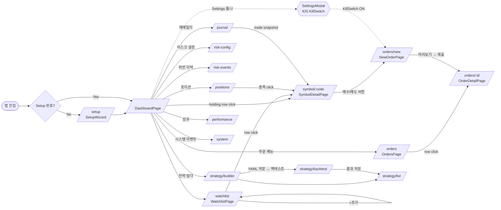
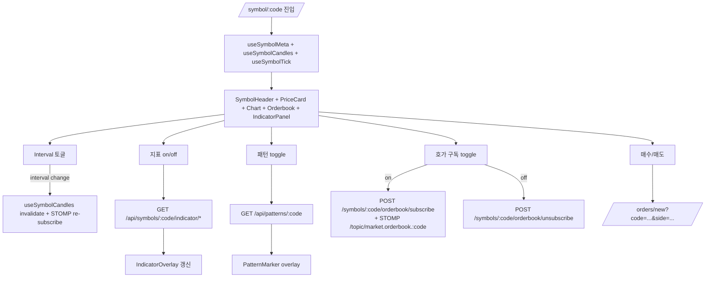
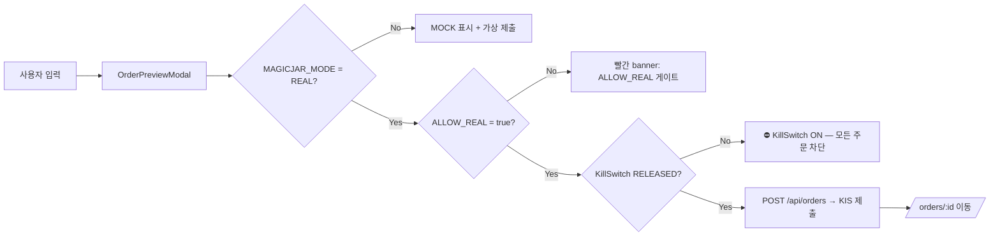

# 05 — UI Inventory (frontend SPA · 화면·메뉴·버튼·상태 매트릭스)

> **시점**: v3.8.0 baseline (2026-05-22 cut 직전)
> **권위 소스**: `frontend/src/App.tsx` (route 정의) · `frontend/src/components/layout/AppHeader.tsx` (메뉴) · `frontend/src/pages/**`, `frontend/src/components/**`, `frontend/src/api/**` · `frontend/tests/e2e/**` (Playwright baseline)
> **작성자**: frontend (ADR 0094 amend §2-2-A 통합 — TradingView LWC v4 책임 이관 적용 / §2-2-B 통합 — qa Visual Playwright baseline 5건)

본 문서는 **v3.8.0 시점에 화면이 무엇을 보여주고, 어떤 메뉴·버튼·상태를 가지며, 어떤 데이터 토픽을 구독하는지**를 SPA 구조 그대로 인벤토리화한다. 화면 추측·미구현 화면 묘사 금지 — 본 인벤토리는 `App.tsx` route 정의 + `AppHeader.tsx` nav를 raw 출처로 한다.

---

## 5-0. SPA 한 장 요약

- **단일 SPA** — React 19 + TS + Vite + Tailwind + TanStack Query + STOMP.js, pnpm 패키지 매니저, Vite dev `:5173`, 운영 docker `frontend` 컨테이너 (ADR 0009 · ADR 0049)
- **레이아웃** — `AppHeader` (전 화면 공통 header · 14 메뉴 + 2 indicator + NotificationCenter + Settings) + page outlet (route별 단독 화면 렌더)
- **데이터 채널** — REST (`/api/**`, axios `apiClient`) + STOMP (`/topic/**` 6 토픽 패밀리)
- **상태 관리** — TanStack Query (server state) + zustand (client UI state · `frontend/src/stores`) + STOMP topic subscription (실시간 invalidate)
- **route count** — 14 (path) · **메뉴 count** — 13 nav + Settings + NotificationCenter + 2 WS indicator
- **Playwright baseline** — 7 시나리오 (`tests/e2e/s1`~`s6` + s4 settings) · chromium-darwin PNG 스냅샷 LOCK (ADR 0094 §2-2-B)

---

## 5-1. 화면 매트릭스 (route × 컴포넌트 × hook × data source × 액션)

> **권위**: `frontend/src/App.tsx` L116~L146 의 `<Route>` 정의 14건 그대로.

### 5-1-A. Dashboard 영역

| route | 페이지 컴포넌트 | 주요 child 컴포넌트 | 주요 hook | REST endpoint | STOMP topic | 사용자 액션 |
|-------|-----------------|---------------------|-----------|---------------|-------------|------------|
| `/` | `pages/Dashboard/DashboardPage.tsx` | `AccountSummaryCard` · `BalanceCard` · `HoldingsTable` · `AccountTypeToggle` | `useAccountSummary` · `useAccountBalance` · `useAccountPositions` · `useStompAccountBalance` | `GET /api/account/summary` · `GET /api/account/balance` · `GET /api/account/positions` | `/topic/account.balance.{userId}` | 계좌 타입 토글 (실전/모의) · 종목 click → `/symbol/:code` |
| `/performance` | `pages/PerformanceDashboardPage.tsx` | `features/performance/components/*` | `useQuery` (performance api) | `GET /api/performance/*` (R/PnL · 손익 곡선) | — | 기간 필터 |

### 5-1-B. Watchlist 영역 (UI 진입 default — T-W1)

| route | 페이지 컴포넌트 | 주요 child 컴포넌트 | 주요 hook | REST endpoint | STOMP topic | 사용자 액션 |
|-------|-----------------|---------------------|-----------|---------------|-------------|------------|
| `/watchlist` | `pages/Watchlist/WatchlistPage.tsx` | `WatchlistRow` · `WatchlistAddForm` · `WatchlistEmpty` | `useWatchlist` (TanStack) + STOMP tick subscription per row | `GET /api/watchlist` · `POST /api/watchlist` · `DELETE /api/watchlist/{code}` · `PUT /api/watchlist/order` | `/topic/market.tick.{code}` (행별 구독) | 종목 추가 · 삭제 · 드래그 이동 · row click → `/symbol/:code` |

### 5-1-C. Symbol Detail (실시간 차트 · 호가 · 지표)

| route | 페이지 컴포넌트 | 주요 child 컴포넌트 | 주요 hook | REST endpoint | STOMP topic | 사용자 액션 |
|-------|-----------------|---------------------|-----------|---------------|-------------|------------|
| `/symbol/:code` | `pages/Symbol/SymbolDetailPage.tsx` | `SymbolHeader` · `SymbolPriceCard` · `SymbolMetaCard` · `SymbolChart` (LWC v4 wrapper) · `LightweightChart` · `SymbolOrderbook` · `IndicatorPanel` · `IndicatorOverlay` · `CandleCountSelector` · `IntervalToggle` · `SymbolError` | `useSymbolTick` · `useSymbolCandles` · `useSymbolOrderbook` · `useSymbolMeta` · `useIndicator` · `usePatterns` · STOMP boundary subscribe | `GET /api/symbols/{code}` · `GET /api/symbols/{code}/candles` · `GET /api/symbols/{code}/indicator/*` · `POST /api/symbols/{code}/orderbook/subscribe` · `POST /api/symbols/{code}/orderbook/unsubscribe` | `/topic/market.tick.{code}` · `/topic/market.candle.minute.{code}` · `/topic/market.candle.{interval}.{code}` (boundary closed) · `/topic/market.orderbook.{code}` | interval 토글 (1m/5m/15m/D 등) · 캔들 수 변경 · 지표 on/off · 패턴 toggle · 호가 구독 토글 · [매수]/[매도] 버튼 → `/orders/new?code=...&side=...` |

> **★ LWC v4 책임 이관 (ADR 0094 §2-2-A / ADR 0085)** — 차트 컴포넌트(`SymbolChart`·`LightweightChart`·`IndicatorOverlay`·`PatternMarker`·`PatternToggleMenu`)는 chart-curator 해고 시점에 frontend로 이관됨. 5-5 항 참조.

### 5-1-D. Strategy 영역

| route | 페이지 컴포넌트 | 주요 child 컴포넌트 | 주요 hook | REST endpoint | STOMP topic | 사용자 액션 |
|-------|-----------------|---------------------|-----------|---------------|-------------|------------|
| `/strategy/builder` | `pages/Strategy/StrategyBuilderPage.tsx` | `components/strategy/*` (블록 DSL) | `useDslTranslate` (YAML ↔ block tree) | `POST /api/strategy/dsl/translate` · `GET /api/indicators/catalog` · `GET /api/patterns/catalog` | — | 블록 추가/삭제/논리 결합 · YAML import/export · 저장 → 백테스트로 전환 |
| `/strategy/backtest` | `pages/Strategy/BacktestPage.tsx` | `components/backtest/*` | `useBacktest` mutation + result polling | `POST /api/backtest` · `GET /api/backtest/{jobId}` | — | 기간·종목·전략 선택 · [Run] · 결과 차트·표 · 저장 |
| `/strategy/list` | `pages/Strategy/StrategyListPage.tsx` | 전략 카드 리스트 | `useStrategies` | `GET /api/strategies` · `POST /api/strategies/{id}/activate` · `POST /api/strategies/{id}/deactivate` | — | 전략 활성/비활성 · 편집 · 백테스트 결과 보기 (T-SIG Phase 3) |

### 5-1-E. Risk 영역 (T-RISK Phase 3 · ADR 0067)

| route | 페이지 컴포넌트 | 주요 child 컴포넌트 | 주요 hook | REST endpoint | STOMP topic | 사용자 액션 |
|-------|-----------------|---------------------|-----------|---------------|-------------|------------|
| `/risk-config` | `pages/Risk/RiskConfigPage.tsx` | `components/risk/*` | `useRiskConfig` query + mutation | `GET /api/risk/config` · `PUT /api/risk/config` | — | 일일 손실 한도 · 종목당 비중 · 동시 포지션 수 등 편집 |
| `/risk-events` | `pages/Risk/RiskEventsPage.tsx` | risk event 테이블 | `useRiskEvents` (페이지네이션) | `GET /api/risk/events` | — | 필터 (rule_id · severity · 기간) |
| `/positions` | `pages/Risk/PositionsPage.tsx` | 포지션 테이블 | `useAccountPositions` + STOMP tick (PnL 실시간) | `GET /api/account/positions` | `/topic/market.tick.{code}` (보유 종목별) · `/topic/account.balance.{userId}` | 종목 click → 상세 · [청산] (시장가 close) |

### 5-1-F. Orders 영역 (T-O Phase 3 · ADR 0068)

| route | 페이지 컴포넌트 | 주요 child 컴포넌트 | 주요 hook | REST endpoint | STOMP topic | 사용자 액션 |
|-------|-----------------|---------------------|-----------|---------------|-------------|------------|
| `/orders` | `pages/orders/OrdersPage.tsx` | 주문 내역 테이블 | `useOrders` (날짜/상태 필터) | `GET /api/orders` | `/topic/orders.{userId}` (T-O 시그널 dispatch 시 추가 row) | 필터 · row click → `/orders/:id` |
| `/orders/new` | `pages/orders/NewOrderPage.tsx` | `components/order/OrderForm` · `OrderPreviewModal` | `useNewOrder` mutation + dry-run preview | `POST /api/orders/preview` (dry-run) · `POST /api/orders` (제출) | — | 종목/측/수량/가격/구분 입력 → [미리보기] → 3중 게이트(MAGICJAR_MODE + ALLOW_REAL + KillSwitch OFF) → [제출] |
| `/orders/:id` | `pages/orders/OrderDetailPage.tsx` | 주문 + 체결 + 상태 history | `useOrder(id)` | `GET /api/orders/{id}` · `POST /api/orders/{id}/cancel` | `/topic/orders.{userId}` (해당 id 갱신) | [취소] (CANCELLABLE 일 때만) |

### 5-1-G. Journal·System·Setup 영역

| route | 페이지 컴포넌트 | 주요 child 컴포넌트 | 주요 hook | REST endpoint | STOMP topic | 사용자 액션 |
|-------|-----------------|---------------------|-----------|---------------|-------------|------------|
| `/journal` | `pages/TradingJournalPage.tsx` | `features/journal/components/*` (Trade 카드 · 차트 스냅샷) | `useJournal` (기간 필터) | `GET /api/journal/trades` · `GET /api/journal/{tradeId}/snapshot` | — | 거래 카드 펼치기 · 차트 스냅샷 (chart-curator wrapper) · 메모 |
| `/system` | `pages/SystemEvent/SystemEventPage.tsx` | system event 테이블 | `useSystemEvents` + `useSystemEventStompSubscription` | `GET /api/system/events` | `/topic/system.event.user.{userId}` · `/topic/system.event.broadcast` | 필터 (severity · type · 기간) · ack |
| `/setup` | `pages/SetupWizard.tsx` | `pages/setup/steps/*` (`SystemConfigStep` · `KisRealStep` · `KisMockStep` · `KisValidatingStep` · `CompleteStep`) | `useOnboarding` step state machine | `POST /api/onboarding/*` (KIS 키 등록 · validate) | — | step 진행 · KIS 키 입력 · 검증 · 완료 → `/` |

### 5-1-H. 폴백

| route | 동작 |
|-------|------|
| `*` (catch-all) | `<Navigate to="/" replace />` — 미정의 URL은 대시보드로 |

---

## 5-2. 메뉴 매트릭스

### 5-2-A. AppHeader 전역 nav (권위: `frontend/src/components/layout/AppHeader.tsx`)

| 순서 | 메뉴 라벨 | 경로 | 도입 시점 / ADR | 비고 |
|------|----------|------|----------------|------|
| 1 | 대시보드 | `/` | T-W1 (W1) | end match (정확 일치) |
| 2 | 관심종목 | `/watchlist` | T-W1 / ADR 0040 §1 | UI 진입 default |
| 3 | 전략 빌더 | `/strategy/builder` | T-SB / ADR 0040 §1 | DSL 블록 GUI |
| 4 | 백테스트 | `/strategy/backtest` | T-BT R3 / ADR 0061 §4 D-1 | — |
| 5 | 전략 목록 | `/strategy/list` | T-SIG Phase 3 / ADR 0066 | — |
| 6 | 리스크 설정 | `/risk-config` | T-RISK Phase 3 / ADR 0067 | — |
| 7 | 위반 이력 | `/risk-events` | T-RISK Phase 3 / ADR 0067 | — |
| 8 | 포지션 | `/positions` | T-RISK Phase 3 / ADR 0067 | — |
| 9 | 주문 | `/orders` | T-O Phase 3 / ADR 0068 | — |
| 10 | 매매일지 | `/journal` | T-J Phase 3 / ADR 0072 | — |
| 11 | 성과 | `/performance` | T-PERF Phase 3 / ADR 0072 | — |
| — | (indicator) WS 접속 | n/a | dogfooding 2026-05-20 | `WsConnectionIndicator` (STOMP) |
| — | (indicator) KIS WS | n/a | dogfooding 2026-05-20 | `KisWsHealthIndicator` (KIS WS 분리) |
| — | (drop) 알림센터 | n/a (`/system` 링크 내장) | P2-T8 | `NotificationCenter` 벨 + unread badge |
| — | (button) 설정 | (modal) | ADR 0069 §6 | `SettingsModal` 진입점 |

> 헤더 상단 추가: `KisRealCredentialBanner` (실전 KIS 키 미등록 시 노란 배너) · `RuntimeFlagsIndicator` (`MAGICJAR_MODE`·`ALLOW_REAL` 표시 · P2-2 frontend).

### 5-2-B. Symbol Detail 내부 탭 / 토글

| 영역 | 항목 |
|------|------|
| Interval | `IntervalToggle` — 1m · 5m · 15m · 30m · 1H · 1D · 1W (구현된 set은 `IntervalToggle.tsx` 권위) |
| Candle Count | `CandleCountSelector` — 50 · 100 · 200 · 500 등 (interval 별 max cap — `candleCountMaxByInterval.ts`) |
| Indicator overlay | `IndicatorPanel` + `IndicatorOverlay` — 가격 overlay (MA·BB) · 별창 (RSI·MACD·STOCH 등) |
| Pattern | `PatternToggleMenu` + `PatternMarker` — 57패턴 (T-PAT) |
| Orderbook | 구독 toggle (REST `subscribe`/`unsubscribe`) |

### 5-2-C. SettingsModal 내부 섹션 (`components/settings/SettingsModal.tsx`)

| section | 책임 | ADR |
|---------|------|-----|
| 1 | KIS 실전 키 등록·교체·삭제 | ADR 0069 §6 |
| 2 | KIS 모의 키 등록 | — |
| 3 | 시스템 설정 (로그 레벨·알림) | — |
| 4 | **KillSwitchSection** — 자본 보호 수동 토글 | ADR 0074 §3 |

---

## 5-3. 상태 매트릭스

### 5-3-A. Price Card 장 구분 badge (`frontend/src/lib/marketHours.ts` · `SymbolPriceCard.tsx`)

| badge | 의미 | 시간대 (KST) |
|-------|------|--------------|
| 정규장 | 정규 거래시간 | 09:00 ~ 15:30 |
| 시간외 단일가 | 단일가 거래 | 15:40 ~ 16:00 (일부) |
| 시간외 | 종가 시간외 | 16:00 ~ 18:00 |
| NXT 야간 | NXT 야간시장 | 정책 ADR 참조 |
| 장 마감 | 거래 외 | 그 외 시간 |

### 5-3-B. Tick stale badge

| badge | trigger |
|-------|---------|
| LIVE | STOMP `/topic/market.tick.{code}` 최근 수신 < 임계 (현재 5s 권위 — `frontend/src/lib/marketHours.ts` 또는 `useSymbolTick` hook) |
| stale | 임계 초과 시 — 회색 dot + ttl 안내 |
| no data | tick 0건 (mock 합성 금지 정책 — KIS-first 미응답 시 명시) |

### 5-3-C. Order status (`api/order.ts` enum)

| status | 의미 | UI 표시 |
|--------|------|---------|
| PENDING | 클라이언트 검증 통과 + 서버 dry-run | 회색 |
| SUBMITTED | KIS 제출 완료 + 응답 대기 | 파랑 |
| ACCEPTED | KIS 접수 완료 | 파랑 |
| PARTIAL_FILLED | 일부 체결 | 노랑 |
| FILLED | 전량 체결 | 초록 |
| CANCELLED | 취소 완료 | 회색 |
| REJECTED | KIS reject (사유 표시) | 빨강 |

### 5-3-D. KillSwitch state (`KillSwitchSection.tsx` + `useKillSwitchState`)

| state | dot 색 | 라벨 | UI 동작 |
|-------|-------|------|---------|
| RELEASED (= OFF) | 회색 | 비활성 (OFF) | [KillSwitch ON] 버튼 표시 |
| LOCKED (= ON) | 빨강 | 활성 (ON) + 사유 + 토글 시각 + 주체 | [KillSwitch OFF 해제] 버튼 표시. 모든 주문 차단 (`OrderPreviewModal` "⛔ KillSwitch ON" red banner) |
| PENDING | 노랑 | (토글 mutation in-flight) | 버튼 disabled |

### 5-3-E. RuntimeFlags / Mode banner

| flag | 표시 |
|------|------|
| `MAGICJAR_MODE=REAL` + `MAGICJAR_ALLOW_REAL=true` | "REAL 주문 활성" 빨간 표식 |
| `MAGICJAR_MODE=MOCK` | "MOCK" 회색 |
| KIS 실전 키 미등록 | `KisRealCredentialBanner` 노랑 배너 — [설정 열기] CTA |
| STOMP/KIS WS 끊김 | 헤더 indicator 빨간 dot + toast |

---

## 5-4. Mermaid 화면 전이도

### 5-4-A. 전체 SPA 진입·전이 (top-level)



### 5-4-B. Symbol Detail 내부 인터랙션



### 5-4-C. Order 제출 게이트 체인 (3중 게이트 + KillSwitch)



### 5-4-D. STOMP 토픽 패밀리 매트릭스

```mermaid
flowchart LR
    subgraph 실시간_시세
        T1[/topic/market.tick.&#123;code&#125;]
        T2[/topic/market.orderbook.&#123;code&#125;]
        T3[/topic/market.candle.minute.&#123;code&#125;]
        T4[/topic/market.candle.&#123;interval&#125;.&#123;code&#125; · boundary closed]
    end
    subgraph 계좌_주문
        T5[/topic/account.balance.&#123;userId&#125;]
        T6[/topic/orders.&#123;userId&#125;]
    end
    subgraph 시스템
        T7[/topic/system.event.user.&#123;userId&#125;]
        T8[/topic/system.event.broadcast]
    end

    T1 --> SymbolDetail
    T1 --> Watchlist
    T2 --> SymbolDetail
    T3 --> SymbolDetail
    T4 --> SymbolDetail
    T5 --> Dashboard
    T5 --> Positions
    T6 --> Orders
    T6 --> OrderDetail
    T7 --> NotificationCenter
    T8 --> NotificationCenter
```

---

## 5-5. TradingView LWC v4 통합 (chart-curator → frontend 책임 이관 · ADR 0094 §2-2-A / ADR 0085)

### 5-5-A. ChartWrapper 컴포넌트 책임 (현재 frontend 단독)

- **권위 코드**: `frontend/src/pages/Symbol/SymbolChart.tsx` (entry wrapper) · `frontend/src/pages/Symbol/LightweightChart.tsx` (LWC v4 mount) · `frontend/src/pages/Symbol/IndicatorOverlay.tsx` · `frontend/src/components/chart/PatternMarker.tsx` · `frontend/src/components/chart/PatternToggleMenu.tsx`
- **이관 사유**: ADR 0094 amend 2026-05-21 — chart-curator 해고 (캔들 SLA → market-data / LWC v4 컴포넌트 → frontend). 외부 인터랙션 인터페이스(예: Watchlist row click → SymbolDetail) + 내부 LWC 구현 모두 frontend 단독 소유.

### 5-5-B. LWC v4 핵심 책임 매트릭스

| 항목 | 컴포넌트 | 비고 |
|------|----------|------|
| 메인 캔들 series | `LightweightChart` (LWC `CandlestickSeries`) | interval prop으로 series 갱신 |
| 거래량 별창 | `LightweightChart` (LWC `HistogramSeries`) | 메인 chart 아래 priceScaleId='vol' |
| MA / BB overlay (가격 동축) | `IndicatorOverlay` (LWC `LineSeries`) | `useIndicator` 응답을 setData |
| RSI / MACD / STOCH 별창 | `IndicatorOverlay` (별도 chart instance) | priceScaleId 분리 |
| 패턴 마커 | `PatternMarker` (LWC `series.setMarkers`) | 57패턴 (T-PAT) |
| 캔들 카운트 cap | `candleCountMaxByInterval.ts` | interval별 max guard (테스트 `SymbolChart.maxCap.test.tsx` · `candleCountMaxByInterval.test.ts`) |
| boundary closed 실시간 | STOMP `/topic/market.candle.{interval}.{code}` | interval ∈ BOUNDARY_INTERVALS 일 때만 구독 (`useSymbolCandles.ts` L13) |
| Multipane MTF | (현 baseline 미구현 / W5 T-LWC 후속) | `tracks-roadmap.md` 참조 |
| Plugin (custom series) | (현 baseline 미구현 / W5 T-LWC 후속) | — |

### 5-5-C. 외부 인터랙션 인터페이스 (다른 화면 → 차트 진입)

- `WatchlistRow` → `<Link to="/symbol/:code">` (대표 진입점)
- `HoldingsTable` (Dashboard) → 동일
- `PositionsPage` → 동일
- `TradingJournalPage` 차트 스냅샷 — `SymbolChart` 컴포넌트를 import + `snapshotMode` prop으로 정적 렌더

> chart-curator agent 정의 자체는 `.claude/agents/_archive/chart-curator.md` (역사 보존). dispatch 0 (`CLAUDE.md` 하네스 문단).

---

## 5-6. qa Visual Playwright baseline 통합 (ADR 0094 §2-2-B)

### 5-6-A. 시나리오 baseline 매트릭스

| ID | spec 파일 | 대상 화면 | snapshot 기준 (chromium-darwin) |
|----|-----------|----------|----------------------------------|
| s1 | `tests/e2e/s1-dashboard.spec.ts` | `/` Dashboard | `s1-dashboard-default-chromium-darwin.png` |
| s2 | `tests/e2e/s2-orders.spec.ts` | `/orders` Orders | `s2-orders-default-chromium-darwin.png` |
| s3 | `tests/e2e/s3-positions.spec.ts` | `/positions` Positions | `s3-positions-default-chromium-darwin.png` |
| s4 | `tests/e2e/s4-settings-modal.spec.ts` | SettingsModal | `s4-settings-modal-chromium-darwin.png` |
| s5 | `tests/e2e/s5-notification-center.spec.ts` | Header NotificationCenter | `s5-notification-center-chromium-darwin.png` |
| s6 | `tests/e2e/s6-symbol-detail-current-price.spec.ts` | `/symbol/:code` × 3 종목 (005930·000660·004090) | `s6-005930-full` · `s6-005930-price-card` · `s6-000660-full` · `s6-000660-price-card` · `s6-004090-full` · `s6-004090-price-card` (6 PNG) |

> baseline 명세서 README: `frontend/tests/e2e/README.md`

### 5-6-B. baseline screenshot 위치 (LOCK)

- 디렉토리: `frontend/tests/e2e/<spec>.spec.ts-snapshots/`
- 명명: `<test-id>-<platform>.png` (`chromium-darwin` 고정)
- 갱신 정책: 1px diff 시 RED gate — 의도된 UI 변경일 경우 PR에서 `pnpm playwright test --update-snapshots` 후 새 PNG 커밋

### 5-6-C. 1px diff RED gate

- Playwright `toHaveScreenshot` default tolerance 사용 + maxDiffPixelRatio 보수적 설정 (spec 별)
- 시각 회귀 발견 시 qa가 결함 보고서 발행 (frontend 책임은 baseline 화면 안정성 유지)
- 회귀 발견 → frontend 측 commit 의무 (디자인 변경 의도면 snapshot 갱신, 의도 외면 UI fix)
- frontend 핵심 화면 변경(헌법 §9-2 · `CLAUDE.md`) → qa Visual 자동 의무 (오케스트라가 qa 동시 dispatch)

### 5-6-D. baseline 미커버 화면 (v3.8.0 시점)

다음 화면은 Playwright spec 미작성 (다음 cut backlog 후보):

- `/watchlist` (T-W1 UI 진입 default — 5-1-B)
- `/strategy/builder` · `/strategy/backtest` · `/strategy/list`
- `/risk-config` · `/risk-events`
- `/orders/new` · `/orders/:id`
- `/journal` · `/performance` · `/system`
- `/setup` (SetupWizard 5 step)

> backlog 이관 권고는 본 baseline 범위 외 — `_workspace/backlog.md` 또는 `qa` 차회 dispatch 시 결정.

---

## 5-7. 본 문서가 의도적으로 다루지 않는 것 (TBD / 차회 baseline)

- **AI Option Console (W4 · T-AI)** — 화면 추가 시점이 v3.8.0 시점 baseline 미진입 (`master-architecture.md` §D 참조). 본 인벤토리는 v3.8.0 cut 기준 현재 14 route + 13 nav 한정.
- **MCP UI 노출 (T-MCP)** — W4. frontend는 backend가 MCP 서버 expose 완료 시 별도 화면(혹은 backend 진입점 안내) 추가 검토.
- **Multipane MTF · LWC plugin** — W5 T-LWC. 5-5-B 표 마지막 row.
- **screenshot description** (`_workspace/frontend/screenshot-desc/`) — Playwright 시각 baseline이 raw evidence이므로 본 baseline에서는 5-6 표가 SoT. 텍스트 description은 QA 사이클에서 별도 발행.

---

## 5-8. 권위 출처 (raw 인용 LOCK)

| 항목 | raw 출처 |
|------|---------|
| route 14건 | `frontend/src/App.tsx` L116~L146 |
| 메뉴 nav 13건 + indicator/Settings | `frontend/src/components/layout/AppHeader.tsx` L65~L240 |
| STOMP 토픽 패밀리 | `frontend/src/api/symbol.ts` L90~L146 · `frontend/src/api/hooks/useStompAccountBalance.ts` L71 · `frontend/src/api/hooks/useSystemEventStompSubscription.ts` L73~L77 |
| KillSwitch UI | `frontend/src/components/settings/sections/KillSwitchSection.tsx` |
| Order 3중 게이트 UI | `frontend/src/components/order/OrderPreviewModal.tsx` L190~L240 |
| LWC v4 컴포넌트 | `frontend/src/pages/Symbol/{SymbolChart,LightweightChart,IndicatorOverlay}.tsx` · `frontend/src/components/chart/{PatternMarker,PatternToggleMenu,candleCountMaxByInterval}.{tsx,ts}` |
| Playwright baseline | `frontend/tests/e2e/s{1..6}-*.spec.ts` + `-snapshots/*.png` |
| 차트 책임 이관 결정 | ADR 0085 · ADR 0094 amend 2026-05-21 |
| qa Visual 격상 결정 | ADR 0094 §2-2-B |

— frontend baseline 작성 END —
