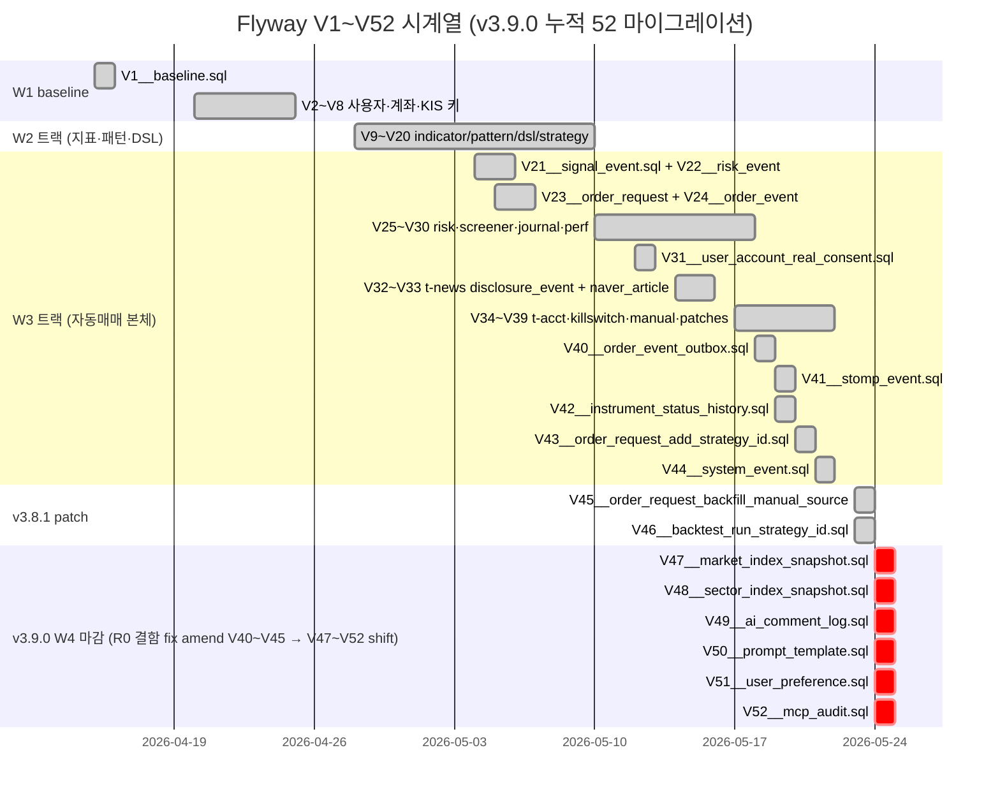
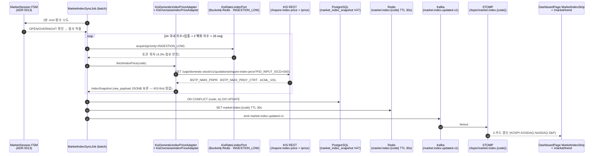
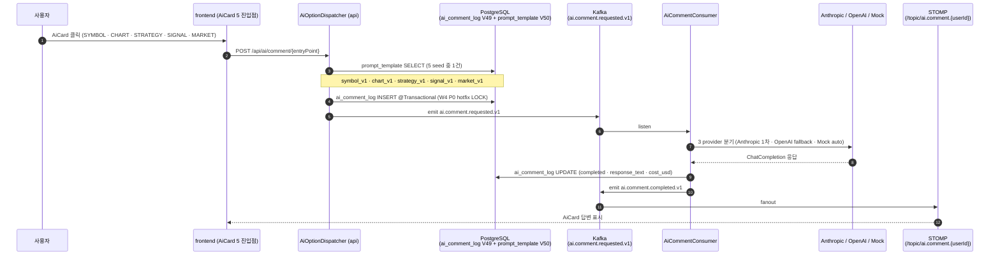
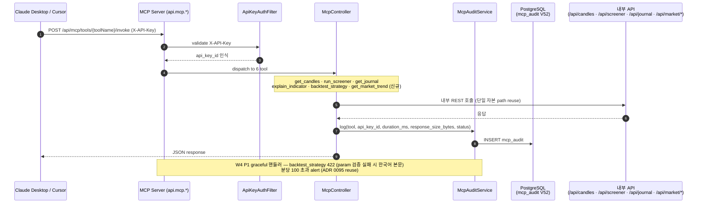
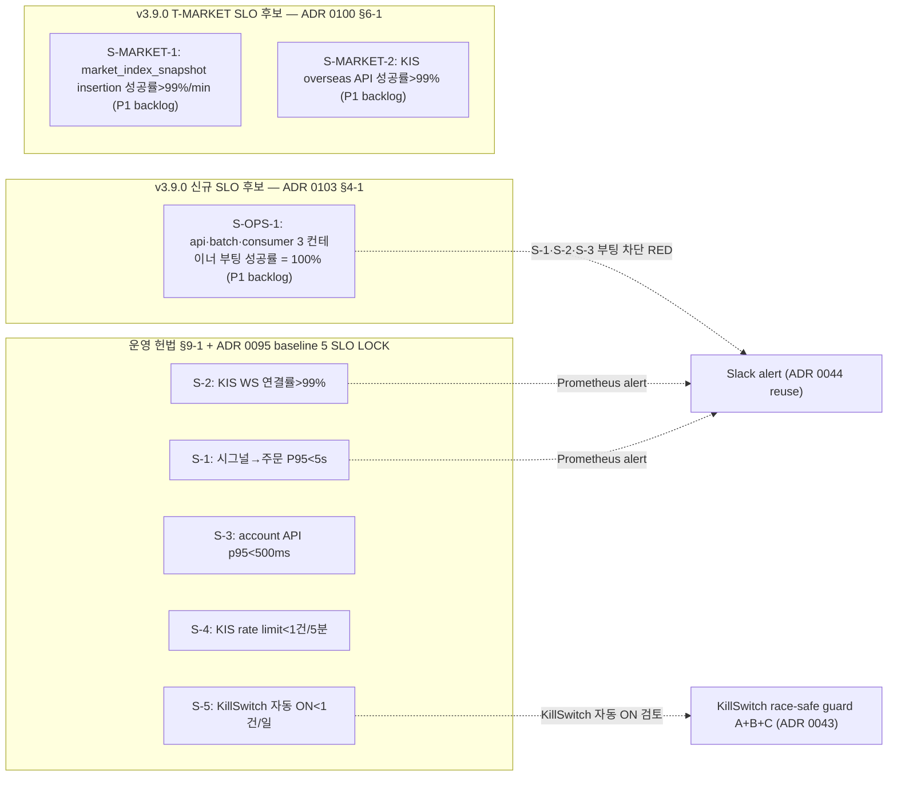
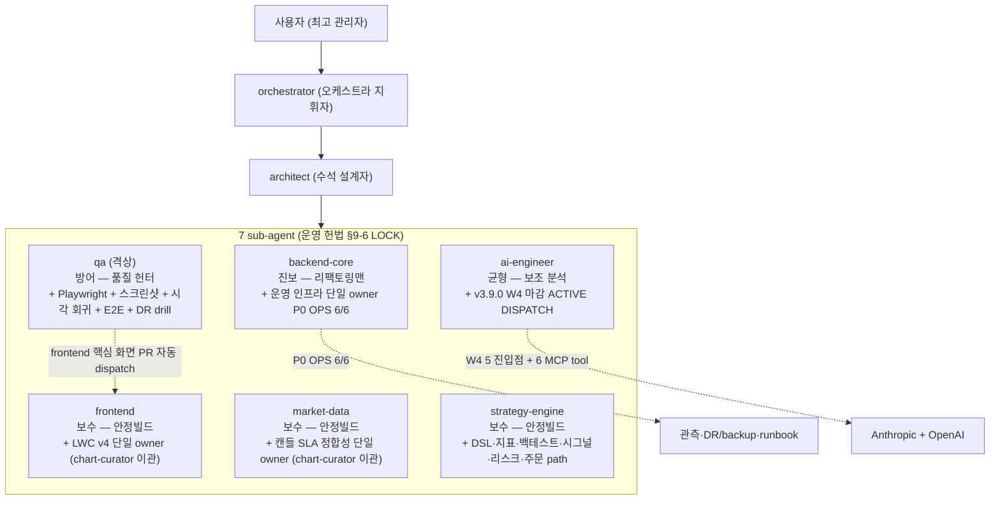
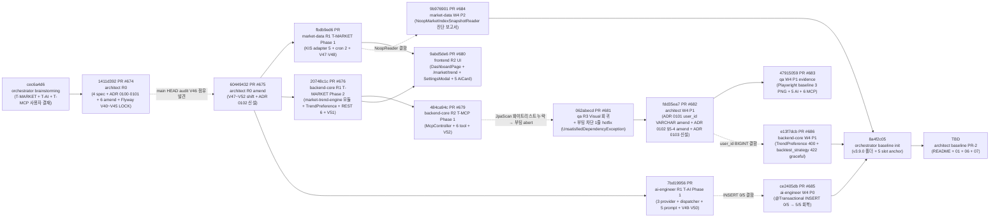

# 01 — magicJar v3.9.0 아키텍처 (시각화)

> **작성자**: architect (PR-2 baseline v3.9.0)
> **시점**: 2026-05-24 v3.9.0 태그 컷 직후 (release commit `<TBD>`)
> **권위**: `docs/architecture/master-architecture.md` v2 §5·§6 + ADR 0002·**0004**(9 모듈 매트릭스 v3.9.0 amend — market-trend-engine 추가)·0005·0006·0007·0008·0009·0023·0024·0028·0029·0030·**0037**(amend — INGESTION_LOW)·0041·0042·0043·0044·**0046**(amend evidence — ADR 0101 W4 P1)·0047·0048·0054·0066·0067·0068·0070·0080·0083·0084·0086·0088·0091·0092·0093·0094·0095·0096·**0097·0098·0099**·**0100·0101·0102·0103** + v3.9.0 시점 코드 inspection 결과

본 문서는 v3.9.0 시점 magicJar 시스템의 **시각화 가능 수준 그림**이다. SoT는 `docs/architecture/master-architecture.md`이며, 본 문서는 그 하위 구체화 — v3.9.0 시점 실체(현재 발행된 컨테이너·테이블·KIS endpoint·Kafka topic·STOMP 토픽·9 JVM 모듈·7 sub-agent hierarchy·페르소나 5 매트릭스·운영 헌법 §9·§10 LOCK·P0 OPS 6/6 LOCK·**W4 마감 — T-MARKET + T-AI + T-MCP 3 트랙 동시 진입**)만 인용한다. v1/v2 잔재 0건. 미발행 트랙(W5 T-LWC·T-LEARN)은 명시적으로 제외.

**v3.8.0 → v3.9.0 핵심 변경 (W4 마감 baseline)**:

- **JVM 모듈 매트릭스 8 → 9**: + `market-trend-engine` (ADR 0100 v3.9.0 신설). Kotlin + Spring Context (Boot main 0). TrendCalculator (pure math · Spring 의존 0) + SmaTrendCalculator + CrossSignalCalculator + RsRatingCalculator + TrendPreferenceService + IndexTrendComposer + SectorRankingComposer + TrendPreferenceRepository port. ADR 0083 indicator-impl · ADR 0088 persistence-shared · ADR 0092 strategy-engine 패턴 1:1 reuse. 컨테이너 0 + Boot main 0.
- **W4 마감 — 3 트랙 동시 진입 (ADR 0100·0101 신설 + ADR 0026·0027 amend)**:
  - **T-MARKET 트랙 (ADR 0100)** — 지수·섹터 추세 분석. KIS endpoint 5 LOCK (`inquire-index-price` · `inquire-index-daily-price` · `inquire-index-category-price` · `price` overseas · `dailyprice` overseas) + cron 2 (1분 + 16:30/06:00 KST 일봉) + REST 6 endpoint + STOMP 3 topic + Flyway V47·V48 (market_index_snapshot + sector_index_snapshot) + KIS-first raw fetch 5 evidence (open-trading-api 공식 SDK examples_llm/ path)
  - **TrendPreference 1급 도메인 (ADR 0101)** — `user_preference` 표 (V51) + `extra JSONB` forward-compat 확장 슬롯 단일 진입점 + Bean Validation + REST 2 endpoint Swagger 4단 한국어 + STOMP fanout + 시드 SQL idempotent + W4 P1 amend (user_id BIGINT → VARCHAR(20) 실 schema 정합)
  - **T-AI 5 진입점 active (ADR 0026 amend)** — SYMBOL · CHART · STRATEGY · SIGNAL · MARKET (신규) + 3 provider (Anthropic · OpenAI · Mock auto fallback) + `AiOptionDispatcher` 단일 분기 + 5 prompt seed (`symbol_v1` · `chart_v1` · `strategy_v1` · `signal_v1` · `market_v1`) + Flyway V49 (ai_comment_log) + V50 (prompt_template) + W4 P0 hotfix (`@Transactional` INSERT 0/5 → 5/5 회복)
  - **T-MCP 6 tool active (ADR 0027 amend)** — `get_candles` · `run_screener` · `get_journal` · `explain_indicator` · `backtest_strategy` · `get_market_trend` (신규) + `McpController` + API key auth filter + Flyway V52 (mcp_audit) + JSON Schema 본문 + 분당 100 초과 alert + W4 P1 graceful (backtest_strategy 422)
- **R0 결함 fix evidence + ADR 0102 신설** — 2026-05-24 R0 PR #674 (1411d392) Flyway V40~V45 LOCK 발행 후 main HEAD audit 결과 V40~V46 점유 사실 발견 → 헌법 §7 escalation → R0 amend PR #675 (60449432) V47~V52 shift + **ADR 0102 spec audit 5단계 절차 LOCK 신설** (영속 자원 6 영역 — Flyway·Kafka·Redis·STOMP·REST·ENV)
- **W4 P1 R3 qa 부팅 차단 hotfix + ADR 0103 신설** — R2 backend-core T-MCP Phase 1 (PR #679) `api.mcp.persistence` 패키지 신설 시 `JpaScanConfiguration.kt` 화이트리스트 갱신 누락 → `UnsatisfiedDependencyException` → exit code 1 → R3 qa 자율 hotfix 1줄 add-only (PR #681 062abecd) + KDoc 7줄 → **ADR 0103 신설** (옵션 A basePackages 단일화 + 옵션 C-lite smoke test 하이브리드 채택 LOCK)
- **ai-engineer active dispatch 시작** — v3.8.0까지 W4 진입 0 LOCK · v3.9.0 W4 마감으로 active dispatch 시작. 자동매매 본체 (시그널 → risk → 주문) AI 호출 0 LOCK 보존 (사용자 옵션 트리거 진입점 5건만 호출)
- **Flyway 누적**: V44 → V52 (V45 v3.8.1 patch + V46 v3.8.1 patch + V47·V48·V49·V50·V51·V52 v3.9.0 W4 마감)
- **KIS Overseas API 첫 진출**: NASDAQ (.IXIC) + S&P 500 (.SPX) 2 지수 신규 — 향후 US 종목 트랙 prereq
- **운영 헌법 §9·§10 LOCK 보존**: SLO 5 + severity 4단 + on-call rotation + 분기 DR drill + 운영 ADR 양식 3 슬롯 (ADR 0100·0101·0102·0103 모두 적용)

---

## §1. 시스템 전경 (9 JVM 모듈 + frontend + 외부 8 + 인프라 3 + 디버깅 2 + 7 sub-agent + W3 종착 노드 보존 + W4 마감 3 트랙 + P0 OPS 6/6 LOCK)

```mermaid
graph TD
    subgraph EXTERNAL["외부 통합 (옵션 + fallback) - v3.9.0 +2 신규"]
        KISREST["KIS REST<br/>openapi.koreainvestment.com:9443 (real)<br/>openapivts.koreainvestment.com:29443 (vps)<br/>order-cash · order-rvsecncl · inquire-balance · inquire-daily-itemchartprice<br/>+ inquire-daily-ccld + inquire-ccld<br/>+ Bucket4j-Redis 단일 bucket LOCK (ADR 0037 amend)<br/>+ INGESTION_LOW priority 신규 (ADR 0037 v3.9.0 amend)"]
        KISREST_INDEX["KIS REST Index (v3.9.0 신규 — T-MARKET ADR 0100)<br/>inquire-index-price · inquire-index-daily-price · inquire-index-category-price<br/>+ FHPUP02100000·FHPUP02120000·FHPUP02140000 tr_id<br/>+ MarketSession FSM gate (OPEN·OVERNIGHT)"]
        KISREST_OVERSEAS["KIS REST Overseas (v3.9.0 신규 — T-MARKET ADR 0100)<br/>price · dailyprice<br/>+ HHDFS00000300·HHDFS76240000 tr_id<br/>+ EXCD=NAS · SYMB=.IXIC/.SPX<br/>+ 06:00 KST 일봉 backfill"]
        KISWS["KIS WebSocket<br/>wss://ops.koreainvestment.com:21000<br/>H0STCNT0 체결가 + H0STASP0 호가<br/>+ H0STCNI0/H0STCNI9 체결통보 (T-O)<br/>+ AES-256-CBC 복호화 (v3.8.0 hotfix)<br/>+ WS_DISCONNECTED·WS_RECONNECTED SystemEvent emit"]
        KISMASTER["KIS 종목마스터 ZIP<br/>new.real.download.dws.co.kr"]
        DART["DART OPENDART<br/>opendart.fss.or.kr<br/>+ T-NEWS 1분 cron 실시간 인입"]
        NAVER["Naver Open API<br/>openapi.naver.com<br/>+ T-NEWS news.json 25K/일 한도"]
        ANTHROPIC["Anthropic Spring AI (v3.9.0 active)<br/>api.anthropic.com<br/>+ Claude Sonnet 1차 default<br/>+ 5 prompt seed (symbol·chart·strategy·signal·market)<br/>+ ai-engineer active dispatch W4 마감"]
        OPENAI["OpenAI Spring AI (v3.9.0 신규 — T-AI ADR 0026)<br/>api.openai.com<br/>+ GPT-4o fallback provider<br/>+ AiOptionDispatcher 단일 분기"]
        YAHOO_DEP["Yahoo Finance Deprecated<br/>YahooCandleFetcherAdapter @Deprecated<br/>v3.9.x 일괄 삭제 예정"]
    end

    subgraph FRONTEND["frontend (React 19 + Vite + LWC v4 — chart-curator 인수)"]
        FE_SETUP["/setup<br/>SetupWizard 7-step"]
        FE_DASH["/<br/>DashboardPage (v3.6.17 격상)<br/>+ AccountSummaryCard + HoldingsTable + BalanceCard<br/>+ B-1 accountType toggle<br/>+ balance STOMP push subscribe<br/>+ MarketIndexStrip add-only (v3.9.0 — T-MARKET ADR 0100)<br/>(KOSPI·KOSDAQ·NASDAQ·S&P 4 카드 + trend 라벨)"]
        FE_WL["/watchlist"]
        FE_SYM["/symbol/:code<br/>+ STOMP 5 boundary<br/>+ LWC chart state lift LOCK<br/>+ CandleCountSelector UI (ADR 0093)<br/>+ Phase 5 LWC 가드 3단<br/>+ AiCard SYMBOL 진입점 (v3.9.0 T-AI ADR 0026)<br/>+ AiCard CHART 진입점 (v3.9.0)"]
        FE_SB["/strategy/builder<br/>+ ScreenerResultModal (T-SC)<br/>+ AiCard STRATEGY 진입점 (v3.9.0)"]
        FE_BT["/strategy/backtest"]
        FE_RC["/risk-config"]
        FE_RE["/risk-events"]
        FE_POS["/positions"]
        FE_ORD["/orders<br/>+ STOMP /topic/order.user.userId<br/>+ AiCard SIGNAL 진입점 (v3.9.0)"]
        FE_ORD_DTL["/orders/:id"]
        FE_ORD_NEW["/orders/new (T-MAN v3.6.15)"]
        FE_JNL["/journal (T-J v3.6.4)"]
        FE_PERF["/performance (T-PERF v3.6.4)"]
        FE_NEWS["/news (T-NEWS v3.6.7)"]
        FE_SCREEN["/screener (T-SC v3.6.3)"]
        FE_ADMIN["/admin"]
        FE_SYSTEM["/system (v3.8.0)<br/>+ SystemEvent Dashboard"]
        FE_MARKET["/market/trend (v3.9.0 신규 — T-MARKET ADR 0100)<br/>+ IndexTrendCard 4 (KOSPI·KOSDAQ·NASDAQ·S&P)<br/>+ SectorRankingTable (todayTop 5 + longTop 5)<br/>+ AiCard MARKET 진입점 (v3.9.0)<br/>+ useTrendPreference hook + STOMP subscribe"]
        FE_SET["SettingsModal v3.6.5 풀세트<br/>+ KIS 키 변경 + KillSwitch 토글 + AI 키<br/>+ RealTradingConsentToggle 이중 confirm<br/>+ 추세 설정 section (v3.9.0 — TrendPreference ADR 0101)<br/>(MA periods 1~5개·각 1~252일·sorted ASC)"]
        FE_HDR["AppHeader<br/>+ RuntimeFlagsIndicator<br/>+ WS health indicator<br/>+ NotificationCenter bell<br/>+ 메뉴 13+ → 14+ (추세 신규)"]
    end

    subgraph API["api (Spring Boot 3.3 / 8080)"]
        API_REST["REST controllers<br/>+ Account 3 + Order 4 + Screener 3 + Journal 3 + Performance 2 + News 4 + ManualOrder 1<br/>+ Runtime 1 + StompBackfill 2 + SystemEvent 2<br/>+ MarketIndex 2 + MarketSector 2 (v3.9.0)<br/>+ UserPreference 2 (v3.9.0)<br/>+ Mcp tools list/invoke 2 (v3.9.0)"]
        API_STOMP["STOMP /ws<br/>tick · candle/1m·5m·15m·30m·90m·1h · orderbook<br/>+ signal.user · risk.user · order.user<br/>+ news.user (T-NEWS) + system.user + account.balance<br/>+ market.index.{code} (v3.9.0)<br/>+ market.sector.rank (v3.9.0)<br/>+ market.user.{userId}.pref (v3.9.0)<br/>+ ai.comment.{userId} (v3.9.0)"]
        API_FLY["Flyway V1~V52 적용기<br/>(v3.9.0: V47·V48·V49·V50·V51·V52 + JpaScanConfiguration 화이트리스트 3건 LOCK ADR 0103)"]
        API_BT["BacktestEngine + Persister + QueryService<br/>+ strategy-engine evaluator 1:1 (ADR 0092)<br/>+ ExecutionPositionUpdatePort (ADR 0097 v3.8.1)<br/>+ KillSwitchQueryPort + Strategy 활성화 게이트 (ADR 0098 v3.8.1)"]
        API_MARKET["MarketIndexController + MarketSectorController (v3.9.0 — T-MARKET ADR 0100)<br/>+ GET /api/market/index/snapshot<br/>+ GET /api/market/index/{code}/trend?periods=...<br/>+ GET /api/market/sectors/snapshot<br/>+ GET /api/market/sectors/ranking<br/>+ market-trend-engine 호출 (TrendCalculator·IndexTrendComposer·SectorRankingComposer)"]
        API_PREF["UserPreferenceController (v3.9.0 — TrendPreference ADR 0101)<br/>+ GET /api/users/me/preferences/trend<br/>+ PUT /api/users/me/preferences/trend<br/>+ Bean Validation (1~5개·각 1~252일·sorted ASC)<br/>+ STOMP fanout /topic/market.user.{userId}.pref"]
        API_AI_DISP["AiOptionDispatcher (v3.9.0 — T-AI ADR 0026)<br/>+ 5 진입점 분기 (SYMBOL·CHART·STRATEGY·SIGNAL·MARKET)<br/>+ 3 provider (Anthropic·OpenAI·Mock)<br/>+ AiCommentRequestedKafka emit<br/>+ ai_comment_log + prompt_template 영속<br/>+ @Transactional W4 P0 hotfix (INSERT 0/5 → 5/5 회복)"]
        API_MCP["McpController + 6 tool (v3.9.0 — T-MCP ADR 0027)<br/>+ POST /api/mcp/tools (list)<br/>+ POST /api/mcp/tools/{toolName}/invoke<br/>+ ApiKeyAuthFilter (api.mcp.*)<br/>+ McpAuditService → mcp_audit 영속<br/>+ get_candles·run_screener·get_journal·explain_indicator·backtest_strategy·get_market_trend<br/>+ W4 P1 graceful 핸들러 (backtest_strategy 422)"]
        API_KIS_BAL["ApiKisBalanceQueryAdapter (T-ACCT v3.6.14)"]
        API_KIS_RATE["KisRateLimiterPort impl<br/>+ Bucket4j-Redis 단일 bucket LOCK<br/>+ INGESTION_LOW priority 신규 (v3.9.0 ADR 0037 amend)"]
        API_RUNTIME["RuntimeFlagsController (P2-2)"]
        API_RECON["ReconcileService (T-RECON v3.6.2)"]
        API_NOTIF["NotificationOutbox + SlackAdapter (T-NOTIFY v3.6.2)"]
        API_JOURNAL["JournalQueryService"]
        API_PERF["PerformanceQueryService + TradeBreakdown (v3.8.1 PR-4)"]
        API_NEWS["NewsQueryService"]
        API_MANUAL["ManualOrderController (T-MAN v3.6.15)"]
        API_SYSEVT["SystemEventController (P2 v3.8.0)"]
        API_TOKEN["KisTokenService<br/>+ T-1·2·3·4 통합 prefix<br/>+ EGW00123 self-heal"]
        API_JPA_SCAN["JpaScanConfiguration (ADR 0088 v3.7.1 + ADR 0103 v3.9.0)<br/>+ basePackages 3건 LOCK<br/>+ api.persistence + api.mcp.persistence + persistence.shared<br/>+ R3 qa hotfix 062abecd (W4 P1)<br/>+ 옵션 A 단일화 P2 dispatch 대기"]
    end

    subgraph BATCH["batch (Spring Batch / 8081)"]
        B_INSTR["InstrumentSyncJob + InstrumentMasterRefreshJob<br/>+ NXT resolver allow-list (ADR 0091)<br/>+ InstrumentStatusHistoryPort INSERT/UPDATE"]
        B_CHK["KisChkHolidayAdapter tr_id=CTCA0903R"]
        B_KSD["KisKsdInfoAdapter"]
        B_DART["DartDisclosureAdapter (T-NEWS)"]
        B_NAVER["NaverArticleAdapter (T-NEWS)"]
        B_PERF["DailyPerformanceJob 00:30 KST"]
        B_SC["DailyScreenerJob"]
        B_MARKET_SYNC["MarketIndexSyncJob (v3.9.0 — T-MARKET ADR 0100)<br/>+ 1분 cron 장중 한정<br/>+ 26 req/min (24 국내 + 2 해외) = 0.43 req/s<br/>+ MarketSession FSM gate<br/>+ KisCallPriority.INGESTION_LOW<br/>+ Kafka market.index.updated.v1 + market.sector.updated.v1 emit"]
        B_MARKET_DAILY["MarketIndexDailyCloseJob (v3.9.0 — T-MARKET ADR 0100)<br/>+ 16:30 KST 국내 일봉 backfill<br/>+ 06:00 KST 해외 일봉 backfill<br/>+ ON CONFLICT UPDATE"]
    end

    subgraph CONSUMER["consumer (Kafka + KIS WS / 8082)"]
        C_KIS_WS["KisWebSocketBridge<br/>H0STCNT0 + H0STASP0 + H0STCNI0/H0STCNI9<br/>+ AES-256-CBC 복호화<br/>+ WS_CONNECTED·WS_DISCONNECTED·WS_RECONNECTED emit"]
        C_KIS_REST["KisRestCandleAdapter<br/>+ KisRateLimiterPort.acquire() (Phase 2)<br/>+ 종목 간 200ms sleep 마진<br/>+ .publishOn(boundedElastic) (ADR 0099 v3.8.1)"]
        C_TICK_AGG["TickToMinuteAggregator"]
        C_SIG["RealtimeSignalGenerator (T-SIG ADR 0066)"]
        C_RISK["RiskGateway (T-RISK ADR 0067)<br/>+ KillSwitchQueryPort fail-closed (ADR 0098 v3.8.1)"]
        C_ORDER["OrderRouterKafkaListener (T-O ADR 0068)<br/>+ 12 step LOCK (자본 path 단일)<br/>+ ExecutionPositionUpdatePort (ADR 0097 v3.8.1)"]
        C_AI["AiCommentConsumer (v3.9.0 — T-AI ADR 0026)<br/>+ ai.comment.requested.v1 listen<br/>+ AnthropicProvider · OpenAiProvider · MockProvider 분기<br/>+ ai.comment.completed.v1 emit<br/>+ ai_comment_log INSERT @Transactional (W4 P0)"]
    end

    subgraph INFRA["인프라 (3 컨테이너)"]
        PG["PostgreSQL 16<br/>schema: public<br/>+ V1~V52 누적 (v3.9.0 +6)"]
        REDIS["Redis 7<br/>+ kis token unified prefix<br/>+ accountType 분리<br/>+ system event dedup<br/>+ market:index:{code} TTL 30s (v3.9.0)<br/>+ ai:comment:cache (v3.9.0)"]
        KAFKA["Kafka 3.7 KRaft<br/>+ 29+ 토픽 누적 (v3.9.0 +4)<br/>+ market.index.updated.v1<br/>+ market.sector.updated.v1<br/>+ ai.comment.requested.v1<br/>+ ai.comment.completed.v1"]
    end

    subgraph OBS["관측 (P0 OPS 6/6 LOCK)"]
        PROM["Prometheus<br/>+ 5 SLO × 2 임계 = 10 alert rule (ADR 0095)<br/>+ S-OPS-1 신규 SLO 후보 (ADR 0103)"]
        GRAF["Grafana SLO Dashboard"]
    end

    subgraph DR["DR/backup (ADR 0096 LOCK)"]
        BACKUP_PG["pg_dump daily 03:00 KST<br/>+ 7일 retention<br/>+ _workspace/backups/postgres/daily/"]
        BACKUP_REDIS["Redis snapshot 03:30 KST<br/>+ 3일 retention<br/>+ _workspace/backups/redis/snapshots/"]
    end

    FE_DASH -->|GET /api/market/index/snapshot| API_MARKET
    FE_MARKET -->|GET /api/market/sectors/ranking| API_MARKET
    FE_SET -->|PUT /api/users/me/preferences/trend| API_PREF
    FE_SYM -->|POST AI dispatch| API_AI_DISP
    FE_SB -->|POST AI dispatch| API_AI_DISP
    FE_MARKET -->|STOMP subscribe| API_STOMP

    API_MARKET -->|TrendCalculator·IndexTrendComposer| MTE
    API_PREF -->|TrendPreferenceRepository port| MTE
    API_AI_DISP -->|emit ai.comment.requested.v1| KAFKA
    KAFKA -->|listen| C_AI
    C_AI -->|provider| ANTHROPIC
    C_AI -->|provider fallback| OPENAI

    B_MARKET_SYNC -->|GET /uapi/domestic-stock/v1/quotations/inquire-index-price| KISREST_INDEX
    B_MARKET_SYNC -->|GET /uapi/overseas-price/v1/quotations/price| KISREST_OVERSEAS
    B_MARKET_DAILY -->|GET /uapi/domestic-stock/v1/quotations/inquire-index-daily-price| KISREST_INDEX
    B_MARKET_DAILY -->|GET /uapi/overseas-price/v1/quotations/dailyprice| KISREST_OVERSEAS
    B_MARKET_SYNC -->|emit| KAFKA
    KAFKA -->|listen| API_STOMP

    API_MCP -->|GET candles or screener or journal| API_REST
    API_MCP -->|get_market_trend| API_MARKET

    subgraph MTE["market-trend-engine (v3.9.0 신설 — ADR 0100 · 9번째 JVM 모듈)"]
        MTE_CALC["TrendCalculator interface<br/>+ SmaTrendCalculator (1차 default)<br/>+ CrossSignalCalculator (GOLDEN·DEAD·NEUTRAL)<br/>+ RsRatingCalculator (Mansfield RS — sector vs KOSPI)"]
        MTE_SVC["TrendPreferenceService<br/>+ IndexTrendComposer<br/>+ SectorRankingComposer"]
        MTE_PORT["TrendPreferenceRepository port<br/>+ findByUserId(userId: String) -- W4 P1 amend<br/>+ upsert(pref)"]
    end
```



본 그림 명시 사실:

- **9 JVM 모듈** — domain · pattern-engine · indicator-impl · persistence-shared · strategy-engine · **market-trend-engine (v3.9.0 신설)** · api · batch · consumer
- **외부 통합 8건 (v3.8.0 6 + v3.9.0 +2)** — KIS REST + KIS Index (신규) + KIS Overseas (신규) + KIS WS + KIS 종목마스터 ZIP + DART + Naver + Anthropic + OpenAI (신규) + Yahoo @Deprecated (점직 제거)
- **W3 자동매매 본체 chain 보존** — RealtimeSignalGenerator → RiskGateway (KillSwitchQueryPort fail-closed ADR 0098) → OrderRouterKafkaListener (12 step LOCK + ExecutionPositionUpdatePort ADR 0097) → KIS REST · KIS WS H0STCNI0/H0STCNI9 체결
- **W4 마감 — T-MARKET cron 발사** — MarketIndexSyncJob (1분 cron 26 req/min INGESTION_LOW) + MarketIndexDailyCloseJob (16:30 + 06:00 KST 일봉) → Kafka → STOMP fanout
- **AI 옵션 보조 active** — AiOptionDispatcher → ai.comment.requested.v1 → AiCommentConsumer → Anthropic/OpenAI/Mock 분기 → ai.comment.completed.v1 → STOMP `/topic/ai.comment.{userId}`
- **MCP 6 tool active** — McpController → ApiKeyAuthFilter → 6 tool 분기 (`get_candles`·`run_screener`·`get_journal`·`explain_indicator`·`backtest_strategy`·`get_market_trend`) + McpAuditService → mcp_audit 영속

---

## §2. 외부 통합 매트릭스 (v3.9.0 +2 신규)

| # | 외부 | endpoint / protocol | 트랙 | v3.9.0 변경 |
|---|------|---------------------|------|------|
| 1 | KIS REST (주문·잔고·체결) | `/uapi/domestic-stock/v1/trading/order-cash` · `/uapi/domestic-stock/v1/trading/inquire-balance` · `/uapi/domestic-stock/v1/trading/inquire-ccld` · `/uapi/domestic-stock/v1/trading/inquire-daily-ccld` | T-O · T-ACCT · T-RECON | 0 (보존) |
| 2 | KIS REST (시세·캔들) | `/uapi/domestic-stock/v1/quotations/inquire-daily-itemchartprice` · `/uapi/domestic-stock/v1/quotations/inquire-price` | T-CC · T-IND | 0 (보존) |
| 3 | **KIS REST Index (v3.9.0 신규)** | `/uapi/domestic-stock/v1/quotations/inquire-index-price` (FHPUP02100000) · `/uapi/domestic-stock/v1/quotations/inquire-index-daily-price` (FHPUP02120000) · `/uapi/domestic-stock/v1/quotations/inquire-index-category-price` (FHPUP02140000) | **T-MARKET (ADR 0100)** | **신설 — 국내 3 지수 (KOSPI=0001·KOSDAQ=1001·KOSPI200=2001) + 21 KRX 업종 + KIS-first raw fetch 3 evidence (open-trading-api examples_llm/domestic_stock/*)** |
| 4 | **KIS REST Overseas (v3.9.0 신규)** | `/uapi/overseas-price/v1/quotations/price` (HHDFS00000300) · `/uapi/overseas-price/v1/quotations/dailyprice` (HHDFS76240000) | **T-MARKET (ADR 0100)** | **신설 — NASDAQ (.IXIC · EXCD=NAS) + S&P 500 (.SPX) 2 지수 + KIS-first raw fetch 2 evidence + 06:00 KST 일봉 backfill cron** |
| 5 | KIS WebSocket | `wss://ops.koreainvestment.com:21000` H0STCNT0/H0STASP0/H0STCNI0/H0STCNI9 | T-CC · T-O | 0 (보존) — AES-256-CBC 복호화 hotfix v3.8.0 |
| 6 | KIS 종목마스터 ZIP | `new.real.download.dws.co.kr` | T-MS1 | 0 (보존) |
| 7 | DART OPENDART | `opendart.fss.or.kr` | T-NEWS | 0 (보존) |
| 8 | Naver Open API | `openapi.naver.com` (news.json) | T-NEWS | 0 (보존) |
| 9 | **Anthropic Spring AI (v3.9.0 active)** | `api.anthropic.com` Claude Sonnet | **T-AI (ADR 0026 amend)** | **W4 마감 — active dispatch + 5 prompt seed + AiOptionDispatcher 단일 분기** |
| 10 | **OpenAI Spring AI (v3.9.0 신규)** | `api.openai.com` GPT-4o | **T-AI (ADR 0026 amend)** | **신설 — fallback provider + AiOptionDispatcher 자동 분기** |
| 11 | Yahoo Finance | `query1.finance.yahoo.com` | (deprecated) | `@Deprecated` 유지 — v3.9.x 일괄 삭제 예정 |

**KIS-first raw fetch 5 evidence (ADR 0100 §3 정합 — 자체 추론 0 LOCK)**:

| # | endpoint | raw 출처 (open-trading-api 공식 SDK) |
|---|---|---|
| 1 | `inquire_index_price` | https://github.com/koreainvestment/open-trading-api/blob/main/examples_llm/domestic_stock/inquire_index_price/inquire_index_price.py |
| 2 | `inquire_index_daily_price` | https://github.com/koreainvestment/open-trading-api/blob/main/examples_llm/domestic_stock/inquire_index_daily_price/inquire_index_daily_price.py |
| 3 | `inquire_index_category_price` | https://github.com/koreainvestment/open-trading-api/blob/main/examples_llm/domestic_stock/inquire_index_category_price/inquire_index_category_price.py |
| 4 | `price` (overseas) | https://github.com/koreainvestment/open-trading-api/blob/main/examples_llm/overseas_stock/price/price.py |
| 5 | `dailyprice` (overseas) | https://github.com/koreainvestment/open-trading-api/blob/main/examples_llm/overseas_stock/dailyprice/dailyprice.py |

---

## §3. Flyway V1~V52 시계열 매트릭스 (v3.9.0 cut 시점 baseline)



**v3.9.0 신규 마이그레이션 6건** (R0 결함 fix amend로 V40~V45 → V47~V52 shift · ADR 0102 신설 5단계 절차 정합):

| version | 표 | 신설 ADR | 영역 (sub-agent) |
|---|---|---|---|
| **V47** | `market_index_snapshot` (KOSPI·KOSDAQ·KOSPI200·NASDAQ·S&P + 21 업종 1분 snapshot + raw_payload JSONB) | ADR 0100 §2-7 | market-data (R1 T-MARKET Phase 1) |
| **V48** | `sector_index_snapshot` (KRX 21 업종 + 한국어명 + 등락률 + 거래대금 + raw_payload JSONB) | ADR 0100 §2-7 | market-data (R1 T-MARKET Phase 1) |
| **V49** | `ai_comment_log` (5 진입점 분기 + 3 provider 식별 + INSERT @Transactional W4 P0 hotfix) | ADR 0026 amend | ai-engineer (R1 T-AI Phase 1) |
| **V50** | `prompt_template` (5 seed: symbol_v1·chart_v1·strategy_v1·signal_v1·market_v1 · `{{maPeriods}}` 변수 치환) | ADR 0026 amend | ai-engineer (R1 T-AI Phase 1) |
| **V51** | `user_preference` (W4 P1 amend — `user_id VARCHAR(20)` 자연 키 정합 ADR 0046 + `trend_ma_periods JSONB` + `extra JSONB` 확장 슬롯 + 시드 SQL idempotent + 2 CHECK 제약) | ADR 0101 §2-2 (W4 P1 amend) | backend-core (R1 T-MARKET Phase 2) |
| **V52** | `mcp_audit` (6 tool 호출 ledger + api_key_id + duration_ms + response_size_bytes + status) | ADR 0027 amend | backend-core (R2 T-MCP Phase 1) |

**R0 결함 fix evidence (ADR 0102 §1-1 본문화)**:

```bash
# main HEAD audit (R0 amend PR #675 직전 실행)
$ git fetch origin main && ls api/src/main/resources/db/migration/ | grep "^V4" | sort
V40__order_event_outbox.sql
V41__stomp_event.sql
V42__instrument_status_history.sql
V43__order_request_add_strategy_id.sql
V44__system_event.sql
V45__order_request_backfill_manual_source.sql
V46__backtest_run_strategy_id.sql
```

V40~V46 모두 점유 사실 확인 → R0 spec V40~V45 LOCK 전체 무효 → R0 amend PR #675 (60449432) V47~V52 재분배 LOCK 발행 + **ADR 0102 신설** (영속 자원 6 영역 audit 5단계 절차 LOCK).

---

## §4. T-MARKET 트랙 흐름 (v3.9.0 W4 마감 — ADR 0100)



**KisCallPriority enum (ADR 0037 v3.9.0 amend)**:

```
USER_PATH > INGESTION > BACKFILL > INGESTION_LOW (신규 v3.9.0)
```

- `INGESTION_LOW` 사유: T-MARKET cron 26 req/min은 사용자 path 보다 느린 user-facing latency 허용 + 정기 시장 추세 갱신 본질. BACKFILL(과거 backfill) 보다 더 낮은 우선순위 — burst 시 BACKFILL 0건 drop 우선.

---

## §5. T-AI 5 진입점 흐름 (v3.9.0 W4 마감 — ADR 0026 amend)



**T-AI 5 진입점 + 5 prompt seed**:

| # | 진입점 | UI 위치 | prompt seed | 변수 치환 |
|---|--------|---------|-------------|-----------|
| 1 | SYMBOL | `/symbol/:code` AiCard | `symbol_v1` | `{{instrumentCode}}` · `{{instrumentName}}` |
| 2 | CHART | `/symbol/:code` AiCard (LWC) | `chart_v1` | `{{candleSummary}}` · `{{indicatorValues}}` |
| 3 | STRATEGY | `/strategy/builder` AiCard | `strategy_v1` | `{{dslYaml}}` |
| 4 | SIGNAL | `/orders` AiCard | `signal_v1` | `{{signalEvent}}` |
| 5 | **MARKET (신규 v3.9.0)** | `/market/trend` AiCard | `market_v1` | `{{maPeriods}}` · `{{rsPeriod}}` · `{{indexTrend}}` · `{{sectorRanking}}` |

**자동매매 본체 AI 호출 0 LOCK 보존** (ADR 0023·0066·0067·0068·0080·0094 baseline) — 시그널 → risk → 주문 chain은 AI 호출 0. 본 5 진입점은 사용자 옵션 트리거만.

---

## §6. T-MCP 6 tool 흐름 (v3.9.0 W4 마감 — ADR 0027 amend)



**6 tool 매트릭스** (JSON Schema 본문 ADR 0027 §2 amend):

| # | tool | 용도 | 내부 API reuse |
|---|------|------|-------|
| 1 | `get_candles` | 종목 캔들 조회 | `/api/candles/{code}` |
| 2 | `run_screener` | 사용자 strategy 스크리닝 실행 | `/api/screener/run` |
| 3 | `get_journal` | 매매일지 조회 | `/api/journal/list` |
| 4 | `explain_indicator` | 지표 설명 (정적 prompt) | (api 내부) |
| 5 | `backtest_strategy` | DSL 백테스트 실행 (W4 P1 graceful 422) | `/api/backtest/run` |
| 6 | **`get_market_trend` (신규 v3.9.0)** | 사용자 user_preference 정합 추세 분석 | `/api/market/index/{code}/trend` |

**JpaScanConfiguration 화이트리스트 LOCK** (ADR 0103 v3.9.0 신설 — R3 qa 부팅 차단 hotfix 직후 architect amend 본문화):

```kotlin
@EnableJpaRepositories(
    basePackages = [
        "kr.spdaewoon.magicjar.api.persistence",
        "kr.spdaewoon.magicjar.api.mcp.persistence",   // ← R3 qa hotfix 062abecd (W4 P1)
        "kr.spdaewoon.magicjar.persistence.shared",
    ],
)
@EntityScan(/* 동일 */)
```

- **임시 baseline**: 3건 명시 화이트리스트 유지 (R3 qa hotfix · KDoc 7줄 사유 — "신규 패키지에 JpaRepository/Entity 추가 시 본 화이트리스트 갱신 의무")
- **장기 fix**: 옵션 A (basePackages 단일화 `kr.spdaewoon.magicjar` 자동 scan) + 옵션 C-lite (Spring context load smoke test 1건 add-only) 하이브리드 — ADR 0103 §3-1 채택안. P1 backend-core dispatch 자율 + P2 옵션 A 적용 (옵션 C 안정 운영 1 사이클 후).

---

## §7. market-trend-engine 모듈 구조 (v3.9.0 신설 — ADR 0100 9번째 모듈)

```
market-trend-engine/                                              # Kotlin + Spring Context (Boot main 0)
├─ build.gradle.kts                                               # implementation(project(":domain"))
├─ src/main/kotlin/kr/spdaewoon/magicjar/market/
│  ├─ calculator/                                                 # pure math (Spring 의존 0)
│  │  ├─ TrendCalculator.kt              # interface
│  │  ├─ SmaTrendCalculator.kt           # 1차 default
│  │  ├─ CrossSignalCalculator.kt        # GOLDEN/DEAD/NEUTRAL 표준
│  │  └─ RsRatingCalculator.kt           # Mansfield RS — sector vs KOSPI
│  ├─ service/
│  │  ├─ TrendPreferenceService.kt       # user pref 조회·검증·적용
│  │  ├─ IndexTrendComposer.kt           # IndexTrend DTO 조립
│  │  └─ SectorRankingComposer.kt        # SectorRanking 조립
│  └─ port/
│     └─ TrendPreferenceRepository.kt    # domain port (impl은 api/persistence-shared)
└─ src/test/kotlin/.../
   ├─ SmaTrendCalculatorTest.kt          # fixture 단위
   ├─ CrossSignalCalculatorTest.kt       # edge case
   └─ RsRatingCalculatorTest.kt          # 계산 정확성
```

**모듈 경계** (ADR 0004 v3.9.0 amend 정합):

- `market-trend-engine` → `domain`만 의존. `api`·`batch`·`consumer` 의존 0.
- `api` · `consumer` → `market-trend-engine` 의존 (R2·R1 부분)
- `batch` → `market-trend-engine` 의존 (cron Job에서 TrendCalculator reuse)
- `frontend` → JVM 그래프 밖. HTTP/STOMP only

ADR 0083 indicator-impl · ADR 0088 persistence-shared · ADR 0092 strategy-engine 패턴 1:1 reuse — domain 순수성 보존 LOCK.

---

## §8. 운영 헌법 §9 SLO 5건 + S-OPS-1 신규 후보 (v3.9.0 ADR 0103 본문화)



**v3.9.0 ADR 0100·0101·0102·0103 SLO 영향 매트릭스 (운영 ADR 양식 3 슬롯 §6-1 / §5-1 / §5-1 / §4-1)**:

| ADR | S-1 | S-2 | S-3 | S-4 | S-5 |
|---|---|---|---|---|---|
| 0100 (T-MARKET) | 0 | 0 | 0 | **+0.43 req/s (4.3% 점유 안전 — INGESTION_LOW)** | 0 |
| 0101 (TrendPreference) | 0 | 0 | 0 | 0 | 0 |
| 0102 (spec audit) | 0 (governance) | 0 | 0 | 0 | 0 |
| 0103 (JpaScan) | **부팅 차단 시 RED** | **부팅 차단 시 RED** | **부팅 차단 시 RED** | 0 | 0 |

---

## §9. 7 sub-agent hierarchy (v3.8.0 LOCK 보존 + v3.9.0 W4 ai-engineer active)



**v3.9.0 sub-agent 활성 매트릭스**:

| sub-agent | v3.8.0 | v3.9.0 |
|-----------|--------|--------|
| architect | active | active (PR-2 baseline 본 문서 발행) |
| backend-core | active | active (R1 T-MARKET Phase 2 + R2 T-MCP Phase 1 + W4 P1 graceful) |
| frontend | active | active (R2 T-MARKET·T-AI UI + 5 AiCard) |
| market-data | active | active (R1 T-MARKET Phase 1 + W4 P2 NoopReader 진단) |
| strategy-engine | active | (v3.9.0 사이클 dispatch 0 — W3 보존) |
| **ai-engineer** | **유지 (W4 진입 0)** | **ACTIVE DISPATCH (R1 T-AI Phase 1 + W4 P0 hotfix)** |
| qa | active (Visual baseline) | active (R3 Visual 회귀 + 부팅 차단 hotfix evidence) |

**chart-curator** — 해고 (ADR 0094 amend 2026-05-21) · dispatch 0 · `.husky/pre-commit` ALLOWED_AUTHOR regex 유지 (historical evidence 보존).

---

## §10. v3.9.0 사이클 PR 흐름 sequential (R0 결함 fix + R1·R2·R3 + W4 P0·P1·P2 hotfix)



R0 결함 fix evidence (헌법 §7 escalation 5단계 완주):

1. **sub-agent escalation 가동** — ai-engineer R1 dispatch가 main HEAD audit 결과 V40~V46 점유 사실 발견 → 작업 0 발행 + orchestrator 보고
2. **orchestrator R1·R2 dispatched sub-agent 즉시 kill** — market-data + backend-core T-MARKET 즉시 kill
3. **architect R0 결함 fix amend PR dispatch** — R0 amend PR #675 (60449432) V47~V52 재분배 LOCK + ADR 0102 신설
4. **amend 머지** — V47~V52 LOCK 정합
5. **R1·R2 sub-agent 재 dispatch** — 헌법 §2 정리 4단계 완료 후

---

본 01-architecture는 v3.9.0 시점 magicJar 시스템의 시각화 가능 수준 그림이다. 본 baseline 폴더의 02-data-flow(backend-core 영역) · 03-use-sequences(market-data KIS-first raw) · 04-feature-spec(backend-core) · 05-ui-inventory(frontend) · 06-history-traceability · 07-policy-evolution 본문은 본 문서를 횡단 인용한다.
