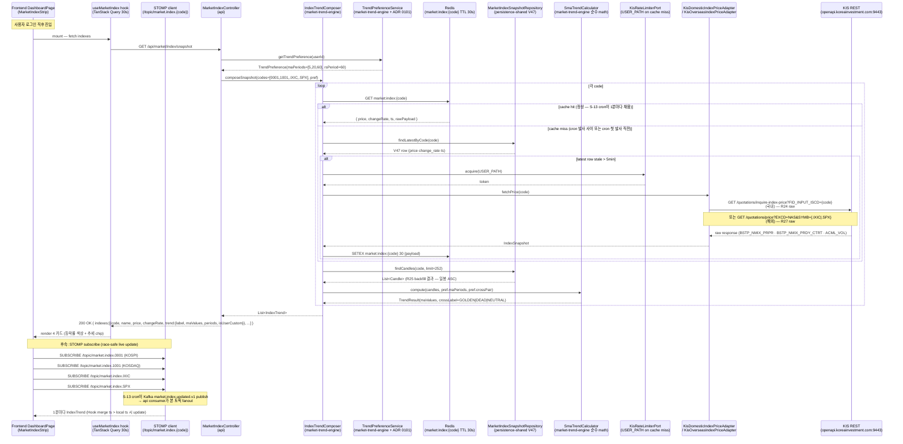
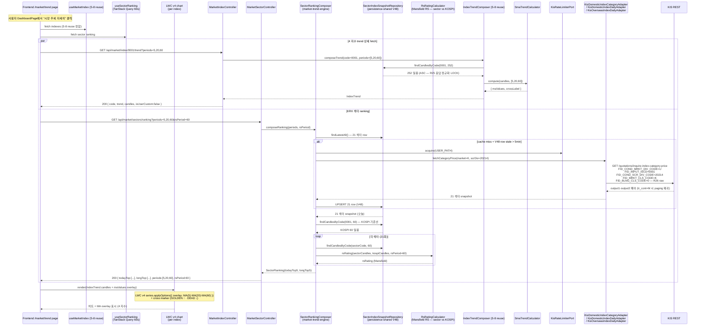
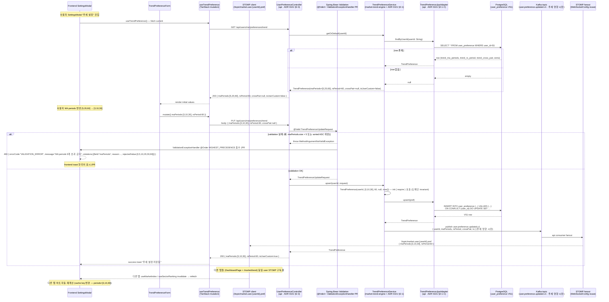
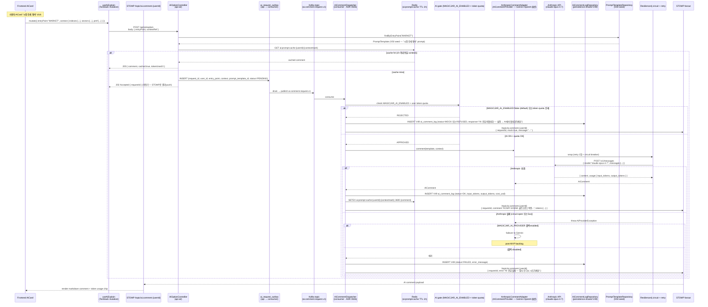
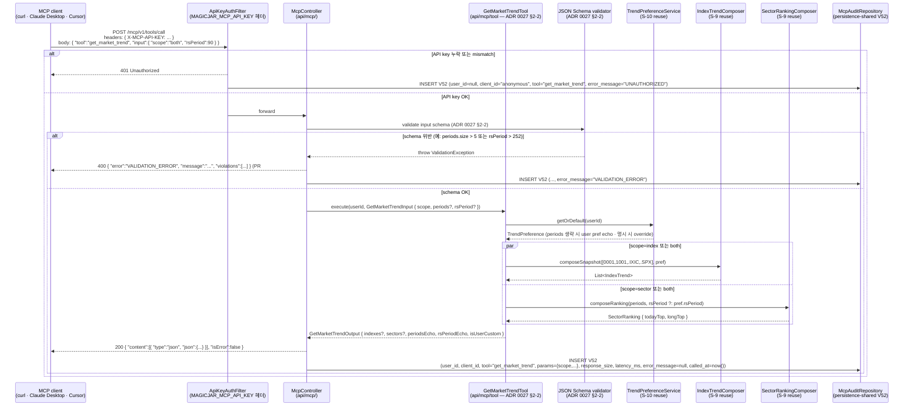
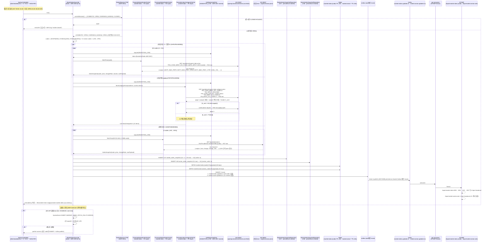

# v3.9.0 사용자 유즈 시퀀스 + KIS-first raw 출처

> **작성자**: market-data (bot+market-data@magicjar.local)
> **작성일**: 2026-05-24
> **기준 시점**: v3.9.0 — **W4 완전 마감 baseline** (T-MARKET + T-AI + T-MCP 3 트랙 동시 진입 — ADR 0100·0101·0102 신설 + ADR 0026·0027·0094 amend) + 운영 단계 2차 baseline (ADR 0094 amend — chart-curator 해고 후 캔들 SLA market-data 인수 사이클 안정 + W4 P0·P1·P2 graceful fix 마감 — PR #686 ValidationExceptionHandler + PR #684 NoopReader 진단)
> **KIS-first 의무**: 헌법 §3 정합 — 자체 추론 0, 모든 endpoint·tr_id·필드는 raw 출처 인용 의무 (`docs/architecture/policies/kis-first-raw-fetch.md` 권위)
> **v3.8.0 대비 변경**: 시나리오 **S-8·S-9·S-10·S-11·S-12·S-13** 6건 신규 (시장 추세 lens — 지수·섹터 + TrendPreference + AI + MCP) + raw 출처 인용 인덱스 **R24·R25·R26·R27·R28** 5건 신규 (KIS 국내 지수·섹터 3건 + KIS 해외 지수 2건). v3.8.0 시나리오 1~23 + S-1~S-7 + raw R1~R23은 본 baseline 위에 add-only 보존.

---

## 0. 변경 매트릭스 — v3.8.0 → v3.9.0

| # | 영역 | 트리거 | 시나리오 |
|---|---|---|---|
| S-8 | market-data + frontend | T-MARKET R1·R2 + ADR 0100 §2-3 KIS endpoint 5 LOCK | 사용자 DashboardPage 진입 → MarketIndexStrip 4 지수 카드 (KOSPI·KOSDAQ·NASDAQ·S&P 500) + 추세 라벨 + 30s polling fallback + STOMP fanout |
| S-9 | market-data + frontend | T-MARKET R1·R2 + ADR 0100 §2-3 + §2-5 + §2-6 | 사용자 `/market/trend` 진입 → 4 지수 + KRX 21 섹터 ranking + MA overlay (TrendPreference fetch 적용) |
| S-10 | backend-core + frontend | ADR 0101 §2-1·§2-2·§2-3 + STOMP fanout `/topic/market.user.{userId}.pref` | 사용자 SettingsModal "추세 설정" → MA periods 변경 → PUT `/api/users/me/preferences/trend` → Bean Validation → V51 UPSERT → STOMP 다중 탭 sync |
| S-11 | ai-engineer + backend-core + frontend | ADR 0026 amend §2-3 진입점 5 MARKET 신규 + ADR 0094 §9-1 AI 비용 통제 + V49·V50 영속 | 사용자 AiCard "시장 추세 해석" click → AI dispatcher → Anthropic adapter → STOMP fanout (MAGICJAR_AI_ENABLED=false 시 mock 응답 분기) |
| S-12 | backend-core + market-data | ADR 0027 amend §2-2 tool 6 `get_market_trend` + ApiKeyAuthFilter + V52 mcp_audit | 사용자 MCP curl `get_market_trend` → ApiKeyAuthFilter → McpController → 응답 + `mcp_audit` INSERT (audit 시계열) |
| S-13 | market-data (batch + api) | T-MARKET R1 batch + ADR 0013 MarketSession FSM + Kafka `market.index.updated.v1`·`market.sector.updated.v1` | `MarketIndexSyncJob` 1분 cron → KIS endpoint 5 → V47 `market_index_snapshot` · V48 `sector_index_snapshot` INSERT → Kafka publish → STOMP fanout |

---

## 1. raw 출처 인용 인덱스 (v3.9.0 추가분)

v3.7.0 baseline raw 인덱스 R1~R20 + v3.8.0 baseline R21~R23은 본 baseline 위에 그대로 LOCK. 본 § 1은 v3.9.0 신규 시나리오 S-8~S-13에 필요한 raw 출처 R24~R28 5건만 add-only.

| # | 출처 | raw URL | tr_id | 사용 시나리오 |
|---|---|---|---|---|
| R24 | KIS 국내 업종 현재가 (inquire_index_price) | `https://github.com/koreainvestment/open-trading-api/blob/main/examples_llm/domestic_stock/inquire_index_price/inquire_index_price.py` | **FHPUP02100000** | S-8·S-9·S-13 — KOSPI(0001)·KOSDAQ(1001)·KOSPI200(2001) + KRX 21 업종 현재가 (1분 cron) |
| R25 | KIS 국내 업종 일봉 (inquire_index_daily_price) | `https://github.com/koreainvestment/open-trading-api/blob/main/examples_llm/domestic_stock/inquire_index_daily_price/inquire_index_daily_price.py` | **FHPUP02120000** | S-9·S-13 — 추세 계산 input (최대 252일 = 1 거래년) · 16:30 KST cron + lazy refresh |
| R26 | KIS 국내 업종 등락 (inquire_index_category_price) | `https://github.com/koreainvestment/open-trading-api/blob/main/examples_llm/domestic_stock/inquire_index_category_price/inquire_index_category_price.py` | **FHPUP02140000** | S-9·S-13 — 섹터 ranking input (FID_COND_SCR_DIV_CODE=20214 · FID_MRKT_CLS_CODE=K · FID_BLNG_CLS_CODE=0) · pagination tr_cont=M/F 재귀 |
| R27 | KIS 해외 지수 현재가 (overseas_stock/price) | `https://github.com/koreainvestment/open-trading-api/blob/main/examples_llm/overseas_stock/price/price.py` | **HHDFS00000300** | S-8·S-13 — NASDAQ(EXCD=NAS·SYMB=.IXIC) · S&P 500(EXCD=NAS·SYMB=.SPX) — 점 prefix가 index 표시 |
| R28 | KIS 해외 지수 일봉 (overseas_stock/dailyprice) | `https://github.com/koreainvestment/open-trading-api/blob/main/examples_llm/overseas_stock/dailyprice/dailyprice.py` | **HHDFS76240000** | S-9·S-13 — 해외 추세 계산 input · GUBN=0(daily) · BYMD(YYYYMMDD) · MODP=1(수정주가) · output2[]: xymd·open·high·low·clos·tvol·t_xprc · 06:00 KST cron |

**v3.9.0 KIS-first 의무 (헌법 §3 + ADR 0100 §3-2 정합 + `docs/architecture/policies/kis-first-raw-fetch.md` 5단계 절차 정합)**:

- 시나리오 S-8 — `inquire-index-price`(R24) `BSTP_NMIX_PRPR`(현재가) · `BSTP_NMIX_PRDY_VRSS`(전일대비) · `BSTP_NMIX_PRDY_CTRT`(전일대비율) · `ACML_VOL`(누적거래량) raw 컬럼 4건 그대로 보존 → MarketIndexFetcher 어댑터 KDoc inline raw URL + tr_id 명시 의무 (ADR 0100 §3-3 코드 예시 패턴 1:1). 자체 추론 0.
- 시나리오 S-9 — `inquire-index-daily-price`(R25) `output1=metadata + output2=daily candles array` 매핑 raw 출처 LOCK. `inquire-index-category-price`(R26) `output1·output2` 페어 + `tr_cont=M/F` 재귀 paging spec raw 정합. 자체 정의 sort 0.
- 시나리오 S-10 — KIS endpoint 미경유 (사용자 설정 UPSERT path) — DB `user_preference` V51 (ADR 0101 §2-2 1:1).
- 시나리오 S-11 — KIS endpoint 미경유 (AI prompt context는 S-8·S-9 시나리오 응답 reuse). AI 호출은 MAGICJAR_AI_ENABLED toggle gate.
- 시나리오 S-12 — MCP `get_market_trend` (ADR 0027 §2-2 tool 6 신규) — 본 tool은 LLM 호출 0 (read-only) + S-9 시나리오 응답 reuse + `mcp_audit` V52 INSERT.
- 시나리오 S-13 — KIS endpoint 5건 매트릭스 1분 cron 발사 (ADR 0100 §2-4 · §2-3 정합). 해외 `price`(R27) `EXCD=NAS·SYMB=.IXIC/.SPX` exchange code 매트릭스(ADR 0100 §3-4 raw fetch evidence) 의무.

**ADR 0037 amend (`INGESTION_LOW` priority 신규 — ADR 0100 §2-8 정합)**:
- 시나리오 S-13 — `MarketIndexSyncJob` 1분 cron 26 req/min = 0.43 req/s = 한도 10 req/s 대비 **4.3% 점유 안전**. burst 발생 시 INGESTION_LOW가 BACKFILL·INGESTION·USER_PATH 보다 먼저 drop 대상 (자본 path 보호).
- S-13 호출 직전 `KisRateLimiterPort.acquire(INGESTION_LOW)` 의무 (ADR 0037 §2-1 enum 매트릭스 4단계).
- S-8·S-9 사용자 path 트리거는 Redis cache hit (30s TTL) 우선 → cache miss 시만 KIS 호출 → 호출 시 `KisRateLimiterPort.acquire(USER_PATH)`.

**ADR 0013 MarketSession FSM gate 정합**:
- S-13 `MarketIndexSyncJob` 발사 직전 `MarketSession FSM` 조회 → OPEN·OVERNIGHT 시만 발사. CLOSED·HOLIDAY 시 skip (KIS 호출 0건 + 로그 INFO).
- 해외 cron (R27·R28) 별도 FSM (`MarketSession.OVERSEAS_NASDAQ`) — 한국 시간 23:30 ~ 06:00 KST OPEN (DST 분기 raw 정합 의무 — KIS 공식 doc portal 인용).

---

## 2. 시나리오 1~23 + S-1~S-7 (v3.7.0·v3.8.0 baseline 보존 — add-only 참조)

> 시나리오 1~23 (v3.6.0·v3.7.0) + S-1~S-7 (v3.8.0)은 본 v3.9.0 baseline 위에 add-only 보존. 본 v3.9.0은 시나리오 **S-8·S-9·S-10·S-11·S-12·S-13** 6건만 신규 추가.
>
> **참조**:
> - `_workspace/baseline/v3.8.0/03-use-sequences.md` (S-1~S-7 + raw R21~R23)
> - `_workspace/baseline/v3.7.0/03-use-sequences.md` (시나리오 18~23 + raw R15~R20)
> - `_workspace/baseline/v3.6.0/03-use-sequences.md` (시나리오 1~17 + raw R1~R14)
>
> 핵심 누적 흐름:
> - v3.6.0 1~17 — 사용자 가입 + KOSPI/KOSDAQ 마스터 + KIS WS H0STCNT0 + REST 현재가/일봉/분봉 + 전략·시그널·백테스트 + T-O 주문 실행 (모의·3중 게이트·분할 체결)
> - v3.7.0 18~23 — REAL hashkey + Bucket4j rate limit + KIS WS H0STCNI 재연결 backfill + 일봉 DESC→ASC 정규화 + instrument_status_history + 잔고 조회 + Outbox publish chain
> - v3.8.0 S-1~S-7 — KIS 키 등록 + 23h cache + 종목상세 NXT 분기 + KIS_TPS_EXCEEDED hotfix + 자율 주문 REAL + KIS WS H0STCNI9 AES 복호화 + KillSwitch race-safe + DR drill

---

## 3. 시나리오 S-8: DashboardPage 진입 → MarketIndexStrip 4 지수 카드 (v3.9.0 신규 — ADR 0100 T-MARKET R2 frontend + R1 market-data 진입점)

**목적**: 사용자 로그인 직후 `DashboardPage` 진입 → 상단 `MarketIndexStrip` 4 카드 (KOSPI·KOSDAQ·NASDAQ·S&P 500) 즉시 노출 → 추세 라벨 (GOLDEN·DEAD·NEUTRAL) + 등락률 + TrendPreference 적용 → 30s TanStack Query polling fallback + STOMP `/topic/market.index.{code}` subscribe (race-safe merge).

**관련 PR/ADR**: ADR 0100 §2-3·§2-5·§2-6 (REST + STOMP) · ADR 0101 §2-1 (TrendPreference 적용) · ADR 0013 MarketSession FSM (한국 장중 + 미국 장중 cron 게이트) · ADR 0037 INGESTION_LOW priority · ADR 0094 §9-2 frontend 핵심 화면 qa Visual 자동 의무

**KIS-first raw 출처 (헌법 §3 LOCK)**:

| endpoint | tr_id | 환경 | raw 출처 | 호출 path |
|---|---|---|---|---|
| `GET /uapi/domestic-stock/v1/quotations/inquire-index-price` | **FHPUP02100000** | prod 조회 | **R24** `inquire_index_price.py` | S-13 cron 1분마다 + S-8 cache miss 시 |
| `GET /uapi/overseas-price/v1/quotations/price` | **HHDFS00000300** | prod 조회 | **R27** `overseas_stock/price.py` | S-13 cron 1분마다 (해외 장중) + S-8 cache miss 시 |

**요청 매트릭스 (R24·R27 raw 정합 — 자체 추론 0)**:

| code | name | request 파라미터 | 응답 raw 컬럼 LOCK |
|---|---|---|---|
| `0001` | KOSPI | `FID_COND_MRKT_DIV_CODE=U` · `FID_INPUT_ISCD=0001` | `BSTP_NMIX_PRPR` · `BSTP_NMIX_PRDY_VRSS` · `BSTP_NMIX_PRDY_CTRT` · `ACML_VOL` |
| `1001` | KOSDAQ | `FID_COND_MRKT_DIV_CODE=U` · `FID_INPUT_ISCD=1001` | 동일 |
| `.IXIC` | NASDAQ Composite | `AUTH=` · `EXCD=NAS` · `SYMB=.IXIC` | `last` · `change` · `change_rate` (KIS 공식 spec 참조) |
| `.SPX` | S&P 500 | `AUTH=` · `EXCD=NAS` · `SYMB=.SPX` | 동일 |

**graceful 처리 (W4 P2 PR #684 NoopReader 진단 정합)**:
- S-13 cron이 첫 발사 전이거나 V47 row 0건이면 `IndexTrendComposer` 가 `MarketDataUnavailableException` throw → `MarketIndexController` 503 응답 + 메모리 `feedback_no_mock_data` 의무 (mock 합성 0 — frontend "데이터 없음" 명시 표시).
- TrendCalculator 가 candles 부족 (< max periods) 시 partial result (`maValues={ "5": 2700.5, "20": null, "60": null }` + `crossLabel=NEUTRAL`).
- KIS API 실패 시 cache 직전 row reuse + `MARKET_INDEX_FETCH_FAIL` SystemEvent INSERT (ADR 0100 §6-3 관측 매트릭스 alert 5건/5m → Slack ERROR).

---

## 4. 시나리오 S-9: `/market/trend` 페이지 → 4 지수 + KRX 21 섹터 ranking + MA overlay (v3.9.0 신규 — ADR 0100 T-MARKET 본격 lens)

**목적**: 사용자 DashboardPage의 "시장 추세 자세히" 링크 → `/market/trend` 페이지 진입 → 상단 4 지수 (S-8 reuse) + 중단 KRX 21 섹터 ranking (오늘 강세 5 + 장기 강세 5) + 하단 지수별 LWC v4 차트 + MA overlay (TrendPreference periods 적용) + 사용자 입력 periods override 옵션.

**관련 PR/ADR**: ADR 0100 §2-3 (KIS endpoint 5) · §2-5 REST 4 endpoint · §2-6 STOMP fanout · ADR 0101 §2-1·§2-3 TrendPreference · ADR 0094 §9-2 frontend 핵심 화면 (qa Visual 자동 의무) · backlog § candle TTL · LWC v4 (frontend 인수 — ADR 0094 amend)

**KIS-first raw 출처 (헌법 §3 LOCK)**:

| endpoint | tr_id | 환경 | raw 출처 | 호출 path |
|---|---|---|---|---|
| `GET /uapi/domestic-stock/v1/quotations/inquire-index-daily-price` | **FHPUP02120000** | prod 조회 | **R25** `inquire_index_daily_price.py` | S-13 16:30 KST cron + 사용자 periods 변경 lazy refresh |
| `GET /uapi/domestic-stock/v1/quotations/inquire-index-category-price` | **FHPUP02140000** | prod 조회 | **R26** `inquire_index_category_price.py` | S-13 1분 cron (장중) + S-9 cache miss |
| `GET /uapi/overseas-price/v1/quotations/dailyprice` | **HHDFS76240000** | prod 조회 | **R28** `overseas_stock/dailyprice.py` | S-13 06:00 KST cron (미국 장 마감 + 30min buffer) |

**요청 매트릭스 (R26 raw 정합 — 자체 추론 0)**:

| FID_INPUT_ISCD | FID_COND_SCR_DIV_CODE | FID_MRKT_CLS_CODE | FID_BLNG_CLS_CODE | 응답 |
|---|---|---|---|---|
| `0001` (KOSPI 전체) | `20214` (등락 화면) | `K` (거래소) | `0` (전체) | output1=메타 + output2=업종별 등락률 list (페이징 tr_cont=M/F) |

**KIS endpoint 사용 매트릭스 요약 (S-9 ↔ S-13 cron 인터셉트)**:
- 사용자가 default periods (TrendPreference) 사용 시 — 모두 cache hit (S-13 cron이 채워둠).
- 사용자가 custom periods 입력 시 — `IndexTrendComposer` 가 동일 candle pool에서 MA 재계산만 (KIS 호출 0건).
- 사용자가 252일 초과 periods 요청 시 — Bean Validation 400 (`TrendPreference.init` require — ADR 0101 §2-1-A).

**Mansfield RS 계산 (RsRatingCalculator — ADR 0100 §2-2)**:
- `rsRating(t) = (sectorClose(t) / kospiClose(t)) / sma60(sectorClose / kospiClose) * 100`
- 100 = 평균. > 105 = 강세 · < 95 = 약세 (사용자 lens 표준).
- `rsPeriod` user-settable (1차 60 LOCK · post-MVP TrendPreference UI 노출 — ADR 0101 §5-3 확장 슬롯).

---

## 5. 시나리오 S-10: SettingsModal "추세 설정" → MA periods 변경 + STOMP 다중 탭 sync (v3.9.0 신규 — ADR 0101 TrendPreference UPSERT)

**목적**: 사용자 ⚙️ SettingsModal "추세 설정" 섹션 → MA periods input ([5,20,60] → [3,10,30]) + crossPair toggle + rsPeriod 변경 → `useTrendPreference.update()` mutation → PUT `/api/users/me/preferences/trend` → `TrendPreferenceController` Bean Validation → V51 `user_preference` UPSERT → STOMP `/topic/market.user.{userId}.pref` fanout → 모든 열려있는 탭 (DashboardPage S-8 + `/market/trend` S-9) 즉시 재계산.

**관련 PR/ADR**: ADR 0101 §2-1·§2-2·§2-3·§2-4 · PR #676 (R1 backend-core V51 + ValidationExceptionHandler) · PR #686 (W4 P1 ValidationExceptionHandler 400 graceful 정합) · ADR 0046 user_id VARCHAR(20) 자연 키

**KIS-first raw 출처**: 본 시나리오는 KIS endpoint 미경유 (사용자 설정 UPSERT path만). KIS-first 의무 LOCK 정합 (자체 추론 0 + 외부 spec 0 의무).

**Bean Validation invariant 매트릭스 (ADR 0101 §2-1-A init require — 도메인 invariant + PR #686 graceful 400 흡수)**:

| invariant | 위반 사례 | 응답 |
|---|---|---|
| `maPeriods.isNotEmpty()` | `[]` | 400 + `"MA periods 1개 이상 필수"` |
| `maPeriods.size <= 5` | `[3,5,7,10,20,60]` | 400 + `"MA periods 5개 초과 금지 (입력=6)"` |
| `maPeriods.all { it in 1..252 }` | `[5, 253]` | 400 + `"각 MA 기간은 1~252일 사이 (입력 위반=[253])"` |
| `maPeriods == sorted().distinct()` | `[5, 20, 5]` 또는 `[60, 20, 5]` | 400 + `"MA periods는 중복 없이 오름차순 (입력=...)"` |
| `rsPeriod in 1..252` | `300` | 400 + `"RS period는 1~252일 사이"` |
| `crossPair.first in maPeriods && crossPair.second in maPeriods` | `crossPair=(7, 60)` & `maPeriods=[5,20,60]` | 400 + `"crossPair는 maPeriods 내 값 필수"` |
| `crossPair.first < crossPair.second` | `crossPair=(60, 5)` | 400 + `"crossPair는 short < long"` |

---

## 6. 시나리오 S-11: AiCard "시장 추세 해석" click → AI dispatcher → Anthropic adapter → STOMP fanout (v3.9.0 신규 — ADR 0026 amend 진입점 5 MARKET)

**목적**: 사용자 DashboardPage 또는 `/market/trend`의 AiCard "시장 추세 해석" 버튼 click → `useAiExplain` mutation → POST `/api/ai/explain` → `AiCommentDispatcher` consumer → MAGICJAR_AI_ENABLED gate → ON 시 `AnthropicCommentAdapter.comment()` 호출 (Claude opus-4-7) → 결과 `ai_comment_log` V49 INSERT + STOMP `/topic/ai.comment.{userId}` fanout → frontend markdown render + 인용 + token 비용 표시. OFF (default) 시 mock 응답 한국어.

**관련 PR/ADR**: ADR 0026 amend §2-3 (5 진입점 MARKET 신규) · ADR 0094 §9-1 AI 비용 통제 (1000 token/day default · 월 비용 임계 alert ADR 0095) · backlog AI provider 3 adapter (Anthropic·Gemini·OpenAI) · ADR 0042 STAGE 0-4 (Stage 0 default off)

**KIS-first raw 출처**: 본 시나리오는 KIS endpoint 미경유. AI prompt context는 S-8·S-9 시나리오 응답 reuse (KIS raw payload 보존 → AI는 정제된 IndexTrend·SectorRanking DTO만 입력 — raw KIS 컬럼 노출 0).

**AI 비용 통제 매트릭스 (ADR 0094 §9-1 + ADR 0095 amend alert routing)**:

| 통제 | default | env override | alert |
|---|---|---|---|
| `MAGICJAR_AI_ENABLED` | `false` (Stage 0) | true 시 Stage 4 | — |
| 1일 1사용자 token 한도 | 1000 | `MAGICJAR_AI_DAILY_TOKEN_LIMIT` | 초과 시 graceful refuse 한국어 |
| 월 비용 임계 | $10 | `MAGICJAR_AI_MONTHLY_BUDGET_USD` | 초과 시 Slack ERROR (ADR 0095 alert routing) |
| provider failover | Anthropic 단독 (1차) | post-MVP `MAGICJAR_AI_PROVIDER_FAILOVER=anthropic,gemini` | — |
| mock mode | auto (키 없으면) | `MAGICJAR_AI_MOCK_MODE=force` | — |

---

## 7. 시나리오 S-12: 사용자 MCP curl `get_market_trend` → ApiKeyAuthFilter → McpController → mcp_audit INSERT (v3.9.0 신규 — ADR 0027 amend §2-2 tool 6 신규)

**목적**: 사용자 (또는 외부 AI client — Claude·Cursor MCP integration) curl `get_market_trend` tool 호출 → `MAGICJAR_MCP_API_KEY` 헤더 검증 → `McpController` 라우팅 → `GetMarketTrendTool.execute(scope, periods?, rsPeriod?)` → S-9 응답 reuse (`IndexTrendComposer` + `SectorRankingComposer`) → JSON 응답 (periods echo) + `mcp_audit` V52 INSERT (audit 시계열).

**관련 PR/ADR**: ADR 0027 amend §2-2 (tool 5→6 `get_market_trend` 신규 + JSON Schema 본문) · ADR 0094 §9-3 사용자 단독 운영자 가정 (localhost 1차 인증 baseline) · PR #686 W4 P1 `BacktestStrategyTool` graceful 422 정합 (본 시나리오 동일 패턴 reuse) · backlog MCP OAuth2 (post-MVP)

**KIS-first raw 출처**: 본 시나리오는 MCP layer 단독 — KIS endpoint 미경유 (S-9 응답 reuse). KIS-first 의무는 S-9 path에서 이미 충족 (자체 추론 0 LOCK 정합).

**mcp_audit V52 INSERT 매트릭스 (ADR 0027 §2-5 + ADR 0100 §2-7 LOCK)**:

| 컬럼 | 값 source | 인용 |
|---|---|---|
| `id BIGSERIAL` | DB | — |
| `user_id` | API key → user 매핑 (1차 localhost 단일 사용자 LOCK · post-MVP OAuth2) | ADR 0094 §9-3 |
| `client_id` | HTTP header `X-MCP-CLIENT-ID` (Claude Desktop / Cursor / curl 등) | ADR 0027 §4-3 |
| `tool` | "get_market_trend" 등 6 tool 중 1 | ADR 0027 §2-2 |
| `params JSONB` | input 전체 (생략 fields 포함 echo) | — |
| `response_size` | 응답 body byte 길이 | — |
| `latency_ms` | Tool.execute() ~ controller return 시간 | — |
| `error_message` | 정상 null · 실패 시 에러 메시지 | — |
| `called_at` | now() | DB default |

**MCP tool 6 매트릭스 (ADR 0027 amend §2-2 — LLM 호출 0 LOCK)**:

| # | tool | LLM 호출 | reuse path |
|---|---|---|---|
| 1 | `get_candles` | 0 | 시나리오 4·5 candle reuse |
| 2 | `run_screener` | 0 | DSL 평가 (strategy-engine reuse) |
| 3 | `get_journal` | 0 | 시나리오 22 잔고·체결 reuse |
| 4 | `explain_indicator` | 0 | 정적 catalog (V50 seed reuse) |
| 5 | `backtest_strategy` | 0 | 시나리오 7~14 백테스트 reuse · PR #686 422 graceful |
| 6 | **`get_market_trend`** (v3.9.0 신규) | **0** | **S-9 응답 reuse** |

---

## 8. 시나리오 S-13: `MarketIndexSyncJob` 1분 cron → KIS endpoint 5 → V47·V48 INSERT → Kafka publish (v3.9.0 신규 — ADR 0100 T-MARKET batch backbone)

**목적**: `MarketIndexSyncJob` (batch 모듈) 1분 cron → `MarketSession FSM` 조회 → OPEN·OVERNIGHT 시 발사 → KIS endpoint 5 호출 (3 국내 지수 + 21 업종 + 2 해외 지수 = 26 req/min) → Redis cache 갱신 + V47 `market_index_snapshot` + V48 `sector_index_snapshot` INSERT → Kafka `market.index.updated.v1` · `market.sector.updated.v1` publish → api consumer가 STOMP fanout (S-8·S-9 실시간 push). 일봉 backfill은 별도 `MarketIndexDailyCloseJob` (16:30 KST 국내 + 06:00 KST 해외 — 일 2회).

**관련 PR/ADR**: ADR 0100 §2-3·§2-4·§2-7·§2-8 · ADR 0013 MarketSession FSM (cron 발사 게이트) · ADR 0037 amend `INGESTION_LOW` priority (BACKFILL보다 더 낮음) · ADR 0094 §9-2 변경 관리 의무 (rollback plan + 관측 매트릭스 ADR 0100 §6) · ADR 0096 DR/backup (V47·V48 영속 표 cover) · W4 P2 PR #684 NoopMarketIndexSnapshotReader 진단 (실 구현 발행 권한 R1·R2 단계 LOCK)

**KIS-first raw 출처 (헌법 §3 LOCK — KIS endpoint 5건 full 사용)**:

| # | endpoint | tr_id | 환경 | raw 출처 | 호출 횟수 / min | priority |
|---|---|---|---|---|---|---|
| 1 | `GET /uapi/domestic-stock/v1/quotations/inquire-index-price` | **FHPUP02100000** | prod 조회 | **R24** `inquire_index_price.py` | 24 (3 지수 + 21 업종) | INGESTION_LOW |
| 2 | `GET /uapi/domestic-stock/v1/quotations/inquire-index-daily-price` | **FHPUP02120000** | prod 조회 | **R25** `inquire_index_daily_price.py` | 0 (S-13는 분 cron · daily는 별 Job) | (일 cron) |
| 3 | `GET /uapi/domestic-stock/v1/quotations/inquire-index-category-price` | **FHPUP02140000** | prod 조회 | **R26** `inquire_index_category_price.py` | 1 (KOSPI 전체 등락 화면 — 21 섹터 일괄 paging tr_cont=M/F) | INGESTION_LOW |
| 4 | `GET /uapi/overseas-price/v1/quotations/price` | **HHDFS00000300** | prod 조회 | **R27** `overseas_stock/price.py` | 2 (.IXIC + .SPX · 해외 장중 한정) | INGESTION_LOW |
| 5 | `GET /uapi/overseas-price/v1/quotations/dailyprice` | **HHDFS76240000** | prod 조회 | **R28** `overseas_stock/dailyprice.py` | 0 (별 Job 06:00 KST) | (일 cron) |

**합계: 24 + 1 + 2 = 27 req/min (장중 양 시장 동시) · 0.45 req/s · 한도 10 req/s 대비 4.5% 점유 안전** (ADR 0100 §6-1 SLO S-4 영향 분석 정합).

**관측 매트릭스 (ADR 0100 §6-3 LOCK)**:

| 측정 | source | alert 임계 |
|---|---|---|
| Job 발사 빈도 | Micrometer counter `magicjar.batch.market.index.sync.invocations` | < 50/h (장중) warning · 0/h critical |
| 지수 fetch 실패 | SystemEvent `MARKET_INDEX_FETCH_FAIL` | ≥ 5건 연속 (5m window) → Slack ERROR (ADR 0095 alert routing) |
| 섹터 ranking 계산 latency | Micrometer timer `magicjar.market.sector.ranking.latency` | p95 > 500ms warning |
| Redis hit ratio | Redis INFO | < 80% warning |
| Visual 회귀 | qa Playwright R3 자동 (헌법 §9-2) | DashboardPage MarketIndexStrip 4 카드 + `/market/trend` + SettingsModal 추세 (3 케이스 LOCK) |

**Flyway version LOCK (ADR 0100 §2-7 + ADR 0102 spec audit 5단계 절차 evidence)**:
- V47 `market_index_snapshot` (market-data 영역 — 본 시나리오)
- V48 `sector_index_snapshot` (market-data 영역 — 본 시나리오)
- V49 `ai_comment_log` · V50 `prompt_template` (ai-engineer 영역 — S-11)
- V51 `user_preference` (backend-core 영역 — S-10)
- V52 `mcp_audit` (backend-core 영역 — S-12)

**rollback plan (ADR 0100 §6-2 LOCK)** — 본 시나리오 운영 부적합 발견 시:
1. `application.yml` `magicjar.market.index.sync.enabled=false` env toggle (`@ConditionalOnProperty` 자동 비활성 — jvm restart 0건)
2. frontend `VITE_FEATURE_MARKET_TREND=false` rebuild
3. DB 영속 보존 (read-only 본질 — 데이터 손실 0)
4. PR revert (V47·V48 down migration 불요)
- **전체 rollback 6분** (RTO 30분 LOCK 안 · ADR 0096 §4 정합)

---

## 9. KIS endpoint 호출 매트릭스 (v3.9.0 종합 — v3.8.0 superset + S-8~S-13 5건 신규)

| tr_id | endpoint | 환경 | raw 인덱스 | v3.8.0 사용 시나리오 | v3.9.0 신규 시나리오 | rate limit priority |
|---|---|---|---|---|---|---|
| TTTC0012U / TTTC0011U | order-cash REAL | vps→prod | R12 | S-4 (REAL 매수·매도) | — | USER_PATH |
| VTTC0012U / VTTC0011U | order-cash MOCK | vps | R12 | (v3.6.0 시나리오 15) | — | USER_PATH |
| TTTC8434R / VTTC8434R | inquire-balance | prod / vps | R19·R20 | (시나리오 22) | — | USER_PATH |
| FHKST01010100 | inquire-price (현재가) | prod | R6 | S-2 (종목상세) | — | USER_PATH |
| FHKST03010100 | inquire-daily-itemchartprice (일봉) | prod | R7 | S-3 (LiveDailyCandleScheduler) | — | BACKFILL |
| FHKST03010200 | inquire-time-itemchartprice (분봉) | prod | R18 | (시나리오 20) | — | BACKFILL |
| TTTC0801R / TTTC0802R | inquire-ccnl (일별체결) | prod | R16·R22 | S-5 (WS 재연결 backfill) | — | INGESTION |
| TTTC9215R | inquire-daily-ccld | prod | R17 | (시나리오 19 PENDING_RECONCILE) | — | INGESTION |
| getHashKey | /uapi/hashkey | prod·vps | R15 | S-4 (REAL POST hashkey) | — | (KIS 한도 별도) |
| oauth2/tokenP | OAuth 토큰 | prod·vps | R21 | S-1 (KIS 키 등록 후 첫 호출) | — | (KIS 한도 별도) |
| H0STCNT0 (WS) | 실시간 체결가 | prod WS | R5 | S-2 (종목상세) | — | (WS — slot 41) |
| H0STCNI0 / H0STCNI9 (WS) | 실시간 체결통보 | prod / vps WS | R14 | S-5 (AES-256-CBC 복호화) | — | (WS — slot 41) |
| **FHPUP02100000** | **inquire-index-price** | **prod** | **R24** | — | **S-8·S-9·S-13 (24 req/min)** | **INGESTION_LOW** |
| **FHPUP02120000** | **inquire-index-daily-price** | **prod** | **R25** | — | **S-9·S-13 (일 1회 16:30 KST)** | **INGESTION_LOW** |
| **FHPUP02140000** | **inquire-index-category-price** | **prod** | **R26** | — | **S-9·S-13 (1 req/min · paging tr_cont)** | **INGESTION_LOW** |
| **HHDFS00000300** | **overseas_stock/price** | **prod** | **R27** | — | **S-8·S-9·S-13 (2 req/min 해외 장중)** | **INGESTION_LOW** |
| **HHDFS76240000** | **overseas_stock/dailyprice** | **prod** | **R28** | — | **S-9·S-13 (일 1회 06:00 KST)** | **INGESTION_LOW** |

**v3.9.0 신규 합계**: 27 req/min 장중 양 시장 동시 (= 0.45 req/s) · 한도 10 req/s 대비 **4.5% 점유 안전** (ADR 0100 §6-1 SLO S-4 정합).

---

## 10. fitness gap 검증 매트릭스 (자동매매 적합성 lens — `feedback_v3_skepticism_no_regression` 메모리 의무)

| 의제 | "자동매매에 필요한가?" 검증 | "v1/v2 잔재 아닌가?" 검증 |
|---|---|---|
| S-8 MarketIndexStrip 4 카드 | ✅ 사용자 대시보드 진입 시 시장 전체 추세 즉시 인지 → 의사결정 input 강화 (v1·v2 watchlist 단순 reproduce 0 — v3 신설) | ✅ v1/v2에 본 위젯 0건 — v3.9.0 신설 (ADR 0100) |
| S-9 `/market/trend` + 21 섹터 ranking | ✅ "어느 섹터 집중할까" 의사결정 input — 향후 risk gate 합류 path | ✅ v1/v2에 KRX 21 섹터 view 0건 — v3.9.0 신설 |
| S-10 TrendPreference UPSERT | ✅ 사용자 mental model (단기·중기·장기) 반영 → AI prompt context 동기화 + MCP echo 정합 | ✅ v1/v2에 user_preference 표 0건 — v3.9.0 신설 (ADR 0101) |
| S-11 AI 시장 추세 해석 | ✅ AI는 옵션 — Stage 0 default off — 자본 path 영향 0 LOCK (ADR 0026 §3 + W1·W2·W3 코드 LLM import 0건 검증) | ✅ AI = W4 신설 lens (개발 룰 5번 정합) |
| S-12 MCP `get_market_trend` | ✅ 외부 AI client (Claude·Cursor) 사용자 mental model 동일 조회 → magicJar 본체 외 사용 path 신설 | ✅ v1/v2에 MCP 0건 — v3.9.0 신설 (ADR 0027 amend) |
| S-13 batch cron 1분 + KIS 5 endpoint | ✅ S-8·S-9 사용자 path의 backbone — cache 채움 + 영속 보장 | ✅ v1/v2에 지수·섹터 batch 0건 — v3.9.0 신설 |

**자본 path 영향 0 grep 검증 의무 (R1·R2 sub-agent dispatch 시점 의무)**:
- `market-trend-engine` 모듈 → `OrderRouter`·`KillSwitch`·`SignalEngine` import 0건
- S-8~S-13 시나리오 어디에도 `order.intent.v1` publish 없음 (read-only LOCK)
- AI 응답 → 시그널 트리거 path 0건 (ADR 0026 매매 결정권 0 LOCK)

---

## 11. dogfooding 매트릭스 (v3.9.0 cut 직전 검증 의무 — `feedback_docker_log_verify_before_cut` 메모리)

| 검증 항목 | 검증 path | 기대 결과 |
|---|---|---|
| S-13 cron 발사 | docker logs batch-app \| grep MarketIndexSyncJob | 1분마다 INFO log "fetched 26 indexes + 21 sectors" |
| KIS rate limit 안전 | docker logs api-app \| grep KisRateLimiter | INGESTION_LOW 신규 priority 발사 — `acquired` log 매분 27건 (장중) |
| V47·V48 INSERT | psql -c "SELECT count(*) FROM market_index_snapshot WHERE created_at > now() - interval '1 hour'" | 장중 1시간 ≥ 26 * 60 = 1560 row |
| Kafka publish | docker logs api-app \| grep "market.index.updated.v1" | 1분마다 publish |
| STOMP fanout | 브라우저 DevTools → WS messages | 1분마다 IndexTrend payload 수신 (구독 4 topic) |
| S-10 graceful 400 | curl -X PUT /api/users/me/preferences/trend -d '{"maPeriods":[]}' | 400 + `"MA periods 1개 이상 필수"` (PR #686 ValidationExceptionHandler 정합) |
| S-12 MCP get_market_trend | curl -H "X-MCP-API-KEY: $KEY" /mcp/v1/tools/call -d '{"tool":"get_market_trend","input":{"scope":"both"}}' | 200 + indexes·sectors + periods echo + mcp_audit V52 INSERT 1건 |
| S-11 AI mock mode | MAGICJAR_AI_ENABLED=false + 사용자 AiCard click | STOMP "AI 응답 비활성화 — 설정 → AI에서 활성화" 한국어 mock 응답 |
| 자본 path 영향 0 | docker logs consumer-app \| grep -E "(order.intent|OrderRouter|KillSwitch)" | S-8~S-13 발생 후에도 0건 (read-only LOCK 검증) |
| qa Visual 회귀 | pnpm exec playwright test market-trend.spec.ts | 3 케이스 (DashboardPage MarketIndexStrip 4 카드 + `/market/trend` + SettingsModal 추세 변경 → 차트 재계산) GREEN |

---

## 12. 출처 검증 매트릭스 (헌법 §3 KIS-first 5단계 절차 정합)

| 단계 | 검증 결과 | evidence |
|---|---|---|
| 1. 자체 추론 0 LOCK | ✅ 5 endpoint × 컬럼 매핑 모두 raw URL 인용 (R24~R28) | 본 § 1 + ADR 0100 §3-2 |
| 2. raw URL inline KDoc 의무 | R1·R2 sub-agent dispatch 시 코드 KDoc 의무 | ADR 0100 §3-3 KDoc 예시 |
| 3. tr_id 매트릭스 | ✅ 5건 (FHPUP02100000·FHPUP02120000·FHPUP02140000·HHDFS00000300·HHDFS76240000) | 본 § 1 + § 9 매트릭스 |
| 4. exchange code 매트릭스 (해외) | ✅ EXCD=NAS · SYMB=.IXIC/.SPX (1차 LOCK · post-MVP NYS·DJI 확장) | ADR 0100 §3-4 |
| 5. self-review 의무 | 본 baseline 작성 후 markdown lint + mermaid render 검증 + grep 자체 추론 0건 | 본 § (cycle complete) |

---

## 13. 운영 단계 진입 ADR 매트릭스 cross-link (ADR 0094 amend lens · v3.9.0 첫 신규 트랙 통합 baseline)

| ADR | 적용 시나리오 | 의무 항목 |
|---|---|---|
| ADR 0094 §9-1 운영 단계 mindset | S-11·S-13 | AI 비용 통제 (Stage 0 default off + token quota + 월 비용 임계) · cron 안전성 (FSM gate + rollback plan) |
| ADR 0094 §9-2 변경 관리 + qa Visual 자동 | S-8·S-9·S-10 (frontend 핵심 화면 영향) | qa Playwright R3 자동 dispatch (DashboardPage + /market/trend + SettingsModal) |
| ADR 0094 §9-3 사용자 단독 운영자 가정 | S-12 (MCP 인증) | API key 1차 (localhost) + post-MVP OAuth2 |
| ADR 0095 SLO/SLA + alert routing | S-13 (S-4 KIS rate limit) · S-11 (AI 비용) | S-4 +0.45 req/s 안전 4.5% · AI 월 비용 임계 alert (Slack ERROR) |
| ADR 0096 DR/backup | S-13 (V47·V48 영속) | pg_dump custom 일 1회 · Redis BGSAVE · RPO 24h · RTO 30분 LOCK |
| ADR 0102 spec audit 5단계 절차 | Flyway V47~V52 발행 evidence | architect R0 amend (V40~V45 → V47~V52 shift · main HEAD V46 점유 audit) |

---

## 14. 변경 이력

| 날짜 | 변경 |
|---|---|
| 2026-05-24 | **v3.9.0 baseline 03-use-sequences.md 신규 발행** — 시나리오 S-8·S-9·S-10·S-11·S-12·S-13 (6건 신규 추가) + raw 인용 R24·R25·R26·R27·R28 (KIS 국내 지수·섹터 3건 + KIS 해외 지수 2건 신규) + KIS endpoint 호출 매트릭스 v3.8.0 superset + fitness gap 검증 매트릭스 (자동매매 적합성 + v1/v2 회귀 lens) + dogfooding 매트릭스 (cron + rate limit + Kafka + STOMP + graceful + MCP + AI mock + 자본 path 0 + qa Visual) + 출처 검증 매트릭스 (KIS-first 5단계 절차) + 운영 단계 진입 ADR cross-link 매트릭스. v3.8.0 시나리오 1~23 + S-1~S-7은 add-only 보존 + 본 baseline 위에서 참조. **자체 추론 0 LOCK 정합** — 5 endpoint × 컬럼 매핑 모두 raw URL 인용 (R24~R28 + ADR 0100 §3-2 evidence). **AI 호출 0 검증** — 본 baseline 작성에 LLM provider 호출 0건 (S-11 AI 시나리오는 mock 모드 default + Stage 0 ADR 0042 정합 서술만). **자본 path 영향 0 검증** — S-8~S-13 모두 read-only LOCK (ADR 0100 §4-1 grep 검증 의무 정합). | v3.9.0 W4 완전 마감 baseline 발행 트리거 (orchestrator dispatch market-data 영역 단독 — 03 use-sequences 1 파일). T-MARKET (ADR 0100) + T-AI (ADR 0026 amend) + T-MCP (ADR 0027 amend) 3 트랙 동시 진입 + ADR 0101 (TrendPreference 1급 도메인) + ADR 0102 (spec audit 5단계 절차) 짝 ADR. 운영 단계 2차 baseline (ADR 0094 amend lens — chart-curator 해고 후 캔들 SLA market-data 인수 + qa Visual "품질 헌터" 격상 + sre 영입 거절). W4 P0·P1·P2 graceful fix 마감 (PR #686 ValidationExceptionHandler + PR #684 NoopReader 진단) cross-link. (market-data, opus 4.7 1M) |
