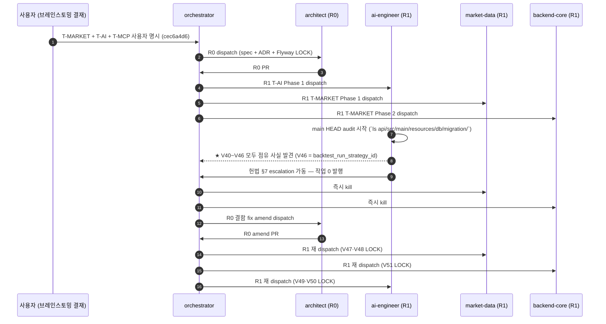

# 06 — magicJar v3.9.0 PR·ADR·기능 매핑 (W4 마감 baseline + R0 결함 fix evidence + W4 P0·P1·P2 hotfix)

> **작성자**: architect (PR-2 baseline v3.9.0)
> **권위**: `_workspace/arch/adr/README.md` ADR 인덱스 + `CHANGELOG.md` row 시계열 + `_workspace/baseline/v3.9.0/01-architecture.md` 8 그래프 매트릭스 + `_workspace/tasks/done/` task ledger
> **범위**: v3.8.0 → v3.8.1 patch → v3.9.0 W4 마감 사이 모든 의미 있는 변경 PR · ADR · 기능 단위 매핑. 사이클별 시계열 + 트랙 매핑 + backlog 처리 표.

본 문서는 v3.9.0 시점 magicJar의 **권위 변경 추적**이다. 사용자 명시 "어떤 PR이 어떤 트랙에 매핑되는지, 어떤 ADR이 어떤 기능을 baseline화 했는지 단일 위치에서 추적 가능"이어야 함.

---

## §1. v3.8.0 → v3.9.0 시계열 (사이클 단위)

| 사이클 | 일자 (KST) | PR 범위 | 미러스톤 | 관련 ADR |
|--------|---|---|---|---|
| **v3.8.0 cut** | 2026-05-22 | #661+ | 운영 단계 진입 baseline (개발 단계 종착 + 7 actor reshuffle + qa Visual 격상 + P0 OPS 6/6 LOCK) | 0091·0092·0093·0094·0095·0096 + 운영 헌법 §9·§10 신설 |
| **v3.8.0 post-cut sync** | 2026-05-22 | a6dfefa9 | master.html + devlog + baseline html + task archive | (정리 사이클) |
| **v3.8.1 hotfix (자율)** | 2026-05-22 | 474f92de | order and instrument navigation hotfix (frontend·api) | (자율 hotfix) |
| **v3.8.1 patch 코덱스 협업 P0 4건 사이클** | 2026-05-23 | #667·#669·#670 등 | PR-1 KIS .block() subscribeOn + PR-2 ADR 0097·0098·0099 + PR-3 ExecutionPositionUpdatePort·KillSwitchQueryPort + PR-4 trade breakdown 화면 | 0097·0098·0099 신설 |
| **v3.8.1 hotfix (auto-trading)** | 2026-05-23 | ff4799d5 | safety artifacts 누락 fix | (자율 hotfix) |
| **gitignore + wrapper** | 2026-05-24 | 402bf378 | gradle wrapper jar 추적 | (메타) |
| **OneAboveAll evidence** | 2026-05-24 | 47f2d220 | 사용자 명시 시점 evidence commit | (메타) |
| **symbol detail polling tame** | 2026-05-24 | #672 6e584121·ebbc7c5a | frontend hotfix | (frontend hotfix) |
| **W4 brainstorming 결재** | 2026-05-24 | cec6a4d6 | orchestrator W4 통합 design 발행 (T-MARKET + T-AI + T-MCP) | (spec 발행) |
| **R0 W4 통합 spec/ADR 발행** | 2026-05-24 | 1411d392 PR #674 | architect R0 — 4 spec + ADR 0100·0101 신설 + 6 ADR amend + CHANGELOG slot 7 anchor + KIS endpoint 5 raw fetch evidence | 0100·0101 신설 |
| **R0 amend (Flyway 결함 fix)** | 2026-05-24 | 60449432 PR #675 | **architect R0 amend — Flyway V40~V45 → V47~V52 shift + ADR 0102 신설 (spec audit 5단계 절차 LOCK)** | **0102 신설** |
| **R1 T-MARKET Phase 1** | 2026-05-24 | fbdb9ed6 | market-data — KIS adapter 5 + cron Job 2 + V47·V48 + INGESTION_LOW | 0100 |
| **R1 T-MARKET Phase 2** | 2026-05-24 | 20748c1c PR #676 | backend-core — market-trend-engine 모듈 + TrendPreference + REST 6 + V51 | 0100·0101 |
| **R1 T-AI Phase 1** | 2026-05-24 | 7bd19956 PR #678 | ai-engineer — 3 provider + dispatcher + 5 prompt seed + V49·V50 | 0026 amend |
| **R2 T-MCP Phase 1** | 2026-05-24 | 484ca94c PR #679 | backend-core — McpController + 6 tool + ApiKeyAuthFilter + V52 + mcp_audit | 0027 amend |
| **R2 frontend UI** | 2026-05-24 | 9abd5de6 PR #680 | frontend — DashboardPage MarketIndexStrip + `/market/trend` + SettingsModal 추세 설정 + 5 AiCard 진입점 | 0100·0101·0026 |
| **R3 qa Visual 회귀 + 부팅 차단 hotfix** | 2026-05-24 | 062abecd PR #681 | qa — Visual 7 spec + docker logs evidence + **부팅 차단 1줄 hotfix** (api.mcp.persistence basePackages add-only) | 0103 신설 trigger |
| **W4 P1 architect ADR amend** | 2026-05-24 | fdd35ea7 PR #682 | **architect W4 P1 — ADR 0101 §2-2 user_id VARCHAR(20) 실 schema 정합 amend + ADR 0102 §5-4 영역 확장 후보 cross-ref + ADR 0103 신설 (JpaScan 패키지 누락 차단)** | **0103 신설 + 0101·0102 amend** |
| **W4 P1 qa evidence** | 2026-05-24 | 47915059 PR #683 | qa — Playwright baseline 3 PNG + 5 AI + 6 MCP 실측 + 영속 매트릭스 evidence | (검증) |
| **W4 P2 market-data 진단** | 2026-05-24 | 9b976901 PR #684 | market-data — NoopMarketIndexSnapshotReader root cause 진단 보고서 | (진단) |
| **W4 P0 ai-engineer hotfix** | 2026-05-24 | ce2405db PR #685 | ai-engineer — `@Transactional` 추가 (INSERT 0/5 → 5/5 회복) | 0026 amend evidence |
| **W4 P1 backend-core graceful** | 2026-05-24 | e13f7dcb PR #686 | backend-core — TrendPreference 400 + backtest_strategy 422 graceful 핸들러 | 0101·0027 evidence |
| **v3.9.0 baseline init** | 2026-05-24 | 8a4f2c05 | orchestrator — 폴더 + README skeleton + CHANGELOG 4 anchor + 5 slot | (baseline 시작) |
| **PR-2 baseline architect** (본 PR) | 2026-05-24 | TBD | **architect baseline — README + 01-architecture + 06-history + 07-policy** | (본 PR) |

---

## §2. ADR 시계열 + 트랙 매핑 (v3.8.1 patch + v3.9.0 W4 마감)

### 2-1. v3.8.1 patch (코덱스 협업 P0 4건 사이클 — 2026-05-23)

| ADR | 트랙 | 상태 | 본문 핵심 |
|---|---|---|---|
| **0097** | W3 (T-O 보강) | Accepted | **ExecutionPositionUpdatePort** — 체결 직후 내부 position 갱신 도메인 port (reconcile 5분 cron "사이" 빈틈 cover + WS H0STCNI / REST inquire-ccnl 양 path 일관성 LOCK) |
| **0098** | W3 (T-RISK·T-SIG 보강) | Accepted | **KillSwitchQueryPort + Strategy 활성화 게이트** — fail-closed default=true · 신규 전략 status=PAUSED default · PAUSED→ACTIVE 백테스트 통과 의무 (`BacktestRunJpaRepository.existsAutoActivationReadyRun`) |
| **0099** | 횡단 | Accepted | **Reactor `.block()` non-blocking 계약 LOCK** — callee `subscribeOn(boundedElastic)` + caller `isInNonBlockingThread()` 2단 방어 + 5단 진단 체크리스트 + code-convention §reactor 등재 |

### 2-2. v3.9.0 W4 마감 (2026-05-24)

| ADR | 트랙 | 상태 | 본문 핵심 |
|---|---|---|---|
| **0100** | **T-MARKET (신규)** | **Accepted** | **지수·섹터 추세 분석 모듈 — market-trend-engine 신설 (9번째 JVM 모듈) + KIS endpoint 5 LOCK + cron 매트릭스 + Flyway V47·V48 + REST 6 + STOMP 3 + 운영 ADR 양식 3 슬롯 첫 적용 사례 v3.9.0 + KIS-first raw fetch 5 evidence (open-trading-api examples_llm/) + R0 결함 fix amend (V40·V41 → V47·V48 shift)** |
| **0101** | **T-MARKET (신규)** | **Accepted (W4 P1 amend)** | **TrendPreference 1급 도메인 + `user_preference` 표 (V51) + extra JSONB forward-compat 확장 슬롯 단일 진입점 + Bean Validation (1~5개·각 1~252일·sorted ASC) + REST 2 endpoint Swagger 4단 한국어 + STOMP fanout + 시드 SQL idempotent + 후속 사이클 10+ 슬롯 + R0 결함 fix amend (V44 → V51 shift) + W4 P1 amend (user_id BIGINT → VARCHAR(20) 실 schema 정합 — ADR 0046 자연 키 정합)** |
| **0102** | **메타·운영·하네스 (신규)** | **Accepted (신설 + W4 P1 amend)** | **spec/plan 발행 시 main 영속 자원 audit 5단계 절차 LOCK — R0 PR #674 Flyway V40~V45 결함 fix 본문화 + 영속 자원 6 영역 (Flyway·Kafka·Redis·STOMP·REST·ENV) + 면제 조건 3건 (md only·hotfix·기존 LOCK amend) + escalation 경로 5단계 + 발생 evidence 본문 + 운영 ADR 양식 3 슬롯 + 후속 사이클 6 슬롯 + W4 P1 amend (§5-4 내부 도메인 모델 inventory 영역 확장 후보 cross-ref 1건 — ADR 0101 user_id BIGINT 초안 결함 evidence)** |
| **0103** | **메타·운영·하네스 (신규)** | **Accepted (W4 P1 R3 qa 부팅 차단 hotfix 직후 architect amend)** | **JpaScanConfiguration 신규 패키지 누락 차단 — 옵션 A (basePackages 단일화) + 옵션 C-lite (smoke test) 하이브리드 채택 LOCK + 임시 baseline (R3 hotfix 화이트리스트 3건 명시 유지) + 운영 ADR 양식 3 슬롯 + S-OPS-1 신규 SLO 후보 + 후속 사이클 6 슬롯** |

### 2-3. v3.9.0 W4 마감 amend 매트릭스 (6 ADR)

| ADR | 본 v3.9.0 amend 사유 |
|---|---|
| **0004** | 모듈 경계 8 → 9 amend — market-trend-engine 추가 (ADR 0100 정합) |
| **0026** | AI 옵션 보조 — 진입점 4 → 5 (MARKET 신규) + V49·V50 LOCK (R0 결함 fix amend V42·V43 → V49·V50 shift) + AI 비용 통제 + KillSwitch + prompt_template:market_v1 seed + W4 P0 hotfix `@Transactional` evidence |
| **0027** | MCP 서버 — tool 5 → 6 (`get_market_trend` 신규) + JSON Schema 본문 추가 + V52 LOCK (R0 결함 fix amend V45 → V52 shift) + MCP 분당 100 초과 alert + W4 P1 graceful 핸들러 422 evidence |
| **0037** | KIS Rate Limit — `INGESTION_LOW` 신규 priority enum 추가 (T-MARKET cron 26 req/min 4.3% 점유 안전) |
| **0046** | user_account 자연 키 — ADR 0101 §2-2 W4 P1 amend evidence (user_id VARCHAR(20) KIS 계좌번호 자연 키 정합) |
| **0100** | R0 결함 fix amend (V40·V41 → V47·V48 shift · ADR 0102 정합) |
| **0101** | R0 결함 fix amend (V44 → V51 shift) + W4 P1 amend (user_id BIGINT → VARCHAR(20) 실 schema 정합) |

---

## §3. 트랙 매핑 (W3 보존 + W4 마감 + W5 진입 0)

### 3-1. W3 자동매매 본체 (v3.9.0 보존 + v3.8.1 patch 보강)

| 트랙 | v3.8.0 baseline | v3.8.1 patch | v3.9.0 W4 마감 |
|---|---|---|---|
| T-SIG (실시간 시그널) | ADR 0066 LOCK | 0 (보존) | 0 (보존) |
| T-RISK (리스크) | ADR 0067 LOCK | **ADR 0098 — KillSwitchQueryPort fail-closed + Strategy 활성화 게이트** | 0 (보존) |
| T-O (주문) | ADR 0068 LOCK | **ADR 0097 — ExecutionPositionUpdatePort + reconcile 빈틈 cover** | 0 (보존) |
| T-RECON (잔고 정합) | ADR 0041·0070 | 0 (보존) | 0 (보존) |
| T-CC (캔들·차트) | ADR 0086·0090·0093 | **ADR 0099 — Reactor `.block()` non-blocking 계약** | 0 (보존) |
| T-NEWS (뉴스·공시) | ADR 0075 | 0 (보존) | 0 (보존) |
| T-ACCT (계좌 잔고) | ADR 0081 | 0 (보존) | 0 (보존) |
| T-MAN (수동 주문) | ADR 0082 | 0 (보존) | 0 (보존) |
| T-PERF (성과) | ADR 0072 | **trade breakdown 화면 추가 PR-4** | 0 (보존) |
| T-J (매매일지) | ADR 0072 | 0 (보존) | 0 (보존) |
| T-SC (스크리너) | ADR 0071 | 0 (보존) | 0 (보존) |

### 3-2. W4 마감 (v3.9.0 신규 3 트랙 동시 진입)

| 트랙 | 신설 ADR | 모듈 | KIS endpoint | Flyway | REST | STOMP | 사용자 진입점 |
|---|---|---|---|---|---|---|---|
| **T-MARKET** | **ADR 0100** | **market-trend-engine (9번째)** | **+5** (inquire-index-price · inquire-index-daily-price · inquire-index-category-price · price overseas · dailyprice overseas) | **V47 + V48** | **+4** (`/api/market/index/snapshot` · `/api/market/index/{code}/trend` · `/api/market/sectors/snapshot` · `/api/market/sectors/ranking`) | **+2** (`/topic/market.index.{code}` · `/topic/market.sector.rank`) | DashboardPage MarketIndexStrip + `/market/trend` page |
| **TrendPreference (T-MARKET 짝)** | **ADR 0101** | (api · domain port) | 0 | **V51** | **+2** (`/api/users/me/preferences/trend` GET/PUT) | **+1** (`/topic/market.user.{userId}.pref`) | SettingsModal "추세 설정" section |
| **T-AI** | **ADR 0026 amend** | (api·consumer 횡단) | 0 (Anthropic·OpenAI 외부 통합 +1) | **V49 + V50** | (`/api/ai/comment/{entryPoint}` 5 진입점) | **+1** (`/topic/ai.comment.{userId}`) | AiCard 5 진입점 (SYMBOL·CHART·STRATEGY·SIGNAL·MARKET) |
| **T-MCP** | **ADR 0027 amend** | (api 횡단) | 0 (내부 reuse only) | **V52** | (`/api/mcp/tools` + `/api/mcp/tools/{toolName}/invoke`) | 0 | (외부 MCP client — Claude Desktop·Cursor) |

### 3-3. W5 트랙 (v3.9.0 진입 0)

| 트랙 | 상태 |
|---|---|
| T-LWC (LWC v4 + 자체 도형/주석/패턴 ADR 0025) | (진입 0 — 사용자 결정 의제) |
| T-LEARN | (진입 0 — 사용자 결정 의제) |

---

## §4. R0 결함 fix evidence (헌법 §7 escalation 5단계 완주 — ADR 0102 §1-1 본문화)

### 4-1. 결함 발생 timeline



### 4-2. 결함 evidence 본문 (ADR 0102 §1-1 인용)

```bash
# main HEAD audit (R0 amend PR #675 직전 실행)
$ git fetch origin main && ls api/src/main/resources/db/migration/ | grep "^V4" | sort
V40__order_event_outbox.sql
V41__stomp_event.sql
V42__instrument_status_history.sql
V43__order_request_add_strategy_id.sql
V44__system_event.sql
V45__order_request_backfill_manual_source.sql
V46__backtest_run_strategy_id.sql
```

V40~V46 모두 점유 사실 확인 → R0 spec V40~V45 LOCK 전체 무효 → R0 amend PR #675 V47~V52 재분배 LOCK + ADR 0102 신설 (영속 자원 6 영역 audit 5단계 절차 LOCK).

### 4-3. ADR 0102 5단계 절차 LOCK 신설 본문

R0 amend 후속 재발 방지 본문화 — spec/plan 발행 직전 5단계 audit 의무 (architect 단독):

| # | 단계 | 검증 명령 (예시) | 통과 기준 |
|---|---|---|---|
| 1 | **main HEAD 영속 자원 inventory 작성** | `git fetch origin main && git ls-tree origin/main api/src/main/resources/db/migration/` | 영속 자원 디렉토리 모두 ls 출력 첨부 |
| 2 | **본 spec/plan에서 신설할 자원 매트릭스 작성** | spec 본문 표 (Flyway · Kafka · Redis · STOMP · REST · ENV 6 영역) | 신설 자원 모두 명시 |
| 3 | **inventory와 신설 매트릭스 충돌 검사** | `grep "V40\|V41\|V42" <inventory>` 또는 topic name grep | 충돌 0건 — 충돌 시 §4 진행 |
| 4 | **충돌 발견 시 next-available shift 결정** | 다음 자유 번호/이름 매트릭스 (예: V47~V52) | shift 후 다시 §3 충돌 검사 통과 |
| 5 | **spec 본문에 audit evidence 첨부** | "main HEAD audit 결과 V46까지 점유 + V47 비점유 검증" 1줄 첨부 | spec/ADR 본문에 명시 |

### 4-4. ADR 0102 W4 P1 amend — 내부 도메인 모델 inventory 영역 확장 후보

ADR 0101 §2-2 DDL `user_id BIGINT REFERENCES user_account(id)` 초안은 R1 backend-core T-MARKET Phase 2 (PR #676) audit 결과 실 schema (`V1__baseline.sql` L29-35 — `user_account.user_id VARCHAR(20)` KIS 계좌번호 자연 키 · ADR 0046 §2-1 권위) 불일치 발견 → ADR 0101 W4 P1 amend (`VARCHAR(20)` 실 schema 정합 정정). 본 사례는 ADR 0102 영역 확장 후보 cross-ref 1건 (외부 영속 자원 6 영역 외 **내부 도메인 모델 inventory** 영역 — 누적 evidence 3건+ 시 별 사이클 amend trigger).

---

## §5. W4 P0·P1·P2 hotfix 매트릭스 (v3.9.0 사이클 마감 evidence)

| # | 사이클 | sub-agent | PR # | commit | 결함 본질 | fix 내용 |
|---|---|---|---|---|---|---|
| 1 | W4 R3 부팅 차단 hotfix | qa (자율) | #681 | 062abecd | T-MCP Phase 1 (PR #679) `api.mcp.persistence` 패키지 신설 시 `JpaScanConfiguration.kt` 화이트리스트 갱신 누락 → `UnsatisfiedDependencyException — McpAuditService 의존성 McpAuditJpaRepository bean 미발견` → exit code 1 → api·batch·consumer 3 컨테이너 dependency RED | 1줄 add-only (`api.mcp.persistence` basePackages + entityScan 동시) + KDoc 7줄 사유 본문 (재발 방지 — 신규 패키지 추가 시 화이트리스트 갱신 의무 + 장기 fix는 sub-package 자동 스캔 ADR amend 후보) |
| 2 | W4 P0 ai-engineer hotfix | ai-engineer | #685 | ce2405db | `ai_comment_log` JPA persist 결함 — INSERT 0/5 (Transaction boundary 누락) | `@Transactional` 추가 (R2 evidence INSERT 0/5 → 5/5 회복) |
| 3 | W4 P1 backend-core graceful | backend-core | #686 | e13f7dcb | TrendPreference Bean Validation 위반 시 500 응답 + backtest_strategy param 검증 실패 시 500 응답 | TrendPreference 400 한국어 핸들러 + backtest_strategy 422 graceful 핸들러 |
| 4 | W4 P1 architect ADR amend | architect | #682 | fdd35ea7 | ADR 0101 §2-2 DDL `user_id BIGINT` 초안 vs 실 schema `VARCHAR(20)` 불일치 (R1 backend-core PR #676 audit 결과 발견) + W4 R3 qa hotfix 후속 재발 방지 본문 LOCK 0건 | ADR 0101 §2-2 `user_id VARCHAR(20)` 실 schema 정합 amend + ADR 0102 §5-4 영역 확장 후보 cross-ref 1건 amend + ADR 0103 신설 (JpaScan 패키지 누락 차단 옵션 A + 옵션 C-lite 하이브리드 LOCK) |
| 5 | W4 P1 qa evidence | qa | #683 | 47915059 | (검증 evidence 의제) | Playwright baseline 3 PNG + 5 AI 진입점 실측 + 6 MCP tool 실측 + 영속 매트릭스 evidence |
| 6 | W4 P2 market-data 진단 | market-data | #684 | 9b976901 | `NoopMarketIndexSnapshotReader` root cause 진단 의제 | 진단 보고서 발행 (P2 backlog amend 의제) |

---

## §6. backlog 처리 표 (v3.9.0 사이클 완료)

| backlog § | 처리 | PR | 잔여 |
|---|---|---|---|
| W4 진입 0 LOCK 해제 — T-AI 5 진입점 active | ✅ 완료 (ADR 0026 amend + V49·V50 + R1 T-AI Phase 1 + W4 P0 hotfix) | #678 + #685 | 0 |
| W4 진입 0 LOCK 해제 — T-MCP 6 tool active | ✅ 완료 (ADR 0027 amend + V52 + R2 T-MCP Phase 1 + W4 P1 graceful) | #679 + #686 | 0 |
| 지수·섹터 추세 lens 0건 fitness gap | ✅ 완료 (ADR 0100 신설 + market-trend-engine 9번째 모듈 + KIS endpoint 5 + Flyway V47·V48) | #674 + #675 + #676 + market-data R1 + frontend R2 PR #680 | 0 |
| MA periods hardcoded → 사용자 설정 도메인 | ✅ 완료 (ADR 0101 신설 + V51 + `extra JSONB` 확장 슬롯 + Bean Validation + W4 P1 amend) | #676 + #682 + #686 | 0 |
| spec audit 결함 fix 재발 방지 본문화 | ✅ 완료 (ADR 0102 신설 + 5단계 절차 LOCK + W4 P1 영역 확장 후보 cross-ref) | #675 + #682 | 0 |
| JpaScan 패키지 누락 차단 본문화 | ✅ 완료 (ADR 0103 신설 + 옵션 A + 옵션 C-lite 하이브리드 채택 LOCK) | #682 | 옵션 C smoke test (P1) + 옵션 A 적용 (P2) 후속 사이클 |
| Flyway version 충돌 결함 root cause | ✅ 완료 (R0 amend V40~V45 → V47~V52 shift + ADR 0102 본문화) | #675 | 0 |
| frontend 핵심 화면 PR Visual 자동 dispatch (헌법 §9-2) | ✅ 진행 (R3 qa Visual 회귀 7 spec + W4 P1 evidence + docker logs evidence) | #681 + #683 | DR drill 분기 의무 1회 evidence 잔여 |
| 페르소나 5 매트릭스 + 7 actor LOCK | ✅ 보존 (ADR 0094 hierarchy LOCK 유지) | (보존) | 0 |
| Visual QA 시나리오 5 baseline + 부팅 차단 자동 검출 | ✅ 진행 (R3 qa Playwright + 부팅 차단 자동 검출 1 case 추가) | #681 + #683 | qa P1 추가 시나리오 backlog |

**v3.9.0 잔여 backlog (post-MVP)**:

- ADR 0103 옵션 C smoke test 1건 add-only (`api/src/test/kotlin/.../boot/JpaScanSmokeTest.kt`) — P1 backend-core dispatch (자율)
- ADR 0103 옵션 A 적용 (`basePackages = ["kr.spdaewoon.magicjar"]` 단일화) + ADR 0088 amend 동반 — P2 backend-core dispatch (옵션 C 안정 운영 1 사이클 후)
- S-OPS-1 신규 SLO 발행 (`api·batch·consumer 3 컨테이너 부팅 성공률 = 100%`) — ADR 0095 §9-1 amend + Prometheus alert rule 1건 add-only (post-MVP)
- DR drill 분기 1회 evidence + ADR 0096 §6-2 qa Visual E2E 자동 재현 (사용자 결재 의무)
- ADR 0093 chart limit Phase 4·5 dogfooding 누적
- ADR 0100 §8 후속 사이클 7 슬롯 (MA type · RS period UI · 섹터 RSI/MACD 라벨 · sentiment fusion · 테마/테마주 그룹 · KIS WS 지수 실시간 push · cross 발생 alert)
- ADR 0101 §7 후속 사이클 10+ 슬롯 (MA type UI · RS period UI · crossPair UI · RSI/MACD 라벨 · 차트 default timeframe · 알림 임계 · multi-tenant team_preference · AI prompt 사용자 메모 · MCP 외부 client 권한 매트릭스 · 사용자 설정 export/import)
- ADR 0102 영역 확장 후보 누적 evidence 3건+ 시 별 사이클 amend (내부 도메인 모델 inventory 영역 추가)

---

## §7. 변경 이력 본문 (v3.9.0 baseline PR-2 시점)

| 날짜 (KST) | 변경 | sub-agent |
|------|------|--------|
| 2026-05-22 | v3.8.0 cut + 운영 단계 진입 baseline + 7 actor reshuffle + qa Visual 격상 + P0 OPS 6/6 LOCK | (사이클 결재) |
| 2026-05-23 | v3.8.1 patch — 코덱스 협업 P0 4건 사이클 (PR-1 KIS .block() + PR-2 ADR 0097·0098·0099 + PR-3 ExecutionPositionUpdatePort·KillSwitchQueryPort + PR-4 trade breakdown) | backend-core + strategy-engine + frontend |
| 2026-05-24 (오전) | W4 brainstorming 통합 design 발행 (cec6a4d6) — T-MARKET + T-AI + T-MCP 사용자 결재 | orchestrator |
| 2026-05-24 (오전) | R0 spec/ADR 발행 — 4 spec + ADR 0100·0101 신설 + 6 ADR amend + CHANGELOG slot 7 anchor + KIS endpoint 5 raw fetch evidence | architect |
| 2026-05-24 (오전) | **R0 amend — Flyway V40~V45 → V47~V52 shift + ADR 0102 신설 (spec audit 5단계 절차 LOCK)** — main HEAD V40~V46 점유 사실 발견 후 헌법 §7 escalation 5단계 완주 | architect |
| 2026-05-24 (오후) | R1·R2 sub-agent 병렬 dispatch — market-data T-MARKET Phase 1 + backend-core T-MARKET Phase 2 + ai-engineer T-AI Phase 1 + backend-core T-MCP Phase 1 + frontend UI | 4 sub-agent |
| 2026-05-24 (저녁) | R3 qa Visual 회귀 + 부팅 차단 1줄 hotfix (UnsatisfiedDependencyException) | qa |
| 2026-05-24 (저녁) | W4 P1 architect amend — ADR 0101 user_id VARCHAR(20) 실 schema 정합 + ADR 0102 §5-4 영역 확장 후보 cross-ref + ADR 0103 신설 (JpaScan 패키지 누락 차단 옵션 A + 옵션 C-lite 하이브리드) | architect |
| 2026-05-24 (저녁) | W4 P0·P1·P2 hotfix 마감 — ai-engineer `@Transactional` + backend-core graceful + market-data NoopReader 진단 + qa Playwright evidence | 4 sub-agent |
| 2026-05-24 (밤) | v3.9.0 baseline init (orchestrator 폴더 + skeleton + 5 slot) | orchestrator |
| 2026-05-24 (밤) | **v3.9.0 baseline PR-2 (본 PR) — README + 01-architecture + 06-history + 07-policy** | **architect (본 PR)** |

본 06-history-traceability는 v3.9.0 cut 시점 권위 변경 추적이다. SoT는 ADR README + CHANGELOG + task ledger. 본 문서는 사이클별 PR/ADR 매핑 단일 위치.
