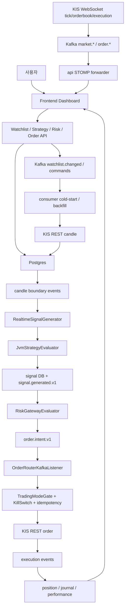
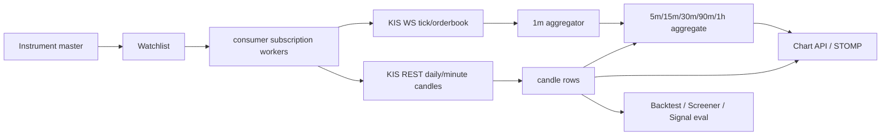

# main 자동매매 종합 리뷰 (2026-05-19)

## 기준

- 기준 소스: `origin/main` detached worktree
- 커밋: `3d75a784d250` (`Merge pull request #590 from sp-daewoon/agent/chart-curator/b-1-consumer-kis-adapter-pagination-restore`)
- worktree: `/Users/ak-song/magic_ch1_review_main_20260519`
- 범위: 코드 리뷰, 기능 리뷰, 데이터 리뷰, 자동매매 플로우 시각화
- 소스 변경: 없음. 이 문서만 리뷰 산출물로 추가.

## 한 줄 판단

magicJar는 UI, KIS 연동, Kafka/STOMP, 주문 라우터, 리스크/운영 화면까지 상당히 많이 올라와 있다. 사용자가 말한 "80%" 체감은 화면과 모듈 골격 기준으로는 납득된다. 다만 자동매매의 닫힌 루프 기준으로는 전략 평가, 실시간 신호 컨텍스트, 주문 수량 산정, 자본 스냅샷 경로에 아직 큰 구멍이 있어 실전 자동매매 완성도는 55-65% 정도로 보는 편이 안전하다.

## 자동매매 핵심 플로우

## 데이터 플로우

## 기능별 상태

| 영역 | 상태 | 메모 |
|---|---:|---|
| Onboarding / KIS credential | 양호 | 실계좌 이중 게이트와 REAL consent 경로가 있음 |
| Watchlist / 종목 상세 / 차트 | 양호 | KIS-first 데이터와 STOMP 실시간 표시가 연결됨 |
| 전략 빌더 / DSL 저장 | 보통 | UI와 저장 흐름은 있으나 API 평가기 배선 이슈가 큼 |
| 백테스트 / 스크리너 | 위험 | API 런타임에서 HOLD stub으로 동작할 가능성이 높음 |
| 실시간 신호 생성 | 위험 | 현재 봉 1개만 평가기에 전달하고 SELL은 후속 Phase로 남음 |
| 리스크 게이트 | 보통 | 예산/빈도/손실 제한은 있으나 kill switch context와 자본 snapshot 경로가 약함 |
| 자동 주문 라우팅 | 보통 | 주문 라우터, idempotency, KIS submit은 있으나 auto sizing이 없음 |
| 수동 주문 | 보통 | 경로는 있으나 idempotency key 충돌 가능성 있음 |
| 체결/잔고 reconcile | 양호 | reconcile job, drift, kill switch auto toggle 경로가 있음 |
| 저널/성과 | 보통 | 이벤트 소비와 대시보드가 있으나 실제 자동 신호 품질에 종속 |
| 패턴 | 부분 완성 | 57개 카탈로그 중 실제 active는 10개 |
| AI | 게이트됨 | 사용자 트리거 보조 기능이 있으나 W4-only 정책과 문서 정합 필요 |

## 주요 문제

### P0. API 백테스트/스크리너가 실제 전략 평가기를 쓰지 못할 수 있음

- `api/build.gradle.kts`는 `consumer`에 의존하지 않고, 실제 `JvmStrategyEvaluatorAdapter`는 consumer 모듈에만 있다.
- API의 `HoldStrategyEvaluatorStub`은 `StrategyEvaluatorPort` 폴백으로 등록되고 항상 `Signal.HOLD`를 반환한다.
- 영향: 백테스트 결과가 거래 0건으로 나오거나, 스크리너가 매칭 0건을 내는 구조가 될 수 있다.
- 근거: `api/build.gradle.kts:9-17`, `api/src/main/kotlin/.../HoldStrategyEvaluatorStub.kt:22-55`, `consumer/src/main/kotlin/.../JvmStrategyEvaluatorAdapter.kt:24-45`
- 권장: `JvmStrategyEvaluator`와 adapter를 `strategy-engine` 또는 별도 shared runtime 모듈로 이동해 API와 consumer가 같은 평가기를 쓰게 한다. stub은 test profile 전용으로 제한한다.

### P0. 실시간 신호 평가가 현재 candle 1개만 사용함

- `RealtimeSignalGenerator`가 `jvmStrategyEvaluator.evaluate(strategyId, ast, listOf(candle))`로 호출한다.
- MA/RSI/crossover 같은 대부분의 DSL은 과거 window가 필요하므로 HOLD가 많아진다.
- 주석상 SELL 처리도 Phase 2로 남아 있다.
- 근거: `consumer/src/main/kotlin/.../RealtimeSignalGenerator.kt:162-177`
- 권장: boundary 시점에 `N`개 과거 candle slice를 repository에서 로드해 평가하고, buy/sell 조건을 모두 처리한다.

### P0. 자동 주문 수량 산정이 없음

- `OrderIntentKafkaProducer`는 quantity를 발행하지 않고, `OrderRouterKafkaListener`는 누락 시 기본값 1주를 넣는다.
- 영향: 자동매매가 "매수 신호당 1주 시장가"로 동작할 수 있어 전략/리스크 기반 자본 배분이 빠진다.
- 근거: `consumer/src/main/kotlin/.../OrderRouterKafkaListener.kt:584-589`
- 권장: risk verdict 이후 position sizing 단계를 추가해 `quantity`, `priceType`, `limitPrice`, `sizingReason`을 명시적으로 발행한다.

### P1. 자동매매 자본 snapshot이 API 계좌 조회 cache에 의존함

- API 계좌 조회가 Redis `account:balance:{userId}`를 TTL 30초로 채운다.
- consumer의 `KisCapitalSnapshotProviderAdapter`는 이 cache만 읽고 miss면 `0`을 반환한다.
- 영향: 대시보드나 계좌 API를 열지 않은 headless 자동매매에서 BUY가 안전하게 막힐 수 있다.
- 근거: `api/src/main/kotlin/.../AccountQueryService.kt:142-156`, `consumer/src/main/kotlin/.../KisCapitalSnapshotProviderAdapter.kt:75-96`
- 권장: consumer가 별도 계좌 snapshot refresher를 갖거나, risk 평가 직전에 rate-limit 보호된 KIS balance fallback을 둔다.

### P1. RiskContext의 kill switch 값이 항상 false

- signal listener의 risk context 생성에서 `killSwitchOn = false`가 하드코딩되어 있다.
- order router가 다시 kill switch를 확인하므로 최종 주문은 막을 수 있지만, risk verdict와 이벤트가 운영 상태를 정확히 반영하지 못한다.
- 근거: `consumer/src/main/kotlin/.../SignalGeneratedKafkaListener.kt:242-255`
- 권장: risk layer에도 `KillSwitchRepository` 또는 port를 주입해 동일한 권위 상태를 사용한다.

### P1. 일봉 장기 데이터 커버리지가 문서 기대와 다름

- KIS daily pagination은 복구되어 100봉 한계 문제는 줄었다.
- 그러나 현재 `MAX_PAGES = 6`으로 일봉은 약 600봉, 대략 2.5년 수준이다.
- 문서/코멘트의 30년 또는 full-period 기대와 다르므로 장기 백테스트는 신뢰 범위를 명시해야 한다.
- 근거: `consumer/src/main/kotlin/.../KisRestCandleAdapter.kt:96-119`
- 권장: backfill target range를 interval별 config로 분리하고, backtest 요청 기간이 DB coverage를 넘으면 명시적으로 경고 또는 fail-fast 처리한다.

### P1. 차트 liveTick이 일/주/월/년봉에도 현재 boundary bar를 만들 수 있음

- `LightweightChart`는 `liveTick`이 오면 현재 interval의 boundary를 계산해 `series.update()`를 호출한다.
- 1d/1wk/1mo/1y에서도 "오늘/이번 주/이번 달/올해" bar를 만들 수 있어, DB 최신 candle이 과거인데 화면에는 현재 bar가 붙어 보일 수 있다.
- 근거: `frontend/src/pages/Symbol/LightweightChart.tsx:105-176`, `frontend/src/pages/Symbol/LightweightChart.tsx:641-667`
- 권장: liveTick update는 intraday interval에만 적용하거나, daily 이상은 서버가 확정한 boundary candle 이벤트만 반영한다.

### P2. 패턴 57개 중 active는 10개

- 카탈로그는 57개를 보이지만 R1 active는 10개, R2 stub은 47개다.
- 프론트가 비활성 패턴을 disabled 처리하고 있어 UX상 방어는 되어 있다.
- 근거: `domain/src/main/kotlin/.../PatternCatalog.kt:14-16`, `pattern-engine/src/main/kotlin/.../JvmPatternRecognizer.kt:49-51`
- 권장: "57개 지원" 표현은 "10개 active + 47개 예정"으로 유지하고, active 확장 시 backtest/signal 영향 테스트를 붙인다.

### P2. AI 호출 정책 정합 필요

- 개발 룰은 W1/W2/W3에서 LLM provider import를 reject한다고 되어 있으나, API 모듈에 Spring AI Anthropic 의존성이 있다.
- 코드상 사용자 트리거 DSL 변환이고 `MAGICJAR_AI_ENABLED=false` 게이트가 있어 자동매매 결정권 문제는 낮다.
- 근거: `api/build.gradle.kts:40-43`
- 권장: ADR 또는 living policy에서 T-DSL 예외를 명시하거나, W4 전까지 provider 의존성을 optional boundary로 격리한다.

### P2. 수동 주문 idempotency key 충돌 가능성

- 수동 주문 key가 `manual:{userId}:{epochSecond}`라 같은 사용자가 같은 초에 다른 종목 주문을 두 번 넣으면 충돌할 수 있다.
- 근거: `api/src/main/kotlin/.../ManualOrderService.kt:61-75`
- 권장: code, side, quantity, random nonce 또는 UUID를 포함한다.

## 검증 결과

- Backend: `/Users/ak-song/magic_ch1/gradlew -p /Users/ak-song/magic_ch1_review_main_20260519 check` 성공
- Frontend install: `pnpm install --frozen-lockfile` 성공
- Frontend typecheck: `pnpm typecheck` 성공
- Frontend tests: `pnpm test` 성공, 34 files / 209 tests passed
- 잔여 경고: `KisRealCredentialBanner.test.tsx`에서 React `act(...)` warning 1건

## 권장 작업 순서

1. API 백테스트/스크리너 평가기 배선 수정: stub을 test-only로 내리고 실제 evaluator를 shared module로 이동.
2. 실시간 signal 평가용 candle history slice 로딩 추가: 최소 MA/RSI/crossover가 동작하는 window 보장.
3. auto order sizing 추가: risk verdict 이후 quantity/priceType/limitPrice를 명시 발행.
4. consumer headless capital snapshot 경로 추가: account API cache 의존 제거.
5. risk context kill switch 연결: verdict와 order router의 운영 상태 일치.
6. candle coverage 정책 정리: interval별 target range와 coverage 부족 시 fail-fast 또는 UI 경고.
7. chart liveTick interval gate: daily 이상에서는 live tick으로 임시 bar를 만들지 않기.
8. 수동 주문 idempotency key 강화와 React act warning 정리.

## 결론

현재 main은 "운영 시스템의 뼈대"는 꽤 잘 세워져 있다. 특히 KIS 연동, Kafka 이벤트, 주문 라우터, reconcile, 화면 구성이 많이 갖춰져 있다. 다음 단계는 기능을 더 늘리기보다 자동매매의 핵심 경로가 실제 돈/실제 신호/실제 수량으로 일관되게 닫히는지 보강하는 것이다.
