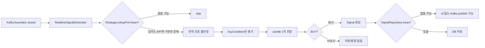
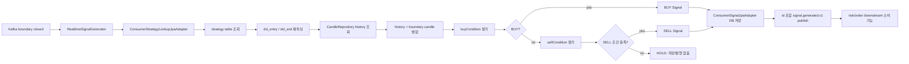
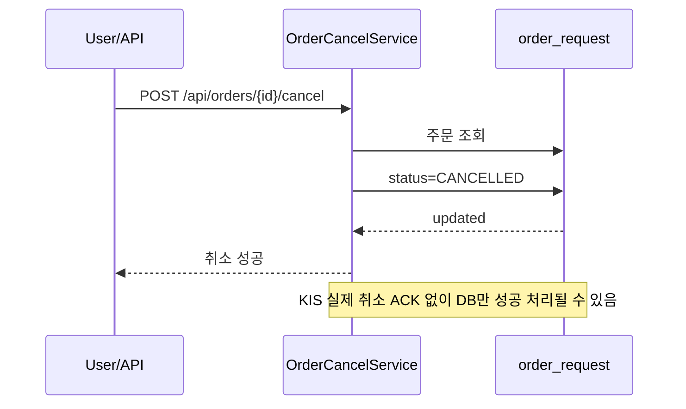
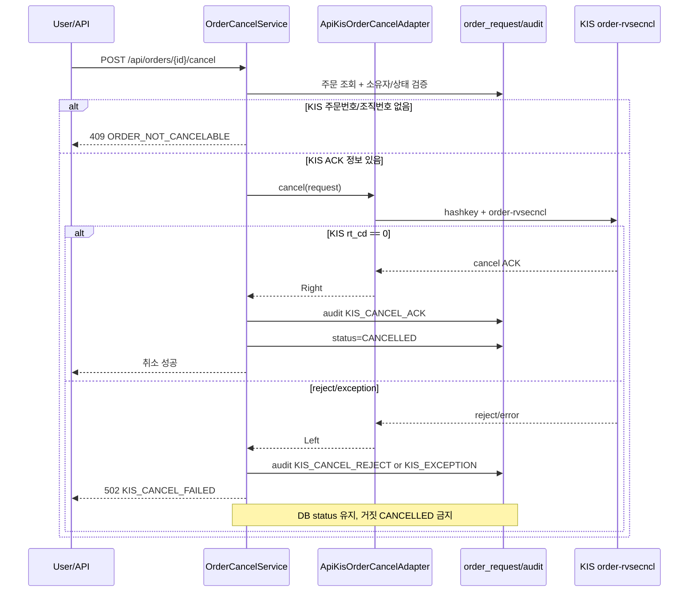
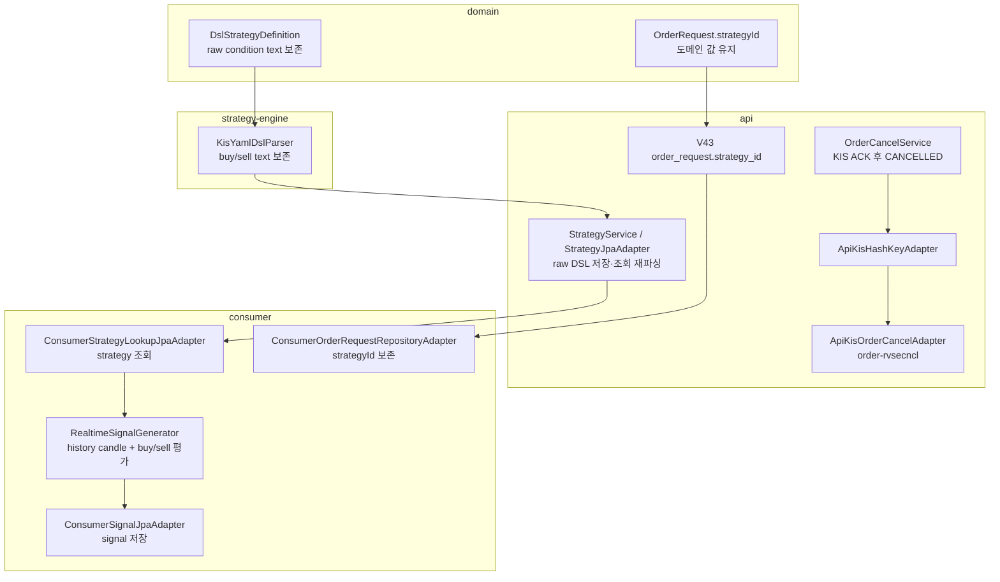

# 자동매매·수동취소 플로우 하드닝 비교 시각화

작성: orchestrator  
기준 커밋: `2f746a30 merge(orchestrator): autotrading flow hardening`  
헌법 준수 기록: task.mjs 작업지시서, CHANGELOG, author whitelist, AI 호출 0, mock 합성 0, consumer/api 모듈 경계 유지

## 한 줄 요약

이번 변경은 "신호가 만들어졌다고 믿었지만 실제 런타임에서는 끊길 수 있는 자동매매 path"와 "KIS 취소가 실패해도 DB만 취소 성공처럼 보일 수 있는 수동취소 path"를 false success 없이 닫는 작업이다.

## Before vs After

| 영역 | Before | After |
|---|---|---|
| 전략 조회 | consumer 런타임에 `StrategyLookupPort` 구현이 없어 실시간 전략 조회가 비어질 수 있음 | consumer 자체 `ConsumerStrategyLookupJpaAdapter`가 `strategy` 테이블 조회 후 DSL 재파싱 |
| 시그널 저장 | consumer 런타임에 `SignalRepository` 구현이 없어 signal id 없는 Kafka publish 가능 | consumer 자체 `ConsumerSignalJpaAdapter`가 DB 저장 후 id 포함 publish |
| 지표 평가 캔들 | boundary candle 1개만 evaluator에 전달, MA/RSI/MACD가 HOLD로 빠질 위험 | DB candle history + boundary candle 병합, 기본 500개 lookback 평가 |
| 자동 매도 | `buyCondition`만 실시간 평가 | BUY 우선, BUY 아니면 `sellCondition` 평가 후 SELL 발행 |
| 전략 DSL | 저장 시 raw DSL 텍스트가 AST `toString()`으로 유실될 수 있음 | `buyConditionText`/`sellConditionText` 보존, 조회 시 AST 재파싱 |
| 주문 귀속 | `order_request`에 `strategy_id`가 없어 조회 시 `0L`로 유실 | V43 migration으로 `strategy_id` add-only 보존 |
| 수동 취소 | KIS 취소 호출 없이 DB `CANCELLED` 전이 가능 | KIS `order-rvsecncl` ACK 이후에만 `CANCELLED` 전이 |
| 취소 실패 | KIS reject/exception도 운영자가 DB 취소로 오해 가능 | `KIS_CANCEL_REJECT`/`KIS_EXCEPTION` audit 후 상태 유지 |

## 자동매매 플로우 비교

### Before

### After

## 수동취소 플로우 비교

### Before

### After

## 데이터/코드 연결 지도

## 검증 매트릭스

| 검증 | 결과 |
|---|---|
| Kotlin compile: domain/strategy-engine/api/consumer | GREEN |
| `OrderCancelServiceTest` | GREEN |
| `RealtimeSignalGeneratorTest` | GREEN |
| `:consumer:test` | GREEN |
| `./gradlew ktlintCheck` | GREEN |
| `./gradlew check` | GREEN |

## 남은 후속

| 후속 | 이유 |
|---|---|
| 주문 정정 REST/API/UI | 취소와 별도 KIS code path(`RVSE_CNCL_DVSN_CD=01`)라 분리 필요 |
| 전략 sizing 기반 수량 산정 | 현재 자동 주문 수량 정책을 portfolio allocator와 연결해야 함 |
| `PENDING_CANCEL_RECONCILE` | KIS timeout/5xx에서 상태 보류와 reconcile 워커가 필요 |
| 체결 reconcile 정교화 | REST cumulative 체결과 WS 분할 체결 중복 수량 정합 보강 필요 |
