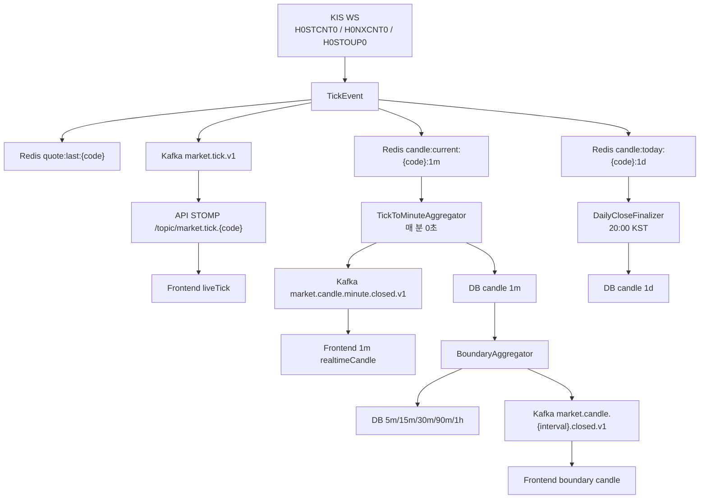
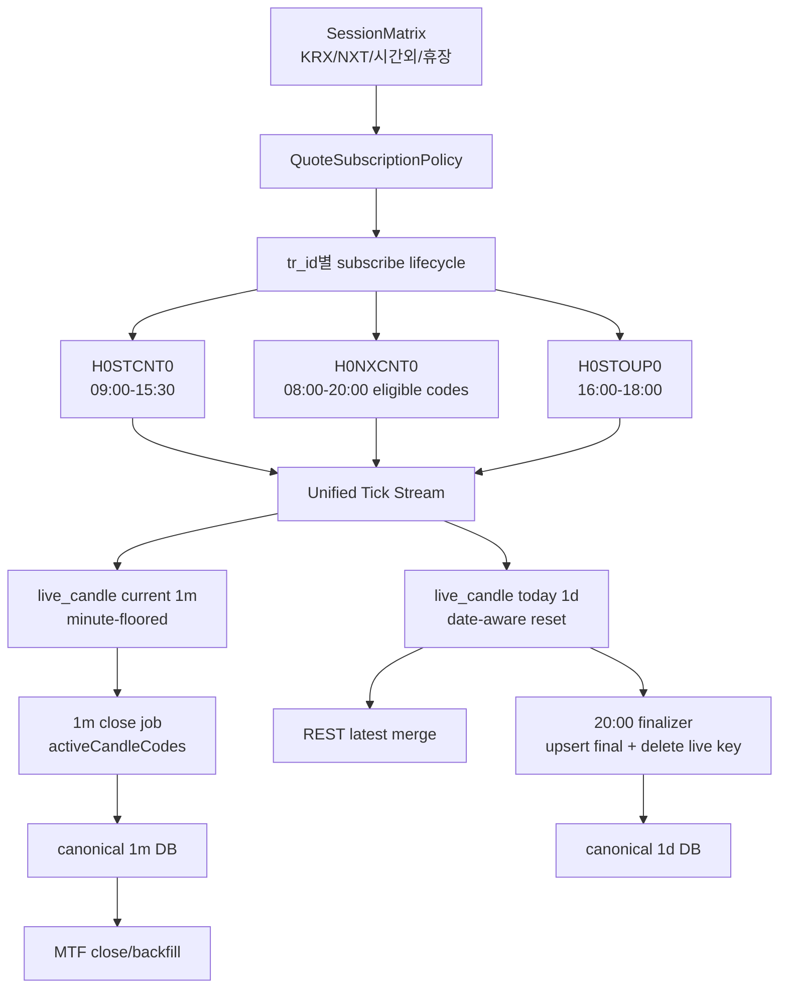

# 차트·캔들 실시간성 집중 리뷰 (2026-05-20)

## 기준

- 기준 소스: `origin/main` detached worktree
- 커밋: `3d75a784d250`
- worktree: `/Users/ak-song/magic_ch1_chart_candle_review_20260520`
- 범위: chart-curator 관점의 캔들 적재, 장 세션, NXT/시간외, STOMP, LWC 차트 실시간 갱신 리뷰
- 소스 변경: 없음. 이 문서만 리뷰 산출물로 추가.

## 외부 기준

- NXT 공식 사이트는 거래시간을 08:00-20:00으로 안내하고, pre-market 08:00-08:50, after-market 15:30-20:00을 명시한다.  
  출처: https://www.nextrade.co.kr/en/marketOverview/content.do
- KRX 공식 사이트는 KOSPI 정규장 09:00-15:30, pre-hours 08:00-09:00, post-hours 15:40-18:00을 명시한다.  
  출처: https://global.krx.co.kr/contents/GLB/06/0602/0602010201/GLB0602010201T1.jsp

즉 당일 캔들은 단순히 "09:00-15:30 정규장"만 따라가면 안 된다. 최소한 KRX 정규장, KRX 시간외, NXT pre/after를 모두 고려한 진행 중 캔들 모델이 필요하다.

## 현재 구현 흐름

## 핵심 판단

현재 구조는 "실시간 tick을 받아서 화면의 마지막 캔들을 움직이는" 부분은 일부 들어와 있다. 하지만 장 세션 전환, 일자 롤오버, DB canonical candle, STOMP payload 계약이 서로 어긋나 있어 당일 캔들이 안정적으로 유지된다고 보기 어렵다.

특히 계속 켜두는 운영 환경에서는 다음 영업일 08:00/09:00에 WS 구독이 복구되지 않을 수 있고, 1d Redis key는 전일 값을 다음날까지 끌고 갈 수 있다. 이 두 가지는 실전 자동매매와 차트 신뢰도에 직접 영향을 준다.

## 주요 문제

### P0. 세션 FSM이 NXT/시간외를 실제 구독 lifecycle로 살리지 못함

- `MarketSession` 모델은 08:00-09:00 PreMarket, 09:00-15:30 Regular, 15:40-16:00 PostMarket까지만 표현한다.
- `KrxMarketSessionResolver`도 16:00 이후를 `Closed`로 처리한다.
- `SubscriptionRouter.onSessionChanged()`는 `Closed` 진입 시 WS 전체 구독을 해제하고, `Regular` 진입 시에도 이전 상태가 `Closed`일 때만 recompute한다.
- 그래서 15:30에 구독을 끊은 뒤 다음날 08:00 `PreMarket`에서는 아무것도 하지 않고, 09:00 `Regular`는 직전 상태가 `PreMarket`이므로 recompute하지 않는다.
- 영향: 하루 이상 계속 켜둔 consumer가 다음 영업일 실시간 tick/candle을 다시 못 받을 수 있다.
- 근거:
  - `domain/.../MarketSession.kt:10-17`
  - `api/.../KrxMarketSessionResolver.kt:89-94`
  - `consumer/.../SubscriptionRouter.kt:145-165`
  - `consumer/.../WatchlistIngestionWorker.kt:104-112`
- 권장:
  - `MarketSession`을 `NxtPre`, `KrxRegular`, `NxtAfter`, `KrxAfterHours`, `Closed` 등으로 재정의하거나, 최소 `isTradingSession` / `shouldSubscribeQuotes` 정책을 별도 함수로 분리한다.
  - `PreMarket`, `PostMarket`, `NxtAfter` 진입도 recompute 대상이어야 한다.
  - `Regular` 진입 조건은 `prev is Closed`가 아니라 `현재 구독 set이 비어 있으면 recompute`가 안전하다.

### P0. 15:30 이후 NXT tick이 끊기는 구조

- `KisWebSocketBridge.subscribe()`는 H0STCNT0와 H0NXCNT0를 같이 구독한다고 되어 있다.
- 하지만 15:30에 `MarketSession.Closed`로 바뀌면 `SubscriptionRouter`가 `kisWsPort.unsubscribe(allCodes)`를 호출하면서 H0STCNT0와 H0NXCNT0를 모두 해제한다.
- NXT after-market은 공식 기준 15:30-20:00인데, 코드상으로는 그 시각에 NXT 구독이 유지되지 않는다.
- `OvertimeSinglePriceSubscriber`는 H0STOUP0를 16:00-18:00만 구독한다. 이것은 KRX 시간외 단일가 보완이지 NXT 15:30-20:00 전체 대체가 아니다.
- 근거:
  - `consumer/.../KisWebSocketBridge.kt:199-232`
  - `consumer/.../SubscriptionRouter.kt:145-149`
  - `consumer/.../OvertimeSinglePriceSubscriber.kt:42-44`
- 권장:
  - 정규장 H0STCNT0와 NXT H0NXCNT0 lifecycle을 분리한다.
  - 15:30에는 H0STCNT0만 정리하고 H0NXCNT0는 20:00까지 유지하거나, 세션별 tr_id 구독 정책 테이블을 둔다.

### P0. H0STOUP0 시간외 tick은 1m/MTF DB에 저장되지 않을 수 있음

- H0STOUP0 tick handler는 `updateCandleCurrent()`와 `updateCandleToday()`를 호출한다.
- 그러나 `TickToMinuteAggregator.aggregate()`는 `kisWebSocketBridge.subscribedCodes()`만 순회한다.
- `subscribedCodes()`는 H0STCNT0 set이고, H0STOUP0 구독 set은 별도 `overtimeSinglePriceCodes`다.
- 15:30에 H0STCNT0/H0NXCNT0 set이 비면, 16:00-18:00 H0STOUP0 tick이 Redis `candle:current`를 갱신해도 매분 DB flush와 boundary aggregation이 돌지 않는다.
- 영향: 시간외 tick이 화면 liveTick에는 보일 수 있으나 1m DB, 5m/15m/30m/90m/1h DB, 백테스트/지표/신호용 데이터에는 누락될 수 있다.
- 근거:
  - `consumer/.../KisWebSocketBridge.kt:660-673`
  - `consumer/.../TickToMinuteAggregator.kt:50-63`
  - `consumer/.../KisWebSocketBridge.kt:268`
  - `consumer/.../KisWebSocketBridge.kt:325-367`
- 권장:
  - `activeCandleCodes()` 같은 통합 universe를 만들고 H0STCNT0, H0NXCNT0, H0STOUP0 구독 set을 모두 포함한다.
  - tick source별로 DB 저장 여부를 다르게 할 필요가 있으면 정책 enum으로 분기하되, 캔들 집계 대상 universe는 별도로 관리한다.

### P0. 1d Redis 진행 캔들이 일자 rollover에 취약함

- `updateCandleToday()`는 기존 Redis hash의 `open/high/low/volume/ts`를 그대로 재사용한다.
- `candle:today:{code}:1d` TTL은 24h이고, `DailyCloseFinalizer`는 flush 후 key를 삭제하지 않는다.
- consumer가 계속 떠 있으면 전일 19:59경 갱신된 key가 다음날 08:00에도 남아 있을 수 있다.
- 다음날 첫 tick이 들어와도 `ts`는 전일 midnight, `open`도 전일 값으로 유지될 수 있다.
- `RedisCandleTodayResetRunner`가 있지만 부팅 시에만 실행된다.
- 영향: 다음날 당일 1d candle이 전일 캔들에 누적되고, 차트/지표/실시간 일봉 판단이 틀어진다.
- 근거:
  - `consumer/.../KisWebSocketBridge.kt:861-894`
  - `consumer/.../DailyCloseFinalizer.kt:80-145`
  - `consumer/.../RedisCandleTodayResetRunner.kt:41-68`
- 권장:
  - `updateCandleToday()`에서 기존 `ts`의 KST date가 오늘이 아니면 hash를 초기화한다.
  - `DailyCloseFinalizer`가 성공적으로 flush한 key는 삭제한다.
  - 07:59 또는 장 시작 전 daily reset job을 추가한다.

### P0. API live daily refresh가 canonical DB 일봉을 partial 값으로 고정할 수 있음

- `LiveDailyCandleScheduler`는 08:00-20:00 동안 5분마다 `CandleRefreshService.refresh(code, ["1d"])`를 호출한다.
- `CandleRefreshService`는 KIS daily row를 canonical `candle` 테이블에 `ON CONFLICT DO NOTHING`으로 insert한다.
- 당일 첫 refresh가 오늘 row를 insert하면, 이후 5분 refresh와 20:00 `DailyCloseFinalizer`가 같은 `(code, interval, ts)`를 업데이트하지 못한다.
- 영향: DB의 당일 1d candle이 장 초반 값으로 얼어붙을 수 있다. 차트 REST, 백테스트, 지표, 신호가 stale daily row를 참조할 수 있다.
- 근거:
  - `api/.../LiveDailyCandleScheduler.kt:42-70`
  - `api/.../CandleRefreshService.kt:327-338`
  - `api/.../CandleRefreshService.kt:577-595`
  - `api/.../CandleJpaRepository.kt:125-145`
  - `consumer/.../DailyCloseFinalizer.kt:108-120`
- 권장:
  - 진행 중 1d candle은 canonical DB에 insert하지 말고 Redis/live cache 또는 별도 `candle_live` table에 둔다.
  - canonical `candle(1d)`는 세션 종료 후 확정값만 upsert한다.
  - 정말 DB에 당일 row를 둔다면 `ON CONFLICT DO UPDATE`를 "today/live source only"로 제한해 최종값을 갱신해야 한다.

### P0. 1m STOMP payload 계약이 backend/frontend에서 다름

- `TickToMinuteAggregator.publishMinuteCandle()`는 `openRaw/highRaw/lowRaw/closeRaw` 필드로 Kafka/STOMP payload를 보낸다.
- frontend `CandleMinutePayload`는 `open/high/low/close`를 기대한다.
- `MarketCandleStompForwarder`는 payload를 변환하지 않고 그대로 전달한다.
- 영향: 1m closed candle STOMP가 차트에 정상 반영되지 않거나 NaN candle로 무시될 수 있다.
- 근거:
  - `consumer/.../TickToMinuteAggregator.kt:136-149`
  - `api/.../MarketCandleStompForwarder.kt:25-36`
  - `frontend/src/api/symbol.ts:109-119`
  - `frontend/src/pages/Symbol/SymbolChart.tsx:158-167`
- 권장:
  - backend payload를 `{ open, high, low, close }`로 바꾸거나 API forwarder에서 변환한다.
  - consumer/api/frontend 공통 STOMP contract test를 추가한다.

### P0. boundary STOMP ts가 epoch seconds인데 frontend는 ISO처럼 처리함

- `BoundaryAggregator.publishToKafka()`는 `ts`를 `bar.ts.epochSeconds` 숫자로 보낸다.
- frontend `CandleClosedPayload.ts`는 string이고, `LightweightChart.toUTCTimestamp()`는 `new Date(isoString).getTime()`으로 처리한다.
- JS `new Date(1710000000)`은 epoch seconds가 아니라 milliseconds로 해석되어 1970년대 시각이 된다.
- 영향: 5m/15m/30m/90m/1h boundary candle이 차트의 엉뚱한 위치에 들어가거나 LWC update가 실패한다.
- 근거:
  - `consumer/.../BoundaryAggregator.kt:301-317`
  - `frontend/src/api/symbol.ts:126-135`
  - `frontend/src/pages/Symbol/LightweightChart.tsx:180-188`
- 권장:
  - STOMP contract를 하나로 고정한다. 차트용이면 `ts`는 ISO string으로 보내는 편이 현재 frontend와 맞다.
  - signal consumer처럼 epoch seconds가 필요한 곳은 별도 field(`tsEpochSec`)를 쓰거나 consumer listener가 두 형식을 모두 수용하게 한다.

### P1. 15m/90m 차트 버튼은 있는데 API candles 조회는 400

- frontend interval type과 toggle에는 `15m`, `90m`이 있다.
- `useSymbolCandles`도 boundary subscription 대상에 `15m`, `90m`을 포함한다.
- 하지만 `CandleQueryService.supportedIntervals`와 `SymbolController` 허용 메시지에는 `15m`, `90m`이 빠져 있다.
- 영향: 사용자가 15분/90분 차트를 누르면 REST candles 조회가 400으로 실패한다.
- 근거:
  - `frontend/src/api/symbol.ts:23`
  - `frontend/src/api/symbol.ts:137-144`
  - `api/.../CandleQueryService.kt:35`
  - `api/.../SymbolController.kt:128-132`
- 권장:
  - API supported interval과 Swagger 설명에 10종 전체를 반영한다.
  - 15m/90m REST smoke test를 추가한다.

### P1. frontend liveTick이 모든 interval에 synthetic bar를 만든다

- `LightweightChart`는 `liveTick`이 오면 현재 interval boundary를 계산해 바로 `candleSeries.update()`를 호출한다.
- 1d는 당일 진행 캔들로 쓸 수 있지만, 1wk/1mo/1y도 현재 주/월/년 synthetic bar를 만든다.
- 5m/15m/30m/90m/1h도 backend boundary contract와 별개로 frontend-only 진행 bar가 생긴다.
- volume은 갱신하지 않고 OHLC만 움직인다.
- 영향: 화면에 보이는 마지막 캔들과 DB/백테스트/신호가 보는 마지막 캔들이 다를 수 있다.
- 근거:
  - `frontend/src/pages/Symbol/SymbolChart.tsx:229-233`
  - `frontend/src/pages/Symbol/LightweightChart.tsx:105-176`
  - `frontend/src/pages/Symbol/LightweightChart.tsx:640-673`
- 권장:
  - `liveTick` 반영 대상 interval을 명시적으로 나눈다.
  - 1m/MTF는 in-progress candle cache와 source badge를 표시하고, 1wk/1mo/1y는 기본적으로 liveTick synthetic update를 끈다.
  - volume도 tick volume 누적 또는 "volume 미확정" 상태를 구분한다.

### P1. 1m 진행 캔들의 startTs가 minute boundary가 아님

- `updateCandleCurrent()`는 첫 tick의 실제 timestamp를 `startTs`로 저장한다.
- DB flush는 `closingTs = now - 60s`로 minute boundary를 쓰지만, REST 최신 조회에서 Redis current를 합류할 때는 `startTs`를 그대로 쓴다.
- 영향: 화면의 미확정 1m bar가 `09:00:17` 같은 비표준 timestamp로 붙을 수 있다.
- 근거:
  - `consumer/.../KisWebSocketBridge.kt:830-855`
  - `api/.../CandleQueryService.kt:99-110`
- 권장:
  - `updateCandleCurrent()`에서 tick timestamp를 KST minute floor로 정규화해 `startTs`를 저장한다.

### P1. frontend 가격 badge는 아직 09:00-15:30만 장중으로 본다

- `isKoreanMarketOpen()`은 평일 09:00-15:30만 true다.
- NXT/시간외 구간에서 polling source면 `closed`로 표시될 수 있다.
- 영향: 실제 거래와 캔들 갱신이 진행 중인데 UI는 장마감/지연으로 보일 수 있다.
- 근거: `frontend/src/lib/marketHours.ts:1-26`
- 권장:
  - backend session API 또는 동일한 session matrix를 frontend에 내려준다.
  - 최소 08:00-20:00 active quote window와 KRX/NXT 세션 라벨을 분리한다.

### P1. KOSDAQ=NXT 미거래 전제는 재검증 필요

- 코드와 정책은 KOSPI는 `UN`, KOSDAQ은 `J`를 사용한다.
- 주석은 "KOSDAQ은 NXT 미거래"라고 되어 있으나, 현재 NXT 공식 사이트는 KOSPI/KOSDAQ product group과 KRX listed stock 거래를 안내한다.
- 과거 KIS `UN` 빈 응답 evidence가 있었다면, "시장 전체 hardcode"보다 "NXT 거래대상 종목 여부" 기준으로 분기해야 한다.
- 근거:
  - `consumer/.../KisRestCandleAdapter.kt:151-169`
  - `api/.../CandleRefreshService.kt:136-143`
  - `docs/architecture/external-api-policy.md:92-113`
- 권장:
  - NXT eligible-stock universe를 별도 테이블/캐시로 관리한다.
  - `fid_cond_mrkt_div_code`는 market(KOSPI/KOSDAQ)이 아니라 code별 NXT eligibility와 KIS 응답 fallback으로 결정한다.

### P2. LiveDailyCandleScheduler는 첫 번째 user의 watchlist만 갱신한다

- `LiveDailyCandleScheduler`는 `findFirstUserIds(PageRequest.of(0, 1)).firstOrNull()`로 단일 user를 고른다.
- candle은 전역 데이터라 여러 사용자의 watchlist 전체 distinct code를 대상으로 갱신하는 편이 맞다.
- 영향: 첫 번째 user watchlist에 없는 종목은 API 5분 일봉 refresh 대상에서 빠진다.
- 근거: `api/.../LiveDailyCandleScheduler.kt:51-63`
- 권장:
  - 전체 watchlist distinct code를 조회하거나, candle refresh는 consumer의 watchlist ingestion owner로 통합한다.

### P2. ConsumerCandleJpaRepository.insertIgnore에 @Transactional이 없음

- API repository의 `insertIgnore`에는 `@Transactional`이 붙어 있으나 consumer repository에는 없다.
- `BoundaryAggregator.onTickClosed()`는 `@Transactional`이라 보호되지만, `DailyCloseFinalizer.finalize()`는 class/method transaction이 없다.
- 영향: finalizer의 native modifying query가 환경에 따라 transaction 오류를 낼 수 있다.
- 근거:
  - `api/.../CandleJpaRepository.kt:125-145`
  - `consumer/.../ConsumerCandleJpaRepository.kt:61-83`
  - `consumer/.../DailyCloseFinalizer.kt:62-67`
- 권장:
  - consumer repository에도 `@Transactional`을 붙이고, finalizer integration test를 추가한다.

## 권장 목표 모델

## 수정 우선순위

1. 세션/구독 lifecycle부터 고친다. `Closed -> PreMarket -> Regular` 전환과 15:30 이후 NXT 유지가 최우선이다.
2. `candle:today` date-aware reset과 finalizer key 삭제를 넣는다.
3. 당일 1d canonical DB insert 정책을 바꾼다. 진행 중 값은 live cache, 확정값만 DB가 원칙이다.
4. STOMP candle payload contract를 통일한다. 1m은 `open/high/low/close`, boundary는 ISO `ts` 또는 명시적 `tsEpochSec`.
5. API supported intervals에 15m/90m을 추가하고 contract/smoke test를 붙인다.
6. `activeCandleCodes()`로 1m close universe를 통합해 H0STOUP0/NXT tick도 DB/MTF에 들어가게 한다.
7. frontend `liveTick` synthetic update는 interval별 정책으로 제한하고, source/volume 미확정 상태를 UI에 드러낸다.

## 검증 결과

- Backend: `/Users/ak-song/magic_ch1/gradlew -p /Users/ak-song/magic_ch1_chart_candle_review_20260520 check` 성공
- Frontend: 이번 리뷰에서는 코드 변경이 없어 별도 실행하지 않음

## 결론

사용자의 직감이 맞다. 현재 main은 "실시간 tick을 차트 마지막 bar에 반영하려는 시도"는 들어와 있지만, NXT/시간외까지 포함한 당일 캔들 생명주기가 아직 시스템 레벨로 자리 잡지 않았다.

가장 먼저 잡아야 할 것은 화면이 아니라 데이터 권위다. 세션 매트릭스, tr_id별 구독 lifecycle, 진행 중 candle과 확정 candle의 저장 위치를 분리해야 한다. 그 다음 STOMP contract와 LWC update 정책을 맞추면 차트가 훨씬 안정적으로 살아날 것이다.
