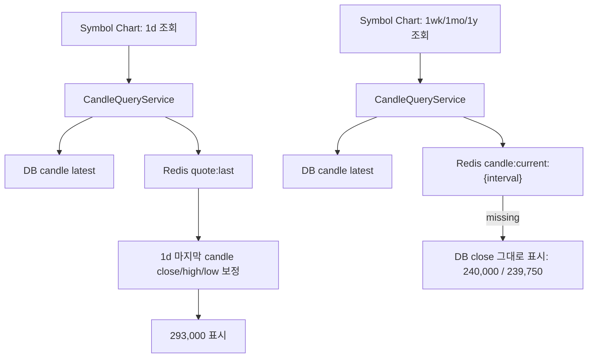
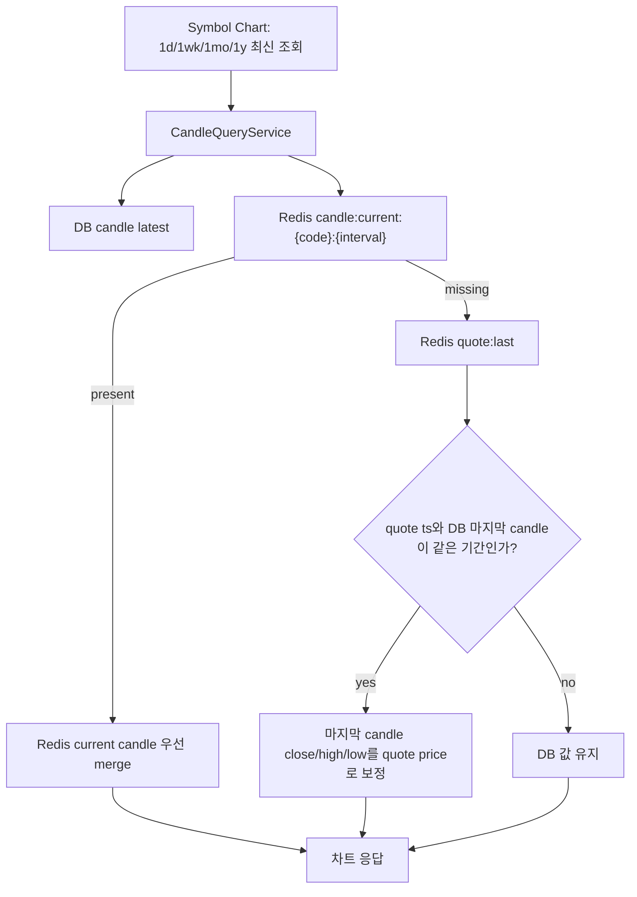

# LG전자 상위봉 가격 불일치 조사 기록

> 작성일: 2026-06-01 KST  
> 대상: `066570` LG전자, `1d` 정상 표시 vs `1wk`/`1mo`/`1y` 현재가 불일치  
> 관련 결정: ADR 0105, candle-data-policy-v2, direction guard

## 요약

LG전자 일봉이 `293,000`으로 보인 것은 DB 일봉 close가 이미 293,000이어서가 아니라 API 조회 단계에서 Redis `quote:last:066570` 현재가를 `1d` 마지막 candle에 보정했기 때문이다. 반면 `1wk`/`1mo`/`1y`는 Redis `candle:current:{code}:{interval}`가 비어 있으면 DB의 마지막 저장 row를 그대로 반환했고, 이 row들이 `240,000` 또는 `239,750` 근처의 과거/current-period stale 값이라 사용자가 본 가격 차이가 발생했다.

## 확인한 실제 상태

```text
Redis quote:last:066570
  price = 293000
  ts    = 2026-05-29T10:59:54Z
  source= live-nxt

Redis candle:current:066570:1d / 1wk / 1mo / 1y
  모두 비어 있음

DB candle latest
  1d   2026-05-29 KST close 281500
  1wk  2026-05-26 KST close 240000
  1mo  2026-05-26 KST close 239750
  1y   2026-05-26 KST close 240000
```

API 응답은 다음처럼 갈라졌다.

```text
GET /api/symbols/066570/candles?interval=1d  -> quote:last 보정 후 close 293000
GET /api/symbols/066570/candles?interval=1wk -> DB stale close 240000
GET /api/symbols/066570/candles?interval=1mo -> DB stale close 239750
GET /api/symbols/066570/candles?interval=1y  -> DB stale close 240000
```

## 변경 전 흐름



## 변경 후 흐름



## 보정 기준

- `1d`: quote 날짜와 DB 마지막 candle 날짜가 같을 때만 보정한다.
- `1wk`: quote 날짜가 DB 마지막 candle과 같은 KST 월요일 시작 주에 있을 때만 보정한다.
- `1mo`: quote 날짜와 DB 마지막 candle의 연/월이 같을 때만 보정한다.
- `1y`: quote 날짜와 DB 마지막 candle의 연도가 같을 때만 보정한다.
- 새 candle row를 임의 생성하지 않는다. 데이터가 아예 없으면 mock/synthetic candle을 만들지 않는다.
- DB 확정 데이터는 유지하고, 장중/현재 기간 화면 표시만 Redis quote/current로 보정한다.

## 남는 운영 이슈

`CandleJpaRepository.insertIgnore`는 `ON CONFLICT DO NOTHING`이라 같은 `(code, interval, ts)`에 이미 저장된 row를 일반 refresh로 수정하지 않는다. 이미 이상하게 저장된 상위봉은 사용자가 `재수집`을 실행하면 delete 후 KIS 원천으로 다시 채우는 경로로 교정한다. 장기적으로는 ADR 0105 reconciliation에서 current-period 전용 upsert 정책을 별도 결정할 수 있다.
