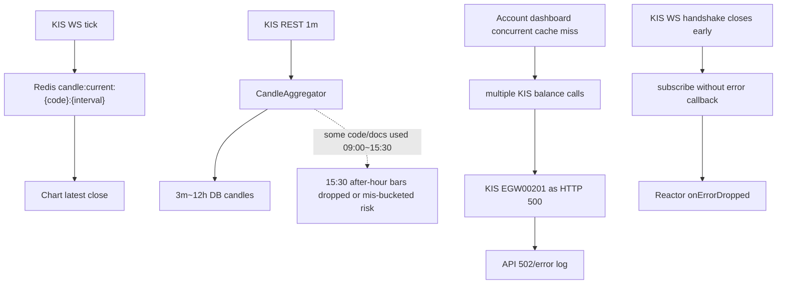
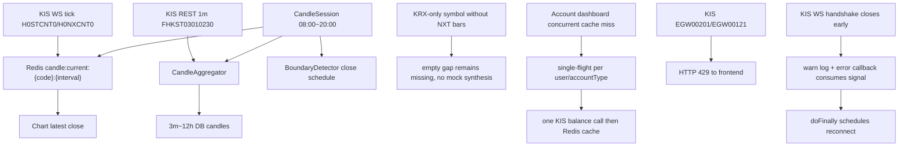

# 2026-06-01 NXT Boundary + KIS Log Review

## 결론

3m·5m·15m·30m·90m·1h·4h·12h 합산봉 정책에 남아 있던 `KRX 정규장 09:00~15:30` 표기는 ADR 0063·0105의 NXT 통합 정책과 충돌하는 stale 문서/구현 조각이었다. 이번 패치는 합산봉 boundary와 장중 Redis current candle anchor를 NXT 통합 `08:00~20:00 KST`로 재정렬했다.

계좌 로그의 `EGW00201`은 KIS가 rate limit을 HTTP 500 body로 감싸 반환하는 케이스다. 기존 공용 classifier는 있었지만 account controller path가 이를 502/error로 로깅했고, cache miss 동시 진입 시 동일 잔고 조회가 중복 호출될 수 있었다. 이번 패치는 account 조회를 cache key 단위 single-flight로 묶고, `EGW00201` 계열은 429로 응답하게 정리했다.

KIS WS `Connection prematurely closed BEFORE opening handshake is complete`는 원격 handshake 전 종료다. 기존 subscribe가 error callback 없이 끝나 Reactor `ErrorCallbackNotImplemented/onErrorDropped`를 만들 수 있었고, 이번 패치는 handshake 실패를 warn으로 소비하면서 기존 `doFinally` 기반 reconnect를 유지한다. `doFinally 중복 발생 ... stale 감지` warn은 기존 audit pair 보호 장치이며, 이번 로그에서는 치명 장애라기보다 중복 termination 신호를 감지한 방어 로그로 보는 것이 맞다.

추가 검토에서 live boundary aggregation의 `12h` fetch count가 KRX 정규장 390분으로 남아 있는 잔여 결함을 확인했다. 이 값은 NXT `08:00~20:00` 12h bar에서 앞 330분을 버릴 수 있으므로, boundary 시작~마감분 inclusive 조회로 바꿔 720개 1m candle을 모두 사용하게 했다.

## Before

## After

## 변경 포인트

| 영역 | 이전 | 이후 |
|---|---|---|
| 합산봉 boundary | 일부 문서/코드가 KRX `09:00~15:30` 기준 | `CandleSession` 단일 정책으로 NXT `08:00~20:00` 기준 |
| 90m | `09:00·10:30·12:00·13:30·15:00` 계열 | `08:00·09:30·11:00·12:30·14:00·15:30·17:00·18:30` |
| 4h | `09:00` anchor | `08:00` anchor, `08:00·12:00·16:00` |
| 12h | `09:00~15:30` 정규장 전체 또는 live fetch 390분 | `08:00~20:00` NXT 통합 전체, live boundary fetch 720분 |
| gap detector | 1m expected sequence가 KRX 390분 위주 | NXT 후보는 720분, 그 외 KRX-only fallback은 390분 |
| 일마감 | 16:00 또는 20:00 표기 혼재 | 20:10 scheduled finalizer, NXT 20:00 마감 후 여유 |
| account rate limit | `EGW00201`이 account API에서 502/error로 보이고, 실패 시 대기 요청이 직렬 재시도 가능 | rate-limit body와 local limiter timeout을 429/warn으로 분류하고, 짧은 실패 single-flight로 재시도 burst 차단 |
| WS handshake/reconnect | handshake 실패가 Reactor dropped error로 번질 수 있고, graceful reconnect cancel이 중복 reconnect를 예약 가능 | error callback이 소비하고 reconnect 흐름은 `doFinally`가 담당하되, graceful reconnect cancel은 direct reconnect path만 사용 |

## 운영 판단

- 15:30은 KRX 정규장 종료 시각으로만 의미가 있다. NXT 후보 종목의 캔들 기준봉은 20:00까지 이어져야 한다.
- KRX-only/J fallback 종목은 08:00~09:00 또는 15:30~20:00에 실제 1m 데이터가 없을 수 있다. 이 구간은 가짜 candle로 채우지 않는다.
- 자동매매 전략 평가는 data readiness가 `READY`가 되기 전에는 계속 fail-closed여야 한다. 이번 변경은 그 정책을 바꾸지 않는다.
- `EGW00201`이 계속 보이면 account cache miss burst 외에도 다른 KIS 호출 경로의 priority/limiter 점검이 필요하다. 이번 패치는 account path에서 관찰된 burst와 API 응답 분류를 먼저 닫는다.

## 검증

- `./gradlew :domain:test --tests "kr.spdaewoon.magicjar.domain.market.candle.CandleAggregatorTest" --tests "kr.spdaewoon.magicjar.domain.market.candle.BoundaryDetectorTest" :api:test --tests "kr.spdaewoon.magicjar.api.account.AccountQueryServiceTest"`
- `./gradlew :consumer:test --tests "kr.spdaewoon.magicjar.consumer.aggregation.CandleGapDetectorAdapterTest" --tests "kr.spdaewoon.magicjar.consumer.ws.KisWebSocketBridgeReconnectTest"`
- `./gradlew :domain:test --tests "kr.spdaewoon.magicjar.domain.market.candle.CandleAggregatorTest" --tests "kr.spdaewoon.magicjar.domain.market.candle.BoundaryDetectorTest" :api:test --tests "kr.spdaewoon.magicjar.api.account.AccountQueryServiceTest" --tests "kr.spdaewoon.magicjar.api.account.AccountControllerTest" :consumer:test --tests "kr.spdaewoon.magicjar.consumer.aggregation.CandleGapDetectorAdapterTest" --tests "kr.spdaewoon.magicjar.consumer.aggregation.BoundaryAggregatorTest" --tests "kr.spdaewoon.magicjar.consumer.ws.KisWebSocketBridgeReconnectTest"`
- `./gradlew ktlintCheck`
- `./gradlew :domain:check :api:check :consumer:check`
