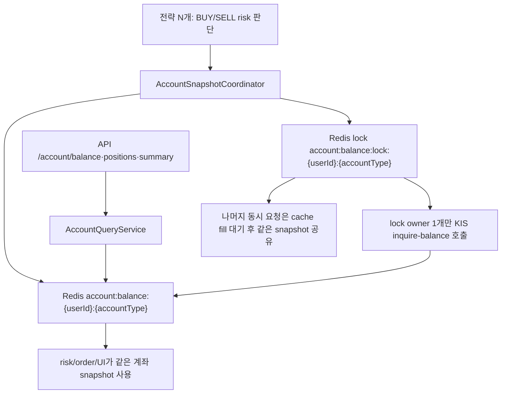
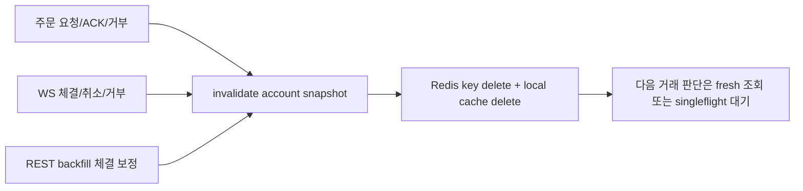

# 2026-06-15 KIS singleflight 계좌 조회 정리

## 이번 변경 범위

목표는 20개 이상 전략이 동시에 같은 계좌 상태를 확인해도 KIS `inquire-balance`가 전략 수만큼 터지지 않게 하는 것이다. 이번 변경은 reservation/projection 엔진을 바로 만들지 않고, 먼저 계좌 조회 공통 관문을 세우는 쪽으로 좁혔다.

- `AccountSnapshotCoordinator` 신설: `userId + accountType` 기준 cache-aside + singleflight.
- Redis cache key는 API와 같은 `account:balance:{userId}:{accountType}`를 사용한다.
- Redis lock key는 `account:balance:lock:{userId}:{accountType}`다.
- 기본 TTL은 300초이며, 주문/체결/취소/거부 이벤트에서 즉시 dirty 처리한다.
- Redis가 없으면 같은 consumer 인스턴스 안에서는 local cache + lock으로 중복 호출을 막는다.
- API `AccountQueryService` TTL도 5분으로 맞췄다. 운영 신선도는 긴 TTL이 아니라 backend invalidation이 책임진다.

## 단일 관문으로 합류한 경로

- BUY risk 자본 조회: `KisCapitalSnapshotProviderAdapter`
- SELL 보유 수량 가드: `SignalGeneratedKafkaListener.ensureKisHoldingIfSell`
- account availability refresh: `AccountAvailabilityRefreshService`
- frontend/API 잔고 조회: `AccountQueryService` shared Redis key

## 캐시 dirty hook

계좌를 바꿀 수 있는 이벤트는 stale TTL을 기다리지 않고 바로 cache를 지운다.

- 주문 요청 접수: `ORDER_REQUESTED`
- KIS 주문 ACK: `ORDER_ACKED`
- KIS submit 실패/거부: `ORDER_REJECTED`, submit failure status
- WS 주문 거부: `WS_REJECTED`
- WS 취소: `WS_CANCELLED`
- WS 부분 체결: `WS_PARTIALLY_FILLED`
- WS 전체 체결: `WS_FILLED`
- REST backfill 체결 흡수: `REST_BACKFILL_FILLED`
- 휴식 매도 주문 취소: `RESTING_SELL_CANCELLED`
- Kafka `account.balance.changed.v1` 수신: consumer fallback invalidation

## 체결 동기화 singleflight

`KisExecutionBackfillService.syncUserTodayExecutions`도 `userId + accountType + verifyCredential` 기준으로 짧은 fresh window를 둔다.

- 성공 결과 공유: 기본 30초
- 실패 결과 cooldown 공유: 기본 10초
- 효과: 여러 전략이 동시에 체결 확인을 요구해도 같은 인스턴스 안에서는 `inquire-daily-ccld`를 반복하지 않는다.
- 남은 갭: 이 체결 동기화 singleflight는 아직 Redis 분산락이 아니라 in-JVM 단위다. 다중 consumer 인스턴스까지 묶으려면 다음 작업에서 Redis key를 붙여야 한다.

## 아직 일부러 안 한 것

이번 변경은 정합성 위험이 큰 full projection/reservation 엔진을 만들지 않았다. 그래서 주문 중 금액, 주문 중 수량, 부분 체결 후 평단 예측 같은 문제는 완전히 해결된 것이 아니라 다음 단계 과제다.

다만 주문/체결 이벤트마다 cache를 dirty 처리하므로, 현재 단계에서도 “긴 TTL 때문에 주문 직후 계좌가 5분 동안 안 바뀌어 보이는” 문제는 피한다. 다음 거래 판단은 dirty 이후 singleflight를 통해 fresh snapshot을 다시 받는다.

## 다음 singleflight 적용 대상

1. 시세/현재가 REST fallback
   - 대상: `KisRestPriceAdapter`, `KisMultiPriceAdapter`, `KisRestAskingPriceAdapter`, `CompositeEntryQuoteAdapter`
   - 정책: WS/Redis quote가 있으면 우선 사용, REST fallback은 `code + endpoint + session` 기준 singleflight. TTL은 0.5~2초 수준으로 짧게.

2. 호가 fallback
   - 대상: `RedisOrderbookTopCache`, `KisRestAskingPriceAdapter`, `EntryOrderPriceResolver`
   - 정책: 호가 WS cache가 없을 때만 REST fallback. 같은 종목 동시 진입은 singleflight로 1회만 호출.

3. 캔들 seed/backfill
   - 대상: `KisRestCandleAdapter`, `KisRestPriceMetricsAdapter`, `TodayCandleSeedPort.seedTodayCandle`, `CandleBackfillWorker`, `LastCandleAtMonitor`
   - 정책: `code + interval + from/to + adjusted flag` 기준 singleflight. 6월 12일 0원 캔들 같은 raw 결함 검증은 cache 전에 수행해야 한다.

4. 체결 조회 분산 singleflight
   - 대상: `KisExecutionBackfillService`, `KisOrderInquireCcldHttpAdapter`, `KisOrderInquireDailyCcldHttpAdapter`
   - 정책: 이번에 넣은 in-JVM fresh window를 Redis lock/cache로 확장.

5. 계좌 reconcile 강제 조회
   - 대상: `BalanceReconcileService`, `KisReconcileBalanceAdapter`
   - 정책: reconcile은 TTL cache hit를 그대로 쓰면 안 된다. 대신 force-refresh도 Redis singleflight lock을 공유해 “강제 fresh 1회”로 수렴시킨다.

6. 실현손익/당일손익 조회
   - 대상: `KisRealizedProfitAdapter`
   - 정책: `userId + accountType + date` 기준 cache-aside. 주문/체결 후 dirty 또는 짧은 TTL.

7. WS subscribe/unsubscribe 명령 coalescing
   - 대상: `KisWebSocketBridge`, `RealtimeSubscriptionRouter`, `OrderbookSubscriptionRouter`
   - 정책: 같은 `trId + code` subscribe/unsubscribe가 같은 순간 여러 owner에서 들어오면 1개 command로 합친다.

8. reservation/projection 얇은 계층
   - 대상: 주문 접수 이후 `cashD2`, 주문 중 금액, 매도 가능 수량, 부분 체결 잔량.
   - 정책: cache snapshot 위에 pending reservation만 얹는다. KIS 확정 체결/취소/거부가 들어오면 reservation을 해제하고 snapshot dirty.

## singleflight 예외

- 실제 주문 `order_cash`와 주문 취소는 cache나 결과 공유 대상이 아니다. idempotency key, rate limiter, queue로 보호해야 한다.
- 주문 hashkey는 같은 canonical body에 한해 매우 짧게 캐시할 수는 있지만, 서로 다른 주문을 singleflight로 합치면 안 된다.
- 계좌 상태가 `uncertain`인 경우에는 긴 TTL cache를 쓰지 않는다. 거래 판단 전 force-refresh를 singleflight로 1회만 수행한다.
- 가격이 주문 가격을 직접 결정하는 경로는 TTL을 길게 잡지 않는다. singleflight는 동시 호출 collapse용이고, stale 허용 근거가 아니다.
