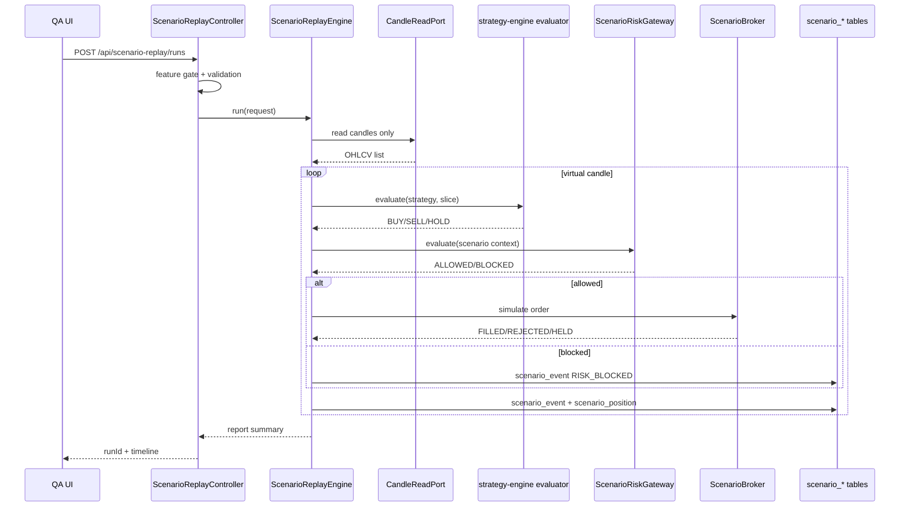

# Scenario Replay Sandbox Spec — v3.11.0 이후 T-SIM

> 작성일: 2026-06-03 KST
> 상태: Phase 1 pure domain skeleton 구현 완료, API/DB/UI 구현 전
> 관계: ADR 0107, policy `scenario-replay-sandbox`

---

## 1. 목표

장중이 아니어도 전략을 QA처럼 재현한다.

사용자는 특정 전략, 종목, interval, 기간, 시작 자본, 가상 보유 수량, 오류 주입 조건을 지정한다. 시스템은 과거 candle을 virtual clock으로 흘리며 다음 타임라인을 생성한다.

1. candle tick
2. strategy evaluation
3. signal decision
4. risk decision
5. scenario order decision
6. scenario fill/reject/held
7. scenario position update
8. user-facing report

실제 KIS 주문, 모의 KIS 주문, live Kafka 주문 토픽, live 주문 DB에는 닿지 않는다.

---

## 2. 리소스 audit

### 2-1. Flyway

현재 점유 마지막 번호: `V62__kill_switch_state_seed.sql`.

T-SIM 최초 영속 마이그레이션 예약 후보:

```text
V63__scenario_replay.sql
```

구현 PR 직전 `find api/src/main/resources/db/migration -maxdepth 1 -type f -name 'V*.sql' | sort -V | tail` 재실행 의무.

### 2-2. Kafka

기존 live 토픽:

| 토픽 | 용도 | 리플레이 사용 |
|---|---|---|
| `signal.generated.v1` | live signal fanout | 금지 |
| `risk.violation.v1` | live risk violation | 금지 |
| `order.intent.v1` | live order router entry | 금지 |
| `order.requested.v1` | live order requested | 금지 |
| `order.filled.v1` | live order filled | 금지 |
| `order.rejected.v1` | live order rejected | 금지 |

v1은 Kafka 0건. 후속 progress stream은 `scenario.*` prefix만.

### 2-3. REST

기존:

- `/api/backtest`
- `/api/backtests`
- `/api/orders`

신규:

- `POST /api/scenario-replay/runs`
- `GET /api/scenario-replay/runs`
- `GET /api/scenario-replay/runs/{runId}`
- `GET /api/scenario-replay/runs/{runId}/events`
- `DELETE /api/scenario-replay/runs/{runId}`

### 2-4. ENV

신규:

```yaml
magicjar:
  scenario-replay:
    enabled: ${MAGICJAR_SCENARIO_REPLAY_ENABLED:false}
    max-candles-per-run: ${MAGICJAR_SCENARIO_REPLAY_MAX_CANDLES:5000}
    max-events-per-run: ${MAGICJAR_SCENARIO_REPLAY_MAX_EVENTS:20000}
```

기본 `false`. local QA에서 명시적으로 켠다.

---

## 3. 도메인 모델 초안

```kotlin
data class ScenarioReplayRequest(
    val userId: String,
    val strategyId: Long,
    val code: String,
    val interval: String,
    val from: Instant,
    val to: Instant,
    val initialCash: BigDecimal,
    val initialPositions: List<ScenarioPositionSeed>,
    val fillModel: ScenarioFillModel = ScenarioFillModel.NEXT_CANDLE_OPEN,
    val faults: List<ScenarioFault> = emptyList(),
)

data class ScenarioEvent(
    val runId: Long,
    val virtualTime: Instant,
    val type: ScenarioEventType,
    val severity: ScenarioSeverity,
    val title: String,
    val message: String,
    val strategyId: Long?,
    val strategyName: String?,
    val code: String?,
    val payload: Map<String, Any?>,
)

enum class ScenarioEventType {
    CANDLE,
    SIGNAL_BUY,
    SIGNAL_SELL,
    SIGNAL_HOLD,
    RISK_ALLOWED,
    RISK_BLOCKED,
    ORDER_REQUESTED,
    ORDER_HELD,
    ORDER_REJECTED,
    ORDER_FILLED,
    POSITION_UPDATED,
    DATA_NOT_READY,
    STRATEGY_ERROR,
    FAULT_INJECTED,
}
```

live `OrderIntent`와 live `OrderRequest`는 사용하지 않는다.

---

## 4. 실행 흐름



---

## 5. Safety acceptance

### 5-1. Forbidden grep

구현 PR은 아래 명령이 통과해야 한다.

```bash
rg "OrderRouterKafkaListener|KisOrderHttpAdapter|KisOrderPort|KisExecutionWsListener|order.intent.v1|order.requested.v1|order.filled.v1|order.rejected.v1|risk.violation.v1|TTTC0012U|TTTC0011U|VTTC0012U|VTTC0011U" \
  domain/src/main/kotlin/kr/spdaewoon/magicjar/domain/scenario \
  api/src/main/kotlin/kr/spdaewoon/magicjar/api/scenario
```

허용되는 결과는 ADR/policy를 설명하는 KDoc 인용뿐이다. 실제 import, constant, call은 0건이어야 한다.

### 5-2. Package boundary

```bash
rg "^import kr\\.spdaewoon\\.magicjar\\.consumer\\." \
  domain/src/main/kotlin/kr/spdaewoon/magicjar/domain/scenario \
  api/src/main/kotlin/kr/spdaewoon/magicjar/api/scenario
```

결과 0건.

### 5-3. DB boundary

scenario repository는 `scenario_*` entity만 가진다. live order/risk/position repository injection 금지.

### 5-4. Message boundary

UI/API 응답의 status text는 "리플레이", "가상", "시나리오" 중 하나를 포함한다. live 주문처럼 보이는 `[주문 체결]` 포맷 사용 금지.

---

## 6. Phase plan

| Phase | 산출물 | 검증 |
|---|---|---|
| 0 | ADR 0107 + policy + 본 spec + v3.11.0 baseline | 문서 only |
| 1 | `domain/scenario` model + `ScenarioReplayEngine` pure skeleton + forbidden import test | `:domain:test --tests "*Scenario*"`, grep |
| 2 | V63 `scenario_*` tables + api persistence + controller | `:api:check`, migration audit |
| 3 | frontend `/qa/scenario-replay` timeline | Playwright screenshot |
| 4 | optional `scenario.*` progress stream | live topic grep 0 |

---

## 7. 첫 QA 시나리오

1. 삼성전자 1분봉 2026-06-02 13:00~14:10, strategy 43, 시작 현금 1,000,000원
2. SK하이닉스 1분봉 2026-06-02 15:50~16:20, initial position 0주, SELL signal 발생
3. fault injection: `BALANCE_LOOKUP_RATE_LIMITED` at 2026-06-02 16:15:00 KST
4. 기대 결과:
   - 잔고 조회 실패는 `ORDER_HELD`
   - 보유 수량 부족은 `RISK_BLOCKED`
   - 장종료는 `ORDER_REJECTED`
   - 각 이벤트가 한 타임라인에서 분리 표기

---

## 8. 변경 이력

| 날짜 | 변경 |
|---|---|
| 2026-06-03 | Phase 1 pure domain skeleton + forbidden boundary test 구현. API/DB/UI/Kafka/KIS adapter는 아직 미구현. |
| 2026-06-03 | Phase 0 spec 신설. |
