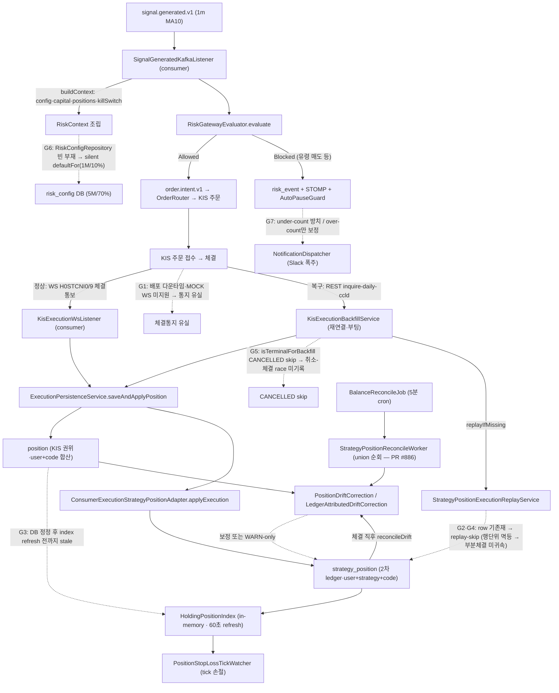

# 체결-원장-리스크 체인 통합 아키텍처 진단 (Execution → Ledger → Risk Integrity)

- **상태**: **Proposed** (사용자 결재용 — 코드 변경 0, audit + 본질 진단 + 아키텍처 대안 비교)
- **작성**: architect (2026-06-10)
- **입력**: 2026-06-10 005930·전략8 MOCK 1m MA10 반나절 incident 5개 연쇄 (orchestrator 실측 DB·로그 evidence) + 전 시스템 체결 체인 전수 코드 audit
- **권위 SoT 정독**: 헌법 `_workspace/arch/agent-charter.md`(§1~§10) · `master-architecture.md`(§3-5 데이터 정합·§5 도메인 경계·§6 모듈 매트릭스) · `development-rules.md`(§1 5룰·§2 품질 메커니즘) · ADR 0088(persistence-shared)·0110(strategy_position 1급)·0114(주문집행·청산 보장)·0115(포지션 정합·청산 사슬)·0116(rate limit)·0042(position bootstrap)·0068(order execution)·0084(WS backfill)
- **관계**: 본 spec은 ADR 0115를 **P2 amend**로 확장 + 헌법·development-rules에 게이트 2건 추가 제안. 신규 ADR 발행은 사용자 결재 후(§7).
- **결재 분기**: 본 문서는 **진단 + 권고**까지만. 코드 디스패치는 사용자가 권고 대안(§3)을 승인한 뒤 후속 사이클.

---

## 0. 자원 audit (헌법 §3·ADR 0102 — spec 발행 전 의무)

본 spec은 코드 변경 0(진단·권고)이므로 신규 자원 0. 단, §4 amend 초안이 향후 구현 시 점유할 자원을 사전 audit한다.

| 자원 | 현 incident 영역 점유 | amend 초안이 추가 필요 | 근거 |
|------|----------------------|----------------------|------|
| **Flyway** | V1~V79 (최신 V79). strategy_position=V65, position=V1, risk_config 기존 | **0** | 멱등키·CANCELLED 대조·drain 가드 모두 기존 테이블 read·기존 컬럼(`order_execution.event_id` UQ) 재사용. 단 §4-① execution-단위 멱등을 영속 보강하려면 `strategy_position_applied_execution` 추적이 필요할 수 있음 → §3 권고 대안 B 채택 시 Flyway 1건 후보(사용자 결재 의제) |
| **Kafka topic** | `order.filled.v1`(fillSource·executedAt 필드 보유)·`order.cancelled.v1`·`signal.generated.v1`·`reconcile.drift.v1` 등 | **0** | replay 식별은 기존 payload 필드 read. drain 가드는 신규 토픽 불요 |
| **Redis** | `reconcile:lock:{userId}`·`idem:order:{key}`·tradeFreq·KIS rate bucket(ADR 0116) | **선택(P2)** | in-flight 주문 drain 카운트는 DB(`order_request.status IN OPEN`) 조회로 충분. 다중 consumer 확장 시에만 Redis |
| **STOMP/REST** | 변경 0 | **0** | 내부 정합·복구 한정. UI 계약 불변 |
| **ENV** | `magicjar.position.drift-auto-correct.enabled`·`...stop-loss.tick-cooldown-seconds`·`...reject-auto-pause.threshold`·`...ws-backfill.enabled`·`...replay.freshness-threshold-seconds` | **신규 1~2건 후보** | §4-④ drain 가드 `magicjar.deploy.drain.in-flight-check.enabled`(default true)·§4-⑤ index 변경감지 주기. add-only |

**audit 결론**: 본 spec PR 자체는 자원 점유 0(docs only). amend 구현 시에도 권고 대안 A(증분+멱등키)는 Flyway 0, 대안 B(파생 뷰 rebuild)는 Flyway 1건(추적 테이블) 후보. 사용자 결재 시 확정.

---

## 1. 전 시스템 데이터 흐름 맵 — 주문 발사 → KIS → 체결 통지 → 원장 3중 상태 → 리스크 → 알림

### 1-1. 모듈 경계 (master §5·§6 + ADR 0088 정합)

자본 체결 체인은 **3 앱 모듈 + 2 라이브러리 모듈**에 걸쳐 있다. incident의 G1~G7은 모두 **모듈 경계의 시차(time skew)·배선(wiring) 지점**에 모여 있다.

```
domain/              # port 인터페이스 + 도메인 타입 (Spring 0)
                     #   StrategyPositionPort · ExecutionStrategyPositionUpdatePort · RiskConfigRepository(port)
                     #   OrderExecutionRepository · KisOrderPort · KillSwitchQueryPort
strategy-engine/     # 순수 정합 산정 (Spring Context, Boot 0)
                     #   PositionDriftCorrection(초과 내림) · LedgerAttributedDriftCorrection(부족 귀속) · ReplayFillPolicy
persistence-shared/  # JPA 어댑터 공유 (api·consumer 양쪽 빈 합류 — ADR 0088)
                     #   ★ RiskConfigJpaAdapter (PR #888로 api→여기 이사: G6 fix)
api/                 # REST/STOMP + 주문 발의 write side + Outbox producer
consumer/            # ★ 체결 수신·귀속·정합·리스크·알림 본체 (incident 발생 지점 전부)
```

### 1-2. 흐름 맵 (mermaid — `mermaid-conventions.md` 규약: 한글 라벨 따옴표 LOCK)



### 1-3. 3중 상태 권위·시차 매트릭스 (★ incident 본질의 토대)

자본 정합의 핵심은 **같은 보유 수량을 3곳이 각자 다른 권위·갱신주기로 들고 있다**는 것이다.

| 상태 | 위치 | 권위 등급 | 갱신 경로 | 갱신 시차 | incident 연루 |
|------|------|----------|-----------|-----------|--------------|
| **`position`** | DB (user+code 합산) | **1차 권위** (KIS 잔고 투영, ADR 0042) | 체결 시 `ConsumerExecutionPositionUpdateAdapter` + 5분 `BalanceReconcileJob`(KIS 잔고 직접 대조) | 체결 즉시~5분 | G2(backfill이 복구) |
| **`strategy_position`** | DB (user+strategy+code) | **2차 ledger** (전략 귀속, ADR 0110) | 체결 시 `applyExecution` + replay + drift 보정 + 5분 worker | 체결 즉시~5분, **replay-skip 시 영구** | G2·G4·G7(미귀속 영구화) |
| **in-memory index** | `HoldingPositionIndex` (JVM heap) | **derived cache** (tick 손절 성능용) | 60초 `@Scheduled` refresh + 체결 즉시 `onFillRefresh` | 0~60초, **부팅 시 채워짐·DB 수동정정은 미감지** | G3(stale 3주 지속) |

**시차의 본질**: `position`은 KIS와 5분마다 강제 대조되어 자기치유 경로가 있다. 그러나 `strategy_position`은 **이벤트 증분으로만 갱신되는 mutable ledger**여서, 증분이 한 번 누락되면(replay-skip·backfill 우회·취소-체결 race) **다음 정합 사이클이 그 누락을 발견하지 못하는 한 영구화**된다. in-memory index는 `strategy_position`을 read하므로 그 오염을 그대로 상속하되, **DB 직접 정정(orchestrator 수동 SQL)은 이벤트가 아니라서 onFillRefresh가 안 돌아 60초 refresh 또는 재기동 전까지 stale**.

---

## 2. 본질 진단 — G1~G7은 7개 버그인가, 하나의 구조적 원인의 7개 증상인가

orchestrator가 제시한 5가설(a~e)을 evidence로 검증한다. **결론: G1~G7은 개별 버그가 아니라 4개 구조적 원인(C1~C4)의 증상이며, 헌법 차원의 메타 갭(C5) 위에 서 있다.**

### 가설 (a) — 체결 이벤트 전달이 at-least-once/exactly-once 어느 쪽도 보장 못 함 → **동의 (C1)**

**evidence**:
- WS 경로(`KisExecutionWsListener`)와 REST backfill 경로(`KisExecutionBackfillService`)가 **서로 다른 event_id namespace**를 쓴다. WS = `{odno}:{stckCntgHour}:{cntgQty}`(분할 1건 단위), backfill = `BACKFILL:{odno}:{ordTmd}:{totCcldQty}`(cumulative 총합 단위). `KisExecutionBackfillService` 주석 L51~58이 명시: *"WS path가 정상 합류 후 backfill이 들어오면 existsByOrderId로도 중복 가능. 본 PR 1차 정책은 단순 event_id UNIQUE만 의존"*.
- 같은 물리 체결이 두 namespace로 들어오면 event_id UQ가 dedup하지 못한다 → **at-least-once도 보장 못 함**(중복 가능). 반대로 backfill `deltaQty <= 0` skip은 **누락 가능**(under-count).
- G1(MOCK WS 체결통보 미지원 → 유실), G4(WS_PREINSERT race), G5(취소-체결 race)가 모두 이 namespace 이중성의 파생.

**판정**: 동의. 체결 이벤트 버스는 **best-effort 멱등**(event_id UQ)일 뿐 exactly-once가 아니며, 두 경로의 멱등 단위가 다르다(분할 vs cumulative)는 것이 근본 취약점.

### 가설 (b) — strategy_position이 event-sourcing 없는 mutable ledger라 누락이 영구화 → **강하게 동의 (C2 — ★ 뿌리)**

**evidence**:
- `ConsumerExecutionStrategyPositionAdapter.applyExecution`은 `current.quantity += fillQty`(증분 가산)다. `StrategyPositionExecutionReplayService` 주석 L31~37이 명시: *"replay는 행 단위 존재만 보고 execution 단위 멱등을 보장하지 않으므로, 이미 행이 있는 상태에서 가산하면 오히려 이중계상(over-count) 위험"* → 그래서 **행이 있으면 skip(under-count를 의도적으로 선택)**.
- 이 선택이 G4의 직접 원인: 14:04 BUY 3주가 부분체결 1+2주로 갈렸을 때, 1주 체결로 행이 생긴 뒤 2주 체결의 replay가 "행 기존재 → skip"되어 **2주 미귀속**. order_execution(권위 원천)에는 2주가 다 있지만 strategy_position에는 1주만.
- 핵심 통찰: **order_execution은 immutable append-only 이벤트 로그인데, strategy_position은 그것을 증분 적용한 mutable projection**이다. 그런데 그 projection이 **자신이 어떤 execution을 이미 반영했는지 추적하지 않는다**(execution-단위 멱등 키 부재). 그래서 "행 존재"라는 거친 신호로 멱등을 흉내내고, 그 거친 신호가 부분체결·재배정·backfill 경로에서 깨진다.

**판정**: 강하게 동의. 이것이 G2·G4·G7의 공통 뿌리다. `strategy_position`을 **order_execution 로그에서 결정론적으로 재계산 가능한 파생 상태**로 보지 않고 **독립 mutable ledger**로 운용하는 것이 영구 누락의 구조적 씨앗.

### 가설 (c) — 안전망이 방향 비대칭 → **동의 (C3)**

**evidence**:
- `PositionDriftCorrection.evaluate`: 초과(strategySum > authority)는 **즉시 내림 보정**, 부족(strategySum < authority)은 `WarnUnderflow`(WARN-only). 주석 L62: *"없는 물량 인식 회피(LOCK)"*.
- 2026-06-10 amend(`LedgerAttributedDriftCorrection`)가 이 비대칭을 **부분 완화**: 부족이라도 귀속 ledger가 명확하면(AUTO·strategyId≠0 FILLED execution의 net) 3중 게이트 통과 시 보정. 그러나 **ledger 합 ≠ authority면 여전히 WARN-only** → G7의 "귀속 모호" 케이스는 방치.
- G7 evidence: 14:10 신규 워커가 drift 탐지 성공하나 "부족 방향-귀속 모호" WARN-only. 14:20 집계 position 자동보정은 작동하나 strategy_position 미보정.

**판정**: 동의. 단 이 비대칭은 **의도된 보수성**(없는 물량 인식 = 자본 위험)이라는 정당한 설계 근거가 있다. 문제는 비대칭 자체가 아니라, **부족 방향에 대한 "신뢰할 수 있는 진실원"(= order_execution 재계산)이 없어서** 보정을 못 하고 방치한다는 것. 즉 C3은 C2의 결과다 — ledger가 파생 뷰라면 부족도 안전하게 rebuild로 채울 수 있다.

### 가설 (d) — silent fallback 문화(빈 부재·null 분기)가 결함을 숨김 → **동의 (C4)**

**evidence**:
- G6 root cause: `RiskConfigJpaAdapter`가 api 모듈에만 `@Component`로 존재 → consumer ApplicationContext엔 빈 부재 → `ObjectProvider<RiskConfigRepository>.getIfAvailable()`이 **항상 null** → `buildContext`가 `defaultFor(1M/10%)`로 silent 진행. **사용자가 5M/70%로 설정을 넓혔는데 시스템은 1M/10%로 더 좁게 평가** = 역방향 자본 위험.
- 이것은 ADR 0088이 이미 한 번 잡은 패턴의 **재발**: ADR 0088 §맥락 L41은 *"consumer 컨테이너 부팅 시 ObjectProvider<OrderEventOutboxRepository>는 항상 empty → drain·retry worker가 매 cycle마다 getIfAvailable() == null → skip → outbox 영구 미발행"* — Outbox는 잡았으나 RiskConfig는 같은 모듈에 합류 안 시킴.
- PR #888이 RiskConfig를 persistence-shared로 이사 + null 분기에 ERROR 로그(MOCK) / fail-fast(REAL) 추가로 fix. 그러나 `SignalGeneratedKafkaListener`에는 **여전히 ObjectProvider graceful 분기가 12개**(config·event·position·notifier·killSwitch·strategyLookup·balance 등). 각각 부재 시 거동이 제각각(killSwitch는 fail-true, position은 empty, config는 defaultFor).

**판정**: 동의. ADR 0088이 만든 `persistence-shared` + `ObjectProvider` 패턴은 **"선택적 모듈 활성화" 의도였으나 실제로는 "필수 빈의 모듈 경계 누락을 silent 통과"시키는 함정**으로 작동. ADR 0088 §맥락이 스스로 *"graceful skip은 모듈 경계 결함 차단 기능을 하지 못함"*이라고 진단했는데, 그 진단이 Outbox 3개에만 적용되고 **RiskConfig 등 나머지 cross-module 필수 port에는 확산되지 않았다**.

### 가설 (e) — 헌법/개발룰 차원의 갭 → **동의 (C5 — 메타)**

**evidence 2건**:
1. **모듈 경계 빈 배선 검증 게이트 부재**: 헌법 §6(JPA Repository default fun 함정)은 **부팅 실패하는** 배선 결함은 다룬다. 그러나 G6처럼 **부팅은 성공하는데 빈이 silent null인** 결함은 룰 0. `development-rules.md` §2-1~§2-9 어디에도 "domain port 구현 빈이 그 port를 쓰는 모든 모듈에 합류했는가"를 강제하는 게이트 없음. ADR 0088이 1회 fix했지만 룰화 안 됨 → 재발(G6).
2. **장중 배포 절차(in-flight 주문 drain) 부재**: G1의 직접 원인은 13:11 AUTO SELL 발사 직후 재배포로 consumer가 13:11~13:16 다운된 것. 헌법 §9-2(변경 관리)는 "canary dev→staging→REAL + 30분 staging dwell"은 있으나 **in-flight 주문이 있는 상태의 consumer를 재배포하면 안 된다는 drain 가드는 없음**. 운영 runbook에도 부재.

**판정**: 동의. C1~C4는 코드 구조 원인이지만, **그것들이 반복 재발하는 메타 원인은 헌법·development-rules에 (1)모듈 경계 빈 합류 검증 게이트와 (2)장중 배포 drain 절차가 없기 때문**.

### 2-X. 본질 종합 — 1문장 + 인과 사슬

> **본질**: `strategy_position`(2차 ledger)을 immutable한 `order_execution` 로그의 **결정론적 파생 뷰가 아니라 독립 mutable 증분 원장**으로 운용하는 것(C2)이 뿌리이고, 그 위에 ① 멱등 단위가 다른 이중 체결 경로(C1) ② 진실원 부재로 인한 방향 비대칭 안전망(C3) ③ 필수 cross-module 빈의 silent null 통과(C4)가 얹혀, ④ 모듈 경계·장중 배포를 검증하는 헌법 게이트 부재(C5)가 이 모두를 반복 재발하게 한다.

```
C5(헌법 게이트 부재) ─── 재발 허용 ───┐
                                      ▼
C2(mutable 증분 ledger·뿌리) ──→ G2·G4·G7 (미귀속 영구화)
   │                                  ▲
   ├─ C1(이중 체결 경로 멱등 불일치) ─┤ G1·G4·G5 (유실·중복·race)
   ├─ C3(진실원 부재 → 비대칭 안전망)─┘ G7 (under-count 방치)
   └─ C4(silent 빈 null) ──────────────→ G6 (역방향 자본 위험)
                                      └→ G3 (in-memory stale은 ledger 오염 상속)
```

incident가 "반나절 5개 구멍"으로 보인 이유: **하나의 뿌리(C2)가 입력 경로(WS·backfill·race·배포다운)마다 다른 표면으로 발현**했기 때문. 개별 hotfix(PR #886·#888)는 표면을 막았지만 뿌리는 남아 다음 입력 경로에서 또 발현할 수 있다.

---

## 3. 아키텍처 대안 비교 + 권고 1개

v1/v2 회귀 금지 + 자동매매 적합성 의심 lens 적용. **평가 기준**: 자본 경로 위험 · 누락 영구화 차단력 · 마이그레이션 공수 · 롤백 용이성 · MVP 적합성(과도한 추상화 배제 — 헌법 작업 원칙).

### 대안 A — 현행 증분 ledger 유지 + execution-단위 멱등키 보강 + 안전망 대칭화

`strategy_position`은 그대로 mutable 증분 원장. 단 (1) **어떤 execution을 반영했는지 추적**(예: `strategy_position.last_applied_execution_id` 또는 별도 `strategy_position_applied_execution(strategy_position_id, execution_id)` UQ)하여 replay가 행 존재가 아니라 **execution 단위로 멱등** 판단. (2) drift 안전망을 양방향 대칭(부족도 ledger 재구성으로 채움 — 이미 `LedgerAttributedDriftCorrection`이 부분 구현).

| 항목 | 평가 |
|------|------|
| 자본 위험 | **낮음** — 증분 가산 유지(검증된 평단 수식 보존), 멱등 단위만 정밀화 |
| 누락 영구화 차단 | **중간** — replay over/under-count는 닫히나, "행 존재 skip" 외 새 누락 경로 등장 시 또 패치 필요(증분의 본질적 취약) |
| 마이그레이션 | Flyway 1건(추적 테이블 또는 컬럼) + replay·adapter 수정 |
| 롤백 | 쉬움 — 추적 테이블 무시하면 현행 복귀 |
| MVP 적합성 | **높음** — 현 구조 위 보수적 보강(헌법 작업 원칙 "현 구조 위 보수적 보강 우선" 정합) |

### 대안 B — `strategy_position`을 order_execution 파생 **재계산 뷰**로 전환 (event-sourcing식 rebuild) ★ 권고

`order_execution`(immutable append-only)을 **유일한 진실원**으로 보고, `strategy_position`을 그로부터 **결정론적으로 재계산하는 파생 상태**로 재정의. 핵심: 증분 적용은 그대로 빠른 경로(hot path)로 유지하되, **drift 감지·reconcile 시 해당 (user,strategy,code)의 strategy_position을 order_execution(+ 평단 수식)으로 전량 rebuild**. 누락이 발생해도 다음 rebuild가 흡수(누락 자체가 영구화 불가). `position`(KIS 권위)과 rebuild 결과가 일치하는지가 최종 검산.

이미 **부분적으로 존재**: `LedgerAttributedDriftCorrection`이 `aggregateFilledByStrategyAndSide`로 ledger를 재집계해 leg를 set한다(증분 아닌 절대목표 → 멱등). 대안 B는 이를 **부족 방향 예외가 아니라 strategy_position 정합의 1급 메커니즘으로 승격**하는 것.

| 항목 | 평가 |
|------|------|
| 자본 위험 | **낮음** — rebuild는 절대목표 set(멱등·over-count 구조적 0). KIS position과 교차검산 |
| 누락 영구화 차단 | **높음 (★)** — C2 뿌리를 직접 제거. 어떤 경로로 누락돼도 다음 reconcile rebuild가 order_execution 진실원에서 복원. G2·G4·G7 동시 해소 |
| 마이그레이션 | Flyway 0~1건(추적 테이블 불요 — order_execution이 이미 진실원). adapter에 rebuild 경로 추가. replay 서비스는 **삭제 가능**(rebuild가 흡수) → 코드 순감 |
| 롤백 | 중간 — rebuild를 reconcile-only로 한정하면 hot path는 현행 유지, ENV로 rebuild off 시 현행 복귀 |
| MVP 적합성 | **높음** — 새 인프라(Kafka event store·snapshot) 0. 기존 order_execution + 기존 집계 쿼리 재사용. "event sourcing 프레임워크 도입"이 아니라 **"이미 있는 append-only 로그를 진실원으로 인정"** |

**v1/v2 회귀 의심 검토**: 대안 B는 event-sourcing "스타일"이지 framework가 아니다. 별도 event store·CQRS read model·snapshot 인프라를 도입하지 않는다(그건 ADR 작업원칙 "이벤트 소싱 기본 배제"에 걸림). order_execution은 이미 모든 체결의 immutable audit row(master §3-5 "결정 audit" 원칙)이므로, **진실원으로 인정하고 reconcile 시 재계산하는 것은 신규 추상화가 아니라 기존 자원의 정직한 사용**이다.

### 대안 C — 권위 단일화 (이중 원장 폐지 — strategy_position 제거, position만)

전략별 귀속을 포기하고 KIS 권위 `position`(user+code 합산)만 운용.

| 항목 | 평가 |
|------|------|
| 자본 위험 | 낮음 (단일 진실원) |
| 누락 영구화 차단 | 높음 (drift 없음 — 원장 1개) |
| 마이그레이션 | **막대** — ADR 0110 전면 폐기. 다전략 익절/손절 귀속·분할매수 평단(ADR 0111)·SELL 전략 분기(SELL_WITHOUT_POSITION strategy별)가 모두 무너짐 |
| MVP 적합성 | **거부** — readiness C-2(다전략 교차 청산 차단)가 ADR 0110의 존재 이유. 단타 발굴 다전략 운용 방향과 정면 충돌. **v1/v2 회귀가 아니라 명시 기능 후퇴** |

### 권고: **대안 B (파생 재계산 뷰) — 단, 점진 도입 (B-on-A)**

**즉시(P2 amend §4)는 대안 A의 보강을 적용**하되, **B를 목표 아키텍처로 명시**하고 `LedgerAttributedDriftCorrection`을 부족 방향 예외에서 **양방향 rebuild 정합의 1급 메커니즘으로 승격**하는 경로로 간다. 이유:

1. **B가 C2 뿌리를 유일하게 직접 제거**한다. A는 표면(replay 멱등)을 정밀화하지만 증분의 본질적 취약(새 누락 경로)이 남는다.
2. B는 **신규 인프라 0**이고 **코드 순감 가능**(replay 서비스 흡수)이라 MVP·운영 단계에 적합하다 — 헌법 작업 원칙(과도한 추상화 배제) 위반 아님.
3. C는 명시 기능(다전략 귀속) 후퇴라 거부.
4. **점진 도입**: hot path(체결 즉시 증분)는 자본 흐름 검증된 현행 유지, reconcile 경로만 rebuild로 통일 → 롤백 ENV 1개로 보장. 이것이 "현 구조 위 보수적 보강"(헌법 작업 원칙)과 "뿌리 제거"를 동시에 만족하는 유일 경로.

---

## 4. ADR 0115 P2 amend 초안 (즉시 실행 가능 — 권고 대안 B-on-A 경로)

> 본 §은 ADR 0115에 추가할 **P2 항목 초안**. 사용자 결재 후 ADR 0115 amend로 정식 편입. 각 항목 끝에 권고 대안(§3)과의 관계 명시.

### P2-① replay execution-단위 멱등 (C1·C2 — 대안 A 보강 + B 디딤돌)

- **현행**: `StrategyPositionExecutionReplayService.replayIfMissing`이 `findByUserStrategyCode != null`이면 skip(행 단위 → 부분체결 2주 미귀속, G4).
- **amend**: replay를 **행 존재가 아니라 execution 단위 멱등**으로. (a) 즉시는 `aggregateFilledByStrategyAndSide` net과 현재 leg quantity를 비교해 **차이만큼만 보강**(절대목표 set — 이미 `LedgerAttributedDriftCorrection`이 하는 일을 replay 경로에도 적용). (b) 또는 reconcile 경로 rebuild에 위임하고 replay는 trigger만(대안 B 디딤돌).
- **대안 관계**: B 채택 시 replay 서비스는 **rebuild에 흡수되어 삭제 가능**. A만 채택 시 추적 컬럼/테이블 필요.

### P2-② backfill CANCELLED 체결 대조 (C1 — G5)

- **현행**: `KisExecutionBackfillService.isTerminalForBackfill()`이 CANCELLED를 terminal로 보고 status sync skip(L630). 취소-체결 race(시스템 CANCELLED 기록, KIS 실체결)에서 1주 영구 미기록(G5).
- **amend**: CANCELLED 주문도 **KIS 일별체결조회의 totCcldQty > 0이면 체결 대조**(취소 전 부분체결 흡수). terminal skip은 status 재마킹 방지용이었으나(completed_at 덮어쓰기 회피 — backlog §82-1), **execution INSERT는 status와 독립**이어야 한다. status는 CANCELLED 유지하되 누락 체결 row는 INSERT + position/strategy_position 반영.
- **대안 관계**: order_execution(진실원)에 누락 체결을 채우는 것 = 대안 B의 전제(진실원 완전성). B의 필수 선행.

### P2-③ WarnUnderflow 단일전략+주문 evidence 시 자동 보정 (C3 — G7)

- **현행**: `LedgerAttributedDriftCorrection`이 `correctedSum == authority` 정확 일치 시만 Adjust, 아니면 WarnUnderflow 방치(G7 "귀속 모호").
- **amend**: 단일 전략 + 해당 종목에 외부(EXTERNAL)·MANUAL 체결 0(순수 AUTO ledger)인 경우, ledger net을 authority로 **신뢰하고 보정**(모호성 없음 — 그 종목 보유는 전부 그 전략의 것). 다전략·외부 혼재만 WARN 유지.
- **대안 관계**: 대안 B(rebuild)의 부분 적용. B 전면 채택 시 이 조건은 rebuild 검산 로직에 통합.

### P2-④ 장중 배포 in-flight drain 가드 (C5 — G1) ★ 헌법·runbook 편입

- **현행**: in-flight 주문(ACK·PARTIALLY_FILLED)이 있는 consumer를 재배포하면 체결통지 유실(MOCK은 WS 미지원이라 backfill만이 복구 경로). 절차 룰 0.
- **amend**: 배포 스크립트(`scripts/build-and-deploy.sh consumer`)에 **in-flight 주문 0 확인 게이트** 추가 — `order_request.status IN (REQUESTED,ACK,PARTIALLY_FILLED)` count > 0이면 경고 + 사용자 확인(또는 `--force-drain`). ENV `magicjar.deploy.drain.in-flight-check.enabled`(default true). 부팅 직후 `KisExecutionBackfillService` 1회 backfill이 이미 흡수 경로이므로, drain 가드는 **유실 윈도를 줄이는 보강**(완전 방지는 아님 — 부팅 backfill과 병행).
- **대안 관계**: 독립 운영 절차. 대안 무관(C5 메타 갭 직접 해소).
- **헌법 편입**: 헌법 §9-2(변경 관리)에 "자본 체결 모듈(consumer) 재배포 시 in-flight 주문 drain 확인" 1줄 + 운영 runbook 신규/보강.

### P2-⑤ in-memory index DB 변경 감지/리프레시 (G3)

- **현행**: `HoldingPositionIndex`는 60초 refresh + 체결 즉시 `onFillRefresh`. **DB 직접 정정(orchestrator 수동 SQL·drift 보정 worker의 upsert)은 이벤트가 아니라서 onFillRefresh 미발화** → 60초 또는 재기동 전까지 stale(G3 3주 지속).
- **amend**: drift 보정(`ConsumerExecutionStrategyPositionAdapter.applyDriftCorrection`·`applyLedgerUnderflowCorrection`)이 strategy_position을 변경하면 **그 code에 대해 `HoldingPositionIndex.onFillRefresh(code)` 동반 호출**(보정도 보유 변경 이벤트로 취급). 수동 SQL 정정은 운영 절차로 "정정 후 consumer 재기동 또는 refresh 트리거" 명시.
- **대안 관계**: 독립. 대안 B로 reconcile가 정밀해질수록 index 동반 갱신의 가치 증가.

### amend 4-X. 운영 ADR 양식 3 슬롯 (헌법 §9-5)

- **SLO 영향**: 직접 수치 0. S-1(시그널→주문) 오발주 reject·알림 폭주 감소. P2-④ drain 가드는 배포 시간에 in-flight 대기 추가(운영 트레이드오프).
- **rollback plan**: 각 항목 ENV toggle로 현행 복귀. P2-①②③은 보정 비활성 시 현행 WARN-only. P2-④는 `in-flight-check.enabled=false`. P2-⑤는 동반 호출 제거.
- **관측 매트릭스**: `STRATEGY_POSITION_DRIFT_CORRECTED` count(보정 동작) · replay 미귀속 0 · CANCELLED 체결 흡수 count · in-flight drain 경고 발동 · index stale 감지 시간.

---

## 5. 헌법·운영 정합 제안 (C4·C5 메타 갭 — architect 단독 PR 영역)

### 5-1. 헌법 §11 신설 후보 — 모듈 경계 빈 합류 검증 게이트 (C4)

- **룰**: domain port의 구현 빈(`@Component`/`@Repository`)이 **그 port를 `ObjectProvider`로 주입받는 모든 앱 모듈(api·consumer·batch)의 ApplicationContext에 실제 합류**하는지 검증하는 정적 테스트 의무. ADR 0088 `persistence-shared` 패턴이 표준 경로.
- **발동**: cross-module 필수 port(RiskConfig·Position·Outbox·KillSwitch 등 자본·리스크 결정에 쓰이는 port) 신규/이동 PR.
- **검증 방법**: 각 앱 모듈에 "이 port의 빈이 컨텍스트에 존재하는가"를 단언하는 `@SpringBootTest` 슬라이스 또는 컴포넌트 scan basePackages 정적 검증(PR #888이 이미 consumer 배선 정적 검증 2건 추가 — 이를 룰화).
- **silent fallback 금지 보강**: `ObjectProvider.getIfAvailable() == null` 분기는 **반드시 log.error 가시화 + REAL 모드 fail-fast 또는 명시 degraded 표기**. silent 진행(로그 0) 금지. (PR #888이 RiskConfig에 적용한 패턴을 12개 ObjectProvider 분기 전체로 확산하는 점진 backlog.)

### 5-2. development-rules §추가 후보 — 자본 모듈 장중 배포 drain 절차 (C5)

- **룰**: consumer(체결·자본 경로) 재배포는 **장중(09:00~15:30) in-flight 주문 0 확인 후**. in-flight 있으면 drain 대기 또는 명시 force + 부팅 backfill 확인.
- **위치**: `development-rules.md` 운영 정책 §3 또는 헌법 §9-2 cross-link + 운영 runbook(`docs/operations/`) 신규.

### 5-3. master-architecture §3-5 정합 후보 — 3중 상태 권위 매트릭스 본문화

- 본 spec §1-3의 3중 상태(position·strategy_position·in-memory index) 권위·시차 매트릭스를 master §3-5(데이터 정합성 원칙)에 본문화 — "이벤트 멱등" 원칙 아래 **"파생 상태는 진실원에서 재계산 가능해야 한다"** 원칙 추가(대안 B 채택 시).

---

## 6. spec 발행 main 자원 audit 5종 (헌법 §3·feedback_spec_audit_existing_resources)

| 자원 | main 현황 (audit GREEN) | 본 spec 충돌 |
|------|------------------------|-------------|
| **Flyway** | V1~V79 점유(최신 V79 slack webhook). strategy_position=V65 | 본 spec 코드 0 → 충돌 0. amend 구현 시 V80+ (충돌 없음) |
| **Kafka** | `order.filled.v1`(fillSource·executedAt)·`order.cancelled.v1`·`signal.generated.v1`·`reconcile.drift.v1` 등 17 topic | 신규 0 — 기존 payload read만 |
| **Redis** | `reconcile:lock`·`idem:order`·tradeFreq·KIS rate bucket(ADR 0116) | 신규 0 (P2 선택) |
| **STOMP** | risk·position·order fanout | 변경 0 |
| **REST** | risk-config·positions·orders endpoint | 변경 0 |
| **ENV** | drift-auto-correct·tick-cooldown·reject-auto-pause·ws-backfill·replay-freshness | 신규 1~2 후보(drain·index) add-only |

**audit 결론**: 본 spec PR은 docs only, 자원 점유 0. amend 구현은 add-only(Flyway 0~1·ENV 1~2), 기존 자원 변경 0.

---

## 7. 사용자 결재 의제 (3건)

1. **권고 대안 B-on-A 승인 여부** — strategy_position을 order_execution 파생 재계산 뷰로 점진 전환(reconcile rebuild 1급화). 승인 시 후속 사이클 strategy-engine+backend-core 디스패치.
2. **P2 amend 5항목 우선순위** — ②(CANCELLED 대조)·④(drain 가드)는 자본 누락 직결 1순위 권고. ①③⑤는 정합 정밀화 2순위.
3. **헌법 §11(모듈 경계 빈 합류 게이트) + development-rules drain 절차 신설** — C4·C5 재발 차단. architect 단독 PR 영역이나 사용자 인지 의제.

---

## 변경 이력

| 날짜 | 변경 | 작성 |
|------|------|------|
| 2026-06-10 | 초기 발행 (Proposed) — 2026-06-10 005930·전략8 incident 5연쇄 전 시스템 audit. G1~G7 → C1~C5 본질 진단(mutable 증분 ledger 뿌리). 데이터 흐름 맵 + 3중 상태 권위 매트릭스 + 대안 3안(권고 B-on-A) + ADR 0115 P2 amend 5항목 초안 + 헌법 §11·development-rules drain 절차 제안. 코드 0 touch. (architect) | architect |
