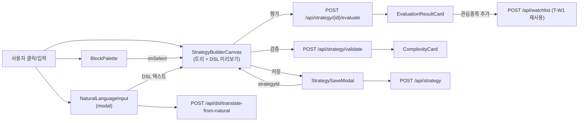

# PR-44 T-SB 설계 가이드 (W2 진입 — Strategy Builder UI: GUI 블록 빌더 + DSL 직렬화 + Watchlist 등록)

- 작성: architect (opus 4.7 1M)
- 작성일: 2026-05-10
- 대상 PR 시리즈: PR-45 (단일 frontend XL — 시나리오 C 채택, §11 사유). 분할 시나리오 A·B는 §11에서 거부.
- 진입 prerequisite: v3.1.2 hotfix 정상화 + W2 T-IND 풀세트(PR-33) + W2 T-DSL 풀세트(PR-36) + W2 T-PAT 풀세트(PR-39 + PR-41~43 pattern-engine 모듈 분리 + ktlint 정정 PR-267) main 위 정상 동작. main HEAD = `cbf2249`.
- 정합 SoT:
  - **ADR 0009** Frontend SPA — React 19 + TS + Vite + Tailwind + LWC v4 + TanStack Query + Zustand
  - **ADR 0020** KIS Strategy Builder 흡수 = 명세 port (T-SB의 GUI 컨셉 — 블록·드래그·미리보기 — 참고만 / 코드 흡수 0)
  - **ADR 0021** Indicator Source 추상화 (T-SB는 80지표를 GUI block palette에 노출 — `IndicatorCatalog.ALL` 80건 + `frontend/src/api/indicator.ts INDICATOR_CATALOG` 정합)
  - **ADR 0022** Strategy DSL = .kis.yaml superset (T-SB GUI 출력은 항상 DSL 텍스트 → backend `/api/strategy/validate` + `/api/strategy/{id}/evaluate` 1:1 호환)
  - **ADR 0023** Spring AI Anthropic helper (T-DSL `/api/dsl/translate-from-natural` 자연어→DSL — T-SB GUI에 "자연어로 입력" 옵션으로 노출. 사용자 트리거만 — 매매 결정권 0)
  - **ADR 0026** AI provider 선택 (위와 동일 — 사용자 트리거 helper)
  - **ADR 0040** 관심종목 우선 UI 흐름 (Strategy Builder → 발굴 → Watchlist → 상세 — T-SB가 그 시작점)
  - **ADR 0047** DSL Evaluation Sandbox (T-SB는 GUI만 — sandbox 호출은 backend `/api/strategy/{id}/evaluate`가 책임)
  - **ADR 0050** CHANGELOG 슬롯 채번룰 (본 spec PR이 sub-agent 슬롯 row 사전 발행 의무)
  - **ADR 0051** Repository default fun 함정 (본 PR-44는 신규 JPA Repository 추가 0건 — 함정 발동 0)
  - **ADR 0053** Living Policy Docs (kis-first-raw-fetch 정독 의무, 본 PR은 KIS API 직접 호출 0이라 raw fetch 비대상)
  - **ADR 0055 (본 spec 발행 결정 — §10 결론)**: GUI 빌더 컴포넌트 라이브러리 선택 — **하이브리드 트리 폼 빌더 + YAML 텍스트 토글** 채택, Reactflow/@xyflow/react/React DnD 거부.
  - `docs/architecture/master-architecture.md` v2 §B.8 (Strategy Builder UI) · §10 ADR 인덱스
  - `docs/architecture/tracks-roadmap.md` §1 W2 · §2 T-SB row · §3 T-SB outline §185-200
  - `docs/architecture/development-rules.md` 5건 (룰 2 단일 책임 · 룰 3 라운드 · 룰 5 AI 호출 0 본체)
  - `docs/architecture/code-convention.md`
  - `docs/architecture/policies/kis-first-raw-fetch.md`
  - `_workspace/arch/agent-charter.md` §3·§4·§5·§6
  - `_workspace/specs/pr-35-w2-t-dsl-design.md` (T-DSL inner 클래스·DSL 텍스트 형식 LOCK 참고)
  - `_workspace/specs/pr-38-w2-t-pat-design.md` (T-PAT 57패턴 catalog LOCK 참고)
  - `_workspace/specs/pr-32-w2-t-ind-design.md` (T-IND 80지표 catalog LOCK 참고)

- 작업 원칙 (개발 룰북 정합):
  - **룰 2 — 단일 책임**: PR-45 = frontend 단일 — `frontend/src/{api,components/strategy,pages/Strategy}/*` add-only. backend·domain 수정 0건.
  - **룰 3 — 라운드 분할**: 본 PR-44 = R0 spec only(코드 0). PR-45 = R1+R2+R3 통합 (frontend XL — 단일 영역 · backend touch 0이라 layer 분할 불필요. 한 PR 4 layer 동시 변경 금지 룰 위배 0 — frontend는 1 layer로 간주).
  - **룰 4 — 코드 먼저 R3 일괄**: PR-45 단일이라 R3 분리 불필요. 단위 테스트(Vitest)는 핵심 5종(DslSerializer round-trip · BlockTree validation · Translate fallback · SaveModal flow · Evaluate result rendering)만 동반 의무. e2e (Playwright/MSW) 일괄은 W3 진입 후 (T-BT R3와 함께) 별도 사이클로.
  - **룰 5 — AI 호출 0 (본체)**: T-SB는 W2 — 본체에서 LLM provider import 0건. 단 사용자 트리거 helper로 T-DSL의 `/api/dsl/translate-from-natural` (이미 머지됨) endpoint를 GUI에 "자연어로 입력하기" 버튼으로 노출 — 호출 주체는 backend (api/.../ai/dsl/), frontend는 단순 fetch hook. ADR 0023 §사용자 트리거만 정합. fitness gap §13 검증.
  - **KIS-first 의무 (헌법 §3)**: T-SB는 KIS API 직접 호출 0 (frontend → magicJar `/api/strategy/*`만). KIS catalog는 이미 backend domain LOCK(`IndicatorCatalog.ALL` 80 + `PatternCatalog.ALL` 57) + frontend 정적 카탈로그(`api/indicator.ts INDICATOR_CATALOG` T-IND R3 PR-33)에서 파생. raw fetch 발동 0 (코드 추론 비대상 — KIS 정합 데이터는 이미 두 SoT가 보유). 사용자 메모리 `feedback_kis_first_policy.md` GREEN.

---

## §1. T-SB 한 줄 목표 + DoD

### 1-1. 목표

> **사용자가 magicJar UI에서 코드 한 줄 안 쓰고 GUI 블록(지표 80 + 패턴 57 + 캔들 OHLCV + 비교/산술/논리 연산자 + 상수)을 트리 형태로 결합해 매매 룰을 구성하면, 그 GUI 상태가 KIS .kis.yaml 호환 DSL 텍스트로 직렬화되어 backend `/api/strategy/validate`로 4단 complexity(LOW/MEDIUM/HIGH/CRITICAL) + AST stats를 받고, 단건 종목·인터벌로 `/api/strategy/{id}/evaluate`로 BUY/SELL/HOLD + reason을 받아 결과 카드로 표시한다. 저장 시 universe·timeframe·이름·한국어명을 모달에서 입력하고 `POST /api/strategy`로 persist + 동시에 backtest 결과 종목을 `POST /api/watchlist`로 Watchlist에 add 가능. AI 옵션 보조: "자연어로 입력하기" 버튼 → 기존 `/api/dsl/translate-from-natural` (T-DSL PR-36 ai-engineer 머지) 호출 → DSL 텍스트 받아 GUI 트리 자동 재구성. YAML export/import 동시 지원 — 사용자가 외부에서 .kis.yaml 작성 후 업로드 시 GUI 트리 재구성, GUI에서 .kis.yaml 다운로드 가능. AI 호출 0(W2 본체 룰 5 정합) — translate helper는 사용자 클릭 트리거만이고 매매 결정권 0.**

### 1-2. DoD (Definition of Done) — PR-45 머지 후 검증

| # | 검증 항목 | 명령·시나리오 | 기대 결과 |
|---|---|---|---|
| 1 | 라우팅 등록 | 브라우저 `/strategy/builder` 접근 | `StrategyBuilderPage` 렌더 (블록 팔레트 좌 + 캔버스 중앙 + 결과 우) |
| 2 | 80지표 블록 팔레트 | "지표" 탭 클릭 → 검색창 "rsi" | rsi 1건 hit + 6 분류(TREND·MOMENTUM·VOLUME·VOLATILITY·OSCILLATOR·OTHER) 섹션 |
| 3 | 57패턴 블록 팔레트 | "패턴" 탭 클릭 | 57 패턴 목록 표시 + 카테고리 SINGLE 14·DOUBLE 16·TRIPLE_PLUS 27 + R1 active 10 표기 (`★` 아이콘) + R2 stub 47 disabled 시각화 |
| 4 | 트리 폼 빌더 — 노드 추가 | 비교 조건 노드 추가 → left=지표 RSI(period=14), op=`<`, right=상수 30 | 트리에 `Condition(rsi(14) < 30)` 추가 + DSL 미리보기 영역에 `rsi(14) < 30` 텍스트 즉시 갱신 |
| 5 | 트리 폼 빌더 — 논리 결합 | AND 노드 추가 → left=조건1, right=조건2 | DSL 미리보기 `(rsi(14) < 30) AND (ma(5) crosses_above ma(20))` |
| 6 | 산술 표현식 | `volume > volume_ma(20) * 1.5` 트리 구성 | DSL 미리보기 정합 갱신 |
| 7 | 패턴 조건 | `pattern_detected("hammer")` 노드 추가 | DSL 미리보기 `pattern_detected("hammer")` |
| 8 | 캔들 직접 참조 | OHLCV 노드 (close · open · high · low · volume) 추가 | DSL 미리보기 `close > open` 형태 |
| 9 | DSL 직렬화 (round-trip) | GUI 트리 → DSL 텍스트 → 파싱(Vitest) → 트리 재구성 → 동일 DSL | Vitest `DslSerializer.test.ts` round-trip 5 fixture GREEN |
| 10 | validate 호출 (200) | "검증" 버튼 클릭 | `POST /api/strategy/validate` body=`{expr:"..."}` → 200 + `complexity:{astDepth,nodeCount,indicatorCallCount,estimatedEvalTimeMs,complexityClass}` 카드 표시 |
| 11 | validate 오류 (400) | DSL 위반 식("ma(5) crosses_above unknown_func()") | 400 + 오류 메시지 표시 (mock 데이터 금지 — backend 응답 그대로) |
| 12 | evaluate 호출 — 저장 후 | 저장 모달에서 종목 = "005930" + interval = "1d" 선택 → "평가" | `POST /api/strategy/{id}/evaluate` body=`{code:"005930",interval:"1d"}` → 200 + signal/strength/reason 카드 |
| 13 | 저장 (CreateStrategy) | "저장" 모달 → name·nameKo·universe·tf 입력 후 확인 | `POST /api/strategy` body=`{userId,name,nameKo,entry,exit?,universe,tf}` → 200 + strategyId 반환 + 토스트 |
| 14 | Watchlist 등록 | evaluate 결과 카드 "관심종목 추가" 클릭 | `POST /api/watchlist` body=`{code,nameKo}` → 200 + `useWatchlist` invalidate (T-W1 hook 재사용) |
| 15 | 자연어 → DSL helper | "자연어로 입력하기" 버튼 → "RSI 30 이하면 매수" 입력 | `POST /api/dsl/translate-from-natural` → DSL 텍스트 → GUI 트리 자동 재구성 |
| 16 | 자연어 helper UNTRANSLATABLE | 모호한 입력("그냥 사라") | 응답 mode=UNTRANSLATABLE / reasoning 표시 + GUI 트리 변경 0 |
| 17 | YAML export | "DSL 다운로드" 버튼 | `.kis.yaml` 파일 다운로드 (clientName: ko, buy_condition·sell_condition·universe·tf) |
| 18 | YAML import | `.kis.yaml` 파일 업로드 | GUI 트리 재구성 + DSL 미리보기 정합 |
| 19 | 데이터 없음 표시 (메모리 정합) | evaluate가 candle 미적재 종목 + 0건 응답 | "데이터 없음" 명시 표시 — mock 합성 0 (`feedback_no_mock_data.md` 정합) |
| 20 | LLM provider import 0 (본체) | `grep -rE "spring-ai|anthropic|openai" frontend/src` | 0건 — frontend 본체 AI 호출 0 (translate hook은 backend endpoint fetch만) |
| 21 | TanStack Query mutation 정합 | useStrategyValidate · useStrategyEvaluate · useStrategyCreate · useStrategyTranslate 4 hook | 모두 useMutation + 적절한 invalidateQueries (저장 시 strategyList) |
| 22 | 80지표 카탈로그 frontend SoT 일치 | `INDICATOR_CATALOG.length === 80` (T-IND R3 fixture 재사용) | Vitest 검증 GREEN |
| 23 | 57패턴 카탈로그 신규 추가 | `frontend/src/api/pattern.ts PATTERN_CATALOG.length === 57` (R1 active 10 + R2 stub 47 표기) | Vitest 검증 GREEN |
| 24 | DSL 화이트리스트 정합 | DSL 직렬화 → backend `/api/strategy/validate` 200 (KIS 호환 토큰만 사용) | T-DSL `KisYamlDslParser` 화이트리스트 위반 0건 |
| 25 | A11y — 키보드 탐색 | Tab으로 블록 트리 노드 이동 + Enter 추가 + Delete 제거 | 마우스 의존 0 — 키보드 only 시나리오 GREEN |
| 26 | 반응형 — 데스크톱 위주 | 1280px+ 정상 / 768px 이하는 안내 메시지 ("현재 데스크톱 권장") | mobile 폼 전환은 후속 PR 명시 |

### 1-3. 비즈니스 가치

- **W2 마감 — 사용자=최고 관리자/설계자가 코드 없이 룰을 만드는 1차 도구.** 사용자 메모리 `project_system_vision.md` "룰 기반 quant trading 본체 + AI 옵션 보조 / 매매=룰·시그널, AI=분석 코멘트만" 정합 — T-SB는 룰 본체 작성 도구.
- **사용자 가치 1**: 80지표 + 57패턴 + 연산자 GUI 결합으로 백테스트→Watchlist 흐름 1차 닫음 (T-BT R3 후 정식 사이클).
- **사용자 가치 2**: KIS .kis.yaml import/export로 외부 자산(KIS Strategy Builder 사용자가 만든 yaml)을 magicJar로 가져오기 가능.
- **사용자 가치 3**: 자연어 helper로 DSL 학습 곡선 완화 — 사용자 트리거만 (매매 결정권 0, ADR 0023 정합).
- **자동매매 fitness (사용자 메모리 `feedback_v3_skepticism_no_regression.md` 정합)**: T-SB는 quant trading 룰 본체의 입력 인터페이스 — v1/v2 PoC 시점에는 없었던 도구(v1: hardcode RSI / v2: yaml 텍스트 직접 편집). T-SB로 일반 사용자 진입 가능. v1/v2 잔재 0건. AI 호출 0 (룰 5).

---

## §2. ADR 0022·0023·0040·0055 준수 항목 체크리스트

본 PR-44(spec) → PR-45(코드)이 ADR 0022 §2-1·§2-2(DSL 1:1 호환) + ADR 0023 §2(AI 사용자 트리거만) + ADR 0040(Strategy Builder → Watchlist 흐름) + ADR 0055 신설(GUI 빌더 컴포넌트 결정)을 그대로 implementation 한다.

### 2-1. ADR 0022 (Strategy DSL) — DSL 텍스트 1:1 직렬화 의무

| ADR 0022 §위치 | 결정 사항 | PR-45 구현 위치 | 담당 |
|---|---|---|---|
| §2-1 KIS 호환 토큰 | `ma`·`ema`·`rsi`·`macd`·`crosses_above`·`crosses_below`·`AND`·`OR`·`NOT`·`>` `<` `>=` `<=` `==` `!=`·산술 `+` `-` `*` `/`·literal | `frontend/src/lib/dsl/serializer.ts` `serializeBlockTree()` 토큰 화이트리스트 LOCK |
| §2-2 magicJar 확장 | `pattern("name")` · `pattern_detected("name")` · `consecutive("up"/"down")` | `BlockNode.tsx` 패턴 노드 직렬화 시 `pattern_detected("hammer")` 형태 |
| §2-3 1줄 표현식 (entry/exit) | 다중 줄 0 — 단일 표현식만 | `serialize()` 결과는 항상 1줄 string |
| §2-4 화이트리스트 위반 | 자체 토큰 추가 0 — backend `KisYamlDslParser` 정합 | `serializer.ts` 토큰 ENUM 명시 LOCK |

### 2-2. ADR 0023 (AI helper 사용자 트리거) — 자연어 → DSL

| ADR 0023 §위치 | 결정 사항 | PR-45 구현 위치 | 담당 |
|---|---|---|---|
| §1 사용자 트리거만 | 자동 호출 0 — 사용자 버튼 클릭만 | `NaturalLanguageInput.tsx` "자연어로 입력하기" 버튼 onClick |
| §2 매매 결정권 0 | AI 응답은 **DSL 텍스트만** — 매매 결정 0 | translate 응답 → GUI 트리 재구성, signal 발화 0 |
| §3 mock fallback | `MAGICJAR_AI_ENABLED=false` 시 mode=DISABLED 응답 | `useStrategyTranslate` mode 분기 → 안내 메시지 |
| §4 503 disabled | `MAGICJAR_AI_ENABLED=false`이고 `MOCK_MODE=off` 시 503 | UI에서 503 표시 |

### 2-3. ADR 0040 (관심종목 우선 UI 흐름) — Strategy → Watchlist

| ADR 0040 §위치 | 결정 사항 | PR-45 구현 위치 | 담당 |
|---|---|---|---|
| §1 진입점 | Strategy Builder가 발굴·룰 작성 시작점 | `App.tsx` 라우팅 `/strategy/builder` 추가 + AppHeader 메뉴 |
| §2 결과 → Watchlist | evaluate 후 종목 → Watchlist add | `EvaluationResultCard.tsx` "관심종목 추가" 버튼 + `useAddWatchlist` (T-W1 기존 hook 재사용) |

### 2-4. ADR 0055 (본 spec 신규 발행 — §10 결론) — GUI 빌더 컴포넌트 결정

| ADR 0055 §위치 | 결정 사항 | PR-45 구현 위치 | 담당 |
|---|---|---|---|
| §3 채택 | 하이브리드 트리 폼 빌더 + YAML 텍스트 토글 (B+C 결합) | `StrategyBuilderCanvas.tsx` 트리 노드 재귀 컴포넌트 + `DslTextEditor.tsx` 토글 |
| §4 거부 | A. Reactflow/@xyflow/react 캔버스 / D. React DnD 풀 드래그 | 의존 추가 0건 (기존 React 19 + Tailwind만) |
| §5 사유 | 의존 무게 회피 + AST 1:1 매핑 자연성 + 키보드 접근성 + 모바일 후속 전환 용이 | _§10에서 상세 |

---

## §3. 컴포넌트 분량 추정 + 디렉토리 LOCK

### 3-1. 신규 디렉토리

```
frontend/src/
├─ api/
│  ├─ pattern.ts                      // [신규] 57패턴 정적 카탈로그 (PATTERN_CATALOG)
│  ├─ strategy.ts                     // [신규] strategyApi (validate·evaluate·create·list·get·delete·enable)
│  ├─ dslTranslate.ts                 // [신규] dslTranslateApi (POST /api/dsl/translate-from-natural)
│  └─ hooks/
│     ├─ useStrategy.ts               // [신규] useStrategies + useStrategy + useStrategyValidate + useStrategyEvaluate + useCreateStrategy + useEnableStrategy + useDeleteStrategy
│     └─ useStrategyTranslate.ts      // [신규] useStrategyTranslate (useMutation)
├─ lib/
│  └─ dsl/
│     ├─ blockTree.ts                 // [신규] BlockNode 타입 정의 (sealed-like — IndicatorBlock·LiteralBlock·CandleBlock·PatternBlock·OperatorBlock·LogicalBlock·ArithmeticBlock + Tree)
│     ├─ serializer.ts                // [신규] serializeBlockTree() — Tree → DSL 텍스트
│     ├─ parser.ts                    // [신규] parseDslText() — DSL 텍스트 → Tree (yaml import + AI translate 응답용 — 백엔드 화이트리스트와 1:1 정합)
│     ├─ yaml.ts                      // [신규] kisYamlExport()·kisYamlImport() — .kis.yaml 직렬화
│     └─ __tests__/
│        ├─ serializer.test.ts        // round-trip 5 fixture
│        ├─ parser.test.ts            // KIS 정합 5 fixture
│        └─ yaml.test.ts              // import/export 3 fixture
├─ components/
│  └─ strategy/
│     ├─ BlockPalette.tsx             // 좌측 — 지표 80 + 패턴 57 + 캔들 + 연산자 + 상수 (탭 + 검색)
│     ├─ BlockNode.tsx                // 트리 노드 재귀 컴포넌트 (분기: indicator·literal·candle·pattern·operator·logical·arithmetic)
│     ├─ StrategyBuilderCanvas.tsx    // 중앙 — 트리 + add/remove + DSL 미리보기 (textarea readonly)
│     ├─ DslTextEditor.tsx            // (옵션) 직접 DSL 편집 토글 (Monaco 미사용 — textarea + 단순 syntax color)
│     ├─ NaturalLanguageInput.tsx     // 자연어 입력 modal (translate hook 호출)
│     ├─ EvaluationResultCard.tsx     // signal/strength/reason 카드 + "관심종목 추가" 버튼
│     ├─ ComplexityCard.tsx           // validate 응답 4단 표시
│     ├─ StrategySaveModal.tsx        // name·nameKo·universe·tf · entry/exit 저장 모달
│     └─ __tests__/
│        ├─ BlockNode.test.tsx
│        ├─ StrategyBuilderCanvas.test.tsx
│        └─ EvaluationResultCard.test.tsx
└─ pages/
   └─ Strategy/
      ├─ StrategyBuilderPage.tsx      // 페이지 컴포지션 (BlockPalette + Canvas + 결과 영역 + Save modal trigger)
      └─ __tests__/
         └─ StrategyBuilderPage.test.tsx
```

추가 — `App.tsx` 라우팅 1줄 추가 (`/strategy/builder` → `StrategyBuilderPage`) + `AppHeader.tsx` 메뉴 1줄 추가 ("전략 빌더").

### 3-2. LOC 추정

| 영역 | 파일 수 | LOC 추정 |
|---|---|---|
| api 클라이언트 (strategy·pattern·dslTranslate) | 3 | ~250 |
| api hooks | 2 | ~180 |
| lib/dsl (blockTree·serializer·parser·yaml) | 4 | ~550 |
| lib/dsl 단위 테스트 | 3 | ~300 |
| components/strategy (8 컴포넌트) | 8 | ~1100 |
| components/strategy 단위 테스트 | 3 | ~250 |
| pages/Strategy (페이지 + 테스트) | 2 | ~250 |
| App.tsx + AppHeader.tsx 갱신 | 2 | ~10 |
| 합계 | 27 | **~2890 LOC** |

XL 트랙 정합 (tracks-roadmap T-SB row "XL").

### 3-3. 모듈·인터페이스 LOCK (PR-45 단독 frontend라 backend 인터페이스 변경 0)

- **REST 인터페이스 동결 (수정 0)**: T-DSL PR-36 backend-core가 발행한 7 endpoint 그대로 사용:
  - `POST /api/strategy` (CreateStrategyRequest → CreateStrategyResponse)
  - `GET /api/strategy?userId=`
  - `GET /api/strategy/{id}`
  - `DELETE /api/strategy/{id}`
  - `PUT /api/strategy/{id}/enable`
  - `POST /api/strategy/validate` (ValidateRequest → StrategyComplexityDto)
  - `POST /api/strategy/{id}/evaluate` (EvaluateRequest → EvaluateResponse)
  - + T-DSL ai-engineer 발행 1 endpoint: `POST /api/dsl/translate-from-natural`
  - + T-W1 기존: `POST /api/watchlist` (재사용)
- **catalog endpoint 신설 0**: 80지표는 frontend `INDICATOR_CATALOG` 정적(T-IND R3) + 57패턴은 본 PR-45가 `PATTERN_CATALOG` 정적 신설. backend domain LOCK(`IndicatorCatalog`·`PatternCatalog`)와 frontend 정적 카탈로그가 두 SoT 분리되는 것은 backlog §N 신규 추가(catalog endpoint 단일화 후속 사이클).
- **DSL 토큰 LOCK (자체 추론 0)**: serializer 토큰 ENUM은 backend `KisYamlDslParser` 화이트리스트 1:1 정합 — 본 spec §6 매트릭스 LOCK.

---

## §4. 데이터 흐름 (핵심 경로 5건)

### 4-1. GUI 트리 → DSL 텍스트 (실시간)

```
사용자 트리 편집 (BlockNode.add/remove/replace)
    ↓
useState<BlockTree>
    ↓
useMemo(() => serializeBlockTree(tree), [tree])
    ↓
DSL 미리보기 textarea (readonly)
```

- **토큰 룰 (자체 추론 0)**: backend `KisYamlDslParser` 화이트리스트와 1:1.
- **빈 트리 처리**: 트리가 비어 있으면 미리보기 빈 문자열 + validate 버튼 disabled.

### 4-2. validate (검증)

```
사용자 "검증" 클릭
    ↓
useStrategyValidate.mutate({ expr: serializedDsl })
    ↓
POST /api/strategy/validate { expr }
    ↓
200: StrategyComplexityDto → ComplexityCard 4단 표시
400: ErrorResponse → 오류 메시지 (mock 0, backend 응답 그대로)
```

### 4-3. evaluate (평가 — 저장 후)

```
사용자 "평가" 클릭 (단, strategyId 존재해야 — 미저장 시 안내)
    ↓
useStrategyEvaluate.mutate({ strategyId, code, interval })
    ↓
POST /api/strategy/{id}/evaluate { code, interval }
    ↓
200: { strategyId, signal, strength, reason, evalTimeMs } → EvaluationResultCard
```

- **0건/에러 처리**: backend 응답 0건이면 카드 "데이터 없음" 명시 (사용자 메모리 `feedback_no_mock_data.md` 정합).

### 4-4. save (저장)

```
사용자 "저장" 클릭 → StrategySaveModal 열기
    ↓
사용자 입력 (name·nameKo·universe·tf)
    ↓
useCreateStrategy.mutate({ userId, name, nameKo, entry, exit, universe, tf })
    ↓
POST /api/strategy
    ↓
200: { strategyId, complexity } → 토스트 + invalidateQueries(['strategy', 'list'])
    ↓
strategyId 상태 업데이트 → "평가" 버튼 활성화
```

### 4-5. 자연어 → DSL (사용자 트리거 helper)

```
사용자 "자연어로 입력하기" 클릭 → NaturalLanguageInput modal
    ↓
사용자 입력 ("RSI 30 이하면 매수, RSI 70 이상이면 매도")
    ↓
useStrategyTranslate.mutate({ text })
    ↓
POST /api/dsl/translate-from-natural { text }
    ↓
200: { mode: REAL/MOCK/DISABLED/UNTRANSLATABLE, dslEntry?, dslExit?, reasoning? }
    ↓
mode=REAL/MOCK + dslEntry: parseDslText(dslEntry) → setBlockTree(tree)
mode=UNTRANSLATABLE: 사용자에게 reasoning 표시 + 트리 변경 0
mode=DISABLED: AI 비활성 안내 (503은 axios catch)
```

---

## §5. 컴포넌트 책임 매트릭스 (8 컴포넌트)

| 컴포넌트 | 역할 | props 핵심 | state | hooks |
|---|---|---|---|---|
| `StrategyBuilderPage` | 페이지 composition + 라우팅 진입 | - | `selectedStrategyId`·`evalCode`·`evalInterval` | useStrategy(id?) |
| `BlockPalette` | 좌측 80지표·57패턴·캔들·연산자·상수 탭 + 검색 | `onSelect: (block) => void` | `tab`·`query` | INDICATOR_CATALOG·PATTERN_CATALOG (정적) |
| `BlockNode` | 트리 노드 재귀 (8 분기) | `node: BlockNode`·`onChange`·`onRemove` | - | - |
| `StrategyBuilderCanvas` | 트리 + DSL 미리보기 + entry/exit 두 트리 토글 | `tree`·`onTreeChange` | `tab: entry/exit` | useMemo(serialize) |
| `DslTextEditor` | (옵션 토글) DSL 텍스트 직접 편집 → 트리 재구성 | `dsl`·`onDslChange` | `dsl` | parseDslText try/catch |
| `NaturalLanguageInput` | modal — 자연어 입력 → translate | `onResult: (dsl) => void` | `text` | useStrategyTranslate |
| `EvaluationResultCard` | signal·strength·reason + Watchlist 추가 버튼 | `result: EvaluateResponse`·`code` | - | useAddWatchlist (T-W1 재사용) |
| `ComplexityCard` | validate 응답 4단 표시 (LOW/MEDIUM/HIGH/CRITICAL 배지) | `complexity: StrategyComplexityDto` | - | - |
| `StrategySaveModal` | name·nameKo·universe·tf 입력 + 저장 | `entry`·`exit`·`onSaved: (id) => void` | form fields | useCreateStrategy |

---

## §6. DSL 토큰 화이트리스트 매트릭스 (자체 추론 0 — backend 1:1)

본 매트릭스는 backend `consumer/.../strategy/KisYamlDslParser.kt` (T-DSL PR-36a 머지) 토큰과 1:1 정합. frontend serializer는 이 외 토큰 생성 금지.

| 분류 | 토큰 | DSL 표현 | 참고 |
|---|---|---|---|
| 비교 연산자 | `>`·`<`·`>=`·`<=`·`==`·`!=` | `rsi(14) > 70` | KIS 정합 |
| 산술 연산자 | `+`·`-`·`*`·`/` | `volume * 1.5` | KIS 정합 |
| 논리 연산자 | `AND`·`OR`·`NOT` | `(rsi(14) < 30) AND (volume > volume_ma(20))` | 대문자 LOCK |
| 교차 연산 | `crosses_above`·`crosses_below` | `ma(5) crosses_above ma(20)` | KIS golden_cross 표현 |
| 지표 호출 | `ma(...)`·`ema(...)`·`rsi(...)`·`macd(...)`... 80건 | `rsi(14)` | INDICATOR_CATALOG.id 정합 |
| multi-output 지표 alias | `bb_upper`·`bb_lower`·`bb_middle`·`macd_signal`·`macd_hist`·`stoch_k`·`stoch_d` | `bb_upper(20, 2.0)` | T-DSL DslIdentifierMapper LOCK |
| 캔들 직접 | `open`·`high`·`low`·`close`·`volume` | `close > open` | KIS 정합 |
| 캔들 ma | `volume_ma(period)` | `volume > volume_ma(20)` | KIS 정합 |
| 패턴 호출 | `pattern("name")`·`pattern_detected("name")` | `pattern_detected("hammer")` | T-PAT 57 PATTERN_CATALOG.id 정합 |
| 연속 방향 | `consecutive("up")`·`consecutive("down")` | `consecutive("up") >= 3` | T-PAT helper 정합 |
| 리터럴 | 정수·실수·문자열·boolean | `30`·`1.5`·`"hammer"`·`true` | KIS 정합 |
| 괄호 | `(`·`)` | precedence override | 표준 |

**금지 토큰**: 위 외 모든 (eval·function 정의·while·for·if문 등). serializer.ts 가드 의무.

---

## §7. 시각화 컨셉 (사용자 메모리 정합 — 데스크톱 위주)

```
┌─────────────────────────────────────────────────────────────────────────┐
│ [AppHeader]   대시보드 / 관심종목 / 종목 / [전략 빌더] / 설정              │
├──────────────────────────────────────────────────────────────────────────┤
│ ┌──────────────┐  ┌────────────────────────────────────────────┐  ┌───┐ │
│ │ Block Palette│  │  StrategyBuilderCanvas                     │  │결과│ │
│ │ ┌──────────┐ │  │  ┌─────────────────────────────────────┐   │  │   │ │
│ │ │지표│패턴 │ │  │  │ Entry │ Exit                        │   │  │   │ │
│ │ │캔들│연산 │ │  │  ├─────────────────────────────────────┤   │  │ ┌─┐ │
│ │ │상수│      │ │  │  │ AND                                │   │  │ │상│ │
│ │ └──────────┘ │  │  │ ├─ Condition                       │   │  │ │세│ │
│ │ [search]     │  │  │ │  ├─ rsi(14)  <  30              │   │  │ │카│ │
│ │              │  │  │ ├─ Condition                       │   │  │ │드│ │
│ │ ▼ TREND 20   │  │  │ │  ├─ ma(5)  crosses_above  ma(20)│   │  │ └─┘ │
│ │  - ma        │  │  │ └─ Pattern: hammer                  │   │  │   │ │
│ │  - ema       │  │  │                                     │   │  │   │ │
│ │  - macd      │  │  │ [+ AND]  [+ OR]  [+ NOT]            │   │  │   │ │
│ │ ▼ MOMENTUM   │  │  └─────────────────────────────────────┘   │  │   │ │
│ │ ▼ ...        │  │  DSL 미리보기 (readonly):                  │  │   │ │
│ │              │  │  (rsi(14) < 30) AND (ma(5) crosses_above…)│  │   │ │
│ │              │  │                                              │  │   │ │
│ │              │  │  [자연어로 입력] [DSL 직접 편집] [YAML 다운] │  │   │ │
│ │              │  │  [검증]  [저장]   [평가 — 005930 1d]        │  │   │ │
│ └──────────────┘  └────────────────────────────────────────────┘  └───┘ │
└──────────────────────────────────────────────────────────────────────────┘
```



---

## §8. 위험·트레이드오프

| # | 위험 | 영향 | 완화 |
|---|---|---|---|
| 1 | DSL 토큰 화이트리스트 drift (frontend serializer ↔ backend parser) | validate 400 폭발 | §6 매트릭스 LOCK + serializer.ts ENUM + 단위 테스트 5 fixture(ma/ema/rsi/macd/bb 1:1) |
| 2 | 80지표·57패턴 SoT 이중화 (frontend 정적 + backend domain) | 카탈로그 갱신 시 양쪽 update 의무 | backlog §N 추가 — catalog endpoint 단일화 후속 사이클 |
| 3 | parseDslText (DSL 텍스트 → Tree) 정확성 | yaml import + AI translate 응답 처리 시 트리 재구성 실패 | parser.ts 1차는 단순 — 재귀 하강 (backend KisYamlDslParser 6단 정합 / 자체 추론 0) + 실패 시 fallback "DSL 직접 편집" 모드 안내 |
| 4 | XL 단일 PR 머지 부담 | 충돌 위험 + 리뷰 부담 | PR 본문 §별 명시 + 테스트 일괄 GREEN 의무 + ktlint 0건 (frontend는 ESLint 정합) |
| 5 | mobile 레이아웃 미지원 | 768px 이하 사용자 진입 시 깨짐 | DoD #26 — 안내 메시지 + post-MVP 명시 |
| 6 | AI translate 응답 신뢰성 | UNTRANSLATABLE / 잘못된 DSL 응답 시 트리 재구성 깨짐 | parseDslText try/catch + 실패 시 사용자에게 원본 DSL 텍스트 + 안내 |
| 7 | YAML import 악성 페이로드 | yaml에 거대 nesting / 무한 alias 등 | 최대 1MB · 파싱 후 backend `/api/strategy/validate`로 위임 (한도 검증) |
| 8 | KIS .kis.yaml 형식 정확성 | KIS 형식 변동 시 import 실패 | T-DSL PR-36a `parseYaml(.kis.yaml import)` 1:1 정합 — 자체 추론 0 |

---

## §9. 비범위

- **풀 GUI 캔버스 + 드래그&드롭** (Reactflow/@xyflow/react) — ADR 0055 §4 거부 결론. 후속 PR (W3 이후 사용자 요청 시).
- **다중 사용자 공유** (전략 export → 친구 import) — post-MVP.
- **백테스트 엔진 결과 카드 풀세트** — T-BT(W3) 진입 시 `/api/strategy/{id}/backtest` 신설 후 evaluate 카드 보강.
- **screener (universe × DSL)** — T-SC(W3).
- **모바일 폼 전환** — 후속 PR (1280px 이하 안내만).
- **AI 옵션 외 LLM 호출** — W4 한정 (룰 5).
- **catalog endpoint 단일화** (frontend 정적 → backend GET) — backlog §N (T-SB 머지 후 별도 사이클).
- **e2e (Playwright)** — W3 진입 후 (T-BT R3와 함께 일괄).
- **Monaco Editor 풀세트** — DslTextEditor 1차는 textarea + 단순 syntax color (정규식 highlight). Monaco는 post-MVP.

---

## §10. ADR 0055 — GUI 빌더 컴포넌트 결정 (신규 발행 결론)

본 spec PR이 ADR 0055 (`_workspace/arch/adr/0055-strategy-builder-component-stack.md`)를 동반 발행한다. 의사결정 요약:

### 10-1. 옵션 비교

| 옵션 | 설명 | 의존 추가 | 학습곡선 | A11y | 모바일 | AST 매핑 |
|---|---|---|---|---|---|---|
| **A. Reactflow / @xyflow/react 캔버스** | 노드·엣지 드래그·드롭 (KIS Strategy Builder Python 컨셉 흡수) | ~150KB gzip | 중 | 어려움 | 어려움 | 그래프 모델 (AST tree와 mismatch — 2D 위치 정보 잉여) |
| **B. 트리 폼 빌더 (재귀 컴포넌트)** | DSL AST를 1:1로 시각화 (entry/exit 트리 2개) | 의존 0 | 낮 | 자연 (Tab 탐색) | 자연 | **AST 1:1** |
| **C. Monaco Editor + 자동완성** | 코드 직접 편집 — 개발자 친화 | ~2MB | 높 (DSL 학습 필수) | 표준 | 어려움 | 텍스트만 — 시각 0 |
| **D. 하이브리드 (블록 + 코드 토글)** | B + Monaco 토글 | ~2MB | 중 | 자연 | 자연 (트리만) | AST 1:1 + 텍스트 옵션 |
| **★ 채택 — B+C-lite 하이브리드** | 트리 폼 빌더 + textarea DSL 편집 토글 (Monaco 제외) | 의존 0 | 낮 | 자연 | 자연 (트리만) | AST 1:1 + 텍스트 옵션 |

### 10-2. 채택 사유 (B+C-lite 하이브리드)

1. **의존 무게 회피**: Reactflow ~150KB·Monaco ~2MB 추가 시 frontend bundle 증가 + tsc/build 시간 증가. magicJar는 LWC v4(이미 포함)·TanStack Query만 핵심 — 추가 의존 최소화 정책.
2. **AST 1:1 매핑 자연성**: DSL은 sealed class AST(`DslNode`·`Condition`·`CompositeCondition`·`ArithmeticExpr` 4종 + 7+ 분기). 트리 폼 빌더는 그 그대로 시각화 — 직렬화·역직렬화가 단순. 캔버스는 노드 위치(2D)가 잉여 정보.
3. **키보드 접근성**: Tab 키 노드 탐색 + Enter 추가 + Delete 제거. 사용자=최고 관리자/설계자 (메모리 `project_system_vision.md`)는 키보드 친화 — 마우스 의존 ↓.
4. **모바일 후속 전환 용이**: 트리 폼은 narrow viewport에서 세로 스크롤로 자연스럽게 전환. 캔버스는 mobile rewrite 필수.
5. **사용자=최고 관리자/설계자 친화**: 메모리에 사용자가 이미 코드(DSL) 친화 — Monaco 없이 textarea 직접 편집도 충분 (단순 syntax color로 보강). Monaco 도입 비용 > 가치.
6. **PR 범위 적합**: 의존 0 추가 시 PR-45가 frontend src 단독 — 빌드·CI 영향 0.
7. **마스터 §B.8 정합**: "GUI 블록 빌더 1차 골격 + yaml export/import 동시" — 트리 폼이 정확히 그 명세. 풀 GUI는 2차(post-W2).

### 10-3. 거부 사유

- **A. Reactflow 캔버스**: 의존 무게(~150KB) + AST 매핑 mismatch + 모바일 어려움 + 키보드 접근성 ↓. 사용자가 명시적으로 "캔버스" 요청 시 W3 후 별도 사이클 검토.
- **D. Monaco Editor**: 의존 ~2MB + DSL이 단순(1줄 표현식)이라 풀 IDE 기능 잉여. 후속 사용자 요청 시 검토.

### 10-4. 후속 검토 트리거 (UNCERTAIN)

- 사용자가 "drag&drop 시각 빌더가 더 직관적이다" 명시 요청 시 → ADR 0055 갱신 + Reactflow 채택 사이클.
- DSL이 다중 줄·풀 스크립트로 확장 시(post-MVP) → Monaco 채택 검토.

---

## §11. 분할 시나리오 (단일 PR-45 채택 결정)

### 11-1. 시나리오 검토

| 시나리오 | PR 분할 | 영역 | 머지 순서 | 장점 | 단점 |
|---|---|---|---|---|---|
| **A. 완전 병렬** | PR-45a frontend 메인(트리 + 직렬화 + validate flow) + PR-45b frontend 보조(SaveModal + Watchlist + AI translate) | frontend 단독 | 병렬 | 빠름 | **frontend 단일 에이전트** — 동시 작업 0이라 실질적 불가 |
| **B. 직렬 분할** | PR-45a 메인 → 머지 → PR-45b 보조 | frontend 단독 | 순차 | 안전 — 머지 부담 분산 | wallclock 2× — sub-agent 컨텍스트 재로드 |
| **★ C. 단일 PR-45 (채택)** | 한 번에 ~2890 LOC | frontend 단독 | 단일 | 빠름·컨텍스트 1회 | 머지 부담 큼 (~2900 LOC) |

### 11-2. 시나리오 C 채택 사유

1. **frontend 단일 에이전트** (오케스트라 모자 매트릭스 정합) — 동시 frontend PR 발행 0. A/B의 wallclock 분리 효과 없음.
2. **영역 add-only 100%**: 신규 디렉토리 4건(`api/`·`api/hooks/`·`lib/dsl/`·`components/strategy/`·`pages/Strategy/`) + `App.tsx`·`AppHeader.tsx` 1줄씩 추가만. modify-shared 충돌 0건.
3. **인터페이스 동결**: backend REST 7+1 endpoint 모두 머지 완료 (T-DSL PR-36 기존). frontend가 호출만 — 인터페이스 변경 0이라 분할 의의 0.
4. **테스트 일괄**: 단위 테스트(Vitest) 5종 + 컴포넌트 테스트 3종 + 페이지 테스트 1종이 한 PR에 묶여야 의미. 분할 시 테스트 fragmentation.
5. **사용자 지시**: "W2 끝까지 자율 진행" — fragmentation 회피 + 빠른 마감.

### 11-3. PR-45c (backend-core 보조) 검토 결과: **불필요**

- **의문**: T-SB가 80지표·57패턴 catalog endpoint를 호출해야 하는가?
- **결정**: 호출 0 — frontend 정적 카탈로그(T-IND R3 기존 INDICATOR_CATALOG + 본 PR 신설 PATTERN_CATALOG)로 충분. backend domain LOCK과의 SoT 이중화는 backlog §N 신규 (단일화 후속 사이클).
- **결과**: backend-core 보조 PR 0건. PR-45 단일 frontend로 마감.

### 11-4. LOC + wallclock 추정

- LOC: ~2890 (§3-2)
- 단일 sub-agent (frontend) wallclock: 단일 컨텍스트 ~3-4시간 (T-IND R3 ~1900 LOC 1.5h 기준선상으로 1.5x)
- 머지 후 즉시 worktree 정리 (헌법 §2)

---

## §12. PR 분리 매트릭스 (참고만 — 시나리오 C 채택)

본 PR-44 (architect spec/plan + ADR 0055 발행 + CHANGELOG 슬롯) → PR-45 (frontend 단독).

| PR | 영역 | 내용 | LOC | 작성자 |
|---|---|---|---|---|
| **PR-44 (본 PR)** | docs/spec/ADR | spec/plan/dispatch/conflict-matrix + ADR 0055 + master·README 인덱스 + CHANGELOG 슬롯 사전 | ~2000 | architect |
| **PR-45** | frontend (`frontend/src/{api,api/hooks,lib/dsl,components/strategy,pages/Strategy}/*` + App.tsx + AppHeader.tsx) | 트리 폼 빌더 + DSL serializer/parser + YAML import/export + validate/evaluate/save flow + AI translate helper + EvaluationResultCard + Watchlist 추가 + 단위 테스트 5종 + 컴포넌트 테스트 3종 + 페이지 테스트 1종 | ~2890 | frontend |

---

## §13. fitness gap 검증 (사용자 메모리 `feedback_v3_skepticism_no_regression.md` 정합)

| 검증 항목 | 결과 | 근거 |
|---|---|---|
| **자동매매에 필요한가?** | ✓ 핵심 | 사용자=최고 관리자/설계자가 코드 없이 룰을 만드는 1차 도구. 룰 본체(W2-W3)의 입력 인터페이스. 메모리 `project_system_vision.md` "룰 기반 quant trading 본체 + AI 옵션 보조" 정합. |
| **v1/v2 잔재 아닌가?** | ✓ 신규 | v1 PoC: hardcode RSI 룰. v2 PoC: yaml 텍스트 직접 편집(GUI 0). v3 W2 T-SB는 GUI 1차 신설. v3.0.0에서 PoC 코드 전체 정리됨(메모리 `project_v3_baseline.md`). |
| **AI 호출 0 (룰 5 정합)** | ✓ GREEN | frontend src 본체에 LLM provider import 0건 — translate hook은 backend `/api/dsl/translate-from-natural` fetch만 (호출 주체는 backend api/.../ai/dsl/, 사용자 트리거만, ADR 0023). |
| **mock 데이터 사용 0 (메모리 정합)** | ✓ GREEN | evaluate 0건/에러 시 "데이터 없음" 명시 (DoD #19). frontend가 합성 데이터 만들지 않음 (메모리 `feedback_no_mock_data.md`). |
| **KIS-first 정합 (헌법 §3)** | ✓ GREEN | KIS API 직접 호출 0 (frontend → magicJar `/api/*`만). 80지표/57패턴 catalog는 backend domain LOCK + frontend 정적(T-IND R3 기존)에서 파생. raw fetch 발동 0. |
| **단일 책임 (룰 2)** | ✓ GREEN | PR-45 = frontend 단일 영역 (api·components·pages·lib). backend·domain 수정 0. |
| **Repository default fun 함정 (ADR 0051)** | ✓ N/A | 본 PR 신규 JPA Repository 0건 — 함정 비대상. |

---

## §14. 다음 단계

1. **PR-44 (본 spec) 발행 직후**: orchestrator가 PR-45 frontend 디스패치 시작 가능. 인터페이스 동결 시점 = PR-44 머지 후 즉시 (REST endpoint 7+1 모두 main에 존재).
2. **PR-45 머지 후**: T-SB DoD 26개 검증 + W2 마감.
3. **W2 마감 후**: W3 진입 (T-BT·T-SC·T-SIG·T-RISK·T-O·T-PERF·T-J).
4. **catalog endpoint 단일화 backlog §N**: T-SB 머지 후 별도 사이클 (frontend 정적 → backend GET endpoint 호출).
5. **mobile 폼 전환 backlog §N+1**: 사용자 메모리 정합 (mobile 진입 빈도 ↑ 시).

---

작성: architect (opus 4.7 1M)  
작성일: 2026-05-10  
브랜치: `agent/architect/pr-44-w2-t-sb`  
관련: PR-44 (본 spec) → PR-45 (frontend) → W2 마감 → W3 진입
