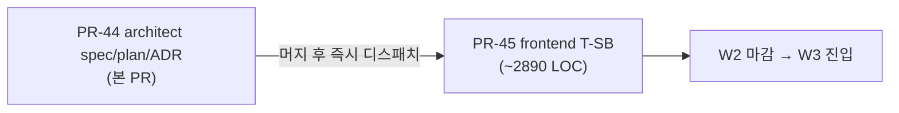

# PR-44 T-SB Plan — 시나리오 C 단일 PR-45 채택 + LOC + wallclock

- 작성: architect (opus 4.7 1M)
- 작성일: 2026-05-10
- 본 plan은 `pr-44-w2-t-sb-design.md` §11 분할 시나리오 결론을 토대로 한다 — **시나리오 C 단일 PR-45 채택**.

---

## §1. PR 매트릭스

| PR | 영역 | 작성자 | 의존 | LOC | wallclock | 머지 정책 |
|---|---|---|---|---|---|---|
| **PR-44 (본 PR)** | docs/spec/ADR/CHANGELOG | architect | - | ~2000 | 1회 (현재) | rebase merge |
| **PR-45** | frontend 단독 (`frontend/src/{api,api/hooks,lib/dsl,components/strategy,pages/Strategy}/*` + `App.tsx` + `components/layout/AppHeader.tsx`) | frontend | T-DSL PR-36 머지 + T-IND PR-33 머지 + T-PAT PR-39 머지 (모두 머지 완료) | ~2890 | ~3-4h | rebase merge |

---

## §2. PR-45 frontend 분량 분배 (단일 PR 내부 파일별 분량)

### 2-1. api 레이어 (3 파일 ~250 LOC)

| 파일 | LOC | 내용 |
|---|---|---|
| `frontend/src/api/strategy.ts` | ~120 | strategyApi: `validate(req)`·`evaluate(id, req)`·`create(req)`·`list(userId)`·`get(id)`·`delete(id)`·`enable(id)` + 공통 axios baseURL 정합 (T-W1·T-S1 패턴) |
| `frontend/src/api/pattern.ts` | ~90 | PATTERN_CATALOG 57건 정적 데이터 (PatternCatalog.ALL 1:1) + categoryMap (SINGLE 14·DOUBLE 16·TRIPLE_PLUS 27) + R1_ACTIVE_IDS Set 10 |
| `frontend/src/api/dslTranslate.ts` | ~40 | dslTranslateApi: `translateFromNatural(text)` (POST /api/dsl/translate-from-natural — 503 graceful) |

### 2-2. api hooks (2 파일 ~180 LOC)

| 파일 | LOC | 내용 |
|---|---|---|
| `frontend/src/api/hooks/useStrategy.ts` | ~140 | `useStrategies(userId)` (useQuery, queryKey=['strategy','list',userId], staleTime 30s) + `useStrategy(id)` + `useStrategyValidate()` (useMutation) + `useStrategyEvaluate()` (useMutation) + `useCreateStrategy()` (useMutation + invalidate ['strategy','list']) + `useEnableStrategy()` + `useDeleteStrategy()` |
| `frontend/src/api/hooks/useStrategyTranslate.ts` | ~40 | `useStrategyTranslate()` (useMutation — translate-from-natural · 1회 재시도 0 — backend가 처리) |

### 2-3. lib/dsl 핵심 (4 파일 ~550 LOC)

| 파일 | LOC | 내용 |
|---|---|---|
| `frontend/src/lib/dsl/blockTree.ts` | ~120 | `BlockNode` discriminated union 8 타입 (IndicatorBlock·LiteralBlock·CandleBlock·PatternBlock·ComparisonBlock·LogicalBlock·ArithmeticBlock·NotBlock) + `BlockTree`(root) + `cloneNode`/`replaceNode`/`removeNode` 헬퍼 |
| `frontend/src/lib/dsl/serializer.ts` | ~150 | `serializeBlockTree(tree): string` — 재귀 visitor + 토큰 매트릭스 LOCK (`pr-44-w2-t-sb-design.md` §6) + 괄호 precedence + 빈 트리 → 빈 문자열 |
| `frontend/src/lib/dsl/parser.ts` | ~200 | `parseDslText(text): BlockTree` — backend KisYamlDslParser 6단 재귀 하강 패턴 정합 (or → and → comparison → arithmetic → term → factor) + 토큰 화이트리스트 가드 + try/catch wrapper |
| `frontend/src/lib/dsl/yaml.ts` | ~80 | `kisYamlExport(strategy): string` (clientName · buy_condition · sell_condition · universe · tf) + `kisYamlImport(yamlText): {entry,exit,universe,tf}` (단순 key-value 파싱 — backend `parseYaml` 위임이 정석이지만 frontend는 미리보기용 일부 필드만) |

### 2-4. lib/dsl 단위 테스트 (3 파일 ~300 LOC)

| 파일 | LOC | 내용 |
|---|---|---|
| `frontend/src/lib/dsl/__tests__/serializer.test.ts` | ~120 | 5 fixture round-trip: (1) `rsi(14) < 30` (2) `(rsi(14) < 30) AND (ma(5) crosses_above ma(20))` (3) `volume > volume_ma(20) * 1.5` (4) `pattern_detected("hammer")` (5) `bb_upper(20, 2.0) > close` |
| `frontend/src/lib/dsl/__tests__/parser.test.ts` | ~120 | 5 fixture parse — KIS 호환 입력 → BlockTree (위와 1:1) + 화이트리스트 위반 입력 throw |
| `frontend/src/lib/dsl/__tests__/yaml.test.ts` | ~60 | 3 fixture: kisYamlExport 결과 형식 + kisYamlImport 후 entry/exit 추출 + 잘못된 yaml graceful |

### 2-5. components/strategy (8 컴포넌트 ~1100 LOC)

| 파일 | LOC | 내용 |
|---|---|---|
| `frontend/src/components/strategy/BlockPalette.tsx` | ~180 | 좌측 4 탭(지표·패턴·캔들·연산자/상수) + 검색 + 카테고리 섹션 + onSelect 콜백 |
| `frontend/src/components/strategy/BlockNode.tsx` | ~250 | 재귀 컴포넌트 — 8 분기 (Indicator·Literal·Candle·Pattern·Comparison·Logical·Arithmetic·Not) + 인라인 편집 + remove 버튼 + Tab/Enter/Delete 키보드 |
| `frontend/src/components/strategy/StrategyBuilderCanvas.tsx` | ~180 | entry/exit 두 트리 토글 + 트리 렌더 (BlockNode 재귀) + DSL 미리보기 readonly textarea + 편집 버튼 |
| `frontend/src/components/strategy/DslTextEditor.tsx` | ~80 | textarea + 단순 syntax color (정규식 highlight — 토큰별 span) + parse try/catch + 트리 재구성 버튼 |
| `frontend/src/components/strategy/NaturalLanguageInput.tsx` | ~100 | modal — textarea + "변환" 버튼 + useStrategyTranslate + 4 mode 분기 (REAL/MOCK/UNTRANSLATABLE/DISABLED) |
| `frontend/src/components/strategy/EvaluationResultCard.tsx` | ~100 | signal 배지(BUY/SELL/HOLD) + strength 게이지 + reason JSON 표시 + "관심종목 추가" 버튼 (useAddWatchlist 재사용) + 0건 시 "데이터 없음" |
| `frontend/src/components/strategy/ComplexityCard.tsx` | ~70 | 4단 배지(LOW=녹/MEDIUM=노/HIGH=오렌지/CRITICAL=빨강) + astDepth/nodeCount/indicatorCallCount/estimatedEvalTimeMs |
| `frontend/src/components/strategy/StrategySaveModal.tsx` | ~140 | name·nameKo·universe·tf form + useCreateStrategy + 저장 후 strategyId 콜백 |

### 2-6. components/strategy 테스트 (3 파일 ~250 LOC)

| 파일 | LOC | 내용 |
|---|---|---|
| `frontend/src/components/strategy/__tests__/BlockNode.test.tsx` | ~100 | 8 분기 렌더 + edit + remove |
| `frontend/src/components/strategy/__tests__/StrategyBuilderCanvas.test.tsx` | ~80 | 트리 추가/제거/토글 + DSL 미리보기 갱신 |
| `frontend/src/components/strategy/__tests__/EvaluationResultCard.test.tsx` | ~70 | signal 분기 + Watchlist 추가 mutate + 0건 "데이터 없음" |

### 2-7. pages/Strategy (2 파일 ~250 LOC)

| 파일 | LOC | 내용 |
|---|---|---|
| `frontend/src/pages/Strategy/StrategyBuilderPage.tsx` | ~180 | composition: BlockPalette + StrategyBuilderCanvas + 결과 영역 (ComplexityCard + EvaluationResultCard) + StrategySaveModal trigger + NaturalLanguageInput trigger + responsive 안내 (768px↓) |
| `frontend/src/pages/Strategy/__tests__/StrategyBuilderPage.test.tsx` | ~70 | 페이지 통합 — block 추가 → DSL 미리보기 → validate mutate → save → evaluate → Watchlist 추가 (MSW) |

### 2-8. App.tsx + AppHeader.tsx 갱신 (~10 LOC)

| 파일 | LOC | 내용 |
|---|---|---|
| `frontend/src/App.tsx` | +5 | `<Route path="/strategy/builder" element={<StrategyBuilderPage />} />` 추가 |
| `frontend/src/components/layout/AppHeader.tsx` | +5 | 메뉴 "전략 빌더" 1줄 추가 |

---

## §3. 머지 의존 그래프

- **rebase merge** 정책 (CLAUDE.md + 헌법 §5).
- pre-push에서 `./gradlew check` 자동 실행 (pre-push hook ADR 0031). PR-45는 frontend 단독이라 JVM check는 cached pass.
- frontend `pnpm typecheck` + `pnpm test` + `pnpm build` GREEN 의무 (CI matrix 정합).

---

## §4. wallclock 추정

| 단계 | 추정 |
|---|---|
| PR-44 작성 (현재) | ~30분 |
| PR-44 → orchestrator 머지 | ~5분 |
| PR-45 frontend dispatch (단일 컨텍스트) | ~3-4시간 |
| PR-45 머지 + DoD 26 검증 + worktree 정리 | ~30분 |
| 합계 | ~4-5시간 |

---

## §5. 인터페이스 동결 시점

- **현재 (PR-44 발행 시점)**: T-DSL backend REST 7 endpoint + T-DSL ai-engineer 1 endpoint + T-W1 watchlist 1 endpoint **모두 main 머지 완료**. PR-45 frontend는 호출만 — 인터페이스 변경 0.
- **DSL 토큰 화이트리스트**: backend `KisYamlDslParser` (consumer/.../strategy/) main 머지 LOCK. frontend serializer는 그 화이트리스트 1:1.

---

## §6. 검증 게이트 (PR-45 머지 직전)

- [ ] `pnpm typecheck` GREEN (frontend tsc --noEmit)
- [ ] `pnpm test` GREEN (Vitest 단위 5종 + 컴포넌트 3종 + 페이지 1종)
- [ ] `pnpm build` GREEN (Vite production build)
- [ ] LLM provider import 0건 (`grep -rE "anthropic|openai|spring-ai" frontend/src/main` → 0)
- [ ] `frontend/src/api/pattern.ts PATTERN_CATALOG.length === 57` 정합
- [ ] `frontend/src/api/indicator.ts INDICATOR_CATALOG.length === 80` 정합 (T-IND R3 기존 보존)
- [ ] DSL serializer round-trip 5 fixture GREEN
- [ ] DoD 26개 (`pr-44-w2-t-sb-design.md` §1-2) 모두 PR 본문에 GREEN/PENDING 마킹
- [ ] PR 본문 fitness gap §13 인용 의무
- [ ] CHANGELOG.md PR-45 frontend slot row 본문 채움 (HTML anchor 정합)
- [ ] `node scripts/task.mjs done --pr 45`

---

## §7. 후속 작업 (PR-45 머지 후)

1. devlog HTML 갱신 (사용자 메모리 `feedback_devlog_html.md` — 7 표준 섹션)
2. backlog § N 신규: catalog endpoint 단일화 (frontend 정적 → backend GET) — T-SB 머지 후 별도 사이클
3. backlog § N+1 신규: mobile 폼 전환 — 사용자 진입 빈도 ↑ 시
4. W3 진입 — T-BT (Backtest Engine 강화 + DSL sandbox ADR 0047) 우선
5. 사용자 보고: "W2 4 트랙(T-IND·T-PAT·T-DSL·T-SB) 모두 main 머지 완료, W3 진입 준비"

---

작성: architect (opus 4.7 1M)  
작성일: 2026-05-10
