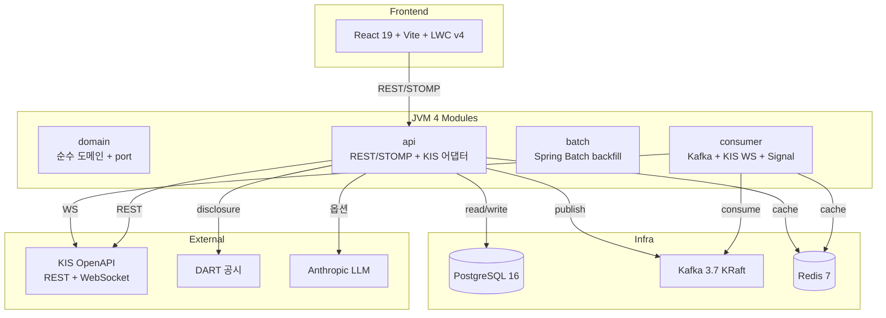
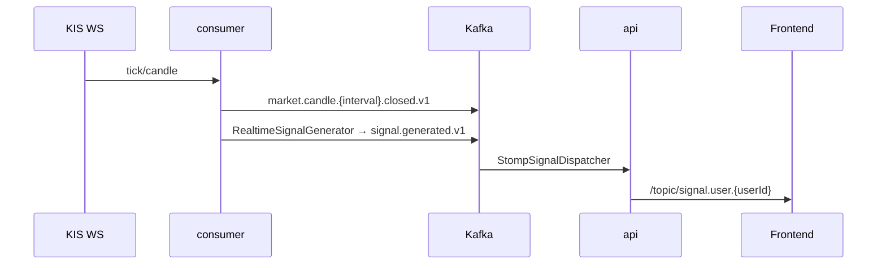
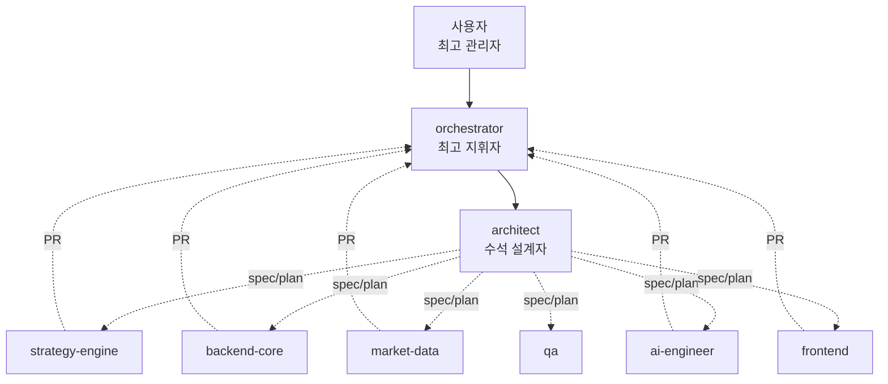

# PR-52 — README 굴직 비전 plan (프로젝트의 꽃)

> **트랙**: META / Documentation Flagship
> **작성**: architect
> **상태**: Proposed (사용자 결정 의제 5건 위임)
> **사용자 의제**: 2026-05-12 "프로젝트의 꽃"
> **연관 ADR**: ADR 0030 (SoT 마스터 아키텍처) · ADR 0036 (3단 hierarchy) · ADR 0051 (Repository 컨벤션) · ADR 0066 (T-SIG) · 신규 ADR 0068 검토 (옵션)

---

## §1. 컨텍스트

### 사용자 의제 인용 (2026-05-12)

> "프로젝트 README.md 에 엄청 간결하고 명확하고 깔끔하게 모든 내용이 들어갈 수 있게끔 되어야해 굴찍하게!!! 우리 깃헙 들어와서 readme만 보고 아 이거 이걸로 만들었고 이렇게 되는 프로그램이구나 에이전트는 어떻게 진행되었고 md 관리는 어떻구나까지 딱 한번에 눈에 들일 수 있도록. 이게 우리 완성된 프로젝트의 꽃이여야해"

### 사용자 비전 핵심 매트릭스 (5건)

GitHub 방문자가 README 한 번 정독에 다음 5건을 즉시 이해해야 한다:

1. **이걸로 만들었다** — 기술 스택 (Kotlin · Spring Boot · React · KIS OpenAPI · Kafka · Redis · LWC v4)
2. **이렇게 되는 프로그램** — 핵심 기능 + E2E 흐름 (시세 → boundary fanout → signal → risk → order)
3. **에이전트 진행** — 7 sub-agent + orchestrator + 운영 헌법 + ADR + baseline 사이클
4. **md 관리** — ADR 63건 + baseline 5세대(v3.1.0/v3.2.0/v3.2.2/v3.3.0/v3.4.0) + devlog + 사용자 메모리
5. **굴직·간결·명확·깔끔** — 한 번에 눈에 들어와야 (스크롤 길이는 굴직, 정보 밀도는 명확)

### 현재 상태 진단

- `README.md` 117 lines — 기술 스택·빌드·URL·디렉토리·SoT·CI/CD 6 섹션. v3.0.0 시점 작성된 기초 정보 모음
- **굴직 못함** — Hero(첫인상) 0 · 시각화(Mermaid) 0 · agent 시스템 표기 0 · md 관리 매트릭스 0 · v3.4.0까지의 진화 stories 0
- **GitHub first-impression 함정** — 방문자는 README 첫 화면(above-the-fold) ~600px에서 이탈 결정. 현재 README는 "Spring Boot 기반 시스템"이라는 한 문장 후 바로 디렉토리 트리 — 비전·매력 0
- **v3 잔재 의심 lens** (사용자 메모리 `feedback_v3_skepticism_no_regression` 정합): 현재 README는 v3.0.0 시점 그대로 — v3.1.0/v3.2.0/v3.2.2/v3.3.0/v3.4.0 5세대 진화(ADR 0066 T-SIG 가동 본체 매매 결정 노드 완성)가 반영 0. **굴직 재작성 필수 case**

### fitness gap (자동매매 본체 fitness 의심 lens)

- **자동매매 본체 fitness — 필수**: README가 본체 가시성·매력에 직접 영향. GitHub fork·star·collaborator 유입 진입점. 사용자가 향후 dogfooding 공유 또는 외부 협업 진입 시 첫 매력 노드
- **MCP 서버 미래 노출 (ADR 0001) 정합**: README가 magicJar의 "룰 본체 + AI 옵션 + MCP 서버" 3 비전 표기 의무. 현재 README는 "Spring AI 기반" 한 문장만 — MCP 비전 누락
- **3단 hierarchy 가시성 (ADR 0036 정합, 사용자 메모리 `feedback_3tier_hierarchy`)**: 사용자=최고 관리자 + 오케스트라=지휘자 + 7 sub-agent 병렬 실행 구도는 magicJar의 독창성. README에 표기 의무

---

## §2. 결정 의제 5건 (사용자 결정 대기)

### 의제 A — README 전체 구조

| 옵션 | 구조 | 길이 | 장점 | 단점 |
|------|------|------|------|------|
| **A-1** ★ 권장 | 굴직 Hero + 5 section (Hero/Quick Start/Architecture/Agents/Documentation) | ~350~400 lines | 한 페이지 풀세트 — 사용자 비전 "한 번에 눈에 들어와야" 직접 충족 | 길이 자체는 굴직 (좋고 굴직 두 마리 토끼) |
| A-2 | GitHub badges + collapsible `<details>` 섹션 | ~250 lines | 첫 화면 간결 + 클릭 후 펼치기 | GitHub README에서 `<details>` 인지도 낮음 + 사용자 비전 "한 번에" 위반 |
| A-3 | README 짧고 (100 lines) 깊이 docs/ 분리형 | ~100 lines | 짧음 | 사용자 비전 "굴직" 정면 위반 + README만 보고 다 이해 불가 |

**architect 권장**: **A-1** — 사용자 비전 "굴직·간결·명확·깔끔" + "딱 한번에 눈에 들일 수 있도록" 동시 충족. 길이가 굴직하되 섹션이 명확하면 readable.

### 의제 B — 비주얼 자원

| 옵션 | 방식 | 장점 | 단점 |
|------|------|------|------|
| B-1 | ASCII art only (`├─`·`│` 트리만) | git diff 친화 + 외부 자원 0 | 굴직 못함 + Mermaid 시각화 누락 |
| **B-2** ★ 권장 | Mermaid 다이어그램 embed (GitHub 자동 render) | 시각화 풍부 + 외부 이미지 의존 0 + git diff 친화(text) + 자동 render | Mermaid 학습 곡선 (architect 부담) |
| B-3 | 외부 이미지 (banner.png · screenshot.gif) | 비주얼 풍부 | 외부 자원 의존 + git LFS or repo 무게 증가 + screenshot 유지보수 부담 + frontend 추가 작업 |

**architect 권장**: **B-2** — GitHub Mermaid 자동 render(2022~) 활용. 다이어그램 3건:
1. **아키텍처 전경** — 4 JVM 모듈 + frontend + 외부 4 통합 (KIS·DART·Yahoo·Anthropic) + 인프라 3 (PostgreSQL·Kafka·Redis)
2. **데이터 흐름** — KIS WebSocket → consumer → boundary fanout → Kafka signal.generated.v1 → STOMP → frontend
3. **에이전트 시스템** — 사용자(최고 관리자) → orchestrator(지휘자) → architect + 6 실무 sub-agent (병렬 디스패치)

### 의제 C — 가이드 진입 경로

| 옵션 | 진입점 | 장점 | 단점 |
|------|--------|------|------|
| C-1 | README → `docs/architecture/master-architecture.md` 한 곳 | 단일 SoT (ADR 0030 정합) | baseline html 누락 — v3.4.0 5세대 진화 가시성 0 |
| C-2 | README → `_workspace/baseline/v3.4.0/*.html` baseline 한 곳 | 최신 baseline 풀세트 매력 | master-architecture SoT 정합 위반 위험 |
| **C-3** ★ 권장 | README → master-architecture + baseline html 둘 다 명시 | SoT 정합 + baseline 매력 동시 | 진입점 2개로 약간 복잡 |

**architect 권장**: **C-3** — master-architecture(권위) + baseline(진화 추적) 양쪽 명시. "현행 권위는 master-architecture, 시점 snapshot은 baseline/v3.4.0" 한 줄로 구분.

### 의제 D — 에이전트 시스템 표기 깊이

| 옵션 | 깊이 | 장점 | 단점 |
|------|------|------|------|
| D-1 | 7 sub-agent 표 + ADR 0036 인용 | 매트릭스 단정 | orchestrator·헌법 누락 |
| D-2 | orchestrator 일대기 (사용자 → orchestra → architect → sub-agent 디스패치 흐름) | 스토리 강함 | 7 sub-agent 매트릭스 누락 |
| **D-3** ★ 권장 | 둘 다 (7 sub-agent 표 + orchestrator 일대기 Mermaid + 운영 헌법 7§ 한 줄 + ADR 63건 인용) | 풀세트 매력 | 섹션 길이 ~80 lines |

**architect 권장**: **D-3** — 사용자 비전 "에이전트는 어떻게 진행되었고" 직접 충족. orchestrator 일대기 + 7 sub-agent 표 + 헌법 7§ + ADR 63건 인용 4 요소 결합.

### 의제 E — md 관리 표기 방식

| 옵션 | 표기 | 장점 | 단점 |
|------|------|------|------|
| **E-1** ★ 권장 | ADR/baseline/devlog/memory 4 매트릭스 표 | 풀세트 가시성 + 사용자 비전 "md 관리는 어떻구나" 직접 충족 | 섹션 길이 ~50 lines |
| E-2 | numerical 요약만 (ADR 63건·baseline 5세대·devlog 4건·memory 26건 한 줄) | 간결 | 깊이 부족 — 사용자가 어떻게 관리되는지 인지 어려움 |

**architect 권장**: **E-1** — 사용자 비전 "딱 한번에 눈에 들일 수 있도록" 직접 충족. 4 매트릭스 표로 각 md 자원의 위치·갱신 주기·관리자 한눈 인지.

---

## §3. architect 권장안 한 줄 (5건 통합)

**A-1 + B-2 + C-3 + D-3 + E-1**

- A-1: 굴직 Hero + 5 section (Hero · Quick Start · Architecture · Agents & Workflow · Documentation)
- B-2: Mermaid 다이어그램 3건 embed (architecture · data-flow · agent-system)
- C-3: master-architecture + baseline html 둘 다 진입 경로 명시
- D-3: 7 sub-agent 표 + orchestrator 일대기 + 운영 헌법 7§ + ADR 63건
- E-1: ADR/baseline/devlog/memory 4 매트릭스 표

---

## §4. fitness gap 분석 (자동매매 본체 + v1/v2 잔재)

### 자동매매 본체 fitness — 필수

- **README가 자동매매 본체 가시성에 직접 영향**: GitHub 방문자 첫 인상 = 프로젝트 매력 척도. README가 굴직하면 fork·star·collaborator 유입 ↑
- **MCP 서버 미래 노출 (ADR 0001) 직접 표기 의무**: 현재 README "Spring AI 기반" 한 문장 → 새 README "룰 본체 + AI 옵션 + MCP 서버 미래" 3 비전 명시
- **T-SIG 가동 본체 (ADR 0066) 가시성**: v3.4.0 마감 미러스톤이 README에 0% 반영 — 자동매매 본체 매매 결정 노드 가동을 README hero에 표기

### v1/v2 잔재 의심 lens

- **현재 README 117 lines는 v3.0.0 시점 작성**: v3.1.0/v3.2.0/v3.2.2/v3.3.0/v3.4.0 5 minor 진화(ADR 0061·0066·0067 신규 등) 반영 0
- **굴직 재작성 case 확정**: v1/v2 잔재 아닌 v3 초기 잔재. 검열 후 v3.4.0 시점 풀 반영 의무
- **3단 hierarchy 가시성 (ADR 0036 정합)**: 사용자=최고 관리자 + 오케스트라=지휘자 + 7 sub-agent 구도는 magicJar 독창성 — README 표기 필수

### 통과 결론

본 plan은 **자동매매 본체 fitness 직접 충족** + **v1/v2 잔재 검열 통과** + **v3.4.0 진화 풀 반영**. architect 단독 PR로 진행 가능.

---

## §5. 굴직 README 본문 sketch (5 섹션)

### 섹션 1 — Hero (Above-the-Fold, ~50 lines)

```markdown
# magicJar (마법의항아리)

> **개인 맞춤형 한국 주식 자동매매 시스템** — 룰 기반 quant trading 본체 + AI 옵션 보조 + MCP 서버 미래 노출

[](https://github.com/sp-daewoon/magicJar/releases)
[](https://kotlinlang.org/)
[](https://spring.io/projects/spring-boot)
[](#license)

## 핵심 가치

1. **룰 기반 quant trading 본체** — 사용자가 정의한 DSL 룰이 KIS WebSocket 실시간 시세에 평가되어 BUY/SELL 시그널 발행. AI는 매매 결정권 0
2. **한국투자증권 KIS OpenAPI 직접 통합** — 모의투자 → 실전 dual mode + WebSocket 실시간 + 80개 지표·57개 패턴 카탈로그
3. **사용자 = 최고 관리자** — 7 AI 에이전트가 architect 설계 → 실무 sub-agent 병렬 실행 디스패치 운영. 사용자는 비전·결정만 위임
```

### 섹션 2 — Quick Start (~40 lines)

```markdown
## Quick Start (5분 안에 첫 차트)

### 1. 환경 변수

```bash
cp .env.example .env
# KIS OpenAPI 키 (조회용 prod + 주문용 vps) + Anthropic API 키 (옵션)
```

### 2. 통합 기동

```bash
scripts/build-and-deploy.sh   # Gradle bootJar + Docker compose up (7 컨테이너)
```

### 3. 접속

| URL | 설명 |
|-----|------|
| http://localhost:3000 | Frontend SPA — 첫 dogfooding 차트 |
| http://localhost:8080/swagger-ui.html | REST API 문서 |
| http://localhost:8888 | Dozzle (전 컨테이너 로그) |

### 4. 첫 dogfooding 시나리오

1. ⚙️ Settings → KIS 키 입력 (DB AES 암호화 저장)
2. /strategy/list → 룰 활성화
3. boundary 마감 시점 (5m/15m/30m/90m/1h) → STOMP 토스트 시그널 도착
```

### 섹션 3 — Architecture (~90 lines)

```markdown
## Architecture

### 시스템 전경 (Mermaid 1 — architecture)



### 데이터 흐름 (Mermaid 2 — data-flow)



### 기술 스택 매트릭스

| 영역 | 기술 | 버전 |
|------|------|------|
| 언어 | Kotlin · TypeScript | 2.0 (K2) · 5 |
| Backend | Spring Boot · Spring AI · Spring Batch | 3.3 |
| Frontend | React · Vite · Tailwind · LWC v4 | 19 · 6 · 3 · 4 |
| 인프라 | PostgreSQL · Kafka KRaft · Redis | 16 · 3.7 · 7 |
| 외부 API | KIS OpenAPI (prod + vps) · DART · Yahoo · Naver RSS · Anthropic | - |
| 빌드 | Gradle KTS · pnpm | 8.5 · 9 |
| 배포 | Docker Compose 7 컨테이너 (인프라 3 + 앱 4) | - |

### 운영 정책 한 줄

- **default profile**: `dev,real-kis` (mock 폐기, ADR 0044)
- **실계좌 이중 게이트**: `MAGICJAR_MODE=REAL` + `MAGICJAR_ALLOW_REAL=true` 둘 다
- **AI 호출 0 본체**: T-DSL·T-IND·T-PAT·T-SIG 트랙 LLM provider import 0건 (ADR 0023 정합)
```

### 섹션 4 — Agents & Workflow (~80 lines)

```markdown
## Agents & Workflow

### 3단 hierarchy (Mermaid 3 — agent-system)



### 7 Sub-agent 매트릭스

| 에이전트 | 모델 | 책임 | 트랙 예시 |
|----------|------|------|----------|
| **orchestrator** (skill) | - | 사용자 위임 받아 지휘 · 디스패치 매트릭스 · 머지 흐름 통제 | 사이클 전체 |
| **architect** | Opus | 시스템 설계 · ADR 발행 · spec/plan · 모듈 경계 | T-W1·T-SIG·T-RISK plan |
| **backend-core** | Sonnet | 4 JVM 모듈 · REST · JPA · Flyway · STOMP | API 구현 |
| **market-data** | Sonnet | KIS OpenAPI · Yahoo · DART · 캔들 영속 | T-MS1·T-CA1·T-IM1 |
| **strategy-engine** | Opus | DSL · 지표 · 패턴 · 시그널 · 백테스트 | T-DSL·T-IND·T-PAT·T-SIG·T-BT |
| **ai-engineer** | Opus | Spring AI · 프롬프트 · LLM 호출 게이트 | T-AI·T-MCP |
| **frontend** | Sonnet | React SPA · LWC v4 차트 · STOMP 소비 | UI 컴포넌트 |

### 운영 헌법 7 § (`_workspace/arch/agent-charter.md`)

1. **task.mjs 4단계** — start → check → done → archive 의무
2. **머지 후 정리** — worktree·로컬 브랜치 즉시 정리
3. **KIS-first raw fetch** — 자체 추론 0, 공식 출처 raw fetch 의무
4. **CHANGELOG 슬롯** — sub-agent별 row + anchor 사전 prepend
5. **rebase 머지** — squash 금지 (author 화이트리스트 정합)
6. **Repository default fun 0** — 헌법 §6 (ADR 0051)
7. **fail 분기 7개 룰** — error handling 표준화

### 사이클 흐름

```
사용자 의제 → orchestrator 디스패치 → architect spec/plan (ADR 발행)
  → 사용자 결정 의제 검토 → sub-agent 병렬 실행 (PR 생성)
  → orchestrator 머지 → baseline cut (minor release 마다)
```

### 진화 매트릭스 (5 baseline)

| 버전 | 미러스톤 | ADR 신규 | 핵심 트랙 |
|------|----------|----------|----------|
| v3.0.1 | MD 정리 + 헌법 | ADR 0033·0036 | 베이스라인 |
| v3.1.0 | W1 풀세트 | T-W1·T-S1·T-MS1·T-IM1·T-CA1 | 시세 영속 |
| v3.2.0 | W2 4 트랙 | T-IND·T-DSL·T-PAT·T-SB | DSL + 80지표 + 57패턴 |
| v3.2.2 | NXT 통합 | ADR 0062·0063 | 5종 합산 + 통합거래 |
| v3.3.0 | boundary fanout | ADR 0064 | 실시간 합산 갱신 |
| **v3.4.0** | **T-SIG 가동 본체** | ADR 0066 | **매매 결정 노드 완성** |
```

### 섹션 5 — Documentation (~70 lines)

```markdown
## Documentation

### 단일 진실원 (SoT)

- **★ INDEX**: [`_workspace/INDEX.md`](_workspace/INDEX.md) — 모든 자원의 단일 진입점
- **★ 권위 정책**: [`docs/architecture/policies/`](docs/architecture/policies/) — Living Policy (ADR 0053)
- **마스터 아키텍처**: [`docs/architecture/master-architecture.md`](docs/architecture/master-architecture.md) (ADR 0030 SoT)
- **트랙 로드맵**: [`docs/architecture/tracks-roadmap.md`](docs/architecture/tracks-roadmap.md) (W1·W2·W3·W4·W5)

### md 관리 4 매트릭스

| 자원 | 위치 | 갱신 주기 | 관리자 | 현재 |
|------|------|----------|--------|------|
| **ADR** (Architecture Decision Records) | `_workspace/arch/adr/` | 의제마다 발행 | architect 단독 | 63건 |
| **baseline snapshot** | `_workspace/baseline/v<X.Y.Z>/` | minor release | 4 sub-agent 병렬 | 5세대 (v3.1.0 ~ v3.4.0) |
| **devlog** | `_workspace/devlog/*.html` | 매일 | 사용자 `/devlog` 호출 | 4 HTML |
| **사용자 메모리** | `~/.claude/projects/.../memory/` | 자율 | Claude 자동 | 26건 |

### 결정 이력 진입 경로

- **현행 권위는 무엇인가** → `docs/architecture/policies/README.md`
- **결정 이력은 무엇인가** → `_workspace/arch/adr/README.md` (63건 인덱스)
- **진행 중 의제는 무엇인가** → `_workspace/backlog.md`
- **특정 시점 풀 snapshot은 무엇인가** → `_workspace/baseline/v3.4.0/README.md`
- **에이전트 운영 규칙은 무엇인가** → `_workspace/arch/agent-charter.md` (7 §)

### 외부 진입 경로

- **마스터 아키텍처 한 페이지**: [`docs/architecture/master-architecture.md`](docs/architecture/master-architecture.md)
- **v3.4.0 baseline 풀 snapshot**: [`_workspace/baseline/v3.4.0/`](_workspace/baseline/v3.4.0/) (README + 01~07 7 파일)
- **개발 룰북**: [`docs/architecture/development-rules.md`](docs/architecture/development-rules.md) (개발 룰 5건)
- **코드 컨벤션**: [`docs/architecture/code-convention.md`](docs/architecture/code-convention.md)
- **KIS API 레퍼런스**: [`docs/operations/kis-api-reference.md`](docs/operations/kis-api-reference.md)

## CI/CD

- 로컬 빌드: `scripts/build-and-deploy.sh` (Gradle bootJar + Docker compose up)
- GitHub Actions: **폐기** (사용자 결정 — `release/v*` 태그 이미지 push만 유지, ADR 0049 Superseded)
- 릴리즈: `v*.*.*` 태그 → release commit + baseline cut + immutable

## License

TBD (Private) — `sp-daewoon/magicJar` repository
```

---

## §6. Mermaid 다이어그램 3건 outline

### Mermaid 1 — Architecture (전경)

- Frontend (React 19 + Vite + LWC v4)
- JVM 4 Modules (domain + api + batch + consumer)
- Infra (PostgreSQL 16 + Kafka 3.7 KRaft + Redis 7)
- External (KIS OpenAPI REST/WS + DART + Anthropic + Yahoo·Naver)
- 화살표: REST·STOMP·Kafka·WS·cache·옵션 LLM

### Mermaid 2 — Data Flow (시그널 흐름)

- KIS WS → consumer (RealtimeTickListener)
- consumer → Kafka (`market.candle.{interval}.closed.v1`)
- consumer → RealtimeSignalGenerator → Kafka (`signal.generated.v1`)
- Kafka → api (StompSignalDispatcher)
- api → Frontend (`/topic/signal.user.{userId}` STOMP)

### Mermaid 3 — Agent System (3단 hierarchy)

- 사용자 (최고 관리자)
- orchestrator (지휘자)
- architect (수석 설계자) — spec/plan 발행
- 6 실무 sub-agent (strategy-engine · backend-core · market-data · ai-engineer · frontend · qa)
- 점선: dispatch (spec/plan), PR (실작업)

---

## §7. md 관리 4 매트릭스 sketch

| 자원 | 위치 | 갱신 | 관리자 | 현재 | 권위 ADR |
|------|------|------|--------|------|----------|
| **ADR** | `_workspace/arch/adr/` | 의제마다 | architect 단독 | 63건 (0001 ~ 0067) | ADR 0030 SoT |
| **baseline** | `_workspace/baseline/v<X.Y.Z>/` | minor release | 4 sub-agent 병렬 | 5세대 (v3.1.0 · v3.2.0 · v3.2.2 · v3.3.0 · v3.4.0) | baseline LOCK (immutable) |
| **devlog** | `_workspace/devlog/*.html` | 매일 (사용자 `/devlog`) | 사용자 호출 | 4 HTML (2026-05-08·10·11 + index) | 사용자 메모리 `feedback_devlog_html` |
| **사용자 메모리** | `~/.claude/.../memory/` | 자율 (Claude) | 자동 | 26건 (feedback + project) | 사용자 메모리 시스템 |

---

## §8. sub-agent 디스패치 매트릭스 (채택 후 실작업)

| Phase | sub-agent | 산출물 | 비고 |
|-------|-----------|--------|------|
| **Phase 1 (필수)** | **architect** | README 본문 작성 (5 섹션) + Mermaid 3건 + 4 매트릭스 표 + 운영 헌법 7§ 인용 + ADR 63건 인용 | 사용자 결정 후 architect 단독 PR (`agent/architect/readme-flagship-rewrite`) |
| Phase 2 (옵션) | frontend | screenshot.gif · banner.png 비주얼 자원 | 사용자가 옵션 B-3 채택 시 (현 권장 B-2는 Mermaid only → Phase 2 불필요) |

---

## §9. 운영 영향

### 변경 분량

- `README.md` 117 → ~350~400 lines (굴직, readable 유지)
- Mermaid embed 3건 (~70 lines)
- 코드 변경 0건 (.md only)
- 도구 영향 0 (CI/CD·husky·gradle 무관)

### badges 정책

- **포함**: version (v3.4.0) · Kotlin 2.0 · Spring Boot 3.3 · License (Private)
- **제외**: GitHub Actions build badge (ADR 0049 Superseded GHA 폐기) · code coverage (qa on-demand 정책)

### 진입점 정합

- README → INDEX (`_workspace/INDEX.md`) 한 라인
- README → master-architecture (SoT) 한 라인
- README → baseline/v3.4.0/ (snapshot) 한 라인
- README → ADR README (63건 인덱스) 한 라인
- README → tracks-roadmap (W1~W5) 한 라인

---

## §10. Rollback

- 현재 `README.md` 117 lines는 본 PR 머지 전 git history에 보존 (rollback 가능)
- 굴직 버전 별도 commit으로 진입 → 사용자 검수 후 채택
- 사용자가 "굴직 못함" 또는 "다른 방향" 결정 시 immediate revert 가능

---

## §11. 영향 ADR/문서 매트릭스

| 문서 | 변경 | 사유 |
|------|------|------|
| `README.md` | 본 plan 채택 후 sub-agent 실작업 (Phase 1 architect) | 본 PR은 spec만 |
| `docs/architecture/master-architecture.md` | README 인용 정합 확인 (작은 cross-ref 추가 가능) | SoT 정합 |
| `_workspace/arch/adr/README.md` | 신규 ADR 0068 발행 시 인덱스 갱신 (옵션 — 사용자 결정 후) | README 비전 ADR화 검토 |
| `_workspace/backlog.md` | §42 신규 등록 (README 굴직 비전 트랙) | 본 PR 산출물 |
| `CHANGELOG.md` | row 1건 추가 | 본 PR |
| `_workspace/specs/pr-52-readme-flagship-vision-plan.md` | 신규 (본 문서) | 본 PR |

**ADR 신규 발행 (옵션)**: 사용자가 채택 시 ADR 0068 — README 굴직 비전 ADR 발행 검토 (Status `Accepted` — 채택 의제 5건 LOCK). 또는 ADR 발행 없이 `_workspace/specs/`만으로 처리 가능 (사용자 메모리 `feedback_spec_plan_scope` 정합 — 신규 트랙·새 모듈·다중 ADR일 때만 spec/plan 발행. 본 plan은 README 단일 파일 재작성 — spec만으로 충분).

---

## §12. 우선순위 (architect 작업 순서)

1. **1순위** — README 본문 sketch 5 섹션 outline (Hero · Quick Start · Architecture · Agents & Workflow · Documentation)
2. **2순위** — Mermaid 다이어그램 3건 outline (architecture · data-flow · agent-system)
3. **3순위** — 결정 의제 5건 정합 (사용자 검토용)
4. **4순위** — ADR/baseline/devlog/memory 4 매트릭스 표 sketch
5. **5순위** — sub-agent 디스패치 매트릭스 (실작업 단계)

---

## §13. 헌법 정합 (7 §)

| § | 룰 | 본 PR 정합 |
|---|-----|-----------|
| §1 | task.mjs 4단계 | start → check 6회 → done → archive 의무 |
| §2 | 머지 후 정리 | 본 PR 머지 후 worktree·local 브랜치 정리 |
| §3 | KIS-first raw fetch | 본 PR은 README .md 전용 — KIS API 영향 0 |
| §4 | CHANGELOG 슬롯 | 본 PR은 architect 단독 (sub-agent slot 발행 0 — 채택 후 Phase 1만 architect) |
| §5 | rebase 머지 | PR 머지 시 `--rebase` |
| §6 | Repository default fun 0 | 본 PR은 .md only — 영향 0 |
| §7 | fail 분기 7개 룰 | 본 PR은 .md only — 영향 0 |

---

## §14. 사용자 메모리 정합

- `feedback_spec_plan_scope.md` — README 단일 파일 재작성 → spec만 발행, ADR 발행은 옵션
- `feedback_v3_skepticism_no_regression.md` — fitness gap §4 lens 의무 이행
- `project_system_vision.md` — 룰 본체 + AI 옵션 + MCP 서버 미래 3 비전 README 명시
- `feedback_devlog_html.md` — devlog 매트릭스 §E-1 표 포함
- `feedback_3tier_hierarchy.md` — 3단 hierarchy Mermaid 3 + 7 sub-agent 매트릭스 명시
- `feedback_autonomy.md` — 사용자 결정 의제 5건은 본 plan에 명시 (이후 사용자 검토 단계)
- `feedback_honorific.md` — 본 spec 작성 한국어 + 존댓말 (대화 단)
- `project_pr29_w1_close_in_progress.md` — v3.4.0 마감 후 진입 (사이클 정합)

---

## §15. 결론

본 PR-52는 사용자 명시 의제 **"프로젝트의 꽃"** 직접 충족 plan이다. architect 단독 spec/plan 발행 후 사용자 결정 의제 5건 위임 → 채택 시 Phase 1 architect 단독 PR로 README 본문 재작성. 코드 변경 0건. README가 GitHub 방문자에게 magicJar의 **5건 매력**(기술 스택 · E2E 흐름 · 에이전트 시스템 · md 관리 · 굴직 first-impression)을 한 페이지에 전달.

**사용자에게 위임**: 의제 A·B·C·D·E 5건 검토 후 채택안 명시 (기본 권장 A-1+B-2+C-3+D-3+E-1).
