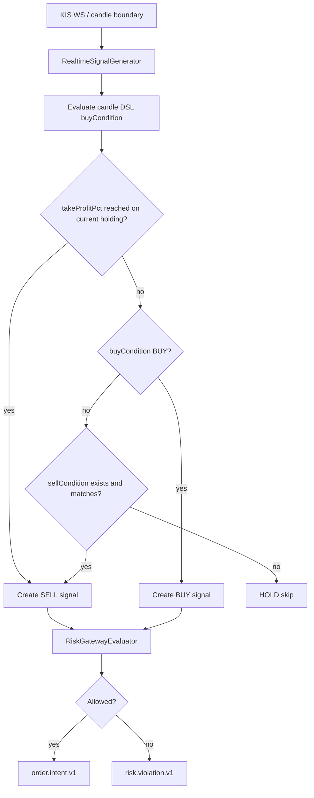

# Position-Aware Exit Policy

## Context

Strategy Builder DSL is candle-only by design. Expressions such as `ma(10)`, `fvg_bullish_active(50)`, and `close > ob_bullish_mid(...)` are evaluated from candle history and can be reused by realtime signal generation, screener, and backtest paths.

Holding profit exits are different. A rule like "sell my holding when evaluated profit is at least 5%" depends on account state: current holding quantity, average price, and current candle/price. It must not be encoded as a candle indicator because that would blur strategy evaluation with user capital state.

## Decision

`takeProfitPct` is a strategy-level exit policy, separate from `sellCondition`.

- `sellCondition`: candle/indicator DSL condition.
- `takeProfitPct`: position-aware policy; when the strategy has a current holding for the code and `(currentPrice - avgPrice) / avgPrice * 100 >= takeProfitPct`, realtime signal generation may create a `SELL` signal.
- Risk gateway remains the final order guard. It still verifies that a SELL has an actual holding before order intent is emitted.

## Flow

## Notes

- The realtime policy currently computes profit from internal position average price and the latest evaluated candle close.
- KIS account `profitLossRate` can differ slightly because KIS may include its own evaluation conventions. Risk and order paths still use current position state before sending orders.
- Newly saved builder strategies start as `PAUSED`; the user still needs the existing activation flow before automatic trading starts.
