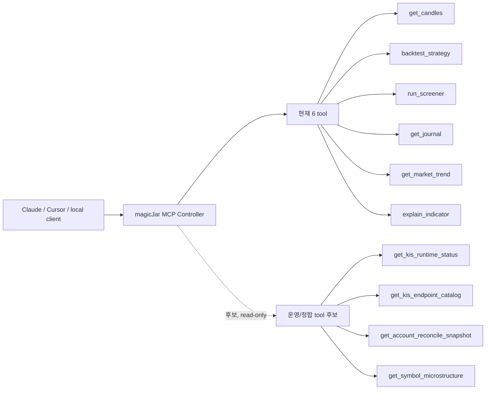
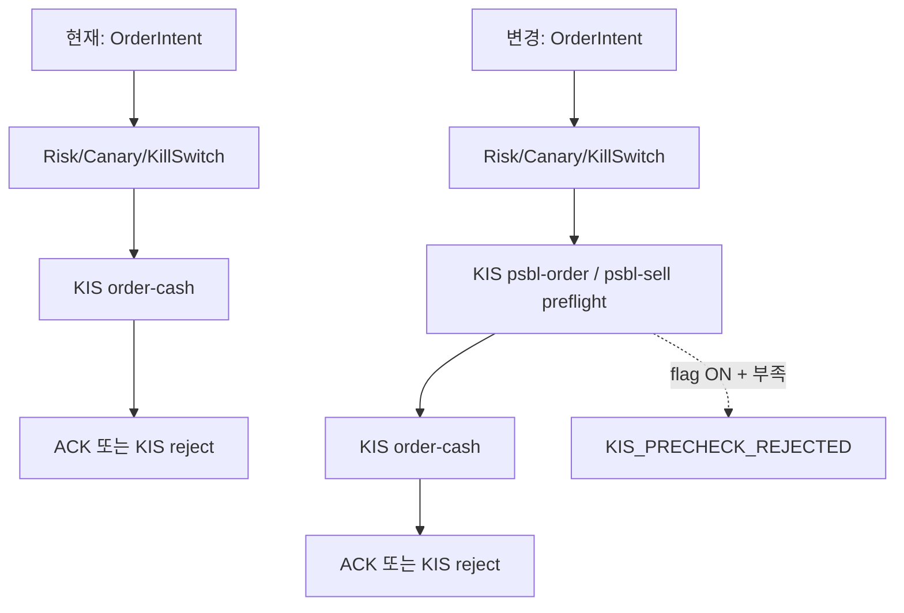
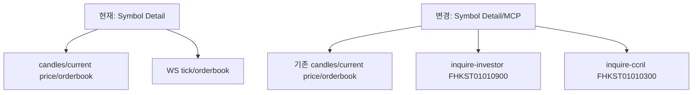
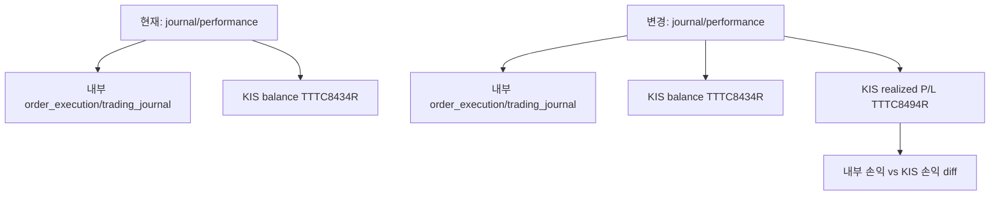
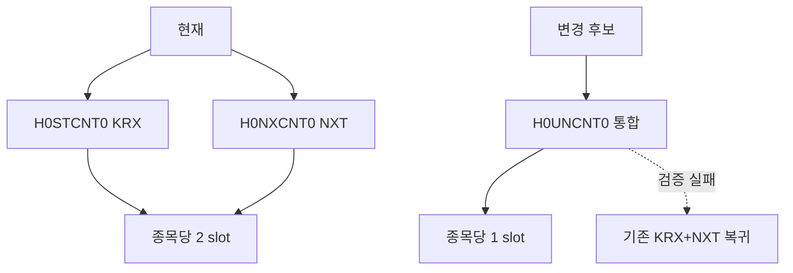

# KIS API / MCP 채용 우선순위 카탈로그

> 작성일: 2026-06-12
> 기준: v3.13.0 main 코드 inspection + KIS 공식 `open-trading-api/examples_llm/domestic_stock` raw 예제 확인
> 원칙: 현재 사용 중인 KIS API와 MCP tool을 최상단에 두고, 새 채용 후보는 magicJar 운영 가치 순으로 정렬한다.

## 0. 현재 사용 중인 KIS API

| 우선 | 구분 | API / TR_ID | 현재 사용처 | 상태 |
|---|---|---|---|---|
| A0 | 주문 | `order-cash` `TTTC0012U`/`VTTC0012U`/`TTTC0011U`/`VTTC0011U` | `KisOrderHttpAdapter` | 실 주문 주경로 |
| A0 | 취소 | `order-rvsecncl` `TTTC0013U`/`VTTC0013U` | `KisOrderHttpAdapter.cancel` | 수동/자동 취소 |
| A0 | 체결 backfill | `inquire-daily-ccld` `TTTC0081R`/`VTTC0081R` | `KisOrderInquireCcldHttpAdapter` | WS 유실 보정 |
| A0 | 잔고 | `inquire-balance` `TTTC8434R`/`VTTC8434R` | `KisBalanceAdapter`, `KisReconcileBalanceAdapter` | position 권위 |
| A0 | 현재가 | `inquire-price` `FHKST01010100` | 현재가/일봉 seed/지표 | 사용 중 |
| A0 | 호가 REST | `inquire-asking-price-exp-ccn` `FHKST01010200` | 진입 호가 fallback | 사용 중 |
| A0 | 일/주/月/년봉 | `inquire-daily-itemchartprice` `FHKST03010100` | candle backfill | 사용 중 |
| A0 | 당일/과거 분봉 | `FHKST03010200`, `FHKST03010230` | 1m backfill | 사용 중 |
| A0 | 멀티 현재가 | `intstock-multprice` `FHKST11300006` | nightly snapshot/NXT 검증 | 사용 중 |
| A0 | 휴장일 | `chk-holiday` `CTCA0903R` | 캘린더/수집 gate | 사용 중 |
| A0 | 예탁원 정보 | `HHKDB669100C0`/`101C0`/`102C0`/`104C0`/`105C0`/`106C0` | corp action batch | 사용 중 |
| A0 | WS 체결가 | `H0STCNT0`, `H0NXCNT0`, `H0STOUP0` | 실시간 tick | 사용 중 |
| A0 | WS 호가 | `H0STASP0` | 상세/진입 호가 | 사용 중 |
| A0 | WS 체결통보 | `H0STCNI0`, `H0STCNI9` | order execution | 사용 중 |

## 1. 현재 사용 중인 MCP tool

| 우선 | Tool | 현재 입력 | 현재 출력 | 변경 안정성 |
|---|---|---|---|---|
| A0 | `get_candles` | `code`, `interval`, `from`, `to`, `limit` | OHLCV 배열 | 유지 |
| A0 | `backtest_strategy` | `strategyId`, `universe`, `interval`, `from`, `to`, `initialCapital` | 성과 카드 + trades | 유지 |
| A0 | `run_screener` | `strategyId`, `universe`, option | 후보 ranking | 유지 |
| A0 | `get_journal` | 기간/종목/전략 필터 | 매매일지 | 유지 |
| A0 | `get_market_trend` | periods/preferences | 지수·섹터 추세 | 유지 |
| A0 | `explain_indicator` | indicator id | 정적 설명 | 유지 |

## 2. 다음 채용 우선순위

| 순위 | 후보 | 공식 예제 / TR_ID | 채용 이유 | 기본값 |
|---|---|---|---|---|
| P0 | 주문 가능수량/가능금액 | `inquire-psbl-order` `TTTC8908R`/`VTTC8908R`, `inquire-psbl-sell` `TTTC8408R` | KIS 본주문 전에 KIS 기준 가능수량을 확인해 거절과 원장 불일치를 줄인다. | 관측 ON, 차단 flag OFF |
| P1 | 투자자/체결 REST 보강 | `inquire-investor` `FHKST01010900`, `inquire-ccnl` `FHKST01010300` | 종목 상세/스크리너/WS stale 보강에 쓰는 read-only 정보다. | read-only |
| P1 | 계좌 실현손익 reconcile | `inquire-balance-rlz-pl` `TTTC8494R`, `inquire-period-profit` | 내부 저널 수익률과 KIS 계좌 손익을 대조한다. | read-only |
| P1-deferred | 통합 체결가 WS | `ccnl_total` `H0UNCNT0` | KRX+NXT 2슬롯을 1슬롯으로 줄일 가능성이 있다. | feature flag OFF |
| P2 | 통합 호가 WS | `asking_price_total` 후보 `H0UNASP0` | DETAIL/STRATEGY 호가 슬롯 절감 후보. | raw 재확인 후 |
| P2 | 재무비율 | `FHKST66430300` 등 | 스크리너/fundamental 설명 강화. | batch only |
| P2 | 추정실적/투자의견 | `HHKST668300C0`, `FHKST663300C0`, `FHKST663400C0` | AI 설명/종목 상세 보조. | batch/cache |
| P3 | ETF/ETN NAV/구성 | `FHPST02400000` 등 | ETF 전략 활성화 시 가치. | 보류 |

## 3. MCP 확장 시각화

현재 MCP는 백테스트/스크리너/캔들처럼 "분석 실행" 중심이다. 다음 확장은 주문 실행이 아니라 KIS 운영 상태와 계좌 정합을 읽는 read-only 계층이다.

| Tool 후보 | 현재 대체 흐름 | 바뀌는 점 | 다운그레이드 방지 |
|---|---|---|---|
| `get_kis_runtime_status` | 운영자가 `/admin/realtime`, 로그, Prometheus를 따로 확인 | MCP 한 번으로 WS slot/stale/execution notice를 요약 | 기존 REST/화면 유지, read-only wrapper |
| `get_kis_endpoint_catalog` | `kis-api-reference.md`를 사람이 읽음 | 현재 사용/후보/보류 API를 tool로 조회 | 문서가 SoT, tool은 문서 snapshot만 반환 |
| `get_account_reconcile_snapshot` | 계좌/position/reconcile 화면을 따로 봄 | KIS 잔고, 내부 position, 최근 reconcile 상태를 한 번에 비교 | 주문 발행 없음, KillSwitch 변경 없음 |
| `get_symbol_microstructure` | 캔들, 호가, 체결, 투자자를 따로 봄 | 종목 상세용 미시구조 요약 | 기존 `get_candles` 유지, 추가 정보만 합류 |

## 4. 네 API의 현재 -> 변경 흐름

### 4-1. 주문 가능수량 API

| 현재 | 변경 | 코멘트 |
|---|---|---|
| 주문 수량은 내부 RiskConfig, canary cap, 가격 source로 판단하고 KIS 본주문에서 최종 거절된다. | 본주문 직전 `TTTC8908R`/`VTTC8908R` 또는 `TTTC8408R`로 가능수량을 읽고 audit에 남긴다. | 기본은 관측만, 차단 flag를 켤 때만 실제 주문을 막는다. |

### 4-2. 투자자/체결 REST 보강

| 현재 | 변경 | 코멘트 |
|---|---|---|
| 상세/스크리너는 가격·캔들 중심이고 체결 리스트/투자자 수급은 비어 있다. | 외국인·기관 흐름과 최근 체결을 REST로 보강한다. | WS가 비어도 read-only 정보라 자본 path 영향이 작다. |

### 4-3. 계좌 손익 reconcile

| 현재 | 변경 | 코멘트 |
|---|---|---|
| KIS 잔고와 내부 position 수량/평단을 reconcile한다. | KIS 실현손익을 추가로 읽어 내부 저널 손익과 대조한다. | 수량 정합 다음 단계의 돈 정합이며, read-only로 시작한다. |

### 4-4. `H0UNCNT0` 통합 체결가

| 현재 | 변경 | 코멘트 |
|---|---|---|
| 정규+NXT 체결가를 `H0STCNT0` + `H0NXCNT0` 두 채널로 구독한다. | flag ON 시 `H0UNCNT0` 한 채널을 구독하고, 문제가 있으면 기존 이중 채널로 되돌린다. | 슬롯 절감은 크지만 운영 검증 전 기본 OFF가 맞다. |

## 5. 구현 순서

1. 문서/레퍼런스 갱신: 현재 사용 중인 API와 후보 우선순위 고정.
2. 주문 가능수량 preflight: adapter + audit/log + feature flag.
3. 투자자/체결 REST: read-only adapter + cache/API/MCP 후보 연결.
4. 계좌 손익: realized P/L adapter + reconcile snapshot.
5. `H0UNCNT0`: feature flag + ledger 반영 + fallback.

## 6. 원천 링크

- KIS 공식 예제 root: https://github.com/koreainvestment/open-trading-api/tree/main/examples_llm/domestic_stock
- `inquire_psbl_order`: https://raw.githubusercontent.com/koreainvestment/open-trading-api/main/examples_llm/domestic_stock/inquire_psbl_order/inquire_psbl_order.py
- `inquire_psbl_sell`: https://raw.githubusercontent.com/koreainvestment/open-trading-api/main/examples_llm/domestic_stock/inquire_psbl_sell/inquire_psbl_sell.py
- `inquire_investor`: https://raw.githubusercontent.com/koreainvestment/open-trading-api/main/examples_llm/domestic_stock/inquire_investor/inquire_investor.py
- `inquire_ccnl`: https://raw.githubusercontent.com/koreainvestment/open-trading-api/main/examples_llm/domestic_stock/inquire_ccnl/inquire_ccnl.py
- `inquire_balance_rlz_pl`: https://raw.githubusercontent.com/koreainvestment/open-trading-api/main/examples_llm/domestic_stock/inquire_balance_rlz_pl/inquire_balance_rlz_pl.py
- `ccnl_total`: https://raw.githubusercontent.com/koreainvestment/open-trading-api/main/examples_llm/domestic_stock/ccnl_total/ccnl_total.py
